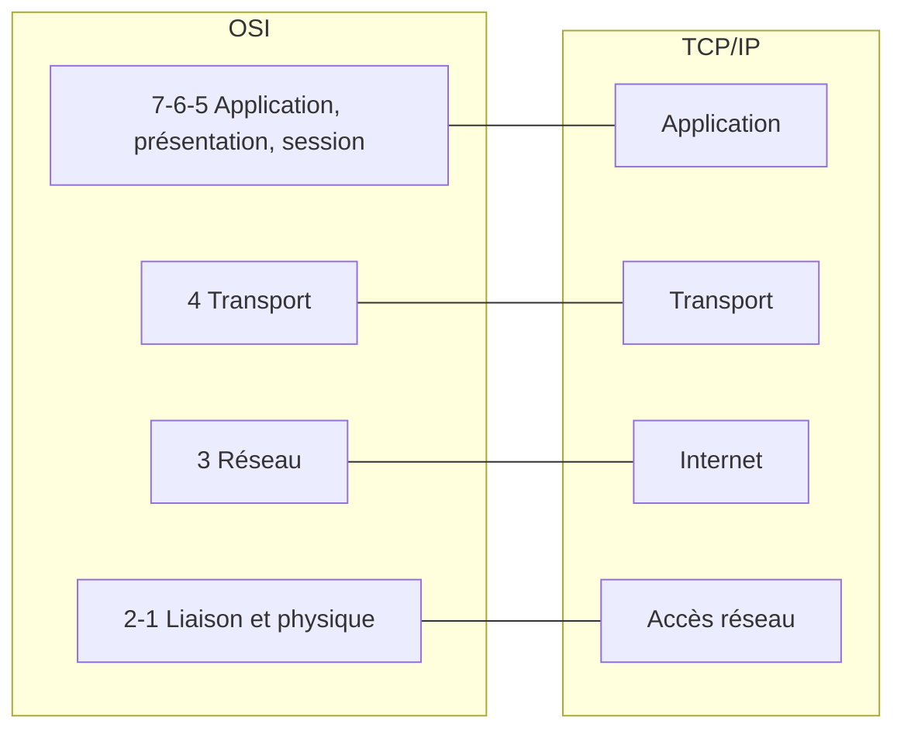
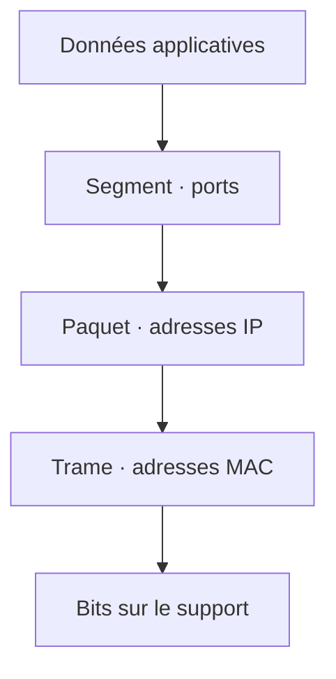

# Module 01 — Le modèle OSI

**Séquence :** Bases des réseaux  
**Rôle dans le parcours :** décrire une communication couche par couche avant l’adressage, les échanges et les commandes.

L’onglet Cours Original indique **Inexistant** : ce module n’a pas de support de cours PDF. La fiche suit les notes de quiz des modules 1 et 2. Le PDF homonyme est un doublon de ces notes : le même texte, mis en page. Il n’est pas repris à part.

## Objectifs

À l’issue du module, vous devez pouvoir :

- nommer les sept couches et l’unité de données de chacune ;
- expliquer PDU, SDU et PCI lors de l’encapsulation ;
- associer un protocole, un port ou un équipement à sa couche ;
- choisir un câble droit ou croisé, et savoir ce que fait Auto MDI-X ;
- situer les deux modes de Packet Tracer.

## 1. Sept couches

Le modèle OSI (*Open Systems Interconnection*) décrit la communication entre deux systèmes. Chaque couche a une fonction et parle à la couche juste au-dessus et à celle juste en dessous. Ce découpage sert à construire et à dépanner les protocoles.

| Couche | Rôle dans les notes | Unité | Repères |
|---|---|---|---|
| 7 — Application | Services rendus aux logiciels | Données (APDU) | HTTP, FTP, SMTP, DNS |
| 6 — Présentation | Format, compression, chiffrement | Données (PPDU) | TLS, formats multimédias |
| 5 — Session | Ouverture, maintien, fermeture du dialogue | Données (SPDU) | RPC, NetBIOS |
| 4 — Transport | Segmentation, ordre, ports | Segment (TPDU) | TCP, UDP |
| 3 — Réseau | Adressage logique et chemin entre réseaux | Paquet | IPv4, IPv6, ICMP ; routeur |
| 2 — Liaison | Trame locale, adresses MAC, erreurs du lien | Trame | Ethernet, Wi-Fi ; commutateur |
| 1 — Physique | Bits transformés en signaux | Bits | Câble, fibre, radio ; hub, répéteur |

**Illustration IA / externe au cours — correspondance souvent utilisée avec TCP/IP.** Les notes détaillent OSI. Le modèle TCP/IP regroupe autrement les mêmes idées : liaison et physique d’un côté, réseau, transport, puis les applications.

## 2. PDU, SDU et PCI

Le **PDU** (*Protocol Data Unit*) est l’unité échangée à une couche : données utiles et informations de contrôle. Le **SDU** (*Service Data Unit*) est le bloc reçu de la couche supérieure, encore sans les informations de la couche qui va le traiter. Le **PCI** (*Protocol Control Information*) est ce que la couche ajoute : adresses, numéros, contrôle d’erreur.

1. Le PDU de la couche N+1 devient le SDU de la couche N.
2. La couche N ajoute son PCI. C’est l’encapsulation.
3. Le résultat est le PDU de la couche N, transmis à la couche N−1.

Exemple des notes, du transport vers le réseau : le segment TCP (ports, numéro de séquence, données) devient le SDU du réseau. Le réseau ajoute les adresses IP. Le PDU obtenu est le paquet IP, ensuite remis à la liaison.

À l’arrivée, chaque couche retire son PCI. Les bits redeviennent une trame, puis un paquet, un segment, et enfin les données de l’application. Les notes prennent l’exemple d’un courriel : APDU, PPDU, SPDU, segment, paquet, trame, bits, puis le chemin inverse.

**Illustration IA / externe au cours — ordre d’encapsulation décrit par les notes.**

## 3. Ports cités

Les ports distinguent les communications à la couche transport. Les notes citent notamment :

| Port | Protocole |
|---:|---|
| 22 | SSH |
| 25 | SMTP |
| 53 | DNS |
| 80 | HTTP |
| 443 | HTTPS |

## 4. Couche physique et câbles

La couche physique transmet les bits. Elle ne vérifie ni la destination ni les erreurs de contenu. Les notes lui rattachent l’encodage, la synchronisation et le débit en bits par seconde.

| Câble | Branchement dans les notes | Schéma |
|---|---|---|
| Droit | Appareils de types différents : ordinateur vers commutateur, ordinateur vers routeur, commutateur vers routeur | Les deux extrémités en T568B : blanc-orange, orange, blanc-vert, bleu, blanc-bleu, vert, blanc-marron, marron |
| Croisé | Deux ordinateurs, deux commutateurs ou deux routeurs | Une extrémité en T568A (blanc-vert, vert, blanc-orange, bleu, blanc-bleu, orange, blanc-marron, marron), l’autre en T568B |

Le croisement relie l’émission d’un appareil à la réception de l’autre. Les notes signalent **Auto MDI-X** : beaucoup de cartes et de commutateurs récents reconnaissent le câble et acceptent un câble droit même entre appareils de même type.

Équipements cités à cette couche : câbles, connecteur RJ45, émetteurs radio, hubs et répéteurs.

## 5. Liaison de données

La liaison transmet des trames entre appareils du même réseau local. Elle ajoute un en-tête et une fin de trame, porte les adresses MAC et peut détecter des erreurs (parité, CRC, codes de Hamming dans les notes).

| Sous-couche | Rôle dans les notes |
|---|---|
| LLC | Identifie le protocole porté par la trame et permet à plusieurs protocoles de partager le support |
| MAC | Décide qui émet (CSMA/CD sur Ethernet) et porte l’adresse physique |

Un commutateur relaie les trames d’après les adresses MAC. Un pont relie des segments au même niveau. La liaison ne route pas vers un autre réseau : c’est le rôle de la couche réseau.

## 6. Réseau et transport

La couche réseau choisit le chemin des paquets à l’aide d’adresses IP, peut fragmenter un paquet trop grand, et surveille la congestion. Les notes citent IP, ICMP (dont ping), RIP et OSPF. L’équipement associé est le routeur. IP ne garantit pas à lui seul la livraison : cette garantie, quand elle existe, est celle de TCP.

| Transport | Ce que les notes en retiennent |
|---|---|
| TCP | Orienté connexion, ordre, renvoi en cas d’erreur. Adapté au transfert de fichiers et au web |
| UDP | Sans connexion, plus léger. Adapté au temps réel, où perdre un peu de données est accepté pour aller plus vite |

La couche transport segmente, numérote, contrôle le flux et multiplexe les applications grâce aux ports. Les notes la situent surtout dans le système et les logiciels. Un pare-feu peut s’en servir pour filtrer selon les ports.

## 7. Packet Tracer

Les notes présentent Packet Tracer comme un logiciel de topologie, sans matériel physique. Deux modes y sont distingués :

- **Temps réel** : les paquets circulent en continu.
- **Simulation** : on suit chaque étape, couche par couche.

Le dossier contient trois activités pour ce module. Leur contenu est binaire et illisible hors du logiciel. Elles ne sont pas publiées. Le travail se fait dans Packet Tracer, avec la consigne du formateur.

## Résumé

1. OSI sépare une communication en sept responsabilités, de l’application jusqu’aux bits.
2. Encapsuler, c’est ajouter le PCI de la couche au SDU reçu d’au-dessus. Décapsuler retire ces informations dans l’ordre inverse.
3. MAC et trame restent sur le lien local. IP et paquet traversent les réseaux. Les ports distinguent les applications.
4. Un câble droit relie des appareils de types différents. Un câble croisé croise émission et réception. Auto MDI-X peut s’en passer.
5. Ce module n’a pas de support PDF. Les activités Packet Tracer ne sont pas sur le site.

## Mini-quiz

1. Quelle unité les notes associent-elles à la couche transport, et laquelle à la liaison ?
2. Que devient le PDU de la couche N+1 pour la couche N ?
3. Citez les ports des notes pour SSH, DNS, HTTP et HTTPS.
4. Quel câble les notes utilisent-elles entre deux ordinateurs, avant Auto MDI-X ?
5. Quelle différence les notes font-elles entre le mode temps réel et le mode simulation ?

??? note "Réponses du mini-quiz"
    1. Segment pour le transport, trame pour la liaison.
    2. Il devient son SDU. La couche N y ajoute son PCI pour former son propre PDU.
    3. 22, 53, 80 et 443.
    4. Un câble croisé, T568A d’un côté et T568B de l’autre.
    5. En temps réel les paquets circulent en continu. En simulation on observe chaque étape.
