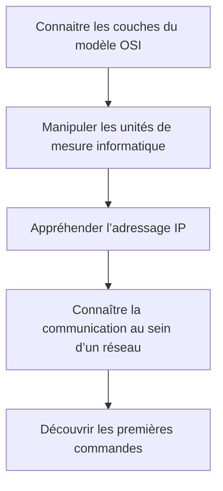

# Module 02 — Les unités informatiques

Les parties ci-dessous reprennent le cours original, dans le même ordre. Les encadrés et les schémas répètent ses formulations.

## Parcours de lecture
1. Notes du Drive · Notes de cours — modules 1 et 2 · document texte
2. Module 2 - Les unités informatiques
3. Comprendre les unités informatiques
4. Le Principe de la Numération Décimale
5. Structure et Valeur des Chiffres en Décimal
6. Le Principe de la Numération Binaire
7. Pourquoi Utiliser le Système Binaire en Informatique ?
8. Structure et Valeur des Bits
9. La Numération Octale
10. Pourquoi Utiliser la Base Octale ?
11. Structure et Conversion Binaire-Octal
12. cimal)
13. Utilisation de l’Octal en Informatique et Réseaux
14. La Numération Hexadécimale
15. Pourquoi Utiliser la Base Hexadécimale ?
16. Structure et Conversion Binaire-Hexadécimal
17. cimal)
18. Utilisation de la Base Hexadécimale en Réseaux
19. Voici les étapes de cette méthode :
20. 1 ÷ 2 = 0, reste 1
21. Pour convertir un nombre décimal en binaire :
22. Conversion d’un Nombre Binaire en Nombre Décimal
23. 2
24. Exemple : Conversion du Nombre Binaire 10110 en Décimal
25. Pour convertir un nombre binaire en décimal :
26. Conversion d’un Nombre Décimal en Nombre Octal
27. Méthode de Conversion
28. 2 ÷ 8 = 0, reste 2
29. Pour convertir un nombre décimal en octal :
30. Conversion d’un Nombre Octal en Nombre Décimal
31. 8
32. Exemple : Conversion du Nombre Octal 234 en Décimal
33. Pour convertir un nombre octal en décimal :
34. Conversion d’un Nombre Décimal en Nombre Hexadécimal
35. Méthode de Conversion
36. Exemple : Conversion du Nombre Décimal 254 en Hexadécimal
37. Pour convertir un nombre décimal en hexadécimal :
38. Conversion d’un Nombre Hexadécimal en Nombre Décimal
39. 16
40. Exemple : Conversion du Nombre Hexadécimal 3F en Décimal
41. En partant de la droite, identifions la position de chaque chiffre :
42. Pour convertir un nombre hexadécimal en décimal :
43. Les Différentes Unités Informatiques
44. Les Bits et les Octets
45. Les Multiples de l’Octet
46. 3
47. 6
48. 9
49. 12
50. Unités de Vitesse de Transmission
51. Conversion de la base 10 à la base 2, première méthode
52. 0 est ≥ 0 donc j’inscris 1 dans la colonne 4
53. Conversion de la base 10 à la base 2, deuxième méthode

**Visuel externe**

Source : notes de cours. Aucun support de cours PDF n’existe pour ce module.

SOURCE DRIVE · TRANSCRIPTION DU SUPPORT

Le contenu des documents du dossier TSSR est transcrit ci-dessous, page par page. Les textes et tableaux sont intégrés à la page Web. Aucun fichier PDF, aucune diapositive entière ni aucune reproduction de page n’est affiché. Seuls des croquis ou visuels isolés et vérifiés peuvent accompagner la transcription. Les versions et les consignes restent celles des supports de formation. Les compléments IA sont conservés dans leur onglet distinct.

## Notes du Drive · Notes de cours — modules 1 et 2 · document texte

!!! note "À retenir"
    Aucun support de cours PDF n’existe pour ce module.

**Visuel externe**

Source : notes de cours. Aucun support de cours PDF n’existe pour ce module.

Source : notes de cours. Aucun support de cours PDF n’existe pour ce module.

- Connaitre les couches du modèle OSI
- Manipuler les unités de mesure informatique
- Appréhender l’adressage IP
- Connaître la communication au sein d’un réseau
- Découvrir les premières commandes

## Module 2 - Les unités informatiques

- Objectifs
- Les bases de numération
- Principe de numération décimale
- Principe de numération binaire
- Principe de numération octale
- Principe de numération héxadécimale
- Equivalence des valeurs
- Conversion décimale/binaire
- Conversion binaire/décimale
- Conversion décimale/octale
- Conversion octale/décimale
- Conversion décimale/hexadécimale
- Conversion hexadécimale/décimale
- Les différentes unités informatiques
- Les préfixes et équivalence des unités
- Démonstration - Les conversions
- Connaître le principe de numération
- Effectuer des conversions

## Comprendre les unités informatiques

En informatique, la numération est le système utilisé pour représenter les nombres. Les bases les plus courantes sont la base binaire (base 2), la base octale (base 8), la base décimale (base 10), et la base hexadécimale (base 16).

En base binaire, les nombres sont représentés avec des 0 et des 1 (bits). C’est la base fondamentale en informatique, car elle correspond directement au fonctionnement des circuits électroniques, qui utilisent deux états : activé (1) et désactivé (0).

La base octale utilise les chiffres de 0 à 7. Elle est parfois employée pour représenter de grands nombres binaires de manière plus compacte.

La base décimale est la base standard utilisée par les humains, allant de 0 à 9. En informatique, elle est souvent convertie en binaire pour être traitée par la machine.

En base hexadécimale, les nombres sont représentés de 0 à 9 et de A à F (où A = 10, B = 11, …, F = 15). Cette base permet de représenter efficacement les grands nombres binaires, chaque chiffre hexadécimal correspondant à quatre bits binaires.

Ces systèmes de numération facilitent le traitement, le stockage et l'affichage des données en informatique.

## Le Principe de la Numération Décimale

Le système de numération décimale, également appelé base 10, est le système de numération le plus familier et celui que nous utilisons couramment dans notre vie quotidienne. Il se compose de dix chiffres allant de 0 à 9 et se base sur les puissances de 10. Chaque position d'un chiffre dans un nombre décimal représente une puissance de 10, et la valeur de chaque chiffre est multipliée par cette puissance.

## Structure et Valeur des Chiffres en Décimal

Dans un nombre décimal, chaque chiffre a une place spécifique qui lui attribue une valeur pondérée en fonction de sa position. La valeur d’un nombre est déterminée en multipliant chaque chiffre par la puissance de 10 correspondant à sa position, en partant de la droite. Par exemple, pour le nombre 325, on a :

3 × 102 + 2 × 101 + 5 × 100 = 300 + 20 + 5 = 325

Ainsi, le chiffre 3 dans la centaine représente 3 × 100

, le 2 dans la dizaine représente 2 × 10

, et le 5 dans l’unité représente 5 × 1 .

## Le Principe de la Numération Binaire

Dans le monde informatique, la numération binaire (ou base 2) est le système de numération fondamental. Il repose sur deux chiffres seulement : 0 et 1. Ce système est essentiel pour comprendre le fonctionnement des ordinateurs, car il correspond directement aux états des circuits électroniques, qui peuvent être soit en position activée (1), soit en position désactivée (0).

## Pourquoi Utiliser le Système Binaire en Informatique ?

Le binaire est particulièrement adapté à l’informatique car il permet une représentation simple et efficace des données par les circuits électroniques. Les 0 et 1 du binaire correspondent aux deux états de tension d’un transistor : passage de courant (représenté par 1) et absence de courant (représenté par 0). Ainsi, les ordinateurs utilisent le binaire pour traiter et stocker des informations de manière rapide et fiable.

## Structure et Valeur des Bits

Dans le système binaire, chaque chiffre est appelé un bit (Binary Digit), et chaque bit représente une puissance de 2. Par exemple, pour le nombre binaire 1011, chaque bit correspond à une puissance de 2, en partant de la droite :

1 × 23 + 0 × 22 + 1 × 21 + 1 × 20 = 8 + 0 + 2 + 1 = 11

## La Numération Octale

La numération octale est un système numérique en base 8, qui utilise huit chiffres de 0 à 7. Chaque position dans un nombre octal représente une puissance de 8. Bien que moins courante que la numération binaire ou décimale, la base octale est parfois utilisée en informatique pour simplifier la lecture et la manipulation des nombres binaires.

## Pourquoi Utiliser la Base Octale ?

Le système octal est principalement utilisé comme une méthode de représentation compacte des nombres binaires. Un chiffre octal peut être directement traduit en trois bits binaires, car 8 = 23 8 = 2^3. Ainsi, le système octal permet de réduire la longueur des séquences binaires en groupes de trois, ce qui facilite la lecture et la gestion des données.

## Structure et Conversion Binaire-Octal

Dans le système octal, chaque position d’un chiffre représente une puissance de 8. Par exemple, le nombre octal 237 signifie :

2 × 82 + 3 × 81 + 7 × 80 = 128 + 24 + 7 = 159

- (en d
- e
- ˊ

## cimal)

Pour convertir un nombre binaire en octal, on regroupe simplement les bits par paquets de trois (en partant de la droite) et on les remplace par leur valeur octale. Par exemple, pour convertir le nombre binaire 110110 en octal :

Séparer en groupes de trois : 110 110.

Convertir chaque groupe en octal : 110 = 6

et 110 = 6 , donc le résultat est 66 en octal.

## Utilisation de l’Octal en Informatique et Réseaux

Bien que l’octal ne soit pas autant utilisé aujourd’hui, il a joué un rôle important dans les systèmes Unix pour représenter les permissions des fichiers et dans certaines configurations de bas niveau, notamment dans l’écriture des codes de contrôle des périphériques. En réseau, le système octal est moins commun, mais on le trouve parfois pour certains aspects spécifiques, comme :

Configuration de Permissions : En Unix/Linux, les permissions des fichiers et dossiers sont souvent définies en utilisant un système de notation octale, avec des valeurs telles que 755 ou 644 pour indiquer les droits de lecture, d’écriture et d’exécution.

Compacité pour les Systèmes de Fichiers : Avant que le système hexadécimal ne soit largement adopté, l’octal permettait de manipuler et d’afficher plus efficacement des informations binaires, en particulier dans le développement et la configuration des systèmes réseau et des périphériques de stockage.

## La Numération Hexadécimale

La numération hexadécimale est un système en base 16, qui utilise seize symboles pour représenter les valeurs : les chiffres de 0 à 9 et les lettres A à F (où A correspond à 10, B à 11, …, F à 15). Ce système est largement utilisé en informatique car il permet de représenter des nombres binaires longs de manière concise et lisible.

## Pourquoi Utiliser la Base Hexadécimale ?

Le système hexadécimal est particulièrement utile en informatique pour représenter de grandes quantités de données binaires en format abrégé. Chaque chiffre hexadécimal correspond à quatre bits (ou un demi-octet), car 16 = 24 16 = 2^4. Ainsi, un nombre binaire peut être regroupé par blocs de quatre bits, chaque bloc correspondant à un chiffre hexadécimal. Cela simplifie considérablement la lecture et l’écriture des adresses mémoire, des codes de couleurs, et des adresses IP dans le cas des réseaux IPv6.

## Structure et Conversion Binaire-Hexadécimal

Dans un nombre hexadécimal, chaque position d’un chiffre représente une puissance de 16. Par exemple, le nombre hexadécimal 2AF signifie :

2 × 1 6 2 + 10 × 1 6 1 + 15 × 1 6 0 = 512 + 160 + 15 = 687

- (en d
- e
- ˊ

## cimal)

Pour convertir un nombre binaire en hexadécimal, il suffit de regrouper les bits en paquets de quatre, en partant de la droite, puis de remplacer chaque paquet par son équivalent hexadécimal. Par exemple, pour convertir le binaire 10101111 en hexadécimal :

Séparer en groupes de quatre : 1010 1111.

- Convertir chaque groupe :
- 1010

= A

- et
- 1111

= F , ce qui donne AF en hexadécimal.

## Utilisation de la Base Hexadécimale en Réseaux

La numération hexadécimale est très présente dans les réseaux informatiques, surtout avec les adresses IPv6 et dans les configurations de bas niveau, comme les adresses MAC.

Adresses IPv6 : Les adresses IPv6 utilisent la base hexadécimale pour simplifier l’écriture et la lecture de longues adresses de 128 bits. Par exemple, une adresse IPv6 comme 2001:0db8:85a3:0000:0000:8a2e:0370:7334 est en réalité composée de 128 bits divisés en blocs de quatre.

Adresses MAC : Les adresses physiques des cartes réseau, ou adresses MAC, sont également écrites en hexadécimal, par exemple 00:1A:2B:3C:4D:5E. Ce format permet de représenter de manière concise les adresses uniques attribuées aux périphériques réseau.

Couleurs Web : En conception web, les couleurs sont souvent exprimées en hexadécimal pour définir les valeurs de rouge, vert et bleu (RGB). Par exemple, la couleur #FF5733 est une représentation hexadécimale indiquant un niveau élevé de rouge (FF), un niveau moyen de vert (57), et un niveau bas de bleu (33).

Le principe de conversion d'un nombre décimal en binaire repose sur la méthode des divisions successives par 2.

## Voici les étapes de cette méthode :

Diviser le nombre décimal par 2 et noter le reste (qui sera toujours 0 ou 1). Prendre le quotient obtenu et le diviser de nouveau par 2. Répéter cette opération jusqu’à obtenir un quotient égal à 0. Le nombre binaire est formé en lisant les restes de bas en haut, c'est-à-dire en commençant par le dernier reste obtenu jusqu'au premier.

- Exemple : Conversion du Nombre Décimal 25 en Binaire
- Prenons l'exemple de la conversion du nombre décimal 25 en binaire :
- 25 ÷ 2 = 12, reste 1
- 12 ÷ 2 = 6, reste 0
- 6 ÷ 2 = 3, reste 0
- 3 ÷ 2 = 1, reste 1

## 1 ÷ 2 = 0, reste 1

En lisant les restes de bas en haut, on obtient le nombre binaire 11001.

Ainsi, 25 en base 10 est égal à 11001 en base 2.

## Pour convertir un nombre décimal en binaire :

Divisez le nombre par 2 et notez le reste. Répétez l’opération avec le quotient jusqu'à atteindre 0. Le nombre binaire final s'obtient en lisant les restes de bas en haut.

## Conversion d’un Nombre Binaire en Nombre Décimal

La conversion d'un nombre binaire (base 2) en nombre décimal (base 10) repose sur le principe des puissances de 2. Chaque chiffre (ou bit) d’un nombre binaire correspond à une puissance de 2, en commençant de la droite (position 0) vers la gauche.

Méthode de Conversion Pour convertir un nombre binaire en décimal, on suit les étapes suivantes :

Identifiez les positions des bits dans le nombre binaire, en commençant par la droite (le premier bit est la position 0).

Multipliez chaque bit par

## 2

2 élevé à la puissance correspondant à sa position. Additionnez tous les produits obtenus pour obtenir le nombre décimal.

## Exemple : Conversion du Nombre Binaire 10110 en Décimal

Prenons le nombre binaire 10110 et convertissons-le en base 10.

- En partant de la droite, on note la position de chaque bit :
- Le bit tout à droite (0) est à la position 0
- Le bit suivant (1) est à la position 1
- Le bit suivant (1) est à la position 2
- Le bit suivant (0) est à la position 3
- Le bit le plus à gauche (1) est à la position 4
- On multiplie chaque bit par
- 2
- à la puissance de sa position :
- (

1 × 24

- )
- +
- (

0 × 23

- )
- +
- (

1 × 22

- )
- +
- (

1 × 21

- )
- +
- (

0 × 20

- )
- En simplifiant les calculs :
- (

1 × 16

- )
- +
- (

0 × 8

- )
- +
- (

1 × 4

- )
- +
- (

1 × 2

- )
- +
- (

0 × 1

) = 16 + 0 + 4 + 2 + 0 = 22

Ainsi, le nombre binaire 10110 correspond au nombre décimal 22.

## Pour convertir un nombre binaire en décimal :

Multipliez chaque bit par une puissance de 2, en fonction de sa position (de droite à gauche). Additionnez les valeurs obtenues pour obtenir le nombre en base 10.

## Conversion d’un Nombre Décimal en Nombre Octal

La conversion d’un nombre décimal (base 10) en nombre octal (base 8) est une méthode courante en informatique pour simplifier la représentation des valeurs numériques, surtout en lien avec la gestion des systèmes et des permissions. Le système octal utilise huit chiffres (0 à 7) et repose sur des puissances de 8.

## Méthode de Conversion

La conversion d’un nombre décimal en octal suit la méthode des divisions successives par 8 :

Diviser le nombre décimal par 8 et noter le reste. Prendre le quotient obtenu et le diviser à nouveau par 8. Répéter cette opération jusqu’à obtenir un quotient de 0. Le nombre octal est formé en lisant les restes de bas en haut, en commençant par le dernier reste obtenu jusqu'au premier.

- Exemple : Conversion du Nombre Décimal 156 en Octal
- Prenons l’exemple de la conversion du nombre décimal 156 en octal :
- 156 ÷ 8 = 19, reste 4
- 19 ÷ 8 = 2, reste 3

## 2 ÷ 8 = 0, reste 2

En lisant les restes de bas en haut, on obtient le nombre octal 234.

Ainsi, 156 en base 10 est égal à 234 en base 8.

## Pour convertir un nombre décimal en octal :

Divisez le nombre par 8 et notez le reste. Répétez avec le quotient jusqu'à obtenir 0. Lisez les restes de bas en haut pour obtenir le nombre en base 8

## Conversion d’un Nombre Octal en Nombre Décimal

La conversion d’un nombre octal (base 8) en nombre décimal (base 10) s’appuie sur les puissances de 8. Chaque chiffre dans un nombre octal représente une puissance de 8, en partant de la droite (position 0) vers la gauche.

Méthode de Conversion Pour convertir un nombre octal en nombre décimal, on utilise les étapes suivantes :

Identifiez les positions des chiffres dans le nombre octal, en commençant par la droite (le premier chiffre est la position 0).

Multipliez chaque chiffre par

## 8

élevé à la puissance de sa position. Additionnez les produits obtenus pour obtenir le nombre en base 10.

## Exemple : Conversion du Nombre Octal 234 en Décimal

Prenons le nombre octal 234 et convertissons-le en base 10.

- En partant de la droite, on note la position de chaque chiffre :
- Le chiffre le plus à droite (4) est à la position 0
- Le chiffre suivant (3) est à la position 1
- Le chiffre le plus à gauche (2) est à la position 2
- On multiplie chaque chiffre par
- 8
- à la puissance de sa position :
- (

2 × 82

- )
- +
- (

3 × 81

- )
- +
- (

4 × 80

- )
- En simplifiant les calculs :
- (

2 × 64

- )
- +
- (

3 × 8

- )
- +
- (

4 × 1

) = 128 + 24 + 4 = 156 Ainsi, le nombre octal 234 correspond au nombre décimal 156.

## Pour convertir un nombre octal en décimal :

Multipliez chaque chiffre par une puissance de 8, selon sa position. Additionnez les valeurs obtenues pour obtenir le nombre en base 10.

## Conversion d’un Nombre Décimal en Nombre Hexadécimal

Le système de numération hexadécimal est une base de 16 qui utilise les chiffres de 0 à 9 et les lettres A à F pour représenter les valeurs de 0 à 15. Cette base est couramment utilisée en informatique pour représenter des valeurs binaires de façon plus compacte, car chaque chiffre hexadécimal équivaut à quatre bits binaires.

## Méthode de Conversion

La conversion d’un nombre décimal en hexadécimal se fait en utilisant la méthode des divisions successives par 16 :

Divisez le nombre décimal par 16 et notez le reste (qui sera compris entre 0 et 15). Si le reste est 10, 11, 12, 13, 14, ou 15, remplacez-le par les lettres hexadécimales correspondantes : A, B, C, D, E, et F. Prenez le quotient obtenu et divisez-le à nouveau par 16. Répétez l’opération jusqu’à ce que le quotient soit 0. Le nombre hexadécimal final est obtenu en lisant les restes de bas en haut, en commençant par le dernier reste obtenu jusqu'au premier.

## Exemple : Conversion du Nombre Décimal 254 en Hexadécimal

Convertissons le nombre décimal 254 en hexadécimal.

254 ÷ 16 = 15, reste 14 (14 correspond à la lettre E en hexadécimal). 15 ÷ 16 = 0, reste 15 (15 correspond à la lettre F en hexadécimal). En lisant les restes de bas en haut, on obtient le nombre hexadécimal FE.

Ainsi, 254 en base 10 est égal à FE en base 16.

## Pour convertir un nombre décimal en hexadécimal :

Divisez le nombre par 16 et notez le reste. Remplacez les restes supérieurs à 9 par les lettres correspondantes (A à F). Lisez les restes de bas en haut pour obtenir le nombre hexadécimal.

## Conversion d’un Nombre Hexadécimal en Nombre Décimal

Le système hexadécimal est une base de 16, utilisant les chiffres de 0 à 9 et les lettres A à F (A pour 10, B pour 11, jusqu'à F pour 15). La conversion d’un nombre hexadécimal en nombre décimal s’appuie sur les puissances de 16, en attribuant une puissance à chaque position de droite à gauche.

Méthode de Conversion Pour convertir un nombre hexadécimal en nombre décimal, on suit ces étapes :

Identifiez les positions des chiffres hexadécimaux, en commençant par la droite (la première position est 0).

Multipliez chaque chiffre par

## 16

16 élevé à la puissance correspondant à sa position. Additionnez les produits obtenus pour obtenir le nombre décimal.

## Exemple : Conversion du Nombre Hexadécimal 3F en Décimal

Prenons l'exemple du nombre hexadécimal 3F et convertissons-le en base 10.

## En partant de la droite, identifions la position de chaque chiffre :

Le chiffre F (qui vaut 15 en décimal) est à la position 0. Le chiffre 3 est à la position 1.

- Multiplions chaque chiffre par
- 16
- à la puissance de sa position :
- (

3 × 1 6 1

- )
- +
- (

15 × 1 6 0

- )
- En simplifiant les calculs :
- (

3 × 16

- )
- +
- (

15 × 1

) = 48 + 15 = 63 Ainsi, le nombre hexadécimal 3F correspond au nombre décimal 63.

## Pour convertir un nombre hexadécimal en décimal :

Multipliez chaque chiffre hexadécimal par une puissance de 16 en fonction de sa position. Additionnez les valeurs obtenues pour obtenir le nombre en base 10.

## Les Différentes Unités Informatiques

Dans le monde informatique, la représentation et la manipulation des données sont au cœur de l’activité des systèmes et des réseaux. Les unités informatiques sont essentielles pour quantifier la taille des informations, la mémoire et la capacité de stockage. Ces unités suivent un système de notation en base 2 ou base 10 pour représenter les données et sont divisées en plusieurs échelles, chacune représentant une quantité précise d’informations.

## Les Bits et les Octets

Le bit (b) est la plus petite unité de mesure en informatique. Il représente une valeur binaire unique, soit 0 ou 1, correspondant à un état électrique de marche ou d’arrêt. L’octet (B) est constitué de 8 bits. Il est souvent utilisé pour représenter un caractère ou une petite unité d’information. Par exemple, une lettre dans un fichier texte simple peut occuper environ 1 octet.

## Les Multiples de l’Octet

Les unités supérieures sont basées sur des multiples de l’octet pour permettre de mesurer de plus grandes quantités d’informations. Il existe deux systèmes de notation principaux : le système binaire (en base 2), utilisé en informatique, et le système décimal (en base 10), plus courant dans la vie quotidienne.

- Système Binaire (Base 2)
- Kio (Kibioctet) : 1 Kio =

210 octets, soit 1 024 octets.

Mio (Mebioctet) : 1 Mio = 220 octets, soit 1 048 576 octets.

Gio (Gibioctet) : 1 Gio = 230 octets, soit environ 1,07 milliard d’octets.

Tio (Tebioctet) : 1 Tio = 240 octets, soit environ 1,1 billion d’octets.

- Système Décimal (Base 10)
- Ko (Kilooctet) : 1 Ko =
- 1
- 0

## 3

octets, soit 1 000 octets.

- Mo (Megaoctet) : 1 Mo =
- 1
- 0

## 6

octets, soit 1 000 000 octets.

- Go (Gigaoctet) : 1 Go =
- 1
- 0

## 9

octets, soit 1 milliard d’octets.

- To (Téraoctet) : 1 To =
- 1
- 0

## 12

octets, soit 1 billion d’octets.

Ces systèmes créent parfois une confusion, notamment dans le domaine des disques durs ou des supports de stockage, où les fabricants utilisent souvent les valeurs décimales (base 10) tandis que les systèmes d’exploitation se réfèrent aux valeurs binaires (base 2).

## Unités de Vitesse de Transmission

Dans les réseaux, il est également essentiel de mesurer la vitesse de transfert des données :

bps (bits par seconde) : La vitesse de base pour mesurer le transfert de données. Kbps, Mbps, Gbps : Correspondent respectivement à 1 000, 1 000 000 et 1 000 000 000 bits par seconde. Ces unités sont utilisées pour quantifier le débit d’une connexion réseau, par exemple lors du transfert de fichiers ou du streaming de vidéos.

## Conversion de la base 10 à la base 2, première méthode

Pour convertir un nombre décimal en nombre binaire, on utilise un tableau.

Ce tableau binaire va se limiter aux huit premières valeurs représentant un octet. Il peut être agrandi pour la conversion de nombre décimal supérieur à 255.

- Prendre un nombre décimal : ex : 156
- Puis procéder par soustraction donnant un résultat ≥ 0
- 156 - 128 = 28
- 28 est ≥ 0 donc j’inscris 1 dans la colonne 128
- 28 - 64 = 36
- 36 est ≤ 0 donc j’inscris 0 dans la colonne 64
- 28 - 32 = 4
- 4 est ≤ 0 donc j’inscris 0 dans la colonne 32
- 28 - 16 = 12
- 12 est ≥ 0 donc j’inscris 1 dans la colonne 16
- 12 - 8 = 4
- 4 est ≥ 0 donc j’inscris 1 dans la colonne 8
- 4 - 4 = 0

## 0 est ≥ 0 donc j’inscris 1 dans la colonne 4

La conversion est terminée mais le tableau n’est pas rempli alors on le complète avec des 0, ici des 0 sont rajoutés dans les colonnes 2 et 1

Le résultat 156 en décimal est égal à 10010100 en binaire

## Conversion de la base 10 à la base 2, deuxième méthode

Pour convertir un nombre décimal en nombre binaire, on utilise un tableau.

Ce tableau binaire va se limiter aux huit premières valeurs représentant un octet. Il peut être agrandi pour la conversion de nombre décimal supérieur à 255.

- Prendre un nombre décimal
- ex : 235

Puis procéder par addition donnant un résultat ≤ inférieur au nombre recherché :

- 0 + 128 = 128
- 128 est ≤ 235 donc j’inscris 1 dans la colonne 128
- 128 + 64 = 192
- 192 est ≤ 235 donc j’inscris 1 dans la colonne 64
- 192 + 32 = 224
- 224 est ≤ 235 donc j’inscris 1 dans la colonne 32
- 224 + 16 = 240
- 240 est ≥ 235 donc j’inscris 0 dans la colonne 16
- 224 + 8 = 232
- 232 est ≤ 235 donc j’inscris 1 dans la colonne 8
- 232 + 4 = 236
- 236 est ≥ 235 donc j’inscris 0 dans la colonne 4
- 232 + 2 = 234
- 234 est ≤ 235 donc j’inscris 1 dans la colonne 2
- 234 + 1 = 235
- 235 est ≤ 235 donc j’inscris 1 dans la colonne 1
- Le résultat : 235 en décimal est égal à 1110 1011 en binaire

Référence du document : 1lboUfARfL1q4Oemnr9M-_vi0XpnzuRmn · SHA-256 a962747a178b82dd…

## Notes du Drive

Doublon — le quiz des notes des modules 1 et 2 est publié dans le [module 01 — Le modèle OSI](module-01-le-modele-osi.md).

## Fiche de synthèse

Les lignes reprennent les titres du cours et la première phrase de chaque partie.

| Partie | Repère du cours |
| --- | --- |
| Notes du Drive · Notes de cours — modules 1 et 2 · document texte | Aucun support de cours PDF n’existe pour ce module. |
| Module 2 - Les unités informatiques | Objectifs Les bases de numération Principe de numération décimale Principe de numération binaire Principe de numération octale Principe de numération héxadécimale Equivalence de… |
| Comprendre les unités informatiques | En informatique, la numération est le système utilisé pour représenter les nombres. |
| Le Principe de la Numération Décimale | Le système de numération décimale, également appelé base 10, est le système de numération le plus familier et celui que nous utilisons couramment dans notre vie quotidienne. |
| Structure et Valeur des Chiffres en Décimal | Dans un nombre décimal, chaque chiffre a une place spécifique qui lui attribue une valeur pondérée en fonction de sa position. |
| Le Principe de la Numération Binaire | Dans le monde informatique, la numération binaire (ou base 2) est le système de numération fondamental. |
| Pourquoi Utiliser le Système Binaire en Informatique ? | Le binaire est particulièrement adapté à l’informatique car il permet une représentation simple et efficace des données par les circuits électroniques. |
| Structure et Valeur des Bits | Dans le système binaire, chaque chiffre est appelé un bit (Binary Digit), et chaque bit représente une puissance de 2. |
| La Numération Octale | La numération octale est un système numérique en base 8, qui utilise huit chiffres de 0 à 7. |
| Pourquoi Utiliser la Base Octale ? | Le système octal est principalement utilisé comme une méthode de représentation compacte des nombres binaires. |
| Structure et Conversion Binaire-Octal | Dans le système octal, chaque position d’un chiffre représente une puissance de 8. |
| cimal) | Pour convertir un nombre binaire en octal, on regroupe simplement les bits par paquets de trois (en partant de la droite) et on les remplace par leur valeur octale. |
| Utilisation de l’Octal en Informatique et Réseaux | Bien que l’octal ne soit pas autant utilisé aujourd’hui, il a joué un rôle important dans les systèmes Unix pour représenter les permissions des fichiers et dans certaines confi… |
| La Numération Hexadécimale | La numération hexadécimale est un système en base 16, qui utilise seize symboles pour représenter les valeurs : les chiffres de 0 à 9 et les lettres A à F (où A correspond à 10,… |
| Pourquoi Utiliser la Base Hexadécimale ? | Le système hexadécimal est particulièrement utile en informatique pour représenter de grandes quantités de données binaires en format abrégé. |
| Structure et Conversion Binaire-Hexadécimal | Dans un nombre hexadécimal, chaque position d’un chiffre représente une puissance de 16. |
| cimal) | Pour convertir un nombre binaire en hexadécimal, il suffit de regrouper les bits en paquets de quatre, en partant de la droite, puis de remplacer chaque paquet par son équivalen… |
| Utilisation de la Base Hexadécimale en Réseaux | La numération hexadécimale est très présente dans les réseaux informatiques, surtout avec les adresses IPv6 et dans les configurations de bas niveau, comme les adresses MAC. |
| Voici les étapes de cette méthode : | Diviser le nombre décimal par 2 et noter le reste (qui sera toujours 0 ou 1). |
| 1 ÷ 2 = 0, reste 1 | En lisant les restes de bas en haut, on obtient le nombre binaire 11001. |
| Pour convertir un nombre décimal en binaire : | Divisez le nombre par 2 et notez le reste. |
| Conversion d’un Nombre Binaire en Nombre Décimal | La conversion d'un nombre binaire (base 2) en nombre décimal (base 10) repose sur le principe des puissances de 2. |
| 2 | 2 élevé à la puissance correspondant à sa position. |
| Exemple : Conversion du Nombre Binaire 10110 en Décimal | Prenons le nombre binaire 10110 et convertissons-le en base 10. |
| Pour convertir un nombre binaire en décimal : | Multipliez chaque bit par une puissance de 2, en fonction de sa position (de droite à gauche). |
| Conversion d’un Nombre Décimal en Nombre Octal | La conversion d’un nombre décimal (base 10) en nombre octal (base 8) est une méthode courante en informatique pour simplifier la représentation des valeurs numériques, surtout e… |
| Méthode de Conversion | La conversion d’un nombre décimal en octal suit la méthode des divisions successives par 8 : Diviser le nombre décimal par 8 et noter le reste. |
| 2 ÷ 8 = 0, reste 2 | En lisant les restes de bas en haut, on obtient le nombre octal 234. |
| Pour convertir un nombre décimal en octal : | Divisez le nombre par 8 et notez le reste. |
| Conversion d’un Nombre Octal en Nombre Décimal | La conversion d’un nombre octal (base 8) en nombre décimal (base 10) s’appuie sur les puissances de 8. |
| 8 | Additionnez les produits obtenus pour obtenir le nombre en base 10. |
| Exemple : Conversion du Nombre Octal 234 en Décimal | Prenons le nombre octal 234 et convertissons-le en base 10. |
| Pour convertir un nombre octal en décimal : | Multipliez chaque chiffre par une puissance de 8, selon sa position. |
| Conversion d’un Nombre Décimal en Nombre Hexadécimal | Le système de numération hexadécimal est une base de 16 qui utilise les chiffres de 0 à 9 et les lettres A à F pour représenter les valeurs de 0 à 15. |
| Méthode de Conversion | La conversion d’un nombre décimal en hexadécimal se fait en utilisant la méthode des divisions successives par 16 : Divisez le nombre décimal par 16 et notez le reste (qui sera… |
| Exemple : Conversion du Nombre Décimal 254 en Hexadécimal | Convertissons le nombre décimal 254 en hexadécimal. |
| Pour convertir un nombre décimal en hexadécimal : | Divisez le nombre par 16 et notez le reste. |
| Conversion d’un Nombre Hexadécimal en Nombre Décimal | Le système hexadécimal est une base de 16, utilisant les chiffres de 0 à 9 et les lettres A à F (A pour 10, B pour 11, jusqu'à F pour 15). |
| 16 | 16 élevé à la puissance correspondant à sa position. |
| Exemple : Conversion du Nombre Hexadécimal 3F en Décimal | Prenons l'exemple du nombre hexadécimal 3F et convertissons-le en base 10. |
| En partant de la droite, identifions la position de chaque chiffre : | Le chiffre F (qui vaut 15 en décimal) est à la position 0. |
| Pour convertir un nombre hexadécimal en décimal : | Multipliez chaque chiffre hexadécimal par une puissance de 16 en fonction de sa position. |
| Les Différentes Unités Informatiques | Dans le monde informatique, la représentation et la manipulation des données sont au cœur de l’activité des systèmes et des réseaux. |
| Les Bits et les Octets | Le bit (b) est la plus petite unité de mesure en informatique. |
| Les Multiples de l’Octet | Les unités supérieures sont basées sur des multiples de l’octet pour permettre de mesurer de plus grandes quantités d’informations. |
| 12 | Ces systèmes créent parfois une confusion, notamment dans le domaine des disques durs ou des supports de stockage, où les fabricants utilisent souvent les valeurs décimales (bas… |
| Unités de Vitesse de Transmission | Dans les réseaux, il est également essentiel de mesurer la vitesse de transfert des données : bps (bits par seconde) : La vitesse de base pour mesurer le transfert de données. |
| Conversion de la base 10 à la base 2, première méthode | Pour convertir un nombre décimal en nombre binaire, on utilise un tableau. |
| 0 est ≥ 0 donc j’inscris 1 dans la colonne 4 | La conversion est terminée mais le tableau n’est pas rempli alors on le complète avec des 0, ici des 0 sont rajoutés dans les colonnes 2 et 1 Le résultat 156 en décimal est égal… |
| Conversion de la base 10 à la base 2, deuxième méthode | Pour convertir un nombre décimal en nombre binaire, on utilise un tableau. |
