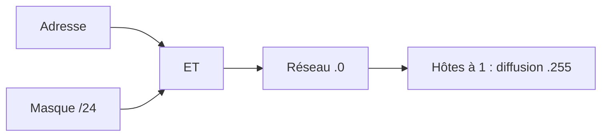
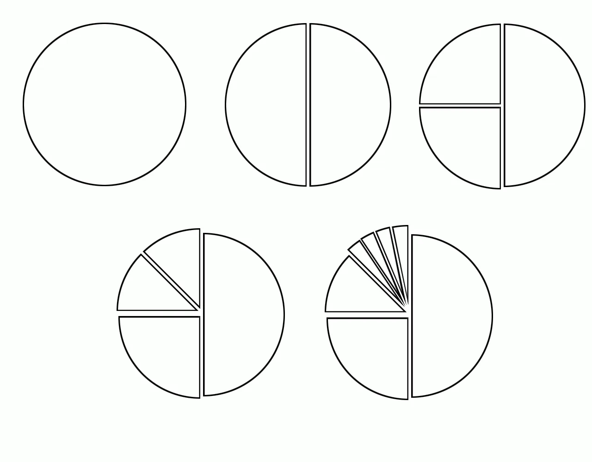

# Module 03 — L’adressage IPv4

**Séquence :** Bases des réseaux  
**Rôle dans le parcours :** calculer réseau, diffusion et découpage avant d’étudier qui peut parler à qui.

Le support de cours PDF est absent. L’onglet Cours Original contient l’énoncé et la correction du TP « Calcul des sous-réseaux », durée indiquée 3 heures. La fiche reprend aussi les notes de quiz des modules 3 et 4. L’activité Packet Tracer d’adressage n’est pas publiée.

## Objectifs

À l’issue du module, vous devez pouvoir :

- séparer identifiant réseau et identifiant d’hôte ;
- retrouver réseau, diffusion et plage avec un ET logique ;
- reconnaître classes, adresses privées et APIPA tels que les notes les décrivent ;
- traiter les six parties du TP, correction comprise.

## 1. Adresse et masque

Une adresse IPv4 a **32 bits**, quatre octets de 0 à 255. Les notes décomposent `192.168.1.1` en `11000000.10101000.00000001.00000001`.

Elle porte un identifiant réseau et un identifiant d’hôte. Le masque a des 1 sur le réseau et des 0 sur l’hôte. L’hôte a besoin de l’adresse et du masque pour calculer son réseau et sa diffusion.

| Étape des notes | Opération |
|---|---|
| Réseau | ET logique entre l’adresse et le masque |
| Diffusion | Bits hôte à 1 |
| Hôtes utilisables | Entre le réseau + 1 et la diffusion − 1 |

Exemple des notes, `192.168.1.10/24` : réseau `192.168.1.0`, hôte `10`.

Deuxième exemple, `192.168.10.100/24` :

| Élément | Valeur |
|---|---|
| Réseau | `192.168.10.0` |
| Diffusion | `192.168.10.255` |
| Hôtes | `192.168.10.1` à `192.168.10.254` |
| Type | Privée, classe C |

Troisième exemple, `172.25.192.0` avec `255.255.240.0` (`/20`) : réseau inchangé, diffusion `172.25.207.255`, hôtes de `172.25.192.1` à `172.25.207.254`. Les notes comptent 212 − 2 = 4 094 hôtes.

**Illustration IA / externe au cours — ET logique de l’exemple 192.168.10.100/24.**

## 2. Classes, CIDR, privé, APIPA

| Classe | Plage des notes | Partage par défaut |
|---|---|---|
| A | 0.0.0.0 à 127.255.255.255 | 1 octet réseau |
| B | 128.0.0.0 à 191.255.255.255 | 2 octets réseau |
| C | 192.0.0.0 à 223.255.255.255 | 3 octets réseau |
| D | 224.0.0.0 à 239.255.255.255 | Multidiffusion |
| E | 240.0.0.0 à 255.255.255.255 | Réservée dans les notes |

La notation **CIDR** indique le nombre de bits réseau après le slash. Elle remplace les blocs de taille fixe. `/24` = `255.255.255.0`, `/26` = `255.255.255.192`, `/16` = `255.255.0.0`, `/8` = `255.0.0.0`.

| Privé, RFC 1918 dans les notes | Préfixe | Adresses citées |
|---|---|---:|
| 10.0.0.0 à 10.255.255.255 | /8 | 16 777 216 |
| 172.16.0.0 à 172.31.255.255 | /12 | 1 048 576 |
| 192.168.0.0 à 192.168.255.255 | /16 | 65 536 |

Ces adresses ne sont pas routées sur Internet. Les notes font passer l’accès Internet par une traduction NAT. La boucle locale citée est `127.0.0.1`.

**APIPA**, RFC 3927 dans les notes : si le DHCP ne répond pas, le poste prend une adresse dans `169.254.0.0` à `169.254.255.255`, masque `255.255.0.0`, après une requête ARP pour éviter un doublon. Le lien local fonctionne. Internet, non.

Le sur-réseau des notes regroupe `192.168.0.0/24`, `192.168.1.0/24`, `192.168.2.0/24` et `192.168.3.0/24` en `192.168.0.0/22`.

## 3. TP, partie A — validité

Une adresse d’hôte n’est ni le réseau ni la diffusion. La première ligne est déjà remplie dans l’énoncé. La correction donne :

| Adresse | Valide | Réseau | Diffusion | Masque |
|---|---|---|---|---|
| 12.1.1.1/8 | OUI | 12.0.0.0 | 12.255.255.255 | 255.0.0.0 |
| 209.207.177.100/30 | NON | 209.207.177.100 | 209.207.177.103 | 255.255.255.252 |
| 192.0.35.12/26 | OUI | 192.0.35.0 | 192.0.35.63 | 255.255.255.192 |
| 120.146.80.1/20 | OUI | 120.146.80.0 | 120.146.95.255 | 255.255.240.0 |
| 120.80.1.0/11 | OUI | 120.64.0.0 | 120.95.255.255 | 255.224.0.0 |
| 211.104.16.17/29 | OUI | 211.104.16.16 | 211.104.16.23 | 255.255.255.248 |
| 172.168.0.1/24 | OUI | 172.168.0.0 | 172.168.0.255 | 255.255.255.0 |
| 109.168.248.32/21 | OUI | 109.168.248.0 | 109.168.255.255 | 255.255.248.0 |
| 96.139.84.12/21 | OUI | 96.139.80.0 | 96.139.87.255 | 255.255.248.0 |
| 172.16.32.0/25 | NON | 172.16.32.0 | 172.16.32.127 | 255.255.255.128 |
| 172.16.0.127/25 | NON | 172.16.0.0 | 172.16.0.127 | 255.255.255.128 |
| 192.168.19.87/29 | NON | 192.168.19.80 | 192.168.19.87 | 255.255.255.248 |
| 172.16.32.1/18 | OUI | 172.16.0.0 | 172.16.63.255 | 255.255.192.0 |
| 210.71.10.128/28 | NON | 210.71.10.128 | 210.71.10.143 | 255.255.255.240 |

## 4. TP, partie B — préfixe demandé

Le masque de départ est celui de la classe. La correction imprime :

| Demande | Réponse imprimée |
|---|---|
| Au moins 120 sous-réseaux, 172.16.0.0 | /23 |
| 2 adresses par liaison, 192.168.1.0 | /30 |
| Au moins 31 sous-réseaux, 185.221.0.0 | /21 |
| Au moins 15 sous-réseaux, 131.107.0.0 | /20 |
| Environ 500 sous-réseaux, 140.10.0.0 | /25 |
| Exactement 8 sous-réseaux, 192.168.10.0 | /27 |
| 10 sous-réseaux d’au moins 17 hôtes, 214.12.33.0 | X |
| Environ 2 020 sous-réseaux, 10.0.0.0 | /19 |
| 127 sous-réseaux, 188.23.0.0 | /23 |

Le **X** est la réponse imprimée : un réseau de classe C n’a que 8 bits d’hôte, insuffisants pour 10 sous-réseaux et 17 hôtes à la fois.

## 5. TP, partie C — scénarios

Le réseau de départ a toujours un masque de classe. La correction imprime le masque, le nombre de sous-réseaux et le nombre d’adresses.

| Scénario | Réseau | Segments | Hôtes demandés | Masque imprimé | Sous-réseaux imprimés | Adresses imprimées |
|---|---|---:|---:|---|---|---|
| 1 | 192.177.4.0 | 5 | 25 | 255.255.255.240 | 24 = 16 | 24 − 2 = 14 |
| 2 | 39.0.0.0 | 100 | 88 000 | 255.255.0.0 | 28 = 256 | 216 − 2 = 65 534 |
| 3 | 171.133.0.0 | 100 | 350 | 255.255.255.0 | 28 = 256 | 28 − 2 = 254 |
| 4 | 128.199.0.0 | 16 | 1 500 | 255.255.252.0 | 26 = 64 | 210 − 2 = 1 022 |
| 5 | 191.254.0.0 | 250 | 100 | 255.255.255.192 | 210 = 1 024 | 26 − 2 = 62 |
| 6 | 216.121.44.0 | 12 | 12 | 255.255.255.248 | 25 = 32 | 23 − 2 = 6 |
| 7 | 134.119.0.0 | 50 | 600 | 255.255.254.0 | 27 = 128 | 29 − 2 = 510 |

!!! warning "Relecture du calcul imprimé"
    Pour les scénarios 1, 2, 3, 4, 5, 6 et 7, le nombre d’adresses imprimées est inférieur au nombre d’hôtes demandé. La fiche conserve les valeurs de la correction. Elle ne les remplace pas par un autre masque.

## 6. TP, parties D et E — blocs retenus

La partie D découpe `199.210.15.0/24`. La correction, dans l’ordre croissant :

| Segment | Préfixe |
|---|---|
| 1 | 199.210.15.0/25 |
| 2 | 199.210.15.128/26 |
| 3 | 199.210.15.192/27 |
| 4 | 199.210.15.224/29 |
| 5 | 199.210.15.232/29 |
| 6 | 199.210.15.240/29 |
| 7 | 199.210.15.248/29 |

Schéma du TP — le bloc est coupé en parts de plus en plus fines.

La partie E garde les blocs du haut et ne divise que le dernier. Les adresses en rouge dans la correction sont les segments retenus. Le nombre d’adresses est celui de la ligne du tableau.

| Réseau | Segments demandés | Blocs rouges |
|---|---|---|
| 195.220.12.0/24 | 115, 58, 25, une douzaine, deux fois 5 | /25 `.0` (126), /26 `.128` (62), /27 `.192` (30), /28 `.224` (14), /29 `.240` et `.248` (6) |
| 192.168.10.0/24 | trois fois une soixantaine, une trentaine, deux fois au moins 11 | trois /26 (`.0`, `.64`, `.128`, 62), un /27 `.192` (30), deux /28 `.224` et `.240` (14) |
| 222.8.15.0/24 | une centaine, quatre fois environ 28 | /25 `.0` (126), quatre /27 (`.128`, `.160`, `.192`, `.224`, 30) |

!!! warning "Case imprimée"
    Dans la grille de 195.220.12.0, deux cases intermédiaires portent `195.22.12.144` et `195.22.12.152`. Les blocs rouges restent en `195.220.12`. La fiche ne corrige pas ces cases : elle signale l’écart.

## 7. TP, partie F — plages libres

Rouge = utilisé. Vert = disponible.

| Étude | Utilisé | Disponible imprimé en vert |
|---|---|---|
| 112.19.0.0/16 | /18 `.0` et `.64`, /19 `.128`, /20 `.160`, `.176`, `.224`, `.240` | 112.19.192.0/19 |
| 192.168.10.0/24 | /25 `.0`, /27 `.128` et `.160`, /28 `.224` | 192.168.10.192/27 et 192.168.10.240/28 |
| 199.1.1.0/24 | /26 `.0`, /27 `.128` et `.160`, /28 `.192`, `.224`, `.240` | 199.1.1.64/26 et 199.1.1.208/28 |
| Classe C, 1×62, 3×30, 4×14 | un /26, trois /27, quatre /28 | un /27 |
| Classe C, 3×30, 3×14 | trois /27, trois /28 | un /28, un /27, un /26 |
| Classe C, 1×62, 1×14 | un /26, un /28 | un /28, un /27, deux /26 |

Les trois derniers cas n’ont pas d’adresse de départ : la correction ne donne que la taille des blocs, 62, 30 ou 14 adresses.

## Résumé

1. Réseau = adresse ET masque. Diffusion = bits hôte à 1. L’hôte est strictement entre les deux.
2. CIDR compte les bits à 1. Les privées des notes sont 10/8, 172.16/12 et 192.168/16. APIPA est 169.254/16.
3. Le TP demande de refuser réseau et diffusion, puis de découper en gardant le haut du bloc.
4. La correction imprime X quand la demande ne tient pas dans la classe, et plusieurs masques plus petits que le besoin en hôtes.
5. L’activité Packet Tracer n’est pas sur le site.

## Mini-quiz

1. Quelle opération donne le réseau de 192.168.10.100/24 dans les notes ?
2. Quelle plage APIPA les notes donnent-elles, et que manque-t-il alors pour Internet ?
3. Pourquoi 172.16.32.0/25 est-elle NON dans la correction ?
4. Que signifie le X de 214.12.33.0 dans la partie B ?
5. Quel bloc vert reste libre dans 112.19.0.0/16 ?

??? note "Réponses du mini-quiz"
    1. Un ET avec le masque 255.255.255.0, qui donne 192.168.10.0. La diffusion est 192.168.10.255.
    2. 169.254.0.0 à 169.254.255.255, masque 255.255.0.0. L’adresse n’est pas routée : pas d’accès Internet.
    3. C’est l’adresse réseau du /25. Elle n’est pas attribuable à un hôte.
    4. La correction marque la demande impossible sur ce réseau de classe C.
    5. 112.19.192.0/19.
