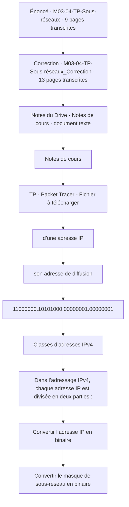
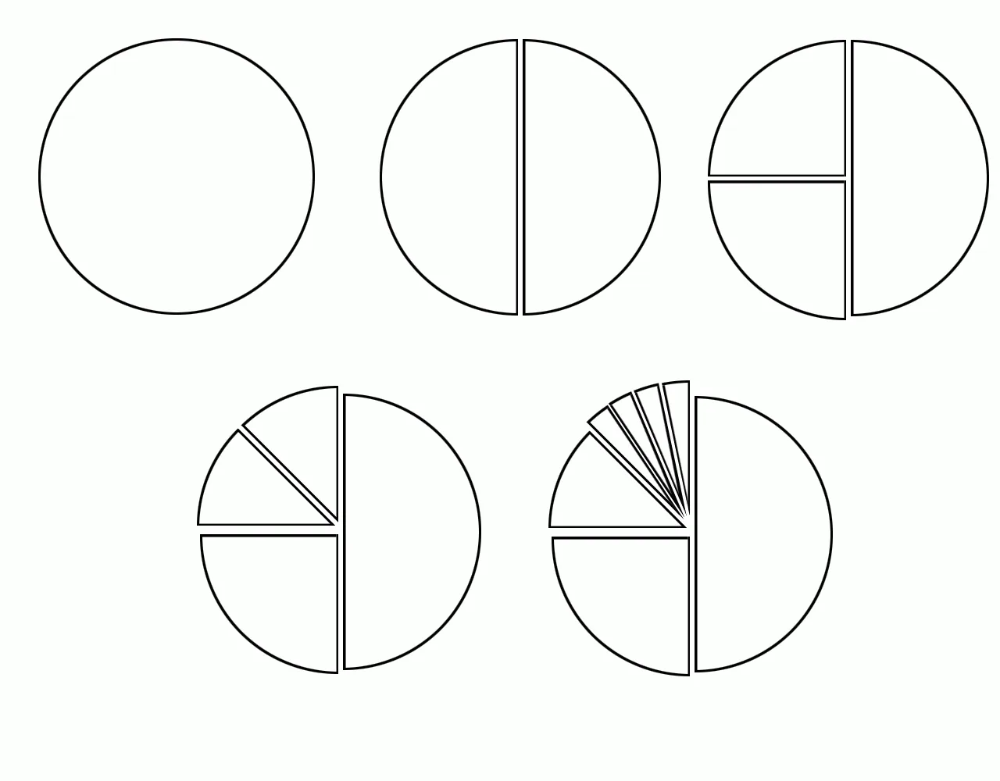
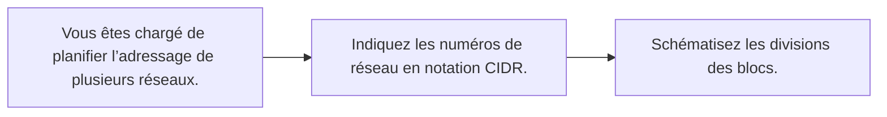
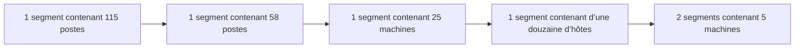
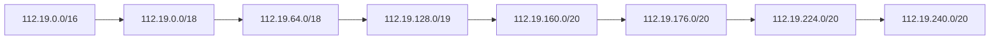

# Module 03 — L’adressage IPv4

Les parties ci-dessous reprennent le cours original, dans le même ordre. Les encadrés et les schémas répètent ses formulations.

## Parcours de lecture

1. Énoncé · M03-04-TP-Sous-réseaux · 9 pages transcrites
2. Correction · M03-04-TP-Sous-réseaux_Correction · 13 pages transcrites
3. Notes du Drive · Notes de cours · document texte
4. Notes de cours
5. TP - Packet Tracer - Fichier à télécharger
6. d’une adresse IP
7. son adresse de diffusion
8. 11000000.10101000.00000001.00000001
9. Classes d’adresses IPv4
10. Dans l’adressage IPv4, chaque adresse IP est divisée en deux parties :
11. Convertir l’adresse IP en binaire
12. Convertir le masque de sous-réseau en binaire
13. Appliquer une opération logique AND
14. Identifier la partie hôte
15. Trouver l’adresse hôte
16. Généralisation
17. ID Réseau : 11000000.10101000.00001010.00000000
18. Broadcast : 11000000.10101000.00001010.11111111
19. ID Réseau : 10101100.00011001.11000000.00000000
20. Broadcast : 10101100.00011001.11001111.11111111
21. La Notation CIDR
22. Comment Fonctionne la Notation CIDR ?
23. Pourquoi Utiliser CIDR ?
24. Étapes de Conversion d’un Masque de Sous-Réseau en Préfixe CIDR
25. Étapes pour trouver le masque IP à partir du CIDR
26. Plages d'Adresses IP Privées
27. Nombre total d'adresses : 16 777 216
28. Nombre total d'adresses : 1 048 576
29. Nombre total d'adresses : 65 536
30. Pourquoi Utiliser des Adresses Privées ?
31. Exemple Pratique
32. Principe de Fonctionnement d’APIPA
33. Exemple Pratique
34. Objectifs du Sous-réseautage
35. 2
36. Calcul du Nombre de Sous-Réseaux et d’Hôtes
37. n
38. h
39. Enoncé du TP - Communication inter-réseau
40. Un domaine de diffusion est limité par les équipements réseau suivants :
41. Le Routage
42. Le rôle principal du routage est de :
43. Un routeur est un équipement qui :
44. Lorsqu’un paquet arrive sur un routeur :
45. Exemple sans sur-réseau :
46. Exemple avec sur-réseau :
47. 11000000.10101000.000000**
48. Donc oui : je peux te faire exactement la même chose que pour les modules 1 et 2
49. * **Niveau moyen** : réseau / broadcast / plage d’hôtes / rôle du routage
50. Ma recommandation
51. * exemple pour chaque question
52. **Pourquoi ?**
53. **Exemple :**
54. **Pourquoi ?**
55. **Exemple :**
56. **Pourquoi ?**
57. **Exemple :**
58. **Pourquoi ?**
59. **Exemple :**
60. **Pourquoi ?**
61. **Exemple :**
62. **Pourquoi ?**
63. **Exemple :**
64. **Pourquoi ?**
65. **Exemple :**
66. **Pourquoi ?**
67. **Exemple :**
68. **Pourquoi ?**
69. **Exemple :**
70. **Pourquoi ?**
71. **Exemple :**
72. **Pourquoi ?**
73. **Exemple :**
74. **Pourquoi ?**
75. **Exemple :**
76. 13. Quel masque correspond au préfixe CIDR /24 ?
77. **Pourquoi ?**
78. **Pourquoi ?**
79. **Pourquoi ?**
80. **Exemple :**
81. **Pourquoi ?**
82. **Exemple :**
83. **Pourquoi ?**
84. **Exemple :**
85. **Pourquoi ?**
86. **Pourquoi ?**
87. **Exemple :**
88. **Exemple :**
89. **Pourquoi ?**
90. **Exemple :**
91. **Pourquoi ?**
92. **Pourquoi ?**
93. **Exemple :**
94. **Pourquoi ?**
95. **Exemple :**
96. 25. Si un réseau 192.168.1.0/24 est découpé en deux sous-réseaux /25, combien obtient-on de sous-réseaux ?
97. **Pourquoi ?**
98. ---
99. 26. Si un réseau /24 devient /25, combien d’hôtes utilisables possède chaque sous-réseau ?
100. Un /25 laisse **7 bits hôte** :
101. ---
102. 27. Quel est le premier sous-réseau obtenu dans l’exemple de découpage de 192.168.1.0/24 en /25 ?
103. **Exemple :**
104. **Pourquoi ?**
105. **Exemple :**
106. ---
107. 29. Quelle opération logique permet d’obtenir l’ID réseau à partir d’une IP et de son masque ?
108. **Pourquoi ?**
109. **Pourquoi ?**
110. **Exemple :**
111. 31. Quel équipement transmet les diffusions à tous les ports d’un même VLAN ?
112. **Pourquoi ?**
113. **Exemple :**
114. **Pourquoi ?**
115. **Exemple :**
116. Une entrée peut dire :
117. **Pourquoi ?**
118. **Exemple :**
119. ---
120. 35. Quel sur-réseau regroupe 192.168.0.0/24, 192.168.1.0/24, 192.168.2.0/24 et 192.168.3.0/24 ?
121. 36. Vrai ou Faux
122. **Pourquoi ?**
123. **Exemple :**
124. 37. Vrai ou Faux
125. **Exemple :**
126. 38. Vrai ou Faux
127. **Pourquoi ?**
128. 39. Vrai ou Faux
129. **Pourquoi ?**
130. 40. Vrai ou Faux
131. **Pourquoi ?**
132. 41. Vrai ou Faux
133. **Exemple :**
134. 42. Vrai ou Faux
135. **Pourquoi ?**
136. Ce que je peux faire maintenant
137. **“fais-moi la version Kahoot prête à copier”**

**Visuel externe**



SOURCE DRIVE · TRANSCRIPTION DU SUPPORT

Le contenu des documents du dossier TSSR est transcrit ci-dessous, page par page. Les textes et tableaux sont intégrés à la page Web. Aucun fichier PDF, aucune diapositive entière ni aucune reproduction de page n’est affiché. Seuls des croquis ou visuels isolés et vérifiés peuvent accompagner la transcription. Les versions et les consignes restent celles des supports de formation. Les compléments IA sont conservés dans leur onglet distinct.

## Énoncé · M03-04-TP-Sous-réseaux · 9 pages transcrites

### Page 1

#### Calcul des sous-réseaux

!!! note "À retenir"
    TP du Module 03-04 Pour effectuer ce TP, il faut avoir suivi la partie sur le découpage en sous-réseau du module 3 sur l’adressage IPv4.

TP du Module 03-04

Pour effectuer ce TP, il faut avoir suivi la partie sur le découpage en sous-réseau du module 3 sur l’adressage IPv4.

- En vidéo pour les stagiaires du campus en ligne
- Diaporama et explications pour les stagiaires en présence d’un formateur

Durée estimée : 3 heures

#### Énoncé

##### A. Validité des adresses en notation CIDR

!!! note "À retenir"
    Indiquez si les adresses sont valides pour des hôtes.

Indiquez si les adresses sont valides pour des hôtes.

Transformez la notation CIDR en notation standard.

| Adresse | Valide | @Réseau / @Diffusion | Standard |
| --- | --- | --- | --- |
| 12.1.1.1/8 | OUI | 12.0.0.0 12.255.255.255 | 12.1.1.1 255.0.0.0 |
| 209.207.177.100/30 |  |  |  |
| 192.0.35.12/26 |  |  |  |
| 120.146.80.1/20 |  |  |  |
| 120.80.1.0/11 |  |  |  |
| 211.104.16.17/29 |  |  |  |
| 172.168.0.1/24 |  |  |  |
| 109.168.248.32/21 |  |  |  |

### Page 2

| Adresse | Valide | @Réseau / @Diffusion | Standard |
| --- | --- | --- | --- |
| 96.139.84.12/21 |  |  |  |
| 172.16.32.0/25 |  |  |  |
| 172.16.0.127/25 |  |  |  |
| 192.168.19.87/29 |  |  |  |
| 172.16.32.1/18 |  |  |  |
| 210.71.10.128/28 |  |  |  |

### Page 3

##### B. Calculs de masque

!!! note "À retenir"
    Calculez le masque approprié et complétez l’adresse en notation CIDR afin d’obtenir la quantité d’hôtes ou de sous-réseaux requis.

Calculez le masque approprié et complétez l’adresse en notation CIDR afin d’obtenir la quantité d’hôtes ou de sous-réseaux requis.

Le masque de sous-réseau de départ est le masque par défaut associé à la classe.

| Paramètres requis | Notation CIDR |
| --- | --- |
| Au moins 120 sous-réseaux | 172.16.0.0/ |
| 2 adresses par sous-réseau (liaisons pt à pt) | 192.168.1.0/ |
| Au moins 31 sous-réseaux | 185.221.0.0/ |
| Au moins 15 sous-réseaux | 131.107.0.0/ |
| À peu près 500 sous-réseaux | 140.10.0.0/ |
| Exactement 8 sous-réseaux | 192.168.10.0/ |
| 10 sous-réseaux d’au moins 17 hôtes | 214.12.33.0/ |
| Environ 2020 sous-réseaux | 10.0.0.0/ |
| 127 sous-réseaux | 188.23.0.0/ |

##### C. Calculs de masques, nombre de réseaux et hôtes

!!! note "À retenir"
    Calculez le masque adapté aux exigences du scénario.

Calculez le masque adapté aux exigences du scénario.

Indiquez le nombre de sous-réseaux créés.

Indiquez le nombre d’hôtes par sous-réseau.

Le réseau de départ comporte toujours un masque de classe A, B ou C standard.

##### Scénario 1

| Rubrique | Valeur |
| --- | --- |
| Nombre de segments physiques requis | 5 |
| Nombre maximum d’hôtes par segment | 25 |
| Adresse de réseau | 192.177.4.0 |
| Masque de sous-réseau proposé |  |
| Nombre de sous-réseaux créés |  |
| Nombre maximum d’adresses par segment |  |

##### Scénario 2

| Rubrique | Valeur |
| --- | --- |
| Nombre de segments physiques requis | 100 |
| Nombre maximum d’hôtes par segment | 88.000 |
| Adresse de réseau | 39.0.0.0 |
| Masque de sous-réseau proposé |  |
| Nombre de sous-réseaux créés |  |
| Nombre maximum d’adresses par segment |  |

### Page 4

##### Scénario 3

| Rubrique | Valeur |
| --- | --- |
| Nombre de segments physiques requis | 100 |
| Nombre maximum d’hôtes par segment | 350 |
| Adresse de réseau | 171.133.0.0 |
| Masque de sous-réseau proposé |  |
| Nombre de sous-réseaux créés |  |
| Nombre maximum d’adresses par segment |  |

##### Scénario 4

| Rubrique | Valeur |
| --- | --- |
| Nombre de segments physiques requis | 16 |
| Nombre maximum d’hôtes par segment | 1 500 |
| Adresse de réseau | 128.199.0.0 |
| Masque de sous-réseau proposé |  |
| Nombre de sous-réseaux créés |  |
| Nombre maximum d’adresses par segment |  |

##### Scénario 5

| Rubrique | Valeur |
| --- | --- |
| Nombre de segments physiques requis | 250 |
| Nombre maximum d’hôtes par segment | 100 |
| Adresse de réseau | 191.254.0.0 |
| Masque de sous-réseau proposé |  |
| Nombre de sous-réseaux créés |  |
| Nombre maximum d’adresses par segment |  |

##### Scénario 6

| Rubrique | Valeur |
| --- | --- |
| Nombre de segments physiques requis | 12 |
| Nombre maximum d’hôtes par segment | 12 |
| Adresse de réseau | 216.121.44.0 |
| Masque de sous-réseau proposé |  |
| Nombre de sous-réseaux créés |  |
| Nombre maximum d’adresses par segment |  |

##### Scénario 7

| Rubrique | Valeur |
| --- | --- |
| Nombre de segments physiques requis | 50 |
| Nombre maximum d’hôtes par segment | 600 |
| Adresse de réseau | 134.119.0.0 |
| Masque de sous-réseau proposé |  |
| Nombre de sous-réseaux créés |  |
| Nombre maximum d’adresses par segment |  |

### Page 5

##### D. Découpage en sous-réseau

!!! note "À retenir"
    On découpe le bloc 199.210.15.0/24 selon le schéma suivant.

On découpe le bloc 199.210.15.0/24 selon le schéma suivant.



Schéma du support — découpage du bloc 199.210.15.0/24.

Donnez les adresses des 7 segments définis (par ordre croissant).

| Segment | Adresse |
| --- | --- |
| Segment 1 |  |
| Segment 2 |  |
| Segment 3 |  |
| Segment 4 |  |
| Segment 5 |  |
| Segment 6 |  |
| Segment 7 |  |

### Page 6

##### E. Découpage en sous-réseau

!!! note "À retenir"
    Vous êtes chargé de planifier l’adressage de plusieurs réseaux.

**Visuel externe**



- Vous êtes chargé de planifier l’adressage de plusieurs réseaux.
- Vous subdivisez successivement les blocs d’adresses et vous conservez toujours les blocs supérieurs et divisez le dernier bloc.
- Indiquez les numéros de réseau en notation CIDR.
- Schématisez les divisions des blocs.
- Indiquez le nombre d’adresses valides par segment et le nombre d’adresses global.

##### 1. Premier réseau à découper : 195.220.12.0/24

!!! note "À retenir"
    1 segment contenant 115 postes 1 segment contenant 58 postes 1 segment contenant 25 machines 1 segment contenant d’une douzaine d’hôtes 2 segments contenant 5 machines Listez les segments dans le tableau de découpage.

**Visuel externe**



- 1 segment contenant 115 postes
- 1 segment contenant 58 postes
- 1 segment contenant 25 machines
- 1 segment contenant d’une douzaine d’hôtes
- 2 segments contenant 5 machines

Listez les segments dans le tableau de découpage.

##### 2. Deuxième réseau à découper : 192.168.10.0/24

!!! note "À retenir"
    3 segments contenant d’une soixantaine d’hôtes 1 segment contenant d’une trentaine de postes 2 segments contenant d’au moins 11 machines Listez les segments dans le tableau de découpage.

**Visuel externe**


- 3 segments contenant d’une soixantaine d’hôtes
- 1 segment contenant d’une trentaine de postes
- 2 segments contenant d’au moins 11 machines

Listez les segments dans le tableau de découpage.

### Page 7

##### 3. Troisième réseau à découper : 222.8.15.0/24

- 1 segment contenant d’une centaine d’hôtes
- 4 segments contenant 28 hôtes environ

Listez les segments dans le tableau de découpage.

##### F. Recherche de sous-réseaux inutilisés

- Vous auditez plusieurs réseaux.
- On vous demande de rechercher les segments inutilisés.

##### 1. Premier réseau à étudier

**Visuel externe**



- 112.19.0.0/16

Réseaux actuellement utilisés :

- 112.19.0.0/18
- 112.19.64.0/18
- 112.19.128.0/19
- 112.19.160.0/20
- 112.19.176.0/20
- 112.19.224.0/20
- 112.19.240.0/20

Indiquer les segments inutilisés.

### Page 8

##### 2. Deuxième réseau à étudier

- 192.168.10.0/24

Réseaux actuellement utilisés :

- 192.168.10.0/25
- 192.168.10.128/27
- 192.168.10.160/27
- 192.168.10.224/28

Indiquer les segments inutilisés.

##### 3. Troisième réseau à étudier

- 199.1.1.0/24

Réseaux actuellement utilisés :

- 199.1.1.0/26
- 199.1.1.128/27
- 199.1.1.160/27
- 199.1.1.192/28
- 199.1.1.224/28
- 199.1.1.240/28

Indiquer les segments inutilisés.

##### 4. Quatrième réseau à étudier

- Réseau de classe C

Réseaux actuellement utilisés :

- 1 segment de 62 postes
- 3 segments de 30 postes
- 4 segments de 14 postes

Indiquer les segments inutilisés.

### Page 9

##### 5. Cinquième réseau à étudier

- Réseau de classe C

Réseaux actuellement utilisés :

- 3 segments de 30 postes
- 3 segments de 14 postes

Indiquer les segments inutilisés.

##### 6. Sixième réseau à étudier

- Réseau de classe C

Réseaux actuellement utilisés :

- 1 segment de 62 postes
- 1 segment de 14 postes

Indiquer les segments inutilisés.

Référence du document : 1tjvGBelc6J2jftBAFjm0l2psagWX-E-p · SHA-256 ad726effb62af7f2…

## Correction · M03-04-TP-Sous-réseaux_Correction · 13 pages transcrites

Correction originale : à consulter après avoir tenté l’exercice.

### Page 1

#### Calcul des sous-réseaux

TP du Module 03-04

Pour effectuer ce TP, il faut avoir suivi la partie sur le découpage en sous-réseau du module 3 sur l’adressage IPv4.

- En vidéo pour les stagiaires du campus en ligne
- Diaporama et explications pour les stagiaires en présence d’un formateur

Durée estimée : 3 heures

#### Énoncé

##### A. Validité des adresses en notation CIDR

Indiquez si les adresses sont valides pour des hôtes.

Transformez la notation CIDR en notation standard.

| Adresse | Valide | @Réseau / @Diffusion | Standard |
| --- | --- | --- | --- |
| 12.1.1.1/8 | OUI | 12.0.0.0 12.255.255.255 | 12.1.1.1 255.0.0.0 |
| 209.207.177.100/30 | NON | 209.207.177.100 (réseau) 209.207.177.103 | 209.207.177.100 255.255.255.252 |
| 192.0.35.12/26 | OUI | 192.0.35.0 192.0.35.63 | 192.0.35.12 255.255.255.192 |
| 120.146.80.1/20 | OUI | 120.146.80.0 120.146.95.255 | 120.146.80.1 255.255.240.0 |
| 120.80.1.0/11 | OUI | 120.64.0.0 120.95.255.255 | 120.80.1.0 255.224.0.0 |
| 211.104.16.17/29 | OUI | 211.104.16.16 211.104.16.23 | 211.104.16.17 255.255.255.248 |
| 172.168.0.1/24 | OUI | 172.168.0.0 172.168.0.255 | 172.168.0.1 255.255.255.0 |
| 109.168.248.32/21 | OUI | 109.168.248.0 109.168.255.255 | 109.168.248.32 255.255.248.0 |

### Page 2

| Adresse | Valide | @Réseau / @Diffusion | Standard |
| --- | --- | --- | --- |
| 96.139.84.12/21 | OUI | 96.139.80.0 96.139.87.255 | 96.139.84.12 255.255.248.0 |
| 172.16.32.0/25 | NON | 172.16.32.0 (réseau) 172.16.32.127 | 172.16.32.0 255.255.255.128 |
| 172.16.0.127/25 | NON | 172.16.0.0 172.16.0.127 (broadcast) | 172.16.0.127 255.255.255.128 |
| 192.168.19.87/29 | NON | 192.168.19.80 192.168.19.87 (broadcast) | 192.168.19.87 255.255.255.248 |
| 172.16.32.1/18 | OUI | 172.16.0.0 172.16.63.255 | 172.16.32.1 255.255.192.0 |
| 210.71.10.128/28 | NON | 210.71.10.128 (réseau) 210.71.10.143 | 210.71.10.128 255.255.255.240 |

### Page 3

##### B. Calculs de masque

Calculez le masque approprié et complétez l’adresse en notation CIDR afin d’obtenir la quantité d’hôtes ou de sous-réseaux requis.

Le masque de sous-réseau de départ est le masque par défaut associé à la classe.

| Paramètres requis | Notation CIDR |
| --- | --- |
| Au moins 120 sous-réseaux | 172.16.0.0/23 |
| 2 adresses par sous-réseau (liaisons pt à pt) | 192.168.1.0/30 |
| Au moins 31 sous-réseaux | 185.221.0.0/21 |
| Au moins 15 sous-réseaux | 131.107.0.0/20 |
| À peu près 500 sous-réseaux | 140.10.0.0/25 |
| Exactement 8 sous-réseaux | 192.168.10.0/27 |
| 10 sous-réseaux d’au moins 17 hôtes | 214.12.33.0/X |
| Environ 2020 sous-réseaux | 10.0.0.0/19 |
| 127 sous-réseaux | 188.23.0.0/23 |

##### C. Calculs de masques, nombre de réseaux et hôtes

Calculez le masque adapté aux exigences du scénario.

Indiquez le nombre de sous-réseaux créés.

Indiquez le nombre d’hôtes par sous-réseau.

Le réseau de départ comporte toujours un masque de classe A, B ou C standard.

##### Scénario 1

| Rubrique | Valeur |
| --- | --- |
| Nombre de segments physiques requis | 5 — 3 bits + 1 |
| Nombre maximum d’hôtes par segment | 25 — 5 bits − 1 |
| Adresse de réseau | 192.177.4.0 |
| Masque de sous-réseau proposé | 255.255.255.240 |
| Nombre de sous-réseaux créés | 2<sup>4</sup> = 16 |
| Nombre maximum d’adresses par segment | 2<sup>4</sup> − 2 = 14 |

##### Scénario 2

| Rubrique | Valeur |
| --- | --- |
| Nombre de segments physiques requis | 100 — 7 bits + 1 |
| Nombre maximum d’hôtes par segment | 88.000 — 17 bits − 1 |
| Adresse de réseau | 39.0.0.0 |
| Masque de sous-réseau proposé | 255.255.0.0 |
| Nombre de sous-réseaux créés | 2<sup>8</sup> = 256 |
| Nombre maximum d’adresses par segment | 2<sup>16</sup> − 2 = 65534 |

### Page 4

##### Scénario 3

| Rubrique | Valeur |
| --- | --- |
| Nombre de segments physiques requis | 100 — 7 bits + 1 |
| Nombre maximum d’hôtes par segment | 350 — 9 bits − 1 |
| Adresse de réseau | 171.133.0.0 |
| Masque de sous-réseau proposé | 255.255.255.0 |
| Nombre de sous-réseaux créés | 2<sup>8</sup> = 256 |
| Nombre maximum d’adresses par segment | 2<sup>8</sup> − 2 = 254 |

##### Scénario 4

| Rubrique | Valeur |
| --- | --- |
| Nombre de segments physiques requis | 16 — 4 bits + 1 + 1 |
| Nombre maximum d’hôtes par segment | 1 500 — 11 bits − 1 |
| Adresse de réseau | 128.199.0.0 |
| Masque de sous-réseau proposé | 255.255.252.0 |
| Nombre de sous-réseaux créés | 2<sup>6</sup> = 64 |
| Nombre maximum d’adresses par segment | 2<sup>10</sup> − 2 = 1022 |

##### Scénario 5

| Rubrique | Valeur |
| --- | --- |
| Nombre de segments physiques requis | 250 — 8 bits + 1 + 1 |
| Nombre maximum d’hôtes par segment | 100 — 7 bits − 1 |
| Adresse de réseau | 191.254.0.0 |
| Masque de sous-réseau proposé | 255.255.255.192 |
| Nombre de sous-réseaux créés | 2<sup>10</sup> = 1024 |
| Nombre maximum d’adresses par segment | 2<sup>6</sup> − 2 = 62 |

##### Scénario 6

| Rubrique | Valeur |
| --- | --- |
| Nombre de segments physiques requis | 12 — 4 bits + 1 |
| Nombre maximum d’hôtes par segment | 12 — 4 bits − 1 |
| Adresse de réseau | 216.121.44.0 |
| Masque de sous-réseau proposé | 255.255.255.248 |
| Nombre de sous-réseaux créés | 2<sup>5</sup> = 32 |
| Nombre maximum d’adresses par segment | 2<sup>3</sup> − 2 = 6 |

##### Scénario 7

| Rubrique | Valeur |
| --- | --- |
| Nombre de segments physiques requis | 50 — 6 bits + 1 |
| Nombre maximum d’hôtes par segment | 600 — 10 bits − 1 |
| Adresse de réseau | 134.119.0.0 |
| Masque de sous-réseau proposé | 255.255.254.0 |
| Nombre de sous-réseaux créés | 2<sup>7</sup> = 128 |
| Nombre maximum d’adresses par segment | 2<sup>9</sup> − 2 = 510 |

### Page 5

##### D. Découpage en sous-réseau

On découpe le bloc 199.210.15.0/24 selon le schéma suivant.


Schéma du support — découpage du bloc 199.210.15.0/24.

Donnez les adresses des 7 segments définis (par ordre croissant).

| Segment | Adresse |
| --- | --- |
| Segment 1 | 199.210.15.0/25 |
| Segment 2 | 199.210.15.128/26 |
| Segment 3 | 199.210.15.192/27 |
| Segment 4 | 199.210.15.224/29 |
| Segment 5 | 199.210.15.232/29 |
| Segment 6 | 199.210.15.240/29 |
| Segment 7 | 199.210.15.248/29 |

### Page 6

##### E. Découpage en sous-réseau

- Vous êtes chargé de planifier l’adressage de plusieurs réseaux.
- Vous subdivisez successivement les blocs d’adresses et vous conservez toujours les blocs supérieurs et divisez le dernier bloc.
- Indiquez les numéros de réseau en notation CIDR.
- Schématisez les divisions des blocs.
- Indiquez le nombre d’adresses valides par segment et le nombre d’adresses global.

##### 1. Premier réseau à découper : 195.220.12.0/24

- 1 segment contenant 115 postes
- 1 segment contenant 58 postes
- 1 segment contenant 25 machines
- 1 segment contenant d’une douzaine d’hôtes
- 2 segments contenant 5 machines

Segments imprimés en rouge dans la correction, avec le nombre d’adresses de la ligne du tableau.

| Préfixe | Réseau retenu | Adresses du préfixe |
| --- | --- | --- |
| /25 | 195.220.12.0 | 126 |
| /26 | 195.220.12.128 | 62 |
| /27 | 195.220.12.192 | 30 |
| /28 | 195.220.12.224 | 14 |
| /29 | 195.220.12.240 | 6 |
| /29 | 195.220.12.248 | 6 |

La grille imprimée contient aussi, hors des blocs retenus, les cases 195.22.12.144 et 195.22.12.152.

### Page 7

##### 2. Deuxième réseau à découper : 192.168.10.0/24

- 3 segments contenant d’une soixantaine d’hôtes
- 1 segment contenant d’une trentaine de postes
- 2 segments contenant d’au moins 11 machines

Segments imprimés en rouge dans la correction, avec le nombre d’adresses de la ligne du tableau.

| Préfixe | Réseau retenu | Adresses du préfixe |
| --- | --- | --- |
| /26 | 192.168.10.0 | 62 |
| /26 | 192.168.10.64 | 62 |
| /26 | 192.168.10.128 | 62 |
| /27 | 192.168.10.192 | 30 |
| /28 | 192.168.10.224 | 14 |
| /28 | 192.168.10.240 | 14 |

##### 3. Troisième réseau à découper : 222.8.15.0/24

- 1 segment contenant d’une centaine d’hôtes
- 4 segments contenant 28 hôtes environ

Segments imprimés en rouge dans la correction, avec le nombre d’adresses de la ligne du tableau.

| Préfixe | Réseau retenu | Adresses du préfixe |
| --- | --- | --- |
| /25 | 222.8.15.0 | 126 |
| /27 | 222.8.15.128 | 30 |
| /27 | 222.8.15.160 | 30 |
| /27 | 222.8.15.192 | 30 |
| /27 | 222.8.15.224 | 30 |

### Page 8

##### F. Recherche de sous-réseaux inutilisés

- Vous auditez plusieurs réseaux.
- On vous demande de rechercher les segments inutilisés.

##### 1. Premier réseau à étudier

- 112.19.0.0/16

Réseaux actuellement utilisés :

- 112.19.0.0/18
- 112.19.64.0/18
- 112.19.128.0/19
- 112.19.160.0/20
- 112.19.176.0/20
- 112.19.224.0/20
- 112.19.240.0/20

La correction marque en rouge les réseaux utilisés et en vert les réseaux disponibles.

Segments disponibles imprimés en vert :

- 112.19.192.0/19

### Page 9

##### 2. Deuxième réseau à étudier

- 192.168.10.0/24

Réseaux actuellement utilisés :

- 192.168.10.0/25
- 192.168.10.128/27
- 192.168.10.160/27
- 192.168.10.224/28

La correction marque en rouge les réseaux utilisés et en vert les réseaux disponibles.

Segments disponibles imprimés en vert :

- 192.168.10.192/27
- 192.168.10.240/28

### Page 10

##### 3. Troisième réseau à étudier

- 199.1.1.0/24

Réseaux actuellement utilisés :

- 199.1.1.0/26
- 199.1.1.128/27
- 199.1.1.160/27
- 199.1.1.192/28
- 199.1.1.224/28
- 199.1.1.240/28

La correction marque en rouge les réseaux utilisés et en vert les réseaux disponibles.

Segments disponibles imprimés en vert :

- 199.1.1.64/26
- 199.1.1.208/28

### Page 11

##### 4. Quatrième réseau à étudier

- Réseau de classe C

Réseaux actuellement utilisés :

- 1 segment de 62 postes
- 3 segments de 30 postes
- 4 segments de 14 postes

La correction marque en rouge les réseaux utilisés et en vert les réseaux disponibles.

Segments disponibles imprimés en vert :

- 1 bloc /27 laissé disponible dans la grille

Blocs retenus imprimés en rouge : un /26, trois /27 et quatre /28. La ligne du tableau indique 62, 30 et 14 adresses.

### Page 12

##### 5. Cinquième réseau à étudier

- Réseau de classe C

Réseaux actuellement utilisés :

- 3 segments de 30 postes
- 3 segments de 14 postes

La correction marque en rouge les réseaux utilisés et en vert les réseaux disponibles.

Segments disponibles imprimés en vert :

- 1 bloc /28
- 1 bloc /27
- 1 bloc /26

Blocs retenus imprimés en rouge : trois /27 et trois /28.

### Page 13

##### 6. Sixième réseau à étudier

- Réseau de classe C

Réseaux actuellement utilisés :

- 1 segment de 62 postes
- 1 segment de 14 postes

La correction marque en rouge les réseaux utilisés et en vert les réseaux disponibles.

Segments disponibles imprimés en vert :

- 1 bloc /28
- 1 bloc /27
- 2 blocs /26

Blocs retenus imprimés en rouge : un /26 et un /28.

Référence du document : 1ioU0uTtjNzBXzO5gbMCT3bxfja9CyLIc · SHA-256 3a47c869c9c914ea…

## Notes du Drive · Notes de cours · document texte

Source : notes de cours. Aucun support de cours PDF n’existe pour ce module.

## Notes de cours

Notes de cours. Source : notes de cours. Aucun support de cours PDF n’existe pour ce module.

- Présentation de l'adressage IPv4
- Les classes IPv4
- Démonstration - Les classes IPv4
- TP - Les classes IPv4
- Calcul des adresses
- Démonstration - Les types d'adresses IPv4
- TP - Calcul d'adresses
- La notation CIDR
- Démonstration - La notation CIDR
- TP - Notion CIDR
- Les adresses privées
- Les adresses APIPA
- Les sous-réseaux
- Démonstration - Calcul des adresses de sous-réseaux
- TP - Calcul des sous-réseaux
- TP - Packet Tracer Adressage IPv4

## TP - Packet Tracer - Fichier à télécharger

Une adresse IPv4 est constituée de 32 bits découpés en 4 octets distincts.

- Une adresse IPv4 est composée :
- d’un identifiant réseau (ID_Réseau)
- d’un identifiant d’hôte unique sur le réseau logique (ID_Hôtes)

Pour communiquer avec d’autres hôtes sur son réseau logique, un hôte réseau a besoin :

## d’une adresse IP

d’un masque de sous-réseau. À partir de son adresse IP et son masque de sous-réseau, l’hôte réseau va calculer :

son adresse de réseau logique

## son adresse de diffusion

Une adresse IPv4 est composée de 32 bits (4 octets) et est représentée sous forme de quatre nombres décimaux séparés par des points, chacun des quatre nombres étant compris entre 0 et 255.

Par exemple :

```
192.168.1.1
```

En binaire, cette adresse se représenterait ainsi :

## 11000000.10101000.00000001.00000001

Chaque section de 8 bits (ou 1 octet) est appelée octet, et elle permet d’obtenir 256 combinaisons possibles par section (de 0 à 255).

## Classes d’adresses IPv4

Les adresses IPv4 sont divisées en différentes classes pour mieux organiser le réseau, et chaque classe définit la répartition des bits pour le réseau et l'hôte.

Classe A : Destinée aux réseaux de grande taille, elle utilise les adresses de 0.0.0.0 à 127.255.255.255. Le premier octet représente le réseau, et les trois suivants représentent l’hôte. Classe B : Utilisée pour les réseaux de taille moyenne, avec des adresses de 128.0.0.0 à 191.255.255.255. Les deux premiers octets sont réservés pour le réseau, et les deux derniers pour l’hôte. Classe C : Utilisée pour les petits réseaux, de 192.0.0.0 à 223.255.255.255. Les trois premiers octets représentent le réseau, et le dernier octet est pour l’hôte. Classe D : Réservée pour les adresses de multidiffusion (ou multicast), allant de 224.0.0.0 à 239.255.255.255. Classe E : Réservée pour des utilisations futures ou expérimentales, de 240.0.0.0 à 255.255.255.255.

Adresses Spéciales Certaines adresses IPv4 ont des significations spécifiques :

Adresse de boucle locale (localhost) : 127.0.0.1 – utilisée pour les tests et la communication à l'intérieur de l'appareil. Adresse réseau : Utilisée pour identifier le réseau lui-même (ex. : 192.168.1.0 pour un réseau de classe C). Adresse de diffusion (broadcast) : Permet d’envoyer un message à tous les appareils d'un réseau (ex. : 192.168.1.255).

## Dans l’adressage IPv4, chaque adresse IP est divisée en deux parties :

L’ID réseau : Identifie le réseau auquel appartient l’adresse. L’adresse hôte : Identifie un appareil (hôte) spécifique dans ce réseau. Pour récupérer ces deux éléments, on utilise le masque de sous-réseau. Ce masque détermine quels bits de l’adresse IP correspondent à la partie réseau et lesquels correspondent à la partie hôte.

- Voici comment procéder :
- Étapes du Calcul des Adresses

## Convertir l’adresse IP en binaire

Une adresse IPv4 est composée de 4 octets (32 bits) exprimés en notation décimale pointée. Chaque octet est converti en binaire pour faciliter les opérations.

## Convertir le masque de sous-réseau en binaire

Le masque de sous-réseau, également écrit en notation CIDR (par exemple, /24), indique combien de bits sont dédiés à l’identification du réseau. En binaire, les bits du masque sont composés de 1 pour la partie réseau et de 0 pour la partie hôte.

## Appliquer une opération logique AND

L’opération AND est effectuée entre l’adresse IP et le masque de sous-réseau pour obtenir l’ID réseau. Dans une opération AND, un bit est 1 seulement si les deux bits correspondants dans l’opération sont également 1.

## Identifier la partie hôte

La partie hôte est obtenue en effectuant l’opération XOR ou en examinant les bits restants après avoir déduit les bits réseau.

```
Exemple Pratique : Adresse IP 192.168.1.10/24
```

Convertir en binaire

```
Adresse IP : 192.168.1.10
```

- En binaire : 11000000.10101000.00000001.00001010
- Masque de sous-réseau : /24
- En binaire : 11111111.11111111.11111111.00000000
- Appliquer l’opération AND
- L’ID réseau est obtenu en appliquant un AND entre l’adresse IP et le masque :
- Adresse IP : 11000000.10101000.00000001.00001010
- Masque : 11111111.11111111.11111111.00000000
- ID Réseau : 11000000.10101000.00000001.00000000

```
En notation décimale : 192.168.1.0
```

## Trouver l’adresse hôte

Les bits de la partie hôte sont les bits restants après l’application du masque.

- Adresse IP : 11000000.10101000.00000001.00001010
- ID Réseau : 11000000.10101000.00000001.00000000
- Adresse Hôte : 00000000.00000000.00000000.00001010
- En décimal : 10
- Résultat Final

```
Adresse IP : 192.168.1.10
ID Réseau : 192.168.1.0
```

Adresse Hôte : 10

## Généralisation

Si le masque est /n, les n premiers bits de l’adresse IP sont utilisés pour l’ID réseau, et les 32−n32 - n32−n bits restants sont pour l’adresse hôte. Le calcul est identique, quelle que soit la plage d’adresses ou le masque.

```
Analyse de l’adresse IP 192.168.10.100 avec le masque 255.255.255.0
Pour déterminer le type de cette adresse IP, nous allons analyser les éléments suivants :
```

### 1. Conversion de l’adresse IP et du masque en binaire

Adresse IP :

```
192.168.10.100 en binaire :
```

- 11000000.10101000.00001010.01100100
- Masque :

```
255.255.255.0 en binaire :
```

11111111.11111111.11111111.00000000

### 2. Calcul de l’ID réseau

L’ID réseau est obtenu en appliquant une opération AND entre l’adresse IP et le masque de sous-réseau.

- Adresse IP : 11000000.10101000.00001010.01100100
- Masque : 11111111.11111111.11111111.00000000

## ID Réseau : 11000000.10101000.00001010.00000000

En décimal, l’ID réseau est : 192.168.10.0.

### 3. Calcul de l’adresse de diffusion (broadcast)

L’adresse de broadcast est obtenue en mettant tous les bits de la partie hôte à 1.

- ID Réseau : 11000000.10101000.00001010.00000000
- Partie Hôte : 00000000.00000000.00000000.11111111

## Broadcast : 11000000.10101000.00001010.11111111

En décimal, l’adresse de broadcast est : 192.168.10.255.

### 4. Calcul des adresses disponibles pour les hôtes

Les adresses hôtes sont comprises entre :

```
ID réseau + 1 : 192.168.10.1
Adresse de broadcast - 1 : 192.168.10.254
```

Cela donne une plage d’hôtes de 192.168.10.1 à 192.168.10.254.

### 5. Reconnaissance du type d’adresse

```
L’adresse IP 192.168.10.100 :
```

Appartient à la plage d’adresses privées de la Classe C (192.168.0.0 à 192.168.255.255). Utilisée dans un réseau local (LAN). Conclusion : L’adresse 192.168.10.100 est une adresse privée utilisée pour un hôte spécifique dans le réseau 192.168.10.0/24.

Résumé des Calculs

| Élément | Valeur |
| --- | --- |
| Adresse IP | 192.168.10.100 |
| Masque | 255.255.255.0 |
| ID Réseau | 192.168.10.0 |
| Adresse de Broadcast | 192.168.10.255 |
| Plage d’Hôtes | 192.168.10.1 - 192.168.10.254 |
| Type d’Adresse | Privée (Classe C) |

```
Analyse de l’adresse IP 172.25.192.0 avec le masque 255.255.240.0
```

Pour analyser cette adresse IP et son masque, nous allons suivre les mêmes étapes.

### 1. Conversion de l’adresse IP et du masque en binaire

Adresse IP :

```
172.25.192.0 en binaire :
```

- 10101100.00011001.11000000.00000000
- Masque :

```
255.255.240.0 en binaire :
```

11111111.11111111.11110000.00000000

### 2. Calcul de l’ID réseau

L’ID réseau est obtenu en appliquant une opération AND entre l’adresse IP et le masque.

- Adresse IP : 10101100.00011001.11000000.00000000
- Masque : 11111111.11111111.11110000.00000000

## ID Réseau : 10101100.00011001.11000000.00000000

En décimal, l’ID réseau est : 172.25.192.0.

### 3. Calcul de l’adresse de diffusion (broadcast)

L’adresse de broadcast est obtenue en mettant tous les bits de la partie hôte à 1.

- ID Réseau : 10101100.00011001.11000000.00000000
- Partie Hôte : 00000000.00000000.00001111.11111111

## Broadcast : 10101100.00011001.11001111.11111111

En décimal, l’adresse de broadcast est : 172.25.207.255.

### 4. Calcul des adresses disponibles pour les hôtes

Les adresses hôtes sont comprises entre :

```
ID réseau + 1 : 172.25.192.1
Adresse de broadcast - 1 : 172.25.207.254
```

Cela donne une plage d’hôtes de 172.25.192.1 à 172.25.207.254.

### 5. Reconnaissance du type d’adresse

```
L’adresse IP 172.25.192.0 :
```

Appartient à la plage d’adresses privées de la Classe B (172.16.0.0 à 172.31.255.255). Utilisée dans un réseau local (LAN). N’est pas routable sur Internet sans translation d’adresse (NAT). Conclusion : L’adresse 172.25.192.0 est une adresse privée utilisée comme ID réseau dans le réseau 172.25.192.0/20.

Résumé des Calculs

| Élément | Valeur |
| --- | --- |
| Adresse IP | 172.25.192.0 |
| Masque | 255.255.240.0 |
| Préfixe CIDR | /20 |
| ID Réseau | 172.25.192.0 |
| Adresse de Broadcast | 172.25.207.255 |
| Plage d’Hôtes | 172.25.192.1 - 172.25.207.254 |
| Type d’Adresse | Privée (Classe B) |

Détail supplémentaire : Pourquoi un masque /20 ? Le masque 255.255.240.0 correspond à 20 bits pour l’ID réseau et 12 bits pour les hôtes :

20 bits réseau : Les 16 bits des deux premiers octets (255.255) + 4 bits supplémentaires dans le troisième octet (240). 12 bits hôtes : Les 4 bits restants dans le troisième octet + les 8 bits du dernier octet. Cela permet d’avoir (2^12 - 2 = 4094 adresses utilisables pour les hôtes.

## La Notation CIDR

La notation CIDR (Classless Inter-Domain Routing) est une méthode utilisée pour exprimer les adresses IP et les masques de sous-réseau de manière plus flexible et économique en adresses. Elle a été introduite pour répondre aux limitations de l'adressage de classe traditionnelle (classe A, B, C), qui pouvait gaspiller des adresses en allouant des blocs de tailles fixes. La notation CIDR permet donc de découper les adresses en sous-réseaux plus petits, selon les besoins spécifiques de chaque réseau.

## Comment Fonctionne la Notation CIDR ?

Dans la notation CIDR, une adresse IP est suivie d’un slash (/) et d'un nombre, qui représente le nombre de bits utilisés pour identifier la partie réseau de l'adresse. Par exemple, dans 192.168.1.0/24 :

192.168.1.0 est l'adresse réseau. /24 signifie que les 24 premiers bits de l'adresse sont réservés pour l'identification du réseau, et les 8 bits restants sont utilisés pour les hôtes.

## Pourquoi Utiliser CIDR ?

La notation CIDR permet de créer des sous-réseaux de tailles variées en fonction des besoins. Cela est essentiel pour les réseaux modernes, car elle optimise l’espace d’adressage IPv4 en attribuant des blocs de tailles adaptées plutôt que des classes entières. Par exemple, une entreprise peut obtenir un bloc de taille précise pour ses besoins (par exemple, /28, /29) sans gaspiller d’adresses inutilisées.

Conversion en Masque Décimal Chaque notation CIDR peut être convertie en masque de sous-réseau décimal. Par exemple :

/24 correspond à 255.255.255.0 en décimal (les 24 premiers bits sont des 1, les 8 restants des 0). /16 correspond à 255.255.0.0. /26 correspond à 255.255.255.192.

| CIDR | Masque Décimal | Bits de Réseau | Bits d’Hôtes | Nombre d'Hôtes |
| --- | --- | --- | --- | --- |
| /24 | 255.255.255.0 | 24 | 8 | 254 |
| /26 | 255.255.255.192 | 26 | 6 | 62 |
| /28 | 255.255.255.240 | 28 | 4 | 14 |

```
Exemple d'Utilisation : 192.168.10.0/26
Si l'on prend 192.168.10.0/26 :
```

Les 26 premiers bits (soit 255.255.255.192) sont réservés pour l'identifiant réseau. Les 6 bits restants permettent de créer 64 adresses, mais seulement 62 hôtes utilisables (les adresses de réseau et de broadcast ne sont pas attribuables aux hôtes).

Pour convertir un masque de sous-réseau en préfixe CIDR, il suffit de compter le nombre de bits à 1 dans la représentation binaire du masque. Ce nombre correspond à la valeur du préfixe CIDR.

## Étapes de Conversion d’un Masque de Sous-Réseau en Préfixe CIDR

Convertir le masque en binaire : Écrivez chaque octet du masque sous sa forme binaire. Compter le nombre de 1 : Comptez tous les bits à 1 dans le masque. Ce nombre représente le préfixe CIDR.

Exemples de Conversion

| Masque Décimal | Masque en Binaire | Préfixe CIDR |
| --- | --- | --- |
| 255.0.0.0 | 11111111.00000000.00000000.00000000 | /8 |
| 255.255.0.0 | 11111111.11111111.00000000.00000000 | /16 |
| 255.255.255.0 | 11111111.11111111.11111111.00000000 | /24 |
| 255.255.255.128 | 11111111.11111111.11111111.10000000 | /25 |
| 255.255.255.192 | 11111111.11111111.11111111.11000000 | /26 |
| 255.255.255.240 | 11111111.11111111.11111111.11110000 | /28 |

A l'inverse, pour trouver le masque à partir d’un préfixe CIDR, il faut transformer le préfixe CIDR en une série de bits à 1 (qui indiquent la partie réseau), suivie de bits à 0 (qui indiquent la partie hôte) dans une adresse de 32 bits.

## Étapes pour trouver le masque IP à partir du CIDR

Écrire le nombre de bits en 1 correspondant au préfixe CIDR. Compléter avec des 0 pour atteindre un total de 32 bits. Diviser les 32 bits en 4 octets de 8 bits. Convertir chaque octet binaire en notation décimale.

- Exemples de Conversion
- Exemple 1 : Préfixe CIDR /24
- Écrire 24 bits à 1 et compléter avec 8 bits à 0 :
- 11111111.11111111.11111111.00000000
- Diviser en octets :
- 11111111 . 11111111 . 11111111 . 00000000
- Convertir chaque octet en décimal :

```
255.255.255.0
```

Le masque est donc 255.255.255.0 pour un /24.

- Exemple 2 : Préfixe CIDR /26
- Écrire 26 bits à 1 et compléter avec 6 bits à 0 :
- 11111111.11111111.11111111.11000000
- Diviser en octets :
- 11111111 . 11111111 . 11111111 . 11000000
- Convertir chaque octet en décimal :

```
255.255.255.192
```

Le masque est donc 255.255.255.192 pour un /26.

- Exemple 3 : Préfixe CIDR /20
- Écrire 20 bits à 1 et compléter avec 12 bits à 0 :
- 11111111.11111111.11110000.00000000
- Diviser en octets :
- 11111111 . 11111111 . 11110000 . 00000000
- Convertir chaque octet en décimal :

```
255.255.240.0
```

Le masque est donc 255.255.240.0 pour un /20.

Table de Référence Rapide

| CIDR | Masque Décimal |
| --- | --- |
| /8 | 255.0.0.0 |
| /16 | 255.255.0.0 |
| /24 | 255.255.255.0 |
| /26 | 255.255.255.192 |
| /28 | 255.255.255.240 |
| /30 | 255.255.255.252 |

Les adresses IP privées sont des adresses définies par l'IETF pour être utilisées exclusivement dans les réseaux internes, comme les réseaux domestiques, les réseaux d'entreprises, ou tout environnement local où la communication se fait en interne et non sur Internet. Ces adresses privées sont utiles pour préserver l'espace d'adressage IPv4 global, qui est limité, et pour sécuriser les réseaux en empêchant l'accès direct aux adresses internes depuis l'extérieur.

## Plages d'Adresses IP Privées

Dans le cadre de la norme IPv4, trois plages d'adresses IP ont été réservées pour les réseaux privés, selon la RFC 1918 :

```
Plage de Classe A : 10.0.0.0 à 10.255.255.255
```

Préfixe CIDR : /8

## Nombre total d'adresses : 16 777 216

Utilisation : Cette plage est souvent utilisée dans les grandes entreprises qui nécessitent de nombreux sous-réseaux.

```
Plage de Classe B : 172.16.0.0 à 172.31.255.255
```

Préfixe CIDR : /12

## Nombre total d'adresses : 1 048 576

Utilisation : Utilisée dans les réseaux de taille moyenne qui nécessitent une certaine flexibilité dans le découpage en sous-réseaux.

```
Plage de Classe C : 192.168.0.0 à 192.168.255.255
```

Préfixe CIDR : /16

## Nombre total d'adresses : 65 536

Utilisation : Très populaire pour les petits réseaux, comme les réseaux domestiques et les petites entreprises.

## Pourquoi Utiliser des Adresses Privées ?

Les adresses privées permettent d’éviter l'épuisement rapide de l'espace d'adressage IPv4 en attribuant des adresses IP locales au sein d'un réseau fermé. Les ordinateurs, smartphones, imprimantes et autres appareils connectés au réseau utilisent ces adresses pour communiquer entre eux.

Ces adresses privées ne sont pas routables sur Internet. Cela signifie qu'un appareil ayant une adresse IP privée ne peut pas être directement atteint depuis l’extérieur. Pour communiquer avec Internet, il doit passer par un processus de NAT (Network Address Translation), qui traduit les adresses IP privées en une adresse IP publique unique assignée au réseau.

Économie d'Adresses Publiques : En regroupant les appareils sous une seule adresse IP publique grâce au NAT, on réduit la demande d’adresses IP uniques sur Internet.

Sécurité : Les adresses privées ne sont pas accessibles depuis l’extérieur, ce qui limite les risques d’intrusion directe.

Flexibilité : La segmentation des réseaux en sous-réseaux privés permet une gestion plus efficace du réseau interne, surtout dans les environnements de grande échelle.

Les adresses privées ne peuvent pas être utilisées pour des services accessibles depuis l’extérieur sans configuration supplémentaire (NAT, DMZ). Elles sont également limitées en termes de portée et ne permettent pas d’accéder directement à Internet, car elles ne sont pas routées en dehors du réseau local.

## Exemple Pratique

Dans un réseau domestique, le routeur de la maison a généralement une adresse IP publique côté Internet (fournie par le FAI) et utilise une adresse IP privée (comme 192.168.1.1) pour le réseau interne. Tous les appareils connectés au réseau domestique (ordinateurs, smartphones, tablettes, etc.) obtiennent une adresse privée dans la plage 192.168.1.x. Lorsqu’un de ces appareils souhaite accéder à Internet, le routeur effectue la traduction NAT et transmet la requête en utilisant l’adresse IP publique.

Les adresses APIPA (Automatic Private IP Addressing) sont des adresses IP automatiquement attribuées par un appareil dans un réseau local lorsqu'il ne parvient pas à obtenir d’adresse IP d’un serveur DHCP. APIPA, standardisé par Microsoft et repris dans la norme RFC 3927, permet aux appareils de continuer à communiquer localement même en l'absence de configuration d'adresse IP via DHCP ou d'administrateur réseau.

## Principe de Fonctionnement d’APIPA

Lorsqu'un appareil est configuré pour obtenir automatiquement une adresse IP, mais ne reçoit pas de réponse d’un serveur DHCP, il utilise alors le mécanisme APIPA pour s’auto-attribuer une adresse IP. APIPA choisit l’adresse parmi la plage réservée pour ce type d’adressage :

```
Plage APIPA : 169.254.0.0 à 169.254.255.255
Masque de sous-réseau : 255.255.0.0
```

L’appareil sélectionne une adresse dans cette plage et vérifie que celle-ci n’est pas déjà utilisée sur le réseau en envoyant une requête ARP (Address Resolution Protocol). Si aucune réponse n'est reçue, l’adresse est attribuée à l’appareil. Sinon, l’appareil choisit une autre adresse et recommence la vérification.

Continuité du Réseau Local : APIPA permet aux appareils de continuer à communiquer entre eux dans le même réseau local, même en l’absence de serveur DHCP.

Configuration Automatique : Cette fonctionnalité est automatique et ne nécessite aucune configuration manuelle, ce qui est utile dans les petits réseaux ou pour des utilisateurs non-experts.

Pas d’Accès Internet : Les adresses APIPA ne sont pas routables, ce qui signifie que les appareils avec ces adresses ne peuvent pas communiquer au-delà du réseau local, donc sans accès à Internet ou à d’autres réseaux externes.

Utilisation en Réseaux Restreints : APIPA est surtout utile pour les réseaux de petite taille où la communication locale est suffisante.

## Exemple Pratique

Dans un bureau où les ordinateurs sont configurés pour recevoir une adresse IP via DHCP, un problème avec le serveur DHCP peut empêcher l'attribution d'adresses. Chaque ordinateur activera alors l’APIPA et s’auto-attribuera une adresse dans la plage 169.254.x.x. Les ordinateurs pourront ainsi continuer de communiquer localement pour partager des fichiers ou des imprimantes, mais n'auront pas d’accès Internet.

Les sous-réseaux (ou subnetting) sont une méthode permettant de diviser un réseau IP en plusieurs réseaux plus petits, appelés sous-réseaux. Le sous-réseautage est essentiel dans l’adressage IPv4 pour organiser, segmenter et optimiser la gestion des adresses IP au sein d'un réseau. Cela permet de mieux utiliser les adresses disponibles, de faciliter la gestion du trafic et d’améliorer la sécurité du réseau.

## Objectifs du Sous-réseautage

Optimisation de l’espace d’adressage : En divisant un grand réseau en sous-réseaux plus petits, on peut réduire le gaspillage d’adresses IP, surtout dans les réseaux ayant moins de périphériques. Amélioration des performances : Le sous-réseautage réduit la taille des domaines de diffusion (broadcast domains), ce qui diminue le nombre de paquets de diffusion et améliore les performances du réseau. Sécurité : En segmentant un réseau en sous-réseaux, on peut limiter l’accès entre les différents segments et mieux contrôler le flux de données.

Structure d’une adresse IP et du masque de sous-réseau Une adresse IPv4 est composée de 32 bits divisés en deux parties :

Partie Réseau : Identifie le réseau principal. Partie Hôte : Identifie les périphériques (hôtes) au sein de ce réseau. Le masque de sous-réseau est utilisé pour spécifier quelles parties de l’adresse IP représentent le réseau et lesquelles représentent les hôtes. En créant des sous-réseaux, on modifie ce masque pour "emprunter" certains bits de la partie hôte afin de les utiliser pour identifier des sous-réseaux.

Exemple de sous-réseautage avec une adresse IPv4

```
Imaginons une adresse IP de réseau 192.168.1.0/24 :
```

Le masque /24 correspond à un masque de sous-réseau 255.255.255.0, où les 24 premiers bits sont réservés pour le réseau, et les 8 bits restants pour les hôtes. Ce réseau peut théoriquement contenir jusqu'à 254 hôtes (soit 2<sup>8</sup>

−

## 2

28−2, en excluant l’adresse réseau et l’adresse de diffusion). Si l’on souhaite créer deux sous-réseaux, on peut utiliser un masque de sous-réseau /25 (ou 255.255.255.128), divisant ainsi le réseau initial en deux sous-réseaux distincts :

```
Sous-réseau 1 : 192.168.1.0/25 (adresses de 192.168.1.0 à 192.168.1.127)
Sous-réseau 2 : 192.168.1.128/25 (adresses de 192.168.1.128 à 192.168.1.255)
```

## Calcul du Nombre de Sous-Réseaux et d’Hôtes

Pour déterminer le nombre de sous-réseaux et d’hôtes disponibles, il faut connaître le nombre de bits "empruntés" dans le masque :

- Nombre de Sous-Réseaux :
- 2
- n
- où

## n

est le nombre de bits empruntés pour la partie réseau.

- Nombre d’Hôtes par Sous-Réseau :
- 2
- h
- −
- 2
- , où

## h

est le nombre de bits restants pour les hôtes (on soustrait 2 pour l’adresse réseau et l’adresse de broadcast).

```
Exemple : Réseau 192.168.1.0 avec Masque /26
```

Si on utilise un masque /26 (255.255.255.192), cela donne quatre sous-réseaux avec 62 hôtes chacun :

```
Sous-réseau 1 : 192.168.1.0 à 192.168.1.63
Sous-réseau 2 : 192.168.1.64 à 192.168.1.127
Sous-réseau 3 : 192.168.1.128 à 192.168.1.191
Sous-réseau 4 : 192.168.1.192 à 192.168.1.255
```

Efficacité : Meilleure gestion de l’espace d’adressage, ce qui est important dans les grands réseaux.

Contrôle et Sécurité : Possibilité de restreindre l’accès entre les sous-réseaux.

Réduction de la Diffusion : En réduisant la taille des domaines de diffusion, le sous-réseautage améliore la performance globale du réseau.

- Le domaine de diffusion
- La communication entre deux PC
- La communication entre deux nœuds
- La communication entre deux nœuds - suite
- Le routage
- Le sur-réseau
- Démonstration - La communication réseau
- Enoncé du TP - Communication dans un réseau

## Enoncé du TP - Communication inter-réseau

Dans le cadre des réseaux informatiques, un domaine de diffusion (ou broadcast domain) est une portion logique du réseau dans laquelle une trame de diffusion (broadcast) est transmise à tous les appareils connectés. Cela permet à une machine d’envoyer un message destiné à tous les autres équipements présents dans le même domaine.

### 1. Définition de la Diffusion (Broadcast)

La diffusion est un mécanisme dans lequel une trame ou un paquet est envoyé avec une adresse de destination spéciale appelée adresse de broadcast. En IPv4, cette adresse est constituée de tous les bits à 1 dans la partie hôte, par exemple 192.168.1.255 dans un réseau avec un masque 255.255.255.0.

Tous les appareils du domaine de diffusion reçoivent ce message, même si ce n’est pas explicitement destiné à eux. Les messages de broadcast sont souvent utilisés pour des tâches comme :

La découverte de machines (exemple : DHCP). La résolution d’adresses (exemple : ARP).

### 2. Composants du Domaine de Diffusion

## Un domaine de diffusion est limité par les équipements réseau suivants :

Switchs (commutateurs) : Ils transmettent les diffusions à tous les ports d’un même VLAN. Routeurs : Ils délimitent les domaines de diffusion. Un routeur ne transmet pas les trames de diffusion d’un réseau à un autre, créant ainsi des frontières entre domaines. VLAN (Virtual LAN) : Chaque VLAN constitue un domaine de diffusion distinct, même s’ils sont configurés sur le même switch physique.

### 3. Importance du Domaine de Diffusion

Un domaine de diffusion trop grand peut entraîner des problèmes de performances, car chaque appareil du domaine doit traiter les diffusions, même si elles ne lui sont pas destinées. Cela peut surcharger le réseau et les ressources des machines.

C’est pourquoi les réseaux modernes sont souvent segmentés en plusieurs domaines de diffusion pour :

Réduire le trafic inutile. Améliorer les performances globales. Sécuriser la communication entre différentes parties du réseau.

### 4. Exemple Pratique

Dans un réseau local avec un switch, si 10 ordinateurs sont connectés au même VLAN, ils appartiennent tous au même domaine de diffusion. Si un ordinateur envoie une requête de type ARP (Who has 192.168.1.10?), cette requête est envoyée à tous les autres appareils. En revanche, si ce réseau est segmenté avec un routeur ou des VLANs, la diffusion sera limitée au sous-réseau correspondant.

### 5. Lien avec le Modèle OSI

Le domaine de diffusion opère principalement à la couche 2 (Liaison de données) du modèle OSI. Les diffusions sont transmises à tous les appareils d’un même domaine via l’adresse MAC de destination FF:FF:FF:FF:FF:FF. À la couche 3 (Réseau), les diffusions utilisent des adresses IP spéciales comme 192.168.1.255.

### 6. Segmenter les Domaines de Diffusion

Pour limiter les problèmes liés aux domaines de diffusion trop étendus, on peut utiliser :

Des routeurs : Ils créent des segments de réseau distincts. Des VLANs : Ils divisent logiquement un réseau en plusieurs sous-réseaux indépendants. Le domaine de diffusion est une notion clé pour comprendre comment le trafic de diffusion circule dans un réseau. Bien qu’il facilite certaines communications, il peut rapidement devenir une source de congestion si le réseau n’est pas correctement segmenté. L’utilisation de VLANs et de routeurs permet d’organiser et d’optimiser le trafic dans un réseau informatique.

## Le Routage

Le routage est un processus fondamental en réseau informatique qui consiste à déterminer le chemin que doivent emprunter les données (paquets) pour atteindre leur destination. Ce mécanisme se déroule principalement à la couche 3 (Réseau) du modèle OSI, où les routeurs et les équipements connectés décident de la meilleure route pour acheminer les paquets à travers un ou plusieurs réseaux.

### 1. Rôle du Routage

Le routage intervient lorsque des données doivent traverser plusieurs réseaux pour atteindre leur destination. Contrairement à la communication au sein d’un même réseau local (LAN), qui repose sur des commutateurs (switches), le routage est nécessaire pour connecter différents sous-réseaux ou réseaux distants via des équipements appelés routeurs.

## Le rôle principal du routage est de :

Acheminer les paquets IP vers leur destination. Trouver le chemin optimal pour minimiser le temps de transit et éviter les congestions. Séparer les domaines de diffusion, limitant ainsi le trafic inutile.

### 2. Les Routeurs

## Un routeur est un équipement qui :

Lit l’adresse IP de destination dans chaque paquet. Consulte sa table de routage, une base de données interne contenant les routes disponibles. Décide du meilleur chemin pour transmettre les données, en fonction de critères tels que la distance (nombre de sauts) ou la priorité d’une route.

### 3. Table de Routage

La table de routage est au cœur du fonctionnement des routeurs. Elle contient des informations sur :

Les réseaux connus : Les sous-réseaux que le routeur peut atteindre. Les passerelles : Les routeurs voisins qui peuvent relayer les paquets. Les métriques : Des valeurs utilisées pour évaluer la "coût" ou l’efficacité de chaque route (distance, bande passante, etc.).

Exemple d’entrée dans une table de routage :

| Réseau Destination | Masque | Passerelle | Interface Sortante |
| --- | --- | --- | --- |
| 192.168.1.0 | 255.255.255.0 | 192.168.0.1 | Ethernet 0 |
| 10.0.0.0 | 255.0.0.0 | 192.168.0.2 | Ethernet 1 |

### 4. Types de Routage

Il existe deux types principaux de routage :

### a) Routage statique

Les routes sont configurées manuellement par un administrateur réseau. Idéal pour les petits réseaux ou des routes fixes. Avantages : Simplicité, contrôle précis. Inconvénients : Manque de flexibilité en cas de panne ou de changement.

### b) Routage dynamique

Les routes sont déterminées automatiquement à l’aide de protocoles de routage. Les protocoles de routage comme RIP, OSPF, ou BGP permettent aux routeurs d’échanger des informations et d’ajuster les routes en fonction des changements dans le réseau. Avantages : Adaptabilité, gestion automatique des pannes. Inconvénients : Configuration plus complexe et consommation de ressources.

### 5. Processus de Routage

## Lorsqu’un paquet arrive sur un routeur :

Le routeur lit l’adresse IP de destination dans l’en-tête du paquet. Il consulte sa table de routage pour déterminer où envoyer le paquet. Si aucune route n’est trouvée, il transmet généralement le paquet à une passerelle par défaut. Le paquet est ensuite envoyé vers le prochain routeur ou la destination finale.

### 6. Exemple : Routage d’un Paquet

Un ordinateur avec l’adresse IP 192.168.1.100 (masque 255.255.255.0) envoie des données à une machine distante 10.0.0.1 :

L’ordinateur identifie que la destination 10.0.0.1 n’est pas sur le même réseau local (192.168.1.0/24). Le paquet est envoyé au routeur configuré comme passerelle par défaut (par exemple 192.168.1.1). Le routeur consulte sa table de routage et trouve une route vers le réseau 10.0.0.0/8. Il transmet le paquet au routeur suivant, ou directement à la destination si elle est atteignable.

### 7. Avantages du Routage

Permet la communication entre différents réseaux. Optimise le trafic réseau en choisissant les meilleurs chemins. Assure la scalabilité en supportant des réseaux complexes et vastes (exemple : Internet).

Le sur-réseau, ou supernetting, est une technique utilisée en réseau pour regrouper plusieurs sous-réseaux en un seul réseau plus grand. C’est l’opération inverse du sous-réseau (subnetting). Le sur-réseau est souvent utilisé pour réduire la taille des tables de routage et simplifier la gestion des adresses IP dans des réseaux de grande envergure, comme l’Internet.

### 1. Principe du Sur-Réseau

Dans un réseau, le sur-réseau consiste à fusionner plusieurs plages d’adresses IP contiguës pour en former une plus grande, en utilisant un masque de réseau moins restrictif (moins de bits à 1 dans le masque). Cela permet de représenter plusieurs sous-réseaux avec une seule entrée dans une table de routage.

## Exemple sans sur-réseau :

Les réseaux 192.168.0.0/24, 192.168.1.0/24, 192.168.2.0/24 et 192.168.3.0/24 sont représentés comme quatre routes distinctes dans une table de routage.

## Exemple avec sur-réseau :

Ces mêmes réseaux peuvent être regroupés en un seul sur-réseau : 192.168.0.0/22.

### 2. Avantages du Sur-Réseau

Réduction de la taille des tables de routage : En combinant plusieurs réseaux, on simplifie les tables de routage, ce qui améliore la performance des routeurs. Meilleure gestion des ressources : Utile dans les grandes infrastructures où les adresses doivent être regroupées pour une administration simplifiée. Efficacité sur Internet : Le sur-réseau est utilisé dans le cadre du routage interdomaines (CIDR) pour regrouper des adresses IP en blocs.

### 3. Sur-Réseau et CIDR

Le sur-réseau utilise la notation CIDR (Classless Inter-Domain Routing), qui est une méthode flexible pour attribuer des plages d’adresses IP.

Dans l’exemple 192.168.0.0/22, le préfixe /22 indique que les 22 premiers bits sont réservés pour l’identification du réseau. Cela laisse 10 bits pour les adresses d’hôtes, permettant de regrouper 4 sous-réseaux de 256 adresses (soit 1024 adresses).

### 4. Étapes pour Créer un Sur-Réseau

### a) Identifier les sous-réseaux à regrouper :

Les plages doivent être contiguës et alignées sur des limites binaires compatibles. Exemple : 192.168.0.0/24, 192.168.1.0/24, 192.168.2.0/24, 192.168.3.0/24.

### b) Trouver le nouveau préfixe :

Convertissez les adresses réseau des sous-réseaux en binaire.

Exemple pour les réseaux ci-dessus :

```
192.168.0.0 = 11000000.10101000.00000000.00000000
192.168.1.0 = 11000000.10101000.00000001.00000000
192.168.2.0 = 11000000.10101000.00000010.00000000
192.168.3.0 = 11000000.10101000.00000011.00000000
```

Identifiez les bits communs partagés entre ces adresses.

Ici, les 22 premiers bits sont identiques :

## 11000000.10101000.000000**

Le masque est donc /22.

### c) Regrouper les réseaux :

Le sur-réseau correspondant est 192.168.0.0/22, couvrant les plages d’adresses 192.168.0.0 à 192.168.3.255.

### 5. Limites du Sur-Réseau

Perte de granularité : Le regroupement des réseaux peut réduire la précision pour identifier ou isoler des plages spécifiques. Alignement des plages requis : Les sous-réseaux doivent être contigus et alignés sur des limites binaires, ce qui limite parfois son application. Risque de conflits : En superposant des plages d’adresses mal planifiées, des conflits d’adresses IP peuvent survenir.

### 6. Exemple Pratique

Imaginons un fournisseur d’accès à Internet (FAI) qui attribue plusieurs sous-réseaux à ses clients :

```
192.168.0.0/24 pour Client 1
192.168.1.0/24 pour Client 2
192.168.2.0/24 pour Client 3
192.168.3.0/24 pour Client 4
```

Au lieu d’annoncer quatre routes distinctes sur Internet, le FAI peut utiliser un sur-réseau 192.168.0.0/22, simplifiant ainsi le routage.

Le sur-réseau est une technique de regroupement d’adresses IP qui permet de simplifier les tables de routage et d’améliorer l’efficacité du réseau, en particulier à grande échelle. Bien qu’il nécessite une planification attentive pour garantir l’alignement des plages d’adresses, il reste un outil puissant pour optimiser l’infrastructure des réseaux modernes.

Oui — et cette fois je vais le faire proprement **en me basant sur le fichier du module 3 et 4**, pas en improvisant.

- ## Ce que j’ai identifié dans ton cours des modules 3 et 4
- Les thèmes visibles dans le fichier sont notamment :
- * **Adressage IPv4**
- * structure d’une IPv4 sur 32 bits
- * ID réseau / ID hôte
- * classes IPv4
- * adresses spéciales
- * adresses privées
- * APIPA
- * **Calcul réseau**
- * adresse réseau
- * broadcast
- * plage d’hôtes
- * calcul avec masque
- * **CIDR**
- * conversion **CIDR → masque**
- * conversion **masque → CIDR**
- * nombre d’hôtes selon le préfixe
- * **Sous-réseaux**
- * calculs de sous-réseaux
- * **Domaine de diffusion**
- * rôle
- * segmentation via routeurs / VLAN
- * **Routage**
- * rôle du routeur
- * table de routage
- * routage statique vs dynamique
- * passerelle par défaut
- * protocoles RIP / OSPF / BGP
- * **Sur-réseau (supernetting)**
- * principe
- * regroupement de réseaux contigus

```
* exemple **192.168.0.0/24 à 192.168.3.0/24 → 192.168.0.0/22**
```

## Donc oui : je peux te faire exactement la même chose que pour les modules 1 et 2

Je te propose de te produire un **quiz Kahoot complet modules 3 et 4** avec la **même logique** :

- ### Structure
- * **Niveau facile** : définitions, classes, adresses privées, CIDR de base

## * **Niveau moyen** : réseau / broadcast / plage d’hôtes / rôle du routage

* **Niveau difficile** : calculs de sous-réseaux, conversion masque↔CIDR, nombre d’hôtes, supernetting * **Questions pièges** : vrai/faux sur APIPA, broadcast, passerelle, routeur, etc.

- ### Format
- Pour **chaque question**, je te donnerai :

### 1. **la question Kahoot**

### 2. **4 réponses**

### 3. **la bonne réponse**

### 4. **une explication claire**

### 5. **un exemple concret**, comme je l’ai fait pour modules 1 et 2

---

```
# Ce que je te propose maintenant
```

- Je peux te générer **tout de suite** un pack complet du style :
- ## Quiz Kahoot — Modules 3 et 4
- * **35 questions**
- * difficulté progressive
- * **100 % basé sur ton cours**
- * avec explication + exemple pour **chaque question**
- ### Exemple du rendu que je vais te faire :
- * **Question 1** — Que signifie le préfixe /24 ?
- * **Question 2** — Quelle est la plage privée de classe B ?

```
* **Question 3** — Convertir 255.255.255.192 en CIDR
* **Question 4** — Trouver l’adresse réseau de 192.168.10.100/24
* **Question 5** — Trouver le broadcast de 172.25.192.0 avec 255.255.240.0
* **Question 6** — Combien d’hôtes utilisables dans un /26 ?
* **Question 7** — Quel est le rôle d’une passerelle par défaut ?
* **Question 8** — Quelle différence entre routage statique et dynamique ?
* **Question 9** — Quel sur-réseau regroupe 192.168.0.0/24 à 192.168.3.0/24 ?
```

* etc.

---

## Ma recommandation

Vu ce que tu veux, le plus efficace est que je te livre directement **la version finale complète**, comme pour les modules 1 et 2, en un seul bloc.

- 👉 **Si tu veux, réponds juste :**
- **“fais-moi le quiz complet modules 3 et 4”**
- et je te génère **tout le quiz complet maintenant** :
- * 35 questions
- * réponses
- * correction
- * explication

## * exemple pour chaque question

* sans hors sujet, uniquement à partir du cours.

Oui — je te fais le **quiz complet modules 3 et 4**, en restant **strictement collé à ton cours** : IPv4, classes, adresses privées, APIPA, calcul réseau/broadcast/hôtes, CIDR, sous-réseautage, domaine de diffusion, routage et sur-réseau. Je me base sur les éléments explicitement présents dans ton fichier.

- Je vais te donner le **même format que pour modules 1 et 2** :
- * **question Kahoot**
- * **4 réponses**
- * **bonne réponse**
- * **explication**
- * **exemple concret**
- ---

```
# Quiz Kahoot — Modules 3 et 4
```

---

```
# Niveau Facile (1 à 12)
```

- ## 1. Combien de bits contient une adresse IPv4 ?
- * A. 16
- * B. 32 ✅
- * C. 48
- * D. 64

## **Pourquoi ?**

Une adresse IPv4 est composée de **4 octets**, donc **4 × 8 = 32 bits**.

## **Exemple :**

192.168.1.10 = 4 nombres séparés par des points → chaque nombre = 1 octet.

- ---
- ## 2. Dans une adresse IPv4, à quoi sert le masque de sous-réseau ?
- * A. À chiffrer l’adresse IP
- * B. À séparer la partie réseau et la partie hôte ✅
- * C. À convertir l’adresse en MAC
- * D. À calculer la passerelle

## **Pourquoi ?**

Le masque sert à savoir **quels bits appartiennent au réseau** et **quels bits appartiennent à l’hôte**.

## **Exemple :**

Avec **192.168.1.10/24**, les **24 premiers bits** sont le réseau, les **8 derniers** sont la partie hôte.

- ---
- ## 3. Quelle classe IPv4 correspond aux petits réseaux dans le cours ?
- * A. Classe A
- * B. Classe B
- * C. Classe C ✅
- * D. Classe D

## **Pourquoi ?**

Dans ton cours, la **classe C** est utilisée pour les **petits réseaux** et couvre **192.0.0.0 à 223.255.255.255**.

## **Exemple :**

192.168.1.0/24 est un cas typique de réseau de type classe C.

---

```

## 4. Quelle classe IPv4 couvre les adresses de 128.0.0.0 à 191.255.255.255 ?

```

- * A. Classe A
- * B. Classe B ✅
- * C. Classe C
- * D. Classe D

## **Pourquoi ?**

Le cours indique que la **classe B** correspond à cette plage.

## **Exemple :**

172.25.192.0 appartient à cette plage.

- ---
- ## 5. Quelle adresse est l’adresse de boucle locale (localhost) ?

```
* A. 192.168.1.1
* B. 10.0.0.1
* C. 127.0.0.1 ✅
* D. 255.255.255.255
```

## **Pourquoi ?**

127.0.0.1 est l’adresse utilisée pour tester la machine elle-même.

## **Exemple :**

Quand tu fais un test local sur ton PC, tu peux viser **127.0.0.1**.

- ---
- ## 6. Quelle adresse permet d’envoyer un message à tous les hôtes d’un réseau ?
- * A. Adresse MAC
- * B. Adresse de broadcast ✅
- * C. Adresse APIPA
- * D. Adresse loopback

## **Pourquoi ?**

L’adresse de **broadcast** a tous les bits de la partie hôte à 1.

## **Exemple :**

Dans **192.168.1.0/24**, le broadcast est **192.168.1.255**.

- ---
- ## 7. Quelle plage correspond aux adresses privées de classe A ?

```
* A. 172.16.0.0 à 172.31.255.255
* B. 192.168.0.0 à 192.168.255.255
* C. 10.0.0.0 à 10.255.255.255 ✅
* D. 127.0.0.0 à 127.255.255.255
```

## **Pourquoi ?**

C’est l’une des trois plages privées RFC 1918 mentionnées dans ton cours.

## **Exemple :**

Un grand réseau d’entreprise peut utiliser des adresses comme **10.1.20.5**.

- ---
- ## 8. Quelle plage correspond aux adresses privées de classe B ?

```
* A. 10.0.0.0 à 10.255.255.255
* B. 172.16.0.0 à 172.31.255.255 ✅
* C. 192.168.0.0 à 192.168.255.255
* D. 224.0.0.0 à 239.255.255.255
```

## **Pourquoi ?**

Ton cours donne explicitement cette plage privée.

## **Exemple :**

**172.25.192.0** fait partie de cette plage.

- ---
- ## 9. Quelle plage correspond aux adresses privées de classe C ?

```
* A. 192.168.0.0 à 192.168.255.255 ✅
* B. 172.16.0.0 à 172.31.255.255
* C. 10.0.0.0 à 10.255.255.255
* D. 224.0.0.0 à 239.255.255.255
```

## **Pourquoi ?**

C’est la plage privée la plus courante dans les petits réseaux.

## **Exemple :**

Ta box à la maison utilise souvent **192.168.1.x**.

- ---
- ## 10. Quelle plage est utilisée par APIPA ?
- * A. 10.x.x.x
- * B. 172.16.x.x
- * C. 169.254.x.x ✅
- * D. 192.168.x.x

## **Pourquoi ?**

APIPA attribue automatiquement une adresse **169.254.x.x** quand aucun serveur DHCP ne répond.

## **Exemple :**

Si ton PC n’obtient pas d’adresse du DHCP, il peut s’auto-attribuer **169.254.12.8**.

- ---
- ## 11. APIPA permet surtout :
- * A. d’accéder à Internet plus vite
- * B. de communiquer localement sans DHCP ✅
- * C. de chiffrer les paquets
- * D. de remplacer le routage

## **Pourquoi ?**

APIPA permet de **continuer à communiquer sur le réseau local**, mais **pas sur Internet**.

## **Exemple :**

Deux PC en panne de DHCP peuvent encore échanger des fichiers localement via des adresses 169.254.x.x.

- ---
- ## 12. Que signifie la notation /24 dans une adresse IPv4 ?
- * A. 24 bits pour les hôtes
- * B. 24 bits pour la partie réseau ✅
- * C. 24 octets dans le masque
- * D. 24 adresses utilisables

## **Pourquoi ?**

Le **/24** indique que **24 bits** sont réservés au réseau.

## **Exemple :**

**192.168.1.0/24** → masque **255.255.255.0**.

---

```
# Niveau Moyen (13 à 24)
```

## 13. Quel masque correspond au préfixe CIDR /24 ?

```
* A. 255.255.0.0
* B. 255.255.255.0 ✅
* C. 255.255.255.128
* D. 255.255.255.192
```

## **Pourquoi ?**

/24 = **24 bits à 1**, puis 8 bits à 0 → **255.255.255.0**.

**Exemple :**

```
11111111.11111111.11111111.00000000 = 255.255.255.0
```

- ---
- ## 14. Quel masque correspond au préfixe CIDR /26 ?

```
* A. 255.255.255.0
* B. 255.255.255.128
* C. 255.255.255.192 ✅
* D. 255.255.255.240
```

## **Pourquoi ?**

/26 = 26 bits à 1 → le dernier octet vaut **11000000**, soit **192**.

**Exemple :**

```
/26 = **255.255.255.192**
```

- ---
- ## 15. Quel masque correspond au préfixe /20 ?

```
* A. 255.255.255.0
* B. 255.255.240.0 ✅
* C. 255.255.224.0
* D. 255.255.255.240
```

## **Pourquoi ?**

/20 = 20 bits à 1 → **11111111.11111111.11110000.00000000**.

## **Exemple :**

Le cours utilise **172.25.192.0 / 255.255.240.0**, soit **/20**.

---

```

## 16. Quel préfixe CIDR correspond au masque 255.255.255.192 ?

```

- * A. /24
- * B. /25
- * C. /26 ✅
- * D. /28

## **Pourquoi ?**

255.255.255.192 = **11111111.11111111.11111111.11000000** → **26 bits à 1**.

## **Exemple :**

Ce masque laisse **6 bits pour les hôtes**.

---

```

## 17. Quel préfixe CIDR correspond au masque 255.255.255.240 ?

```

- * A. /26
- * B. /27
- * C. /28 ✅
- * D. /29

## **Pourquoi ?**

255.255.255.240 = **11110000** dans le dernier octet → **28 bits à 1** au total.

## **Exemple :**

Un /28 offre 16 adresses au total, dont 14 hôtes utilisables.

---

```

## 18. Quel est l’ID réseau de 192.168.1.10/24 ?

* A. 192.168.1.1
* B. 192.168.1.10
* C. 192.168.1.0 ✅
* D. 192.168.1.255
```

## **Pourquoi ?**

Avec un /24, le dernier octet est la partie hôte. On le met à 0 pour obtenir l’ID réseau.

**Exemple :**

```
192.168.1.10 AND 255.255.255.0 = **192.168.1.0**
```

---

```

## 19. Quel est le broadcast du réseau 192.168.10.0/24 ?

* A. 192.168.10.0
* B. 192.168.10.1
* C. 192.168.10.254
* D. 192.168.10.255 ✅
```

## **Pourquoi ?**

Le broadcast met **tous les bits hôte à 1**.

## **Exemple :**

Pour un /24, les hôtes vont de **1 à 254**, donc le broadcast est **255**.

---

```

## 20. Quelle est la plage d’hôtes utilisables du réseau 192.168.10.0/24 ?

* A. 192.168.10.0 à 192.168.10.255
* B. 192.168.10.1 à 192.168.10.254 ✅
* C. 192.168.10.1 à 192.168.10.255
* D. 192.168.10.0 à 192.168.10.254
```

- **Pourquoi ?**
- On retire :

```
* l’adresse réseau → **192.168.10.0**
* l’adresse de broadcast → **192.168.10.255**
```

## **Exemple :**

Les hôtes utilisables sont donc **192.168.10.1 à 192.168.10.254**.

---

```

## 21. Quel est le broadcast de 172.25.192.0 avec le masque 255.255.240.0 ?

* A. 172.25.192.255
* B. 172.25.200.255
* C. 172.25.207.255 ✅
* D. 172.25.255.255
```

## **Pourquoi ?**

Le cours donne cet exemple complet : **172.25.192.0 /20** a pour broadcast **172.25.207.255**.

## **Exemple :**

La plage d’hôtes va de **172.25.192.1 à 172.25.207.254**.

---

```

## 22. Quelle est la plage d’hôtes du réseau 172.25.192.0/20 ?

* A. 172.25.192.0 à 172.25.207.255
* B. 172.25.192.1 à 172.25.207.254 ✅
* C. 172.25.192.1 à 172.25.255.254
* D. 172.25.193.1 à 172.25.207.254
```

## **Pourquoi ?**

On retire l’ID réseau et le broadcast.

**Exemple :**

```
* Réseau : **172.25.192.0**
* Broadcast : **172.25.207.255**
* Hôtes : **172.25.192.1 → 172.25.207.254**
```

- ---
- ## 23. Combien d’hôtes utilisables y a-t-il dans un /26 ?
- * A. 30
- * B. 62 ✅
- * C. 64
- * D. 126

## **Pourquoi ?**

Un /26 laisse **6 bits hôte**. Donc : **2⁶ = 64 adresses**, mais on retire **réseau + broadcast** → **62 hôtes**.

## **Exemple :**

192.168.10.0/26 → 62 hôtes utilisables.

- ---
- ## 24. Combien d’hôtes utilisables y a-t-il dans un /28 ?
- * A. 14 ✅
- * B. 16
- * C. 30
- * D. 62

## **Pourquoi ?**

Un /28 laisse **4 bits hôte**. Donc : **2⁴ = 16 adresses**, moins 2 = **14 hôtes utilisables**.

## **Exemple :**

Un petit sous-réseau de 14 machines maximum.

---

```
# Niveau Difficile (25 à 35)
```

## 25. Si un réseau 192.168.1.0/24 est découpé en deux sous-réseaux /25, combien obtient-on de sous-réseaux ?

- * A. 2 ✅
- * B. 4
- * C. 8
- * D. 16

## **Pourquoi ?**

On passe de /24 à /25 : on **emprunte 1 bit** pour le sous-réseau. Nombre de sous-réseaux = **2¹ = 2**.

**Exemple :**

```
* 192.168.1.0/25
* 192.168.1.128/25
```

## ---

## 26. Si un réseau /24 devient /25, combien d’hôtes utilisables possède chaque sous-réseau ?

- * A. 62
- * B. 126 ✅
- * C. 128
- * D. 254
- **Pourquoi ?**

## Un /25 laisse **7 bits hôte** :

**2⁷ = 128**, donc **126 hôtes utilisables**.

**Exemple :**

```
* Sous-réseau 1 : 192.168.1.0 à 192.168.1.127
* Sous-réseau 2 : 192.168.1.128 à 192.168.1.255
```

## ---

## 27. Quel est le premier sous-réseau obtenu dans l’exemple de découpage de 192.168.1.0/24 en /25 ?

```
* A. 192.168.1.0/25 ✅
* B. 192.168.1.64/25
* C. 192.168.1.128/25
* D. 192.168.1.255/25
```

- **Pourquoi ?**
- Le cours donne cet exemple explicitement :

```
* **192.168.1.0/25**
* **192.168.1.128/25**
```

## **Exemple :**

Le premier couvre **192.168.1.0 à 192.168.1.127**.

- ---
- ## 28. Quel est le second sous-réseau obtenu dans ce même découpage ?

```
* A. 192.168.1.64/25
* B. 192.168.1.127/25
* C. 192.168.1.128/25 ✅
* D. 192.168.1.255/25
```

## **Pourquoi ?**

Le second bloc commence à **128**, car un /25 coupe le /24 en deux blocs de 128 adresses.

## **Exemple :**

192.168.1.128/25 couvre **192.168.1.128 à 192.168.1.255**.

## ---

## 29. Quelle opération logique permet d’obtenir l’ID réseau à partir d’une IP et de son masque ?

- * A. OR
- * B. XOR
- * C. AND ✅
- * D. NOT

## **Pourquoi ?**

Le cours précise que l’ID réseau est obtenu en faisant **IP AND masque**.

**Exemple :**

```
192.168.1.10 AND 255.255.255.0 = 192.168.1.0
```

- ---
- ## 30. Quel équipement délimite les domaines de diffusion ?
- * A. Hub
- * B. Switch
- * C. Routeur ✅
- * D. Répéteur

## **Pourquoi ?**

Un routeur **ne transmet pas les diffusions** d’un réseau à un autre. Il sépare donc les broadcast domains.

## **Exemple :**

Deux sous-réseaux reliés par un routeur ne partagent pas le même broadcast.

---

## 31. Quel équipement transmet les diffusions à tous les ports d’un même VLAN ?

- * A. Routeur
- * B. Switch ✅
- * C. Modem
- * D. Pare-feu

## **Pourquoi ?**

Dans un même VLAN, le switch propage les trames de diffusion à tous les ports concernés.

## **Exemple :**

Une requête ARP est diffusée à toutes les machines du VLAN.

- ---
- ## 32. Quel est le rôle principal d’un routeur selon le cours ?
- * A. Convertir les adresses MAC en IP
- * B. Acheminer les paquets IP entre réseaux ✅
- * C. Chiffrer les communications
- * D. Attribuer automatiquement les adresses IP

## **Pourquoi ?**

Le routage sert à faire passer des paquets **d’un réseau à un autre**.

## **Exemple :**

Un PC du réseau **192.168.1.0/24** veut joindre **10.0.0.1** → il envoie le paquet à sa passerelle.

- ---
- ## 33. Que contient une table de routage ?
- * A. Seulement les adresses MAC
- * B. Les réseaux connus, les passerelles et les métriques ✅
- * C. Les mots de passe Wi-Fi
- * D. Les ports TCP ouverts
- **Pourquoi ?**
- Le cours liste :
- * réseaux connus
- * passerelles
- * métriques
- * interface sortante
- **Exemple :**

## Une entrée peut dire :

“Pour atteindre **10.0.0.0/8**, passe par **192.168.0.2**”.

- ---
- ## 34. Quelle différence caractérise le routage statique ?
- * A. Les routes sont apprises automatiquement
- * B. Les routes sont configurées manuellement ✅
- * C. Il utilise forcément OSPF
- * D. Il ne fonctionne qu’en IPv6

## **Pourquoi ?**

Le routage statique est **saisi par l’administrateur**.

## **Exemple :**

Sur un petit réseau, on ajoute à la main une route vers **10.0.0.0/8**.

## ---

## 35. Quel sur-réseau regroupe 192.168.0.0/24, 192.168.1.0/24, 192.168.2.0/24 et 192.168.3.0/24 ?

```
* A. 192.168.0.0/24
* B. 192.168.0.0/23
* C. 192.168.0.0/22 ✅
* D. 192.168.0.0/20
```

**Pourquoi ?** Ton cours donne précisément cet exemple de **supernetting** : 4 réseaux /24 contigus peuvent être regroupés en **192.168.0.0/22**.

**Exemple :**

```
* 192.168.0.0/24
* 192.168.1.0/24
* 192.168.2.0/24
* 192.168.3.0/24
→ regroupés dans **192.168.0.0/22**
```

---

```
# Questions pièges / Vrai-Faux (36 à 42)
```

## 36. Vrai ou Faux

Une adresse APIPA permet normalement d’accéder à Internet.

❌ **Faux**

## **Pourquoi ?**

Le cours précise que les adresses APIPA **ne sont pas routables** hors du réseau local.

## **Exemple :**

Deux PC peuvent se parler en 169.254.x.x, mais pas aller sur Internet via cette adresse seule.

---

## 37. Vrai ou Faux

Dans un réseau /24, l’adresse se terminant par .255 peut être l’adresse de broadcast.

✅ **Vrai**

## **Exemple :**

Dans **192.168.1.0/24**, le broadcast est **192.168.1.255**.

---

## 38. Vrai ou Faux

Le sous-réseautage permet de réduire la taille des domaines de diffusion.

✅ **Vrai**

## **Pourquoi ?**

C’est un des objectifs du subnetting dans ton cours : **réduire le broadcast** et améliorer les performances.

---

## 39. Vrai ou Faux

Un routeur transmet automatiquement toutes les diffusions d’un réseau à l’autre.

❌ **Faux**

## **Pourquoi ?**

Au contraire, il **délimite** les domaines de diffusion.

---

## 40. Vrai ou Faux

OSPF, RIP et BGP sont cités comme protocoles de routage dynamique.

✅ **Vrai**

## **Pourquoi ?**

Le cours les cite explicitement dans la partie routage dynamique.

---

## 41. Vrai ou Faux

Le masque 255.255.255.0 correspond à /24.

✅ **Vrai**

## **Exemple :**

11111111.11111111.11111111.00000000 → 24 bits à 1.

---

## 42. Vrai ou Faux

Le sur-réseau est l’opération inverse du sous-réseautage.

✅ **Vrai**

## **Pourquoi ?**

Le cours dit explicitement que le **sur-réseau (supernetting)** est l’inverse du **subnetting**.

---

```
# Ce que je te conseille pour ton Kahoot
```

Si tu veux un Kahoot **efficace et pas trop long**, je te recommande de garder **25 à 30 questions** sur les 42 ci-dessus, par exemple :

- ### À garder absolument
- * 1, 2, 5
- * 7, 8, 9, 10
- * 12, 13, 14, 15, 16
- * 18, 19, 20, 21, 22
- * 23, 24
- * 29, 30, 32, 33, 34, 35
- * 36, 38, 39, 40
- Comme ça tu couvres :
- * IPv4
- * classes
- * privées / APIPA
- * CIDR
- * calcul réseau/broadcast/hôtes
- * subnetting
- * broadcast domain
- * routage
- * supernetting
- ---

## Ce que je peux faire maintenant

Je peux enchaîner directement avec **l’étape suivante** et te préparer **la version prête à copier dans Kahoot**, c’est-à-dire un tableau propre comme ça :

| Question | Réponse 1 | Réponse 2 | Réponse 3 | Réponse 4 | Bonne réponse | | -------- | --------: | --------: | --------: | --------: | ------------: |

Donc **sans les explications**, juste le format **copier-coller Kahoot**.

Si tu veux, réponds juste :

## **“fais-moi la version Kahoot prête à copier”**

et je te la prépare pour **les modules 3 et 4**.

Référence du document : 1CzvgvyPCTzyKee2jnBfryFhcr8-MA7XT · SHA-256 6742f4b5b0b756fd…

## Fiche de synthèse

Les lignes reprennent les titres du cours et la première phrase de chaque partie.

| Partie | Repère du cours |
| --- | --- |
| Correction · M03-04-TP-Sous-réseaux_Correction · 13 pages transcrites | Correction originale : à consulter après avoir tenté l’exercice. |
| Notes du Drive · Notes de cours · document texte | Aucun support de cours PDF n’existe pour ce module. |
| Notes de cours | Aucun support de cours PDF n’existe pour ce module. |
| TP - Packet Tracer - Fichier à télécharger | Une adresse IPv4 est constituée de 32 bits découpés en 4 octets distincts. |
| d’une adresse IP | À partir de son adresse IP et son masque de sous-réseau, l’hôte réseau va calculer : son adresse de réseau logique |
| son adresse de diffusion | Une adresse IPv4 est composée de 32 bits (4 octets) et est représentée sous forme de quatre nombres décimaux séparés par des points, chacun des quatre nombres étant compris entr… |
| 11000000.10101000.00000001.00000001 | Chaque section de 8 bits (ou 1 octet) est appelée octet, et elle permet d’obtenir 256 combinaisons possibles par section (de 0 à 255). |
| Classes d’adresses IPv4 | Les adresses IPv4 sont divisées en différentes classes pour mieux organiser le réseau, et chaque classe définit la répartition des bits pour le réseau et l'hôte. |
| Dans l’adressage IPv4, chaque adresse IP est divisée en deux parties : | L’ID réseau : Identifie le réseau auquel appartient l’adresse. |
| Convertir l’adresse IP en binaire | Une adresse IPv4 est composée de 4 octets (32 bits) exprimés en notation décimale pointée. |
| Convertir le masque de sous-réseau en binaire | Le masque de sous-réseau, également écrit en notation CIDR (par exemple, /24), indique combien de bits sont dédiés à l’identification du réseau. |
| Appliquer une opération logique AND | L’opération AND est effectuée entre l’adresse IP et le masque de sous-réseau pour obtenir l’ID réseau. |
| Identifier la partie hôte | La partie hôte est obtenue en effectuant l’opération XOR ou en examinant les bits restants après avoir déduit les bits réseau. |
| Trouver l’adresse hôte | Les bits de la partie hôte sont les bits restants après l’application du masque. |
| Généralisation | Si le masque est /n, les n premiers bits de l’adresse IP sont utilisés pour l’ID réseau, et les 32−n32 - n32−n bits restants sont pour l’adresse hôte. |
| ID Réseau : 11000000.10101000.00001010.00000000 | En décimal, l’ID réseau est : 192.168.10.0. |
| Broadcast : 11000000.10101000.00001010.11111111 | En décimal, l’adresse de broadcast est : 192.168.10.255. |
| ID Réseau : 10101100.00011001.11000000.00000000 | En décimal, l’ID réseau est : 172.25.192.0. |
| Broadcast : 10101100.00011001.11001111.11111111 | En décimal, l’adresse de broadcast est : 172.25.207.255. |
| La Notation CIDR | La notation CIDR (Classless Inter-Domain Routing) est une méthode utilisée pour exprimer les adresses IP et les masques de sous-réseau de manière plus flexible et économique en… |
| Comment Fonctionne la Notation CIDR ? | Dans la notation CIDR, une adresse IP est suivie d’un slash (/) et d'un nombre, qui représente le nombre de bits utilisés pour identifier la partie réseau de l'adresse. |
| Pourquoi Utiliser CIDR ? | La notation CIDR permet de créer des sous-réseaux de tailles variées en fonction des besoins. |
| Étapes de Conversion d’un Masque de Sous-Réseau en Préfixe CIDR | Convertir le masque en binaire : Écrivez chaque octet du masque sous sa forme binaire. |
| Étapes pour trouver le masque IP à partir du CIDR | Écrire le nombre de bits en 1 correspondant au préfixe CIDR. |
| Plages d'Adresses IP Privées | Dans le cadre de la norme IPv4, trois plages d'adresses IP ont été réservées pour les réseaux privés, selon la RFC 1918 : Préfixe CIDR : /8 |
| Nombre total d'adresses : 16 777 216 | Utilisation : Cette plage est souvent utilisée dans les grandes entreprises qui nécessitent de nombreux sous-réseaux. |
| Nombre total d'adresses : 1 048 576 | Utilisation : Utilisée dans les réseaux de taille moyenne qui nécessitent une certaine flexibilité dans le découpage en sous-réseaux. |
| Nombre total d'adresses : 65 536 | Utilisation : Très populaire pour les petits réseaux, comme les réseaux domestiques et les petites entreprises. |
| Pourquoi Utiliser des Adresses Privées ? | Les adresses privées permettent d’éviter l'épuisement rapide de l'espace d'adressage IPv4 en attribuant des adresses IP locales au sein d'un réseau fermé. |
| Exemple Pratique | Dans un réseau domestique, le routeur de la maison a généralement une adresse IP publique côté Internet (fournie par le FAI) et utilise une adresse IP privée (comme 192.168.1.1)… |
| Principe de Fonctionnement d’APIPA | Lorsqu'un appareil est configuré pour obtenir automatiquement une adresse IP, mais ne reçoit pas de réponse d’un serveur DHCP, il utilise alors le mécanisme APIPA pour s’auto-at… |
| Exemple Pratique | Dans un bureau où les ordinateurs sont configurés pour recevoir une adresse IP via DHCP, un problème avec le serveur DHCP peut empêcher l'attribution d'adresses. |
| Objectifs du Sous-réseautage | Optimisation de l’espace d’adressage : En divisant un grand réseau en sous-réseaux plus petits, on peut réduire le gaspillage d’adresses IP, surtout dans les réseaux ayant moins… |
| 2 | 28−2, en excluant l’adresse réseau et l’adresse de diffusion). |
| Calcul du Nombre de Sous-Réseaux et d’Hôtes | Pour déterminer le nombre de sous-réseaux et d’hôtes disponibles, il faut connaître le nombre de bits "empruntés" dans le masque : Nombre de Sous-Réseaux : 2 n où |
| n | est le nombre de bits empruntés pour la partie réseau. |
| h | est le nombre de bits restants pour les hôtes (on soustrait 2 pour l’adresse réseau et l’adresse de broadcast). |
| Enoncé du TP - Communication inter-réseau | Dans le cadre des réseaux informatiques, un domaine de diffusion (ou broadcast domain) est une portion logique du réseau dans laquelle une trame de diffusion (broadcast) est tra… |
| Un domaine de diffusion est limité par les équipements réseau suivants : | Switchs (commutateurs) : Ils transmettent les diffusions à tous les ports d’un même VLAN. |
| Le Routage | Le routage est un processus fondamental en réseau informatique qui consiste à déterminer le chemin que doivent emprunter les données (paquets) pour atteindre leur destination. |
| Le rôle principal du routage est de : | Acheminer les paquets IP vers leur destination. |
| Un routeur est un équipement qui : | Lit l’adresse IP de destination dans chaque paquet. |
| Lorsqu’un paquet arrive sur un routeur : | Le routeur lit l’adresse IP de destination dans l’en-tête du paquet. |
| Exemple sans sur-réseau : | Les réseaux 192.168.0.0/24, 192.168.1.0/24, 192.168.2.0/24 et 192.168.3.0/24 sont représentés comme quatre routes distinctes dans une table de routage. |
| Exemple avec sur-réseau : | Ces mêmes réseaux peuvent être regroupés en un seul sur-réseau : 192.168.0.0/22. |
| Donc oui : je peux te faire exactement la même chose que pour les modules 1 et 2 | Je te propose de te produire un **quiz Kahoot complet modules 3 et 4** avec la **même logique** : ### Structure * **Niveau facile** : définitions, classes, adresses privées, CID… |
| * **Niveau moyen** : réseau / broadcast / plage d’hôtes / rôle du routage | **Niveau difficile** : calculs de sous-réseaux, conversion masque↔CIDR, nombre d’hôtes, supernetting * **Questions pièges** : vrai/faux sur APIPA, broadcast, passerelle, routeur… |
| Ma recommandation | Vu ce que tu veux, le plus efficace est que je te livre directement **la version finale complète**, comme pour les modules 1 et 2, en un seul bloc. |
| * exemple pour chaque question | sans hors sujet, uniquement à partir du cours. |
| **Pourquoi ?** | Une adresse IPv4 est composée de **4 octets**, donc **4 × 8 = 32 bits**. |
| **Exemple :** | 192.168.1.10 = 4 nombres séparés par des points → chaque nombre = 1 octet. |
| **Pourquoi ?** | Le masque sert à savoir **quels bits appartiennent au réseau** et **quels bits appartiennent à l’hôte**. |
| **Exemple :** | Avec **192.168.1.10/24**, les **24 premiers bits** sont le réseau, les **8 derniers** sont la partie hôte. |
| **Pourquoi ?** | Dans ton cours, la **classe C** est utilisée pour les **petits réseaux** et couvre **192.0.0.0 à 223.255.255.255**. |
| **Exemple :** | 192.168.1.0/24 est un cas typique de réseau de type classe C. |
| **Pourquoi ?** | Le cours indique que la **classe B** correspond à cette plage. |
| **Exemple :** | Quelle adresse est l’adresse de boucle locale (localhost) ? |
| **Pourquoi ?** | 127.0.0.1 est l’adresse utilisée pour tester la machine elle-même. |
| **Exemple :** | Quand tu fais un test local sur ton PC, tu peux viser **127.0.0.1**. |
| **Pourquoi ?** | L’adresse de **broadcast** a tous les bits de la partie hôte à 1. |
| **Exemple :** | Dans **192.168.1.0/24**, le broadcast est **192.168.1.255**. |
| **Pourquoi ?** | C’est l’une des trois plages privées RFC 1918 mentionnées dans ton cours. |
| **Exemple :** | Un grand réseau d’entreprise peut utiliser des adresses comme **10.1.20.5**. |
| **Pourquoi ?** | Ton cours donne explicitement cette plage privée. |
| **Exemple :** | **172.25.192.0** fait partie de cette plage. |
| **Pourquoi ?** | C’est la plage privée la plus courante dans les petits réseaux. |
| **Exemple :** | Ta box à la maison utilise souvent **192.168.1.x**. |
| **Pourquoi ?** | APIPA attribue automatiquement une adresse **169.254.x.x** quand aucun serveur DHCP ne répond. |
| **Exemple :** | Si ton PC n’obtient pas d’adresse du DHCP, il peut s’auto-attribuer **169.254.12.8**. |
| **Pourquoi ?** | APIPA permet de **continuer à communiquer sur le réseau local**, mais **pas sur Internet**. |
| **Exemple :** | Deux PC en panne de DHCP peuvent encore échanger des fichiers localement via des adresses 169.254.x.x. |
| **Pourquoi ?** | Le **/24** indique que **24 bits** sont réservés au réseau. |
| **Exemple :** | **192.168.1.0/24** → masque **255.255.255.0**. |
| **Pourquoi ?** | /24 = **24 bits à 1**, puis 8 bits à 0 → **255.255.255.0**. |
| **Pourquoi ?** | /26 = 26 bits à 1 → le dernier octet vaut **11000000**, soit **192**. |
| **Pourquoi ?** | /20 = 20 bits à 1 → **11111111.11111111.11110000.00000000**. |
| **Exemple :** | Le cours utilise **172.25.192.0 / 255.255.240.0**, soit **/20**. |
| **Pourquoi ?** | 255.255.255.192 = **11111111.11111111.11111111.11000000** → **26 bits à 1**. |
| **Exemple :** | Ce masque laisse **6 bits pour les hôtes**. |
| **Pourquoi ?** | 255.255.255.240 = **11110000** dans le dernier octet → **28 bits à 1** au total. |
| **Exemple :** | Un /28 offre 16 adresses au total, dont 14 hôtes utilisables. |
| **Pourquoi ?** | Avec un /24, le dernier octet est la partie hôte. |
| **Pourquoi ?** | Le broadcast met **tous les bits hôte à 1**. |
| **Exemple :** | Pour un /24, les hôtes vont de **1 à 254**, donc le broadcast est **255**. |
| 20. Quelle est la plage d’hôtes utilisables du réseau 192.168.10.0/24 ? | 192.168.10.0 à 192.168.10.254 l’adresse réseau → **192.168.10.0** l’adresse de broadcast → **192.168.10.255** |
| **Exemple :** | Les hôtes utilisables sont donc **192.168.10.1 à 192.168.10.254**. |
| **Pourquoi ?** | Le cours donne cet exemple complet : **172.25.192.0 /20** a pour broadcast **172.25.207.255**. |
| **Exemple :** | La plage d’hôtes va de **172.25.192.1 à 172.25.207.254**. |
| **Pourquoi ?** | Combien d’hôtes utilisables y a-t-il dans un /26 ? |
| **Pourquoi ?** | Donc : **2⁶ = 64 adresses**, mais on retire **réseau + broadcast** → **62 hôtes**. |
| **Exemple :** | Combien d’hôtes utilisables y a-t-il dans un /28 ? |
| **Pourquoi ?** | Donc : **2⁴ = 16 adresses**, moins 2 = **14 hôtes utilisables**. |
| **Exemple :** | Un petit sous-réseau de 14 machines maximum. |
| **Pourquoi ?** | On passe de /24 à /25 : on **emprunte 1 bit** pour le sous-réseau. |
| Un /25 laisse **7 bits hôte** : | **2⁷ = 128**, donc **126 hôtes utilisables**. |
| 27. Quel est le premier sous-réseau obtenu dans l’exemple de découpage de 192.168.1.0/24 en /25 ? | **Pourquoi ?** Le cours donne cet exemple explicitement : |
| **Exemple :** | Le premier couvre **192.168.1.0 à 192.168.1.127**. |
| **Pourquoi ?** | Le second bloc commence à **128**, car un /25 coupe le /24 en deux blocs de 128 adresses. |
| **Exemple :** | 192.168.1.128/25 couvre **192.168.1.128 à 192.168.1.255**. |
| **Pourquoi ?** | Le cours précise que l’ID réseau est obtenu en faisant **IP AND masque**. |
| **Pourquoi ?** | Un routeur **ne transmet pas les diffusions** d’un réseau à un autre. |
| **Exemple :** | Deux sous-réseaux reliés par un routeur ne partagent pas le même broadcast. |
| **Pourquoi ?** | Dans un même VLAN, le switch propage les trames de diffusion à tous les ports concernés. |
| **Exemple :** | Une requête ARP est diffusée à toutes les machines du VLAN. |
| **Pourquoi ?** | Le routage sert à faire passer des paquets **d’un réseau à un autre**. |
| **Exemple :** | Un PC du réseau **192.168.1.0/24** veut joindre **10.0.0.1** → il envoie le paquet à sa passerelle. |
| Une entrée peut dire : | “Pour atteindre **10.0.0.0/8**, passe par **192.168.0.2**”. |
| **Pourquoi ?** | Le routage statique est **saisi par l’administrateur**. |
| **Exemple :** | Sur un petit réseau, on ajoute à la main une route vers **10.0.0.0/8**. |
| 35. Quel sur-réseau regroupe 192.168.0.0/24, 192.168.1.0/24, 192.168.2.0/24 et 192.168.3.0/24 ? | **Pourquoi ?** Ton cours donne précisément cet exemple de **supernetting** : 4 réseaux /24 contigus peuvent être regroupés en **192.168.0.0/22**. |
| 36. Vrai ou Faux | Une adresse APIPA permet normalement d’accéder à Internet. |
| **Pourquoi ?** | Le cours précise que les adresses APIPA **ne sont pas routables** hors du réseau local. |
| **Exemple :** | Deux PC peuvent se parler en 169.254.x.x, mais pas aller sur Internet via cette adresse seule. |
| 37. Vrai ou Faux | Dans un réseau /24, l’adresse se terminant par .255 peut être l’adresse de broadcast. |
| **Exemple :** | Dans **192.168.1.0/24**, le broadcast est **192.168.1.255**. |
| 38. Vrai ou Faux | Le sous-réseautage permet de réduire la taille des domaines de diffusion. |
| **Pourquoi ?** | C’est un des objectifs du subnetting dans ton cours : **réduire le broadcast** et améliorer les performances. |
| 39. Vrai ou Faux | Un routeur transmet automatiquement toutes les diffusions d’un réseau à l’autre. |
| **Pourquoi ?** | Au contraire, il **délimite** les domaines de diffusion. |
| 40. Vrai ou Faux | OSPF, RIP et BGP sont cités comme protocoles de routage dynamique. |
| **Pourquoi ?** | Le cours les cite explicitement dans la partie routage dynamique. |
| 41. Vrai ou Faux | Le masque 255.255.255.0 correspond à /24. |
| **Exemple :** | 11111111.11111111.11111111.00000000 → 24 bits à 1. |
| 42. Vrai ou Faux | Le sur-réseau est l’opération inverse du sous-réseautage. |
| **Pourquoi ?** | Le cours dit explicitement que le **sur-réseau (supernetting)** est l’inverse du **subnetting**. |
| Ce que je peux faire maintenant | Je peux enchaîner directement avec **l’étape suivante** et te préparer **la version prête à copier dans Kahoot**, c’est-à-dire un tableau propre comme ça : Donc **sans les expli… |
| **“fais-moi la version Kahoot prête à copier”** | et je te la prépare pour **les modules 3 et 4**. |
