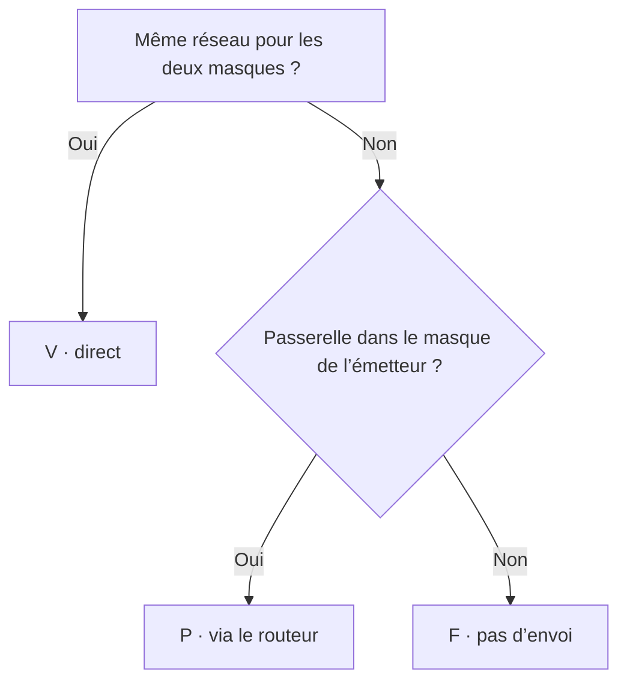

# Module 04 — La communication dans un réseau

**Séquence :** Bases des réseaux  
**Rôle dans le parcours :** décider si deux postes se parlent directement, via une passerelle, ou pas du tout.

L’onglet Cours Original transcrit les deux énoncés et la correction. Durée indiquée du TP écrit : 2 heures. Le TP Packet Tracer indique 30 minutes. Les fichiers `.pka` ne sont pas publiés. Les notes de quiz des modules 3 et 4 complètent le vocabulaire : un commutateur diffuse dans le même VLAN, un routeur borne le domaine de diffusion.

## Objectifs

À l’issue du module, vous devez pouvoir :

- comparer le réseau vu par chaque masque, pas seulement l’adresse ;
- remplir un tableau V, F ou P à partir des adresses imprimées ;
- résumer des routes au plus court, comme la correction ;
- agréger les blocs de la partie E avec les préfixes imprimés.

## 1. Même segment, masques différents

La partie A place A, B, C, D, E et F sur le même segment, sans routeur. Le dialogue n’existe que si l’émetteur voit le destinataire dans son masque, et si le destinataire peut répondre dans le sien.

| Poste | Adresse | Masque | Réseau qu’il considère |
|---|---|---|---|
| A | 172.16.10.10 | 255.255.0.0 | 172.16.0.0/16 |
| B | 172.16.11.20 | 255.255.0.0 | 172.16.0.0/16 |
| C | 172.16.100.30 | 255.255.0.0 | 172.16.0.0/16 |
| D | 172.16.11.100 | 255.255.255.0 | 172.16.11.0/24 |
| E | 172.16.100.150 | 255.255.255.0 | 172.16.100.0/24 |
| F | 172.16.10.200 | 255.255.255.0 | 172.16.10.0/24 |

| L’hôte | Contacte | Explication imprimée |
|---|---|---|
| A | B, C, F | A, B et C se voient dans 172.16.0.0/16. F répond dans 172.16.10.0/24 |
| B | A, C, D | Même /16 pour A et C. D répond dans 172.16.11.0/24 |
| C | A, B, E | Même /16 pour A et B. E répond dans 172.16.100.0/24 |
| D | B | Tous deux dans 172.16.11.0/24 |
| E | C | Tous deux dans 172.16.100.0/24 |
| F | A | Tous deux dans 172.16.10.0/24 |

A voit F, parce que 172.16.10.200 est dans son /16, et F voit A, parce que 172.16.10.10 est dans son /24. D ne voit pas A : 172.16.10.10 n’est pas dans 172.16.11.0/24.

## 2. Tableau V, F, P

V : communication directe. F : pas de communication. P : communication en passant par le routeur. La diagonale est déjà à V dans l’énoncé.

### Réseau de la partie B

| Poste | Adresse | Masque | Passerelle |
|---|---|---|---|
| A | 10.11.2.1 | 255.0.0.0 | 10.0.0.254 |
| B | 192.168.1.35 | 255.0.0.0 | 10.0.0.254 |
| C | 10.0.2.4 | 255.255.0.0 | 10.0.0.254 |
| D | 192.168.1.123 | 255.255.255.0 | 192.168.1.254 |
| E | 192.168.2.2 | 255.255.0.0 | 192.168.1.254 |

Routeur X : `10.0.0.254/8`. Routeur Y : `192.168.1.254/24`. Réseau 1 côté X, réseau 2 côté Y.

| De \\ vers | A | B | C | D | E |
|---|---|---|---|---|---|
| A | V | F | V | P | F |
| B | F | V | F | F | F |
| C | P | F | V | P | F |
| D | P | F | P | V | F |
| E | P | F | P | V | V |

B annonce un masque /8 et une adresse 192.168.1.35. Sa passerelle 10.0.0.254 n’est pas dans 192.0.0.0/8. La correction le laisse isolé : une ligne de F, hors lui-même.

### Réseau de la partie C

| Poste | Adresse | Masque | Passerelle |
|---|---|---|---|
| A | 192.167.5.1 | 255.255.255.0 | 192.168.5.254 |
| B | 192.168.5.35 | 255.255.255.0 | 172.20.0.254 |
| C | 172.20.1.4 | 255.255.0.0 | 192.168.5.254 |
| D | 172.20.1.123 | 255.255.255.0 | 172.20.1.254 |
| E | 172.20.0.7 | 255.255.0.0 | 172.20.0.254 |
| F | 172.19.2.2 | 255.0.0.0 | 172.19.0.254 |

Routeur X `192.168.5.254/24`, routeur Y `172.19.0.254/16`, routeur Z `172.20.0.254/16`.

| De \\ vers | A | B | C | D | E | F |
|---|---|---|---|---|---|---|
| A | V | F | F | F | F | F |
| B | F | V | F | F | F | F |
| C | F | F | V | F | F | F |
| D | F | F | F | V | F | F |
| E | F | P | F | V | V | P |
| F | F | P | F | F | F | V |

A, B, C et D ont une passerelle hors du réseau calculé avec leur masque, ou un voisin qui ne partage pas ce réseau. La correction ne leur laisse que la case V vers eux-mêmes. E voit D dans 172.20.0.0/16 et passe par la passerelle 172.20.0.254 vers B et F. F, masque /8, voit B dans 172.0.0.0/8 et marque P.

## 3. Routes statiques minimales

La consigne annonce le bloc `131.107.0.0/16`. Le schéma et les routes imprimées utilisent **13.107**. La fiche suit les adresses des routes.

Neuf réseaux en gras : `13.107.0.0/20`, `13.107.16.0/20`, `13.107.32.0/19`, `13.107.64.0/19`, `13.107.96.0/19`, `13.107.128.0/19`, `13.107.160.0/19`, `13.107.192.0/19`, `13.107.224.0/19`.

R1 à R4 se suivent sur la rangée haute. R5 à R8 se suivent sur la rangée basse. Chaque routeur n’ajoute que les résumés vers les autres.

| Routeur | Routes imprimées |
|---|---|
| R1 | 13.107.32.0/19 via R2, 13.107.64.0/18 via R2, 13.107.128.0/17 via R2 |
| R2 | 13.107.0.0/20 via R1, 13.107.64.0/18 via R3, 13.107.128.0/17 via R3 |
| R3 | 13.107.0.0/19 via R2, 13.107.96.0/19 via R4, 13.107.128.0/17 via R4 |
| R4 | 13.107.0.0/18 via R3, 13.107.128.0/17 via R5 |
| R5 | 13.107.0.0/18 via R4, 13.107.64.0/19 via R4, 13.107.160.0/19 via R6, 13.107.192.0/18 via R6 |
| R6 | 13.107.0.0/17 via R5, 13.107.192.0/18 via R7 |
| R7 | 13.107.0.0/17 via R6, 13.107.128.0/19 via R6, 13.107.224.0/19 via R8 |
| R8 | 13.107.0.0/17 via R7, 13.107.128.0/18 via R7 |

Le format demandé est `(@_rezo, masque, routeur de destination)`.

## 4. Résumés de la partie E

| Blocs à agréger | Résumé imprimé |
|---|---|
| 212.56.132.0/24 à 212.56.135.0/24 | 212.56.132.0/22 |
| 212.56.146.0/24 à 212.56.149.0/24 | 212.56.144.0/21 |
| 212.1.96.0/24 jusqu’à 212.1.159.0/24, 64 réseaux | 212.1.0.0/16 |
| Tous les réseaux de classe A | 0.0.0.0/1 |
| Tous les réseaux de classe B | 128.0.0.0/2 |
| Tous les réseaux de classe C | 192.0.0.0/3 |

!!! info "Relecture du troisième résumé"
    `212.1.0.0/16` est le préfixe imprimé. Il couvre tout le troisième octet, donc aussi les réseaux situés avant `.96` et après `.159`. La fiche conserve cette réponse.

Les classes A, B et C occupent chacune un quart de l’espace : le premier bit distingue A, les deux premiers distinguent B, les trois premiers distinguent C. D’où /1, /2 et /3.

## 5. Packet Tracer

L’énoncé d’une page demande, après les vidéos du module et les TP Packet Tracer précédents :

1. copier `M04-01-02–TP-Packet_Tracer-La_communication.pka` ;
2. l’ouvrir dans Packet Tracer ;
3. mettre en place la communication inter-réseau ;
4. suivre les directives de l’activité.

Le verbe imprimé est « Avoir réaliser les précédents TP Packet Tracer ». Le fichier et la ressource associée ne sont pas publiés. Leur contenu binaire n’a pas été relu.

**Illustration IA / externe au cours — les trois issues du tableau.**

## Résumé

1. Deux postes ne dialoguent que si chacun voit l’autre dans son propre masque.
2. V, F et P se lisent depuis l’émetteur. Une passerelle hors masque isole le poste.
3. Les routes de la partie D suivent les adresses 13.107 imprimées dans le schéma.
4. Les résumés de classe sont /1, /2 et /3. Le résumé des 64 réseaux est imprimé `212.1.0.0/16`.
5. Le TP Packet Tracer se fait dans le logiciel. Le fichier n’est pas sur le site.

## Mini-quiz

1. Pourquoi F répond-il à A, alors que D ne répond pas à A ?
2. Que signifie P dans le tableau ?
3. Pourquoi la ligne de B est-elle presque entièrement F dans la partie B ?
4. Quelle adresse la correction utilise-t-elle pour les routes, 131.107 ou 13.107 ?
5. Quel résumé est imprimé pour l’ensemble des réseaux de classe C ?

??? note "Réponses du mini-quiz"
    1. F est dans 172.16.10.0/24, qui contient A. D est dans 172.16.11.0/24, qui ne contient pas A.
    2. La communication passe par le routeur.
    3. Son masque /8 ne contient pas la passerelle 10.0.0.254. La correction ne lui donne aucun destinataire.
    4. 13.107, celle du schéma et des routes. La phrase d’introduction écrit 131.107.
    5. 192.0.0.0/3.
