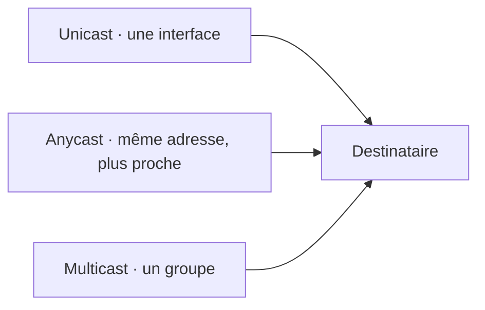

# Module 06 — L’adressage IPv6

**Séquence :** Bases des réseaux  
**Rôle dans le parcours :** lire une adresse de 128 bits et reconnaître son type.

L’onglet Cours Original indique **Inexistant**. Le dossier ne contient aucun document propre à ce module. La fiche suit les notes de quiz des modules 5 et 6.

!!! info "Choix de lecture"
    Les notes intitulent la structure « RFC 2800 ». Un passage plus loin appelle 2000::/3 « adresses locales uniques » et FC00::/8 « multidiffusion ». Le reste du même texte dit l’inverse : 2000::/3 est la plage globale routable, FF00::/8 la multidiffusion, et FC00::/7 les adresses locales uniques, proches des adresses privées IPv4. La fiche suit ce second passage, cohérent avec le tableau des plages et avec la structure GUA.

!!! info "Complément externe au cours"
    Le texte qui décrit le format des adresses IPv6 est la RFC 4291. Les notes citent un autre numéro. [Architecture d’adressage IPv6](https://www.rfc-editor.org/rfc/rfc4291).

## Objectifs

À l’issue du module, vous devez pouvoir :

- écrire et compacter une adresse de 128 bits ;
- classer lien-local, globale, unique locale, multidiffusion et boucle ;
- découper une adresse globale en préfixe, sous-réseau et interface ;
- citer les adresses multicast du lien local données par les notes.

## 1. Écriture

Une adresse IPv6 a **128 bits**, huit groupes de quatre chiffres hexadécimaux.

`2001:0db8:85a3:0000:0000:8a2e:0370:7334`

Les notes appellent chaque groupe un quartet de 16 bits. Elles compressent ainsi :

1. retirer les zéros de tête de chaque groupe : `2001:db8:0:0:8a2e:370:7334` ;
2. remplacer une seule suite de groupes nuls par `::`.

Exemple des notes : `2001:0db8:0000:0000:0000:ff00:0042:8329` devient `2001:db8::ff00:42:8329`.

Les notes annoncent environ 3,4 × 1038 adresses, contre environ 4,3 milliards en IPv4.

## 2. Types retenus

| Préfixe des notes | Type retenu | Repère |
|---|---|---|
| `::/0` | Route par défaut | Tous les réseaux, comme 0.0.0.0/0 |
| `::/128` | Adresse non spécifiée | Avant qu’une adresse de lien local soit choisie |
| `::1/128` | Boucle locale | Équivalent de 127.0.0.1 |
| `FE80::/10` | Lien local | Le lien seulement, voisine d’APIPA dans les notes |
| `FC00::/7`, dont `FD00::/8` | Locale unique | Non routée sur Internet, voisine des adresses privées |
| `2000::/3` | Globale unicast | Routable sur Internet |
| `FF00::/8` | Multidiffusion | Un groupe de destinataires. Les notes indiquent qu’elle remplace en grande partie la diffusion IPv4 |

Une adresse **unicast** désigne une interface. Une adresse **anycast** est partagée : le routage vise l’instance jugée la plus proche. Une adresse **multicast** vise un groupe.

**Illustration IA / externe au cours — les trois modes nommés par les notes.**

## 3. Adresse globale

Les notes découpent une GUA ainsi :

| Partie | Taille | Rôle dans les notes |
|---|---:|---|
| Préfixe global | 48 bits | Réseau attribué par un registre |
| Sous-réseau | 16 bits | Découpage dans l’organisation |
| Identifiant d’interface | 64 bits | Interface, souvent dérivée de l’adresse MAC au format EUI-64, ou fixée à la main |

Dans l’exemple `2001:0db8:85a3:0000:0000:8a2e:0370:7334`, les notes isolent `2001:0db8` comme repère de réseau et `8a2e:0370:7334` comme repère d’hôte.

## 4. Multicast cité

Toutes ces adresses commencent par FF. Les notes détaillent le préfixe, des indicateurs, une portée, puis l’identifiant de groupe.

| Adresse | Portée dans les notes | Groupe |
|---|---|---|
| `FF02::1` | Lien | Tous les nœuds du lien |
| `FF02::2` | Lien | Tous les routeurs du lien |
| `FF02::1:2` | Lien | Serveurs et relais DHCP du lien |
| `FF02::fb` | Lien | Multidiffusion DNS |
| `FF05::1` | Site | Tous les nœuds du site |
| `FF0E::101` | Globale | Groupe donné en exemple mondial |

## 5. Ce que les notes ajoutent à IPv4

- autoconfiguration sans état à partir du préfixe ;
- IPsec prévu dans le protocole ;
- qualité de service portée dans l’en-tête ;
- coexistence par double pile, tunnel IPv6 dans IPv4, ou traduction NAT64.

Les notes indiquent que NDP (*Neighbor Discovery Protocol*) remplace ARP en IPv6. Elles n’en décrivent pas les messages : la fiche s’arrête à ce remplacement.

## Résumé

1. 128 bits, huit groupes hexadécimaux, un seul `::`.
2. `FE80::/10` reste sur le lien. `2000::/3` est globale. `FF00::/8` est multicast. `FD00::/8` joue le rôle privé.
3. `::1` est la boucle. `::` sans longueur est l’adresse non spécifiée quand le préfixe est /128, et la route par défaut quand le préfixe est /0.
4. Une GUA se lit 48 + 16 + 64 bits.
5. Ce module n’a pas de document dans le dossier.

## Mini-quiz

1. Combien de bits et de groupes possède une adresse IPv6 dans les notes ?
2. Quelle plage est limitée au lien local ?
3. Quelle adresse multicast vise tous les nœuds du lien ?
4. Quelle taille les notes donnent-elles à l’identifiant d’interface d’une GUA ?
5. Pourquoi la fiche ne reprend-elle pas l’intitulé qui appelle 2000::/3 « locale unique » ?

??? note "Réponses du mini-quiz"
    1. 128 bits, huit groupes de quatre chiffres hexadécimaux.
    2. `FE80::/10`.
    3. `FF02::1`.
    4. 64 bits.
    5. Un autre passage des mêmes notes, aligné sur le tableau des plages, décrit 2000::/3 comme globale et routable. La fiche suit ce passage.
