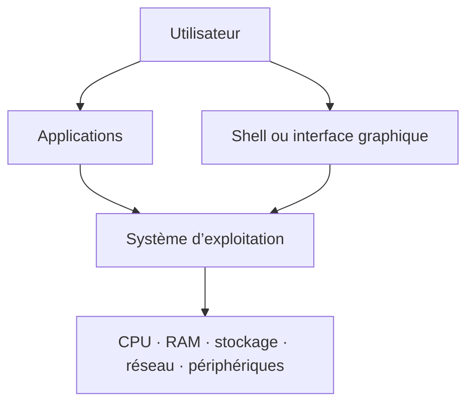
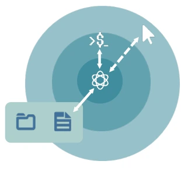
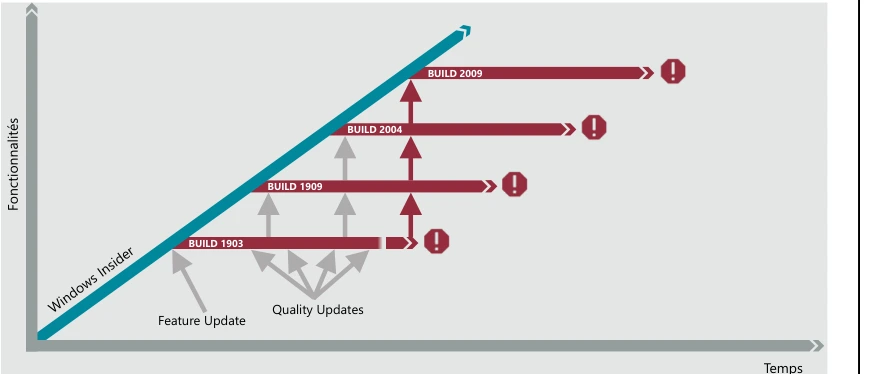

# Module 01 — Les systèmes d’exploitation et Microsoft Windows 10

**Formation :** Systèmes clients Microsoft · **Pré-requis :** reconnaître processeur, mémoire, stockage et périphériques.

## Objectifs

- Expliquer le rôle d’un OS et les services qu’il rend aux applications et à l’utilisateur.
- Relier noyau, shell, interface graphique, pilotes et système de fichiers.
- Lire les repères Windows et le vocabulaire de maintenance du support.
- Distinguer Windows as a Service, édition, licence du poste et licence d’accès serveur.

## 1. L’OS coordonne le matériel et les logiciels

Un **système d’exploitation**, ou **OS** (*Operating System*), reçoit les demandes de l’utilisateur et des applications, puis pilote les ressources matérielles. Il rend les résultats à l’écran ou sur un autre périphérique, comme une imprimante. Les notes rappellent que des communautés, des éditeurs privés et des fabricants peuvent proposer un OS.

**Illustration IA / externe au cours — lecture des relations du support.**

| Fonction de l’OS | Ce qu’il fait | Exemple de lecture d’un incident |
|---|---|---|
| Gérer processeur et mémoire | Répartir le travail et la mémoire entre applications. | Une application ralentit : observer son utilisation des ressources. |
| Optimiser les applications | Attribuer les ressources nécessaires et arbitrer les accès concurrents. | Plusieurs programmes sollicitent le même matériel. |
| Rendre compte du fonctionnement | Fournir tableaux de bord en temps réel et journaux conservés. | Examiner un symptôme actuel puis son historique. |
| Prendre en charge les périphériques | Communiquer par les bus et utiliser leurs pilotes. | Identifier le périphérique et son pilote avant de modifier sa configuration. |
| Protéger les ressources | Appliquer privilèges et droits d’accès. | Une personne autorisée doit accéder à la bonne ressource. |

Un **pilote** décrit à l’OS comment exploiter un périphérique. L’OS conserve la responsabilité des accès : les possibilités d’un utilisateur standard diffèrent de celles de l’administrateur.

## 2. Les composants à relier

| Composant | Fonction | Repère |
|---|---|---|
| **Noyau — kernel** | Lien entre matériel et reste du système ; peut être mis à jour et recevoir des modules. | Gestion centrale des ressources. |
| **Shell / CLI** | Interpréter les instructions tapées ou contenues dans un script. | Interface en ligne de commande. |
| **GUI** | Fournir une interface graphique, facultative selon l’OS. | Fenêtres, menus, outils graphiques. |
| **Système de fichiers** | Organiser le stockage et l’accès aux données. | Disque, clé USB, fichiers et répertoires. |

Les notes citent des systèmes livrés avec leur interface graphique et d’autres permettant de choisir une GUI ou de s’en passer. Il faut distinguer l’OS d’une seule de ses interfaces : administrer un système ne se limite pas à manipuler ses fenêtres.

Visuel isolé du support original : noyau, interfaces et fichiers.

## 3. Les OS sont présents dans de nombreux équipements

Le support ne les limite pas au PC : serveurs, postes utilisateurs, smartphones, tablettes, montres connectées, switchs, routeurs, box, NAS, imprimantes, télévisions et véhicules embarquent des systèmes d’exploitation.

Windows, Android, iOS, macOS/OS X, Ubuntu et Debian sont des exemples cités. La planche de logos ajoute notamment BlackBerry et Red Hat. L’idée à retenir est l’étendue des usages, sans confondre un équipement et le système qui le fait fonctionner.

## 4. Lire l’histoire Windows dans son contexte

Les dates ci-dessous sont les repères historiques du support. Les expressions « aujourd’hui » présentes dans les notes décrivent la période de leur rédaction.

| Date du support | Repère | Ce que les notes mettent en avant |
|---|---|---|
| Août 1981 | MS-DOS | Interface texte, un utilisateur et une instruction à la fois dans la présentation du cours. |
| Novembre 1985 | Windows 1 | Passage à l’interface graphique et usage de la souris. |
| Juillet 1993 | Windows NT | Multi-utilisateur, multitâche et ouverture au monde serveur. |
| Août 1995 / juin 1998 | Windows 95 / 98 | Diffusion de l’informatique dans les foyers. |
| Février 2000 | Windows 2000 | Développement des usages professionnels avec Windows 2000 Server. |
| Octobre 2001 | Windows XP | Forte adoption et développement d’Internet. |
| Janvier 2007 | Windows Vista | Version située dans la succession étudiée. |
| Octobre 2009 | Windows 7 | Successeur mis en avant dans les notes. |
| Octobre 2012 | Windows 8 | Évolution de la gamme étudiée. |
| Juillet 2015 | Windows 10 | Système de référence du laboratoire. |

### Sortie, vente et support sont des étapes différentes

Une version peut cesser d’être vendue avant la fin de son support. La **migration** consiste à remplacer progressivement une version par une autre. Les entreprises doivent prévoir ce passage avant que leur version ne reçoive plus les correctifs attendus.

| Système | Sortie | Fin des ventes | Fin support standard | Fin support étendu |
|---|---|---|---|---|
| XP | Octobre 2001 | Juin 2008 | Avril 2009 | Avril 2014 |
| Vista | Janvier 2007 | Octobre 2011 | Avril 2012 | Avril 2017 |
| 7 | Octobre 2009 | Octobre 2013 | Janvier 2015 | Janvier 2020 |
| 8 | Octobre 2012 | Octobre 2016 | Janvier 2018 | Janvier 2023 |
| 10 | Juillet 2015 | Chaque build a son cycle dans le support | Chaque build a son cycle | Chaque build a son cycle |

!!! note "Tableau historique du cours"
    Ces dates sont transcrites pour comprendre le support. Elles ne constituent pas une vérification actuelle des cycles de chaque édition Windows.

| Terme | Sens utilisé dans le cours |
|---|---|
| **KB — Knowledge Base** | Correctif de sécurité ou de fonctionnalité. |
| **SP — Service Pack** | Ensemble de KB, regroupant des mises à jour. |
| **Release** | Mise à jour majeure ; Windows 8.1 est l’exemple donné. |
| **Migration** | Passage organisé d’un ancien OS à un nouveau. |

## 5. Windows as a Service : distinguer les mises à jour

Le modèle **WaaS** présente Windows 10 comme un système qui évolue au fil des builds. Une **build** identifie une version et ses fonctionnalités. Le support donne `1903` comme exemple, décrit une prise en charge de 18 mois et deux mises à jour de fonctionnalités annuelles : majeure au printemps, mineure à l’automne. Ces cadences sont celles du modèle historique étudié.

- **Windows Insider** : communauté de bêta-testeurs.
- **Feature Update** : passage à une nouvelle build avec des fonctionnalités.
- **Quality Update** : correctifs de sécurité et de bogues d’une build ; rythme du deuxième mardi du mois, ou **Patch Tuesday**, dans le support.

Visuel isolé du support : succession 1903, 1909, 2004 et 2009 ; les mises à jour de qualité continuent au sein d’une build.

Exemple de raisonnement : corriger un bogue sans changer de build relève de la qualité ; passer à la build suivante relève de la fonctionnalité. Il faut identifier la version avant de comparer son comportement à une procédure.

## 6. Édition et licence répondent à deux questions

L’**édition** précise les fonctions disponibles. La **licence** décrit le mode d’acquisition ou le droit d’usage présenté par le cours.

| Édition | Positionnement et fonctions citées |
|---|---|
| **Famille** | Usage domestique ; Cortana, bureaux supplémentaires, OneDrive, Edge. |
| **Professionnelle** | Infrastructure Microsoft : jonction au domaine, GPO, EFS, BitLocker et BitLocker To Go, démarrage natif sur VHD. |
| **Entreprise** | Fonctions supplémentaires : AppLocker, Windows To Go, DirectAccess, BranchCache. |

Les notes ajoutent Professionnelle pour station de travail, Éducation et Entreprise LTSC. Il faut conserver ces noms dans le contexte du cours ; ils ne remplacent pas la vérification d’une offre lors d’un achat réel.

| Licence | Développement | Idée du support |
|---|---|---|
| **OEM** | Original Equipment Manufacturer | Préinstallée et liée à la machine. |
| **Retail** | Vente au détail, boîte ou numérique | Associée à l’utilisateur dans le support, pour un poste. |
| **MAK** | Multiple Activation Key | Activation de plusieurs postes clients. |
| **VLK / KMS** | Volume Licence Key / Key Manager Service | Déploiement en volume ; le support associe KMS à plus de 25 postes. |
| **CAL** | Client Access Licence | Droit d’accès d’un client à un service d’un serveur Microsoft. |

Une CAL ne désigne donc pas l’édition Windows installée sur le poste. Le schéma du cours montre des clients qui sollicitent messagerie, Web ou données sur un serveur pour illustrer ce besoin d’accès.

## 7. Appliquer les repères du module

Pour décrire un poste, séparer quatre informations : OS et version/build, édition, fonctions nécessaires et type de licence. Pour expliquer un incident, identifier d’abord la ressource : CPU/RAM, périphérique, stockage ou droit d’accès.

Exemple pédagogique : un poste qui doit rejoindre une infrastructure Microsoft conduit à examiner les fonctions de l’édition Professionnelle présentées dans le support ; un accès à un service serveur conduit à examiner séparément la notion de CAL. Le vocabulaire permet de poser les bonnes questions avant une installation.

## Rappel transversal présent dans la synthèse du Drive

La synthèse associée réunit OS, Windows et modèle **OSI — Open Systems Interconnection**. Ce rappel conserve le contenu du document ; le développement et les exercices de référence restent dans [Bases des réseaux](../01-bases-reseaux/index.md).

| Couche | Nom | PDU | Exemples classés dans la synthèse |
|---|---|---|---|
| 7 | Application | Données | HTTP, HTTPS, FTP, SMTP, DNS, DHCP |
| 6 | Présentation | Données | SSL/TLS, ASCII, JPEG |
| 5 | Session | Données | NetBIOS, RPC |
| 4 | Transport | Segment | TCP, UDP ; ports 80, 443, 22, 53 |
| 3 | Réseau | Paquet | IPv4/IPv6, ICMP, ARP et routeurs dans le tableau source |
| 2 | Liaison de données | Trame | Ethernet, Wi-Fi, commutateurs, MAC |
| 1 | Physique | Bits | RJ45, fibre optique, signal radio |

Les protocoles sont ici regroupés comme dans la synthèse. La place d’ARP et des protocoles transversaux doit être expliquée avec le cours réseau plutôt qu’apprise comme une correspondance rigide.

La synthèse donne quatre outils pour relier ce vocabulaire au poste Windows : **`ipconfig /all`** pour la configuration, **`ping 192.168.1.1`** pour le test vers la passerelle du scénario, **`tracert google.com`** pour le trajet et **`nslookup campus-eni.fr`** pour la résolution de nom. Ces adresses sont des exemples du document ; elles ne décrivent pas la configuration de chaque laboratoire.

## Mini-quiz

1. Quelles sont les cinq fonctions principales de l’OS citées dans le support ?
2. Quelle différence faites-vous entre noyau, shell et GUI ?
3. Pourquoi fin des ventes et fin du support ne sont-elles pas la même date ?
4. Quelle différence le modèle WaaS fait-il entre Feature Update et Quality Update ?
5. Édition, OEM et CAL : lequel décrit des fonctions, lequel l’acquisition du poste, lequel l’accès à un serveur ?

??? note "Réponses"
    1. Gérer CPU/RAM, optimiser les applications, fournir les informations de fonctionnement, exploiter les périphériques et protéger les ressources.
    2. Le noyau relie matériel et système ; le shell interprète les instructions ; la GUI est une interface graphique.
    3. La vente peut s’arrêter alors que des corrections continuent pendant une période de support.
    4. Feature : nouvelle build et fonctionnalités ; Quality : correctifs d’une build.
    5. L’édition décrit les fonctions ; OEM est un mode de licence lié à la machine ; CAL concerne un service serveur.

## Pour poursuivre

- [Fiche de révision M01](../../revision/systemes-clients/module-01-les-systemes-d-exploitation-et-microsoft-windows-10.md)
- [Kahoot M01](../../kahoot/02-systemes-clients-microsoft-01-les-systemes-d-exploitation-et-microsoft-windows-10.md)
- [Module 02 — Installation](module-02-installation-du-systeme-d-exploitation-windows-10.md)

## Provenance pédagogique

Le support M01, la section Module 1 des notes « module 1 et 2 et extra » et la synthèse Windows/OS du Drive constituent les sources. Le volet OSI de cette synthèse reste un rappel transversal, sans remplacer le cours Bases des réseaux. Les schémas IA, exemples d’incident, tableaux de lecture et mini-quiz sont des aides pédagogiques du portail.
