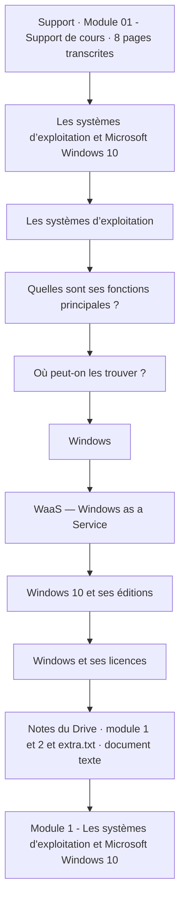
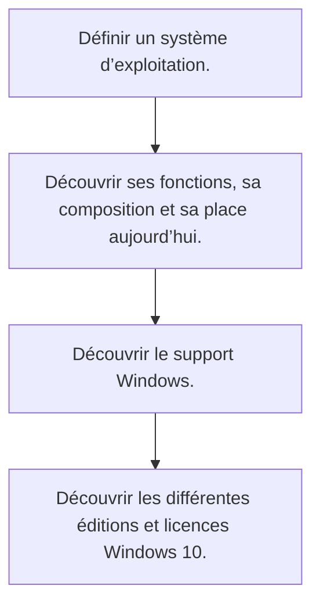
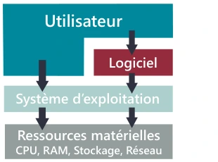
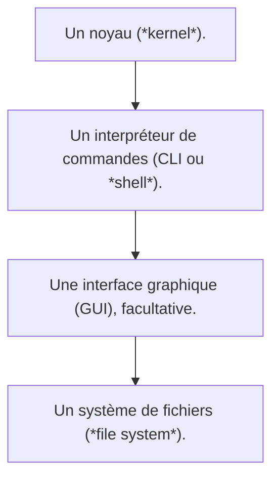
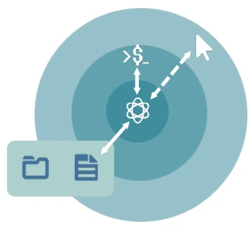
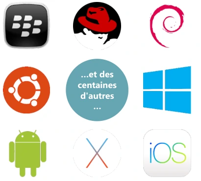
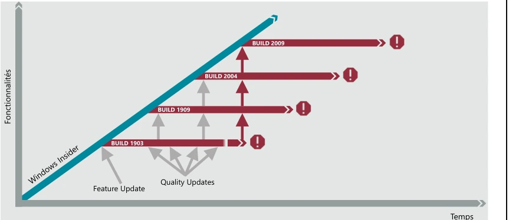
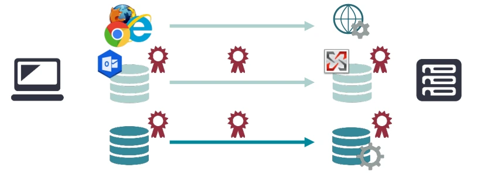

# Module 01 — Les systèmes d’exploitation et Microsoft Windows 10

Les parties ci-dessous reprennent le cours original, dans le même ordre. Les encadrés et les schémas répètent ses formulations.

## Parcours de lecture
1. Support · Module 01 - Support de cours · 8 pages transcrites
2. Les systèmes d’exploitation et Microsoft Windows 10
3. Les systèmes d’exploitation
4. Quelles sont ses fonctions principales ?
5. Où peut-on les trouver ?
6. Windows
7. WaaS — Windows as a Service
8. Windows 10 et ses éditions
9. Windows et ses licences
10. Notes du Drive · module 1 et 2 et extra.txt · document texte
11. Module 1 - Les systèmes d'exploitation et Microsoft Windows 10
12. Modules 1 + 2 + Extra
13. Niveau Facile (1 à 15)
14. 1. Qu’est-ce qu’un système d’exploitation ?
15. 2. Quel composant d’un système d’exploitation gère directement les ressources matérielles ?
16. 3. Que signifie GUI ?
17. 4. Quelle interface permet d’interagir avec le système via des commandes textuelles ?
18. 5. Quel est le rôle principal d’un système d’exploitation ?
19. 6. Lequel de ces systèmes est un système d’exploitation Microsoft ?
20. 7. Quel ancêtre de Windows était principalement en ligne de commande ?
21. 8. Que signifie “Windows as a Service” (WaaS) ?
22. 9. Quel type de mise à jour Windows apporte surtout des corrections de bugs et de sécurité ?
23. 10. Quel type de mise à jour Windows apporte de nouvelles fonctionnalités importantes ?
24. 11. Quel jour mensuel est souvent associé aux mises à jour de sécurité Microsoft ?
25. 12. Quelle édition de Windows 10 est destinée à un usage domestique classique ?
26. 13. Quelle édition de Windows 10 ajoute des fonctions plus avancées pour le travail et l’administration ?
27. 14. Une licence OEM est généralement :
28. 15. Quel outil Windows permet de tester des versions en avance pour les utilisateurs volontaires ?
29. Niveau Moyen (16 à 30)
30. 16. Quelle architecture permet en général d’utiliser plus de mémoire vive et d’exécuter des applications 64 bits ?
31. 17. Quel type d’installation conserve généralement l’ancien système et les données utilisateur lorsqu’elle est possible ?
32. 18. Quel type d’installation repart de zéro et remplace l’environnement existant ?
33. 19. Quel fichier contient principalement l’image du système Windows à déployer ?
34. 20. Quel fichier est utilisé pour l’environnement de démarrage/installation de Windows ?
35. 21. Quel support peut être utilisé pour installer Windows 10 ?
36. 22. Lors d’une installation de Windows, à quoi sert le partitionnement ?
37. 23. Que fait le formatage d’une partition avant l’installation ?
38. 24. Quel outil est cité pour aider à migrer les données utilisateur lors d’un changement de poste ou de système ?
39. 25. À quoi sert principalement une sauvegarde avant une réinstallation ?
40. 26. Quelle édition de Windows 10 est la plus orientée grandes organisations avec fonctions avancées de gestion ?
41. 27. Une licence Retail a généralement quel avantage par rapport à une OEM ?
42. 28. Dans le contexte des licences, MAK signifie :
43. 29. Dans un déploiement Windows, que signifie “support du système” ou “cycle de vie” ?
44. 30. Pourquoi une version Windows non supportée pose problème ?
45. Niveau Difficile (31 à 45)
46. 31. Quelle est la différence principale entre `boot.wim` et `install.wim` ?
47. 32. Quel est l’intérêt d’une machine virtuelle dans le cadre de ton module extra ?
48. 33. Quel logiciel de virtualisation apparaît dans ton support extra ?
49. 34. Dans une machine virtuelle, le système installé à l’intérieur de la VM est appelé :
50. 35. Quel est l’intérêt d’un snapshot dans une machine virtuelle ?
51. 36. Pourquoi faut-il être prudent dans l’allocation des ressources d’une VM (RAM, CPU, disque) ?
52. 37. Lors de l’installation de Windows 10 dans une VM, à quoi sert l’OOBE ?
53. 38. Quel avantage pédagogique a une VM pour un module d’installation Windows ?
54. 39. Une mise à niveau est-elle toujours préférable à une nouvelle installation ?
55. 40. Quel risque existe si on lance une nouvelle installation sans avoir vérifié les sauvegardes ?
56. 41. Quel intérêt a Windows Insider pour Microsoft et les testeurs ?
57. 42. Pourquoi faut-il distinguer licence OEM, Retail et licences de volume dans un quiz Microsoft ?
58. 43. Quel est l’objectif d’un outil comme USMT dans un contexte professionnel ?
59. 44. Dans un environnement de virtualisation, importer une VM signifie généralement :
60. 45. Si ton objectif est de t’entraîner à installer Windows 10 plusieurs fois, avec possibilité de revenir à un état propre en 10 secondes, quelle combinaison est la plus logique ?
61. Questions Vrai / Faux (46 à 55)
62. 46. Vrai ou Faux
63. 47. Vrai ou Faux
64. 48. Vrai ou Faux
65. 49. Vrai ou Faux
66. 50. Vrai ou Faux
67. 51. Vrai ou Faux
68. 52. Vrai ou Faux
69. 53. Vrai ou Faux
70. 54. Vrai ou Faux
71. 55. Vrai ou Faux
72. Mon avis critique sur ce quiz
73. 1) La partie **extra** est forcément moins “dense”
74. 2) Le quiz est **bon pédagogiquement**, mais encore un peu “théorique”
75. Ce que je peux faire maintenant
76. **“fais-moi la version Kahoot prête à copier pour Systèmes clients Microsoft”**
77. Synthèse du Drive · Synthèse Module 1 - OS, Windows 10 & Modèle OSI V2 · 3 pages transcrites
78. Synthèse — Module 1 : Les systèmes d’exploitation, Windows 10 et le modèle OSI (V2)
79. Comparatif des éditions et licences — suite
80. Modèle OSI — suite

**Visuel externe**



SOURCE DRIVE · TRANSCRIPTION DU SUPPORT

Le contenu des documents du dossier TSSR est transcrit ci-dessous, page par page. Les textes et tableaux sont intégrés à la page Web. Aucun fichier PDF, aucune diapositive entière ni aucune reproduction de page n’est affiché. Seuls des croquis ou visuels isolés et vérifiés peuvent accompagner la transcription. Les versions et les consignes restent celles des supports de formation. Les compléments IA sont conservés dans leur onglet distinct.

## Support · Module 01 - Support de cours · 8 pages transcrites

## Les systèmes d’exploitation et Microsoft Windows 10

### Objectifs

!!! note "À retenir"
    Découvrir ses fonctions, sa composition et sa place aujourd’hui.

**Visuel externe**



- Définir un système d’exploitation.
- Découvrir ses fonctions, sa composition et sa place aujourd’hui.
- Observer l’évolution des différents systèmes d’exploitation de l’éditeur Microsoft.
- Découvrir le support Windows.
- Découvrir les différentes éditions et licences Windows 10.

## Les systèmes d’exploitation

!!! note "À retenir"
    Comment définir un système d’exploitation ?

**Visuel externe**


- Comment définir un système d’exploitation ?
- Quelles sont ses fonctions principales ?
- De quoi est-il composé ?
- Où peut-on les trouver ?

### Comment définir un système d’exploitation ?

!!! note "À retenir"
    Un système d’exploitation […] ou *Operating System* (OS) est un logiciel qui […] pilote les dispositifs matériels et reçoit des instructions de l’utilisateur ou d’autres logiciels (ou applications).

Un système d’exploitation […] ou *Operating System* (OS) est un logiciel qui […] pilote les dispositifs matériels et reçoit des instructions de l’utilisateur ou d’autres logiciels (ou applications). […]

Le schéma associe **Utilisateur**, **Logiciel**, **Système d’exploitation** et **Ressources matérielles : CPU, RAM, stockage, réseau**.

Sources citées dans le support : - https://www.futura-sciences.com/tech/definitions/informatique-systeme-exploitation-11820/ - https://www.journaldunet.fr/web-tech/dictionnaire-du-webmastering/1203371-systeme-d-exploitation-definition-traduction-et-acteurs/



Relations entre utilisateur, logiciel, OS et matériel

## Quelles sont ses fonctions principales ?

!!! note "À retenir"
    Gérer les processeurs et la mémoire vive.

**Visuel externe**


- Gérer les processeurs et la mémoire vive.
- Optimiser l’exécution des applications en leur attribuant les ressources nécessaires.
- Fournir des informations sur le bon fonctionnement de l’ordinateur.
- Utiliser les périphériques dans les meilleures conditions.
- Protéger l’accès aux ressources.

### De quoi est-il composé ?

!!! note "À retenir"
    Un interpréteur de commandes (CLI ou *shell*).

**Visuel externe**



- Un noyau (*kernel*).
- Un interpréteur de commandes (CLI ou *shell*).
- Une interface graphique (GUI), facultative.
- Un système de fichiers (*file system*).

Sources citées pour les fonctions et la composition : - https://www.futura-sciences.com/tech/definitions/informatique-systeme-exploitation-11820/ - https://www.journaldunet.fr/web-tech/dictionnaire-du-webmastering/1203371-systeme-d-exploitation-definition-traduction-et-acteurs/



Noyau, shell, interface et fichiers

## Où peut-on les trouver ?

!!! note "À retenir"
    La planche de logos montre BlackBerry, Red Hat, Debian, Ubuntu, Windows, Android, OS X et iOS, avec la mention « …et des centaines d’autres… ».

La planche de logos montre BlackBerry, Red Hat, Debian, Ubuntu, Windows, Android, OS X et iOS, avec la mention « …et des centaines d’autres… ».

- Dans les serveurs et les postes utilisateurs.
- Dans les smartphones et les tablettes.
- Dans les montres connectées.
- Dans les switchs, routeurs, box, NAS et imprimantes.
- Dans les télévisions.
- Dans des véhicules.
- …



Exemples de systèmes d’exploitation représentés

## Windows

| Date représentée | Système |
| --- | --- |
| Août 1981 | MS-DOS |
| Novembre 1985 | Win1 — Windows 1 |
| Juillet 1993 | WinNT — Windows NT |
| Août 1995 | Win95 — Windows 95 |
| Juin 1998 | Win98 — Windows 98 |
| Février 2000 | Win2000 — Windows 2000 |
| Octobre 2001 | WinXP — Windows XP |
| Janvier 2007 | Windows Vista |
| Octobre 2009 | Win7 — Windows 7 |
| Octobre 2012 | Win8 — Windows 8 |
| Juillet 2015 | Win10 — Windows 10 |

### Support des systèmes Windows

!!! note "À retenir"
    **Note :** chaque build Windows 10 possède sa date de fin de support.

| Système | Date de sortie | Fin des ventes | Fin du support standard | Fin du support étendu |
| --- | --- | --- | --- | --- |
| XP | Octobre 2001 | Juin 2008 | Avril 2009 | Avril 2014 |
| Vista | Janvier 2007 | Octobre 2011 | Avril 2012 | Avril 2017 |
| 7 | Octobre 2009 | Octobre 2013 | Janvier 2015 | Janvier 2020 |
| 8 | Octobre 2012 | Octobre 2016 | Janvier 2018 | Janvier 2023 |
| 10 | Juillet 2015 | * | * | * |

**Note :** chaque build Windows 10 possède sa date de fin de support.

| Vocabulaire | Définition du support |
| --- | --- |
| KB | Knowledge Base : correctif de sécurité ou de fonctionnalité. |
| SP | Service Pack : ensemble de KB. |
| Release | MAJ majeure de l’OS ; exemple : Windows 8.1. |

## WaaS — Windows as a Service

| Vocabulaire | Définition du support |
| --- | --- |
| Windows Insider | Communauté d’utilisateurs bêta-testeurs de Windows 10. |
| Build | Version de Windows 10 identifiée par un numéro, par exemple 1903 pour mars 2019 ; propose son lot de fonctionnalités ; support de 18 mois. |
| Feature updates | Mise à disposition d’une nouvelle build ; deux par an, majeure au printemps et mineure à l’automne. |
| Quality updates | Mise à jour de qualité : patch de sécurité et correctifs de bogues ; tous les deuxièmes mardis du mois, le Patch Tuesday. |

### Canal semi-annuel

!!! note "À retenir"
    Le diagramme place les builds **1903, 1909, 2004 et 2009** sur les axes **Temps** et **Fonctionnalités**.

Le diagramme place les builds **1903, 1909, 2004 et 2009** sur les axes **Temps** et **Fonctionnalités**. Les flèches **Feature Update** marquent un passage de build ; les **Quality Updates** jalonnent la vie d’une build.



Canal semi-annuel et mises à jour

## Windows 10 et ses éditions

| Famille | Professionnelle | Entreprise |
| --- | --- | --- |
| Destinée exclusivement à un usage domestique. Cortana, bureaux supplémentaires, OneDrive, Edge… | Intégration à une infrastructure Microsoft : jonction au domaine, traitement des GPO, chiffrement EFS, BitLocker et BitLocker To Go, démarrage natif sur VHD. | Fonctions supplémentaires représentées : AppLocker, Windows To Go, DirectAccess, BranchCache. |

### Windows et ses licences

| Type | Sigle développé | Définition du support |
| --- | --- | --- |
| OEM | Original Equipment Manufacturer | Préinstallée, liée à la machine. |
| Retail | Vente au détail, boîte ou version numérique | Licence liée à l’utilisateur, s’installe sur un poste. |
| MAK | Multiple Activation Key | Une licence pour plusieurs postes clients. |
| VLK | Volume Licence Key | Pour déployer les systèmes clients. Nécessite le service KMS (Key Manager Service) et plus de 25 postes. |
| CAL | Client Access Licence | Licence permettant au client de solliciter le service d’un serveur Microsoft. |

## Windows et ses licences

Le schéma associe des applications et postes clients à des services Web, de messagerie et de données de serveurs Microsoft.

### Sources

https://www.microsoft.com/fr-fr/Licensing/product-licensing/client-access-license.aspx

### Conclusion

- Ils sont partout autour de nous.
- Windows 10 est prédominant en entreprise aujourd’hui.
- Un technicien doit connaître le fonctionnement de Windows 10.



Services et accès clients

Référence du document : 17BaGNjB9AJI1XDss_Qku7u7102-L9f8g · SHA-256 1a53530817f3d88b…

## Notes du Drive · module 1 et 2 et extra.txt · document texte

Notes textuelles présentes dans le Drive. Aucun support de cours illustré distinct n’est fourni pour ce document ; aucune illustration n’a été inventée ou attribuée au support.

## Module 1 - Les systèmes d'exploitation et Microsoft Windows 10

### Objectifs du module

### Les OS : définition et fonctions principales

### Les OS : leur composition et leur place aujourd'hui

### Les OS Windows

### Windows as a Service

### Windows 10 et ses différentes éditions et licences

### Conclusion

Dans ce module, nous allons explorer la notion de systèmes d'exploitation, ou OS, en répondant à des questions essentielles : Comment définir un système d'exploitation ? Quelles sont ses fonctions principales ? De quoi est-il composé ? Où peut-on les trouver ?

### Définir un système d'exploitation

Un système d'exploitation, ou OS en anglais, est un logiciel qui est édité et proposé par des communautés, ou bien édité et commercialisé par des groupes privés et des fabricants de matériel. Il pilote les dispositifs matériels, lui donne des ordres en somme. Ces ordres sont donnés par l'utilisateur, ainsi que par des applications mises à disposition de l'utilisateur. Sans l'utilisateur, le système ne peut pas faire grand-chose. Le résultat du travail effectué par le matériel est rendu, par défaut, à l'écran, ou bien vers d'autres périphériques, comme une imprimante, par exemple.

### Fonctions principales des systèmes d'exploitation

Quelles sont les fonctions principales d'un système d'exploitation ? Le système d'exploitation gère le matériel. C'est lui qui envoie des ordres au processeur, ordres préalablement donnés au système d'exploitation, directement par un logiciel ou directement par l'utilisateur lui-même. Il gère aussi la mémoire vive. Il va chercher, en RAM, les résultats des calculs effectués par le processeur, pour les retranscrire à l'utilisateur. Le système d'exploitation optimise l'exécution des applications en leur attribuant les ressources nécessaires. Il partage l'ensemble des ressources matérielles aux différentes applications, qui sont simultanément en cours d'exécution. Il priorise les accès concurrentiels lorsqu'un conflit d'accès apparaît.

### Informations et communication

Il fournit des informations sur le bon fonctionnement de l'ordinateur à travers des tableaux de bord, affichant les informations en temps réel, ou à travers des journaux, des logs, archivés sur plusieurs semaines. Il utilise les périphériques dans les meilleures conditions, en s'assurant qu'il y ait une bonne communication sur les bus entre la carte-mère et le périphérique en question.

### Gestion des pilotes et des accès

Il assure également le bon fonctionnement des périphériques à l'aide des pilotes, ou drivers. Les pilotes, c'est-à-dire les pilotes de l'ordinateur, sont un peu comme les manuels d'utilisation du périphérique. Ces manuels sont destinés à l'OS, pour qu'il en maîtrise chaque fonctionnalité et chaque spécificité. Le système d'exploitation protège l'accès aux ressources. Chaque système s'appuie sur un principe de privilège d'accès. Les actions et accès d'un simple utilisateur seront réduits par rapport à ceux d'un administrateur de la machine. Granulairement, le système d'exploitation veillera à permettre l'accès à des informations ou ressources aux seules personnes concernées. Une personne non autorisée recevra une notification du système.

En conclusion, nous avons défini le système d'exploitation et ses principales fonctions. Ce logiciel essentiel joue un rôle clé dans la gestion du matériel, l'optimisation des ressources et la sécurité des accès. Comprendre ces concepts est fondamental pour tout technicien supérieur en systèmes et réseaux.

Dans ce module, nous allons explorer les systèmes d'exploitation (OS), leur composition et leur rôle essentiel dans nos vies quotidiennes.

Tout d'abord, un système d'exploitation se compose principalement de plusieurs éléments clés. Au cœur de chaque OS se trouve un noyau, ou kernel. Ce noyau est le lien direct entre le matériel de l'ordinateur et le reste du système d'exploitation. Il est capable d'évoluer et d'être mis à jour, permettant également l'ajout de modules complémentaires.

### Le rôle du shell et de l'interface graphique

Au-dessus du noyau, nous trouvons un interpréteur de commandes, souvent désigné sous le terme CLI (Command Line Interface) ou shell. Ce shell sert d'interface pour l'utilisateur, qui lui envoie des commandes en ligne. En fonction du noyau, les shells peuvent varier, offrant différentes fonctionnalités et usabilités.

Dans la plupart des systèmes d'exploitation, mais de manière facultative, une interface graphique (GUI pour Graphical User Interface) est proposée. Celle-ci facilite l'interaction avec le système pour les utilisateurs non initiés, rendant l'expérience utilisateur plus intuitive. Les éditeurs d'interfaces graphiques s'efforcent toujours de garantir une grande simplicité d'utilisation.

Certaines distributions d'OS sont livrées avec leurs propres interfaces graphiques, comme c'est le cas de Microsoft avec Windows. D'autres, en revanche, laissent le choix aux utilisateurs d'installer la GUI de leur préférence ou même de se passer complètement de celle-ci.

### Le stockage des données

À côté des fichiers systèmes indispensables, il est crucial pour l'utilisateur de garder ses données accessibles et sécurisées. C'est là qu'interviennent les systèmes de fichiers, qui organisent et sécurisent l'accès aux données sur des supports de stockage, comme le disque dur ou une clé USB.

### Les systèmes d'exploitation autour de nous

Il existe une multitude de systèmes d'exploitation, tels que Windows, Android, iOS et Mac OS X, mais aussi des distributions GNU-Linux comme Ubuntu ou Debian. Aujourd'hui, nous retrouvons des OS dans de nombreux appareils. Évidemment, on pense à nos ordinateurs personnels, mais aussi aux serveurs d'entreprise.

Les smartphones et tablettes fonctionnent avec des systèmes d'exploitation comme Android ou iOS. Les montres connectées utilisent également des OS spécifiques, tout comme le matériel réseau, les télévisions ou même les véhicules modernes qui intègrent des ordinateurs de bord.

Avec l'évolution des technologies, notre dépendance aux outils connectés s'accroît, et cela illustre l'importance grandissante des systèmes d'exploitation dans notre vie quotidienne.

En conclusion, nous avons exploré comment les systèmes d'exploitation, à travers leur composition et leur omniprésence, façonnent notre interaction avec la technologie moderne. Ils sont devenus des composants essentiels, non seulement dans nos ordinateurs, mais également dans tous les appareils connectés que nous utilisons quotidiennement.

Dans ce module, nous allons examiner plus en détail les systèmes d'exploitation Microsoft Windows, en commençant par leurs origines et leur évolution.

### Les débuts avec MS-DOS

Nous partons de l'histoire de Microsoft qui a commencé avec le système d'exploitation MS-DOS, né en août 1981. MS-DOS, acronyme de Microsoft Disk Operating System, était un système d'exploitation sans interface graphique, permettant à un seul utilisateur de lancer une seule instruction à la fois. Ce mode de fonctionnement a posé les bases des systèmes d'exploitation qui ont suivi.

### Transition vers l'interface graphique

Avec l'avènement de Windows 1.0 en 1985, nous avons découvert une interface graphique qui a révolutionné l'utilisation des ordinateurs, notamment grâce à l'introduction de la souris comme périphérique d'entrée. Ce fut un tournant dans l'expérience utilisateur et dans l'approche des systèmes d'exploitation.

### Windows NT et l'entrée sur le marché serveur

En juillet 1993, Microsoft a lancé Windows NT, qui a marqué son entrée sur le marché des systèmes d'exploitation serveurs. Ce système est multi-utilisateur, multi-tâche et fonctionne sur un plus large éventail de systèmes matériels, ouvrant ainsi de nouvelles possibilités pour les entreprises.

### L'essor de l'informatique domestique

À la fin des années 1990, des systèmes comme Windows 95 et Windows 98 ont permis à l'informatique de s'imposer dans les foyers. Ensuite, Windows 2000 a été un catalyseur pour l'adoption en entreprise avec sa cohabitation avec Windows 2000 Server, apportant ainsi des fonctionnalités qui sont encore largement utilisées aujourd'hui.

### Windows XP et sa popularité

Windows XP est sans conteste le système d'exploitation le plus populaire à son époque, jouant un rôle fondamental dans l'essor de l'informatique tant dans les secteurs professionnels que personnels. Il a également accompagné l'explosion d'Internet, devenant un pilier essentiel des environnements informatiques.

### Evolutions récentes des systèmes Windows

Nous avons ensuite vu l'apparition de Windows Vista et Windows 8, qui n'ont pas rencontré le succès souhaité. Cependant, Windows 7 s'est rapidement imposé comme le véritable successeur de Windows XP. Aujourd'hui, Windows 10 est le système d'exploitation le plus utilisé dans le monde, avec un poste de travail sur deux fonctionnant sous cette version.

### Cycler la vie d’un OS Windows

Il est crucial de comprendre qu'un système d'exploitation naît, évolue et finit par disparaître. Cela nécessite des équipes chez Microsoft pour suivre ces changements, corriger les bogues et mettre à jour les fonctionnalités. Quatre étapes majeures définissent le cycle de vie d'un OS Windows : la date de sortie, la date de fin des ventes, la date de fin du support standard et la date de fin du support étendu.

### Illustration avec Windows 7

Pour illustrer ces étapes, prenons Windows 7, lancé en octobre 2009 alors que Windows XP et Windows Vista étaient encore largement utilisés. Windows 7 a dû progressivement remplacer ces versions, un processus que l'on appelle migration.

### Importance des mises à jour

À l'avenir, nous devons aussi rappeler que Windows 7 a bénéficié de milliers de mises à jour, appelées KB (Knowledge Base), qui amélioraient les fonctionnalités ou corrigeaient des erreurs. Pour éviter d'attendre des heures lors de l'installation de ces mises à jour, Microsoft a mis à disposition des service packs.

### Fin de support et migration

En octobre 2013, il a été décidé de ne plus vendre Windows 7, avec l'arrivée de Windows 8. Néanmoins, le support standard a perduré jusqu'à la fin de la phase de support étendu, qui dure généralement cinq ans, afin de donner aux entreprises le temps nécessaire pour migrer vers des systèmes plus récents.

En janvier 2020, le support pour Windows 7 a effectivement pris fin, ce qui signifie qu'aucune mise à jour de sécurité n'est plus fournie, mettant en danger la sécurité des entreprises encore sur cette version.

Dans ce module, nous allons examiner la notion de Windows as a Service, qui est essentielle pour comprendre le développement continu de Windows 10.

Jusqu'à nouvel ordre, Microsoft a décidé que Windows 10 serait son dernier système d'exploitation client. Windows 10 a donc pour vocation de vivre longtemps et de connaître des phases d'évolution spécifiques. Windows as a Service est le nouveau nom donné à ce modèle de mise à jour.

### Les Windows Insiders

Les Windows Insiders sont les bêta-testeurs de Windows 10. Leur rôle est crucial car le support de Microsoft se base sur leurs retours d'expérience pour améliorer et planifier la sortie d'une nouvelle version de Windows 10. Vous pouvez vous-même vous inscrire gratuitement au programme des Windows Insiders.

### Les builds et mises à jour

En effet, Windows 10 évoluera grâce à plusieurs versions que l'on appelle des Builds. Chaque Build est identifiée par un numéro, avec lequel nous pouvons facilement retrouver sa date de sortie. Une Build propose son lot de nouvelles fonctionnalités. Le support d'une Build est fixé pour 18 mois.

Une mise à jour de fonctionnalités, qu'on appelle une Feature Update, est la mise à disposition officielle d'une Build aux entreprises et au grand public. Il y a deux Feature Updates par an. En revanche, les mises à jour de qualité, ou Quality Updates, sont différentes. Proposées à un rythme plus soutenu, elles offrent des mises à jour de sécurité et des correctifs. Elles sont cumulatives et sont traditionnellement mises à disposition tous les deuxièmes mardis du mois, lors du Patch Tuesday.

### Collaboration avec les insiders

Durant six mois, nous travaillons main dans la main avec la communauté des Windows Insiders et Microsoft. Pendant cette période, Microsoft récupère massivement et très régulièrement des rapports d'utilisation, de télémétrie et d'incidents de la part des Windows Insiders. Microsoft exploite toutes ces données pour créer et déployer des correctifs, des mises à jour de sécurité et des nouvelles fonctionnalités.

Il n'y a pas vraiment de règle ici, un Insider peut récupérer une mise à jour à n'importe quel moment. Au bout des six mois, Microsoft décide d'envoyer une nouvelle mise à jour, qui est alors considérée comme prête à être mise en production.

### Exemple de déploiement de builds

Par exemple, la build 1903 a été déployée massivement à partir de mars 2019. Il est possible de télécharger cette version complète de Windows 10 sur Internet. Avec le temps, une build connaîtra des Quality Updates pour se renforcer et se fiabiliser, mais ne connaîtra pas de nouvelles fonctionnalités. Pendant ce temps, les Insiders et Microsoft travaillent déjà sur la prochaine build.

Ainsi, six mois après, grâce à une Feature Update, une nouvelle build devient disponible avec son lot de nouvelles fonctionnalités. L'utilisateur a le choix de mettre à jour son système d'exploitation ou de continuer avec la build qu'il possède. Les mois passent, et chaque nouvelle build prend son tour de mise en production. Il est impératif pour l'utilisateur de migrer vers une version de Windows 10 encore en phase de support, sous peine de perdre l'accès aux mises à jour et à la sécurité.

En conclusion, Windows as a Service représente un modèle dynamique et adaptatif qui garantit la sécurité et la fonctionnalité des systèmes d'exploitation à travers des mises à jour régulières.

Dans cet article, nous allons explorer Windows 10 et ses différentes éditions ainsi que les licences qui lui sont associées.

### Les différentes éditions de Windows 10

Windows 10 se décline en plusieurs éditions, dont les trois principales sont l'édition Famille, l'édition Professionnelle et l'édition Entreprise. L'édition Famille est destinée à un usage domestique. C'est l'édition de base, qui contient les fonctionnalités natives, telles que le moteur de reconnaissance vocale Cortana, des fonctionnalités de bureau supplémentaires, la timeline, OneDrive, ainsi que d'autres fonctionnalités selon la build que nous utilisons.

Ensuite, nous avons l'édition Professionnelle, qui est construite sur la base de l'édition Famille. Elle inclut donc les mêmes fonctionnalités, mais nous avons également accès à des outils spécifiques du monde de l'entreprise, tels que le chiffrement BitLocker et EFS (Encrypted File System), ainsi que la possibilité de joindre notre ordinateur à l'annuaire Active Directory de l'entreprise.

L'édition Entreprise, quant à elle, est une surcouche de l'édition Professionnelle qui embarque des outils supplémentaires dédiés aux grands groupes, comme la fonctionnalité Direct Access, permettant la connexion distante et automatique d'un utilisateur au réseau de son entreprise de façon transparente.

Ces trois éditions ne sont pas les seules. Il existe d'autres éditions de Windows 10, plus spécifiques et ciblées, telles que l'édition Professionnelle pour station de travail, l'édition Éducation ou l'édition Entreprise LTSC (Long Term Servicing Channel), qui bénéficie d'un support assuré pendant 10 ans.

### Les licences d'utilisation de Windows 10

Pour pouvoir utiliser Windows 10 et bénéficier de ses mises à jour, il est nécessaire de posséder une licence d'utilisation. Les règles d'utilisation de Windows sont consignées dans le CLUF, Contrat de licence d'utilisateur final, ou en anglais EULA (End User License Agreement). Il existe plusieurs possibilités pour obtenir une licence d'utilisation Windows 10.

Tout d'abord, la licence OEM est probablement la plus populaire. Elle est préinstallée sur les ordinateurs grand public que nous achetons dans les enseignes de grande distribution, par exemple, et elle est liée au BIOS de la machine. Cela signifie que nous ne pouvons pas utiliser cette licence ou l'activer sur une autre machine.

Ensuite, nous avons la licence Retail, qui s'achète de manière unitaire. Lorsque nous acquérons une licence Retail, celle-ci est liée à l'acheteur. Nous pouvons l'installer sur un ordinateur que nous avons assemblé nous-mêmes, par exemple, et la réinstaller sur un futur ordinateur.

Pour les petites entreprises, nous pouvons nous procurer une licence Volume Activation Key (KMS). Cette licence dispose d'un nombre prédéterminé d'activations autorisées, permettant une licence pour plusieurs ordinateurs. Pour les entreprises de taille moyenne et plus, il existe également le principe de licence VLK, adapté pour des environnements de plus de 25 postes, nécessitant l'installation du service KMS dans notre réseau d'entreprise pour centraliser l'activation.

### Délai de grâce et licences d'accès client

Chaque type de licence possède un délai de grâce, une période courte durant laquelle Windows bénéficie de toutes ses fonctionnalités et de son support. Ce délai permet généralement à nos équipes de tester et de maqueter Windows avant de valider son utilisation en masse.

Un dernier type de licence, moins connue mais importante dans un environnement professionnel, est la licence d'accès client. Elle a pour but de permettre les communications client-serveur, permettant à un système d'exploitation client ou à un utilisateur connecté d'utiliser les services d'un serveur d'entreprise. Bien que nécessaire, il n'est pas bloquant de ne pas en posséder une pour des cas plus généraux. Cependant, il est indispensable que l'entreprise s'en procure pour rester à jour en cas de contrôle.

En conclusion, nous avons vu que Windows 10 offre plusieurs éditions et licences. Comprendre ces notions est essentiel pour une utilisation optimale dans un environnement professionnel.

Dans ce module, nous avons exploré en profondeur les systèmes d'exploitation et leur importance dans le monde actuel.

Nous avons constaté que les systèmes d'exploitation sont partout autour de nous, et Windows 10 est aujourd'hui prédominant dans les entreprises en tant que système d'exploitation client. Nous avons appris que comprendre le fonctionnement de Windows 10 est essentiel pour devenir un bon technicien.

### Importance de la maîtrise de Windows 10

Dans le cadre de notre formation de Technicien Supérieur Systèmes et Réseaux, il est impératif que nous maîtrisions Windows 10. Ce système d'exploitation offre une interface conviviale ainsi que des fonctionnalités robustes qui facilitent la gestion des systèmes informatiques. Être compétent dans son utilisation nous permettra de résoudre efficacement les problèmes techniques qui peuvent survenir dans un environnement professionnel.

Pour devenir un technicien compétent, nous devons développer certaines compétences clés liées à Windows 10. Cela inclut la capacité à installer et configurer le système, comprendre la gestion des mises à jour, ainsi que la connaissance des paramètres de sécurité.

## Modules 1 + 2 + Extra

## Niveau Facile (1 à 15)

## 1. Qu’est-ce qu’un système d’exploitation ?

- A. Un logiciel de montage vidéo
- B. Un programme qui gère le matériel et les logiciels d’un ordinateur ✅
- C. Un antivirus
- D. Un navigateur web

**Pourquoi ?**

Le système d’exploitation (OS) est le logiciel de base qui permet à l’ordinateur de fonctionner. Il sert d’intermédiaire entre le matériel, les applications et l’utilisateur.

**Exemple :**

Sans Windows, tu ne pourrais pas lancer l’explorateur de fichiers, ouvrir un navigateur ou gérer tes périphériques.

## 2. Quel composant d’un système d’exploitation gère directement les ressources matérielles ?

- A. Le navigateur
- B. Le noyau ✅
- C. Le bureau
- D. Le BIOS

**Pourquoi ?**

Le **noyau** (kernel) est le cœur du système d’exploitation. Il gère la mémoire, le processeur, les périphériques et les accès système.

**Exemple :**

Quand plusieurs programmes tournent en même temps, c’est le noyau qui répartit le temps CPU entre eux.

## 3. Que signifie GUI ?

- A. Global User Interface
- B. Graphic Utility Interface
- C. Graphical User Interface ✅
- D. General User Internet

**Pourquoi ?**

GUI signifie **Graphical User Interface**, c’est-à-dire l’interface graphique avec fenêtres, icônes, menus, etc.

**Exemple :**

Le bureau Windows avec la barre des tâches et le menu Démarrer fait partie de la GUI.

## 4. Quelle interface permet d’interagir avec le système via des commandes textuelles ?

- A. GUI
- B. CLI ✅
- C. BIOS
- D. UEFI

**Pourquoi ?**

CLI signifie **Command Line Interface**. C’est une interface où l’on tape des commandes au clavier.

**Exemple :**

L’invite de commandes `cmd` ou PowerShell sous Windows sont des interfaces CLI.

## 5. Quel est le rôle principal d’un système d’exploitation ?

- A. Uniquement afficher des images
- B. Gérer le matériel, les fichiers et exécuter les programmes ✅
- C. Se connecter à Internet automatiquement
- D. Remplacer la carte mère

**Pourquoi ?**

Le système d’exploitation ne sert pas qu’à afficher un bureau : il gère les programmes, la mémoire, les disques, les utilisateurs, les périphériques, etc.

**Exemple :**

Quand tu branches une clé USB et qu’elle apparaît dans l’explorateur, c’est l’OS qui gère ça.

## 6. Lequel de ces systèmes est un système d’exploitation Microsoft ?

- A. Ubuntu
- B. Windows 10 ✅
- C. Android
- D. macOS

**Pourquoi ?**

Windows 10 fait partie de la famille des systèmes d’exploitation développés par Microsoft.

**Exemple :**

Windows 7, Windows 10 et Windows 11 sont tous des OS Microsoft.

## 7. Quel ancêtre de Windows était principalement en ligne de commande ?

- A. MS-DOS ✅
- B. Windows 10
- C. Windows XP
- D. Windows 8

**Pourquoi ?**

Avant les versions graphiques de Windows, Microsoft proposait **MS-DOS**, un système basé sur des commandes texte.

**Exemple :**

Pour lancer un programme sous MS-DOS, il fallait taper son nom dans la console.

## 8. Que signifie “Windows as a Service” (WaaS) ?

- A. Windows est vendu uniquement sur Internet
- B. Windows évolue par mises à jour continues plutôt que par nouvelles versions totalement séparées ✅
- C. Windows fonctionne sans disque dur
- D. Windows est gratuit pour tout le monde

**Pourquoi ?**

WaaS signifie que Windows reçoit régulièrement des **mises à jour fonctionnelles et de sécurité**, au lieu d’attendre de longues années entre deux versions majeures.

**Exemple :**

Windows 10 a reçu plusieurs mises à jour de fonctionnalités au fil du temps, sans changer totalement de nom.

## 9. Quel type de mise à jour Windows apporte surtout des corrections de bugs et de sécurité ?

- A. Feature Update
- B. Quality Update ✅
- C. BIOS Update
- D. Driver Rollback

**Pourquoi ?**

Les **Quality Updates** corrigent les bugs, améliorent la stabilité et comblent des failles de sécurité.

**Exemple :**

Les mises à jour mensuelles de sécurité distribuées via Windows Update en font partie.

## 10. Quel type de mise à jour Windows apporte de nouvelles fonctionnalités importantes ?

- A. Quality Update
- B. Feature Update ✅
- C. Ping Update
- D. Patch matérielle

**Pourquoi ?**

Une **Feature Update** modifie davantage le système : nouvelles fonctions, nouvelles interfaces, changements plus visibles.

**Exemple :**

Une grande mise à jour de Windows 10 ajoutant de nouveaux outils ou modifiant le menu Démarrer.

## 11. Quel jour mensuel est souvent associé aux mises à jour de sécurité Microsoft ?

- A. Monday Fix
- B. Patch Tuesday ✅
- C. Security Friday
- D. Update Sunday

**Pourquoi ?**

Microsoft publie traditionnellement une grande partie de ses correctifs de sécurité lors du **Patch Tuesday**.

**Exemple :**

En entreprise, les admins surveillent souvent ce jour pour déployer les correctifs.

## 12. Quelle édition de Windows 10 est destinée à un usage domestique classique ?

- A. Entreprise
- B. Professionnelle
- C. Famille ✅
- D. Datacenter

**Pourquoi ?**

L’édition **Famille (Home)** vise surtout le grand public.

**Exemple :**

Un PC acheté en magasin pour un usage personnel est souvent livré avec Windows 10 Famille.

## 13. Quelle édition de Windows 10 ajoute des fonctions plus avancées pour le travail et l’administration ?

- A. Famille
- B. Professionnelle ✅
- C. Starter
- D. Embedded

**Pourquoi ?**

La version **Professionnelle** ajoute des fonctions comme la gestion avancée, certaines stratégies, le domaine, etc.

**Exemple :**

Un PC utilisé en entreprise a plus souvent Windows 10 Pro que Windows 10 Home.

## 14. Une licence OEM est généralement :

- A. transférable librement sur plusieurs machines
- B. liée à la machine vendue avec le système ✅
- C. réservée uniquement aux serveurs
- D. utilisée uniquement en machine virtuelle

**Pourquoi ?**

Une licence **OEM** est généralement fournie avec un ordinateur et liée à cette machine.

**Exemple :**

Un PC portable acheté avec Windows préinstallé utilise souvent une licence OEM.

## 15. Quel outil Windows permet de tester des versions en avance pour les utilisateurs volontaires ?

- A. Windows Legacy
- B. Windows Insider ✅
- C. Microsoft DOS Lab
- D. Task Scheduler

**Pourquoi ?**

Le programme **Windows Insider** permet d’essayer des builds de test avant leur diffusion générale.

**Exemple :**

Un utilisateur Insider peut recevoir des versions préliminaires de nouvelles fonctionnalités Windows.

## Niveau Moyen (16 à 30)

## 16. Quelle architecture permet en général d’utiliser plus de mémoire vive et d’exécuter des applications 64 bits ?

- A. 16 bits
- B. 32 bits
- C. 64 bits ✅
- D. 8 bits

**Pourquoi ?**

Un système **64 bits** peut gérer davantage de mémoire et exécuter des logiciels conçus pour cette architecture.

**Exemple :**

Windows 10 64 bits peut utiliser bien plus de RAM qu’un système 32 bits classique.

## 17. Quel type d’installation conserve généralement l’ancien système et les données utilisateur lorsqu’elle est possible ?

- A. Nouvelle installation
- B. Mise à niveau ✅
- C. Formatage complet
- D. Suppression du boot

**Pourquoi ?**

Une **mise à niveau** vise à conserver autant que possible les applications, paramètres et données existants.

**Exemple :**

Passer d’une version de Windows à une autre sans repartir de zéro.

## 18. Quel type d’installation repart de zéro et remplace l’environnement existant ?

- A. Mise à niveau
- B. Nouvelle installation ✅
- C. Migration DNS
- D. Snapshot

**Pourquoi ?**

Une **nouvelle installation** installe Windows sur une base propre, souvent après partitionnement/formatage.

**Exemple :**

Installer Windows 10 sur un SSD vierge ou après avoir supprimé les partitions existantes.

## 19. Quel fichier contient principalement l’image du système Windows à déployer ?

- A. boot.ini
- B. install.wim ✅
- C. pagefile.sys
- D. desktop.ini

**Pourquoi ?**

Le fichier **install.wim** contient l’image de Windows à installer.

**Exemple :**

Lorsqu’on prépare un support d’installation, c’est ce fichier qui contient les données du système à déployer.

## 20. Quel fichier est utilisé pour l’environnement de démarrage/installation de Windows ?

- A. install.wim
- B. boot.wim ✅
- C. autorun.inf
- D. kernel32.dll

**Pourquoi ?**

**boot.wim** sert à démarrer l’environnement d’installation de Windows.

**Exemple :**

Quand tu démarres sur une clé USB Windows, l’environnement de setup vient notamment de `boot.wim`.

## 21. Quel support peut être utilisé pour installer Windows 10 ?

- A. Une clé USB bootable ✅
- B. Un câble RJ45 uniquement
- C. Un fichier .txt
- D. Un navigateur web

**Pourquoi ?**

Windows peut être installé depuis un **DVD**, une **clé USB bootable**, voire une image préparée.

**Exemple :**

Créer une clé USB d’installation de Windows 10 avec l’outil Microsoft.

## 22. Lors d’une installation de Windows, à quoi sert le partitionnement ?

- A. À chiffrer Internet
- B. À découper le disque en espaces logiques pour installer et organiser les données ✅
- C. À augmenter la fréquence CPU
- D. À activer le Wi-Fi

**Pourquoi ?**

Le partitionnement permet de structurer le disque : partition système, données, récupération, etc.

**Exemple :**

Tu peux avoir une partition pour Windows et une autre pour tes fichiers personnels.

## 23. Que fait le formatage d’une partition avant l’installation ?

- A. Il augmente la RAM
- B. Il prépare le système de fichiers sur la partition ✅
- C. Il active le BIOS
- D. Il installe les pilotes réseau

**Pourquoi ?**

Le formatage prépare la partition pour y stocker des fichiers selon un système de fichiers compatible.

**Exemple :**

Formater une partition en NTFS avant d’y installer Windows.

## 24. Quel outil est cité pour aider à migrer les données utilisateur lors d’un changement de poste ou de système ?

- A. USMT ✅
- B. ARP
- C. netstat
- D. ping

**Pourquoi ?**

**USMT** (User State Migration Tool) sert à migrer profils et données utilisateurs dans des scénarios de déploiement.

**Exemple :**

Transférer les paramètres d’un utilisateur d’un ancien PC vers un nouveau poste Windows.

## 25. À quoi sert principalement une sauvegarde avant une réinstallation ?

- A. À accélérer le processeur
- B. À protéger les données en cas de perte ou de suppression pendant l’installation ✅
- C. À créer un nouveau noyau
- D. À changer la licence OEM en Retail

**Pourquoi ?**

Réinstaller un système peut effacer des données. Une sauvegarde réduit ce risque.

**Exemple :**

Copier Documents, Bureau et paramètres importants sur un disque externe avant une nouvelle installation.

## 26. Quelle édition de Windows 10 est la plus orientée grandes organisations avec fonctions avancées de gestion ?

- A. Famille
- B. Entreprise ✅
- C. Student
- D. Basic

**Pourquoi ?**

L’édition **Entreprise** cible les structures qui ont besoin de fonctions avancées de sécurité, de déploiement et d’administration.

**Exemple :**

Un parc de plusieurs centaines de PC en entreprise utilisera plus volontiers Windows Enterprise.

## 27. Une licence Retail a généralement quel avantage par rapport à une OEM ?

- A. Elle est plus liée au matériel et moins déplaçable
- B. Elle peut en général être transférée plus facilement vers une autre machine ✅
- C. Elle ne fonctionne pas avec Windows
- D. Elle ne permet pas l’activation

**Pourquoi ?**

La licence **Retail** est généralement plus souple que l’OEM sur le transfert, même s’il faut respecter les conditions de licence.

**Exemple :**

Si tu changes de PC, une licence Retail est souvent plus simple à réutiliser qu’une OEM.

## 28. Dans le contexte des licences, MAK signifie :

- A. Multi Activation Key ✅
- B. Manual Access Kernel
- C. Microsoft Admin Kit
- D. Main Authentication Key

**Pourquoi ?**

**MAK** = **Multiple Activation Key**, un mode d’activation utilisé dans certains environnements Microsoft.

**Exemple :**

Une entreprise peut activer plusieurs postes avec une clé de type MAK.

## 29. Dans un déploiement Windows, que signifie “support du système” ou “cycle de vie” ?

- A. Le poids du disque dur
- B. La période pendant laquelle Microsoft fournit mises à jour et assistance pour une version donnée ✅
- C. Le temps de démarrage du BIOS
- D. Le nombre de partitions recommandées

**Pourquoi ?**

Une version Windows n’est pas maintenue indéfiniment : il existe une période de support.

**Exemple :**

Une version en fin de support ne reçoit plus de correctifs de sécurité réguliers.

## 30. Pourquoi une version Windows non supportée pose problème ?

- A. Elle empêche d’utiliser le clavier
- B. Elle ne reçoit plus correctement les correctifs et devient plus risquée à utiliser ✅
- C. Elle ne peut plus afficher le bureau
- D. Elle change automatiquement la carte réseau

**Pourquoi ?**

Sans support, le système devient plus vulnérable car les failles ne sont plus corrigées.

**Exemple :**

Garder un poste sensible sur une version obsolète est un mauvais choix en entreprise.

## Niveau Difficile (31 à 45)

## 31. Quelle est la différence principale entre `boot.wim` et `install.wim` ?

- A. `boot.wim` contient l’environnement de démarrage, `install.wim` contient l’image du système à installer ✅
- B. `boot.wim` contient les licences, `install.wim` les pilotes réseau
- C. `boot.wim` remplace le BIOS, `install.wim` remplace l’UEFI
- D. Il n’y a aucune différence

**Pourquoi ?**

Tu dois distinguer **l’environnement de setup** et **l’image système à déployer**. Les confondre serait une erreur classique.

**Exemple :**

Le PC démarre sur l’environnement d’installation via `boot.wim`, puis applique l’image contenue dans `install.wim`.

## 32. Quel est l’intérêt d’une machine virtuelle dans le cadre de ton module extra ?

- A. Remplacer définitivement le système hôte
- B. Tester, installer ou manipuler un OS dans un environnement isolé sans toucher directement à la machine physique ✅
- C. Doubler la RAM physique
- D. Désactiver Windows Update

**Pourquoi ?**

La virtualisation permet de travailler sur un système invité sans casser le système principal.

**Exemple :**

Installer Windows 10 dans VMware pour s’entraîner à l’installation sans risquer son PC réel.

## 33. Quel logiciel de virtualisation apparaît dans ton support extra ?

- A. VirtualBox
- B. VMware Workstation ✅
- C. Hyper-V uniquement
- D. QEMU exclusivement

**Pourquoi ?**

La partie extra que tu m’as donnée tourne autour de **VMware Workstation**.

**Exemple :**

Créer une VM Windows 10 dans VMware Workstation avec un ISO.

## 34. Dans une machine virtuelle, le système installé à l’intérieur de la VM est appelé :

- A. système hôte
- B. système invité ✅
- C. système racine
- D. système passif

**Pourquoi ?**

Le **système hôte** est la machine réelle, le **système invité** est l’OS qui tourne dans la VM.

**Exemple :**

Ton Windows réel peut être l’hôte, et un Windows 10 de test dans VMware l’invité.

## 35. Quel est l’intérêt d’un snapshot dans une machine virtuelle ?

- A. Augmenter la bande passante
- B. Sauvegarder un état de la VM pour pouvoir revenir en arrière plus tard ✅
- C. Changer le type de licence Windows
- D. Convertir un système 32 bits en 64 bits

**Pourquoi ?**

Un **snapshot** capture l’état de la VM à un instant donné.

**Exemple :**

Tu prends un snapshot avant de modifier le registre ou d’installer un logiciel risqué, puis tu reviens en arrière si besoin.

## 36. Pourquoi faut-il être prudent dans l’allocation des ressources d’une VM (RAM, CPU, disque) ?

- A. Parce que la VM ne consomme jamais rien
- B. Parce qu’une mauvaise allocation peut dégrader les performances de la VM ou de la machine hôte ✅
- C. Parce que cela désactive Windows
- D. Parce que cela remplace automatiquement la carte graphique

**Pourquoi ?**

Si tu donnes trop peu de ressources à la VM, elle sera lente ; trop de ressources, et c’est l’hôte qui souffre.

**Exemple :**

Donner 14 Go de RAM à une VM sur un PC qui n’en a que 16 peut rendre l’hôte instable ou très lent.

## 37. Lors de l’installation de Windows 10 dans une VM, à quoi sert l’OOBE ?

- A. À défragmenter le disque
- B. À réaliser la configuration initiale après l’installation (compte, région, options, etc.) ✅
- C. À flasher le BIOS
- D. À lancer la console Linux

**Pourquoi ?**

L’**OOBE** correspond à la phase de première configuration de Windows après la copie des fichiers.

**Exemple :**

Choix de la langue, du clavier, création du compte, réglages de confidentialité.

## 38. Quel avantage pédagogique a une VM pour un module d’installation Windows ?

- A. Elle remplace la théorie
- B. Elle permet de refaire plusieurs installations, tests et erreurs sans risquer le poste réel ✅
- C. Elle empêche les bugs
- D. Elle supprime la nécessité de connaître les licences

**Pourquoi ?**

Pour apprendre, une VM est idéale : tu peux recommencer, casser, restaurer, comparer.

**Exemple :**

Tu peux tester une installation propre, puis une autre en changeant les partitions ou les options réseau.

## 39. Une mise à niveau est-elle toujours préférable à une nouvelle installation ?

- A. Oui, dans tous les cas
- B. Non, cela dépend du contexte, de l’état du système et de l’objectif recherché ✅
- C. Oui, car elle efface tout
- D. Non, car elle ne conserve jamais les données

**Pourquoi ?**

Une mise à niveau n’est pas automatiquement le meilleur choix. Si le système est corrompu ou si tu veux repartir proprement, une nouvelle installation peut être meilleure.

**Exemple :**

Un vieux Windows lent, instable et pollué de logiciels peut justifier une installation propre.

## 40. Quel risque existe si on lance une nouvelle installation sans avoir vérifié les sauvegardes ?

- A. Le PC devient 64 bits
- B. Perdre des données utilisateur importantes ✅
- C. Le noyau se désinstalle automatiquement
- D. Le BIOS est effacé

**Pourquoi ?**

C’est l’un des risques majeurs d’une réinstallation : la perte de données si les partitions sont supprimées ou formatées.

**Exemple :**

Supprimer la mauvaise partition pendant l’installation peut effacer les documents de l’utilisateur.

## 41. Quel intérêt a Windows Insider pour Microsoft et les testeurs ?

- A. Fournir des correctifs BIOS
- B. Tester en avance des fonctionnalités et remonter des retours avant diffusion large ✅
- C. Remplacer les licences OEM
- D. Empêcher les mises à jour de sécurité

**Pourquoi ?**

Le programme Insider sert à valider les évolutions de Windows avant leur sortie générale.

**Exemple :**

Un testeur peut signaler un bug sur une nouvelle interface avant qu’elle n’arrive chez tout le monde.

## 42. Pourquoi faut-il distinguer licence OEM, Retail et licences de volume dans un quiz Microsoft ?

- A. Parce que c’est purement décoratif
- B. Parce que cela change les usages, les conditions d’activation et parfois la transférabilité des licences ✅
- C. Parce que cela détermine le navigateur par défaut
- D. Parce que cela change la taille du noyau Windows

**Pourquoi ?**

Le type de licence a un impact réel en entreprise et dans les déploiements.

**Exemple :**

Une licence de volume ne se gère pas comme une licence OEM d’un PC acheté en magasin.

## 43. Quel est l’objectif d’un outil comme USMT dans un contexte professionnel ?

- A. Changer la résolution d’écran
- B. Faciliter la migration des profils et données utilisateurs lors d’un changement de poste ou d’OS ✅
- C. Mettre à jour le firmware SSD
- D. Réparer automatiquement les partitions système

**Pourquoi ?**

USMT est un outil de migration, pas un outil de réparation ou de partitionnement.

**Exemple :**

Un service informatique renouvelle 40 PC et veut récupérer les profils utilisateurs de l’ancien parc.

## 44. Dans un environnement de virtualisation, importer une VM signifie généralement :

- A. Formater le disque hôte
- B. récupérer une machine virtuelle existante dans le logiciel de virtualisation pour l’utiliser ou la restaurer ✅
- C. convertir une licence OEM en Retail
- D. activer le Secure Boot du BIOS physique

**Pourquoi ?**

L’import/export permet de déplacer ou réutiliser une VM déjà créée.

**Exemple :**

Un professeur fournit une VM préconfigurée que les étudiants importent dans VMware.

## 45. Si ton objectif est de t’entraîner à installer Windows 10 plusieurs fois, avec possibilité de revenir à un état propre en 10 secondes, quelle combinaison est la plus logique ?

- A. Installer directement sur ton PC principal sans sauvegarde
- B. Utiliser une VM + créer un snapshot juste après l’installation propre ✅
- C. Désactiver Windows Update et supprimer la partition système
- D. Utiliser uniquement l’invite de commandes

**Pourquoi ?**

C’est la méthode la plus rationnelle : tu gardes un point de retour immédiat sans toucher à la machine réelle.

**Exemple :**

Tu installes Windows 10 dans VMware, fais un snapshot après l’OOBE, puis tu testes différentes manipulations en revenant ensuite à l’état propre.

## Questions Vrai / Faux (46 à 55)

## 46. Vrai ou Faux

Le noyau est une partie centrale du système d’exploitation.

### ✅ **Vrai**

**Pourquoi ?**

Le noyau gère les ressources essentielles du système.

## 47. Vrai ou Faux

Une GUI est une interface textuelle basée uniquement sur des commandes.

### ❌ **Faux**

**Pourquoi ?**

Ça, c’est une CLI. Une GUI est graphique.

## 48. Vrai ou Faux

Une Feature Update ajoute généralement plus de nouveautés qu’une Quality Update.

### ✅ **Vrai**

**Pourquoi ?**

Feature = nouvelles fonctions importantes ; Quality = correctifs et stabilité.

## 49. Vrai ou Faux

Une nouvelle installation conserve toujours automatiquement tous les logiciels et paramètres de l’ancien Windows.

### ❌ **Faux**

**Pourquoi ?**

Une nouvelle installation repart en général sur une base propre.

## 50. Vrai ou Faux

`install.wim` contient l’image du système à installer.

### ✅ **Vrai**

**Pourquoi ?**

C’est l’un des points clés du module 2.

## 51. Vrai ou Faux

Une licence OEM est généralement plus librement transférable qu’une Retail.

### ❌ **Faux**

**Pourquoi ?**

C’est plutôt l’inverse en pratique.

## 52. Vrai ou Faux

USMT sert à migrer des données et profils utilisateurs.

### ✅ **Vrai**

**Pourquoi ?**

C’est précisément son usage dans les déploiements.

## 53. Vrai ou Faux

Une machine virtuelle permet de tester un système d’exploitation dans un environnement isolé.

### ✅ **Vrai**

**Pourquoi ?**

C’est l’un des gros intérêts de la virtualisation.

## 54. Vrai ou Faux

Un snapshot VMware permet de revenir à un état antérieur de la machine virtuelle.

### ✅ **Vrai**

**Pourquoi ?**

C’est exactement sa fonction.

## 55. Vrai ou Faux

Une version Windows en fin de support continue à recevoir normalement les mêmes correctifs de sécurité qu’une version supportée.

### ❌ **Faux**

**Pourquoi ?**

Une version hors support n’est justement plus maintenue normalement.

## Mon avis critique sur ce quiz

Il est **cohérent avec les modules 1 + 2 + extra que tu m’as donnés**, mais je préfère être franc sur deux limites :

## 1) La partie **extra** est forcément moins “dense”

Parce que je n’ai pas un vrai module extra structuré comme les autres ; j’ai surtout de la matière autour de **VMware / installation Windows en VM**.

Donc j’ai construit cette partie **proprement**, mais elle est **moins riche** que si j’avais un support extra complet.

## 2) Le quiz est **bon pédagogiquement**, mais encore un peu “théorique”

Pour un **Kahoot**, ça passe très bien.

Mais si tu veux une version **plus forte**, je te conseillerais ensuite une **version optimisée prête à copier** avec :

- moins de définitions
- plus de **mises en situation**
- plus de **“que choisir dans ce cas ?”**
- plus de questions type :
- “tu veux réinstaller sans perdre les données : que choisis-tu ?”
- “tu veux tester Windows sans casser ton PC : quelle solution ?”
- “quelle licence conviendrait le mieux à tel contexte ?”

Et là, ton Kahoot sera nettement meilleur.

## Ce que je peux faire maintenant

Je peux te faire **immédiatement la version Kahoot prête à copier** de ce quiz Microsoft, exactement comme pour les autres :

- **juste les questions**
- **4 réponses**
- **bonne réponse marquée**
- **sans explication**
- **format propre à coller dans Kahoot**

Si tu veux, réponds simplement :

## **“fais-moi la version Kahoot prête à copier pour Systèmes clients Microsoft”**

et je te la prépare.

Référence du document : 1nxEVg-7mxd3jMbcAE5Kz3qCC4VNDZHhg · SHA-256 7d214dc2f3c70800…

## Synthèse du Drive · Synthèse Module 1 - OS, Windows 10 & Modèle OSI V2 · 3 pages transcrites

Les noms du domaine de formation sont représentés par un repère neutre ; les adresses IP et les étapes restent celles du document.

## Synthèse — Module 1 : Les systèmes d’exploitation, Windows 10 et le modèle OSI (V2)

### 1. Introduction aux systèmes d’exploitation (OS)

Un système d’exploitation (*Operating System* — OS) est un ensemble de programmes qui gère les ressources matérielles d’un ordinateur et fournit aux applications des services pour fonctionner.

#### Composants principaux d’un OS

- **Noyau (Kernel)** : cœur du système gérant le processeur (CPU), la mémoire vive (RAM) et la communication matérielle.
- **Interpréteur de commandes (Shell / CLI)** : interface en ligne de commande permettant à l’utilisateur ou aux scripts de donner des instructions.
- **Interface graphique (GUI)** : environnement visuel facilitant l’interaction utilisateur.
- **Système de fichiers (File System)** : organisation et structuration des données sur le stockage.

### 2. Évolution, modèle WaaS et éditions de Windows 10

#### Windows as a Service (WaaS)

Microsoft met à jour Windows 10 de manière continue à travers le modèle WaaS : - **Feature Updates** : mises à jour majeures de fonctionnalités diffusées deux fois par an, canal semi-annuel. - **Quality Updates** : patchs de sécurité et correctifs distribués mensuellement, Patch Tuesday. - **Windows Insider** : programme de bêta-test pour essayer les builds en avant-première.

#### Comparatif des éditions et licences

| Édition / licence | Caractéristiques clés | Usage cible |
| --- | --- | --- |
| Famille (Home) | Fonctionnalités de base ; la ligne continue sur la page suivante. | Usage domestique |

## Comparatif des éditions et licences — suite

| Édition / licence | Caractéristiques clés | Usage cible |
| --- | --- | --- |
| Famille (Home), suite de la page précédente | Cortana, OneDrive, Edge. Pas de jonction de domaine. | Usage domestique |
| Professionnelle (Pro) | Jonction au domaine Active Directory, stratégies de groupe (GPO), chiffrement EFS, Hyper-V. | Entreprises et TPE/PME |
| Entreprise | BitLocker, AppLocker, DirectAccess, BranchCache, Windows To Go. | Grands comptes |
| OEM / Retail | OEM liée à la carte mère ; Retail transférable d’un PC à un autre. | Postes individuels |
| MAK / VLK (KMS) | Licenciement en volume pour déploiement d’entreprise ; KMS exige plus de 25 postes. | Déploiement massif |

### 3. Modèle OSI et communication réseau

Le modèle OSI (*Open Systems Interconnection*) comporte 7 couches théoriques définissant les étapes de la communication réseau.

| N° | Couche | Unité de données (PDU) | Protocoles / équipements |
| --- | --- | --- | --- |
| 7 | Application | Données | HTTP, HTTPS, FTP, SMTP, DNS, DHCP |
| 6 | Présentation | Données | SSL/TLS, ASCII, JPEG |
| 5 | Session | Données | NetBIOS, RPC |
| 4 | Transport | Segment | TCP, UDP ; ports 80, 443, 22, 53 |

## Modèle OSI — suite

| N° | Couche | Unité de données (PDU) | Protocoles / équipements |
| --- | --- | --- | --- |
| 3 | Réseau | Paquet | IP (IPv4/IPv6), ICMP, ARP, routeurs |
| 2 | Liaison de données | Trame | Ethernet, Wi-Fi, commutateurs (switches), MAC |
| 1 | Physique | Bits | Câbles RJ45, fibre optique, signal radio |

### 4. Commandes réseau de base

```
:: Afficher la configuration réseau complète
ipconfig /all

:: Tester la connectivité vers la passerelle
ping 192.168.1.1

:: Tracer la route vers un serveur distant
tracert google.com

:: Résoudre un nom de domaine via le DNS
nslookup domaine-du-laboratoire.example
```

Référence du document : 1DHJRR2xe-qeYGsgp5Souf9BrNhz5-3dHTVm7EBYDRFE · SHA-256 01059d26b18caa8a…

## Fiche de synthèse

Les lignes reprennent les titres du cours et la première phrase de chaque partie.

| Partie | Repère du cours |
| --- | --- |
| Les systèmes d’exploitation | Comment définir un système d’exploitation ? |
| Quelles sont ses fonctions principales ? | Gérer les processeurs et la mémoire vive. |
| Où peut-on les trouver ? | La planche de logos montre BlackBerry, Red Hat, Debian, Ubuntu, Windows, Android, OS X et iOS, avec la mention « …et des centaines d’autres… ». |
| Windows et ses licences | Le schéma associe des applications et postes clients à des services Web, de messagerie et de données de serveurs Microsoft. |
| Notes du Drive · module 1 et 2 et extra.txt · document texte | Notes textuelles présentes dans le Drive. |
| 1. Qu’est-ce qu’un système d’exploitation ? | Un programme qui gère le matériel et les logiciels d’un ordinateur ✅ C. |
| 2. Quel composant d’un système d’exploitation gère directement les ressources matérielles ? | Le BIOS **Pourquoi ?** Le **noyau** (kernel) est le cœur du système d’exploitation. |
| 3. Que signifie GUI ? | General User Internet **Pourquoi ?** GUI signifie **Graphical User Interface**, c’est-à-dire l’interface graphique avec fenêtres, icônes, menus, etc. |
| 4. Quelle interface permet d’interagir avec le système via des commandes textuelles ? | UEFI **Pourquoi ?** CLI signifie **Command Line Interface**. |
| 5. Quel est le rôle principal d’un système d’exploitation ? | Gérer le matériel, les fichiers et exécuter les programmes ✅ C. |
| 6. Lequel de ces systèmes est un système d’exploitation Microsoft ? | macOS **Pourquoi ?** Windows 10 fait partie de la famille des systèmes d’exploitation développés par Microsoft. |
| 7. Quel ancêtre de Windows était principalement en ligne de commande ? | Windows 8 **Pourquoi ?** Avant les versions graphiques de Windows, Microsoft proposait **MS-DOS**, un système basé sur des commandes texte. |
| 8. Que signifie “Windows as a Service” (WaaS) ? | Windows est vendu uniquement sur Internet B. |
| 9. Quel type de mise à jour Windows apporte surtout des corrections de bugs et de sécurité ? | Driver Rollback **Pourquoi ?** Les **Quality Updates** corrigent les bugs, améliorent la stabilité et comblent des failles de sécurité. |
| 10. Quel type de mise à jour Windows apporte de nouvelles fonctionnalités importantes ? | Patch matérielle **Pourquoi ?** Une **Feature Update** modifie davantage le système : nouvelles fonctions, nouvelles interfaces, changements plus visibles. |
| 11. Quel jour mensuel est souvent associé aux mises à jour de sécurité Microsoft ? | Update Sunday **Pourquoi ?** Microsoft publie traditionnellement une grande partie de ses correctifs de sécurité lors du **Patch Tuesday**. |
| 12. Quelle édition de Windows 10 est destinée à un usage domestique classique ? | Datacenter **Pourquoi ?** L’édition **Famille (Home)** vise surtout le grand public. |
| 13. Quelle édition de Windows 10 ajoute des fonctions plus avancées pour le travail et l’administration ? | Embedded **Pourquoi ?** La version **Professionnelle** ajoute des fonctions comme la gestion avancée, certaines stratégies, le domaine, etc. |
| 14. Une licence OEM est généralement : | transférable librement sur plusieurs machines B. |
| 15. Quel outil Windows permet de tester des versions en avance pour les utilisateurs volontaires ? | Task Scheduler **Pourquoi ?** Le programme **Windows Insider** permet d’essayer des builds de test avant leur diffusion générale. |
| 16. Quelle architecture permet en général d’utiliser plus de mémoire vive et d’exécuter des applications 64 bits ? | 8 bits **Pourquoi ?** Un système **64 bits** peut gérer davantage de mémoire et exécuter des logiciels conçus pour cette architecture. |
| 17. Quel type d’installation conserve généralement l’ancien système et les données utilisateur lorsqu’elle est possible ? | Suppression du boot **Pourquoi ?** Une **mise à niveau** vise à conserver autant que possible les applications, paramètres et données existants. |
| 18. Quel type d’installation repart de zéro et remplace l’environnement existant ? | Snapshot **Pourquoi ?** Une **nouvelle installation** installe Windows sur une base propre, souvent après partitionnement/formatage. |
| 19. Quel fichier contient principalement l’image du système Windows à déployer ? | desktop.ini **Pourquoi ?** Le fichier **install.wim** contient l’image de Windows à installer. |
| 20. Quel fichier est utilisé pour l’environnement de démarrage/installation de Windows ? | kernel32.dll **Pourquoi ?** **boot.wim** sert à démarrer l’environnement d’installation de Windows. |
| 21. Quel support peut être utilisé pour installer Windows 10 ? | Un navigateur web **Pourquoi ?** Windows peut être installé depuis un **DVD**, une **clé USB bootable**, voire une image préparée. |
| 22. Lors d’une installation de Windows, à quoi sert le partitionnement ? | À découper le disque en espaces logiques pour installer et organiser les données ✅ C. |
| 23. Que fait le formatage d’une partition avant l’installation ? | Il prépare le système de fichiers sur la partition ✅ C. |
| 24. Quel outil est cité pour aider à migrer les données utilisateur lors d’un changement de poste ou de système ? | ping **Pourquoi ?** **USMT** (User State Migration Tool) sert à migrer profils et données utilisateurs dans des scénarios de déploiement. |
| 25. À quoi sert principalement une sauvegarde avant une réinstallation ? | À protéger les données en cas de perte ou de suppression pendant l’installation ✅ C. |
| 26. Quelle édition de Windows 10 est la plus orientée grandes organisations avec fonctions avancées de gestion ? | Basic **Pourquoi ?** L’édition **Entreprise** cible les structures qui ont besoin de fonctions avancées de sécurité, de déploiement et d’administration. |
| 27. Une licence Retail a généralement quel avantage par rapport à une OEM ? | Elle est plus liée au matériel et moins déplaçable B. |
| 28. Dans le contexte des licences, MAK signifie : | Main Authentication Key **Pourquoi ?** **MAK** = **Multiple Activation Key**, un mode d’activation utilisé dans certains environnements Microsoft. |
| 29. Dans un déploiement Windows, que signifie “support du système” ou “cycle de vie” ? | La période pendant laquelle Microsoft fournit mises à jour et assistance pour une version donnée ✅ C. |
| 30. Pourquoi une version Windows non supportée pose problème ? | Elle ne reçoit plus correctement les correctifs et devient plus risquée à utiliser ✅ C. |
| 31. Quelle est la différence principale entre `boot.wim` et `install.wim` ? | `boot.wim` contient l’environnement de démarrage, `install.wim` contient l’image du système à installer ✅ B. |
| 32. Quel est l’intérêt d’une machine virtuelle dans le cadre de ton module extra ? | Remplacer définitivement le système hôte B. |
| 33. Quel logiciel de virtualisation apparaît dans ton support extra ? | QEMU exclusivement **Pourquoi ?** La partie extra que tu m’as donnée tourne autour de **VMware Workstation**. |
| 34. Dans une machine virtuelle, le système installé à l’intérieur de la VM est appelé : | système passif **Pourquoi ?** Le **système hôte** est la machine réelle, le **système invité** est l’OS qui tourne dans la VM. |
| 35. Quel est l’intérêt d’un snapshot dans une machine virtuelle ? | Sauvegarder un état de la VM pour pouvoir revenir en arrière plus tard ✅ C. |
| 36. Pourquoi faut-il être prudent dans l’allocation des ressources d’une VM (RAM, CPU, disque) ? | Parce que la VM ne consomme jamais rien B. |
| 37. Lors de l’installation de Windows 10 dans une VM, à quoi sert l’OOBE ? | À réaliser la configuration initiale après l’installation (compte, région, options, etc.) ✅ C. |
| 38. Quel avantage pédagogique a une VM pour un module d’installation Windows ? | Elle permet de refaire plusieurs installations, tests et erreurs sans risquer le poste réel ✅ C. |
| 39. Une mise à niveau est-elle toujours préférable à une nouvelle installation ? | Non, cela dépend du contexte, de l’état du système et de l’objectif recherché ✅ C. |
| 40. Quel risque existe si on lance une nouvelle installation sans avoir vérifié les sauvegardes ? | Perdre des données utilisateur importantes ✅ C. |
| 41. Quel intérêt a Windows Insider pour Microsoft et les testeurs ? | Tester en avance des fonctionnalités et remonter des retours avant diffusion large ✅ C. |
| 42. Pourquoi faut-il distinguer licence OEM, Retail et licences de volume dans un quiz Microsoft ? | Parce que cela change les usages, les conditions d’activation et parfois la transférabilité des licences ✅ C. |
| 43. Quel est l’objectif d’un outil comme USMT dans un contexte professionnel ? | Faciliter la migration des profils et données utilisateurs lors d’un changement de poste ou d’OS ✅ C. |
| 44. Dans un environnement de virtualisation, importer une VM signifie généralement : | récupérer une machine virtuelle existante dans le logiciel de virtualisation pour l’utiliser ou la restaurer ✅ C. |
| 45. Si ton objectif est de t’entraîner à installer Windows 10 plusieurs fois, avec possibilité de revenir à un état propre en 10 secondes, quelle combinaison est la plus logique ? | Installer directement sur ton PC principal sans sauvegarde B. |
| 46. Vrai ou Faux | Le noyau est une partie centrale du système d’exploitation. |
| 47. Vrai ou Faux | Une GUI est une interface textuelle basée uniquement sur des commandes. |
| 48. Vrai ou Faux | Une Feature Update ajoute généralement plus de nouveautés qu’une Quality Update. |
| 49. Vrai ou Faux | Une nouvelle installation conserve toujours automatiquement tous les logiciels et paramètres de l’ancien Windows. |
| 50. Vrai ou Faux | `install.wim` contient l’image du système à installer. |
| 51. Vrai ou Faux | Une licence OEM est généralement plus librement transférable qu’une Retail. |
| 52. Vrai ou Faux | USMT sert à migrer des données et profils utilisateurs. |
| 53. Vrai ou Faux | Une machine virtuelle permet de tester un système d’exploitation dans un environnement isolé. |
| 54. Vrai ou Faux | Un snapshot VMware permet de revenir à un état antérieur de la machine virtuelle. |
| 55. Vrai ou Faux | Une version Windows en fin de support continue à recevoir normalement les mêmes correctifs de sécurité qu’une version supportée. |
| Mon avis critique sur ce quiz | Il est **cohérent avec les modules 1 + 2 + extra que tu m’as donnés**, mais je préfère être franc sur deux limites : |
| 1) La partie **extra** est forcément moins “dense” | Parce que je n’ai pas un vrai module extra structuré comme les autres ; j’ai surtout de la matière autour de **VMware / installation Windows en VM**. |
| 2) Le quiz est **bon pédagogiquement**, mais encore un peu “théorique” | Mais si tu veux une version **plus forte**, je te conseillerais ensuite une **version optimisée prête à copier** avec : moins de définitions plus de **mises en situation** plus… |
| Ce que je peux faire maintenant | Je peux te faire **immédiatement la version Kahoot prête à copier** de ce quiz Microsoft, exactement comme pour les autres : **juste les questions** **4 réponses** **bonne répon… |
| **“fais-moi la version Kahoot prête à copier pour Systèmes clients Microsoft”** | Référence du document : 1nxEVg-7mxd3jMbcAE5Kz3qCC4VNDZHhg · SHA-256 7d214dc2f3c70800… |
| Synthèse du Drive · Synthèse Module 1 - OS, Windows 10 & Modèle OSI V2 · 3 pages transcrites | Les noms du domaine de formation sont représentés par un repère neutre ; les adresses IP et les étapes restent celles du document. |
