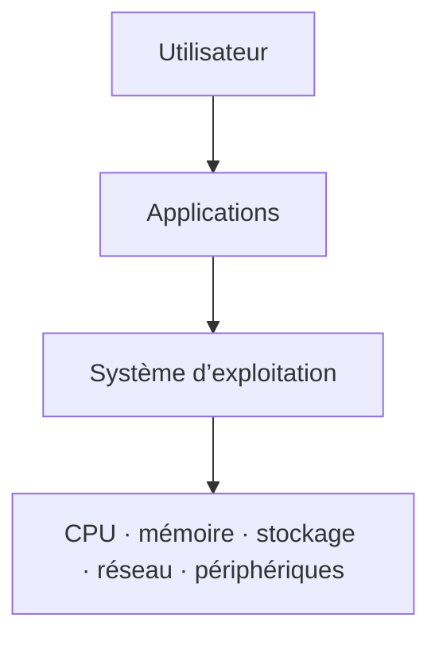

# Module 01 — Les systèmes d’exploitation et Microsoft Windows 10

**Formation :** Systèmes clients Microsoft

**Pré-requis :** identifier les principaux composants d’un ordinateur.

## Objectifs

À l’issue de ce module, vous devez pouvoir :

- définir un système d’exploitation et expliquer ses fonctions principales ;
- situer le noyau, le shell, l’interface graphique et le système de fichiers ;
- reconnaître la présence d’un système d’exploitation dans les équipements cités par le support ;
- décrire les repères historiques Windows, le vocabulaire de support et le modèle Windows as a Service présentés dans les sources ;
- distinguer les éditions et les licences Windows 10 étudiées.

## 1. Le rôle d’un système d’exploitation

Un système d’exploitation, ou *Operating System* (OS), est le logiciel qui pilote les dispositifs matériels et reçoit les instructions de l’utilisateur ou des applications. Il constitue l’intermédiaire entre les logiciels et les ressources matérielles de la machine.

Le support associe notamment à l’OS les fonctions suivantes :

- gérer le processeur et la mémoire vive ;
- répartir les ressources entre les applications et prioriser les accès concurrents ;
- fournir des informations de fonctionnement au moyen de tableaux de bord ou de journaux ;
- permettre l’utilisation des périphériques au moyen de leurs pilotes ;
- protéger l’accès aux ressources selon les privilèges des utilisateurs.

## 2. Les composants à reconnaître

| Composant | Rôle présenté dans les sources |
| --- | --- |
| **Noyau** (*kernel*) | lien direct entre le matériel et le reste de l’OS ; il peut évoluer et recevoir des modules complémentaires. |
| **Shell / CLI** | interpréteur de commandes par lequel un utilisateur ou un script envoie des instructions. |
| **GUI** | interface graphique facultative qui facilite l’interaction avec le système. |
| **Système de fichiers** | organise les données et leur accès sur les supports de stockage. |
| **Pilote** (*driver*) | permet à l’OS de prendre en charge les fonctionnalités d’un périphérique. |

!!! tip "Lire un besoin avant d’agir"
    Lorsque vous analysez une situation, commencez par identifier la ressource concernée : processeur, mémoire, stockage, périphérique ou droit d’accès. Le support rattache ensuite chaque fonction de l’OS à cette ressource.

## 3. Les systèmes d’exploitation autour de nous

Les sources ne limitent pas les OS aux postes de travail. Elles les situent aussi dans :

- les serveurs et postes utilisateurs ;
- les smartphones et tablettes ;
- les montres connectées ;
- les switchs, routeurs, box, NAS et imprimantes ;
- les télévisions et les véhicules.

Les exemples cités comprennent Windows, Android, iOS, macOS ainsi que des distributions GNU/Linux comme Ubuntu ou Debian.

## 4. Repères historiques Windows du support

Le support retrace une chronologie allant de MS-DOS à Windows 10 : MS-DOS (1981), Windows 1.0 (1985), Windows NT (1993), Windows 95, Windows 98, Windows 2000, Windows XP, Windows Vista, Windows 7, Windows 8 et Windows 10.

!!! note "Repères historiques"
    Les dates, versions et cycles présentés dans cette section sont des éléments historiques issus des sources TSSR. Ils servent à comprendre les notions de migration et de support ; cette page ne les actualise pas avec une source externe.

Le support emploie le vocabulaire suivant :

| Terme | Sens donné par le support |
| --- | --- |
| **KB** | correctif de sécurité ou de fonctionnalité. |
| **Service Pack** | ensemble de KB. |
| **Release** | mise à jour majeure de l’OS ; le support prend Windows 8.1 comme exemple. |
| **Migration** | remplacement progressif d’une version de Windows par une autre. |

## 5. Windows as a Service

Les sources présentent Windows as a Service comme le modèle d’évolution continue de Windows 10.

| Notion | Description issue du support |
| --- | --- |
| **Windows Insider** | communauté de bêta-testeurs de Windows 10. |
| **Build** | version identifiée par un numéro, par exemple `1903` dans le support. |
| **Feature Update** | mise à disposition d’une nouvelle build et de nouvelles fonctionnalités. |
| **Quality Update** | mise à jour de qualité : correctifs de sécurité et de bogues. |
| **Patch Tuesday** | rythme historique cité pour les Quality Updates : le deuxième mardi du mois. |

Les exemples de durée de support de build et de cadence de mises à jour présents dans les sources sont des descriptions du modèle étudié, pas des engagements actuels.

## 6. Éditions Windows 10

| Édition | Positionnement indiqué dans le support |
| --- | --- |
| **Famille** | usage domestique ; le support cite notamment Cortana, bureaux supplémentaires, OneDrive et Edge. |
| **Professionnelle** | environnement professionnel ; jonction au domaine, GPO, EFS et BitLocker font partie des exemples cités. |
| **Entreprise** | fonctionnalités supplémentaires destinées aux grandes organisations, par exemple AppLocker, DirectAccess et BranchCache. |

Le support évoque aussi les éditions Professionnelle pour station de travail, Éducation et Entreprise LTSC.

## 7. Types de licence étudiés

| Type | Définition présentée |
| --- | --- |
| **OEM** | licence préinstallée et liée à la machine. |
| **Retail** | vente au détail, boîte ou version numérique ; associée à l’utilisateur dans le support. |
| **MAK** | clé permettant plusieurs activations. |
| **VLK / KMS** | licence de volume destinée au déploiement de systèmes clients ; le support associe KMS à un environnement de plus de 25 postes. |
| **CAL** | licence permettant au client de solliciter le service d’un serveur Microsoft. |

## Synthèse

- L’OS coordonne les ressources matérielles, les applications, les périphériques et les droits d’accès.
- Noyau, shell, GUI et système de fichiers jouent des rôles complémentaires.
- Les repères Windows et WaaS doivent être lus dans leur contexte historique de support.
- Le choix d’une édition et d’une licence dépend de l’usage et de l’environnement décrits.

## Pour réviser

- [Fiche de révision M01](../../revision/systemes-clients/module-01-les-systemes-d-exploitation-et-microsoft-windows-10.md)
- [Kahoot M01](../../kahoot/02-systemes-clients-microsoft-01-les-systemes-d-exploitation-et-microsoft-windows-10.md)
- [Présentation de la formation](index.md)

## Provenance pédagogique

- **A — sources originales TSSR :** `Module 01 - Support de cours.pdf` et `module 1 et 2 et extra.txt`, section Module 1.
- **B — structuration pédagogique :** progression web, tableaux et synthèse construits uniquement à partir des sources A.
