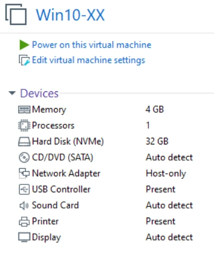

# Module 02 — Installation du système d’exploitation Windows 10

**Formation :** Systèmes clients Microsoft · **Pré-requis :** module 01 et prise en main de VMware Workstation.

## Objectifs

- Vérifier les prérequis et distinguer image d’installation, environnement de démarrage et système installé.
- Choisir entre nouvelle installation, mise à niveau et transfert des données.
- Installer et configurer la VM Win10-XX, documenter l’opération, installer les VMware Tools et importer Discovery.

## 1. Préparer l’installation

Le support enseigne Windows 10 ; ses chiffres et écrans décrivent le laboratoire. Ils servent à reproduire le scénario, pas à dimensionner un poste de production actuel.

| Prérequis du support | 32 bits | 64 bits |
|---|---|---|
| Processeur | 1 GHz | 1 GHz |
| Mémoire vive | 1 Go | 2 Go |
| Disque | 16 Go | 32 Go |

Le passage au 64 bits est présenté comme une adaptation aux composants : meilleures performances, prise en charge de plus de 4 Go de RAM et protection accrue avec des pilotes signés. Les notes rappellent qu’un minimum permettant l’installation ne garantit pas un confort d’utilisation ; le TP prévoit donc **4 Go de mémoire**.

### `boot.wim` et `install.wim` ont des rôles différents

- **`boot.wim`** contient le mini-OS léger servant à installer ou réparer Windows.
- **`install.wim`** contient l’image qui sera appliquée au disque du poste.
- DVD, clé USB, ISO et déploiement réseau sont des moyens d’atteindre ces fichiers.

**Illustration IA / externe au cours — déroulement pédagogique.**

## 2. Choisir la méthode et préparer les données

| Méthode | Point de départ | Résultat recherché |
|---|---|---|
| Nouvelle installation | Matériel neuf ou remplacement d’un système. | Installer un nouveau système puis le paramétrer. |
| Mise à niveau | Windows existant ; cas particuliers du support, depuis Windows 7 64 bits et versions plus récentes. | Conserver applications, paramètres et données dans les cas compatibles étudiés. |
| Migration des données et paramètres | Ancien système vers nouveau système. | Transférer les éléments explicitement sélectionnés. |

Avant une nouvelle installation, les notes demandent d’identifier ce qui doit être conservé : fichiers et dossiers, comptes et profils, configurations logicielles, pilotes, polices, messagerie et paramètres du système. Le support cite **Sauvegarder et restaurer** pour les fichiers/dossiers et **USMT — User State Migration Tools** en ligne de commande pour les comptes et paramètres.

Une image ISO n’est pas la sauvegarde des documents de l’utilisateur. Préparer les données à conserver fait partie de l’installation.

## 3. Comprendre les étapes de l’assistant

1. Démarrer dans l’environnement d’installation et choisir l’édition proposée.
2. Choisir le mode d’installation, puis préparer le disque : partitionnement et formatage.
3. Copier le contenu de l’image et laisser le paramétrage automatique s’effectuer.
4. Démarrer sur le disque installé et réaliser la première configuration.

Le support théorique évoque un redémarrage ; la correction de l’atelier en observe deux jusqu’à la première configuration. Il faut suivre l’état de l’assistant plutôt que déduire une panne du seul nombre de redémarrages.

## 4. TP — Préparer Win10-XX et la procédure

**Durée indicative : une heure.** Lire l’ensemble de l’atelier avant de commencer.

Sur le volume de données de l’hôte, créer **ISO**, **Procédures** et **Vms-WorkStation**, puis copier l’ISO Windows 10 fournie dans le dossier ISO. L’emplacement peut être le lecteur C: ou un autre volume de données.

Dans Workstation, choisir **Create a New Virtual Machine**, puis appliquer le contrat du TP :

| Paramètre | Valeur attendue |
|---|---|
| Assistant | Typical |
| Système invité | Windows 10 x64 |
| Nom | Win10-XX, XX = initiales |
| Emplacement | Sous-dossier Win10-XX de Vms-WorkStation |
| Disque | 32 GB, **Store virtual disk as a single file** |
| RAM | 4 GB |
| Processeur | 1 processeur, 1 cœur |
| Réseau | **Host-Only** |

Dans **Customize Hardware**, vérifier la RAM, le processeur et l’adaptateur réseau avant **Finish**. La VM doit apparaître dans la bibliothèque Workstation. Monter l’ISO dans le lecteur DVD virtuel via **Browse**.

Capture isolée de l’énoncé : 4 Go, un processeur, disque de 32 Go, Host-Only.

### Enregistrer les étapes avec PSR

Lancer **`psr`**, l’Enregistreur d’actions utilisateur, depuis l’hôte. Paramétrer :

- fichier de sortie **`Procédures\psr-install-Win10.zip`** ;
- capture d’écran activée ;
- nombre maximal de captures récentes, **999** dans la correction ;
- **Commencer l’enregistrement**, puis réduire PSR pour garder l’écran lisible.

L’énoncé abrège une fois le nom du ZIP en `install-Win10.zip` ; conserver le nom réellement choisi dans les paramètres, puis exploiter son contenu pour la procédure **`Procédures\install-Win10.docx`**.

## 5. TP — Installer Windows 10 Professionnel

1. Démarrer Win10-XX et cliquer dans sa console.
2. Appuyer sur une touche lorsque **Press any key to boot from CD or DVD** apparaît.
3. Choisir **Français (France)**, puis **Installer maintenant**.
4. Choisir **Je n’ai pas de clé de produit** : le TP utilise le délai de grâce.
5. Choisir **Windows 10 Professionnel**, puis accepter le contrat de licence.
6. Choisir **Personnalisé : installer uniquement Windows**.
7. Laisser l’installation utiliser la totalité des **32 Go d’espace non alloué** de cette VM de laboratoire.
8. Attendre la copie et les redémarrages. Le système finit par démarrer depuis son disque.
9. Arrêter PSR quand l’installation initiale est terminée et vérifier la présence de l’enregistrement dans le ZIP.

Construire la procédure personnalisée avec les captures utiles, leur ordre et des commentaires expliquant les choix. Le livrable doit permettre de reproduire l’opération.

### Réglages de première utilisation demandés

| Écran ou option | Choix de l’atelier |
|---|---|
| Région | France |
| Clavier | Français ; aucune disposition supplémentaire |
| Connexion | Pas de connexion Internet pour le moment ; installation limitée |
| Compte local | `pnom` : première lettre du prénom + nom ; définir son mot de passe et les réponses de récupération |
| Historique des activités | Non |
| Cortana | Non |
| Reconnaissance vocale en ligne | Non |
| Emplacement utilisé par Microsoft/apps | Non |
| Localisation de l’appareil | Non |
| Diagnostic | Envoi basique dans les écrans du support |
| Amélioration écriture manuscrite et saisie | Non |
| Expériences personnalisées par les diagnostics | Non |
| Identifiant publicitaire | Non |

Les écrans dépendent de la build utilisée ; conserver les objectifs du TP si une formulation diffère. Ces réglages décrivent le scénario source.

## 6. TP — Finaliser et conserver un état de référence

Dans Workstation, choisir **Install VMware Tools** pour monter leur ISO. Dans la VM, ouvrir **Ce PC**, le DVD **VMware Tools**, puis lancer **`setup64`**. Conserver l’installation typique et les propositions par défaut, puis redémarrer.

Éjecter le DVD des VMware Tools. L’énoncé demande ensuite d’éteindre la VM et de prendre le snapshot **« TP1 terminé »**. La correction explique aussi les snapshots à froid, VM arrêtée, et à chaud, VM allumée. Pour reproduire l’énoncé, conserver ici l’état à froid.

Le snapshot donne un point de retour du laboratoire. La procédure écrite conserve les étapes et leurs raisons : les deux objets ont des usages différents.

## 7. TP — Importer Discovery

1. Créer **`Vms-WorkStation\Discovery`**.
2. Y préparer l’archive **`Discovery.ova`** fournie.
3. Dans Workstation : **Home → Open a Virtual Machine** ; choisir l’OVA.
4. Importer sous le nom **Discovery**, dans le sous-dossier Discovery, puis attendre la fin.
5. Observer les réglages, sans les deviner à partir de ceux de Win10-XX.

| Discovery selon la correction | Valeur |
|---|---|
| Nombre de disques | **4** |
| Mémoire | **4 GB** |
| Processeurs | **1** |
| Carte réseau | **Host-Only** |
| VMware Tools | Présents ; vérifiables dans les programmes installés |

Ouvrir une session avec le compte **`adm`** et le mot de passe fourni par le formateur. L’énoncé demande d’exécuter **`reinit.bat`**, sur le Bureau, **en tant qu’administrateur**, puis de redémarrer Discovery. Conserver cette étape de l’énoncé même si la correction ne la répète pas.

## Contrôler le résultat

- Win10-XX démarre sur Windows 10 Professionnel ; le compte local fonctionne.
- La VM respecte 32 Go, 4 Go, 1 cœur et Host-Only.
- Les VMware Tools sont installés et le DVD est éjecté.
- La procédure DOCX et les captures PSR sont présentes dans Procédures.
- Le snapshot « TP1 terminé » est identifiable.
- Discovery est importée ; ses quatre disques et ses Tools sont observés ; la réinitialisation demandée est faite.

## Mini-quiz

1. À quoi servent `boot.wim` et `install.wim` ?
2. Une nouvelle installation et une mise à niveau poursuivent-elles le même objectif de conservation ?
3. Pourquoi le TP fixe-t-il 4 Go de RAM alors que le minimum du support est 2 Go en 64 bits ?
4. Quel réseau et quel espace disque sont imposés pour Win10-XX ?
5. Quelle étape propre à Discovery est présente dans l’énoncé ?

??? note "Réponses"
    1. `boot.wim` fournit l’environnement léger ; `install.wim` l’image du Windows installé.
    2. La mise à niveau vise la conservation dans les cas compatibles ; une nouvelle installation demande de préparer les éléments à transférer.
    3. Le minimum d’installation ne représente pas le dimensionnement du scénario pratique.
    4. Host-Only et 32 Go.
    5. Exécuter reinit.bat comme administrateur puis redémarrer.

- [Énoncé et correction du TP](../../tp/systemes-clients/module-02/index.md)
- [Fiche de révision M02](../../revision/systemes-clients/module-02-installation-du-systeme-d-exploitation-windows-10.md)
- [Kahoot M02](../../kahoot/02-systemes-clients-microsoft-02-installation-du-systeme-d-exploitation-windows-10.md)

## Provenance pédagogique

Support M02, énoncé et solution du TP Installation de Windows, section Module 2 des notes et synthèse Installation/Configuration du Drive. Les explications d’enchaînement, contrôles et mini-quiz sont des aides IA ; aucune actualisation ne remplace les versions du laboratoire.
