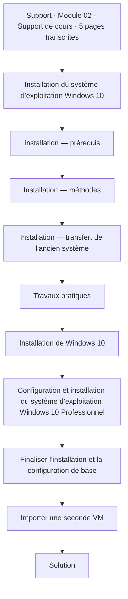
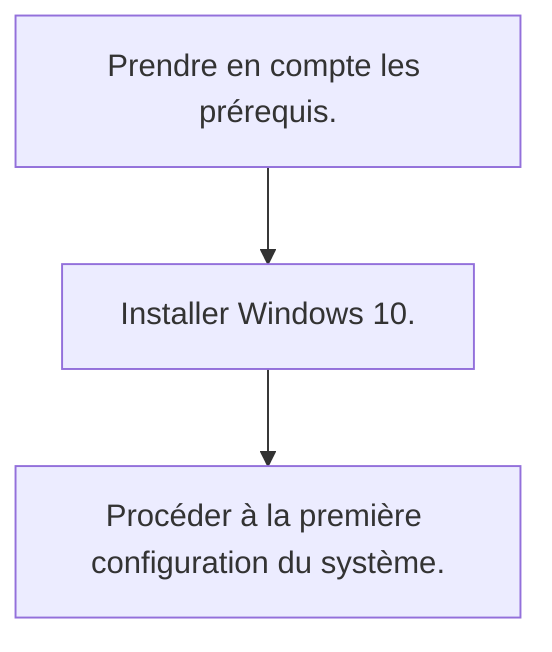
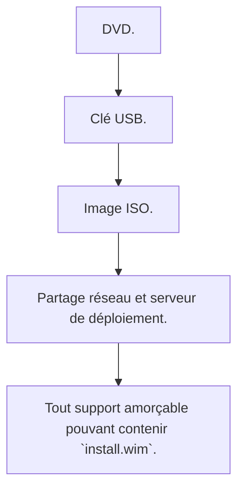
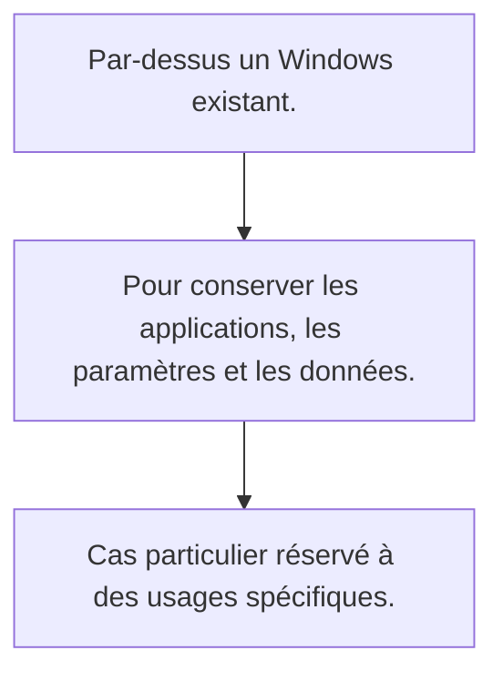
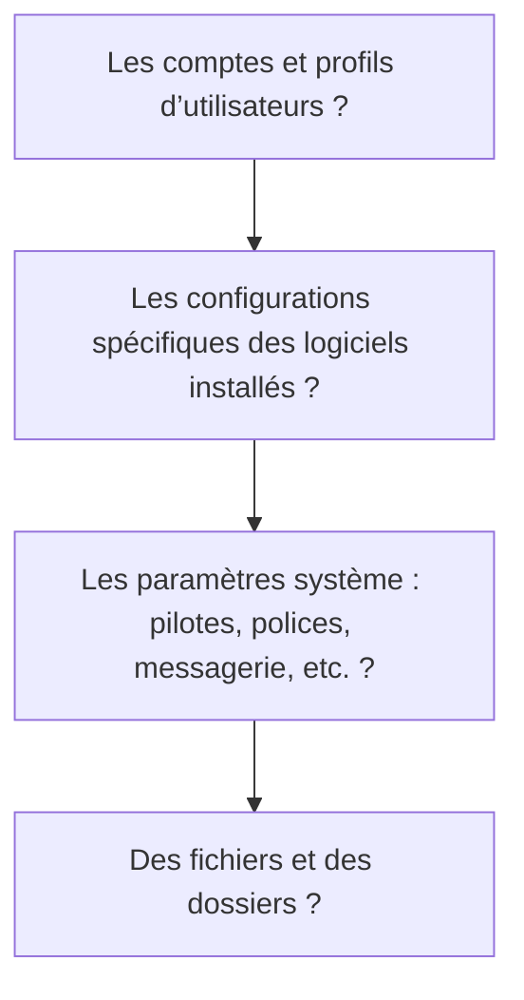

# Module 02 — Installation du système d’exploitation Windows 10

[Travaux pratiques](../../tp/systemes-clients/module-02/index.md)

Les parties ci-dessous reprennent le cours original, dans le même ordre. Les encadrés et les schémas répètent ses formulations.

## Parcours de lecture
1. Support · Module 02 - Support de cours · 5 pages transcrites
2. Installation du système d’exploitation Windows 10
3. Installation — prérequis
4. Installation — méthodes
5. Installation — transfert de l’ancien système
6. Travaux pratiques
7. Installation de Windows 10
8. Configuration et installation du système d’exploitation Windows 10 Professionnel
9. Finaliser l’installation et la configuration de base
10. Importer une seconde VM
11. Solution
12. Synthèse du Drive · Synthèse Module 2 - Installation et Configuration de Windows 10 V2 · 2 pages transcrites
13. Synthèse — Module 2 : Installation et configuration initiale de Windows 10 (V2)
14. Commande de réinitialisation de la VM d’apprentissage
15. Notes du Drive · module 1 et 2 et extra.txt · document texte
16. Module 2 - Installation de Windows 10
17. Importer une seconde VM
18. Examiner Discovery

**Visuel externe**



SOURCE DRIVE · TRANSCRIPTION DU SUPPORT

Le contenu des documents du dossier TSSR est transcrit ci-dessous, page par page. Les textes et tableaux sont intégrés à la page Web. Aucun fichier PDF, aucune diapositive entière ni aucune reproduction de page n’est affiché. Seuls des croquis ou visuels isolés et vérifiés peuvent accompagner la transcription. Les versions et les consignes restent celles des supports de formation. Les compléments IA sont conservés dans leur onglet distinct.

## Support · Module 02 - Support de cours · 5 pages transcrites

## Installation du système d’exploitation Windows 10

### Objectifs

!!! note "À retenir"
    Procéder à la première configuration du système.

**Visuel externe**



- Prendre en compte les prérequis.
- Installer Windows 10.
- Procéder à la première configuration du système.

## Installation — prérequis

| Matériel | Système 32 bits | Système 64 bits |
| --- | --- | --- |
| Processeur | 1 GHz | 1 GHz |
| Mémoire vive | 1 Go | 2 Go |
| Espace disque | 16 Go | 32 Go |

### Le 64 bits, c’est quoi ?

!!! note "À retenir"
    Adaptation du système d’exploitation aux évolutions des composants : meilleures performances.

- Adaptation du système d’exploitation aux évolutions des composants : meilleures performances.
- Prise en compte native de plus de 4 Go de mémoire vive.
- Meilleure protection du système : nécessite des pilotes signés.

### Supports d’installation

!!! note "À retenir"
    Un fichier source est commun aux supports d’installation : **`install.wim`**.

**Visuel externe**



Un fichier source est commun aux supports d’installation : **`install.wim`**.

- DVD.
- Clé USB.
- Image ISO.
- Partage réseau et serveur de déploiement.
- Tout support amorçable pouvant contenir `install.wim`.

Un mini-système d’exploitation est requis : OS léger pour installer ou réparer Windows, disponible dans le fichier **`boot.wim`** du support d’installation.

## Installation — méthodes

### Nouvelle installation

- Sur du nouveau matériel.
- En remplacement d’un système existant.

### Mise à niveau

!!! note "À retenir"
    Pour conserver les applications, les paramètres et les données.

**Visuel externe**



- Par-dessus un Windows existant.
- Pour conserver les applications, les paramètres et les données.
- Cas particulier réservé à des usages spécifiques.
- Mise à niveau possible, dans le support, depuis Windows 7 64 bits et les systèmes plus récents.

### Déroulement

!!! note "À retenir"
    **Choix de l’édition et du mode d’installation** : démarrage dans un environnement d’installation ; selon les supports, plusieurs éditions sont proposées, par exemple Famille et Professionnelle.

1. **Choix de l’édition et du mode d’installation** : démarrage dans un environnement d’installation ; selon les supports, plusieurs éditions sont proposées, par exemple Famille et Professionnelle.
2. **Configuration du matériel** : partitionnement et formatage.
3. **Copie des fichiers et installation de Windows** : copie du contenu de l’image sur la partition ; paramétrage automatique, avec un redémarrage nécessaire.
4. **Premier démarrage sur le disque** : préparation pour la première utilisation.

## Installation — transfert de l’ancien système

### Que transfère-t-on ?

!!! note "À retenir"
    Les configurations spécifiques des logiciels installés ?

**Visuel externe**



- Les comptes et profils d’utilisateurs ?
- Les configurations spécifiques des logiciels installés ?
- Les paramètres système : pilotes, polices, messagerie, etc. ?
- Des fichiers et des dossiers ?

### Comment faire ?

!!! note "À retenir"
    Pour les fichiers et dossiers : fonctionnalité **Sauvegarder et restaurer**.

- Pour les fichiers et dossiers : fonctionnalité **Sauvegarder et restaurer**.
- Pour les comptes utilisateurs et les paramètres système et logiciels : outil **USMT — User State Migration Tools**, en ligne de commande.

### Démonstration

!!! note "À retenir"
    Le support annonce une démonstration de l’installation.

Le support annonce une démonstration de l’installation.

## Travaux pratiques

Le support renvoie au TP d’installation de Windows.

### Conclusion

- Différents supports d’installation.
- Différentes méthodes d’installation.
- Paramétrage du socle du système fraîchement installé.

Référence du document : 1Bk4bAsNg5iCJkSgvyLRCX5ReWFlYDxJe · SHA-256 4f99523be23c53a7…

## Synthèse du Drive · Synthèse Module 2 - Installation et Configuration de Windows 10 V2 · 2 pages transcrites

Les synthèses Windows 10 de ce dossier sont rattachées au cours Systèmes clients.

## Synthèse — Module 2 : Installation et configuration initiale de Windows 10 (V2)

### 1. Préparation de l’environnement virtuel

Dans le cadre d’un déploiement ou d’un TP de formation, la virtualisation avec VMware Workstation permet de simuler un environnement client étanche et reproductible.

#### Configuration recommandée de la VM Windows 10

- Type de système : Windows 10 x64.
- Mémoire RAM : 4 Go.
- Processeur : 1 processeur / 1 cœur.
- Disque dur virtuel : 32 Go, fichier unique.
- Carte réseau : Host-Only, réseau privé virtuel.

### 2. Étapes d’installation de Windows 10

L’installation s’effectue depuis une image ISO officielle bootable : 1. Démarrage sur l’image ISO de Windows 10. 2. Choix de la langue, Français, et sélection de l’édition Windows 10 Professionnel. 3. Sélection du type d’installation : Personnalisée, installer uniquement Windows, avancé, sur l’espace non alloué. 4. Configuration initiale hors ligne : installation limitée sans compte Microsoft cloud. 5. Création d’un compte utilisateur local administrateur, exemple : pnom. 6. Désactivation des services de télémétrie, géolocalisation et données de diagnostic superflues. 7. Installation des VMware Tools pour optimiser l’affichage et la gestion du périphérique. 8. Création d’un snapshot d’état propre, exemple : TP1 terminé.

### 3. Automatisation et documentation d’installation

L’Enregistreur d’actions utilisateur de Windows, Step Recorder / psr.exe, permet d’automatiser la capture des étapes pour rédiger une procédure personnalisée d’installation.

```
:: Lancement de l’enregistreur d’actions utilisateur (PSR)
psr.exe
```

## Commande de réinitialisation de la VM d’apprentissage

```
:: Commande de réinitialisation de la VM d’apprentissage (script batch)
reinit.bat
```

Référence du document : 1BIk1H_2uj3XFijQHxwvV9Ve50UrWWACE5M6AmT1L9Lk · SHA-256 dd49debff3c0b587…

## Notes du Drive · module 1 et 2 et extra.txt · document texte

Notes textuelles présentes dans le Drive. Aucun support de cours illustré distinct n’est fourni pour ce document ; aucune illustration n’a été inventée ou attribuée au support.

## Module 2 - Installation de Windows 10

### Objectifs du module

### Les prérequis

### L'installation

### La migration

### Démonstration - L'installation

### TP - Installation de Windows

### Conclusion

Dans ce module, nous allons explorer les différentes étapes nécessaires à l'installation de Windows 10 sur un système donné.

Les objectifs du module sont les suivants : nous allons tout d'abord prendre en compte les prérequis pour l'installation. Cela inclut la vérification des configurations matérielles et logicielles nécessaires pour assurer un bon fonctionnement du système.

### Installation de Windows 10

Ensuite, nous allons procéder à l'installation de Windows 10. Cette étape nécessite une attention particulière pour éviter les erreurs et garantir que le système est installé correctement. Nous allons nous familiariser avec les différentes options d'installation, telles que l'installation propre et l'installation de mise à niveau.

### Configuration initiale du système

Enfin, après l'installation, nous allons effectuer la première configuration du système. Cela comprend le paramétrage des comptes utilisateurs, la configuration des paramètres de sécurité, ainsi que l'activation des fonctionnalités clés du système d'exploitation.

En conclusion, ce module nous permettra de maîtriser l'installation et la configuration initiale de Windows 10, ce qui est essentiel pour nos futures activités professionnelles dans le domaine des systèmes et réseaux.

Dans ce module, nous allons aborder les prérequis matériels nécessaires à l'installation de Windows 10, afin d'assurer un fonctionnement minimal mais performant du système.

Pour installer Windows 10, nous devons prendre en compte certains prérequis matériels de base. Tout d'abord, un processeur capable de fournir une puissance de calcul d'1 GHz est indispensable. Concernant la mémoire vive, il nous faut 1 Go pour les systèmes 32 bits et 2 Go pour les systèmes 64 bits. Cependant, avec l'évolution de l'OS et l'utilisation de logiciels supplémentaires, il est préférable de prévoir plus de mémoire vive.

### Les exigences de stockage

L'espace de stockage est également un critère essentiel. Nous avons besoin de 16 Go d'espace pour un système 32 bits et de 32 Go pour un système 64 bits. Ce stockage est nécessaire pour le système d'exploitation lui-même ainsi que pour les mises à jour qui peuvent survenir. Évidemment, nous devons prévoir davantage d'espace pour le stockage de nos données personnelles.

### Comprendre les architectures 32 bits et 64 bits

Il est important de comprendre pourquoi il existe une différence de spécification entre les systèmes 32 bits et 64 bits. L'architecture 64 bits représente une avancée matérielle. À mesure que le temps passe, le matériel devient à la fois plus compact et plus puissant. Les composants d'un ordinateur échangent des informations dans un cadre de fiabilité et de rapidité supérieures, ce qui nécessite que le système d'exploitation s'adapte à cette architecture 64 bits, afin d'exploiter le matériel de manière optimale.

### Performances et sécurité avec le 64 bits

Les systèmes d'exploitation 64 bits sont de plus en plus répandus et apportent de nombreux avantages. En effet, un système Windows 10 64 bits peut gérer de manière native plus de 4 Go de mémoire vive. De plus, il offre une meilleure protection du système, en intégrant le démarrage sécurisé grâce au firmware UEFI. Nous bénéficions également de meilleures garanties de fiabilité, car un tel système ne prend en charge que les périphériques dont le pilote a été signé et approuvé par Microsoft, réduisant ainsi le risque d'erreurs critiques telles que le « blue screen of death ».

### Les fichiers nécessaires pour l'installation

Pour installer Windows sur un ordinateur, nous avons besoin d'un ensemble de fichiers appelés fichiers système. Ces fichiers doivent être déployés sur le support de stockage de l'ordinateur, qui est généralement le disque dur. Cet ensemble de fichiers est contenu dans une archive appelée « image », connue sous le nom de « install.vim ». L'extension vim signifie Windows Imaging.

### Où trouver l'image windows

Nous pouvons trouver cette image sur différents médias bootables, tels qu'un DVD – ce qui est la méthode historique – ou des clés USB bootables. Les images ISO, qui représentent le DVD virtuel, sont également une option viable. Il existe aussi des partages réseau contenant plusieurs images vim pour intégrer différentes instances de Windows.

### Déploiement de l'image

Une fois l'image vim en notre possession, le déploiement de son contenu sur le disque dur requiert un outil spécifique, soit un mini système d'exploitation. Ce dernier est très léger et doit également être disponible sur le support d'installation, en utilisant le fichier boot.vim. Ce fichier est celui qui apparaîtra à l'écran lors du démarrage de l'ordinateur, avant même qu'il n'héberge Windows.

En résumé, les prérequis pour installer Windows 10 doivent être scrupuleusement respectés pour garantir la performance et la sécurité de notre système d'exploitation.

Dans ce module, nous allons aborder les différentes méthodes d'installation de Windows 10.

Nous avons deux possibilités pour installer Windows 10. Nous pouvons procéder à une nouvelle installation sur du nouveau matériel, sur un disque tout neuf, ou bien sur un ordinateur qui avait préalablement un système d'exploitation installé. Dans ce dernier cas, le contenu du disque sera au préalable effacé.

### Mise à niveau vers Windows 10

Nous avons également la possibilité de réaliser ce qu'on appelle une mise à niveau vers Windows 10. Cela consiste à installer Windows 10 par-dessus un Windows existant. Toutefois, ce type d'installation est plutôt rare et n'est pas la plus appréciée des techniciens et des administrateurs, car il réduit la fiabilité du système. Installer Windows 10 au-dessus d'un Windows 7 qui n'est peut-être pas très fiable est à éviter, selon nous.

D'autres contraintes existent également. Par exemple, il ne sera pas possible de faire une mise à niveau vers Windows 10 depuis un ordinateur possédant Windows XP ou Windows Vista. Pour toutes ces raisons, la mise à niveau est donc à proscrire, même si elle peut être utilisée dans des cas spécifiques, comme pour conserver des données difficiles à exporter ou pour continuer à utiliser des logiciels sans accès à leurs sources d'installation.

### Processus d'installation

Que se passe-t-il lors de l'installation de Windows ? Après avoir booté sur le support d'installation, un mini système d'exploitation issu du boot.vim se lance, et nous arrivons dans un environnement d'installation. Nous choisissons ensuite l'édition de Windows 10 lorsque l'assistant nous le demande, bien que cette étape soit facultative. L'assistant nous demande alors où déployer les fichiers système.

### volume_choisi = volumes_disponibles.find \{ |v| v.formaté_en == 'NTFS' \}

Nous avons la possibilité d'utiliser un volume existant sur le disque dur qui sera formaté en NTFS, ou bien de créer un nouveau volume pour accueillir le système d'exploitation. Une fois le volume choisi, l'installation commence : c'est-à-dire la copie des fichiers système en première étape, suivie des configurations de bas niveau du système. Un redémarrage survient à l'issue de l'installation, ce qui est normal. Nous pouvons alors retirer le support d'installation, car nous n'en aurons plus besoin, tout étant maintenant présent sur le disque dur de l'ordinateur.

L'ordinateur démarre maintenant grâce aux fichiers système présents sur le disque dur, et nous procédons au premier démarrage. Ce premier démarrage après l'installation est important, car il nous permet de personnaliser notre système.

Nous devons retenir que le choix entre une installation neuve et une mise à niveau doit être fait judicieusement, en tenant compte de la fiabilité du système et des données à sauvegarder.

Dans l'environnement professionnel actuel, lorsque nous installons Windows 10, il est courant que nous travaillions sur un nouvel ordinateur suite à un renouvellement de parc. Cela signifie que nous devons recréer un environnement de travail similaire à celui que nous avions auparavant.

### Les éléments à migrer

Nous devons réfléchir à ce que notre équipe technique doit transférer de l'ancien poste vers le nouveau. Cela inclut :

Les comptes et profils des utilisateurs.

Les configurations particulières des logiciels installés localement.

Des outils bureautiques.

Les paramètres systèmes tels que les pilotes, la messagerie et les polices d'écriture.

Les fichiers et dossiers.

### Les solutions de sauvegarde

Pour les fichiers et dossiers, nous pourrons nous appuyer sur notre solution centralisée de sauvegarde. Si celle-ci n'existe pas, Windows propose un outil natif de sauvegarde de données : l'outil de sauvegarde et restauration Windows 7, qui a été conservé tel quel dans Windows 10. Cet outil n'a subi aucun changement depuis sa création.

### La migration des paramètres et des configurations

Pour migrer les comptes, les profils et autres configurations et logiciels, notre équipe se basera sur des scripts USMT, pour User State Migration Tools.

### Scripts USMT

Des procédures d'utilisation d'USMT sont disponibles sur le site de Microsoft. Voici un exemple de script que nous pourrions utiliser :

### USMT /capture /i:migration.xml /l:logfile.log

En conclusion, le processus de migration est essentiel pour garantir que nous ne perdions pas en productivité lors du passage à un nouvel ordinateur. Grâce à des outils efficaces et des scripts appropriés, nous pouvons assurer une transition fluide vers notre nouvel environnement de travail.

Dans cette section, nous allons procéder à une simple installation de Windows 10, ici la build 1909.

Pour l'installation, nous nous appuyons sur une VM Workstation qui répond aux prérequis d'installation. Le média d'installation est une image ISO que nous allons aller chercher dans notre dossier ISO. Nous pouvons même la monter dans notre système d'exploitation principal, comme si nous naviguions à l'intérieur d'un DVD.

### Vérification des fichiers d'installation

Allons vérifier que les images install.vim et boot.vim sont présentes sur ce support d'installation. Nous faisons une petite recherche avec *vim, et nous nous retrouvons avec un résultat. Deux fichiers apparaissent : install.vim, qui fait 4,29 Go, et boot.vim, qui est beaucoup plus petit. Le fichier install.vim contient tous les fichiers système qui seront ensuite présents sur le disque dur de notre VM, tandis que boot.vim est un mini système d'exploitation permettant d'installer Windows.

### Montage de l'image ISO

Nous allons introduire ce DVD virtuel dans le lecteur DVD virtuel de notre VM. Pour cela, nous allons dans les paramètres du lecteur DVD de la VM et montons l'ISO présente sur notre disque dur externe. L'image ISO est donc présente dans le lecteur DVD.

### Configuration de la machine virtuelle

Avant de démarrer notre VM, il est important de noter que pour l'instant, c'est une VM vide, sans système d'exploitation installé. Lorsque nous allons la démarrer, le firmware de cette VM va aller à la recherche d'un système d'exploitation. Il parcourra cet ordre et détectera le DVD, en lançant le contenu de boot.vim pour pouvoir installer Windows.

### Démarrage de l'installation

La VM démarre et affiche « Press any key to boot from CD or DVD ». Cela nous prouve que l'image ISO a bien été prise en compte par notre VM et que l'assistant d'installation Windows se lance. Nous configurons l'environnement en français, en choisissant d'installer Windows, et non de le réparer.

### Activation et choix de l'édition

L'installateur nous propose d'activer Windows. Nous n'avons pas de clé d'activation pour le moment, mais nous pourrons l'activer plus tard. Nous pouvons bénéficier d'un délai de grâce de 30 jours, avec toutes les fonctionnalités disponibles. Ensuite, nous choisissons l'édition. Dans notre cas, nous sélectionnons « Windows 10 Professionnel », bien que deux éditions soient proposées, dont l'édition N qui a été dépouillée de certaines fonctionnalités multimédia.

### CLUF et type d'installation

Nous acceptons le contrat de licence utilisateur final (CLUF) pour pouvoir continuer l'installation. Ensuite, l'installateur nous demande notre type d'installation. Nous n'ayant pas de système d'exploitation dans notre VM, nous choisissons une installation personnalisée. Il nous demande où installer Windows, et nous optons pour le disque dur tout neuf de 60 Go.

### Copie des fichiers et préparation de Windows 10

La copie des fichiers est en cours. Le contenu de l'image système se déploie sur le volume, et nous devons patienter quelques minutes pour la préparation de Windows 10. Le firmware détecte le système d'exploitation sur le disque dur maintenant qu'il est déployé et gère le premier démarrage.

### Configuration initiale de Windows

Après un redémarrage automatique, Windows démarre sa configuration de base. L'assistant OOBE (Out-of-Box Experience) s'affiche. Nous choisissons la région « France » et la disposition de clavier appropriée. Étant donné que notre VM n'est pas connectée à Internet, nous sélectionnons « Je n'ai pas Internet » et continuons avec une installation limitée.

### Personnalisation du premier utilisateur

Nous créons notre premier utilisateur, « Demo User ». Nous définissons un mot de passe pour sécuriser l'accès et choisissons trois questions de sécurité. Cet utilisateur pourra personnaliser le système par la suite.

### Finalisation de l'installation

Nous finalisons les premières configurations, puis nous arrivons sur le bureau de l'utilisateur « Demo User ». Windows a terminé son installation et ses configurations initiales, et nous sommes maintenant prêts à l'utiliser.

Pour résumer, nous avons monté une image ISO, démarré la VM, et configuré Windows 10 dans un environnement virtuel adapté.

Dans ce TP, nous allons être amenés à créer une VM avec Workstation.

Pour cela, nous vous invitons à consulter la vidéo d'introduction à Workstation disponible sur le site du campus en ligne.

### Création de la VM

Une fois notre VM créée, nous procéderons à l'installation de Windows 10. Cela nécessitera que nous suivions plusieurs étapes pour s'assurer que tout soit correctement configuré.

### Configuration initiale de Windows 10

Après l'installation, nous allons devoir réaliser la configuration initiale de Windows 10. Cela inclut des réglages importants pour assurer le bon fonctionnement de notre environnement de travail.

### Importation d'une VM existante

Nous aurons également l'occasion d'importer une VM Windows 10 existante. Cette étape nous permettra de nous familiariser avec les fonctionnalités d'importation et d'exportation de Workstation.

À vous de jouer ! Nous espérons que ces étapes vous aideront à maîtriser l'installation et la configuration de Windows 10 dans un environnement virtuel.

Dans ce module, nous avons compris qu'il existe différents supports d'installation du système d'exploitation Windows 10.

Nous savons que tout support doit posséder au minimum une image VIM d'installation. Ils nous permettent de mener à bien le processus d'installation en toute simplicité.

### Méthodes d'installation

Nous avons également exploré les différentes méthodes d'installation. Que ce soit par le biais d'une nouvelle installation ou d'une mise à niveau, chacune des options propose ses avantages.

### Paramétrage de Windows 10

Enfin, une fois que nous avons installé le système d'exploitation, il est essentiel de procéder à son paramétrage de base. Cela inclut la configuration des paramètres de réseau, des paramètres de sécurité, ainsi que le choix des mises à jour.

En résumé, nous avons acquis une compréhension essentielle des supports d'installation, des méthodes disponibles et des étapes de paramétrage nécessaires pour Windows 10. Grâce à ces connaissances, nous sommes désormais bien préparés pour appliquer nos compétences lors des installations réelles.

Référence du document : 1nxEVg-7mxd3jMbcAE5Kz3qCC4VNDZHhg · SHA-256 7d214dc2f3c70800…

| Travaux pratiques | Le support renvoie au TP d’installation de Windows. |
| Configuration et installation du système d’exploitation Windows 10 Professionnel | À l’issue de la création de la VM, sa configuration doit être la suivante, présentée dans la capture du document. |
| Finaliser l’installation et la configuration de base | À la fin de l’installation, lorsque la VM redémarre, cliquez sur **Arrêter l’enregistrement**. |
| Importer une seconde VM | Importez la VM Discovery au format OVA dans un sous-dossier créé par vos soins en amont nommé Discovery dans le dossier VMs-WorkStation. |
| Solution | Une solution est proposée pour ce TP sous la forme d’un PDF commenté, disponible dans les ressources à télécharger. |
| Synthèse du Drive · Synthèse Module 2 - Installation et Configuration de Windows 10 V2 · 2 pages transcrites | Les synthèses Windows 10 de ce dossier sont rattachées au cours Systèmes clients. |
| Commande de réinitialisation de la VM d’apprentissage | Référence du document : 1BIk1H_2uj3XFijQHxwvV9Ve50UrWWACE5M6AmT1L9Lk · SHA-256 dd49debff3c0b587… |
| Notes du Drive · module 1 et 2 et extra.txt · document texte | Notes textuelles présentes dans le Drive. |
| Importer une seconde VM | Importez la VM Discovery au format OVA dans un sous-dossier créé par vos soins en amont nommé Discovery dans le dossier VMs-WorkStation. |
| Examiner Discovery | Démarrez Discovery et ouvrez une session avec l’utilisateur **adm**, avec le mot de passe fourni par le formateur. |
