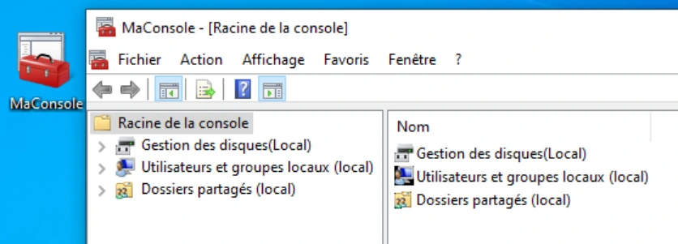
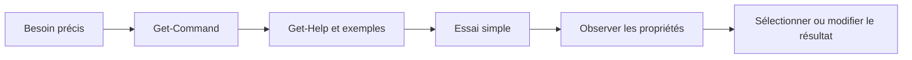

# Module 03 — Interagir avec Windows 10

**Formation :** Systèmes clients Microsoft · **Pré-requis :** Win10-XX et Discovery installées ; connaissance du module 02.

## Objectifs

- Se déplacer dans l’interface Windows et construire une console MMC.
- Lire la syntaxe d’une commande et utiliser l’aide de cmd.exe.
- Découvrir PowerShell, ses commandes, objets, paramètres et alias.
- Trouver les commandes et les propriétés demandées par les cinq ateliers.

## 1. Trois façons d’administrer le système

| Interface | Usage dans le module | Outils |
|---|---|---|
| **GUI** | Observer et modifier les réglages par des fenêtres. | Paramètres, Panneau de configuration, consoles MMC. |
| **cmd.exe** | Exécuter des commandes internes, des programmes et des fichiers batch. | `help`, `cd`, `md`, `copy`, `dir`, redirection. |
| **PowerShell** | Exécuter des commandes et scripts en manipulant des objets. | `Get-Command`, `Get-Help`, cmdlets et propriétés. |

Les notes expliquent que la CLI devient utile pour des actions précises et l’automatisation. Le support situe `command.com` dans les OS MS-DOS, `cmd.exe` dans la famille Windows NT et PowerShell à partir de Windows Server 2008 dans son panorama historique.

## 2. Repérer les éléments graphiques

Windows est **multi-utilisateur** : chaque utilisateur possède un profil, un Bureau et un menu Démarrer personnalisables. Il est aussi **multitâche** : plusieurs applications fonctionnent simultanément.

- Le clic gauche sur Démarrer ouvre les applications et tuiles des écrans du support ; le clic droit donne les principaux raccourcis d’administration.
- La barre des tâches permet de basculer entre programmes. **Windows + Tab** affiche les tâches et bureaux supplémentaires.
- **Timeline** est l’historique d’actions présenté dans cette build du cours.
- Le **Gestionnaire des tâches** renseigne le fonctionnement des applications.
- La zone de notification donne les informations courantes, l’accès réseau, la connectivité, le mode Tablette et « Tous les paramètres ».
- La recherche indexée sert à retrouver un outil : taper « panneau » permet par exemple d’atteindre le Panneau de configuration.

Les notes différencient les paramètres modernes, les éléments du Panneau de configuration, souvent associés à des fichiers **`.cpl`**, et les consoles de gestion **`.msc`**. Ces outils sont notamment présents dans le répertoire système.

### Construire une console MMC

**MMC — Microsoft Management Console** est un cadre qui reçoit des composants logiciels enfichables. On peut ouvrir une console préconfigurée ou lancer **`mmc`** pour assembler les outils utiles.

Dans l’atelier : **Fichier → Ajouter/supprimer des composants logiciels enfichables** ; ajouter **Gestion des disques**, **Utilisateurs et groupes locaux** et **Dossiers partagés**, chaque fois pour l’ordinateur local. Enregistrer la console sur le Bureau en **`MaConsole.msc`**.



<p class="tssr-caption">Capture isolée de la correction : outils de gestion réunis dans une console.</p>

## 3. Lire une ligne cmd.exe

```text
C:\windows\system32> shutdown /r /t 0
```

Le **prompt** indique le contexte courant ; `shutdown` est la commande ; `/r` est une option ; `/t` reçoit ici la valeur `0`. L’exemple explique la syntaxe d’un redémarrage : il ne faut pas le lancer pour tester une simple lecture de la ligne.

Les espaces séparent les mots. Un chemin comportant des espaces doit être délimité correctement ; dans cmd.exe, utiliser par exemple **`"C:\Mes Documents"`**. Le support parle de « quotes » ; les guillemets doubles rendent ici l’exemple utilisable dans cmd.exe.

### Demander l’aide avant de composer la commande

```bat
help
help cd
copy /?
```

`help` liste les commandes internes. Le **synopsis**, première explication de l’aide, indique la fonction : `cd` affiche ou change le répertoire courant. Une application externe peut posséder sa propre aide.

| Notation de l’aide | Comment la lire |
|---|---|
| Texte sans délimiteurs | Élément obligatoire à taper ou valeur à fournir. |
| `[ ... ]` | Élément facultatif. |
| `{ ... }` | Choix parmi des éléments proposés. |
| `\|` dans la syntaxe d’aide | Séparation d’alternatives. |
| `...` | Élément qui peut être répété. |

Le support utilise la commande COPY : `source` est obligatoire, `cible` peut être facultative selon la forme, des options peuvent être ajoutées et plusieurs sources peuvent être réunies. Le caractère `|` d’une notation d’aide ne doit pas être confondu avec le pipeline à exécuter entre deux commandes.

### Conserver un résultat

```bat
help shutdown > aide.txt
```

Le résultat est envoyé dans `aide.txt`. **`>`** crée ou remplace le contenu du fichier ; **`>>`** ajoute à sa suite. Le résultat n’apparaît donc plus simplement à l’écran.

## 4. Comprendre PowerShell

PowerShell réunit un interpréteur de commandes, un langage de scripts et un modèle orienté objet. La version Windows PowerShell du support s’appuie sur **.NET Framework**.

### Repères de versions du support

| Date présentée | Version PowerShell | Windows associé dans le tableau |
|---|---|---|
| Novembre 2006 | 1.0 | Windows Server 2008 ; distributions aussi citées pour XP/Server 2003/Vista. |
| Octobre 2009 | 2.0 | Windows 7, Server 2008 R2 ; disponible sur plusieurs générations précédentes. |
| Septembre 2012 | 3.0, .NET 4.0 | Windows 8, Server 2012 ; Windows 7 SP1 et Server 2008 selon les prérequis du tableau. |
| Octobre 2013 | 4.0, .NET 4.5 | Windows 8.1, Server 2012 R2 ; autres systèmes indiqués dans l’original. |
| Septembre 2014 | 5.0, .NET 4.5 | Windows 10 ; Windows 8.1 et Server 2012 R2 dans la colonne de disponibilité. |

Ce tableau restitue les repères historiques du cours. Pour le TP, **observer la version présente** est plus utile que supposer celle de la machine à partir de la date du tableau.

```powershell
$PSVersionTable
Get-Host
```

`PSVersion` indique la version ; `PSCompatibleVersions` présente la rétrocompatibilité. La console texte peut être lancée avec les droits administrateur. **ISE** (*Integrated Scripting Environment*) facilite la manipulation des scripts ; les notes et le support citent aussi **Windows Terminal** et **VSCode**.

### Cmdlet, paramètre, argument, alias

```powershell
Get-ChildItem -Path C:\Users
```

- `Get-ChildItem` : **cmdlet**, formée d’un verbe et d’un nom séparés par un tiret.
- `-Path` : **paramètre**.
- `C:\Users` : **argument**, sa valeur.

Les verbes courants sont `Get`, `Set`, `Remove`, `Add` et `New`. Le nom dépend du contexte : LocalUser, NetAdapter, Alias, Variable… Les commandes ne sont pas sensibles à la casse ; les paramètres peuvent être obligatoires ou facultatifs et certains fonctionnent sans valeur.

Un **alias** est un autre nom d’une commande : `dir`, `gci` et `ls` sont des alias de `Get-ChildItem` dans le laboratoire PowerShell. Un nom identique à une commande cmd ne garantit pas une syntaxe identique : vérifier l’aide de la console utilisée.

### Saisir plus vite et garder le contrôle

| Touche / commande | Usage |
|---|---|
| Tab / Maj + Tab | Parcourir les complétions de commande, chemin, paramètre et valeur. |
| Ctrl + Espace | Afficher les propositions, puis choisir avec les flèches et Entrée. |
| Échap | Effacer la ligne en cours. |
| Haut / Bas | Parcourir l’historique. |
| Gauche / Droite | Déplacer le curseur. |
| Home / Fin | Aller au début ou à la fin. |
| Ctrl + C | Interrompre l’instruction. |
| `cls` | Effacer l’écran. |
| `exit` | Quitter la console. |

## 5. Trouver une commande puis lire son aide

**Illustration IA / externe au cours — méthode de résolution commune aux TP.**



```powershell
Get-Command
Get-Command Get-*
Get-Command *printer*
Get-Command New-*user*
Get-Help Disable-LocalUser
Help Help
Man about_Variables
Get-Help about_*
```

`Get-Command` sert à découvrir les commandes. `Get-Help` explique une commande ou un concept. `Help` et `Man` permettent la lecture page par page dans l’environnement du support ; **`-?`** ouvre également l’aide d’une cmdlet.

| Besoin | Forme |
|---|---|
| Aide complète | `Get-Help Get-Alias -Full` |
| Exemples seuls | `Get-Help Get-Help -Examples` |
| Fenêtre séparée | `Get-Help about_Aliases -ShowWindow` |
| Aide en ligne | `Get-Help Get-Alias -Online` |

L’aide de PowerShell 1 et 2 est décrite comme intégrée. À partir de PowerShell 3, le support insiste sur son téléchargement, permettant la mise à jour des sections.

```powershell
Update-Help
Update-Help -Force
```

Ces opérations demandent les droits d’administration dans le scénario. `-Force` permet de dépasser la limite d’une mise à jour par jour mentionnée dans le support. En environnement déconnecté, le cours décrit un dépôt d’aide local :

```powershell
Update-Help -SourcePath \\chemin\vers\aide\PowerShell -UICulture en-US -Credential <login>
```

`<login>` et le chemin sont des valeurs à remplacer ; les chevrons ne font pas partie d’une commande à copier telle quelle.

## 6. Lire les objets plutôt que le seul affichage

Carte réseau, disque, utilisateur et fichier sont des exemples d’objets. Un objet possède des **propriétés** et des **méthodes**. L’affichage par défaut sélectionne certaines propriétés ; les autres existent encore.

Le support utilise un objet fictif **monBallon** : forme, diamètre, masse, couleur et description sont des propriétés ; lancer, gonfler et faire rebondir illustrent des actions.

```powershell
Get-monBallon
Get-monBallon | Select-Object *
Get-monBallon | Select-Object diamètre,forme,couleur
(Get-monBallon).Description
```

!!! note "Exemple conceptuel"
    Les commandes monBallon servent d’analogie dans le support. Elles ne sont pas des cmdlets natives à rechercher sur la VM. L’accès `(objet).Description` fournit la valeur ; `Select-Object Description` construit un objet sélectionné pour l’affichage.

Le cours illustre ensuite la modification, la création et la suppression :

```powershell
Set-monBallon -Nom "Basket" -Description "Ballon de Basket"
New-monBallon -Nom "Rugby" -Forme "ovale" -Couleur "blanc" -Description "Ballon de rugby"
Remove-monBallon -Nom "Football"
```

Les notes transposent cette démarche aux services et aux utilisateurs locaux : rechercher la commande liée à l’objet, lire l’aide, observer ses propriétés puis effectuer la modification demandée. Les ateliers l’appliquent aux groupes, disques et cartes réseau.

## 7. TP 1 — Prise en main de l’interface graphique

**Durée indicative : 30 minutes.** Sur **Win10-XX** :

1. Ouvrir la session et changer le mot de passe depuis l’écran de sécurité de la VM.
2. Détacher Store et Courrier de la barre des tâches ; rechercher PowerShell puis l’épingler.
3. Dans Windows Update et ses options avancées, suspendre temporairement les mises à jour pour la durée maximale demandée par le TP, **35 jours au plus**. C’est un réglage du laboratoire.
4. Rechercher « nom » pour afficher le nom initial `DESKTOP-…`. Renommer le PC **Win10-XX**, redémarrer et vérifier.
5. Créer **MaConsole.msc** sur le Bureau avec gestion des disques, utilisateurs/groupes locaux et dossiers partagés.
6. Personnaliser le papier peint ; dans les réglages de veille, choisir **Jamais** pour l’écran et la veille selon la correction.
7. Prendre le snapshot **« TP02 terminé »**.

Sur **Discovery**, ouvrir la session `adm` avec le mot de passe remis par le formateur. Examiner **admConsole** : la correction y identifie **Gestion de l’ordinateur**, **Gestionnaire de périphériques** et **Services**. Renommer l’OS **DiscoveryXX**, redémarrer, vérifier le nom, puis appliquer la suspension Windows Update demandée.

Le nom de la VM dans Workstation et le nom de l’OS invité sont deux réglages : le TP demande de les faire correspondre.

## 8. TP 2 — Prise en main de cmd.exe

**Durée indicative : une heure.** Régler la console Win10-XX : **Consolas 24**, couleurs de texte et d’arrière-plan adaptées, depuis ses propriétés. La correction mentionne aussi le zoom avec Ctrl et la molette.

Lire l’aide puis réaliser et vérifier chaque étape :

```bat
help
help cd
cd /d C:\
md C:\CommandList
help > C:\CommandList\InternalCommands.txt
type C:\CommandList\InternalCommands.txt
copy C:\CommandList\InternalCommands.txt "%USERPROFILE%\Desktop\"
dir /A /OS "%USERPROFILE%\Desktop"
```

| Étape | Contrôle |
|---|---|
| `help` | Liste des commandes internes. |
| `help cd` | Fonction de CD/CHDIR et syntaxe. |
| `cd /d C:\` | Répertoire courant placé à la racine de C:, même si le lecteur précédent différait. |
| `md` | Dossier CommandList présent. |
| `help > ...` | Fichier InternalCommands.txt créé. |
| `type` | Fichier lisible et contenant la liste. |
| `copy` | Copie présente sur le Bureau du profil réel. |
| `dir /A /OS` | Tous les éléments demandés, tri croissant par taille. |

!!! note "Coquilles de la correction source"
    Le document crée InternalCommands.txt puis emploie InternalList.txt dans COPY. Il alterne aussi pnom et prenom. Les commandes pédagogiques ci-dessus conservent un seul fichier et utilisent le profil courant. L’original garde les formulations du document.

Terminer par le snapshot **« TP03 terminé »**.

## 9. TP 3 — Premiers pas avec PowerShell

**Durée indicative : 30 minutes.** Agrandir la fenêtre et adapter la police. Sur Win10-XX :

```powershell
$PSVersionTable
Get-Host
Get-ChildItem
Get-ChildItem -Path C:\Users
Get-Alias
```

Identifier la version, lister le répertoire courant puis C:\Users, et retrouver les alias **dir, gci, ls** de Get-ChildItem. Prendre le snapshot **« TP04 terminé »**.

Sur DiscoveryXX, ouvrir la session `adm` puis lire le fichier et changer de position :

```powershell
Get-Content C:\PowerShell\Intro.txt
Get-Location
Set-Location C:\
```

La correction propose **gc**, **type** ou **cat** comme alias de Get-Content, et **cd** comme alias de Set-Location. Le fichier peut être inspecté avec le Bloc-notes pour découvrir la commande demandée ; il faut ensuite l’exécuter dans PowerShell.

## 10. TP 4 — Manipuler l’aide de PowerShell

**Durée indicative : une heure.** Comparer sur Discovery et Win10-XX :

```powershell
Get-Help Get-Alias -Full
```

L’aide de Win10-XX est moins fournie avant téléchargement ; les exemples manquent et une section Remarques signale les fichiers à installer. Cela explique une différence entre VM sans conclure que la commande est absente.

### Mettre l’aide à jour dans le scénario

1. Vérifier la suspension Windows Update demandée par l’énoncé.
2. Passer temporairement l’adaptateur Workstation de Win10-XX en **Bridged** pour atteindre le réseau de mise à jour.
3. Suivre les étapes de connexion du laboratoire et utiliser les identifiants fournis si le réseau les demande. La correction choisit l’emplacement privé et reporte la finalisation du profil Windows.
4. Ouvrir PowerShell en administrateur et lancer `Update-Help`.
5. Refaire `Get-Help Get-Alias -Full` pour vérifier le téléchargement, puis **revenir en Host-Only**.

Un message sur certains modules peut signaler un module absent ou une langue indisponible, comme dans la correction. Il faut lire le message et vérifier l’aide de la commande recherchée. L’absence de barre de progression, à elle seule, ne prouve pas une erreur de syntaxe.

### Explorer les concepts, alias et historique

```powershell
Get-Help Get-Help -Examples
Get-Help about_*
Get-Help about_Aliases -ShowWindow
Get-Help about_Profiles
Get-Help about_History
$MaximumHistoryCount
$MaximumHistoryCount = 100
```

- `about_*` répertorie les concepts ; l’exemple 8 de l’aide Get-Help est le point de départ cité dans la correction.
- La section **SAVING ALIASES** explique que les alias créés dans une session n’y survivent pas automatiquement. Le support propose le profil PowerShell ou **Export-Alias** pour les conserver.
- **`$MaximumHistoryCount`** détermine le nombre maximal d’entrées de l’historique concerné. Le document donne **4096** par défaut et un exemple à **100**. Ce résultat appartient au Windows PowerShell étudié ; ne pas le confondre avec tous les mécanismes d’historique d’autres environnements.
- La correction renvoie au redémarrage de PowerShell pour son exemple ; un réglage destiné à durer doit être replacé dans le contexte du profil et de l’aide consultée.

## 11. TP 5 — Devenir autonome avec les objets

**Durée indicative : une heure trente.** Appliquer systématiquement : trouver la cmdlet, lire ses exemples, faire un essai simple, afficher les propriétés puis sélectionner celles demandées.

### Sur Win10-XX : commandes et groupes locaux

```powershell
Get-Command
Get-Command -CommandType Cmdlet
Get-Command -CommandType Cmdlet -Name Get-*
Get-Command Get-*group*
Get-LocalGroup
Get-LocalGroup | Select-Object *
Get-LocalGroup -Name "Utilisateurs du Bureau*" | Select-Object SID,PrincipalSource
```

Le groupe local s’affiche d’abord avec **Name** et **Description**. Le TP fait découvrir **SID**, **PrincipalSource** et **ObjectClass**, qui ne sont pas visibles dans cet affichage par défaut. La sélection du SID et de la source principale vérifie que l’on sait demander une propriété précise.

### Sur Discovery : disques et carte réseau

```powershell
Get-Disk
Get-Disk | Select-Object *
Get-Disk | Select-Object Number,Model
Get-Disk -Number 2 | Select-Object FriendlyName,BusType,Manufacturer
Get-NetAdapter | Select-Object Name,Status,DriverDescription
```

La correction relève **quatre disques**. Le numéro est l’identité à sélectionner dans l’état observé, pas une supposition fondée sur l’ordre d’affichage. `Select-Object *` sert d’abord à découvrir les noms exacts des propriétés, dont Model et Manufacturer.

### Membres du groupe Administrateurs et fichier résultat

```powershell
Get-LocalGroupMember -Name "Administrateurs"
Get-LocalGroupMember -Name "Administrateurs" > C:\Users\AdminMembers.txt
Get-ChildItem C:\Users
Get-Content C:\Users\AdminMembers.txt
```

La dernière paire de commandes vérifie les deux conditions : le fichier existe et il contient le résultat demandé. Le nom du groupe est celui du Windows français de la VM.

## Compléments présents dans la synthèse du Drive

La synthèse complète les exemples avec le filtrage de processus et de services. Le pipeline transmet les objets à la commande suivante ; **`$_`** représente l’objet courant dans le filtre.

```powershell
Get-Help Get-Process -Detailed
Get-Process | Where-Object { $_.CPU -gt 10 }
Get-Service | Where-Object { $_.Status -eq "Running" }
```

La première sélection conserve les processus dont la propriété CPU dépasse 10 dans les unités de cette propriété ; la seconde conserve les services au statut Running. Vérifier la signification d’une propriété avant d’interpréter sa valeur.

La même synthèse comporte un rappel **Excel**, à situer dans [Microsoft 365](../03-microsoft-365-outils-collaboratifs/module-03-connaissances-des-notions-de-base-d-excel.md) :

| Famille | Fonctions de la source | Exemple |
|---|---|---|
| Mathématiques | SOMME, ARRONDI, MOD, QUOTIENT | `=SOMME(A1:A10)` |
| Texte | CONCAT, GAUCHE, DROITE, NBCAR | `=CONCAT(A2; " "; B2)` |
| Recherche | RECHERCHEV, RECHERCHEH, COLONNE | `=RECHERCHEV(A2; TableRef; 2; FAUX)` |
| Logique | SI, ET, OU, SIERREUR | `=SI(ET(A2>10; B2="OK"); "Valide"; "Rejeté")` |

Ce tableau préserve le contenu transversal du document associé ; il ne modifie pas le cours Microsoft 365 déjà refait.

## Mini-quiz

1. Quel avantage apporte une console MMC personnalisée ?
2. Dans `Get-ChildItem -Path C:\Users`, identifiez cmdlet, paramètre et argument.
3. Quelle différence faites-vous entre Get-Command et Get-Help ?
4. Comment trouver une propriété absente de l’affichage par défaut ?
5. Que faut-il faire après le téléchargement de l’aide dans le TP ?
6. Quel fichier prouve la dernière tâche sur les administrateurs de Discovery ?

??? note "Réponses"
    1. Réunir les outils nécessaires dans une console enregistrée.
    2. Get-ChildItem ; -Path ; C:\Users.
    3. Découvrir les commandes, puis apprendre leur utilisation ou les concepts.
    4. Observer l’objet avec Select-Object * avant de choisir les propriétés.
    5. Vérifier l’aide puis remettre la carte réseau en Host-Only.
    6. C:\Users\AdminMembers.txt ; vérifier sa présence et lire son contenu.

- [Les cinq TP : énoncés et corrections](../../tp/systemes-clients/module-03/index.md)
- [Fiche de révision M03](../../revision/systemes-clients/module-03-interagir-avec-windows-10.md)
- [Kahoot M03](../../kahoot/02-systemes-clients-microsoft-03-interagir-avec-windows-10.md)

## Provenance pédagogique

Support M03, cinq énoncés et leurs cinq solutions, section Module 3 des notes, synthèse Interaction Windows/CLI/PowerShell du Drive. La synthèse comporte aussi des rappels Excel, dont le cours de référence reste Microsoft 365. Les méthodes de lecture, clarifications des coquilles, contrôles et mini-quiz sont des aides pédagogiques IA.
