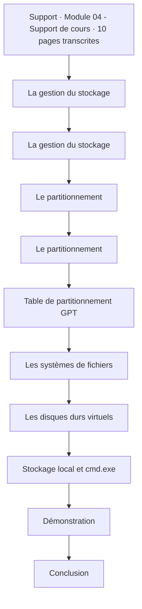
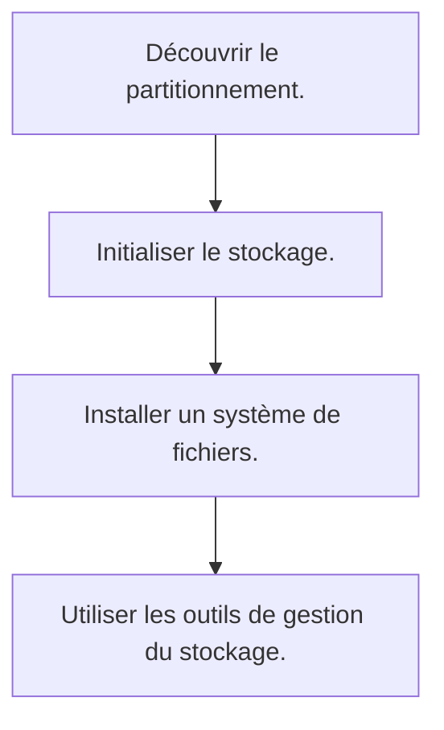
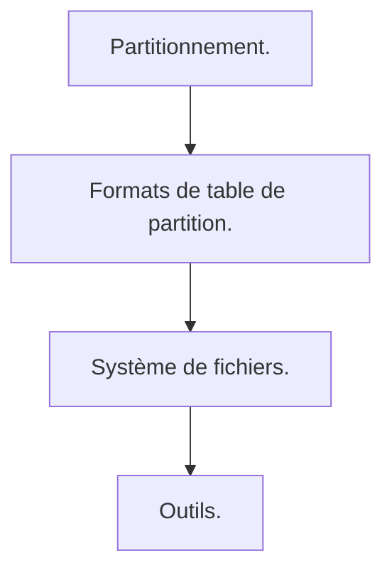
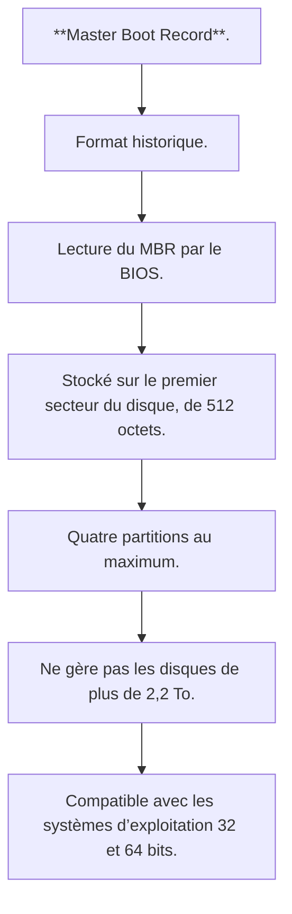
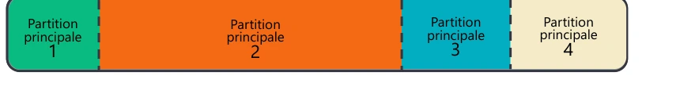
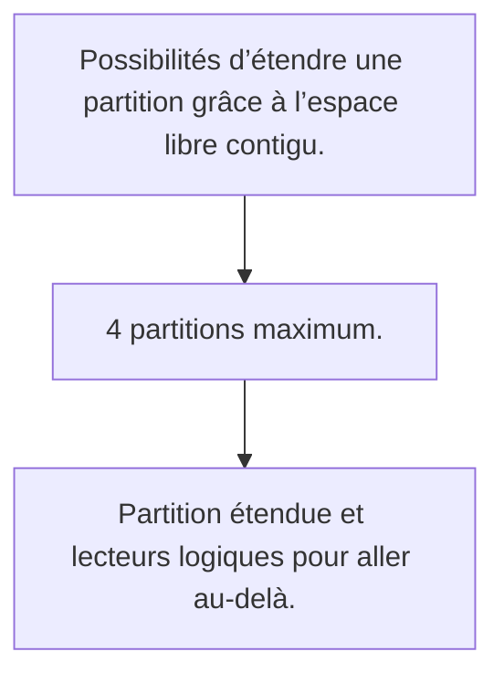
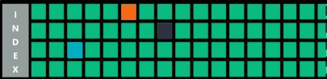
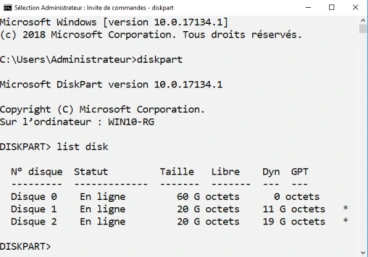

# Module 04 — La gestion du stockage

[Travaux pratiques](../../tp/systemes-clients/module-04/index.md)

Les parties ci-dessous reprennent le cours original, dans le même ordre. Les encadrés et les schémas répètent ses formulations.

## Parcours de lecture
1. Support · Module 04 - Support de cours · 10 pages transcrites
2. La gestion du stockage
3. La gestion du stockage
4. Le partitionnement
5. Le partitionnement
6. Table de partitionnement GPT
7. Les systèmes de fichiers
8. Les disques durs virtuels
9. Stockage local et cmd.exe
10. Démonstration
11. Conclusion
12. Synthèse du Drive · Synthèse Module 4 - Gestion du Stockage sous Windows V2 · 2 pages transcrites
13. Synthèse — Module 4 : La gestion du stockage sous Windows (V2)
14. Gestion du stockage via DiskPart — suite
15. Notes du Drive · module 3 et 4 system clients microsoft.txt · document texte
16. Module 4 - La gestion du stockage
17. Formater le volume COMMUN
18. Supprimer le volume DATA
19. Recréer le volume DATA avec l’ensemble de l’espace libre des deux disques

**Visuel externe**



SOURCE DRIVE · TRANSCRIPTION DU SUPPORT

Le contenu des documents du dossier TSSR est transcrit ci-dessous, page par page. Les textes et tableaux sont intégrés à la page Web. Aucun fichier PDF, aucune diapositive entière ni aucune reproduction de page n’est affiché. Seuls des croquis ou visuels isolés et vérifiés peuvent accompagner la transcription. Les versions et les consignes restent celles des supports de formation. Les compléments IA sont conservés dans leur onglet distinct.

## Support · Module 04 - Support de cours · 10 pages transcrites

## La gestion du stockage

### Objectifs

!!! note "À retenir"
    Utiliser les outils de gestion du stockage.

**Visuel externe**



- Découvrir le partitionnement.
- Initialiser le stockage.
- Installer un système de fichiers.
- Utiliser les outils de gestion du stockage.

## La gestion du stockage

**Visuel externe**



- Partitionnement.
- Formats de table de partition.
- Système de fichiers.
- Outils.

### Le partitionnement

!!! note "À retenir"
    Partitionner un disque, c’est le « séparer » en plusieurs « portions » logiques, étanches et indépendantes.

Partitionner un disque, c’est le « séparer » en plusieurs « portions » logiques, étanches et indépendantes. Le schéma représente les portions P1, P2, P3, P4, P5, P6, P7…


Séparer un disque en partitions

## Le partitionnement

### Table de partition

!!! note "À retenir"
    Détermine les caractéristiques des partitions du disque.

- Détermine les caractéristiques des partitions du disque.
- Constitue le « sommaire » du disque.

### Table de partition au format MBR

!!! note "À retenir"
    Stocké sur le premier secteur du disque, de 512 octets.

**Visuel externe**



- **Master Boot Record**.
- Format historique.
- Lecture du MBR par le BIOS.
- Stocké sur le premier secteur du disque, de 512 octets.
- Quatre partitions au maximum.
- Ne gère pas les disques de plus de 2,2 To.
- Compatible avec les systèmes d’exploitation 32 et 64 bits.

| Élément du MBR représenté | Taille |
| --- | --- |
| Routine | 440 octets, au maximum 446 |
| Signature facultative | 4 octets |
| Valeur habituellement nulle, `0x0000` | 2 octets |
| Table des partitions primaires, quatre entrées de 16 octets | 64 octets |
| Signature MBR `0x55`, `0xAA`, soit `0xAA55` | 2 octets |
| Total | 512 octets |

### Disque de base

!!! note "À retenir"
    Une partition peut être étendue grâce à l’espace libre contigu.

- Une partition peut être étendue grâce à l’espace libre contigu.
- Quatre partitions au maximum sont représentées : principales 1, 2, 3 et 4.


Capture du support — Module 04 - Support de cours



Quatre partitions principales

## Le partitionnement

### Partitionnement d’un disque de base

!!! note "À retenir"
    Possibilités d’étendre une partition grâce à l’espace libre contigu.

**Visuel externe**



- Possibilités d’étendre une partition grâce à l’espace libre contigu.
- 4 partitions maximum.
- Partition étendue et lecteurs logiques pour aller au-delà.

Le schéma représente Partition principale 1, Partition principale 2, Partition principale 3, puis une Partition étendue contenant L. Logique 1, L. Logique 2, L. Logique 3 et Espace libre.

### Partitionnement d’un disque dynamique, évolution du disque de base

!!! note "À retenir"
    Attention, pour Microsoft, les partitions contenues sur un disque dynamique s’appellent des volumes.

!!! warning "Attention"
    Attention, pour Microsoft, les partitions contenues sur un disque dynamique s’appellent des volumes.

- Attention, pour Microsoft, les partitions contenues sur un disque dynamique s’appellent des volumes.
- Possibilité d’étendre un volume grâce à l’espace libre disponible sur le disque source…
- … et disponible sur un disque supplémentaire. Permet de gérer les disques par ensemble, RAID.
- Convertir un disque de base en disque dynamique ? Pas de perte de données.

Le schéma représente Volume 1, Volume 2 et Volume 3, puis Volume 2 étendu et Espace libre.


Partition étendue et lecteurs logiques


Volumes dynamiques sur plusieurs espaces

## Table de partitionnement GPT

- **GUID Partition Table**.
- Nouveau format qui gomme les inconvénients du MBR.
- Dupliqué sur plusieurs secteurs du disque.
- Lecture par l’UEFI, évolution du BIOS indiquée depuis 2013 dans le support.
- 128 partitions au maximum.
- Taille maximale d’une partition indiquée : 256 To.
- Seulement compatible avec les systèmes d’exploitation 64 bits et les puces UEFI, selon le support.

Le schéma GPT représente un **Protective MBR**, une en-tête GPT primaire, les entrées de partitions 1 à 128, les partitions, puis les entrées et l’en-tête GPT secondaires en fin de disque.

Le schéma « GUID Partition Table Scheme » contient les repères suivants :

| Repère LBA | Libellé représenté |
| --- | --- |
| LBA 0 | Protective MBR |
| LBA 1 | En-tête de la partie Primary GPT, zone étiquetée Partition 1 dans le dessin |
| LBA 2 à LBA 33 | Entry 1, Entry 2, Entry 3, Entry 4 ; Entries 5-128 |
| LBA 34 et suivants | Partition 1, Partition 2, Remaining Partitions |
| LBA -34 | Fin des partitions |
| LBA -33 à LBA -2 | Entry 1, Entry 2, Entry 3, Entry 4 ; Entries 5-128, partie Secondary GPT |
| LBA -1 | Secondary GPT Header |

### Les systèmes de fichiers

- Après le partitionnement vient le formatage.
- Formater une partition ou un lecteur logique, c’est y installer un système de fichiers.
- Le système de fichiers organise les données.
- Une partition ou un lecteur logique formaté s’appelle un **volume**.
- Plusieurs systèmes de fichiers existent.



Capture du support — Module 04 - Support de cours

## Les systèmes de fichiers

### NTFS

- Système de fichiers par défaut chez Microsoft.
- Sécurisé nativement par les ACL.
- Chiffrement intégré : EFS.
- Compression intégrée.
- Fonctionnalités supplémentaires.
- Taille maximale du volume indiquée : 256 To.

### Les autres

| Système de fichiers | Caractéristiques du support |
| --- | --- |
| FAT16 / FAT32 — File Allocation Table | Historique ; standard ; « volume de 4 Go maximum » dans le support ; non sécurisé nativement. |
| ReFS — Resilient File System | Évolution de NTFS ; taille des volumes présentée comme quasi illimitée ; correction proactive des erreurs. |
| Autres | Ext4, VMFS, UDF et des dizaines d’autres. |

## Les disques durs virtuels

- VHD, Virtual Hard Drive, et VHDX.
- Bootable.
- Taille fixe ou dynamique.
- Créés et utilisés pour les machines virtuelles.
- Utilisable sur les machines physiques ! Montable comme ISO !
- Manipulable comme un fichier : clonage, déplacement, compression, versioning…
- Disques durs virtuels par défaut pour HyperV.

### Stockage local et GUI

Les outils de gestion : avec la console graphique **`diskmgmt.msc`**.


Capture du support — Module 04 - Support de cours

## Stockage local et cmd.exe

Les outils de gestion : avec **diskpart**, outil en ligne de commande très utilisé en production.

### Stockage local et PowerShell

Les outils de gestion : avec les cmdlet PowerShell.

- `Get-Disk` : relever le numéro du nouveau disque.
- `Initialize-Disk -Number <numéro relevé>` : par défaut en GPT. Il faut préciser le paramètre `-PartitionStyle MBR` pour la rétrocompatibilité.
- `New-Partition -DiskNumber <numéro relevé> -UseMaximumSize -AssignDriveLetter`.
- On peut assigner la lettre après avec `Set-Partition -DiskNumber <numéro relevé> -PartitonNumber <numéro relevé> -NewDriveLetter <lettre de votre choix>`. La graphie PartitonNumber est celle de la diapositive source.
- `Format-Volume -DriveLetter <lettre de lecteur>` : format par défaut en NTFS. Votre volume est prêt à l’utilisation.



Capture du support — Module 04 - Support de cours

## Démonstration

Gestion du stockage.

### Travaux pratiques

Gérer le stockage avec la console graphique, DiskPart et PowerShell.

## Conclusion

Recette pour bien utiliser le stockage : 1. Installer le média dans l’ordinateur. 2. Initialiser. 3. Partitionner. 4. Installer le système de fichiers. 5. Attribuer une lettre de lecteur ou un point de montage.

Référence du document : 1nl7ZxMZMH_eN9ctp7iE0QKdPkUQgn3F1 · SHA-256 1369986f889f518a…

## Synthèse du Drive · Synthèse Module 4 - Gestion du Stockage sous Windows V2 · 2 pages transcrites

Les synthèses Windows 10 de ce dossier sont rattachées au cours Systèmes clients.

## Synthèse — Module 4 : La gestion du stockage sous Windows (V2)

### 1. Partitionnement : MBR vs GPT

Avant de pouvoir utiliser un disque dur, celui-ci doit être initialisé avec une table de partitionnement.

| Caractéristique | MBR, Master Boot Record | GPT, GUID Partition Table |
| --- | --- | --- |
| Firmware requis | BIOS traditionnel / Legacy | UEFI moderne |
| Nombre max de partitions | 4 partitions principales, ou 3 + 1 étendue | Jusqu’à 128 partitions |
| Taille max du disque | 2,2 To | 256 To et plus |
| Redondance | Aucune, secteur LBA 0 unique | En-tête de secours en fin de disque |

### 2. Disques de base vs disques dynamiques et systèmes de fichiers

- **Disque de base** : organisé en partitions principales et étendues.
- **Disque dynamique** : organisé en volumes, simples, agrégés par bandes, miroir/RAID.
- **NTFS** : système de fichiers standard Windows supportant les permissions de sécurité, ACL, la compression et le chiffrement EFS.
- **ReFS** : Resilient File System, conçu pour maximiser la disponibilité des données et la résilience aux pannes.
- **FAT32** : format universel mais limité à des fichiers de 4 Go max.

### 3. Outils de gestion du stockage et commandes

Le stockage se gère via la console `diskmgmt.msc`, l’outil CLI `diskpart` ou PowerShell.

```
Gestion du stockage via DiskPart (cmd.exe)
diskpart
list disk
```

## Gestion du stockage via DiskPart — suite

```
select disk 1
clean
convert gpt
create partition primary
format fs=ntfs quick
assign letter=E
exit
```

### Administration du stockage via PowerShell

```
Get-Disk
Initialize-Disk -Number 1 -PartitionStyle GPT
New-Partition -DiskNumber 1 -UseMaximumSize -AssignDriveLetter
Format-Volume -DriveLetter E -FileSystem NTFS -NewFileSystemLabel "Donnees"
```

Référence du document : 1HPSzTP-d7McDtFNHDKfLLzdIZlYgYOvlaTrRjec1VQM · SHA-256 418e8781b0a10327…

## Notes du Drive · module 3 et 4 system clients microsoft.txt · document texte

Notes textuelles présentes dans le Drive. Aucun support de cours illustré distinct n’est fourni pour ce document ; aucune illustration n’a été inventée ou attribuée au support.

## Module 4 - La gestion du stockage

### Objectifs du module

### Présentation du stockage

### Le partitionnement

### Les systèmes de fichiers

### Les disques durs virtuels

### Des outils pour gérer le stockage

### Démonstration - Le stockage local GUI

### Démonstration - Le stockage local Diskpart

### Enoncé du TP - Gestion du stockage

### Conclusion

Référence du document : 1c_HkIgPPzF1QzQvLy0nsrpsSZzmlNClX · SHA-256 3c7c12622492a311…

| Table de partitionnement GPT | Nouveau format qui gomme les inconvénients du MBR. |
| Les disques durs virtuels | Créés et utilisés pour les machines virtuelles. |
| Stockage local et cmd.exe | Les outils de gestion : avec **diskpart**, outil en ligne de commande très utilisé en production. |
| Conclusion | Recette pour bien utiliser le stockage : 1. |
| Synthèse du Drive · Synthèse Module 4 - Gestion du Stockage sous Windows V2 · 2 pages transcrites | Les synthèses Windows 10 de ce dossier sont rattachées au cours Systèmes clients. |
| Notes du Drive · module 3 et 4 system clients microsoft.txt · document texte | Notes textuelles présentes dans le Drive. |
| Formater le volume COMMUN | La liste permet de vérifier que le lecteur K: de 15 Go est bien formaté en NTFS. |
| Supprimer le volume DATA | La capture de correction affiche DATA D: NTFS, volume fractionné de 30 G, puis le sélectionne et le supprime. |
| Recréer le volume DATA avec l’ensemble de l’espace libre des deux disques | La capture relève le disque 0 système de 32 G, puis les disques 1 et 2 dynamiques de 60 G, dont les espaces libres sont respectivement 15 G et 59 G. |
