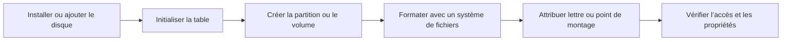

# Module 04 — La gestion du stockage

**Formation :** Systèmes clients Microsoft · **Pré-requis :** installation du laboratoire et bases GUI, cmd.exe et PowerShell.

## Objectifs

- Distinguer disque, table de partition, partition, formatage et volume.
- Comparer les caractéristiques MBR/GPT et base/dynamique présentées par le support.
- Utiliser Gestion des disques, DiskPart et PowerShell dans le scénario demandé.
- Réaliser puis vérifier les volumes DATA, TOOLS, ARCHIVE et COMMUN.

## 1. Lire la chaîne de préparation d’un disque

**Illustration IA / externe au cours — progression du support.**



| Notion | Rôle |
|---|---|
| **Disque** | Support physique ou virtuel présenté au système. |
| **Table de partition** | « Sommaire » décrivant les partitions du disque. |
| **Partition** | Portion logique, indépendante des autres portions dans le modèle du cours. |
| **Formatage** | Installation d’un système de fichiers pour organiser les données. |
| **Volume** | Espace de stockage utilisable ; le support emploie aussi ce terme pour les espaces des disques dynamiques. |
| **Lettre / point de montage** | Moyen d’accéder au volume. |

La présence d’un disque dans la console ne signifie donc pas qu’il est déjà utilisable dans l’Explorateur. Il peut manquer l’initialisation, une partition, le formatage ou une lettre.

## 2. MBR et GPT décrivent la table

| Caractéristique du support | MBR | GPT |
|---|---|---|
| Développement | Master Boot Record | GUID Partition Table |
| Repère d’amorçage étudié | BIOS | UEFI |
| Organisation | Premier secteur, 512 octets | Informations dupliquées sur plusieurs secteurs |
| Nombre présenté | Quatre entrées principales | Jusqu’à 128 partitions dans Windows étudié |
| Limite citée | Disques de 2,2 To | Partition de 256 To dans le support |
| Compatibilité présentée | OS 32 et 64 bits | OS 64 bits et UEFI dans le périmètre du cours |

Ces chiffres sont les repères du support, qui simplifie les conditions de compatibilité. Ils ne constituent pas une matrice universelle des tailles et des possibilités d’amorçage.

### Ce qui occupe les 512 octets du MBR

| Élément du schéma | Taille |
|---|---|
| Routine | 440 octets, jusqu’à 446 selon l’organisation |
| Signature facultative | 4 octets |
| Champ habituellement nul | 2 octets |
| Quatre entrées de partition de 16 octets | 64 octets |
| Signature finale 55h / AAh | 2 octets |

Le schéma GPT montre un MBR protecteur, l’en-tête et les entrées primaires, les partitions, puis les entrées et l’en-tête secondaires en fin de disque. La duplication fait partie de la différence mise en avant.

## 3. Base et dynamique décrivent la gestion des espaces

### Disque de base

Le cours montre quatre partitions principales en MBR. Une partition étendue peut occuper une entrée et contenir plusieurs lecteurs logiques. L’extension d’une partition de base utilise l’espace libre contigu dans le scénario présenté.


<p class="tssr-caption">Schéma isolé du support : principales puis partition étendue contenant les lecteurs logiques.</p>

### Disque dynamique

Le support le présente comme une évolution du disque de base : les espaces sont appelés **volumes**, et un volume peut être étendu avec de l’espace disponible sur son disque ou un autre disque. Il rapproche cette gestion des ensembles de disques et du RAID.

Le TP montrera un **volume fractionné** sur deux disques. Répartir la capacité sur plusieurs disques ne signifie pas créer une copie de protection. Identifier le type effectivement créé évite de confondre agrandissement et redondance.

La conversion de base vers dynamique est annoncée sans perte de données dans le support ; l’atelier travaille sur les disques virtuels ajoutés pour cette opération.

## 4. Choisir et reconnaître le système de fichiers

| Système | Caractéristiques décrites |
|---|---|
| **NTFS** | Système par défaut Microsoft du cours ; ACL, chiffrement EFS, compression ; volume de 256 To cité. |
| **FAT16 / FAT32** | Formats historiques et répandus ; absence de sécurité native comparable aux ACL NTFS. |
| **ReFS** | Resilient File System ; présenté comme une évolution, avec très grandes capacités et correction proactive d’erreurs. |
| **Autres** | Ext4, VMFS, UDF, parmi de nombreux formats. |

!!! note "Incohérence interne du support FAT32"
    Une diapositive mentionne « volume de 4 Go maximum » sous FAT16/FAT32, alors que le TP demande explicitement un volume FAT32 de 7 Go. Ne pas mémoriser 4 Go comme limite générale d’un volume FAT32. L’original conserve la phrase ; l’atelier ci-dessous suit ses 7 Go.

### Les disques virtuels VHD et VHDX

Ces formats sont des fichiers représentant des disques : taille fixe ou dynamique, utilisation par les VM, possibilités d’amorçage ou de montage dans les contextes du support. Ils peuvent être copiés, déplacés, clonés, compressés ou versionnés comme des fichiers. Le support les associe à Hyper-V et explique qu’ils peuvent aussi être utilisés depuis une machine physique.

## 5. Trois outils pour observer le même stockage

| Outil | Accès | Intérêt dans le TP |
|---|---|---|
| **Gestion des disques** | `diskmgmt.msc` ou MaConsole | Visualiser partitions, lettres, types et répartition. |
| **DiskPart** | `diskpart` depuis cmd.exe | Sélectionner un disque/volume puis agir en ligne de commande. |
| **PowerShell** | Cmdlets du stockage | Interroger les propriétés et sélectionner les résultats demandés. |

### Préparer un nouveau disque avec PowerShell

Le support donne l’enchaînement suivant ; remplacer les repères `N`, `P` et `L` par les valeurs observées avant toute exécution :

```powershell
Get-Disk
Initialize-Disk -Number N
New-Partition -DiskNumber N -UseMaximumSize -AssignDriveLetter
Set-Partition -DiskNumber N -PartitionNumber P -NewDriveLetter L
Format-Volume -DriveLetter L
```

L’initialisation est présentée en GPT par défaut ; **`-PartitionStyle MBR`** permet de préciser MBR. `-AssignDriveLetter` attribue directement une lettre ; `Set-Partition` sert si l’on veut l’attribuer ou la changer après. Le support présente NTFS comme format par défaut. La coquille `-PartitonNumber` de la diapositive est rétablie en **`-PartitionNumber`** dans l’aide pédagogique.

## 6. TP — Ajouter les disques et préparer les partitions

**Durée indicative : une heure trente.** Lire l’ensemble du TP ; toutes les manipulations suivantes visent les nouveaux disques du laboratoire **Win10-XX**.

Dans Workstation : **Settings → Add → Hard Disk → SCSI → Create a new virtual disk**. Ajouter **deux disques de 60 Go**, chacun stocké en **un seul fichier** ; donner un nom parlant aux fichiers puis vérifier les deux ajouts.

Dans Gestion des disques, initialiser les deux nouveaux disques en **GPT**. La correction les repère comme **disque 1** et **disque 2** ; vérifier ces identités dans la VM avant de sélectionner.

Sur le premier nouveau disque, répéter l’assistant **Nouveau volume simple** pour créer :

| Espace | Taille de l’assistant | État initial |
|---|---|---|
| Première partition | 15360 Mo = 15 Go | Sans lettre, sans formatage |
| Deuxième partition | 15360 Mo = 15 Go | Sans lettre, sans formatage |
| Troisième partition | 15360 Mo = 15 Go | Sans lettre, sans formatage |
| Quatrième partition | 7168 Mo = 7 Go | Sans lettre, sans formatage |

La correction accepte aussi le résultat MBR de trois principales et d’une étendue contenant un lecteur logique ; son chemin principal est GPT avec quatre partitions principales.

## 7. TP — Formater et attribuer les accès

Dans l’interface graphique :

1. Formater la première partition de 15 Go en **NTFS**, nom **DATA**.
2. Formater la deuxième partition de 15 Go en **NTFS**, nom **TOOLS**.
3. Attribuer **D:** à DATA et **E:** à TOOLS.
4. Si le DVD occupe D:, modifier d’abord sa lettre ; la correction propose **Z:**.
5. Formater la partition de 7 Go en **FAT32**, nom **ARCHIVE**, avec une lettre libre.

Vérifier dans l’Explorateur que les volumes nommés et leurs lettres apparaissent. La troisième partition de 15 Go reste RAW jusqu’à l’étape DiskPart.

### Étendre DATA avec le disque 2

Dans **Étendre le volume** sur DATA, ajouter le **disque 2**, retirer le disque 1 de la sélection d’espace à ajouter, puis demander **15360 Mo**. Le système propose de convertir les disques en dynamiques pour cette extension entre disques.

La correction montre DATA passant de **15 à 30 Go**, désormais **fractionné**, alors que TOOLS et ARCHIVE restent à leurs places. Les codes couleur changent : lire aussi la légende.

## 8. TP — Continuer avec DiskPart

Ouvrir cmd.exe puis DiskPart. Commencer par l’inventaire :

```text
diskpart
list disk
select disk 1
list volume
```

### Créer COMMUN dans le troisième espace de 15 Go

Identifier le **volume RAW de 15 Go** ; son numéro est variable. Le sélectionner avec `select volume N`, où N est remplacé par le numéro constaté. Les commandes de la correction sont ensuite :

```text
format FS=NTFS LABEL=COMMUN QUICK
assign letter=K
list volume
```

K: est l’exemple de la correction ; une lettre libre convient à la consigne. Vérifier le nom COMMUN, NTFS et 15 Go avant de poursuivre.

### Étendre COMMUN avec l’espace restant sur le disque 1

Avec le bon volume toujours sélectionné :

```text
extend
list volume
```

Le rendu source montre COMMUN passant de **15 à 22 Go**. Le but est d’utiliser l’espace libre restant sur ce disque, sans sélectionner le disque du système.

### Supprimer DATA

La capture de correction identifie DATA par sa lettre D :

```text
list volume
select volume D
delete volume
list volume
```

La disparition de DATA dans la seconde liste vérifie l’opération. Elle libère ses espaces sur les deux nouveaux disques.

### Recréer DATA sur tout l’espace restant

Le scénario illustré utilise le disque 1 pour le premier espace, puis le disque 2 pour l’extension :

```text
list disk
select disk 1
create volume simple
list volume
extend disk=2
format FS=NTFS LABEL=DATA QUICK
assign letter=D
list volume
```

La correction écrit `format LABEL=DATA QUICK` ; la forme pédagogique précise NTFS pour rendre le choix visible. Son résultat final affiche **DATA D: de 74 Go**, de type **fractionné** ; COMMUN reste à 22 Go, TOOLS à 15 Go et ARCHIVE à 7 Go. Ces tailles sont celles de la maquette source : les comparer à l’inventaire de sa VM.

## 9. TP — Produire la procédure GestionDuStockage

Enregistrer dans **Procédures** une procédure **GestionDuStockage** reprenant les opérations graphiques et DiskPart. L’énoncé propose d’y démontrer également : ajout d’un disque, initialisation, volume NTFS avec lettre, puis un volume supplémentaire via DiskPart. Utiliser PSR, un traitement de texte ou un autre outil de capture et de rédaction.

Pour chaque opération, conserver le disque/volume de départ, l’action et le contrôle du résultat. Un numéro isolé n’est pas une preuve suffisante sans le nom, la taille et la lettre attendus.

## 10. TP — Examiner Discovery avec PowerShell

### Numéro, taille et table des disques

```powershell
Get-Disk | Select-Object Number,Size,PartitionStyle
```

### Lettre, nom et taille des volumes nommés

```powershell
Get-Volume
Get-Volume -FriendlyName Informatique,Achat-Ventes,Compta |
    Select-Object DriveLetter,FileSystemLabel,Size
```

La correction utilise ces trois noms pour sélectionner les volumes attendus. La consigne peut aussi se lire comme « tous les volumes nommés » ; la forme pédagogique générale serait :

```powershell
Get-Volume | Where-Object { $_.FileSystemLabel } |
    Select-Object DriveLetter,FileSystemLabel,Size
```

!!! note "Propriétés rétablies dans l’aide pédagogique"
    La dernière ligne du document indique `DriveLetter, FileSystem,LabelSize`, qui ne correspond pas aux trois informations demandées. Ici, `FileSystemLabel` fournit le nom et `Size` la taille ; l’original conserve le texte de la correction.

### Nommer le volume C:

```powershell
Set-Volume -DriveLetter C -NewFileSystemLabel "System"
Get-Volume -DriveLetter C | Select-Object DriveLetter,FileSystemLabel,Size
```

La première commande change l’étiquette ; la seconde vérifie **System** sans changer la lettre du système.

## Exemple supplémentaire de la synthèse du Drive

La synthèse distingue également les volumes **simples**, **agrégés par bandes** et **miroirs/RAID**. Le TP DATA utilise le fractionnement pour étendre l’espace ; les autres types ne sont pas créés par cet atelier.

Elle propose une chaîne DiskPart pour un disque de travail à réinitialiser :

```text
diskpart
list disk
select disk 1
clean
convert gpt
create partition primary
format fs=ntfs quick
assign letter=E
exit
```

!!! warning "Exemple distinct du scénario DATA / TOOLS"
    `clean` supprime la structure de partitionnement du disque sélectionné. Cette chaîne de la synthèse sert à comprendre une réinitialisation et ne doit pas être insérée au milieu du TP où l’on conserve des volumes existants. Le numéro 1 doit correspondre à un disque de laboratoire destiné à cet effacement.

La version PowerShell donnée dans la synthèse enchaîne **Get-Disk**, **Initialize-Disk -PartitionStyle GPT**, **New-Partition -UseMaximumSize -AssignDriveLetter**, puis un formatage explicitement nommé :

```powershell
Format-Volume -DriveLetter E -FileSystem NTFS -NewFileSystemLabel "Donnees"
```

La lettre E est celle de son exemple ; elle doit correspondre au volume créé. Cela illustre la même chaîne initialiser → partitionner → formater → accéder.

## Mini-quiz

1. Quelle différence entre initialiser, partitionner et formater ?
2. Pourquoi le quatrième espace d’un disque MBR peut-il être une partition étendue ?
3. À quel moment le TP passe-t-il les disques en dynamique ?
4. Quel outil et quelles commandes permettent de vérifier le volume avant sa suppression ?
5. Pourquoi ne faut-il pas apprendre la phrase « FAT32 = volume de 4 Go maximum » de façon isolée ?
6. Quelles propriétés répondent à lettre, nom et taille d’un volume ?

??? note "Réponses"
    1. Installer la table, découper l’espace, puis installer le système de fichiers.
    2. Elle permet de contenir des lecteurs logiques au-delà des entrées principales présentées.
    3. Lors de l’extension de DATA sur le deuxième disque.
    4. DiskPart, list volume puis sélection vérifiée par lettre, nom et taille.
    5. Le même TP demande et crée ARCHIVE en FAT32 de 7 Go ; le support contient une incohérence.
    6. DriveLetter, FileSystemLabel et Size.

- [Énoncé et correction du TP](../../tp/systemes-clients/module-04/index.md)
- [Fiche de révision M04](../../revision/systemes-clients/module-04-la-gestion-du-stockage.md)
- [Kahoot M04](../../kahoot/02-systemes-clients-microsoft-04-la-gestion-du-stockage.md)

## Provenance pédagogique

Support M04, énoncé et solution Gérer le stockage, section Module 4 des notes et synthèse Stockage du Drive. Les grands écrans de correction sont explicités en commandes et résultats. Les clarifications des incohérences, exemples de vérification et mini-quiz sont des aides IA séparées de l’original.
