# Module 04 — La gestion du stockage

Les parties ci-dessous reprennent le cours original, dans le même ordre. Les encadrés et les schémas répètent ses formulations.

## Parcours de lecture

1. Support · Module 04 - Support de cours · 10 pages transcrites
2. La gestion du stockage
3. La gestion du stockage
4. Le partitionnement
5. Le partitionnement
6. Table de partitionnement GPT
7. Les systèmes de fichiers
8. Les disques durs virtuels
9. Stockage local et cmd.exe
10. Démonstration
11. Conclusion
12. Énoncé · Enoncé du TP - Gestion du stockage · 5 pages transcrites
13. Synthèse du Drive · Synthèse Module 4 - Gestion du Stockage sous Windows V2 · 2 pages transcrites
14. Synthèse — Module 4 : La gestion du stockage sous Windows (V2)
15. Gestion du stockage via DiskPart — suite
16. Notes du Drive · module 3 et 4 system clients microsoft.txt · document texte
17. Module 3 - Interagir avec Windows 10
18. Module 4 - La gestion du stockage
19. Correction · Solution du TP - Gestion du stockage · 11 pages transcrites
20. Formater le volume COMMUN
21. Supprimer le volume DATA
22. Recréer le volume DATA avec l’ensemble de l’espace libre des deux disques

**Visuel externe**

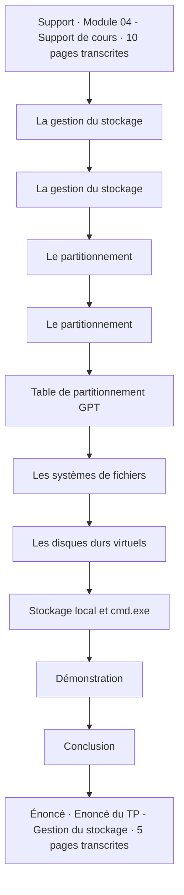

SOURCE DRIVE · TRANSCRIPTION DU SUPPORT

Le contenu des documents du dossier TSSR est transcrit ci-dessous, page par page. Les textes et tableaux sont intégrés à la page Web. Aucun fichier PDF, aucune diapositive entière ni aucune reproduction de page n’est affiché. Seuls des croquis ou visuels isolés et vérifiés peuvent accompagner la transcription. Les versions et les consignes restent celles des supports de formation. Les compléments IA sont conservés dans leur onglet distinct.

## Support · Module 04 - Support de cours · 10 pages transcrites

## La gestion du stockage

### Objectifs

!!! note "À retenir"
    Utiliser les outils de gestion du stockage.

**Visuel externe**


- Découvrir le partitionnement.
- Initialiser le stockage.
- Installer un système de fichiers.
- Utiliser les outils de gestion du stockage.

## La gestion du stockage

**Visuel externe**

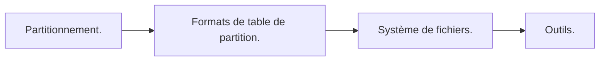

- Partitionnement.
- Formats de table de partition.
- Système de fichiers.
- Outils.

### Le partitionnement

!!! note "À retenir"
    Partitionner un disque, c’est le « séparer » en plusieurs « portions » logiques, étanches et indépendantes.

Partitionner un disque, c’est le « séparer » en plusieurs « portions » logiques, étanches et indépendantes. Le schéma représente les portions P1, P2, P3, P4, P5, P6, P7…


Séparer un disque en partitions

## Le partitionnement

### Table de partition

!!! note "À retenir"
    Détermine les caractéristiques des partitions du disque.

- Détermine les caractéristiques des partitions du disque.
- Constitue le « sommaire » du disque.

### Table de partition au format MBR

!!! note "À retenir"
    Stocké sur le premier secteur du disque, de 512 octets.

**Visuel externe**

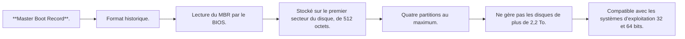

- **Master Boot Record**.
- Format historique.
- Lecture du MBR par le BIOS.
- Stocké sur le premier secteur du disque, de 512 octets.
- Quatre partitions au maximum.
- Ne gère pas les disques de plus de 2,2 To.
- Compatible avec les systèmes d’exploitation 32 et 64 bits.

| Élément du MBR représenté | Taille |
| --- | --- |
| Routine | 440 octets, au maximum 446 |
| Signature facultative | 4 octets |
| Valeur habituellement nulle, `0x0000` | 2 octets |
| Table des partitions primaires, quatre entrées de 16 octets | 64 octets |
| Signature MBR `0x55`, `0xAA`, soit `0xAA55` | 2 octets |
| Total | 512 octets |

### Disque de base

!!! note "À retenir"
    Une partition peut être étendue grâce à l’espace libre contigu.

- Une partition peut être étendue grâce à l’espace libre contigu.
- Quatre partitions au maximum sont représentées : principales 1, 2, 3 et 4.

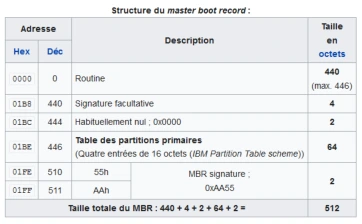

Capture du support — Module 04 - Support de cours


Quatre partitions principales

## Le partitionnement

### Partitionnement d’un disque de base

!!! note "À retenir"
    Possibilités d’étendre une partition grâce à l’espace libre contigu.

**Visuel externe**

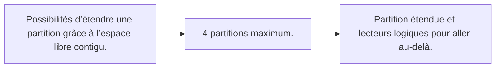

- Possibilités d’étendre une partition grâce à l’espace libre contigu.
- 4 partitions maximum.
- Partition étendue et lecteurs logiques pour aller au-delà.

Le schéma représente Partition principale 1, Partition principale 2, Partition principale 3, puis une Partition étendue contenant L. Logique 1, L. Logique 2, L. Logique 3 et Espace libre.

### Partitionnement d’un disque dynamique, évolution du disque de base

!!! note "À retenir"
    Attention, pour Microsoft, les partitions contenues sur un disque dynamique s’appellent des volumes.

!!! warning "Attention"
    Attention, pour Microsoft, les partitions contenues sur un disque dynamique s’appellent des volumes.

- Attention, pour Microsoft, les partitions contenues sur un disque dynamique s’appellent des volumes.
- Possibilité d’étendre un volume grâce à l’espace libre disponible sur le disque source…
- … et disponible sur un disque supplémentaire. Permet de gérer les disques par ensemble, RAID.
- Convertir un disque de base en disque dynamique ? Pas de perte de données.

Le schéma représente Volume 1, Volume 2 et Volume 3, puis Volume 2 étendu et Espace libre.

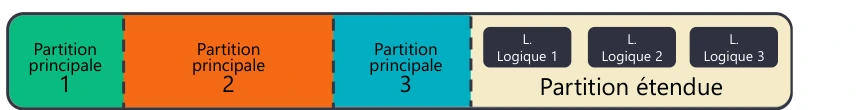

Partition étendue et lecteurs logiques

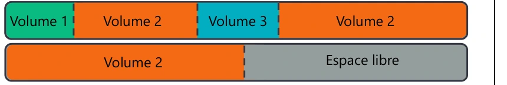

Volumes dynamiques sur plusieurs espaces

## Table de partitionnement GPT

- **GUID Partition Table**.
- Nouveau format qui gomme les inconvénients du MBR.
- Dupliqué sur plusieurs secteurs du disque.
- Lecture par l’UEFI, évolution du BIOS indiquée depuis 2013 dans le support.
- 128 partitions au maximum.
- Taille maximale d’une partition indiquée : 256 To.
- Seulement compatible avec les systèmes d’exploitation 64 bits et les puces UEFI, selon le support.

Le schéma GPT représente un **Protective MBR**, une en-tête GPT primaire, les entrées de partitions 1 à 128, les partitions, puis les entrées et l’en-tête GPT secondaires en fin de disque.

Le schéma « GUID Partition Table Scheme » contient les repères suivants :

| Repère LBA | Libellé représenté |
| --- | --- |
| LBA 0 | Protective MBR |
| LBA 1 | En-tête de la partie Primary GPT, zone étiquetée Partition 1 dans le dessin |
| LBA 2 à LBA 33 | Entry 1, Entry 2, Entry 3, Entry 4 ; Entries 5-128 |
| LBA 34 et suivants | Partition 1, Partition 2, Remaining Partitions |
| LBA -34 | Fin des partitions |
| LBA -33 à LBA -2 | Entry 1, Entry 2, Entry 3, Entry 4 ; Entries 5-128, partie Secondary GPT |
| LBA -1 | Secondary GPT Header |

### Les systèmes de fichiers

- Après le partitionnement vient le formatage.
- Formater une partition ou un lecteur logique, c’est y installer un système de fichiers.
- Le système de fichiers organise les données.
- Une partition ou un lecteur logique formaté s’appelle un **volume**.
- Plusieurs systèmes de fichiers existent.


Capture du support — Module 04 - Support de cours

## Les systèmes de fichiers

### NTFS

- Système de fichiers par défaut chez Microsoft.
- Sécurisé nativement par les ACL.
- Chiffrement intégré : EFS.
- Compression intégrée.
- Fonctionnalités supplémentaires.
- Taille maximale du volume indiquée : 256 To.

### Les autres

| Système de fichiers | Caractéristiques du support |
| --- | --- |
| FAT16 / FAT32 — File Allocation Table | Historique ; standard ; « volume de 4 Go maximum » dans le support ; non sécurisé nativement. |
| ReFS — Resilient File System | Évolution de NTFS ; taille des volumes présentée comme quasi illimitée ; correction proactive des erreurs. |
| Autres | Ext4, VMFS, UDF et des dizaines d’autres. |

## Les disques durs virtuels

- VHD, Virtual Hard Drive, et VHDX.
- Bootable.
- Taille fixe ou dynamique.
- Créés et utilisés pour les machines virtuelles.
- Utilisable sur les machines physiques ! Montable comme ISO !
- Manipulable comme un fichier : clonage, déplacement, compression, versioning…
- Disques durs virtuels par défaut pour HyperV.

### Stockage local et GUI

Les outils de gestion : avec la console graphique **`diskmgmt.msc`**.

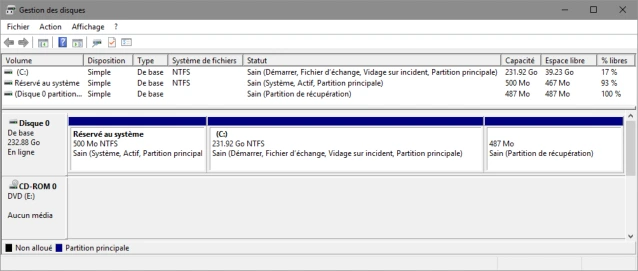

Capture du support — Module 04 - Support de cours

## Stockage local et cmd.exe

Les outils de gestion : avec **diskpart**, outil en ligne de commande très utilisé en production.

### Stockage local et PowerShell

Les outils de gestion : avec les cmdlet PowerShell.

- `Get-Disk` : relever le numéro du nouveau disque.
- `Initialize-Disk -Number <numéro relevé>` : par défaut en GPT. Il faut préciser le paramètre `-PartitionStyle MBR` pour la rétrocompatibilité.
- `New-Partition -DiskNumber <numéro relevé> -UseMaximumSize -AssignDriveLetter`.
- On peut assigner la lettre après avec `Set-Partition -DiskNumber <numéro relevé> -PartitonNumber <numéro relevé> -NewDriveLetter <lettre de votre choix>`. La graphie PartitonNumber est celle de la diapositive source.
- `Format-Volume -DriveLetter <lettre de lecteur>` : format par défaut en NTFS. Votre volume est prêt à l’utilisation.


Capture du support — Module 04 - Support de cours

## Démonstration

Gestion du stockage.

### Travaux pratiques

Gérer le stockage avec la console graphique, DiskPart et PowerShell.

## Conclusion

Recette pour bien utiliser le stockage : 1. Installer le média dans l’ordinateur. 2. Initialiser. 3. Partitionner. 4. Installer le système de fichiers. 5. Attribuer une lettre de lecteur ou un point de montage.

Référence du document : 1nl7ZxMZMH_eN9ctp7iE0QKdPkUQgn3F1 · SHA-256 1369986f889f518a…

## Énoncé · Enoncé du TP - Gestion du stockage · 5 pages transcrites

#### Systèmes Clients Microsoft Gérer le stockage

TP du Module 04 – La gestion du stockage

À travers ce TP, vous serez amené à ajouter des supports de stockage à votre VM puis à créer des volumes sur les disques à l’aide de la console de gestion des disques et à l’aide de diskpart. Enfin, vous découvrirez les volumes présents sur Discovery grâce à PowerShell.

Durée estimée

1 heure 30 minutes

#### Énoncé

Lisez l'ensemble de ce TP avant de vous lancer dans la pratique

À l'aide de VMware WorkStation, ajoutez 2 disques durs de 60 Go chacun à votre VM Win10-XX (Store virtual disk as a single file)

Avec la console graphique de votre VM Windows 10

Sur le premier disque, créer 3 partitions principales de 15 Go chacune sans assigner de lettre de lecteur et sans formater.

Créer une 4e partition de 7 Go sans assigner de lettre de lecteur et sans formater.

Formater les deux premières partitions de 15 Go en NTFS. La première sera nommée DATA, la seconde TOOLS.

Attribuer la lettre D au volume DATA et la lettre E au volume TOOLS.

Formater la partition de 7 Go restante en FAT32, que vous nommerez ARCHIVE et lui attribue la lettre de votre choix.

Étendre le volume DATA de 15 Go supplémentaire. Pour cela vous n'utiliserez que l'espace libre disponible sur le disque 2.

En ligne de commande sur votre VM Windows 10

Formater la 3e partition de 15 Go en NTFS. Vous la nommerez COMMUN et lui attribuerez la lettre de votre choix.

Étendre le volume COMMUN en utilisant l'espace libre restant sur le disque 1.

Supprimer le volume DATA.

Recréer le volume DATA avec l'ensemble de l'espace libre des deux disques.

Rédiger une procédure GestionDuStockage reprenant la configuration de vos disques avec l'interface graphique et avec diskpart. Utilisez psr, un traitement de texte ou un autre outil.

Exemple : - Ajoutez un disque dur supplémentaire avec VMware WorkStation - Avec l’interface graphique, initialisez le disque - Créez un volume formaté en NTFS avec une lettre de votre choix sur ce nouveau lecteur - Lancez diskpart

- Sur le nouveau disque, créez un volume supplémentaire en NTFS avec une lettre de lecteur

Enregistrez votre procédure GestionDuStockage dans le dossier Procédures

Investigation sur la VM Discovery à l'aide de PowerShell

Affichez le numéro, la taille et le type de table de partitionnement des disques durs présents sur la VM

Affichez la lettre de lecteur, le nom et la taille totale des volumes qui possèdent un FriendlyName

Le volume C: ne possède pas de nom. Attribuez-lui le nom "System"

#### Solution

Une solution est proposée pour ce TP sous la forme d'un PDF commenté, disponible dans les ressources à télécharger.

Référence du document : 1pAPTckR7dxiqqi-UXO4wzQzvbyUAJ9Gs · SHA-256 b879ce025b5747c1…

## Synthèse du Drive · Synthèse Module 4 - Gestion du Stockage sous Windows V2 · 2 pages transcrites

Les synthèses Windows 10 de ce dossier sont rattachées au cours Systèmes clients.

## Synthèse — Module 4 : La gestion du stockage sous Windows (V2)

### 1. Partitionnement : MBR vs GPT

Avant de pouvoir utiliser un disque dur, celui-ci doit être initialisé avec une table de partitionnement.

| Caractéristique | MBR, Master Boot Record | GPT, GUID Partition Table |
| --- | --- | --- |
| Firmware requis | BIOS traditionnel / Legacy | UEFI moderne |
| Nombre max de partitions | 4 partitions principales, ou 3 + 1 étendue | Jusqu’à 128 partitions |
| Taille max du disque | 2,2 To | 256 To et plus |
| Redondance | Aucune, secteur LBA 0 unique | En-tête de secours en fin de disque |

### 2. Disques de base vs disques dynamiques et systèmes de fichiers

- **Disque de base** : organisé en partitions principales et étendues.
- **Disque dynamique** : organisé en volumes, simples, agrégés par bandes, miroir/RAID.
- **NTFS** : système de fichiers standard Windows supportant les permissions de sécurité, ACL, la compression et le chiffrement EFS.
- **ReFS** : Resilient File System, conçu pour maximiser la disponibilité des données et la résilience aux pannes.
- **FAT32** : format universel mais limité à des fichiers de 4 Go max.

### 3. Outils de gestion du stockage et commandes

Le stockage se gère via la console `diskmgmt.msc`, l’outil CLI `diskpart` ou PowerShell.

```
Gestion du stockage via DiskPart (cmd.exe)
diskpart
list disk
```

## Gestion du stockage via DiskPart — suite

```
select disk 1
clean
convert gpt
create partition primary
format fs=ntfs quick
assign letter=E
exit
```

### Administration du stockage via PowerShell

```
Get-Disk
Initialize-Disk -Number 1 -PartitionStyle GPT
New-Partition -DiskNumber 1 -UseMaximumSize -AssignDriveLetter
Format-Volume -DriveLetter E -FileSystem NTFS -NewFileSystemLabel "Donnees"
```

Référence du document : 1HPSzTP-d7McDtFNHDKfLLzdIZlYgYOvlaTrRjec1VQM · SHA-256 418e8781b0a10327…

## Notes du Drive · module 3 et 4 system clients microsoft.txt · document texte

Notes textuelles présentes dans le Drive. Aucun support de cours illustré distinct n’est fourni pour ce document ; aucune illustration n’a été inventée ou attribuée au support.

## Module 3 - Interagir avec Windows 10

### Objectifs du module

### Tour d'horizon de l'interface graphique

### Démonstration - L'interface graphique

### Enoncé du TP - Prise en main de l'interface graphique

### Tour d'horizon la CLI

### La syntaxe de l'aide

### Démonstration - La ligne de commande cmd

### Enoncé du TP - Prise en main de la cmd

### Présentation de PowerShell

### Principe d'utilisation de la ligne de commande PowerShell

### Démonstration - Découvrir PowerShell

### Enoncé du TP - Premiers pas avec PowerShell

### L'aide de PowerShell

### Démonstration - Découvrir l'aide de PowerShell

### Enoncé du TP - Manipuler l'aide de PowerShell

### Cmdlets de base et objets

### Interagir avec un objet PowerShell

### Démonstration - Cmdlets de base

### Enoncé du TP - Devenir autonome avec PowerShell

### Conclusion

Dans le cadre de notre module sur Interagir avec Windows 10, nous allons explorer l'interface graphique du système d'exploitation Windows 10, qui est un système d'exploitation multi-utilisateur.

Chaque utilisateur possède un profil dans lequel son bureau est personnalisable ainsi que son menu démarré. Nous avons la possibilité d'ajouter des bureaux supplémentaires pour agrandir notre espace de travail. De plus, nous bénéficions de la fonctionnalité Timeline, qui existe depuis la build 18.03, nous proposant un historique de nos tâches.

### Fonctionnalités multi-tâches

Windows 10 est également un système d'exploitation multi-tâches, ce qui signifie que nous pouvons utiliser plusieurs applications en même temps. Nous pouvons facilement basculer de l'une à l'autre depuis la barre des tâches ou à l'aide de la combinaison de touches Windows + Tabulation. Pour afficher le détail du bon fonctionnement des applications, nous utilisons le gestionnaire des tâches.

### Zone de notification

La zone de notification nous apporte des informations en temps réel et des raccourcis vers certains programmes qui tournent en arrière-plan. Un élément intéressant de cette zone est d'observer, d'un simple coup d'œil, l'état de la connexion réseau ainsi qu'un raccourci pour la configurer, ce qui est pratique pour la mobilité. Les notifications du système apparaissent dans cette zone.

### Zone de recherche

Nous avons aussi accès à une zone de recherche très pratique. Il est conseillé de prendre le réflexe de l'utiliser pour accéder à n'importe quel emplacement du système. Étant indexée, elle propose des suggestions automatiques, ce qui nous permet de gagner du temps. Par exemple, en tapant "panneau", le système nous propose rapidement d'accéder au panneau de configuration.

### Gestion des paramètres du système

Le célèbre panneau de configuration, que nous ne présentons plus, nous permet de lancer divers éléments grâce au fichier avec l'extension .cpl disponible dans le dossier Windows System32. Nous utilisons également les consoles MMC pour Microsoft Management Console. Ces derniers sont des outils essentiels pour les techniciens, même s'ils sont peut-être moins connus.

Il est important de prendre l'habitude d'utiliser ces consoles. Nous avons à notre disposition des consoles préconfigurées, disponibles en faisant un clic droit sur le menu démarrer, ou grâce au fichier .msc disponible dans le dossier Windows System32. De plus, nous pouvons lancer une console vierge et la personnaliser en y ajoutant nos propres composants logiciels enfichables.

En conclusion, nous avons exploré les différentes fonctionnalités et interfaces graphiques de Windows 10, ce qui nous permet de mieux interagir avec le système d'exploitation dans notre rôle de techniciens.

Dans cet extrait, nous étudions l'interface graphique de Windows 10.

### L'interface graphique de Windows 10

Nous commençons par observer le bureau, qui est la première chose que nous voyons après la connexion. En bas à gauche, nous avons le menu démarré, où l'on trouve les célèbres tuiles qui nous permettent d'accéder rapidement aux applications. En bas à droite, se trouve la zone de notification, essentielle pour recevoir des alertes et des informations sur notre système.

### Les fonctionnalités du système

Nous avons la possibilité d'activer diverses fonctionnalités de notre système. En consultant 'Tous les paramètres', nous accédons à une console qui nous permet de modifier plusieurs aspects du système. Cette interface tend à remplacer le panneau de configuration traditionnel, offrant une approche plus moderne et intuitive.

À travers la zone de recherche indexée, nous sommes en mesure de rechercher des éléments spécifiques de manière efficace. Par exemple, en tapant 'panneau', nous pouvons accéder directement au panneau de configuration. Ce dernier nous permet d'explorer différentes catégories pour effectuer des réglages sur notre système.

### Explorer la timeline

Nous avons également accès à la timeline, qui nous donne un historique des actions effectuées sur notre système. Bien qu'elle soit moins utilisée, elle peut s'avérer utile pour retrouver des opérations passées. De plus, la timeline nous permet de créer de nouveaux bureaux, élargissant ainsi notre environnement de travail.

### Accéder aux consoles de gestion

En cliquant droit sur le menu démarré, nous pouvons accéder à des consoles de gestion préconfigurées telles que la gestion des disques ou le gestionnaire de périphériques. Prenons un instant pour lancer la console de gestion de l'ordinateur, qui est assez complète et regroupe plusieurs outils essentiels, tels que l'observateur d'événements et les utilisateurs et groupes locaux.

### Créer notre propre console personnalisée

Ce qui est captivant, c'est que nous avons la possibilité de créer nos propres consoles. Pour ce faire, nous pouvons taper 'MMC' dans la zone de recherche indexée. Cela nous permettra de créer une console sur mesure, où nous pourrons ajouter les composants logiciels enfichables selon nos besoins. Nous avons la possibilité d'ajouter ou de supprimer des composants.

Nous allons ajouter des éléments comme la gestion des disques de cet ordinateur, le pare-feu local, et les utilisateurs et groupes.

Tous les éléments que nous avons sélectionnés apparaîtront dans notre console personnalisée. Nous pouvons ainsi configurer notre système à notre manière. En fin de processus, nous avons la possibilité de sauvegarder notre console. En sélectionnant 'Fichier', puis 'Enregistrer sous', nous pourrons la positionner sur notre bureau. Pour notre exemple, nous l'appellerons 'ma console'. Une fois enregistrée, elle sera présente sur notre bureau.

Nous avons exploré les fonctionnalités principales de l'interface graphique de Windows 10 et la création de consoles personnalisées pour gérer efficacement notre système.

Dans cet atelier, nous allons être amenés à interagir avec l'interface graphique pour commencer à personnaliser le système d'exploitation.

Nous allons découvrir les différentes options et paramètres qui nous permettront de configurer notre environnement de travail afin de l'adapter à nos besoins spécifiques. Cette étape est cruciale pour le bon fonctionnement de notre système.

### Objectifs de l'atelier

Au cours de cet atelier, nous allons également nous familiariser avec les consoles MMC (Microsoft Management Console). Ces consoles sont des outils puissants qui nous permettront de gérer plusieurs aspects de Windows 10.

### Utilisation de la console MMC

Pour commencer à utiliser la console MMC, nous allons suivre les étapes suivantes :

### mmc.exe

Cette commande va lancer la console MMC, qui nous donnera accès à une interface où nous pourrons ajouter des outils et configurer différentes options.

### Personnalisation de l'interface

En utilisant la console MMC, nous aurons la possibilité de personnaliser notre interface en fonction de notre utilisation quotidienne. Nous pourrons ajouter des modules spécifiques qui nous faciliteront la gestion de notre système.

À l'issue de cet atelier, nous aurons acquis des compétences essentielles pour interagir avec l'interface graphique de Windows 10 et personnaliser notre environnement de travail. Cela est fondamental pour nous, en tant que futurs techniciens, afin de nous préparer à des missions concrètes en entreprise.

Dans cet article, nous allons explorer la ligne de commande (CLI) pour interagir avec Windows 10. Nous utilisons habituellement l'interface graphique, mais la CLI est aussi un outil puissant.';

Pourquoi utiliser la CLI ?

Nous avons souvent recours à l'interface graphique pour administrer Windows, mais il existe des situations où l'interface graphique peut nous limiter. Parfois, nous devons passer par la ligne de commande pour effectuer des tâches spécifiques que la GUI ne permet pas.

### Les shells disponibles dans Windows 10

Dans Windows 10, nous avons principalement deux shells à notre disposition : cmd.exe et powershell. Le premier, cmd.exe, est un shell historique et l'évolution de ceux présents avec MS-DOS.

### Commandes internes et externes

Nous allons découvrir que cmd.exe possède des commandes internes spécifiques ainsi que la possibilité d'exécuter des commandes externes qui sont des programmes Windows. Nous pouvons également créer des scripts en enregistrant des commandes dans un fichier texte que le système peut lire et exécuter.

### Utilisation de la ligne de commande

Avec la ligne de commande, nous avons d'abord le prompt, qui nous indique notre position dans l'arborescence du système. Nous pouvons taper des commandes après le prompt, telles que help, et ces commandes peuvent être suivies de paramètres ou d'options.

### Les règles de base de la CLI

Il est crucial de se rappeler que le premier mot ici est toujours une commande. Si nous ne respectons pas cette structure, le système renvoie une erreur. Les éléments de commande et leurs paramètres doivent toujours être séparés par des espaces, car l'espace est un caractère spécial utilisé pour délimiter les différentes parties de la commande.

### Canaliser les résultats des commandes

Une commande a pour but de donner un ordre au système d'exploitation, qui utilise alors les ressources matérielles pour répondre à cet ordre. Par défaut, le résultat de la commande s'affiche sur l'écran, mais nous avons aussi la possibilité de diriger ce résultat vers un fichier à l'aide du chevron.

### Exemples de commandes

### echo Hello World

Dans cet exemple, nous utilisons la commande echo pour afficher "Hello World" à l'écran.

En conclusion, la CLI est un outil incontournable pour les techniciens qui doivent parfois aller au-delà des limites de l'interface graphique. Apprenez à maîtriser ces commandes, car elles renferment une puissance et une flexibilité incomparables lors de l'administration de systèmes Windows 10.

Dans ce module, nous allons explorer la notion cruciale de la syntaxe de la commande dans Windows 10.

Nous allons comprendre comment chaque commande donnée au système nécessite une syntaxe précise pour être exécutée correctement. Si cette syntaxe est incorrecte, le système ne parvient pas à interpréter notre ordre et nous retourne une erreur. Cela souligne l'importance de bien lire l'aide disponible pour chaque commande.

### Utilisation des commandes

Nous devons connaître les codes de syntaxe qui se trouvent dans l'aide pour bien utiliser les commandes. En général, tout texte qui n'est pas entre crochets ou accolades est obligatoire. En revanche, ce qui se trouve entre crochets ou accolades est facultatif.

### Comprendre les éléments de syntaxe

La barre verticale, ou pipe, joue un rôle clé en permettant de séparer des éléments dans la syntaxe. Les points de suspension indiquent que nous pouvons répéter un élément N fois.

### Exemple de la commande COPY

```
COPY source destination [/options]
```

En étudiant la syntaxe de la commande COPY, nous constatons que le mot COPY ainsi que la "source" et la "destination" sont des paramètres obligatoires. Si nous ne les incluons pas, la commande échouera.

### Options disponibles

Nous apercevons également que des options peuvent être ajoutées à cette commande. Ces options sont indiquées par un slash et sont optionnelles, car elles sont entourées de crochets. Par exemple, nous pouvons utiliser des options comme /A ou /B, mais attention, il ne sera pas possible de les cumuler en même temps.

En somme, la commande COPY nous permet de copier des fichiers d'une source vers une destination. Pour son bon fonctionnement, il est impératif de toujours spécifier au moins une source, et nous avons la possibilité d'ajouter plusieurs sources, comme indiqué par les points de suspension dans la syntaxe.

Dans ce module, nous explorons comment interagir avec Windows 10 à travers la ligne de commande, cmd.exe.

### Introduction à cmd.exe

Nous avons plusieurs solutions pour lancer la ligne de commande cmd.exe. La méthode la plus rapide consiste à taper "cmd" dans la barre de recherche. Cela fait apparaître un écran de commande que nous pouvons lancer. À ce stade, nous découvrons une boîte noire dans laquelle nous avons la possibilité de taper des commandes. Lorsqu'on accède à ce shell, nous avons la possibilité de personnaliser notre console en modifiant les propriétés, notamment les options de police, la taille et la couleur. Nous pouvons choisir d'opter pour un texte noir sur un arrière-plan clair, ce qui nous aide à mieux visualiser les informations.

### Les commandes de base

Pour commencer avec les commandes, nous pouvons taper la commande `cls` pour effacer tout ce qui est affiché à l'écran. De plus, en maintenant la touche "Contrôle" tout en scrollant avec notre souris, nous avons la possibilité d'augmenter un peu la taille de la fenêtre, ce qui peut nous être pratique. Nous pouvons également lancer des applications externes grâce à cette ligne de commandes. Par exemple, nous pouvons taper la commande suivante pour ouvrir le Bloc-notes :

```
notepad
```

De plus, nous avons la possibilité de lancer un élément du panneau de configuration en utilisant la commande suivante :

### timedate.cpl

Cela nous permet d'accéder à la gestion de l'heure et de la date de notre système.

### Commandes internes et aide

Nous pouvons aussi exécuter des commandes internes de cmd.exe. Une des commandes les plus utiles, que nous devons connaître, est la commande `help`. En l'exécutant, nous envoyons cet ordre au noyau, qui nous affiche le résultat à l'écran. La commande `help` dresse la liste de toutes les commandes disponibles dans le shell. Nous pouvons faire défiler l'affichage pour voir chaque commande ainsi qu'une brève description. Si nous souhaitons obtenir de l'aide supplémentaire concernant une commande spécifique, nous avons la possibilité de taper `help`, suivie d'un espace et du nom de la commande. Par exemple, pour la commande `copy` :

```
help copy
```

Nous découvrons alors un résumé du rôle de la commande, sa syntaxe et un descriptif des paramètres et des options.

### Privilèges d'administration

Cependant, si nous souhaitons modifier la configuration du système, il est nécessaire de posséder des privilèges d'administration. Un simple utilisateur ne peut pas apporter de modifications pour des raisons de sécurité et de fiabilité. Par conséquent, nous devons lancer le shell cmd en tant qu'administrateur. Pour ce faire, nous fermons nos fenêtres et relançons le shell cmd.exe avec les droits administratifs. Lorsque nous l'exécutons, nous voyons l'invite de commande, et nous devons répondre à une demande de confirmation : "Voulez-vous autoriser cette application à apporter des modifications à votre appareil ?".

En somme, cmd.exe est un puissant outil qui nous permet d'interagir directement avec les ressources de notre ordinateur et de réaliser diverses tâches via la ligne de commande. Nous avons également appris que pour effectuer des actions modifiant le système, une élévation de privilèges est indispensable.

Dans cet atelier, nous allons nous familiariser avec la ligne de commande CMD.

Le but de cet atelier est d'utiliser l'aide disponible dans CMD. Il suffit de lire cette aide pour s'en sortir et comprendre comment utiliser efficacement les commandes. Nous allons également faire des tests avant d'être sûrs d'avoir la commande finale. Il est tout à fait normal de faire des erreurs durant cet atelier, car cela fait partie de notre apprentissage. À ce stade du cours, nous découvrons la ligne de commande, et il est essentiel de comprendre que la pratique est la clé de notre maîtrise.

### Utilisation de l’aide

Nous allons apprendre à utiliser la commande cmd pour accéder à l’aide de n’importe quelle commande. En utilisant l’option /?, nous pourrons obtenir des informations détaillées sur chaque commande. Voici un exemple de comment utiliser l'aide :

command /?

### Pratique et tests

Durant cet atelier, nous effectuerons divers tests pour appliquer ce que nous avons appris. La répétition des essais et des erreurs nous aidera à progresser. Nous nous aiderons également les uns les autres pour résoudre les difficultés rencontrées. N’hésitez pas à poser des questions si quelque chose n’est pas clair.

En conclusion, la ligne de commande est un outil puissant que nous allons utiliser dans d'autres modules. Au fur et à mesure que nous découvrirons davantage de fonctionnalités, notre confiance et notre compétence dans l'utilisation de CMD vont augmenter. Nous serons alors mieux préparés pour nos futurs défis dans la gestion des systèmes et réseaux.

Dans ce module, nous nous intéressons à PowerShell, le dernier shell développé par Microsoft. PowerShell est un interpréteur de commandes qui permet de créer et de lancer des scripts.

### Particularités de PowerShell

Nous constatons que PowerShell est orienté objet, comme certains langages de développement. Il s'appuie sur des bibliothèques .NET Framework, qui permettent de créer des scripts plus ou moins élaborés en fonction de nos besoins, tout en offrant des fenêtres graphiques.

### Historique de PowerShell

Nous savons que la première version de PowerShell était présente nativement sur les systèmes Windows Server 2008 à partir de fin 2006. Cependant, il était également possible de l'installer sur Windows XP, Vista et 2003 Server, à condition de respecter certains prérequis.

### Évolution des versions

PowerShell a beaucoup évolué au fil du temps avec plusieurs versions qui ont apporté leur lot de commandes, d'améliorations, de nouvelles fonctionnalités et de sécurité d'utilisation. À l'heure actuelle, nous en sommes à la version 5.1, qui est stabilisée depuis plusieurs années et qui est très appréciée des techniciens et administrateurs Windows.

### Accès à PowerShell

Nous pouvons accéder à Shell PowerShell par plusieurs moyens. Nous pouvons utiliser la commande via la console PowerShell, qui est présente nativement dans le système, ou bien passer par la console graphique ISE (Integrated Scripting Environment), qui est plus orientée vers le scripting.

### Outils complémentaires

De plus, nous avons la possibilité d'utiliser des outils tiers pour manipuler PowerShell, tels que le Windows Terminal, disponible sur le Windows Store ou sur Git. Nous pouvons également utiliser Visual Studio Code, qui est une alternative à l'ISE.

### Lancement des outils

Dans tous les cas, nous pouvons retrouver ces outils en utilisant la zone de recherche de Windows et avons la possibilité de les lancer en tant qu'administrateur si nous avons besoin de modifier le système.

En résumé, PowerShell est un outil puissant pour les administrateurs système, avec de nombreuses fonctionnalités qui facilitent la gestion des systèmes Windows.

Dans ce module, nous allons apprendre à utiliser la ligne de commande PowerShell, un outil puissant pour interagir avec Windows 10.

### Vérification de la version de PowerShell

Nous devons d'abord vérifier la version actuelle de PowerShell qui est prise en charge sur notre poste. Pour cela, nous faisons appel à la variable $PSVersionTable. Cette variable contient plusieurs informations, dont la version de PowerShell. Il est crucial de connaître cette version, surtout dans un contexte professionnel où nous devons gérer des parcs de machines hétérogènes, incluant des clients Windows 10, Windows 7 et des serveurs tels que 2012 R2, 2016, 2019. Nous allons exécuter la commande suivante pour afficher ces informations :

```
$PSVersionTable
```

### Importance de la rétrocompatibilité

Il est aussi important de prendre en compte la rétrocompatibilité lorsque nous écrivons des scripts. Par exemple, un script élaboré sur Windows 10 utilisant PowerShell version 5.1 pourrait ne pas fonctionner sur des systèmes d'exploitation plus anciens. La variable $PSVersionTable nous fournit également des informations sur la compatibilité, en particulier la valeur PSCompatibleVersion. Cette valeur indique quelle version de PowerShell fonctionne dans notre console, ce qui est essentiel pour éviter les erreurs lors de l'exécution de scripts sur différentes versions du système d'exploitation.

### Commandlets : structure et utilisation

Nous allons également explorer les commandlets, qui sont les commandes que nous utilisons dans PowerShell. Ces commandlets ont une structure intuitive, composée d'un verbe et d'un nom, séparés par un tiret. Les verbes courants incluent GET, SET, REMOVE, ADD et NEW. Par exemple, si nous souhaitons afficher la liste des alias PowerShell, nous pouvons utiliser la commande suivante :

### GET ALIAS

De même, pour découvrir les verbes utilisables, nous tapons :

### GET VERB

Chaque commandlet est conçu pour exécuter une tâche spécifique et il est important de noter qu'elles ne sont pas sensibles à la casse.

### Utilisation des paramètres avec les commandlets

Les commandlets peuvent également posséder des paramètres, qui sont représentés par un tiret suivi d'un mot. Par exemple, la commandlet GET CHILD ITEM possède un paramètre nommé -Path. Certains de ces paramètres fonctionnent seuls, tandis que d'autres nécessitent des arguments. Dans ce cas, -Path nécessite un argument, comme suit :

### GET CHILD ITEM -Path C://users

En résumé, nous avons exploré les concepts fondamentaux de PowerShell, de la vérification de la version avec $PSVersionTable à la structure des commandlets et leur utilisation avec des paramètres. Ces connaissances seront essentielles pour interagir efficacement avec Windows 10 et d'autres systèmes dans un environnement professionnel.

Dans ce module, nous allons découvrir PowerShell, un outil puissant pour interagir avec notre système Windows 10.

### Présentation de PowerShell

PowerShell est un interpréteur de commandes et un langage de script développé par Microsoft. Lorsqu'on tape "PowerShell" dans la barre de recherche, nous avons plusieurs résultats : PowerShell et PowerShell ISE (Integrated Scripting Environment), tant en version 64 bits qu'en version 32 bits, le x86 nous l'indiquant.

### Lancer PowerShell

Nous pouvons lancer PowerShell avec un simple niveau de privilège ou bien en tant qu'administrateur. Lançons la console PowerShell et modifions la taille de la fenêtre ainsi que la taille de la police en maintenant la touche contrôle et en scrollant avec notre souris. Affichons ensuite la version de PowerShell disponible sur notre système avec le contenu de la variable `$PSVersion`.

```
$PSVersion
```

En utilisant la touche tabulation, nous pouvons compléter notre commande rapidement tout en évitant les fautes de frappe. En appuyant sur "Entrée", nous constatons que notre système dispose de la version 5.1 de PowerShell.

### Lancer PowerShell ISE

Lançons maintenant la console ISE. L'application se lance et au centre, nous voyons la console PowerShell. À droite, la liste des commandes cmdlets s'affiche. Nous pouvons afficher le volet script ainsi qu'une ligne de commande. Cette fenêtre de script nous permet de rédiger notre script et de le tester dans la console en dessous en pressant la touche F5.

```
$PSVersionTable
```

En appuyant sur F5, nous avons le résultat et vérifions que nous avons bien la même version de PowerShell disponible sur notre système. Pour ma part, pour une meilleure vision et utilisation, je vais m'en tenir à la console simple PowerShell.

### Utilisation des cmdlets

Affichons à l'écran la liste des verbes que nous pouvons utiliser dans nos cmdlets. Pour cela, nous pouvons taper la commande suivante :

```
get-verb
```

Ceci nous donne une liste de tous les verbes disponibles. Si nous souhaitons lister toutes les commandes disponibles, nous devons taper :

```
get-command
```

Nous découvrons alors qu'il y a beaucoup de commandes. Trois familles de commandes sont regroupées dans le système : les cmdlets, des fonctions et des aliases, et ces familles sont classées dans la colonne "Commande Type".

### Filtrer les commandes

Si nous ne souhaitons afficher que les cmdlets, nous devons taper :

```
get-command -commandtype cmdlet
```

Nous pouvons également utiliser la tabulation pour les options lors de cette action. Cela nous permet de sélectionner facilement un argument cmdlet, et seules les cmdlets s'afficheront à l'écran.

Pour résumer, nous avons découvert PowerShell, comment l'utiliser et comment explorer ses cmdlets. Cet outil nous offre une manière efficace d'interagir avec notre système Windows 10.

Dans cet atelier, nous allons découvrir les bases de l'utilisation de PowerShell.

Nous allons pouvoir interagir de manière simple avec le système. Ce premier atelier PowerShell est assez court, car encore une fois, nous ne pouvons pas pratiquer longtemps sans l'aide. Nous allons aborder ici les commandes fondamentales qui nous seront utiles dans notre travail quotidien.

### Les bases de powerShell

Nous allons commencer par ouvrir PowerShell. Pour cela, nous pouvons rechercher "PowerShell" dans le menu démarrer et cliquer sur l'application. Une fois ouvert, nous serons accueillis par une interface semblable à celle de l'invite de commandes.

### Exécution de commandes simples

Nous allons tester quelques commandes de base pour nous familiariser avec cet outil. Par exemple, utilisons la commande Get-Help pour obtenir de l'aide sur une commande spécifique.

```
Get-Help Get-Process
```

Ensuite, nous pourrons afficher les processus en cours d'exécution sur notre machine avec la commande suivante :

```
Get-Process
```

### Application pratique

À présent, nous avons la possibilité d'expérimenter avec des commandes plus complexes. En jouant avec les paramètres, nous serons en mesure de filtrer les résultats ou d'afficher des informations spécifiques. Par exemple, pour trouver un processus par son nom, nous pourrions utiliser :

```
Get-Process -Name "notepad"
```

Cette commande nous aidera à mieux comprendre comment les processus sont gérés sous Windows et à quel point il est facile d'interagir avec le système à l'aide de PowerShell.

En conclusion, nous avons fait nos premiers pas dans PowerShell. Grâce à cet atelier, nous avons acquis des connaissances fondamentales qui nous permettront d’explorer les fonctionnalités avancées lors de nos prochaines sessions. A nous de jouer !

Dans ce module, nous allons explorer l'aide de PowerShell.

### L'aide de PowerShell : aperçu général

Comme la plupart des shell existants, PowerShell propose de l'aide pour l'utilisation et la compréhension de ce langage. L'aide de PowerShell ne se limite pas simplement à l'usage des commandes, mais elle inclut également des concepts fondamentaux afin de mieux appréhender son fonctionnement. On peut percevoir PowerShell comme un manuel d'utilisation qui est structuré en plusieurs chapitres que nous pouvons appeler et consulter lorsque nous en avons besoin.

### Évolution de l'aide à partir de PowerShell version 3

Avec la version 1 et la version 2 de PowerShell, l'aide était intégrée nativement. Cependant, avec la version 3 et les versions ultérieures, Microsoft a changé son approche. Désormais, l'aide n'est plus native et il est nécessaire de télécharger les sections d'aide pour bénéficier des informations actualisées. Il est important de noter que seules les sections d'aide en anglais sont maintenues à jour.

### Importance de mettre à jour l'aide

Il est donc primordial de mettre à jour l'aide dès que nous commençons à utiliser PowerShell. La mise à jour de l'aide nécessite des privilèges d'administration, car cela modifie le système. La commande pour télécharger l'aide est très simple et intuitive :

```
Update-Help
```

Cette commande permet de télécharger les sections d'aide depuis Internet, plus précisément depuis les dépôts officiels de Microsoft. Nous avons également la possibilité de télécharger l'aide depuis un dépôt privé ou local préinstallé, par exemple, sur un serveur dans notre entreprise.

### Utiliser l'aide de PowerShell

Une fois que l'aide a été mise à jour, comment pouvons-nous l'utiliser ? Nous pouvons utiliser la commande suivante pour avoir un affichage complet :

```
Get-Help
```

Ou, pour un affichage page par page, nous utilisons simplement :

```
Help
```

Il est également possible d'utiliser l'alias de la commande Unix, man, pour afficher l'aide :

### man

Si nous souhaitons obtenir des informations sur une commande spécifique, comme Disable-LocalUser, nous tapons :

```
Get-Help Disable-LocalUser
```

Si nous ne savons pas ce qu'est une variable, nous pouvons demander plus d'informations avec :

### man about_Variable

Toutes les sections d'aide qui commencent par about_ offrent des explications sur diverses notions de PowerShell.

### Astuces pour bien utiliser l'aide

Pour optimiser notre expérience avec l'aide, il existe quelques astuces utiles. Par exemple, si nous connaissons déjà une commande mais que nous avons un doute sur son utilisation, l'option -Example de Get-Help nous permettra d'afficher des exemples pertinents. De plus, l'option -ShowWindow est très pratique, car elle affiche l'aide complète dans une fenêtre séparée avec une barre de recherche pour explorer des options spécifiques.

Enfin, nous pouvons consulter une section d'aide en ligne en utilisant l'option -Online, ce qui nous assure que nous avons accès à la version la plus à jour de l'aide.

En résumé, PowerShell nous offre une aide detaille et accessible pour l'apprentissage et la maîtrise de cet outil puissant, surtout si nous veillons à maintenir cette aide à jour.

Dans cette section, nous allons découvrir comment utiliser la commande update-help dans PowerShell.

Tout d'abord, essayons de nous renseigner sur la commande update-help pour savoir comment l'utiliser. Nous allons lancer une console PowerShell, régler la taille de la fenêtre, et nous pourrons ensuite taper la commande get-help de la commande update-help. Voici l'aide de la commande update-help.

Dans la remarque, nous trouvons la phrase suivante : « get-help ne parvient pas à trouver les fichiers d'aide de cette applet de commandes sur cet ordinateur ». C'est tout à fait normal, car nous sommes avec la version 5.1 de PowerShell. Il faut mettre à jour l'aide de PowerShell.

### Mise à jour de l'aide de PowerShell

Nous avons donc deux possibilités pour mettre à jour l'aide de PowerShell, soit depuis les dépôts Microsoft officiels via Internet, soit depuis un dépôt local. Dans notre cas, nous allons passer par l'aide depuis les serveurs de Microsoft.

Pour cela, nous aurons besoin de deux choses. Premièrement, comme nous allons mettre à jour l'aide sur un poste, nous devons ouvrir une console en tant qu'administrateur. Deuxièmement, notre VM doit avoir accès à Internet. Actuellement, elle est branchée sur le switch Hostonly, ce qui ne lui permet pas d'atteindre Internet. Nous allons donc la brancher sur le switch Bridge afin qu'elle puisse détecter le réseau physique.

### Configuration de la machine virtuelle

Première chose, lançons une commande PowerShell en tant qu'administrateur. Oui, nous allons modifier le système grâce à cette console. Deuxièmement, branchons notre VM sur le réseau physique. Nous éditons la configuration de notre VM au niveau de la carte réseau et nous la connectons au switch virtuel Bridge.

Une fois cette procédure faite, le système découvre un nouveau réseau. Nous acceptons que notre VM soit visible sur ce réseau, ce qui nous permet de terminer la configuration de l'environnement utilisateur demo user, puisqu'elle a détecté Internet. Une page va se lancer pour continuer cette configuration ; nous choisissons de demander à être rappelé plus tard pour le moment.

### Exécution de la commande pour mettre à jour l'aide

Nous allons maintenant pouvoir mettre à jour notre système, et notamment les sections d'aide de PowerShell. La commande est la suivante :

```
Update-Help
```

Un bandeau s'affiche et nous indique que la mise à jour est en cours. Cela peut prendre plusieurs minutes en fonction de notre système et de la bande passante de notre réseau.

### Gestion des messages d'erreur

Dans certains cas, nous pouvons avoir des messages d'erreur suite à la mise à jour. Il est important de les prendre comme des avertissements. Certains modules ne sont pas présents sur notre Windows 10, ce qui fait que la mise à jour n'a pas pu être effectuée.

Maintenant que l'aide est à jour, retentons d'afficher l'aide de la commande update-help. La section d'aide est désormais beaucoup plus fournie et disponible en anglais.

### Consultation des exemples de la commande

Pour consulter les exemples, nous pouvons utiliser la commande suivante :

```
Get-Help Update-Help -Examples
```

Voici quelques exemples disponibles pour cette commande : Exemple 1, mettre à jour tous les modules avec Update-Help. Exemple 2, mettre à jour la section d'aide d'un module spécifique. Exemple 3, aller chercher des sections d'aide dans d'autres langues.

### Affichage de l'aide dans une fenêtre séparée

Nous avons également la possibilité d'afficher la section d'aide dans une fenêtre séparée. La commande à utiliser est la suivante :

```
Update-Help -ShowWindow
```

La page entière d'aide s'affiche dans une fenêtre séparée. Nous pouvons redimensionner cette fenêtre et faire défiler les options. Nous avons aussi la possibilité d'utiliser un champ de recherche pour trouver plus rapidement du texte à l'intérieur de cette fenêtre.

En résumé, nous avons vu comment utiliser update-help pour mettre à jour l'aide dans PowerShell, comment gérer les erreurs potentielles et comment consulter les exemples et l'aide dans une fenêtre séparée.

Dans cet atelier, nous serons amenés à utiliser et naviguer dans l'aide pour retrouver des informations.

Bien évidemment, nous commencerons par mettre à jour cette aide, puis nous découvrirons comment nous l'utilisons et naviguons à l'intérieur. N'oublions pas qu'il existe de l'aide pour deux domaines. L'aide pour utiliser les commandes LED en général, et l'aide pour découvrir des concepts de PowerShell.

### Mettre à jour l'aide de PowerShell

Pour débuter, nous devons mettre à jour l'aide de PowerShell pour bénéficier des dernières fonctionnalités. Nous utiliserons la commande suivante :

```
Update-Help
```

### Naviguer dans l'aide de PowerShell

Une fois que nous avons mis à jour l'aide, nous pouvons naviguer dans différents modules et cmdlets pour trouver les informations dont nous avons besoin. La commande suivante nous permet d'accéder aux différents modules disponibles :

```
Get-Module -ListAvailable
```

Puis, pour voir l'aide d'une cmdlet spécifique, nous pouvons utiliser :

```
Get-Help <NomDeLaCmdlet>
```

En remplacant par le nom de la commande dont nous voulons voir l'aide.

Pour résumer, il est essentiel de se familiariser avec l'aide intégrée de PowerShell afin de l'utiliser efficacement. Nous avons appris à mettre à jour cette aide, à naviguer parmi les modules et à obtenir des informations spécifiques sur les cmdlets.

Dans PowerShell, nous devons comprendre que c'est un langage d'administration orienté objet. Cela signifie que nous interagissons avec des éléments du système appelés objets.

Tout d'abord, il est important de savoir que la notion d'objet n'est pas nouvelle en informatique et provient de certains langages de programmation comme le PHP ou le C#. Un objet PowerShell est un élément du système que nous pouvons manipuler, configurer, comme par exemple un utilisateur, un fichier ou une carte réseau.

### Propriétés et méthodes des objets

Chacun de ces objets possède des propriétés, que nous pouvons plus simplement appeler des caractéristiques, et des méthodes ou des actions que nous pouvons mener sur ces objets. Pour mieux comprendre cette notion d'objet, nous pouvons comparer un objet PowerShell à un objet du monde de tous les jours, l'objet « mon ballon ».

Un ballon est un objet qui possède des caractéristiques. Par exemple, il possède une forme ovale pour un ballon de rugby ou sphérique pour un ballon de basket, des dimensions, une masse, bref, tout un tas de caractéristiques que nous appelons « propriétés » pour un objet PowerShell.

Nous pouvons également mener des actions sur « mon ballon », comme par exemple le lancer ou le gonfler. Ces actions sont ce que nous appelons des méthodes pour un objet PowerShell.

### Exemples de cmdlets

Pour illustrer nos propos, nous allons voir quelques cmdlets de base. Voici un exemple simple qui nous montre comment obtenir la liste des processus en cours d'exécution :

```
Get-Process
```

Nous pouvons également obtenir des informations sur un objet spécifique. Par exemple, pour obtenir des détails sur le processus "notepad", nous utiliserons la commande suivante :

```
Get-Process -Name notepad
```

En conclusion, nous voyons que PowerShell nous permet de travailler avec des objets grâce à des cmdlets qui nous donnent la possibilité d'interagir facilement avec ces objets en utilisant leurs propriétés et méthodes.

Dans cette section, nous allons explorer comment interagir avec un objet PowerShell à travers le système d'exploitation Windows 10.

### Comprendre les objets dans PowerShell

Nous avons la capacité de manipuler des objets au sein de PowerShell, comme un ballon dans notre exemple. En effet, nous pouvons avoir plusieurs objets, tels que des utilisateurs, des fichiers ou des imprimantes. Ainsi, pour afficher les caractéristiques de l'objet « mon ballon », nous pouvons utiliser la commande suivante :

```
let get-monballon
```

Cette commande affichera les propriétés majeures de l'objet sans montrer toutes les propriétés existantes.

### Afficher toutes les propriétés

Si nous souhaitons obtenir une vue complète des propriétés de l’objet, nous avons la possibilité d'utiliser la commande suivante :

```
let get-monballon | select étoile
```

L'étoile représente toutes les propriétés. Par ailleurs, nous pouvons filtrer les propriétés que nous voulons voir. Par exemple, pour afficher uniquement le diamètre, la forme et la couleur de notre ballon, nous pouvons utiliser :

```
let get-monballon | select diamètre, forme, couleur
```

### Interagir avec des objets en utilisant les commandes let

Pour interagir avec les objets dans PowerShell, il existe plusieurs commandes let que nous devons connaître. La commande clé pour cela est :

```
let get-commande
```

Cette commande nous fournira une liste exhaustive des commandes disponibles dans PowerShell.

### Filtrer les commandes

Pour simplifier nos recherches, nous pouvons filtrer les commandes. Par exemple, la commande :

```
let get-commande get-étoile
```

affichera toutes les commandes qui commencent par « get- ». En ce qui concerne les objets spécifiques, nous pourrions rechercher les commandes liées aux imprimantes :

```
let get-commande étoile printer étoile
```

Et pour créer des utilisateurs, il serait judicieux d'utiliser :

```
let get-commande new-étoile user étoile
```

### Modifier un objet avec les commandes let

Pour modifier un objet, il est essentiel de comprendre la structure des commandes let. Par exemple, pour corriger la description d'un ballon de basket, nous pourrions utiliser :

### let set-mon-ballon -name "basket" -description "ballon de basket"

Pour ajouter un nouveau ballon à notre collection :

let new-mon-ballon -name "rugby" -forme "ovale" -couleur "blanc" -description "ballon de rugby"

Enfin, pour retirer un ballon de notre collection, la commande appropriée serait :

### let remove-mon-ballon -name "football"

En conclusion, interagir avec des objets PowerShell nécessite de suivre une méthode: identifier la commande appropriée grâce à get-commande, explorer les propriétés, modifier si nécessaire, et toujours consulter l'aide pour nous guider.

Dans cette démonstration, nous allons nous baser sur deux cas pratiques. Nous allons utiliser, gérer, travailler avec deux objets du système : un service et un utilisateur local.

### Vérification de la géolocalisation

Tout d'abord, je souhaite m'assurer que la géolocalisation ne soit pas activée sur mon poste. La seule chose connue de mon côté, c'est que la géolocalisation est gérée par un service Windows. Je souhaite donc vérifier que ce service est bien arrêté.

### Utilisation de la console PowerShell

Pour cela, je vais lancer une console PowerShell. Je vais l'adapter à l'écran pour que ce soit plus lisible. Et je vais, par déduction, vérifier s'il existe une cmdlet qui possède éventuellement le nom « service », dans le but d'obtenir des informations sur le service géolocalisation de mon système.

```
get-command *service*
```

J'en ai plusieurs. Parfait. Je souhaite vérifier l'état actuel de ce service. Il faut donc que j'affiche l'état du service à l'écran. En règle générale, pour afficher des résultats à l'écran, on va utiliser le verbe « get ». Je vais donc chercher encore plus finement la commande correspondante.

```
get-service
```

La cmdlet « get-service » semble correspondre à mes besoins. J'en suis sûr en affichant l'aide de la commande.

```
help get-service
```

Le résumé de la commande m'indique « affiche les services de l'ordinateur local ou distant ». Je peux scroller pour aller chercher des exemples de la commande. Exemple 1 est « get all services on the computer ».

### Filtrage de la cmdlet

J'arrive à la section exemple 1. Je vais déjà essayer cette cmdlet seule. Sans argument ni option.

```
get-service
```

OK. On a beaucoup de services qui s'affichent à l'écran. Mon résultat du service de la géolocalisation est noyé dans l'information. Dans tous les cas, j'ai trois propriétés qui s'affichent à l'écran : « status », « name » et « display name ».

Je vais tenter de me baser sur l'exemple pour chercher le service qui possèderait la chaîne de caractère « géolocalisation » dans son « display name ».

```
get-service | where-object { $_.displayname -like "*géolocalisation*" }
```

### Arrêt du service de géolocalisation

Je vois maintenant des informations sur le service de géolocalisation, et je vais donc l'arrêter. Je vais vérifier s'il existe une cmdlet qui me permet de gérer l'objet « service ».

```
get-command *service*
```

Je retrouve mon « get-service » que je viens d'utiliser. Je peux en créer de nouveaux, je peux en redémarrer et je vois que je peux en arrêter. Je vais maintenant regarder l'aide de la cmdlet « stop-service ».

```
help stop-service
```

Le résumé m'indique « stops one or more running services ». Je vais essayer d'arrêter mon service « géolocalisation ».

```
stop-service -displayname "géolocalisation"
```

Pas d'erreur, donc le service est bien arrêté. C'était le premier exemple de manipulation de mon objet service.

### Affichage des informations de l'utilisateur

Dans un second exemple, je souhaite voir affiché à l'écran le nom et le SID de l'utilisateur « demo-user ». Je vais chercher une cmdlet qui me permettrait d'afficher cela.

```
get-command *user*
```

Je trouve « get-localuser ». J'ai à disposition toutes les propriétés de mon utilisateur. Par défaut, je ne peux pas obtenir le SID de l'utilisateur. Je vais filtrer tout ça.

```
get-localuser demo-user | select name, SID
```

Parfait. J'ai à l'écran le nom et le SID de cet utilisateur. Maintenant, je souhaite conserver ces informations dans un fichier.

```
get-localuser demo-user | select name, SID | out-file "C:\users\demo-user\identity.txt"
```

En suivant ces étapes, nous avons appris à interagir avec des services et des utilisateurs locaux sur Windows 10. Nous avons utilisé des cmdlets essentielles qui nous permettent d'obtenir et de gérer des informations systèmes avec PowerShell.

Dans cet atelier, nous allons continuer à pratiquer avec la ligne de commande PowerShell, dans le but de nous familiariser avec cette notion d'objet.

Le but de cet atelier va être de chercher les bonnes commandlets, grâce à Get-Command, et à apprendre à les manipuler grâce à Get-Help. De ce fait, nous arriverons à afficher précisément ce qui est demandé dans les consignes.

### Importance de l'aide de PowerShell

Surtout, n'oublions pas l'aide de PowerShell. Lisez l'aide. Elle nous fera gagner un temps précieux.

### Exemples de commandes

Voici quelques exemples de commandes que nous pouvons utiliser :

```
Get-Command
```

```
Get-Help
```

À vous de jouer !

Dans ce module, nous avons exploré différentes approches pour interagir avec Windows 10.

Nous avons vu qu’il existe plusieurs façons de piloter un système d'exploitation. Avec l'interface graphique, d'abord, nous avons appris à naviguer de manière intuitive et naturelle. Ensuite, grâce à la ligne de commande, nous avons approfondi notre interaction avec le système, permettant ainsi d’accéder à des fonctionnalités avancées. Nous avons également découvert PowerShell, le shell de chez Microsoft, qui s'impose de plus en plus et qui semble tendre à faire disparaître la console cmd.exe.

### Ressources et utilisation de l'aide

Nous avons également pris conscience que pour un technicien, l'aide est omniprésente. Nous devons développer le réflexe d'utiliser l'aide pour construire nos commandes. En agissant de la sorte, nous ferons en sorte que le système utilise les ressources de manière optimisée. Cela nous permettra également de modifier le système, à condition de posséder les privilèges d'administration.

En somme, ce module nous a permis de comprendre les différents outils et moyens d'interagir efficacement avec Windows 10. L'utilisation de l'interface graphique, de la ligne de commande, et de PowerShell, ainsi que le recours à l'aide, sont des atouts essentiels pour un technicien compétent.

## Module 4 - La gestion du stockage

### Objectifs du module

### Présentation du stockage

### Le partitionnement

### Les systèmes de fichiers

### Les disques durs virtuels

### Des outils pour gérer le stockage

### Démonstration - Le stockage local GUI

### Démonstration - Le stockage local Diskpart

### Enoncé du TP - Gestion du stockage

### Conclusion

Référence du document : 1c_HkIgPPzF1QzQvLy0nsrpsSZzmlNClX · SHA-256 3c7c12622492a311…

## Correction · Solution du TP - Gestion du stockage · 11 pages transcrites

Correction originale : à consulter après avoir tenté l’exercice.

#### Gérer le stockage

TP du Module 04 – La gestion du stockage

#### Proposition de solution

- A l'aide de VMware WorkStation, ajoutez 2 disques durs de 60 Go chacun à votre VM Win10-XX (Store virtual disk as a single file).

Dans VMware WorkStation, faites un clic droit sur votre VM Win10-XX

Pour rajouter un disque, cliquez sur Add… en bas de la fenêtre

Hard Disk > Next

SCSI (Recommanded) > Next

Create a new virtuel disk > Next

Maximum disk size (GB): 60

Store virtual disk as a single file > Next

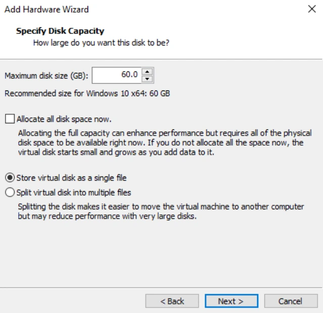

Capture du support — Solution du TP - Gestion du stockage

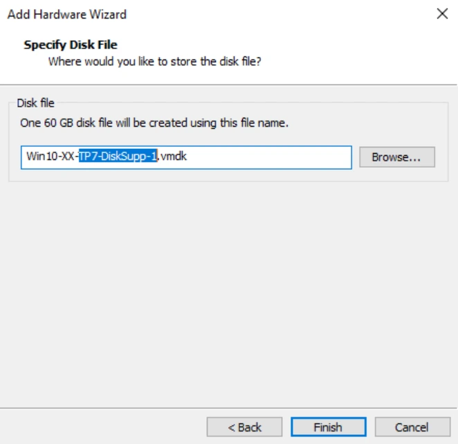

Capture du support — Solution du TP - Gestion du stockage

Entrez un nom parlant pour le fichier > Finish

Le nouveau disque apparaît dans la liste du matériel de votre VM.

Répétez ces étapes pour rajouter un second disque dur dans la VM

Avec la console graphique de votre VM Windows 10

- Sur le premier disque, créer 3 partitions principales de 15Go chacune sans assigner de lettre de lecteur et sans formater.

Ouvrir la console de gestion des disques (disponible dans MaConsole sur le bureau ou via diskmgmt.msc).

Les deux nouveaux disques sont présents mais pas encore initialisés. Faire un clic droit sur Disque 1 > Initialiser le disque

Initialiser les deux disques avec une GUID Partition Table.

Les prochaines étapes doivent être réalisées trois fois

Faire un clic droit sur l'espace non alloué du disque 1 > Nouveau volume simple

L'assistant se lance > Suivant

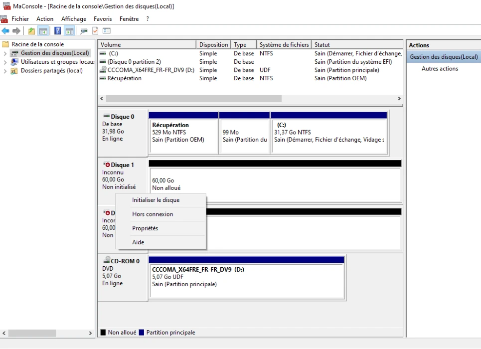

Capture du support — Solution du TP - Gestion du stockage

Taille totale du volume simple en Mo : 15360 (ce qui correspond à 15 Go).

Ne pas attribuer de lettre de lecteur ni de chemin d'accès de lecteur.

Ne pas formater ce volume.

Terminer

À l'issue de la création de vos trois partitions principales sur le disque 1, vous devez obtenir un écran similaire à celui présenté ci-dessous :

Refaire les étapes 1 à 6 deux fois de suite

- Créer une 4e partition de 7 Go sans assigner de lettre de lecteur et sans formater.

Faire un clic droit sur l'espace non alloué du disque 1.

Nouveau volume simple

L'assistant démarre > Suivant

Taille totale du volume simple en Mo : 7168 (ce qui correspond à 7 Go).

Ne pas attribuer de lettre de lecteur ni de chemin d'accès de lecteur.

Ne pas formater ce volume.

Nous nous trouvons sur un disque initialisé avec une table de partitionnement GPT. Nous possédons donc 4 partitions principales. Si vous avez initialisé votre disque avec une table de partitionnement au format MBR, pas de problème. Vous devez cependant obtenir 3 partitions principales ainsi qu'une partition étendue contenant un lecteur logique.

- Formater les deux premières partitions de 15Go en NTFS. La première sera nommée DATA, la seconde TOOLS.

Faire un clic droit sur la première partition principale du disque 1 > Formater

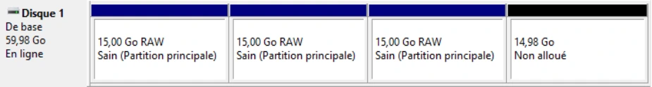

Capture du support — Solution du TP - Gestion du stockage

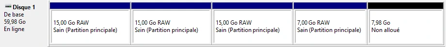

Capture du support — Solution du TP - Gestion du stockage

Faire un clic droit sur la seconde partition principale du disque 1 > Formater

- Attribuer la lettre D au volume DATA et la lettre E au volume TOOLS.

Faire un clic droit sur le Volume D: Lecteur DVD pour d'abord libérer la lettre D et ensuite l'attribuer au nouveau volume.

Faire un clic droit sur le Volume D: > Modifier la lettre de lecteur et les chemins d'accès…

Supprimer > Oui

Vous pouvez ensuite attribuer la lettre de lecteur que vous souhaitez (exemple Z)

Faire un clic droit sur le volume DATA > Modifier la lettre de lecteur et les chemins d'accès…

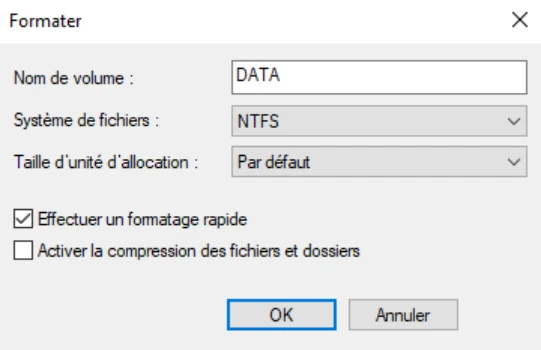

Capture du support — Solution du TP - Gestion du stockage

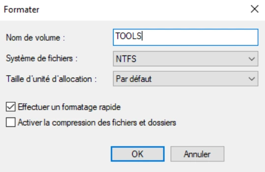

Capture du support — Solution du TP - Gestion du stockage

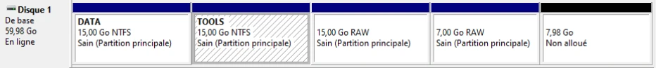

Capture du support — Solution du TP - Gestion du stockage

Ajouter la lettre D.

Faire un clic droit sur le volume TOOLS > Modifier la lettre de lecteur et les chemins d'accès…

Ajouter la lettre E.

Après ces étapes, les volumes sont visibles dans l'explorateur Windows, donc utilisables ! Une notification en bas à droite du bureau nous l'indique d'ailleurs.

- Formater la partition de 7Go restante en FAT32, que vous nommerez ARCHIVE et attribuer lui la lettre de votre choix.

Faire un clic droit sur la partition de 7 Go > Formater…

Faire un clic droit sur ARCHIVE > Modifier la lettre de lecteur et les chemins d'accès…

Ajouter la lettre de votre choix.

- Étendre le volume DATA de 15Go supplémentaire. Pour cela vous n'utiliserez que l'espace libre disponible sur le disque 2.

Faire un clic droit sur le volume DATA > Etendre le volume

Suivant

Clic sur disque 2 > Ajouter >

Clic sur disque 1 > < Supprimer

Sélectionner l'espace en Mo : 15360

Suivant

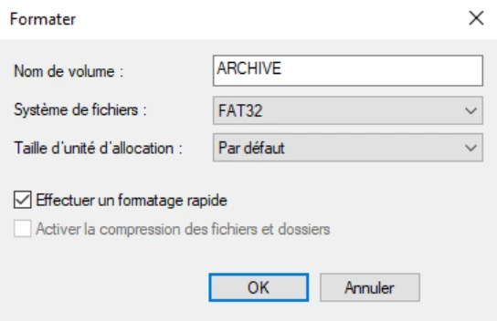

Capture du support — Solution du TP - Gestion du stockage

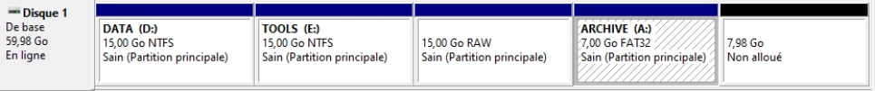

Capture du support — Solution du TP - Gestion du stockage

Terminer

Le système indique qu'il va automatiquement basculer les disques de base en disques dynamiques pour qu'ils puissent travailler "en équipe" > Oui

La légende et les codes couleur ont évolué. Les partitions principales se sont transformées en volume simple et le volume DATA en volume fractionné.

En ligne de commande sur votre VM Windows 10

- Formater la 3e partition de 15Go en NTFS. Vous la nommerez COMMUN et lui attribuerez la lettre de votre choix.

Lancer une fenêtre de ligne de commande cmd.exe.

```
diskpart 
```

```
list disk 
```

```
select disk 1 
```

```
list volume 
```

```
select volume X (où X correspond au volume de 15 Go bruts RAW, le volume n) ; 1 dans le 
cas de cette solution) 
```

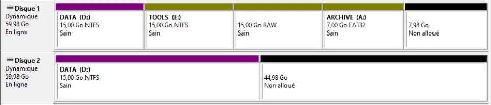

Capture du support — Solution du TP - Gestion du stockage

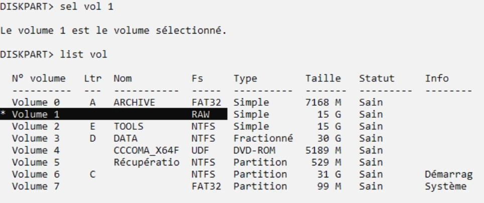

Capture du support — Solution du TP - Gestion du stockage

## Formater le volume COMMUN

```
format FS=NTFS LABEL=COMMUN QUICK
assign letter=k
list vol
```

La liste permet de vérifier que le lecteur K: de 15 Go est bien formaté en NTFS.

### Étendre le volume COMMUN en utilisant l’espace libre restant sur le disque 1

La capture source montre les commandes suivantes sur le volume COMMUN sélectionné :

```
list vol
extend
list vol
```

DiskPart indique que le volume a été correctement étendu. COMMUN passe de **15 G** à **22 G** ; les autres lignes visibles restent ARCHIVE A: FAT32 7168 M, TOOLS E: NTFS 15 G et DATA D: NTFS fractionné 30 G.

## Supprimer le volume DATA

La capture de correction affiche DATA D: NTFS, volume fractionné de 30 G, puis le sélectionne et le supprime.

```
list vol
select volume D
delete volume
list vol
```

Messages : **Le volume 3 est le volume sélectionné** ; **DiskPart a correctement supprimé le volume**.

Dans la liste après suppression, ARCHIVE, COMMUN et TOOLS restent présents ; DATA a disparu.

## Recréer le volume DATA avec l’ensemble de l’espace libre des deux disques

La capture relève le disque 0 système de 32 G, puis les disques 1 et 2 dynamiques de 60 G, dont les espaces libres sont respectivement 15 G et 59 G.

```
list disk
select disk 1
create volume simple
list volume
extend disk=2
format LABEL=DATA QUICK
assign letter=D
list volume
```

Messages successifs : disque 1 sélectionné ; volume créé ; volume étendu ; **100 pour cent effectués** ; volume formaté ; lettre de lecteur ou point de montage assigné.

| Volume présenté à la fin | Lettre | Nom | Système de fichiers | Type | Taille | Statut |
| --- | --- | --- | --- | --- | --- | --- |
| 0 | A | ARCHIVE | FAT32 | Simple | 7168 M | Sain |
| 1 | K | COMMUN | NTFS | Simple | 22 G | Sain |
| 2 | E | TOOLS | NTFS | Simple | 15 G | Sain |
| 3 | D | DATA | NTFS | Fractionné | 74 G | Sain |

La liste conserve aussi le lecteur DVD, la partition de récupération, le volume C: de démarrage et la partition système du disque installé.

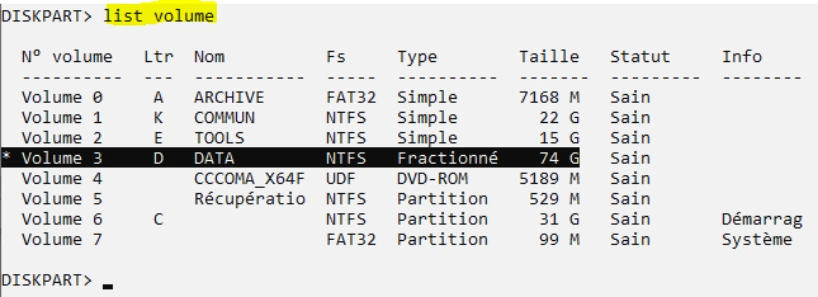

Capture du support — Solution du TP - Gestion du stockage

Investigation sur la VM Discovery à l'aide de PowerShell

- Affichez le numéro, la taille et le type de table de partitionnement des disques durs présents sur la VM

```
Get-Disk | select number,size,PartitionStyle 
 
```

- Affichez la lettre de lecteur, le nom et la taille totale des volumes qui possèdent un FriendlyName

Pour vérifier les informations générales :

```
Get-Volume 
```

Pour n'afficher que les disques qui possèdent un FriendlyName

```
Get-Volume -FriendlyName Informatique,Achat-Ventes,Compta 
```

Pour répondre à la consigne :

```
Get-Volume -FriendlyName Informatique,Achat-Ventes,Compta | Select DriveLetter, 
FileSystem,LabelSize 
```

- Le volume C: ne possède pas de nom. Attribuez-lui le nom "System"

```
Set-Volume -DriveLetter C -NewFileSystemLabel "System" 
 
```

Référence du document : 1iGVskWd7CmnSXiSiQJSRen1GPUUdBkTm · SHA-256 b4f536e32f87ad64…

## Fiche de synthèse

Les lignes reprennent les titres du cours et la première phrase de chaque partie.

| Partie | Repère du cours |
| --- | --- |
| Table de partitionnement GPT | Nouveau format qui gomme les inconvénients du MBR. |
| Les disques durs virtuels | Créés et utilisés pour les machines virtuelles. |
| Stockage local et cmd.exe | Les outils de gestion : avec **diskpart**, outil en ligne de commande très utilisé en production. |
| Conclusion | Recette pour bien utiliser le stockage : 1. |
| Synthèse du Drive · Synthèse Module 4 - Gestion du Stockage sous Windows V2 · 2 pages transcrites | Les synthèses Windows 10 de ce dossier sont rattachées au cours Systèmes clients. |
| Notes du Drive · module 3 et 4 system clients microsoft.txt · document texte | Notes textuelles présentes dans le Drive. |
| Correction · Solution du TP - Gestion du stockage · 11 pages transcrites | Correction originale : à consulter après avoir tenté l’exercice. |
| Formater le volume COMMUN | La liste permet de vérifier que le lecteur K: de 15 Go est bien formaté en NTFS. |
| Supprimer le volume DATA | La capture de correction affiche DATA D: NTFS, volume fractionné de 30 G, puis le sélectionne et le supprime. |
| Recréer le volume DATA avec l’ensemble de l’espace libre des deux disques | La capture relève le disque 0 système de 32 G, puis les disques 1 et 2 dynamiques de 60 G, dont les espaces libres sont respectivement 15 G et 59 G. |
