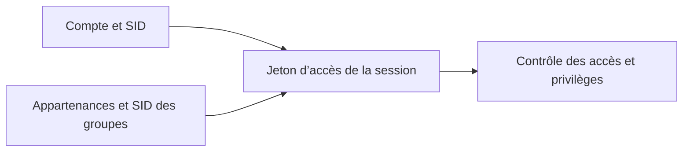

# Module 05 — Les utilisateurs et les groupes

**Séquence :** Systèmes clients Microsoft  
**Fil conducteur :** identifier une personne, préparer son environnement puis lui attribuer les privilèges adaptés.

## Objectifs

- Expliquer l’importance de l’identification dans le système d’information.
- Distinguer compte local, compte de domaine, SID et profil utilisateur.
- Créer et gérer utilisateurs et groupes avec les consoles, `net` et PowerShell.
- Lire les appartenances du jeton d’accès et comprendre l’élévation UAC.
- Réaliser et contrôler le scénario du TP sur Win10-XX et Discovery.

## 1. Du collaborateur au compte utilisateur

Le poste Windows est une porte d’entrée vers le système d’information de l’entreprise. Avant d’accorder la lecture d’un fichier, sa modification ou un privilège d’administration, il faut identifier la personne qui agit. Le support pose les questions « Qui êtes-vous ? », « À quelles ressources devez-vous accéder ? » et « Avec quel rôle ? ». Un collaborateur correspond à un utilisateur du SI ; l’ensemble des données ne doit pas être ouvert indistinctement à tous.

L’accès peut s’appuyer sur le couple **identifiant + mot de passe**, la biométrie Windows Hello ou un objet tel qu’une carte à puce ou un badge. Une seconde authentification peut compléter le mécanisme dans certains contextes : SMS, lien de validation, etc.

| Compte | Stockage présenté | Portée et ouverture de session |
|---|---|---|
| Local | Base **SAM**, Security Account Manager, propre à l’ordinateur | Compte du poste, affiché par défaut sur son écran d’accueil. |
| De domaine | Annuaire **Active Directory**, sur un contrôleur de domaine ou hébergé chez un prestataire | Poste préalablement joint au domaine ; domaine proposé par défaut à l’ouverture de session, possibilité d’un autre domaine selon le contexte. |

Le support associe l’authentification de domaine à Kerberos. Il rappelle aussi qu’une fois le poste joint au domaine, la liste des comptes locaux n’est plus présentée comme sur un poste autonome. Un nom affiché sert à l’humain ; le système identifie le compte par son **SID**, Security Identifier.

## 2. Catégories de comptes et profils

| Catégorie du support | Groupe et usage |
|---|---|
| Standard | Membre d’Utilisateurs, exploite les ressources du poste. |
| Administrateur | Membre d’Administrateurs, peut modifier les ressources du poste ; l’utilisateur créé à l’installation appartient à ce groupe. Le compte intégré Administrateur est désactivé par défaut dans le scénario. |
| Invité | Utilisation restreinte ; le support le présente sans exigence de mot de passe et désactivé par défaut. |

Créer un **compte** ne crée pas immédiatement un **profil**. Le profil personnel apparaît à la première ouverture de session dans `C:\Users`. Il contient les paramètres et les données de l’utilisateur : Documents, Téléchargements, Bureau, Images… Le profil **Public** contient des éléments communs ; le profil **Default**, caché, fournit le modèle d’un nouveau profil.

Pour gérer les profils, ouvrir `sysdm.cpl`, puis **Paramètres système avancés → Profils des utilisateurs → Paramètres**. Le support y situe la suppression et le changement de type du profil ainsi que la gestion du profil par défaut.

!!! warning "Compte et profil : deux objets différents"
    Supprimer manuellement des dossiers dans `C:\Users` n’est pas la méthode de gestion du cours. Dans le TP, Yann et Romain peuvent exister dans la SAM sans profil, parce qu’ils n’ont pas encore ouvert de session.

## 3. Groupes, SID et jeton d’accès

Un groupe rassemble des utilisateurs pour attribuer des autorisations et des privilèges de façon cohérente. Il possède lui aussi un SID. Le jeton d’accès de la session contient notamment le SID du compte et ceux de ses groupes : ce sont ces identités qui seront comparées aux permissions des ressources dans le module suivant.

| Ensemble | Fonction et exemples du support |
|---|---|
| Groupes locaux | Affecter les autorisations aux ressources et certains privilèges d’administration. |
| Groupes prédéfinis | Présents dans Windows ; Administrateurs, Opérateurs de sauvegarde… |
| Entités intégrées de sécurité | Affectées automatiquement, non gérées comme un groupe ordinaire dans les consoles ; Tout le monde, Utilisateurs authentifiés… |

**Illustration IA / externe au cours — construction de l’identité de la session.**



Une modification des appartenances doit être suivie du renouvellement de la session lorsque le TP le demande, afin de tester avec le jeton attendu. Contrôler le nom du compte et la machine avant d’interpréter le résultat.

## 4. Outils de gestion et commandes

Les interfaces du cours se complètent : `lusrmgr.msc` ouvre **Utilisateurs et groupes locaux**, `compmgmt.msc` ouvre **Gestion de l’ordinateur**, et le Panneau de configuration propose une gestion davantage orientée utilisateur. Les propriétés d’un utilisateur regroupent nom complet, description, paramètres du mot de passe, activation/déverrouillage, appartenances et informations de profil. Celles d’un groupe permettent notamment de décrire le groupe et d’en modifier les membres.

### Invite de commandes : actions du TP

```bat
net user francois
net localgroup administrateurs
net user Romain * /add
net localgroup L_Responsables Romain /add
whoami /user
whoami /groups
```

`net user` décrit un compte ; `net localgroup` décrit les groupes et leurs membres. L’astérisque de la création de Romain demande le mot de passe sans l’afficher à l’écran. La création exige la console élevée du scénario. `net help user` et `net help localgroup` donnent l’aide détaillée. `logoff` ferme la session ; `whoami /user` et `/groups` servent à identifier les SID réellement présents.

### PowerShell : objets et propriétés

| Famille | Verbes du support |
|---|---|
| `LocalUser` | `Get`, `New`, `Set`, `Rename`, `Enable`, `Disable`, `Remove` |
| `LocalGroup` | Lire, créer, modifier et supprimer le groupe. |
| Membres d’un groupe | Lire les membres, en ajouter ou en retirer. |

```powershell
Get-LocalUser | Select-Object Name,SID,Description
Get-LocalUser -Name james | Select-Object FullName,Description,ObjectClass,LastLogon
Set-LocalUser -Name adm -Description "Compte générique administrateur de secours"
Get-LocalGroupMember -Name L_SupportInfo | Select-Object Name,SID
```

!!! info "Clarification externe — membres des groupes"
    Le support écrit `{Get | Set | Remove}-LocalGroupMember`. La liste officielle utilise **`Add-LocalGroupMember`** pour ajouter un membre, ainsi que `Get-LocalGroupMember` et `Remove-LocalGroupMember`. Ne pas inventer `Set-LocalGroupMember`. [Référence Microsoft LocalAccounts](https://learn.microsoft.com/en-us/powershell/module/microsoft.powershell.localaccounts/?view=powershell-5.1).

## 5. UAC : demander l’élévation au bon moment

Le **contrôle de compte d’utilisateur**, UAC, évite de travailler constamment avec tous les privilèges. Le bouclier signale une opération nécessitant l’élévation. Le support distingue la validation d’un administrateur et la demande d’authentification à un utilisateur. La commande **Exécuter en tant qu’administrateur** lance explicitement une console élevée.

Ces contrôles visent à limiter les actions de programmes malveillants et à avertir avant un réglage sensible. Le cours situe la configuration dans le Panneau de configuration ou dans `secpol.msc`, **Stratégies locales → Options de sécurité → Contrôle de compte d’utilisateur**. La capture de réglage oppose « Toujours m’avertir » à « Ne jamais m’avertir » ; le support déconseille de désactiver l’UAC.

## 6. TP guidé : créer, déléguer, vérifier

Le TP dure environ **1 h 30**. Les noms sont ceux du laboratoire.

| Objet ou compte | Configuration et contrôle attendus |
|---|---|
| François | Mot de passe sans expiration dans ce scénario ; groupes `L_Informatiques` et `L_Responsables` créés au préalable ; ajout dans Administrateurs. |
| Yann | Mêmes groupes métier que François ; ajout à Lecteurs des journaux d’événements et Opérateurs de configuration réseau. |
| Deux collègues | Comptes libres, regroupés dans `L_Collegues` ; ajout aux Opérateurs de sauvegarde. La correction donne Pauline et Alix comme exemples. |
| Un collègue retiré d’Utilisateurs | Observer ensuite les possibilités d’ouverture de session. |
| Romain | Création en console avec saisie masquée, puis ajout dans `L_Responsables`. |

Dans la MMC, créer un utilisateur par **Utilisateurs → Nouveau utilisateur**, renseigner les paramètres puis contrôler l’onglet **Membre de**. Créer les groupes avant d’y affecter les comptes. La correction souligne la limite d’imbrication des groupes locaux dans une base SAM d’un poste client : ajouter les deux comptes de collègues au groupe prédéfini demandé, plutôt que supposer que l’imbrication de `L_Collegues` suffit.

Fermer la session, constater quels comptes peuvent se connecter puis ouvrir celle de François. Comparer les profils visibles avec la liste des comptes, afficher les SID et terminer sur Discovery avec les quatre commandes PowerShell ci-dessus.

!!! note "Écart conservé entre énoncé et correction"
    L’énoncé demande pour `adm` la description « Compte générique avec privilèges d’administration ». La correction écrit « Compte générique administrateur de secours ». La commande reproduit la correction ; cet écart de libellé est signalé, sans modifier le document original.

## 7. Mini-quiz de compréhension — 5 questions

1. Où un utilisateur local est-il enregistré ?
2. Pourquoi un compte peut-il être présent sans dossier personnel dans `C:\Users` ?
3. Quelle commande affiche les SID des groupes de la session ?
4. Pourquoi la création de Romain utilise-t-elle `*` ?
5. Quel est le rôle du bouclier UAC ?

??? success "Réponses commentées"
    1. Dans la base SAM du poste.
    2. Son profil n’est créé qu’à la première ouverture de session.
    3. `whoami /groups`, dans la session à contrôler.
    4. Pour saisir le mot de passe sans l’exposer à l’écran.
    5. Signaler qu’une élévation est nécessaire pour l’action.

## Pour pratiquer et réviser

- [TP — présentation](../../tp/systemes-clients/module-05/index.md)
- [Énoncé complet](../../tp/systemes-clients/module-05/enonces.md) et [correction](../../tp/systemes-clients/module-05/corrections.md)
- [Fiche de révision](../../revision/systemes-clients/module-05-les-utilisateurs-et-les-groupes.md)
- [Kahoot existant](../../kahoot/02-systemes-clients-microsoft-05-les-utilisateurs-et-les-groupes.md)
- [Retour à la formation](index.md)

## Sources et choix éditoriaux

Le support M05, l’énoncé, la correction et la synthèse M05 du Drive ont été lus sans modification. La synthèse Windows, rangée dans **Base des réseaux / Synthèses**, reste rattachée à ce module ; le fichier `module 5 et 6.txt` est vide : **Inexistant**. Les tableaux, le schéma et le mini-quiz constituent la structuration pédagogique. Les documents d’origine restent disponibles dans l’onglet **Cours Original** ; les compléments externes sont explicitement signalés.
