# Module 05 — Les utilisateurs et les groupes

Les parties ci-dessous reprennent le cours original, dans le même ordre. Les encadrés et les schémas répètent ses formulations.

## Parcours de lecture

1. Support · Module 05 - Support de cours · 12 pages transcrites
2. Systèmes clients Microsoft
3. Objectifs
4. Les objets utilisateurs et groupes
5. La notion d’utilisateur
6. La notion d’utilisateur
7. Gestion des utilisateurs
8. Gestion des utilisateurs
9. Gestion des utilisateurs
10. Les catégories d’utilisateurs
11. La gestion des profils
12. La gestion des profils
13. La gestion des profils
14. Gestion des groupes
15. Gestion des utilisateurs et des groupes
16. Gestion des utilisateurs et des groupes
17. Démonstration
18. Contrôle de comptes d’utilisateur (UAC)
19. Contrôle de comptes d’utilisateur (UAC)
20. Contrôle de comptes d’utilisateur (UAC)
21. Récapitulatif
22. Démonstration
23. TP
24. Conclusion
25. Énoncé · Enoncé du TP - Gestion des utilisateurs et des groupes · 7 pages transcrites
26. Systèmes Clients Microsoft Gestion des utilisateurs et des groupes
27. Énoncé
28. Solution
29. Synthèse du Drive · Synthèse Module 5 - Gestion des Utilisateurs, Groupes et UAC V2 · 3 pages transcrites
30. Synthèse — Module 5 : Les Utilisateurs, les Groupes et le Contrôle de Comptes (UAC) (V2)
31. 1. Concept d’Utilisateur et de Profil
32. 2. Gestion des Groupes et Autorisations
33. 3. Contrôle de Compte d’Utilisateur (UAC) et Administration
34. Cmdlets PowerShell de gestion des utilisateurs locaux
35. Notes du Drive · module 5 et 6.txt · document texte
36. Inexistant
37. Correction · Solution du TP - Gestion des utilisateurs et des groupes · 7 pages transcrites
38. Les utilisateurs et les groupes
39. Proposition de solution

**Visuel externe**

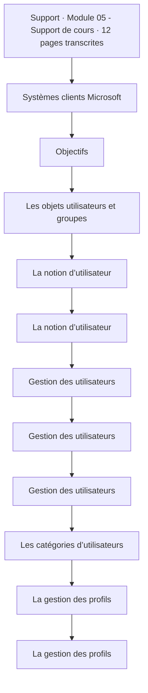

SOURCE DRIVE · TRANSCRIPTION DU SUPPORT

Le contenu des documents du dossier TSSR est transcrit ci-dessous, page par page. Les textes et tableaux sont intégrés à la page Web. Aucun fichier PDF, aucune diapositive entière ni aucune reproduction de page n’est affiché. Seuls des croquis ou visuels isolés et vérifiés peuvent accompagner la transcription. Les versions et les consignes restent celles des supports de formation. Les compléments IA sont conservés dans leur onglet distinct.

## Support · Module 05 - Support de cours · 12 pages transcrites

## Systèmes clients Microsoft

!!! note "À retenir"
    Module 05 – Les utilisateurs et les groupes

Module 05 – Les utilisateurs et les groupes

## Objectifs

!!! note "À retenir"
    Prendre conscience de l'importance de la notion d'utilisateur Distinguer les utilisateurs et leurs profils Gérer les utilisateurs et les groupes Découvrir les outils de gestion Assimiler le fonctionnement de l'UAC

**Visuel externe**

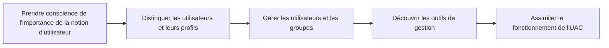

- Prendre conscience de l'importance de la notion d'utilisateur
- Distinguer les utilisateurs et leurs profils
- Gérer les utilisateurs et les groupes
- Découvrir les outils de gestion
- Assimiler le fonctionnement de l'UAC

## Les objets utilisateurs et groupes

!!! note "À retenir"
    Notion d'utilisateurs Les profils d'utilisateurs Les groupes Le contrôle de compte utilisateurs

**Visuel externe**

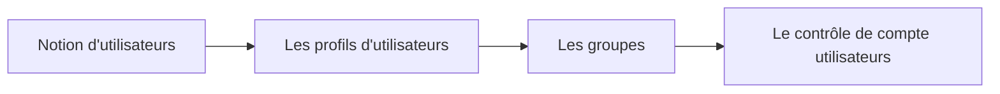

- Notion d'utilisateurs
- Les profils d'utilisateurs
- Les groupes
- Le contrôle de compte utilisateurs

## La notion d’utilisateur

!!! note "À retenir"
    Le système d'exploitation client Windows est une porte ouverte sur le système d'information de l'entreprise Êtes-vous une personne de confiance ?

**Visuel externe**

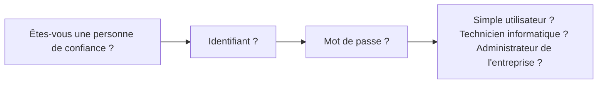

- Le système d'exploitation client Windows est une porte ouverte sur le système d'information de l'entreprise
- Êtes-vous une personne de confiance ?
- Identifiant ?
- Mot de passe ?
- Accès en lecture ? En modification ? À quelques fichiers ? À l'ensemble du réseau ?
- Simple utilisateur ? Technicien informatique ? Administrateur de l'entreprise ?

## La notion d’utilisateur

!!! note "À retenir"
    1 collaborateur de l'entreprise = 1 utilisateur du système d'information Accès au SI validé par : Le couple Identifiant + Mot de passe Biométrie (Windows Hello) Objet tiers (carte à puce, badge…) 2de authentification possible dans certains contextes spécifiques (SMS, lien de validation, etc.)

**Visuel externe**

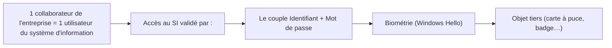

- 1 collaborateur de l'entreprise = 1 utilisateur du système d'information
- Accès au SI validé par :
- Le couple Identifiant + Mot de passe
- Biométrie (Windows Hello)
- Objet tiers (carte à puce, badge…)
- 2de authentification possible dans certains contextes spécifiques (SMS, lien de validation, etc.)

## Gestion des utilisateurs

!!! note "À retenir"
    Utilisateur local Propre à chaque ordinateur Stocké dans la base de données locale SAM (Base Security Account Manager) L'utilisateur ne peut exploiter que les ressources de l'ordinateur source

Utilisateur local

- Propre à chaque ordinateur
- Stocké dans la base de données locale SAM (Base Security Account Manager)
- L'utilisateur ne peut exploiter que les ressources de l'ordinateur source

## Gestion des utilisateurs

Utilisateur du domaine

- Stocké dans une base de données commune (annuaire Active Directory)
- Sur un serveur de l'entreprise (contrôleur de domaine)
- Externalisé chez un prestataire (Microsoft Azure ou autre)
- Authentification Kerberos sécurisée par le réseau
- Un utilisateur peut ouvrir une session sur tous les ordinateurs du domaine
- Un utilisateur (local, de domaine) est identifié par le système grâce à son SID (Security IDentifier)

## Gestion des utilisateurs

Ouverture de session

- Pour les utilisateurs locaux
- Utiliser un compte présent dans la base SAM
- Sont affichés par défaut sur l'écran d'accueil
- Pour les utilisateurs du domaine
- Jonction du poste au domaine de l'entreprise indispensable au préalable
- Domaine sélectionné par défaut Possibilité de s'authentifier grâce à l'annuaire d'un autre domaine

Attention, la liste des utilisateurs locaux n’apparaît plus une fois l’ordinateur joint au domaine de l’entreprise !

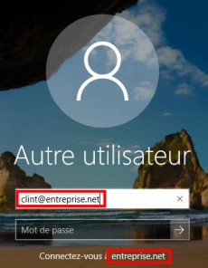

Illustration isolée du support — Module 05 - Support de cours

## Les catégories d’utilisateurs

- Standard
- Pour utiliser les ressources de l'ordinateur
- Être membre du groupe Utilisateurs
- Administrateur
- Pour utiliser et modifier les ressources de l'ordinateur
- Être membre du groupe Administrateurs
- L'utilisateur créé à l'installation du système est membre du groupe Administrateurs
- Le compte administrateur est désactivé par défaut
- Le compte Invité
- Pour une utilisation restreinte des ressources de l'ordinateur
- Pas besoin de mot de passe pour accéder aux ressources
- Ce compte est désactivé par défaut

## La gestion des profils

!!! note "À retenir"
    Un utilisateur ouvre une session pour la première fois, un profil personnel est créé Dans le dossier C:\Users Propre à chaque utilisateur Contient tous les paramètres et données de l'utilisateur Documents Téléchargement Bureau Images… Illustration isolée du support — Module 05 - Support de cours

Un utilisateur ouvre une session pour la première fois, un profil personnel est créé

- Dans le dossier C:\Users
- Propre à chaque utilisateur
- Contient tous les paramètres et données de l'utilisateur
- Documents
- Téléchargement
- Bureau
- Images…

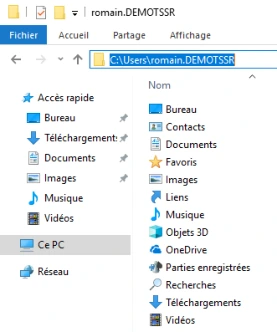

Illustration isolée du support — Module 05 - Support de cours

## La gestion des profils

Un utilisateur ouvre une session pour la première fois, un profil personnel est créé

- Dans le dossier C:\Users
- Propre à chaque utilisateur
- Contient tous les paramètres et données de l'utilisateur
- Documents
- Téléchargement
- Bureau
- Images…
- Profil public : commun à tous les utilisateurs
- Profil par défaut (caché) : modèle pour la création d'un nouveau profil

## La gestion des profils

!!! note "À retenir"
    La gestion manuelle des profils dans le dossier c:\Users est à proscrire !

Comment gérer les profils ?

- La gestion manuelle des profils dans le dossier c:\Users est à proscrire !
- sysdm.cpl onglet Paramètres systèmes avancés
- Supprimer des profils
- Modifier le type du profil
- Gestion du profil par défaut

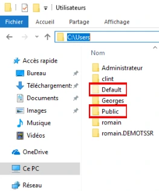

Illustration isolée du support — Module 05 - Support de cours

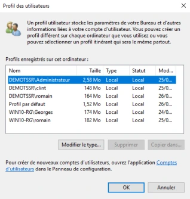

Illustration isolée du support — Module 05 - Support de cours

## Gestion des groupes

- Tout utilisateur doit appartenir à au moins un groupe
- Un groupe est identifié par le système grâce à son SID (Security IDentifier)
- Le SID du groupe s'ajoute au jeton d'accès de l'utilisateur
- Groupes locaux
- Pour configurer les autorisations d'accès aux ressources
- Pour configurer les privilèges d'administration
- Groupes prédéfinis
- Présent nativement
- Pour configurer les privilèges et la délégation d’administration (Administrateurs, Opérateurs de sauvegarde…)
- Entités intégrées de sécurité
- Non visibles dans les consoles
- Affectation automatique
- Utilisés par le système pour la gestion des permissions (Tout le monde, Utilisateurs authentifiés…)

## Gestion des utilisateurs et des groupes

Configuration

- Graphiquement grâce aux consoles MMC
- lusrmgr.msc (gestion des utilisateurs et groupes locaux)
- compmgmt.msc (gestion de l'ordinateur)
- Menu Comptes d'utilisateurs dans le panneau de configuration (orienté utilisateur)
- En ligne de commande
- net user (net help user pour l'aide détaillée)
- net localgroup (net help localgroup)

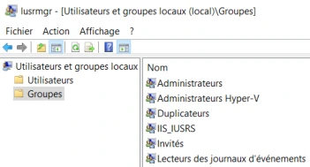

Illustration isolée du support — Module 05 - Support de cours

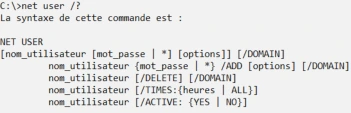

Illustration isolée du support — Module 05 - Support de cours

## Gestion des utilisateurs et des groupes

### Configuration en PowerShell

| Description | verbe | -nom |
| --- | --- | --- |
| Affiche la liste des utilisateurs locaux | Get | -LocalUser |
| Créer un nouvel utilisateur dans la base SAM | New | -LocalUser |
| Modifier un utilisateur local existant | Set | -LocalUser |
| Renommer un utilisateur | Rename | -LocalUser |
| Activer l’utilisateur, il pourra de ce fait utiliser les ressources de l’ordinateur | Enable | -LocalUser |
| Désactiver un utilisateur | Disable | -LocalUser |
| Supprimer un utilisateur de la base SAM | Remove | -LocalUser |

Manipulation des groupes et de leurs membres avec les cmdlets : \{Get | Set | New | Remove\}-LocalGroup et \{Get | Set | Remove\}-LocalGroupMember.

## Démonstration

## Contrôle de comptes d’utilisateur (UAC)

Sans action particulière, le système loge tous les utilisateurs à la même enseigne … même les administrateurs !

- Par l'intermédiaire de l'UAC, le système n'accorde les privilèges que lorsque c'est nécessaire
- Élévation de pouvoir symbolisée par le « bouclier »
- Validation requise pour un administrateur
- Authentification requise pour un utilisateur

## Contrôle de comptes d’utilisateur (UAC)

- Pourquoi ces contrôles ?
- Lutter contre les actions des programmes malveillants
- Avertir face à un paramètre sensible du système
- Comment le configurer ?
- Via le panneau de configuration
- À l'aide de la stratégie de sécurité locale
- secpol.msc
- Stratégies locales > Options de sécurité
- Valeurs Contrôle de compte d'utilisateur

Il est donc déconseillé de désactiver l’UAC.

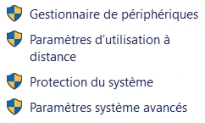

Illustration isolée du support — Module 05 - Support de cours

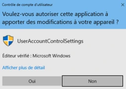

Illustration isolée du support — Module 05 - Support de cours

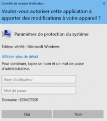

Illustration isolée du support — Module 05 - Support de cours

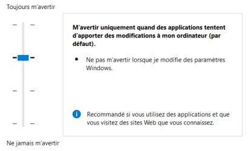

Illustration isolée du support — Module 05 - Support de cours

## Contrôle de comptes d’utilisateur (UAC)

Pour certaines actions, il est nécessaire de demander l’élévation

- Graphiquement avec la fonction Exécuter en tant qu’administrateur

## Récapitulatif

Un utilisateur est associé à :

- Un nom d’ouverture de session et un mot de passe
- Un profil local
- Généré à la première ouverture de session
- Contient les données personnelles et les paramètres de l'utilisateur
- Un identifiant unique (SID)
- Des appartenances de groupe définies dans l’onglet Membre de
- L'ensemble des SID constituent le jeton d'accès, ouvrant des accès et accordant des privilèges
- Les informations du jeton d'accès sont consultables avec la commande whoami

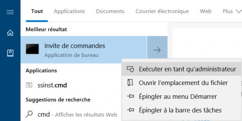

Illustration isolée du support — Module 05 - Support de cours

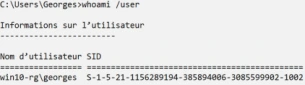

Illustration isolée du support — Module 05 - Support de cours

## Démonstration

## TP

## Conclusion

- Un collaborateur = un utilisateur
- A chacun son métier
- A chacun ses données
- Le système est protégé
- L’identification est la clé de la sécurité

Référence du document : 1s2o2V7Zj5iJuErUiXOsz9PAEcmDykImt · SHA-256 b428003d4e687898…

## Énoncé · Enoncé du TP - Gestion des utilisateurs et des groupes · 7 pages transcrites

## Systèmes Clients Microsoft Gestion des utilisateurs et des groupes

### TP du Module 05 – Les utilisateurs et les groupes

Au cours de ce TP, vous allez être amené à manipuler les utilisateurs et les groupes. Vous mettrez en place des privilèges d’administration et vous testerez leurs effets. Vous parcourrez les caractéristiques des utilisateurs et des groupes. Vous effectuerez toutes ses manipulations à l’aide de l’interface graphique, mais aussi par l’intermédiaire des shells Microsoft.

Durée estimée

1 heure 30 minutes

## Énoncé

Lisez l'ensemble de cet atelier avant de vous lancer dans la pratique

### À l'aide de la console de gestion des utilisateurs de la VM Win10-XX, créez les objets avec les paramètres suivants :

- Créez une procédure relative aux deux points suivants :

o François possédera un mot de passe qui n'aura pas de date d'expiration.

o Il fera partie des groupes L_Informatiques et L_Responsables (vous créerez les groupes en amont).

- Yann fera partie des mêmes groupes que François.

- Créez deux comptes utilisateurs auxquels vous donnerez nom, prénom, login et mot de passe de votre choix. Ils feront partie du groupe L_Collegues

### Mise en place de privilèges d'administration

- François aura la possibilité d'administrer l'ensemble des ressources du poste Win10-XX.
- Yann pourra consulter les journaux d'évènements et configurer la carte réseau.
- Vous accorderez à vos collègues la possibilité de sauvegarder votre poste Win10-XX.

- Retirez l'un de vos collègues du groupe utilisateurs.

### Informations concernant les utilisateurs et groupes

- En naviguant dans la console graphique des utilisateurs et des groupes, listez les propriétés d'un utilisateur : Nom complet, Description

### Listez les propriétés d'un groupe

À l'aide de la ligne de commande cmd.exe

- Afficher les informations du compte utilisateur François.

- Affichez les membres du groupe administrateurs
- Créez un utilisateur Romain, attribuez-lui un mot de passe. Attention, pour des questions de sécurité, le mot de passe que vous taperez ne devra pas être visible à l'écran !
- Ajoutez Romain au groupe L_Responsables

### Manipulations supplémentaires avec l'interface graphique de Windows 10

- Fermez la session de l'utilisateur en cours.

- Quels utilisateurs peuvent ouvrir une session sur le poste ?
- L'un de vos collègues ne peut pas ouvrir de session. Pourquoi ?
- Ouvrez une session avec l'utilisateur François puis affichez les profils présents sur le système. Que peut-on observer ?
- À l'aide de la ligne de commande, affichez son SID, puis affichez les SID des groupes dont il est membre.

### À l'aide de PowerShell et de la VM Discovery

- Afficher la liste des utilisateurs sur le système. Vous afficherez le nom, le SID et la description de chacun d'eux.
- Afficher les informations suivantes concernant l'utilisateur james : Nom complet, description, classe d'objets, date de dernière connexion
- Ajouter la description Compte générique avec privilèges d'administration à l'utilisateur adm
- Afficher le nom et le SID des membres du groupe local L_SupportInfo

## Solution

Une solution est proposée pour ce TP sous la forme d'un PDF commenté, disponible dans les ressources à télécharger.

Référence du document : 1zUt7LGnurr8Z4KlkK8CwpiBBzF0M7qnK · SHA-256 a420fe7d72fd5707…

## Synthèse du Drive · Synthèse Module 5 - Gestion des Utilisateurs, Groupes et UAC V2 · 3 pages transcrites

Les synthèses Windows 10 de ce dossier sont rattachées au cours Systèmes clients.

## Synthèse — Module 5 : Les Utilisateurs, les Groupes et le Contrôle de Comptes (UAC) (V2)

## 1. Concept d’Utilisateur et de Profil

Dans Windows 10, chaque collaborateur est identifié par un compte d’utilisateur associé à un identifiant de sécurité unique (SID - Security Identifier).

- Utilisateur Local : enregistré dans la base de données locale SAM (Security Account Manager) du poste.
- Utilisateur de Domaine : enregistré dans l’annuaire Active Directory pour un accès centralisé.
- Profil Utilisateur : dossier personnel stocké dans C:\Users\<nom> contenant les paramètres et documents de l’utilisateur. La gestion des profils se fait via sysdm.cpl.

## 2. Gestion des Groupes et Autorisations

Les groupes permettent de simplifier l’attribution des droits et privilèges. Un utilisateur hérite des permissions accordées aux groupes auxquels il appartient.

| Type de groupe | Exemples / Rôle |
| --- | --- |
| Administrateurs | Contrôle total sur l’ordinateur et le système. Compte administrateur désactivé par défaut. |
| Utilisateurs | Membres standards autorisés à exécuter des applications sans modifier le système. |
| Invités (Guests) | Accès très restreint, désactivé par défaut. |
| Entités intégrées | Tout le monde, Utilisateurs authentifiés (gérées automatiquement par l’OS). |

## 3. Contrôle de Compte d’Utilisateur (UAC) et Administration

L’UAC (User Account Control) empêche les modifications système non autorisées en imposant une confirmation ou une saisie de mot de passe administrateur (élévation de privilèges symbolisée par le bouclier).

### Commandes de gestion CLI et PowerShell

```
:: Gestion des utilisateurs et groupes locaux (cmd.exe)
net user
net user pdupond Pa$$w0rd /add
net localgroup Administrateurs pdupond /add
whoami /all
:: Lancement des consoles de gestion MMC
lusrmgr.msc
compmgmt.msc
secpol.msc
```

## Cmdlets PowerShell de gestion des utilisateurs locaux

```
Get-LocalUser
New-LocalUser -Name "pdupond" -AccountNeverExpires
Add-LocalGroupMember -Group "Administrateurs" -Member "pdupond"
Disable-LocalUser -Name "Guest"
```

Référence du document : 1xPtrQx5oKA-CNDqmsl8HKcDMVemUE5n-XXwvyJYUpqU · SHA-256 e6bea2f53019f56d…

## Notes du Drive · module 5 et 6.txt · document texte

Notes textuelles présentes dans le Drive. Aucun support de cours illustré distinct n’est fourni pour ce document ; aucune illustration n’a été inventée ou attribuée au support.

## Inexistant

Le fichier de notes est vide dans le Drive. Aucun contenu n’a été inventé.

Référence du document : 1Oi75J3l2QDn53DJw1GUoxHxkXTShq3T7 · SHA-256 e3b0c44298fc1c14…

## Correction · Solution du TP - Gestion des utilisateurs et des groupes · 7 pages transcrites

Correction originale : à consulter après avoir tenté l’exercice.

## Les utilisateurs et les groupes

### TP du Module 05 – Les utilisateurs et les groupes

## Proposition de solution

À l'aide de la console de gestion des utilisateurs de la VM Win10-XX, créez les objets avec les paramètres suivant :

- François possèdera un mot de passe qui n'aura pas de date d'expiration.
- Il fera partie des groupes L_Informatiques et L_Responsables (vous créerez les groupes en amont).

Dans votre console personnalisée MaConsole.msc disponible sur votre bureau

Composant logiciel enfichable "Utilisateurs et groupes locaux" > utilisateurs

Clic droit > Nouvel utilisateur

Remplir le champ Nom d'utilisateur "françois" ou "francois" et entrez un mot de passe

Vous pouvez décocher l'utilisateur doit changer son mot de passe à la prochaine ouverture de session

Cocher Le mot de passe n'expire jamais.

Créer puis Fermer

Francois apparait dorénavant dans la fenêtre des utilisateurs

Composant logiciel enfichable "Utilisateurs et groupes locaux"

Clic droit > Nouveau groupe …

Nom du groupe : L_Informatiques

Ajouter …

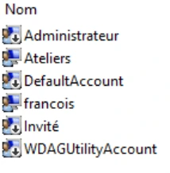

Illustration isolée du support — Solution du TP - Gestion des utilisateurs et des groupes

Entrez les noms des objets à sélectionner : francois

OK

Créer

Nom du groupe : L_Responsables

Ajouter…

Entrez les noms des objets à sélectionner : francois

OK

Créer

Fermer

Les deux nouveaux groupes apparaissent dans la liste

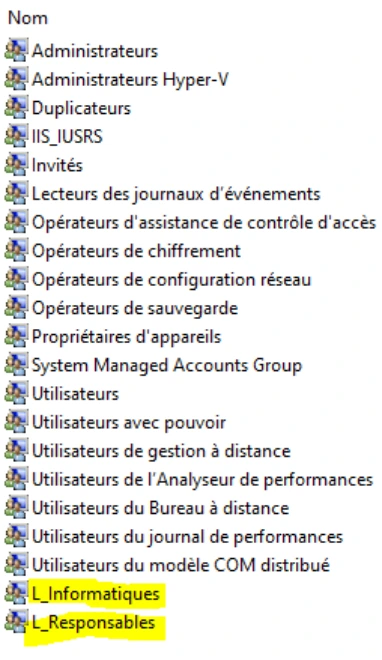

Illustration isolée du support — Solution du TP - Gestion des utilisateurs et des groupes

- Yann fera partie des mêmes groupes que François.

Dans votre console personnalisée MaConsole.msc disponible sur votre bureau

Composant logiciel enfichable "Utilisateurs et groupes locaux" > utilisateurs

Clic droit > Nouvel utilisateur

Remplir le champ Nom d'utilisateur "Yann" et entrez un mot de passe

Vous pouvez décocher l'utilisateur doit changer son mot de passe à la prochaine ouverture de session

Créer puis Fermer

Yann apparait dorénavant dans la fenêtre des utilisateurs

Clic droit sur l'utilisateur Yann > Propriétés

Onglet Membre de

Ajouter…

Entrez les noms des objets à sélectionner : L_Informatiques;L_Responsables

Appliquer > OK

- Créez deux comptes utilisateurs auquel vous donnerez nom, prénom, login et mot de passe de votre choix. Ils feront partie du groupe L_Collegues

Composant logiciel enfichable "Utilisateurs et groupes locaux" > utilisateurs

Clic droit > Nouvel utilisateur

Remplir le champ Nom d'utilisateur et entrez un mot de passe

Vous pouvez décocher l'utilisateur doit changer son mot de passe à la prochaine ouverture de session

Créer

Refaites ces étapes pour un utilisateur supplémentaire puis Fermer

Ils apparaissent dorénavant dans la fenêtre des utilisateurs

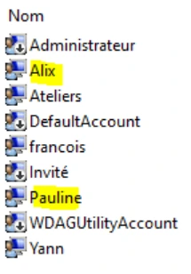

Illustration isolée du support — Solution du TP - Gestion des utilisateurs et des groupes

Composant logiciel enfichable "Utilisateurs et groupes locaux"

Clic droit > Nouveau groupe …

Nom du groupe : L_Collegues

Ajouter …

Entrez les noms des objets à sélectionner : Pauline;Alix

OK

Créer

Fermer

Mise en place de privilèges d'administration

- François aura la possibilité d'administrer l'ensemble des ressources du poste Win10- XX.

Ajouter François dans le groupe prédéfini Administrateurs

- Yann pourra consulter les journaux d'évènements et configurer la carte réseau.

Ajouter Yann dans les groupes prédéfinis suivants :

Lecteurs des journaux d'événements

Opérateurs de configuration réseau

- Vous accorderez à vos collègues la possibilité de sauvegarder votre poste Win10-XX.

Ajouter vos deux utilisateurs supplémentaires dans le groupe prédéfini Opérateurs de sauvegarde

L'imbrication de groupe n'est pas opérationnelle d'un groupe local vers un autre groupe local d'une base SAM d'un système d'exploitation client. Il est possible de le faire en ligne de commande mais pour simple information

- Retirez l'un de vos collègues du groupe utilisateurs.

Supprimer l'un de vos deux utilisateurs du groupe prédéfini Utilisateurs

Informations concernant les utilisateurs et groupes

- En navigant dans la console graphique des utilisateurs et des groupes, listez les propriétés d'un utilisateur.

Nom complet

Description

3 actions possibles sur les mots de passe (Changement à la prochaine ouverture de session, expiration, impossibilité de changer de mot de passe)

2 actions possibles sur le compte (désactivation et déverrouillage)

Appartenance aux groupes

Information de profil, script d'ouverture de session, connexion automatique à lecteur réseau et mappage via une lettre de lecteur, local path

- Listez les propriétés d'un groupe.

Description

Ajouter ou supprimer des membres dans le groupe

À l'aide de la ligne de commande cmd.exe.

- Afficher les informations du compte utilisateur François.

```
net user francois
```

On remarquera ici que la ligne de commande affiche beaucoup plus d'informations concernant l'utilisateur que le composant logiciel enfichable "Utilisateurs et groupes locaux". Cela prouve que la ligne de commande est plus pointue, plus aiguisée et complète que l'interface graphique

- Affichez les membres du groupe administrateurs

```
net localgroup administrateurs
```

- Créez un utilisateur Romain, attribuez-lui un mot de passe. Attention, pour des questions de sécurité, le mot de passe que vous taperez ne devra pas être visible à l'écran !

```
net user Romain * /add
```

Entrez le mot de passe au clavier, il ne s'affichera pas à l'écran

Attention, pour pouvoir créer un nouvel utilisateur dans la base SAM, vous devez ouvrir une fenêtre de ligne de commande en tant qu'administrateur. Créer un utilisateur, c'est modifier le système !

- Ajoutez Romain au groupe L_Responsables

```
net localgroup L_Responsables Romain /add
```

Manipulations supplémentaires avec l'interface graphique de Windows 10

- Fermez la session de l'utilisateur en cours.

```
logoff
```

- Quels utilisateurs peuvent ouvrir une session sur le poste ?

Seuls les utilisateurs membres des groupes Utilisateurs, Administrateurs ou Invités peuvent ouvrir une session locale sur la machine

- L'un de vos collègues ne peut pas ouvrir de session. Pourquoi ?

L'un de vos utilisateurs supplémentaires n'apparait pas sur l'écran d'accueil car vous l'avez supprimé du groupe utilisateurs

- Ouvrez une session avec l'utilisateur François puis affichez les profils présents sur le système. Que peut-on observer ?

Après avoir ouvert une session avec l'utilisateur francois, terminez la configuration de son profil utilisateur. Puisque c'est la première fois que François ouvre une session, un profil d'utilisateur est automatiquement créé dans le dossier c:\Users. Son profil est un sous dossier dont le nom est le même que son login.

Pour afficher les profils présents sur le système :

Rechercher > sysdm.cpl

Onglet Paramètres système avancés

Bouton Paramètres… du champ Profil des utilisateurs

Seuls les profils des utilisateurs ayant déjà ouvert au moins une fois une session sur l'ordinateur sont présents. Il existe plus d'utilisateurs que de profils dans notre cas. C'est normal. Par exemple Yann et Romain sont bien présents dans la base SAM mais n'ont pas encore ouvert de session sur l'ordinateur.

Un profil leur sera automatiquement créé lors de leur première ouverture de session, à l'aide du profil "modèle" le Profil par défaut

- À l'aide de la ligne de commande, affichez son SID, puis affichez les SID des groupes dont il est membre.

Ouvrez une ligne de commande cmd.exe

```
whoami /user
```

```
whoami /groups
```

L'ensemble de ces SID forment le jeton d'accès de l'utilisateur

À l'aide de PowerShell et de la VM Discovery

- Afficher la liste des utilisateurs sur le système. Vous afficherez le nom, le SID et la description de chacun d'eux.

```
Get-LocalUser | select Name,SID,Description
```

- Afficher les informations suivantes concernant l'utilisateur james :

o Nom complet, description, classe d'objets, date de dernière connexion

```
Get-LocalUser -Name james | Select FullName,description,ObjectClass,LastLogon
```

- Ajouter la description Compte générique avec privilèges d'administration à l'utilisateur adm

```
Set-LocalUser -Name adm -description "Compte générique administrateur de secours"
```

- Afficher le nom et le SID des membres du groupe local L_SupportInfo

```
Get-LocalGroupMember -Name L_SupportInfo | Select Name,SID
```

Référence du document : 1OFaYYZbg4qoJYm_UsA_9Idm9g1Jlt9Pt · SHA-256 57ccbb8c406c69c9…

## Fiche de synthèse

Les lignes reprennent les titres du cours et la première phrase de chaque partie.

| Partie | Repère du cours |
| --- | --- |
| Systèmes clients Microsoft | Module 05 – Les utilisateurs et les groupes |
| Objectifs | Prendre conscience de l'importance de la notion d'utilisateur Distinguer les utilisateurs et leurs profils Gérer les utilisateurs et les groupes Découvrir les outils de gestion… |
| Les objets utilisateurs et groupes | Notion d'utilisateurs Les profils d'utilisateurs Les groupes Le contrôle de compte utilisateurs |
| La notion d’utilisateur | Le système d'exploitation client Windows est une porte ouverte sur le système d'information de l'entreprise Êtes-vous une personne de confiance ? |
| La notion d’utilisateur | 1 collaborateur de l'entreprise = 1 utilisateur du système d'information Accès au SI validé par : Le couple Identifiant + Mot de passe Biométrie (Windows Hello) Objet tiers (car… |
| Gestion des utilisateurs | Utilisateur local Propre à chaque ordinateur Stocké dans la base de données locale SAM (Base Security Account Manager) L'utilisateur ne peut exploiter que les ressources de l'or… |
| Gestion des utilisateurs | Utilisateur du domaine Stocké dans une base de données commune (annuaire Active Directory) Sur un serveur de l'entreprise (contrôleur de domaine) Externalisé chez un prestataire… |
| Gestion des utilisateurs | Ouverture de session Pour les utilisateurs locaux Utiliser un compte présent dans la base SAM Sont affichés par défaut sur l'écran d'accueil Pour les utilisateurs du domaine Jon… |
| Les catégories d’utilisateurs | Standard Pour utiliser les ressources de l'ordinateur Être membre du groupe Utilisateurs Administrateur Pour utiliser et modifier les ressources de l'ordinateur Être membre du g… |
| La gestion des profils | Un utilisateur ouvre une session pour la première fois, un profil personnel est créé Dans le dossier C:\Users Propre à chaque utilisateur Contient tous les paramètres et données… |
| La gestion des profils | Un utilisateur ouvre une session pour la première fois, un profil personnel est créé Dans le dossier C:\Users Propre à chaque utilisateur Contient tous les paramètres et données… |
| La gestion des profils | La gestion manuelle des profils dans le dossier c:\Users est à proscrire ! |
| Gestion des groupes | Tout utilisateur doit appartenir à au moins un groupe Un groupe est identifié par le système grâce à son SID (Security IDentifier) Le SID du groupe s'ajoute au jeton d'accès de… |
| Gestion des utilisateurs et des groupes | Configuration Graphiquement grâce aux consoles MMC lusrmgr.msc (gestion des utilisateurs et groupes locaux) compmgmt.msc (gestion de l'ordinateur) Menu Comptes d'utilisateurs da… |
| Contrôle de comptes d’utilisateur (UAC) | Sans action particulière, le système loge tous les utilisateurs à la même enseigne … même les administrateurs ! |
| Contrôle de comptes d’utilisateur (UAC) | Lutter contre les actions des programmes malveillants Avertir face à un paramètre sensible du système Comment le configurer ? |
| Contrôle de comptes d’utilisateur (UAC) | Pour certaines actions, il est nécessaire de demander l’élévation Graphiquement avec la fonction Exécuter en tant qu’administrateur |
| Récapitulatif | Un utilisateur est associé à : Un nom d’ouverture de session et un mot de passe Un profil local Généré à la première ouverture de session Contient les données personnelles et le… |
| Conclusion | Un collaborateur = un utilisateur A chacun son métier A chacun ses données Le système est protégé L’identification est la clé de la sécurité Référence du document : 1s2o2V7Zj5iJ… |
| Énoncé | Lisez l'ensemble de cet atelier avant de vous lancer dans la pratique |
| Solution | Une solution est proposée pour ce TP sous la forme d'un PDF commenté, disponible dans les ressources à télécharger. |
| Synthèse du Drive · Synthèse Module 5 - Gestion des Utilisateurs, Groupes et UAC V2 · 3 pages transcrites | Les synthèses Windows 10 de ce dossier sont rattachées au cours Systèmes clients. |
| 1. Concept d’Utilisateur et de Profil | Dans Windows 10, chaque collaborateur est identifié par un compte d’utilisateur associé à un identifiant de sécurité unique (SID - Security Identifier). |
| 2. Gestion des Groupes et Autorisations | Les groupes permettent de simplifier l’attribution des droits et privilèges. |
| 3. Contrôle de Compte d’Utilisateur (UAC) et Administration | L’UAC (User Account Control) empêche les modifications système non autorisées en imposant une confirmation ou une saisie de mot de passe administrateur (élévation de privilèges… |
| Cmdlets PowerShell de gestion des utilisateurs locaux | Référence du document : 1xPtrQx5oKA-CNDqmsl8HKcDMVemUE5n-XXwvyJYUpqU · SHA-256 e6bea2f53019f56d… |
| Notes du Drive · module 5 et 6.txt · document texte | Notes textuelles présentes dans le Drive. |
| Inexistant | Le fichier de notes est vide dans le Drive. |
| Correction · Solution du TP - Gestion des utilisateurs et des groupes · 7 pages transcrites | Correction originale : à consulter après avoir tenté l’exercice. |
| Proposition de solution | À l'aide de la console de gestion des utilisateurs de la VM Win10-XX, créez les objets avec les paramètres suivant : François possèdera un mot de passe qui n'aura pas de date d'… |
