# Module 06 — La sécurité NTFS et les ACL

Les parties ci-dessous reprennent le cours original, dans le même ordre. Les encadrés et les schémas répètent ses formulations.

## Parcours de lecture

1. Support · Module 06 - Support de cours · 7 pages transcrites
2. Systèmes clients Microsoft
3. Objectifs
4. NTFS et les ACL
5. NTFS et les ACL
6. NTFS et les ACL
7. NTFS et les ACL
8. NTFS et les ACL
9. NTFS et les ACL
10. NTFS et les ACL
11. NTFS et les ACL
12. Démonstration
13. TP
14. Conclusion
15. Énoncé · Enoncé du TP - Les ACL · 3 pages transcrites
16. Systèmes Clients Microsoft Les ACL
17. Énoncé
18. Solution
19. Notes du Drive · Module 6.txt · document texte
20. Quiz Kahoot – Module 6 : La sécurité NTFS et les ACL
21. Niveau Facile (1 à 7)
22. Niveau Moyen (8 à 14)
23. Niveau Difficile (15 à 16)
24. Vrai / Faux
25. Notes du Drive · module 5 et 6.txt · document texte
26. Inexistant
27. Correction · Solution du TP - Les ACL · 11 pages transcrites
28. Les ACL
29. Proposition de solution

**Visuel externe**

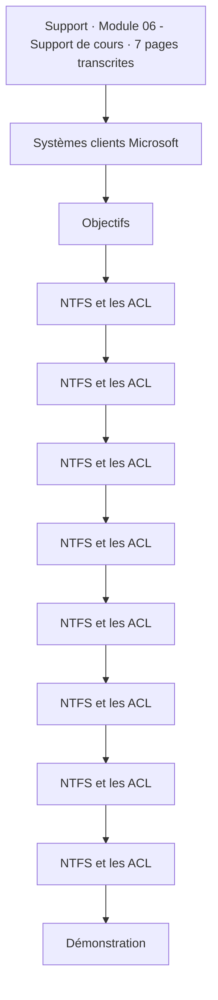

SOURCE DRIVE · TRANSCRIPTION DU SUPPORT

Le contenu des documents du dossier TSSR est transcrit ci-dessous, page par page. Les textes et tableaux sont intégrés à la page Web. Aucun fichier PDF, aucune diapositive entière ni aucune reproduction de page n’est affiché. Seuls des croquis ou visuels isolés et vérifiés peuvent accompagner la transcription. Les versions et les consignes restent celles des supports de formation. Les compléments IA sont conservés dans leur onglet distinct.

## Support · Module 06 - Support de cours · 7 pages transcrites

## Systèmes clients Microsoft

Module 06 – La sécurité NTFS et les ACL

## Objectifs

!!! note "À retenir"
    Définir et découvrir les ACL Connaître le fonctionnement et les bonnes pratiques Configurer les accès Vérifier leur bon fonctionnement

**Visuel externe**

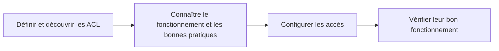

- Définir et découvrir les ACL
- Connaître le fonctionnement et les bonnes pratiques
- Configurer les accès
- Vérifier leur bon fonctionnement

## NTFS et les ACL

**Visuel externe**


Sur un volume formaté en NTFS

- Tous les répertoires et tous les fichiers sont soumis à la sécurité NTFS
- Des autorisations définissent des privilèges d'accès
- L'utilisateur présente son jeton d'accès, qui est filtré par la ressource
- Les autorisations sont stockées dans l'index du système de fichier NTFS
- Consultable, modifiable dans l'onglet sécurité de chaque objet

## NTFS et les ACL

**Visuel externe**

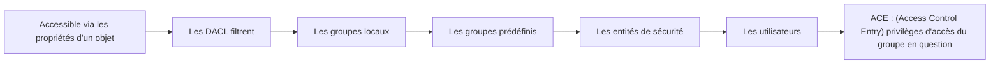

L'onglet sécurité

- Accessible via les propriétés d'un objet
- DACL : (Liste de contrôle d'accès discrétionnaire) contient les utilisateurs et groupes
- Les DACL filtrent
- Les groupes locaux
- Les groupes prédéfinis
- Les entités de sécurité
- Les utilisateurs
- ACE : (Access Control Entry) privilèges d'accès du groupe en question

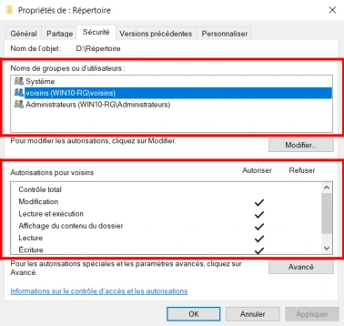

Illustration isolée du support — Module 06 - Support de cours

## NTFS et les ACL

**Visuel externe**

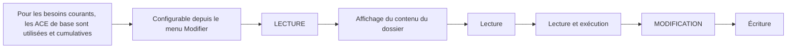

- Pour les besoins courants, les ACE de base sont utilisées et cumulatives
- Configurable depuis le menu Modifier
- LECTURE
- Affichage du contenu du dossier
- Lecture
- Lecture et exécution
- MODIFICATION
- Écriture
- Modification
- CONTRÔLE TOTAL
- Pour des besoins spécifiques, des autorisations spéciales peuvent être configurées
- Accessibles depuis le menu Avancé
- Affinent les privilèges (création de fichiers, suppression de sous-dossiers et fichiers, etc.)

## NTFS et les ACL

- Permissions basées sur des règles explicites
- Un groupe absent de la DACL se verra l'accès refusé (refus implicite)
- Chaque règle peut accorder des privilèges (autoriser) ou les ôter (refuser)
- Plusieurs règles d’accès peuvent s’appliquer à un même utilisateur
- La règle la plus permissive l'emporte
- Le refus explicite l'emporte sur l'autorisation

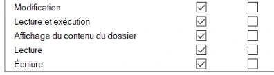

Illustration isolée du support — Module 06 - Support de cours

## NTFS et les ACL

- Les mécanismes d'héritage
- Par défaut, un répertoire propage ses autorisations à ses objets enfants
- Les autorisations héritées apparaissent grisées et ne sont pas modifiables
- Une autorisation d'accès l'emporte sur un refus explicite hérité
- Pour les modifier, il faut :
- Modifier les autorisations sur le dossier parent (voire parfois celles du volume racine)
- "Casser" l'héritage (à effectuer avec précaution)
- Gestion de l'héritage depuis le menu Avancé

## NTFS et les ACL

### Copie et déplacement

| Opération | Même partition / volume | Entre deux partitions / volumes |
| --- | --- | --- |
| Déplacement | Conservation | Héritage |
| Copie | Héritage | Héritage |

## NTFS et les ACL

!!! note "À retenir"
    Une fois les ACL configurées, que faire ?

Une fois les ACL configurées, que faire ?

- Testez les accès avec les utilisateurs !
- Ou/et vérifiez les accès depuis l'onglet Accès effectif du menu Avancé

## NTFS et les ACL

- À manipuler avec précaution !
- Bonnes pratiques pour éviter les effets de bord et les mauvaises surprises
- Privilégier au maximum les groupes dans les DACL
- Utiliser au maximum ACE de base
- Garder en tête les mécanismes d'héritage (attention aux copies, aux déplacements)
- Privilégier l'héritage
- Privilégier le refus implicite
- Toujours tester/vérifier les accès aux ressources
- Attention au double jeton d'accès des administrateurs !

## Démonstration

## TP

## Conclusion

!!! note "À retenir"
    La gestion des ACL est indispensable ACL = DACL + ACE Liste de contrôle d’accès Liste de contrôle d’accès discrétionnaire Entrées de contrôle d’accès Tester les accès Respecter les bonnes pratiques Microsoft Référence du document : 1Qu0t6HJiZ5JIZtGpNhZVpWGcxs8ldDzs · SHA-256 b0954b2cfcc92d40…

- La gestion des ACL est indispensable
- ACL = DACL + ACE
- Liste de contrôle d’accès
- Liste de contrôle d’accès discrétionnaire
- Entrées de contrôle d’accès
- Tester les accès
- Respecter les bonnes pratiques Microsoft

Référence du document : 1Qu0t6HJiZ5JIZtGpNhZVpWGcxs8ldDzs · SHA-256 b0954b2cfcc92d40…

## Énoncé · Enoncé du TP - Les ACL · 3 pages transcrites

## Systèmes Clients Microsoft Les ACL

### TP du Module 06 – La sécurité NTFS et les ACL

!!! note "À retenir"
    Ce TP va vous permettre de manipuler les autorisations d’accès aux dossiers disponibles sur votre système.

Ce TP va vous permettre de manipuler les autorisations d’accès aux dossiers disponibles sur votre système.

Durée estimée

1 heure

## Énoncé

!!! note "À retenir"
    Lisez l'ensemble de ce TP avant de vous lancer dans la pratique

Lisez l'ensemble de ce TP avant de vous lancer dans la pratique

### Sur votre VM Win10-XX, configurez les autorisations d'accès sur les répertoires suivants :

!!! note "À retenir"
    Sur le volume DATA, créer le répertoire Echange Quelles sont les autorisations positionnées par défaut sur le répertoire Echange ?

- Sur le volume DATA, créer le répertoire Echange
- Quelles sont les autorisations positionnées par défaut sur le répertoire Echange ?
- Peuplez ce répertoire de fichiers, de dossiers. Héritent-ils des autorisations du dossier parent ?

- Configurez les autorisations d'accès au répertoire Echange :

o Vos collègues pourront modifier tous les objets et sous-objets de ce répertoire o Les administrateurs auront le contrôle total o Vous accorderez les droits en lecture sur le répertoire aux utilisateurs de votre poste o Testez le bon fonctionnement des autorisations

- Sur le volume TOOLS, créer les répertoires logiciels et manuels d'utilisation :

o Yann et François accéderont en modifications à ces répertoires. o Les utilisateurs standard auront un accès en lecture et les administrateurs posséderont un contrôle total o Testez le bon fonctionnement des autorisations

### Sur la VM Discovery en PowerShell

!!! note "À retenir"
    Afficher la liste des droits d'accès au dossier 2022 du lecteur M: Quelle cmdlet permet la modification des ACL sur un dossier ?

- Afficher la liste des droits d'accès au dossier 2022 du lecteur M:

- Quelle cmdlet permet la modification des ACL sur un dossier ?

## Solution

!!! note "À retenir"
    Une solution est proposée pour ce TP sous la forme d'un PDF commenté, disponible dans les ressources à télécharger.

Une solution est proposée pour ce TP sous la forme d'un PDF commenté, disponible dans les ressources à télécharger.

Référence du document : 1aiD08x7K_WK6bcTRZoJKrA30Yf9_2fOt · SHA-256 bbc9c02eb9231db0…

## Notes du Drive · Module 6.txt · document texte

Notes textuelles présentes dans le Drive. Aucun support de cours illustré distinct n’est fourni pour ce document ; aucune illustration n’a été inventée ou attribuée au support.

## Quiz Kahoot – Module 6 : La sécurité NTFS et les ACL

## Niveau Facile (1 à 7)

### 1. Sur quel système de fichiers les ACL sont-elles disponibles ?

A. FAT32 B. NTFS ✅ C. exFAT D. FAT16

### 2. Que signifie ACL ?

A. Access Computer List B. Access Control List ✅ C. Active Control Link D. Access Configuration Level

### 3. Que signifie DACL ?

A. Dynamic Access Control List B. Discretionary Access Control List ✅ C. Direct Access Control List D. Data Access Control List

### 4. Que représente une ACE ?

A. Une partition B. Une entrée de contrôle d’accès ✅ C. Un groupe d’utilisateurs D. Un système de fichiers

### 5. Quel niveau d’autorisation permet toutes les actions sur un fichier ou un dossier ?

A. Lecture B. Modification C. Contrôle total ✅ D. Exécution

### 6. Où configure-t-on les autorisations NTFS de base ?

A. Onglet Général B. Bouton Modifier ✅ C. Invite de commandes D. Gestionnaire de périphériques

### 7. Où trouve-t-on les autorisations spéciales ?

A. Modifier B. Avancé ✅ C. Partage D. Général

## Niveau Moyen (8 à 14)

### 8. Si un utilisateur n’est pas présent dans la DACL, que se passe-t-il ?

A. Il obtient Lecture B. Il obtient Modification C. Son accès est refusé implicitement ✅ D. Il obtient Contrôle total

### 9. Une ACE peut :

A. Seulement autoriser B. Seulement refuser C. Autoriser ou refuser ✅ D. Seulement modifier

### 10. Si plusieurs autorisations “Autoriser” s’appliquent à un utilisateur, laquelle est retenue ?

A. La plus restrictive B. La première C. La plus permissive ✅ D. Aucune

### 11. Quelle règle est prioritaire ?

A. L’autorisation explicite B. Le refus explicite ✅ C. Le refus implicite D. L’autorisation héritée

### 12. Par défaut, un dossier transmet ses autorisations à :

A. Son propriétaire uniquement B. Ses fichiers et sous-dossiers ✅ C. Son disque uniquement D. Aucun élément

### 13. Lors d’un déplacement dans le même volume, les autorisations NTFS sont :

A. Supprimées B. Conservées ✅ C. Réinitialisées D. Converties

### 14. Lors d’une copie vers un autre volume, les autorisations :

A. Sont conservées B. Héritent du dossier de destination ✅ C. Deviennent publiques D. Sont supprimées

## Niveau Difficile (15 à 16)

### 15. Quelle cmdlet PowerShell permet d’afficher les ACL d’un dossier ?

A. Get-Permission B. Get-Acl ✅ C. Show-Acl D. Read-Acl

### 16. Quelle cmdlet PowerShell permet de modifier les ACL ?

A. Update-Acl B. Set-Acl ✅ C. Edit-Acl D. New-Acl

## Vrai / Faux

### 17. Vrai ou Faux

Microsoft recommande de privilégier les groupes plutôt que les utilisateurs dans les DACL.

✅ Vrai

### 18. Vrai ou Faux

Les autorisations héritées peuvent être modifiées directement sans action particulière.

❌ Faux

### 19. Vrai ou Faux

Après avoir configuré les ACL, il est recommandé de tester les accès ou de consulter l’onglet Accès effectif.

✅ Vrai

### 20. Vrai ou Faux

Le double jeton d’accès des administrateurs (UAC) peut influencer les autorisations effectives.

✅ Vrai

Référence du document : 1SRkAloeUhQqznCjEZYEO2JNPNsJkBR59 · SHA-256 4856c60a24c0f3ef…

## Notes du Drive · module 5 et 6.txt · document texte

Notes textuelles présentes dans le Drive. Aucun support de cours illustré distinct n’est fourni pour ce document ; aucune illustration n’a été inventée ou attribuée au support.

## Inexistant

Le fichier de notes est vide dans le Drive. Aucun contenu n’a été inventé.

Référence du document : 1Oi75J3l2QDn53DJw1GUoxHxkXTShq3T7 · SHA-256 e3b0c44298fc1c14…

## Correction · Solution du TP - Les ACL · 11 pages transcrites

Correction originale : à consulter après avoir tenté l’exercice.

## Les ACL

### TP du Module 06 – La sécurité NTFS et les ACL

## Proposition de solution

Sur votre VM Win10-XX, configurez les autorisations d'accès sur les répertoires suivants :

- Sur le volume DATA, créer le répertoire Echange
- Quelles sont les autorisations positionnées par défaut sur le répertoire Echange ?

Depuis l'explorateur Windows, explorer le lecteur d:\DATA

Clic droit > Nouveau > Dossier

Nommez-le Echange

Pour connaître les autorisations NTFS positionnées par défaut sur ce répertoire :

Clic droit sur Echange > Propriétés

Onglet Sécurité

L'entité de sécurité Utilisateurs authentifiés possède des autorisations en Modification

L'entité de sécurité Système possède des autorisations en Contrôle total

Le groupe prédéfini Administrateurs possède des autorisations en Contrôle total

Le groupe prédéfini Utilisateurs possède des autorisations en Lecture

Ces autorisations proviennent de l'héritage du volume D: (un indice du fait qu'apparaissent des coches grisées).

- Peuplez ce répertoire de fichiers, de dossiers. Héritent-ils des autorisations du dossier parent ?

Dans le dossier Echange

Clic droit > Nouveau > Document texte

Sur Nouveau document texte

Clic droit > Propriétés

Onglet Sécurité

Oui, les nouveaux fichiers héritent des autorisations du dossier parent Echange (qui lui-même hérite des autorisations du lecteur D:).

Pour s'en assurer, il suffit d'observer la présence des coches grisées. Pour plus de détail, cliquez sur le bouton Avancé.

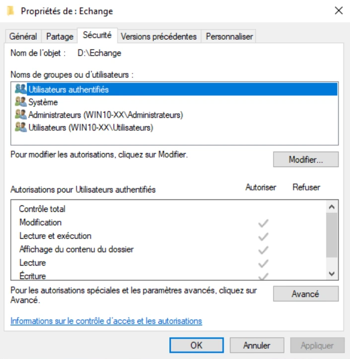

Illustration isolée du support — Solution du TP - Les ACL

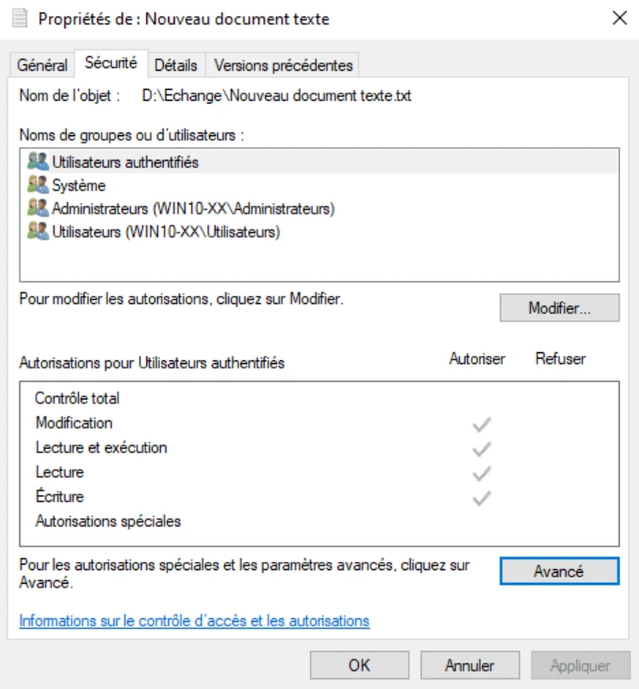

Illustration isolée du support — Solution du TP - Les ACL

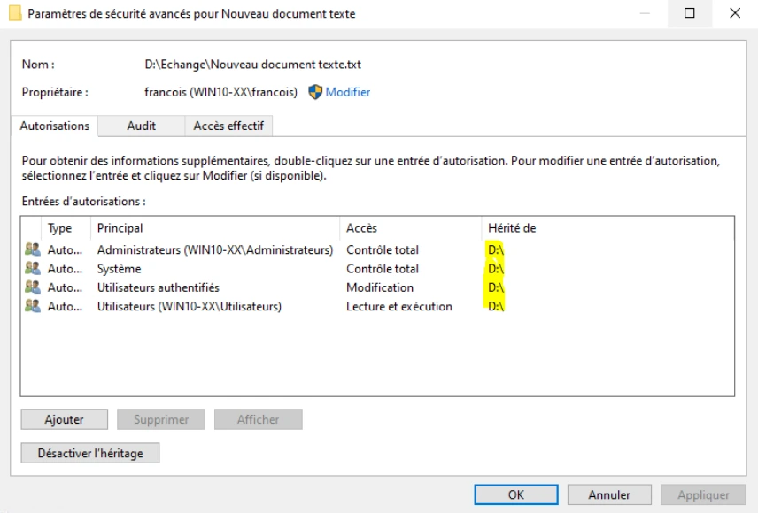

Illustration isolée du support — Solution du TP - Les ACL

- Configurez les autorisations d'accès au répertoire Echange

o Vos collègues pourront modifier tous les objets et sous-objets de ce répertoire

o Les administrateurs auront le contrôle total

o Vous accorderez les droits en lecture sur le répertoire aux utilisateurs de votre

poste

o Testez le bon fonctionnement des autorisations

Ici plusieurs possibilités, en voici une en modifiant les héritages

Lecteur D:

Clic droit > Propriétés

Onglet Sécurité

Modifier

Sélectionnez Utilisateurs authentifiés

Supprimer

Par bonne pratique Microsoft, laissez Système et Administrateurs en Contrôle total

Laissez aussi Utilisateurs en Lecture car c'est ce qui est demandé dans la consigne

OK > Appliquer > OK

Dossier Echange

Clic droit > Propriétés

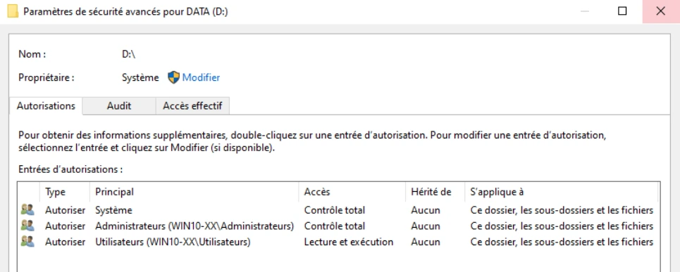

Illustration isolée du support — Solution du TP - Les ACL

Onglet Sécurité

On observe que l'entité de sécurité Utilisateurs authentifiés n'est plus présente, par héritage.

Modifier

Ajouter…

Entrez les noms des objets à sélectionner : L_Collegues

Entrée

Cocher Modification (vous observerez que Ecriture va se cocher automatiquement)

Appliquer > OK

Les tests d'accès (important)

Première solution (peut-être la plus probante) : faire des tests "grandeur réelle"

Fermez votre session actuelle (logoff) puis ouvrez une session locale avec l'utilisateur Romain.

Tester l'accès au dossier Echange (lecture possible car Romain (utilisateur) possède les autorisations en Lecture).

Tester la création d'un nouveau fichier dans le dossier Echange (impossible car Romain n'a

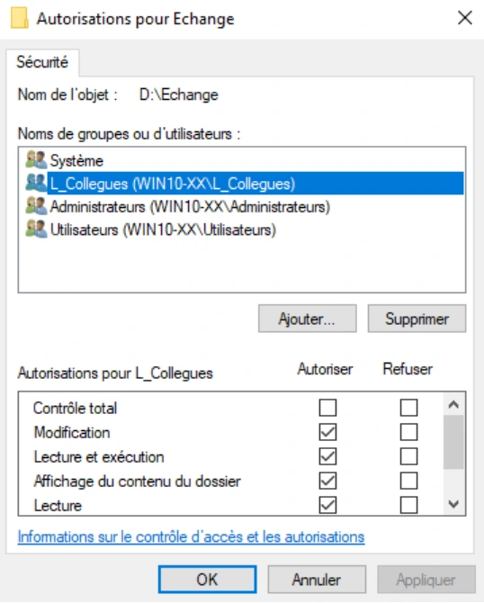

Illustration isolée du support — Solution du TP - Les ACL

pas les autorisations en Modification, il fait partie du groupe prédéfini Utilisateurs).

Fermez la session de Romain et ouvrez une session avec un de vos utilisateurs supplémentaires.

Tester l'accès au dossier Echange (lecture possible car votre utilisateur supplémentaire (L_Collegues) possède les autorisations en Lecture).

Tester la création d'un nouveau fichier dans le dossier Echange (possible car votre utilisateur possède les autorisations en Modification, par l'intermédiaire du groupe L_Collegues).

Tester l'accès à l'onglet Sécurité du dossier Echange pour tenter de modifier les ACL (Impossible car l'utilisateur supplémentaire, qui fait partie du groupe L_Collegues, ne possède pas les autorisations en Contrôle Total, le bouton Modifier est protégé par l'UAC).

Fermer la session actuelle et ouvrez une session locale avec l'utilisateur francois.

Tester l'accès au dossier Echange (lecture possible car francois (Administrateurs) possède les autorisations en Lecture).

Tester la création d'un nouveau fichier dans le dossier Echange (possible car francois possède les autorisations en Modification, par l'intermédiaire du groupe prédéfini Administrateurs).

Tester l'accès à l'onglet Sécurité du dossier Echange pour tenter de modifier les ACL (possible car francois, qui fait partie du groupe prédéfini Administrateurs possède les autorisations en Contrôle Total).

Deuxième possibilité (plus rapide) par l'intermédiaire de l'onglet Accès effectif

Ouvrez une session avec un utilisateur membre du groupe Administrateurs

Affichez les propriétés du dossier Echange (clic droit > Propriétés)

Onglet Sécurité

Avancé

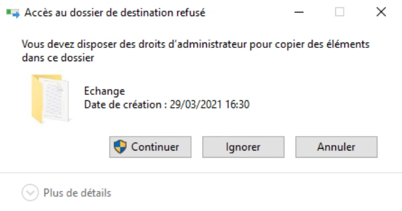

Illustration isolée du support — Solution du TP - Les ACL

Onglet Accès effectif

Sélectionner un utilisateur

Tests d'autorisation d'accès avec un utilisateur membre du groupe utilisateurs

Entrez le nom de l'objet à sélectionner : Romain

Entrée

Afficher l'accès effectif

On observe que romain n'a que des accès en Lecture (pas de création, d'écriture et de suppression possible).

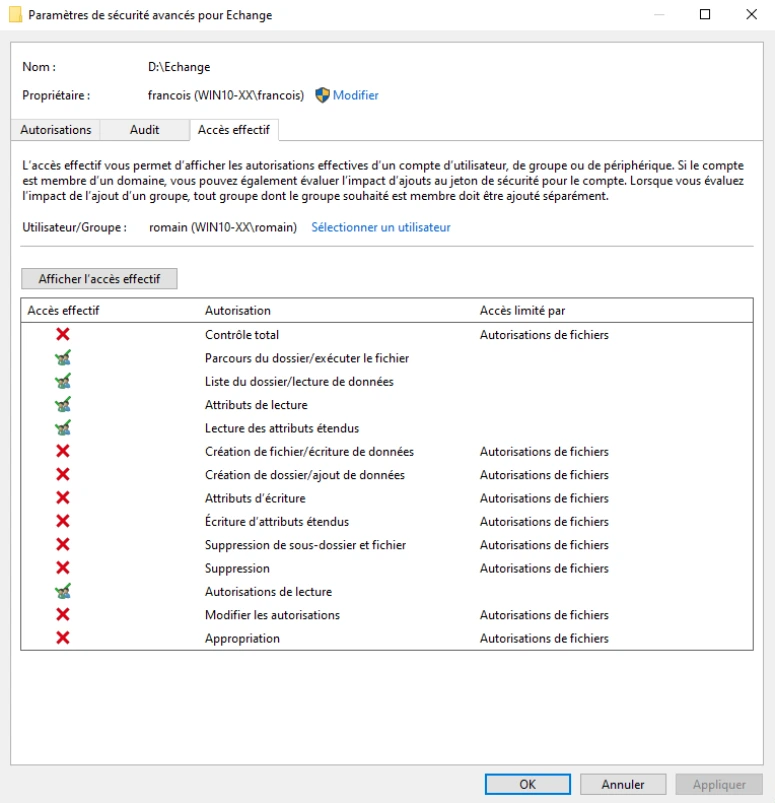

Illustration isolée du support — Solution du TP - Les ACL

Tests d'autorisation d'accès avec un utilisateur membre du groupe L_Collegues

Sélectionner un utilisateur

Entrez le nom de l'objet à sélectionner : l'un de vos utilisateurs supplémentaires

Entrée

Afficher l'accès effectif

On observe qu'Alix possède un niveau d'autorisation plus élevé que romain car le groupe L_Collegues possède des accès en Modification

Tests d'autorisation d'accès avec un utilisateur membre du groupe Administrateurs

Sélectionner un utilisateur

Entrez le nom de l'objet à sélectionner : francois

Entrée

Afficher l'accès effectif

De par son appartenance au groupe prédéfini Administrateurs, francois possède le niveau d'accès Contrôle Total

- Sur le volume TOOLS, créer les répertoires logiciels et manuels d'utilisation

o Yann et François accéderont en modifications à ces répertoires.

o Les utilisateurs standard auront un accès en lecture et les administrateurs

posséderont un contrôle total

o Testez le bon fonctionnement des autorisations

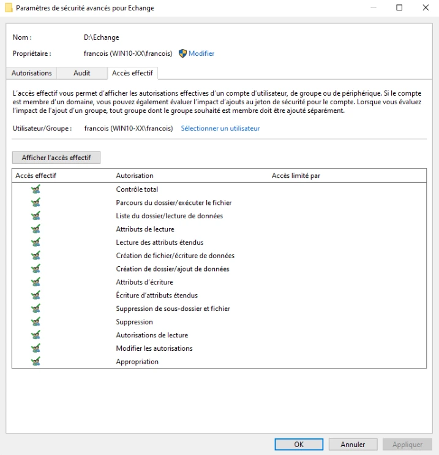

Illustration isolée du support — Solution du TP - Les ACL

Ici plusieurs possibilités, en voici une en modifiant les héritages

Lecteur e:

Clic droit > Propriétés

Onglet Sécurité

Modifier

Sélectionnez Utilisateurs authentifiés

Supprimer

Par bonne pratique Microsoft, laissez Système et Administrateurs en Contrôle total

Laissez aussi Utilisateurs en Lecture car c'est ce qui est demandé dans la consigne.

OK > Appliquer > OK

Créer les dossiers logiciels et manuels d'utilisation dans le volume TOOLS (clic droit dans le volume TOOLS > Nouveau > Dossier).

Par héritage, ces dossiers permettent au Système et aux Administrateurs d'en avoir le Contrôle total. Les membres du groupe Utilisateurs, n'ont qu'un accès en Lecture

Occupons-nous maintenant des autorisations d'accès de Yann et François

Les DACL ne doivent contenir que des groupes. C'est la bonne pratique.

Yann et François sont tous les deux membres du groupe L_Informatiques

Il suffit donc de rajouter le groupe L_Informatiques dans les DACL des dossiers logiciels et manuels d'utilisation

Sur les dossiers logiciels et manuels d'utilisation

Clic droit > Propriétés

Onglet Sécurité

On observe que l'entité de sécurité Utilisateurs authentifiés n'est plus présente, par héritage.

Modifier

Ajouter…

Entrez les noms des objets à sélectionner : L_Informatiques

Entrée

Cocher Modification (vous observerez que Ecriture va se cocher automatiquement).

Toujours faire les tests d'autorisation d'accès "grandeur réelle" ou bien en passant par l'onglet Accès Effectif

Sur la VM Discovery en PowerShell

- Afficher la liste des droits d'accès au dossier 2022 du lecteur M:

```
Get-Acl m:\2022
```

- Quelle cmdlet permet la modification des ACL sur un dossier ?

```
Set-Acl
```

Référence du document : 1410fdahllumEPrWp3O-vvc38KyzkoCJz · SHA-256 3308a9a099283004…

## Fiche de synthèse

Les lignes reprennent les titres du cours et la première phrase de chaque partie.

| Partie | Repère du cours |
| --- | --- |
| Objectifs | Définir et découvrir les ACL Connaître le fonctionnement et les bonnes pratiques Configurer les accès Vérifier leur bon fonctionnement |
| NTFS et les ACL | Sur un volume formaté en NTFS Tous les répertoires et tous les fichiers sont soumis à la sécurité NTFS Des autorisations définissent des privilèges d'accès L'utilisateur présent… |
| NTFS et les ACL | L'onglet sécurité Accessible via les propriétés d'un objet DACL : (Liste de contrôle d'accès discrétionnaire) contient les utilisateurs et groupes Les DACL filtrent Les groupes… |
| NTFS et les ACL | Pour les besoins courants, les ACE de base sont utilisées et cumulatives Configurable depuis le menu Modifier LECTURE Affichage du contenu du dossier Lecture Lecture et exécutio… |
| NTFS et les ACL | Permissions basées sur des règles explicites Un groupe absent de la DACL se verra l'accès refusé (refus implicite) Chaque règle peut accorder des privilèges (autoriser) ou les ô… |
| NTFS et les ACL | Les mécanismes d'héritage Par défaut, un répertoire propage ses autorisations à ses objets enfants Les autorisations héritées apparaissent grisées et ne sont pas modifiables Une… |
| NTFS et les ACL | Une fois les ACL configurées, que faire ? |
| NTFS et les ACL | Bonnes pratiques pour éviter les effets de bord et les mauvaises surprises Privilégier au maximum les groupes dans les DACL Utiliser au maximum ACE de base Garder en tête les mé… |
| Conclusion | La gestion des ACL est indispensable ACL = DACL + ACE Liste de contrôle d’accès Liste de contrôle d’accès discrétionnaire Entrées de contrôle d’accès Tester les accès Respecter… |
| Énoncé | Lisez l'ensemble de ce TP avant de vous lancer dans la pratique |
| Solution | Une solution est proposée pour ce TP sous la forme d'un PDF commenté, disponible dans les ressources à télécharger. |
| Notes du Drive · Module 6.txt · document texte | Notes textuelles présentes dans le Drive. |
| Notes du Drive · module 5 et 6.txt · document texte | Notes textuelles présentes dans le Drive. |
| Inexistant | Le fichier de notes est vide dans le Drive. |
| Correction · Solution du TP - Les ACL · 11 pages transcrites | Correction originale : à consulter après avoir tenté l’exercice. |
| Proposition de solution | Sur votre VM Win10-XX, configurez les autorisations d'accès sur les répertoires suivants : Sur le volume DATA, créer le répertoire Echange Quelles sont les autorisations positio… |
