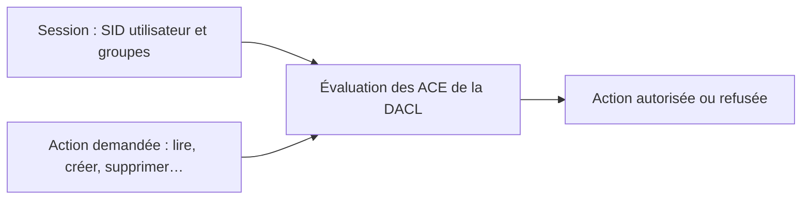

# Module 06 — La sécurité NTFS et les ACL

**Séquence :** Systèmes clients Microsoft  
**Fil conducteur :** traduire un besoin d’accès en permissions, puis prouver le résultat avec les comptes du scénario.

## Objectifs

- Définir ACL, DACL, ACE et jeton d’accès.
- Choisir les autorisations de base et reconnaître les permissions spéciales.
- Expliquer l’héritage, la copie, le déplacement et les limites des raccourcis sur les refus.
- Configurer Echange et les dossiers du volume TOOLS, puis tester les accès effectifs.

## 1. Comment une ressource décide-t-elle de l’accès ?

Sur un volume **NTFS**, les dossiers et fichiers possèdent des informations de sécurité. Le support les situe dans l’index du système de fichiers et les rend consultables dans **Propriétés → Sécurité**. Le système compare les identités du jeton d’accès de la session aux règles de l’objet.

| Notion | Rôle dans le contrôle |
|---|---|
| SID | Identifie un utilisateur ou un groupe. |
| Jeton d’accès | Contient les identités pertinentes de la session, notamment utilisateur et groupes. |
| DACL | Liste de contrôle d’accès discrétionnaire attachée à l’objet. |
| ACE | Entrée de cette liste : identité concernée et droits autorisés ou refusés. |

Les règles peuvent cibler groupes locaux, groupes prédéfinis, entités intégrées de sécurité et utilisateurs. Le support conseille de privilégier les **groupes**, afin de gérer les appartenances plutôt que multiplier les exceptions individuelles.

**Illustration IA / externe au cours — le contrôle porte sur une action précise.**



## 2. Autorisations de base et autorisations spéciales

Le bouton **Modifier** propose les permissions de base. Le support les regroupe de la manière suivante ; les cases peuvent se cumuler et certaines en entraînent d’autres.

| Famille du support | Permissions présentées |
|---|---|
| Lecture | Affichage du contenu du dossier ; Lecture ; Lecture et exécution. |
| Modification | Écriture ; Modification. |
| Contrôle total | Ensemble des droits du niveau Contrôle total. |

Pour un besoin particulier, **Avancé** donne accès aux permissions spéciales : créer des fichiers, supprimer des sous-dossiers et fichiers, etc. Accorder Modification à des collègues ne signifie pas leur confier la gestion des permissions de sécurité.

### Comprendre les formulations du support

Le cours indique que les autorisations s’additionnent, qu’un groupe absent ne reçoit pas de droit par cette seule identité, et qu’un refus explicite peut bloquer un accès. Ces phrases doivent se lire avec le jeton complet et l’ordre des ACE, pas avec le seul nom de l’utilisateur.

!!! info "Clarification externe — refus implicite et ordre des ACE"
    L’absence du SID personnel dans la DACL ne prouve pas le refus : une ACE applicable à un de ses groupes peut accorder les droits. Windows parcourt les ACE dans l’ordre pour les droits demandés ; si aucun ensemble d’autorisations ne satisfait la demande, l’accès est refusé implicitement. [Fonctionnement du contrôle d’accès Microsoft](https://learn.microsoft.com/en-us/windows/win32/secauthz/how-dacls-control-access-to-an-object).

!!! warning "Ne pas apprendre « le refus gagne toujours » sans contexte"
    Le support rappelle lui-même qu’une autorisation explicite peut l’emporter sur un refus hérité. Il faut examiner les règles explicites et héritées ainsi que leur ordre, puis vérifier le résultat. Les phrases plus absolues des notes de quiz sont conservées dans le document original et clarifiées ici.

## 3. Héritage, copie et déplacement

Par défaut, un dossier propage ses autorisations à ses enfants. Les cases héritées sont grisées : on ne les modifie pas directement sur l’enfant tant que l’héritage s’applique. Deux voies sont présentées : corriger les permissions du parent, éventuellement du volume, ou désactiver l’héritage depuis **Avancé**, avec précaution.

| Opération dans le contexte du support | Même partition / volume | Entre deux partitions / volumes |
|---|---|---|
| Déplacement | Conservation des permissions. | Héritage à destination. |
| Copie | Héritage à destination. | Héritage à destination. |

Cette grille explique pourquoi déplacer ou copier un fichier peut produire des accès différents. Après l’opération, contrôler l’objet final plutôt que supposer que ses permissions sont restées identiques.

## 4. TP : préparer une matrice d’accès

Le TP dure environ **1 heure**. Il reprend les comptes et groupes du module 05. Avant toute manipulation, relever les volumes DATA et TOOLS et les appartenances effectives des comptes.

| Ressource | Identité | Besoin |
|---|---|---|
| `DATA\Echange` | `L_Collegues` | Modification de l’objet et de ses sous-objets. |
| `DATA\Echange` | Administrateurs | Contrôle total. |
| `DATA\Echange` | Utilisateurs | Lecture. |
| `TOOLS\logiciels` et `TOOLS\manuels d’utilisation` | Yann et François via `L_Informatiques` | Modification. |
| Dossiers TOOLS | Utilisateurs | Lecture. |
| Dossiers TOOLS | Administrateurs | Contrôle total. |

### A. Observer les permissions par défaut

1. Créer **Echange** sur DATA, dans le scénario `D:`.
2. Ouvrir **Propriétés → Sécurité**.
3. La correction montre Utilisateurs authentifiés en Modification, Système et Administrateurs en Contrôle total, Utilisateurs en Lecture.
4. Créer un fichier et un sous-dossier, puis examiner leur sécurité : les cases grisées montrent l’héritage depuis le dossier, lui-même héritier du volume.

### B. Appliquer le besoin sur Echange

La correction choisit une solution en modifiant l’héritage **au niveau du lecteur D:** : retirer la permission de Modification d’Utilisateurs authentifiés, conserver Système et Administrateurs en Contrôle total et Utilisateurs en Lecture. Sur Echange, ajouter ensuite `L_Collegues` en Modification. La case Écriture se coche avec les permissions associées.

!!! note "Portée du choix présenté"
    La correction annonce plusieurs possibilités et en montre une qui modifie le volume parent. Le choix est conservé comme scénario du TP. Avant de reproduire cette méthode, identifier les autres dossiers héritiers concernés ; ne pas confondre un réglage d’Echange avec une modification sans effet sur les autres enfants du volume.

### C. Prouver les accès

| Session testée | Lire Echange | Créer un fichier | Modifier les ACL |
|---|---|---|---|
| Romain, groupe Utilisateurs | Oui. | Non. | Non dans ce scénario. |
| Alix ou Pauline, `L_Collegues` | Oui. | Oui. | Non par la seule permission Modification. |
| François, Administrateurs | Oui. | Oui. | Contrôle total, avec élévation si requise. |

Fermer la session entre les tests. Une autre vérification s’effectue depuis **Sécurité → Avancé → Accès effectif** : choisir Romain, un membre de `L_Collegues`, puis François, et afficher les permissions correspondantes. Le support attire l’attention sur le double jeton des administrateurs : tester avec une session et une élévation cohérentes avec l’action.

### D. Configurer TOOLS

Sur le lecteur `E:` de la correction, appliquer le même principe aux permissions héritées de base, puis créer **logiciels** et **manuels d’utilisation**. Ajouter **`L_Informatiques`**, dont Yann et François sont membres, aux DACL des deux dossiers avec Modification. Garder les contrôles de lecture des utilisateurs et de Contrôle total des administrateurs, puis effectuer les tests réels ou les contrôles d’accès effectif.

### E. Lire les ACL avec PowerShell sur Discovery

```powershell
Get-Acl M:\2022
```

La cmdlet demandée pour **appliquer des ACL** est `Set-Acl`. L’énoncé n’impose pas ici de construire une nouvelle ACL complète : distinguer l’identification de l’outil et une procédure de modification effectivement vérifiée.

## 5. Bonnes pratiques du module

- Attribuer les accès par groupes et privilégier les permissions de base.
- Conserver l’héritage quand il correspond au besoin.
- Favoriser le refus implicite plutôt que multiplier les refus explicites.
- Vérifier les effets des copies et déplacements.
- Tester l’action réelle avec le compte concerné et consulter les accès effectifs.

## 6. Mini-quiz — 5 questions

1. Quelle différence entre DACL et ACE ?
2. Un utilisateur non nommé directement dans la DACL est-il forcément refusé ?
3. Que représentent les cases grisées de permissions ?
4. Pourquoi Modification ne suffit-elle pas à gérer les ACL ?
5. Que prévoit le tableau du support pour une copie dans le même volume ?

??? success "Réponses commentées"
    1. La DACL est la liste ; une ACE est une règle de cette liste.
    2. Non : examiner aussi ses groupes et les droits demandés.
    3. Des autorisations héritées du parent.
    4. La modification des fichiers et la gestion de leur sécurité sont des droits distincts.
    5. Un héritage des permissions à destination.

## Pour pratiquer et réviser

- [TP — présentation](../../tp/systemes-clients/module-06/index.md)
- [Énoncé complet](../../tp/systemes-clients/module-06/enonces.md) et [correction](../../tp/systemes-clients/module-06/corrections.md)
- [Fiche de révision](../../revision/systemes-clients/module-06-la-securite-ntfs-et-les-acl.md)
- [Kahoot existant](../../kahoot/02-systemes-clients-microsoft-06-la-securite-ntfs-et-les-acl.md)
- [Retour à la formation](index.md)

## Sources et choix éditoriaux

Support M06, énoncé, correction et notes `Module 6.txt` ont été consultés en lecture seule dans le Drive. Le fichier partagé `module 5 et 6.txt` est vide : **Inexistant**. Les 20 questions des notes restent dans leur transcription ; le mini-quiz ci-dessus est distinct du Kahoot existant. Les tableaux de synthèse et le schéma sont pédagogiques, les clarifications externes sont indiquées et les formulations sources demeurent dans **Cours Original**.
