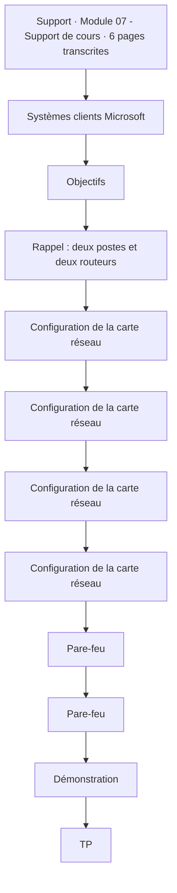
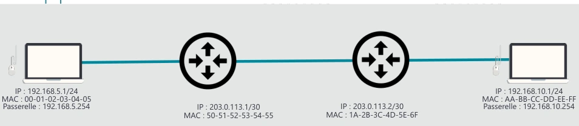
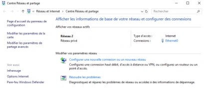
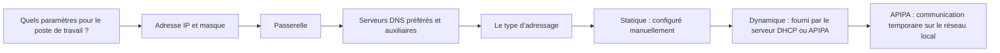
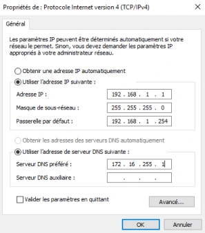
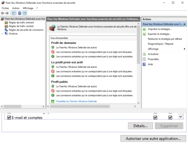

# Module 07 — La gestion du réseau et du pare-feu

[Travaux pratiques](../../tp/systemes-clients/module-07/index.md)

Les parties ci-dessous reprennent le cours original, dans le même ordre. Les encadrés et les schémas répètent ses formulations.

## Parcours de lecture

1. Support · Module 07 - Support de cours · 6 pages transcrites
2. Systèmes clients Microsoft
3. Objectifs
4. Rappel : deux postes et deux routeurs
5. Configuration de la carte réseau
6. Configuration de la carte réseau
7. Configuration de la carte réseau
8. Configuration de la carte réseau
9. Pare-feu
10. Pare-feu
11. Démonstration
12. TP
13. Conclusion
14. Systèmes Clients Microsoft Gestion du réseau
15. Énoncé
16. Solution
17. Gestion du réseau
18. Proposition de solution

**Visuel externe**

SOURCE DRIVE · TRANSCRIPTION DU SUPPORT

Le contenu des documents du dossier TSSR est transcrit ci-dessous, page par page. Les textes et tableaux sont intégrés à la page Web. Aucun fichier PDF, aucune diapositive entière ni aucune reproduction de page n’est affiché. Seuls des croquis ou visuels isolés et vérifiés peuvent accompagner la transcription. Les versions et les consignes restent celles des supports de formation. Les compléments IA sont conservés dans leur onglet distinct.

## Support · Module 07 - Support de cours · 6 pages transcrites

## Systèmes clients Microsoft

!!! note "À retenir"
    Module 07 – La gestion du réseau et du pare-feu

Module 07 – La gestion du réseau et du pare-feu

## Objectifs

!!! note "À retenir"
    Rappel sur les bases des réseaux Configurer la carte et l’emplacement réseau Manipuler le pare-feu Windows

**Visuel externe**

- Rappel sur les bases des réseaux
- Configurer la carte et l’emplacement réseau
- Manipuler le pare-feu Windows

## Rappel : deux postes et deux routeurs

| Équipement visible | Adresse IP | Adresse MAC | Passerelle |
| --- | --- | --- | --- |
| Poste A | 192.168.5.1/24 | 00-01-02-03-04-05 | 192.168.5.254 |
| Routeur 1, liaison interrouteurs | 203.0.113.1/30 | 50-51-52-53-54-55 |  |
| Routeur 2, liaison interrouteurs | 203.0.113.2/30 | 1A-2B-3C-4D-5E-6F |  |
| Poste B | 192.168.10.1/24 | AA-BB-CC-DD-EE-FF | 192.168.10.254 |

## Configuration de la carte réseau

**Visuel externe**

```mermaid
flowchart LR
    N1["Accessible depuis l'icône réseau de la barre de notification"]
    N2["Paramètre réseau et Internet  Centre réseau et partage"]
    N3["Accessible depuis le panneau de configuration"]
    N4["Réseau et Internet  Centre réseau et partage"]
    N5["Donne des indications sur :"]
    N6["La connectivité du poste"]
    N7["Les connexions réseau détectées"]
    N8["Les profils réseau et les emplacements associés"]
    N1 --> N2
    N2 --> N3
    N3 --> N4
    N4 --> N5
    N5 --> N6
    N6 --> N7
    N7 --> N8
```

Le centre réseau et partage

- Accessible depuis l'icône réseau de la barre de notification
- Paramètre réseau et Internet > Centre réseau et partage
- Accessible depuis le panneau de configuration
- Réseau et Internet > Centre réseau et partage
- Donne des indications sur :
- La connectivité du poste
- Les connexions réseau détectées
- Les profils réseau et les emplacements associés
- Donne accès aux paramétrages :
- Des fonctionnalités de partage : découverte, partages, dossiers publics…
- Des cartes réseau (accès direct en lançant ncpa.cpl)
- Des nouvelles connexions

Illustration isolée du support — Module 07 - Support de cours

Illustration isolée du support — Module 07 - Support de cours

## Configuration de la carte réseau

**Visuel externe**

Une carte réseau est associée à un emplacement réseau

- Détermine le comportement du pare-feu
- Réseau privé sur un poste autonome
- Réseau avec domaine non modifiable si le poste est joint à un domaine
- Réseau public si aucune passerelle n’a été définie, si le domaine n’a pas été détecté pour les postes en domaine, si vous refusez de rendre votre ordinateur visible sur le réseau…

## Configuration de la carte réseau

!!! note "À retenir"
    Quels paramètres pour le poste de travail ?

**Visuel externe**

- Quels paramètres pour le poste de travail ?
- Adresse IP et masque
- Passerelle
- Serveurs DNS préférés et auxiliaires
- Le type d’adressage
- Statique : configuré manuellement
- Dynamique : fourni par le serveur DHCP ou APIPA
- APIPA : communication temporaire sur le réseau local
- Obtenir automatiquement une adresse grâce au système d'exploitation Windows si aucun serveur DHCP n'est joignable
- Réseau 169.254.0.0/16
- Communication sur le réseau local possible

Illustration isolée du support — Module 07 - Support de cours

## Configuration de la carte réseau

- Outils graphiques
- Zone de notification (état de la connexion)
- Composant Connexions réseau
- Assistant Résoudre les problèmes : orienté utilisateur…
- Rappel sur les outils invite de commande : les plus précis et efficaces
- ipconfig : afficher la configuration et interagir avec la pile réseau (DNS, DHCP)
- ping : tester la connectivité (bloqué par défaut par le pare-feu Windows !)
- tracert : tester la route empruntée par les paquets TPC/IP
- nslookup : diagnostic de la résolution de noms d’hôte

## Pare-feu

- Pourquoi ?
- Délimiter quels flux réseau sont autorisés en entrée et en sortie
- Protéger le poste contre les accès non autorisés (utilisateurs, programmes)
- Élément de la stratégie globale de sécurité de l’entreprise
- Caractéristiques
- Activé par défaut, bloque certains flux en entrée et les autorise tous en sortie
- Se compose de règles prédéfinies activées (ou facilement activables)
- S'adapte à la situation du poste (emplacements réseau)
- Administrable de manière centralisée (stratégies, export)

## Pare-feu

- 3 niveaux de configuration
- Utilisateur depuis le composant Vérifier l'état du Pare-feu pour l’activation / la désactivation
- Programme avec la fonction Autoriser une application via le pare-feu Windows : fournit un ensemble de règles génériques activées automatiquement et paramétrables
- Avancé avec la console Pare-feu Windows Defender avec fonctions avancées de sécurité : donne accès au paramétrage détaillé de l’ensemble des règles, permet également d’afficher une vue globale des règles activées
- Accessible avec la commande firewall.cpl

## Démonstration

!!! note "À retenir"
    Illustration isolée du support — Module 07 - Support de cours

Illustration isolée du support — Module 07 - Support de cours

TP

## Conclusion

!!! note "À retenir"
    Tout poste client doit communiquer sur les différents réseaux de l’entreprise Tester la communication et diagnostiquer lorsqu’il y a dysfonctionnement Ouvrir et fermer des accès grâce au pare-feu Référence du document : 1ALN74onECdgg4cKnMTFKhNY_a49sbv9r · SHA-256 1b5a252de49b3690…

- Tout poste client doit communiquer sur les différents réseaux de l’entreprise
- Tester la communication et diagnostiquer lorsqu’il y a dysfonctionnement
- Ouvrir et fermer des accès grâce au pare-feu

Référence du document : 1ALN74onECdgg4cKnMTFKhNY_a49sbv9r · SHA-256 1b5a252de49b3690…

| Systèmes clients Microsoft | Module 07 – La gestion du réseau et du pare-feu |
| Objectifs | Rappel sur les bases des réseaux Configurer la carte et l’emplacement réseau Manipuler le pare-feu Windows |
| Configuration de la carte réseau | Le centre réseau et partage Accessible depuis l'icône réseau de la barre de notification Paramètre réseau et Internet > Centre réseau et partage Accessible depuis le panneau de… |
| Configuration de la carte réseau | Une carte réseau est associée à un emplacement réseau Détermine le comportement du pare-feu Réseau privé sur un poste autonome Réseau avec domaine non modifiable si le poste est… |
| Configuration de la carte réseau | Quels paramètres pour le poste de travail ? |
| Configuration de la carte réseau | Outils graphiques Zone de notification (état de la connexion) Composant Connexions réseau Assistant Résoudre les problèmes : orienté utilisateur… Rappel sur les outils invite de… |
| Pare-feu | Délimiter quels flux réseau sont autorisés en entrée et en sortie Protéger le poste contre les accès non autorisés (utilisateurs, programmes) Élément de la stratégie globale de… |
| Pare-feu | 3 niveaux de configuration Utilisateur depuis le composant Vérifier l'état du Pare-feu pour l’activation / la désactivation Programme avec la fonction Autoriser une application… |
| Démonstration | Illustration isolée du support — Module 07 - Support de cours |
| Conclusion | Tout poste client doit communiquer sur les différents réseaux de l’entreprise Tester la communication et diagnostiquer lorsqu’il y a dysfonctionnement Ouvrir et fermer des accès… |
| Énoncé | Lisez l'ensemble de ce TP avant de vous lancer dans la pratique |
| Solution | Une solution est proposée pour ce TP sous la forme d'un PDF commenté, disponible dans les ressources à télécharger. |
| Proposition de solution | Sur votre VM Win10-XX, configurez vos accès réseau : Connectez votre VM sur le switch Bridged (vérifier d'abord le report de 35 jours de Windows Update) Rechercher > Windows Upd… |
