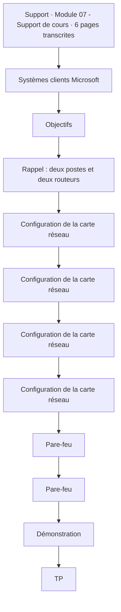
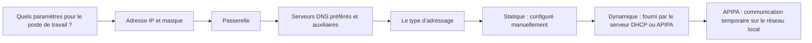
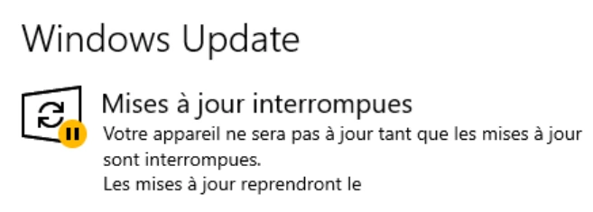
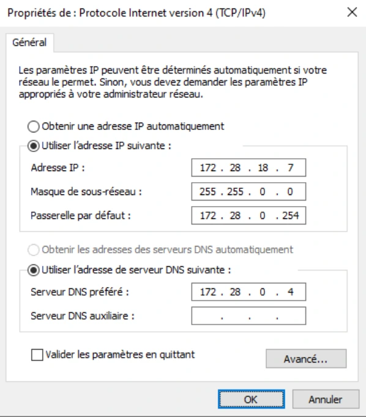
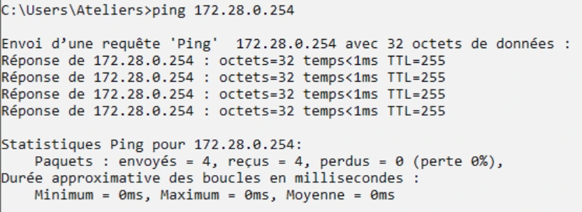
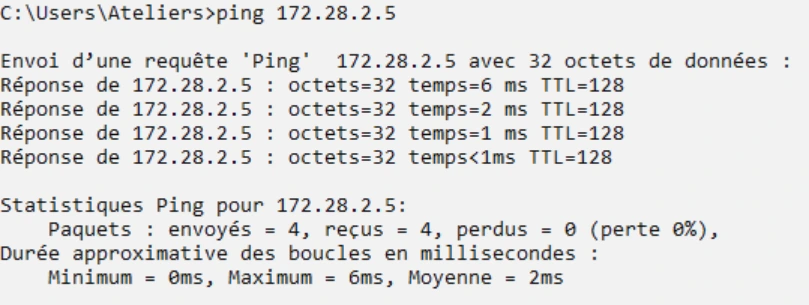
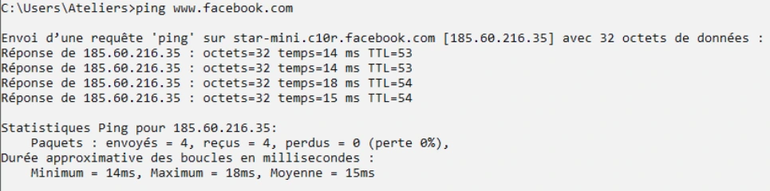
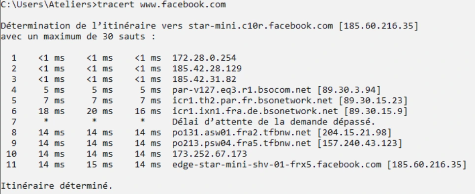

# Module 07 — La gestion du réseau et du pare-feu

Les parties ci-dessous reprennent le cours original, dans le même ordre. Les encadrés et les schémas répètent ses formulations.

## Parcours de lecture

1. Support · Module 07 - Support de cours · 6 pages transcrites
2. Systèmes clients Microsoft
3. Objectifs
4. Rappel : deux postes et deux routeurs
5. Configuration de la carte réseau
6. Configuration de la carte réseau
7. Configuration de la carte réseau
8. Configuration de la carte réseau
9. Pare-feu
10. Pare-feu
11. Démonstration
12. TP
13. Conclusion
14. Énoncé · Enonc‚ du TP - Gestion du r‚seau · 4 pages transcrites
15. Systèmes Clients Microsoft Gestion du réseau
16. Énoncé
17. Solution
18. Correction · Solution du TP - Gestion du r‚seau · 10 pages transcrites
19. Gestion du réseau
20. Proposition de solution

**Visuel externe**



SOURCE DRIVE · TRANSCRIPTION DU SUPPORT

Le contenu des documents du dossier TSSR est transcrit ci-dessous, page par page. Les textes et tableaux sont intégrés à la page Web. Aucun fichier PDF, aucune diapositive entière ni aucune reproduction de page n’est affiché. Seuls des croquis ou visuels isolés et vérifiés peuvent accompagner la transcription. Les versions et les consignes restent celles des supports de formation. Les compléments IA sont conservés dans leur onglet distinct.

## Support · Module 07 - Support de cours · 6 pages transcrites

## Systèmes clients Microsoft

!!! note "À retenir"
    Module 07 – La gestion du réseau et du pare-feu

Module 07 – La gestion du réseau et du pare-feu

## Objectifs

!!! note "À retenir"
    Rappel sur les bases des réseaux Configurer la carte et l’emplacement réseau Manipuler le pare-feu Windows

**Visuel externe**


- Rappel sur les bases des réseaux
- Configurer la carte et l’emplacement réseau
- Manipuler le pare-feu Windows

## Rappel : deux postes et deux routeurs

| Équipement visible | Adresse IP | Adresse MAC | Passerelle |
| --- | --- | --- | --- |
| Poste A | 192.168.5.1/24 | 00-01-02-03-04-05 | 192.168.5.254 |
| Routeur 1, liaison interrouteurs | 203.0.113.1/30 | 50-51-52-53-54-55 |  |
| Routeur 2, liaison interrouteurs | 203.0.113.2/30 | 1A-2B-3C-4D-5E-6F |  |
| Poste B | 192.168.10.1/24 | AA-BB-CC-DD-EE-FF | 192.168.10.254 |

## Configuration de la carte réseau

**Visuel externe**



```mermaid
flowchart LR
    N1["Accessible depuis l'icône réseau de la barre de notification"]
    N2["Paramètre réseau et Internet  Centre réseau et partage"]
    N3["Accessible depuis le panneau de configuration"]
    N4["Réseau et Internet  Centre réseau et partage"]
    N5["Donne des indications sur :"]
    N6["La connectivité du poste"]
    N7["Les connexions réseau détectées"]
    N8["Les profils réseau et les emplacements associés"]
    N1 --> N2
    N2 --> N3
    N3 --> N4
    N4 --> N5
    N5 --> N6
    N6 --> N7
    N7 --> N8
```

Le centre réseau et partage

- Accessible depuis l'icône réseau de la barre de notification
- Paramètre réseau et Internet > Centre réseau et partage
- Accessible depuis le panneau de configuration
- Réseau et Internet > Centre réseau et partage
- Donne des indications sur :
- La connectivité du poste
- Les connexions réseau détectées
- Les profils réseau et les emplacements associés
- Donne accès aux paramétrages :
- Des fonctionnalités de partage : découverte, partages, dossiers publics…
- Des cartes réseau (accès direct en lançant ncpa.cpl)
- Des nouvelles connexions


Illustration isolée du support — Module 07 - Support de cours


Illustration isolée du support — Module 07 - Support de cours

## Configuration de la carte réseau

**Visuel externe**


Une carte réseau est associée à un emplacement réseau

- Détermine le comportement du pare-feu
- Réseau privé sur un poste autonome
- Réseau avec domaine non modifiable si le poste est joint à un domaine
- Réseau public si aucune passerelle n’a été définie, si le domaine n’a pas été détecté pour les postes en domaine, si vous refusez de rendre votre ordinateur visible sur le réseau…

## Configuration de la carte réseau

!!! note "À retenir"
    Quels paramètres pour le poste de travail ?

**Visuel externe**



- Quels paramètres pour le poste de travail ?
- Adresse IP et masque
- Passerelle
- Serveurs DNS préférés et auxiliaires
- Le type d’adressage
- Statique : configuré manuellement
- Dynamique : fourni par le serveur DHCP ou APIPA
- APIPA : communication temporaire sur le réseau local
- Obtenir automatiquement une adresse grâce au système d'exploitation Windows si aucun serveur DHCP n'est joignable
- Réseau 169.254.0.0/16
- Communication sur le réseau local possible


Illustration isolée du support — Module 07 - Support de cours

## Configuration de la carte réseau

- Outils graphiques
- Zone de notification (état de la connexion)
- Composant Connexions réseau
- Assistant Résoudre les problèmes : orienté utilisateur…
- Rappel sur les outils invite de commande : les plus précis et efficaces
- ipconfig : afficher la configuration et interagir avec la pile réseau (DNS, DHCP)
- ping : tester la connectivité (bloqué par défaut par le pare-feu Windows !)
- tracert : tester la route empruntée par les paquets TPC/IP
- nslookup : diagnostic de la résolution de noms d’hôte

## Pare-feu

- Pourquoi ?
- Délimiter quels flux réseau sont autorisés en entrée et en sortie
- Protéger le poste contre les accès non autorisés (utilisateurs, programmes)
- Élément de la stratégie globale de sécurité de l’entreprise
- Caractéristiques
- Activé par défaut, bloque certains flux en entrée et les autorise tous en sortie
- Se compose de règles prédéfinies activées (ou facilement activables)
- S'adapte à la situation du poste (emplacements réseau)
- Administrable de manière centralisée (stratégies, export)

## Pare-feu

- 3 niveaux de configuration
- Utilisateur depuis le composant Vérifier l'état du Pare-feu pour l’activation / la désactivation
- Programme avec la fonction Autoriser une application via le pare-feu Windows : fournit un ensemble de règles génériques activées automatiquement et paramétrables
- Avancé avec la console Pare-feu Windows Defender avec fonctions avancées de sécurité : donne accès au paramétrage détaillé de l’ensemble des règles, permet également d’afficher une vue globale des règles activées
- Accessible avec la commande firewall.cpl

## Démonstration

!!! note "À retenir"
    Illustration isolée du support — Module 07 - Support de cours


Illustration isolée du support — Module 07 - Support de cours

## TP

## Conclusion

!!! note "À retenir"
    Tout poste client doit communiquer sur les différents réseaux de l’entreprise Tester la communication et diagnostiquer lorsqu’il y a dysfonctionnement Ouvrir et fermer des accès grâce au pare-feu Référence du document : 1ALN74onECdgg4cKnMTFKhNY_a49sbv9r · SHA-256 1b5a252de49b3690…

- Tout poste client doit communiquer sur les différents réseaux de l’entreprise
- Tester la communication et diagnostiquer lorsqu’il y a dysfonctionnement
- Ouvrir et fermer des accès grâce au pare-feu

Référence du document : 1ALN74onECdgg4cKnMTFKhNY_a49sbv9r · SHA-256 1b5a252de49b3690…

## Énoncé · Enonc‚ du TP - Gestion du r‚seau · 4 pages transcrites

## Systèmes Clients Microsoft Gestion du réseau

### TP du Module 07 – La gestion du réseau et du pare-feu

!!! note "À retenir"
    Ce TP va vous permettre de configurer la carte réseau de votre VM.

Ce TP va vous permettre de configurer la carte réseau de votre VM. Vous mettrez en place un adressage IP fixe puis effectuerez des tests (tests de communications et de résolution de noms entre autres). Vous parcourrez et modifierez la configuration du pare-feu pour l’adapter aux consignes.

Durée estimée

1 heure

## Énoncé

!!! note "À retenir"
    Lisez l'ensemble de ce TP avant de vous lancer dans la pratique

Lisez l'ensemble de ce TP avant de vous lancer dans la pratique

### Sur votre VM Win10-XX, configurez vos accès réseau :

!!! note "À retenir"
    Connectez votre VM sur le switch Bridged (vérifier d'abord le report de 35 jours de Windows Update) Possédez-vous une adresse IP ?

- Connectez votre VM sur le switch Bridged (vérifier d'abord le report de 35 jours de Windows Update)
- Possédez-vous une adresse IP ? Laquelle ? Quelle est l'adresse du réseau ?
- Configurez une adresse IP fixe sur l'interface réseau de votre VM :

o La partie réseau de votre adresse sera la même que celle qui est configurée sur l’ordinateur à votre disposition pour réaliser les TP.

o La partie hôte sera composée du rang alphabétique de la première lettre de votre prénom puis du rang alphabétique de la première lettre de votre nom de famille

- Exemple : Paul Lefebvre
- P = 16eme lettre de l’alphabet → l’octet n°3 de l’adresse IP sera donc 16

- L = 12eme lettre de l’alphabet → l’octet n°4 de l’adresse IP sera donc 12

o Le masque sera 255.255.0.0

o La passerelle et le serveur DNS préféré seront les mêmes que ceux configurés sur votre VM Campus en ligne

### Connectivité

- Utilisez la commande ping vers les hôtes suivants :

o Adresse IP de la passerelle par défaut

o Adresse IP de votre VM Discovery

o www.facebook.com

- Ces hôtes sont-ils joignables ? S’ils ne le sont pas, vérifier la configuration réseau.
- À quel niveau du réseau sont-ils ? Réseau local ? Internet ?
- Utilisez la commande tracert pour ces mêmes noms. Que nous apprend cette commande ?

### Résolution de noms

- Utilisez la commande nslookup avec les noms suivants :

o www.hadopi.fr

o www.amendes.gouv.fr

o www.facebook.com

- Obtenez-vous des réponses pour chacune des requêtes ? Quelles sont les adresses IPv4 de ces hôtes ?

### Pare-feu sur W10-XX

- Vérifiez l'état d'activation de votre pare-feu pour chaque profil réseau.
- Configurez le pare-feu pour les Programmes autorisés :

o Autorisez le Bureau à distance uniquement pour le profil privé

- Dans la console Pare-feu et fonctions avancées de sécurité, utilisez la règle prédéfinie vous permettant d’autoriser le ping entre vos postes client.

## Solution

Une solution est proposée pour ce TP sous la forme d'un PDF commenté, disponible dans les ressources à télécharger.

Référence du document : 1YxLnsFfNiuJdQAo4fEIHFZ2WH1_E_Bd_ · SHA-256 c236aadd3eb7bc01…

## Correction · Solution du TP - Gestion du r‚seau · 10 pages transcrites

Les noms du domaine de formation sont représentés par un repère neutre ; les adresses IP et les étapes restent celles du document.

Correction originale : à consulter après avoir tenté l’exercice.

## Gestion du réseau

### TP du Module 07 – La gestion du réseau et du pare-feu

## Proposition de solution

Sur votre VM Win10-XX, configurez vos accès réseau :

- Connectez votre VM sur le switch Bridged (vérifier d'abord le report de 35 jours de Windows Update)

Rechercher > Windows Update > Options avancées de Windows Update

Vérifier le report des mises à jour

Dans le cas contraire, reportez les mises à jour depuis le menu Options avancées

Dans VMware WorkStation > Clic droit sur votre VM Win10-XX > Settings

Network Adapter > cocher Bridged

- Possédez-vous une adresse IP ? Laquelle ? Quelle est l'adresse du réseau ?

Ouvrez une fenêtre de ligne de commande cmd.exe

ipconfig (attention, votre adresse IP sera différente de celle de l'encadré ci-dessous).



Illustration isolée du support — Solution du TP - Gestion du r‚seau

Ici, l'adresse IP est 172.28.2.5

L'adresse du réseau est 172.28.0.0 (résultat de l'opération du & entre l'adresse IP et le masque de sous-réseau).

- Configurez une adresse IP fixe sur l'interface réseau de votre VM

o La partie réseau de votre adresse sera la même que celle de votre VM

Campus en ligne

o La partie hôte sera composée du rang alphabétique de la première lettre de

votre prénom puis du rang alphabétique de la première lettre de votre nom de famille

- Exemple : Paul Lefebvre
- P = 16eme lettre de l’alphabet → l’octet n°3 de l’adresse ip sera donc 16
- L = 12eme lettre de l’alphabet → l’octet n°4 de l’adresse ip sera donc 12

o Le masque sera 255.255.0.0

o La passerelle et le serveur DNS préféré seront les mêmes que ceux configurés

sur votre VM Campus en ligne

Ouvrez une fenêtre de ligne de commande cmd.exe sur l'environnement de travail de l'école

ipconfig /all

Notez les informations concernant la partie réseau, la passerelle par défaut et le serveur DNS préféré.

### Configuration Ethernet0 visible dans la capture

Transcription textuelle de la capture : le nom de domaine du laboratoire est neutralisé pour ne pas afficher le nom de l’éditeur. Les adresses numériques, commandes, réponses et notions utiles sont conservées.

| Champ de la capture | Valeur |
| --- | --- |
| Interface | Carte Ethernet Ethernet0 |
| Suffixe DNS propre à la connexion | Domaine Active Directory du laboratoire (nom neutralisé) |
| Adresse IPv6 de liaison locale | fe80::acfb:8349:ce77:6976%10 |
| Adresse IPv4 | 172.28.2.5 |
| Masque de sous-réseau | 255.255.0.0 |
| Passerelle par défaut | 172.28.0.254 |
| Invite de commandes | C:\Users\Ateliers> |

Sur votre VM Win10-XX (faites bien attention de faire les manipulations sur votre VM Win10- XX)

Rechercher > ncpa.cpl

Clic droit sur la carte Ethernet0 > Propriétés

Sélectionnez Protocole Internet version 4 (TCP/IPv4) puis Propriétés

Cochez Utiliser l'adresse IP suivante :

Adresse IP : 172.28.18.7 (attention : ici 18.7 correspond à la partie hôte. 18 pour R et 7 pour G. Votre partie hôte sera donc différente).

Masque de sous-réseau : 255.255.0.0

Passerelle par défaut : 172.28.0.254

Cochez Utiliser l'adresse de serveur DNS suivante

Serveur DNS préféré : 172.28.0.4

OK

Connectivité

- Utilisez la commande ping vers les hôtes suivants :

o Adresse IP de la passerelle par défaut

o Adresse IP de votre VM Discovery

o www.facebook.com

- Ces hôtes sont-ils joignables ? S’ils ne le sont pas, vérifier la configuration réseau.
- À quel niveau du réseau sont-ils ? Réseau local ? Internet ?

Sur la VM Win10-XX

Ouvrez une fenêtre de commande cmd.exe



Illustration isolée du support — Solution du TP - Gestion du r‚seau

```
ping 172.28.0.254
```

La VM Win10-XX obtient une réponse ICMP de la passerelle. La VM Win10-XX et la passerelle par défaut communiquent bien.

Pour retrouver l'adresse IP de la VM Discovery, ouvrez une session avec l'utilisateur adm puis ouvrez une fenêtre de ligne de commande cmd.exe

ipconfig

Si l'adresse IP de la VM Discovery est au format APIPA, c'est que la Discovery ne possède pas d'informations IP fournies par le service DHCP. Pour remédier à cela, il faut que la VM Discovery puisse d'abord communiquer avec le serveur DHCP. Pour cela, il faut donc la "brancher" sur le switch "Bridged"

À l'issue de la bascule sur le switch "Bridged", attendez quelques secondes, votre VM obtiendra les informations IP adéquates pour communiquer sur le réseau

Sur la VM Win10-XX

```
Ping <adresse ip de votre VM Discovery>
```

La VM Win10-XX et Discovery communiquent ensemble sur le même réseau local.

```
ping www.facebook.com
```



Illustration isolée du support — Solution du TP - Gestion du r‚seau



Illustration isolée du support — Solution du TP - Gestion du r‚seau

La communication entre votre VM Win10-XX et ce serveur web est possible grâce au fait que vous avez configuré une passerelle par défaut. Cette passerelle par défaut correspond à une interface réseau du routeur connecté au réseau. Ce routeur vous permet de communiquer avec des hôtes disponibles dans d'autres réseaux et notamment internet.

- Utiliser la commande tracert pour ces mêmes noms. Que nous apprend cette commande ?

Cette commande nous apprend que la passerelle par défaut ainsi que la VM Discovery sont joignables directement. La communication est directe, sans que le paquet ne traverse des routeurs, ne passe par différents réseaux.



Illustration isolée du support — Solution du TP - Gestion du r‚seau

### Deux tests tracert locaux visibles dans la capture

Transcription textuelle de la capture : le nom de domaine du laboratoire est neutralisé pour ne pas afficher le nom de l’éditeur. Les adresses numériques, commandes, réponses et notions utiles sont conservées.

| Commande | Destination | Maximum de sauts | Saut observé | Trois mesures | Résultat |
| --- | --- | --- | --- | --- | --- |
| tracert 172.28.0.254 | 172.28.0.254 | 30 | 1 : 172.28.0.254 | <1 ms ; <1 ms ; <1 ms | Itinéraire déterminé. |
| tracert 172.28.2.5 | DiscoveryXX, nom DNS du laboratoire neutralisé [172.28.2.5] | 30 | 1 : DiscoveryXX [172.28.2.5] | 3 ms ; <1 ms ; <1 ms | Itinéraire déterminé. |

Les deux commandes sont lancées depuis l’invite `C:\Users\Ateliers>`. Chaque destination locale est atteinte en un saut dans cette capture.

La commande nous apprend ici que le serveur web de Facebook est joignable et se trouve dans un réseau différent de celui dans lequel se trouve la VM Win10-XX. La communication est donc possible en passant par des routeurs (nous avons même l'information de leur adresse IP et même parfois de leur nom).

La ligne délai de la demande dépassé indique simplement que le routeur en question ne "souhaite pas" communiquer son adresse IP, mais cela ne bouscule ne rien le processus de routage.

Il faut que le paquet traverse 10 routeurs différents (10 sauts) avant d'atteindre la destination finale.

Résolution de noms

- Utilisez la commande nslookup avec les noms suivants :

o www.hadopi.fr

o www.amendes.gouv.fr

o www.facebook.com

Depuis la VM Win10-XX



Illustration isolée du support — Solution du TP - Gestion du r‚seau

- Obtenez-vous des réponses pour chacune des requêtes ? Quelles sont les adresses ipv4 de ces hôtes ?

Nous obtenons plusieurs informations suite à ces commandes nslookup.

La commande nslookup permet d'obtenir l'adresse IP d'un hôte lorsque nous connaissons son nom. C'est le principe du service DNS. nslookup permet de consulter le service DNS.

Ici, nous pouvons observer que le service DNS est hébergé par l'hôte dont le nom est domaine-du-laboratoire.example et que son adresse IP est 172.28.0.4. C'est justement l'adresse que nous avons renseignée comme serveur DNS préféré dans la configuration de notre carte réseau.

L'adresse IP de l'hôte www.hadopi.fr est 217.115.114.160

L'adresse IP de l'hôte www.amendes.gouv.fr est 90.102.115.80

L'adresse IPv4 l'hôte www.facebook.com est 185.60.216.35. Il possède aussi une adresse IPv6 (2a03:2880:f12d:83:face:booc:0:25de)

www.facebook.com est un alias (un surnom). Son nom d'hôte DNS est en réalité :

star-mini.c10r.facebook.com

### Réponses nslookup visibles dans la capture

Transcription textuelle de la capture : le nom de domaine du laboratoire est neutralisé pour ne pas afficher le nom de l’éditeur. Les adresses numériques, commandes, réponses et notions utiles sont conservées.

Serveur interrogé : **DNS du laboratoire (nom neutralisé)**, adresse `172.28.0.4`. Les trois réponses portent la mention « Réponse ne faisant pas autorité » ; les commandes sont lancées depuis `C:\Users\formateur>`.

| Commande | Nom retourné | Adresse(s) de la capture | Alias |
| --- | --- | --- | --- |
| nslookup www.hadopi.fr | hadopi.fr | 217.115.160.114 | www.hadopi.fr |
| nslookup www.amendes.gouv.fr | www.amendes.gouv.fr | 90.102.115.80 |  |
| nslookup www.facebook.com | star-mini.c10r.facebook.com | 2a03:2880:f11c:8083:face:b00c:0:25de ; 185.60.216.35 | www.facebook.com |

Divergence du document : les valeurs de cette capture ne sont pas toujours celles du paragraphe de correction précédent. Le texte indique une autre adresse pour hadopi et une autre écriture IPv6 pour Facebook. Les deux états sont conservés séparément, sans correction silencieuse ni présentation de ces adresses comme valeurs actuelles.

Pare-feu sur W10-XX

- Vérifiez l'état d'activation de votre pare-feu pour chaque profil réseau.

Avec la VM Win10-XX

Rechercher > Pare-feu Windows Defender

La VM se trouve sur l'emplacement Réseaux privés, le pare-feu est activé. Si, par mobilité, vous basculez dans un réseau public ou invités, le pare-feu sera activé automatiquement.

La VM n'étant pas jointe à un domaine, aucune indication sur l'emplacement de domaine.

- Configurez le pare-feu pour les Programmes autorisés :

o Autorisez le Bureau à distance uniquement pour le profil privé

Rechercher > Autoriser une application via le Pare-feu Windows

Cocher Bureau à distance pour le profil Privé

Dans la console Pare-feu et fonctions avancées de sécurité, utilisez la règle prédéfinie vous permettant d’autoriser le ping entre vos postes client.

Rechercher > Pare-feu Windows Defender avec fonctions avancées de sécurité

Sélectionner Règles de trafic entrant

Clic droit sur Partage de fichiers et d'imprimantes (Demande d'écho – Trafic entrant ICMPv4) Activer la règle

Il y a deux lignes qui portent le même intitulé, activez celle dont le profil correspond à Privé, Public

Pour s'assurer du bon fonctionnement, faites un ping depuis la VM Discovery vers votre VM Win10-XX, la communication doit être maintenant possible.

Référence du document : 1GDEIMZpmyo9qDiGPky7WFfen6C9ncRXs · SHA-256 9cb17ec8495d3204…

## Fiche de synthèse

Les lignes reprennent les titres du cours et la première phrase de chaque partie.

| Partie | Repère du cours |
| --- | --- |
| Systèmes clients Microsoft | Module 07 – La gestion du réseau et du pare-feu |
| Objectifs | Rappel sur les bases des réseaux Configurer la carte et l’emplacement réseau Manipuler le pare-feu Windows |
| Configuration de la carte réseau | Le centre réseau et partage Accessible depuis l'icône réseau de la barre de notification Paramètre réseau et Internet > Centre réseau et partage Accessible depuis le panneau de… |
| Configuration de la carte réseau | Une carte réseau est associée à un emplacement réseau Détermine le comportement du pare-feu Réseau privé sur un poste autonome Réseau avec domaine non modifiable si le poste est… |
| Configuration de la carte réseau | Quels paramètres pour le poste de travail ? |
| Configuration de la carte réseau | Outils graphiques Zone de notification (état de la connexion) Composant Connexions réseau Assistant Résoudre les problèmes : orienté utilisateur… Rappel sur les outils invite de… |
| Pare-feu | Délimiter quels flux réseau sont autorisés en entrée et en sortie Protéger le poste contre les accès non autorisés (utilisateurs, programmes) Élément de la stratégie globale de… |
| Pare-feu | 3 niveaux de configuration Utilisateur depuis le composant Vérifier l'état du Pare-feu pour l’activation / la désactivation Programme avec la fonction Autoriser une application… |
| Démonstration | Illustration isolée du support — Module 07 - Support de cours |
| Conclusion | Tout poste client doit communiquer sur les différents réseaux de l’entreprise Tester la communication et diagnostiquer lorsqu’il y a dysfonctionnement Ouvrir et fermer des accès… |
| Énoncé | Lisez l'ensemble de ce TP avant de vous lancer dans la pratique |
| Solution | Une solution est proposée pour ce TP sous la forme d'un PDF commenté, disponible dans les ressources à télécharger. |
| Correction · Solution du TP - Gestion du r‚seau · 10 pages transcrites | Les noms du domaine de formation sont représentés par un repère neutre ; les adresses IP et les étapes restent celles du document. |
| Proposition de solution | Sur votre VM Win10-XX, configurez vos accès réseau : Connectez votre VM sur le switch Bridged (vérifier d'abord le report de 35 jours de Windows Update) Rechercher > Windows Upd… |
