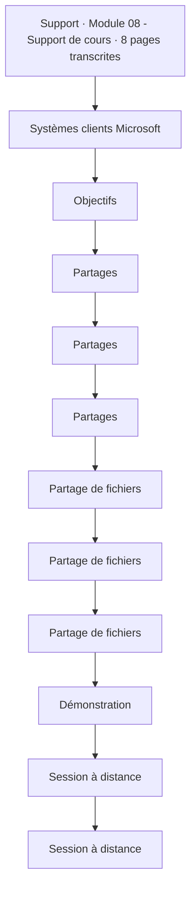
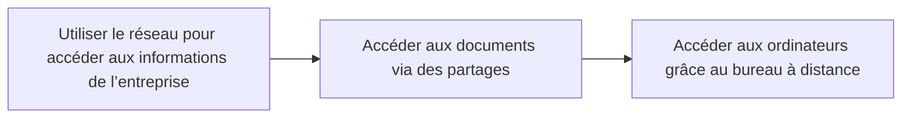
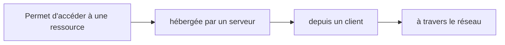
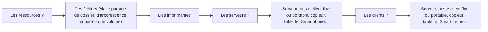
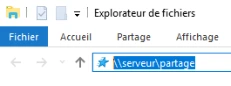
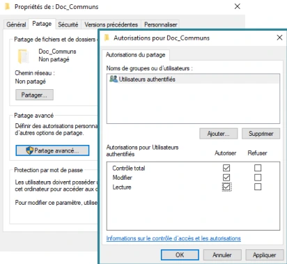
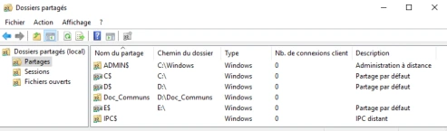
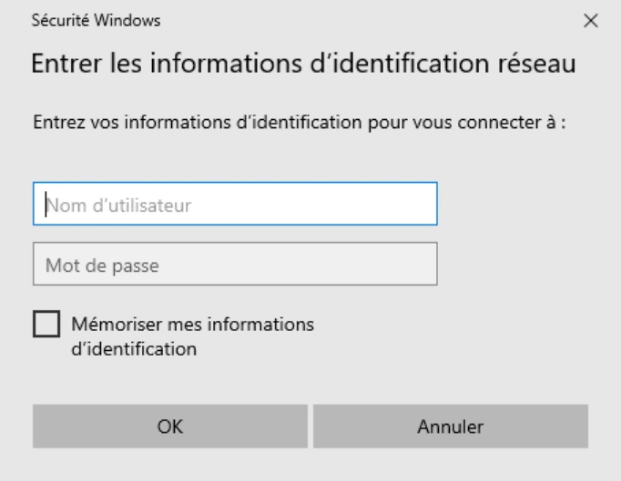
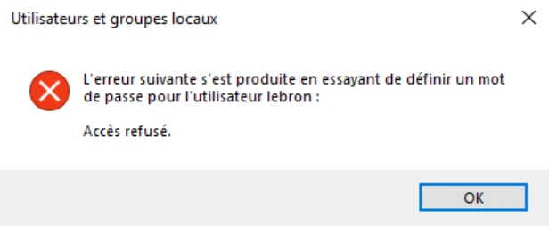

# Module 08 — Le partage de ressources

Les parties ci-dessous reprennent le cours original, dans le même ordre. Les encadrés et les schémas répètent ses formulations.

## Parcours de lecture

1. Support · Module 08 - Support de cours · 8 pages transcrites
2. Systèmes clients Microsoft
3. Objectifs
4. Partages
5. Partages
6. Partages
7. Partage de fichiers
8. Partage de fichiers
9. Partage de fichiers
10. Démonstration
11. Session à distance
12. Session à distance
13. Session à distance
14. Démonstration
15. TP
16. Conclusion
17. Énoncé · Enonc‚ du TP - Partages et sessions distantes · 3 pages transcrites
18. Systèmes Clients Microsoft Partages et sessions distantes
19. Énoncé
20. Solution
21. Correction · Solution du TP - Partages et sessions distantes · 6 pages transcrites
22. Partages et sessions distantes
23. Proposition de solution

**Visuel externe**



SOURCE DRIVE · TRANSCRIPTION DU SUPPORT

Le contenu des documents du dossier TSSR est transcrit ci-dessous, page par page. Les textes et tableaux sont intégrés à la page Web. Aucun fichier PDF, aucune diapositive entière ni aucune reproduction de page n’est affiché. Seuls des croquis ou visuels isolés et vérifiés peuvent accompagner la transcription. Les versions et les consignes restent celles des supports de formation. Les compléments IA sont conservés dans leur onglet distinct.

## Support · Module 08 - Support de cours · 8 pages transcrites

## Systèmes clients Microsoft

Module 08 – Le partage de ressources

## Objectifs

!!! note "À retenir"
    Utiliser le réseau pour accéder aux informations de l’entreprise Accéder aux documents via des partages Accéder aux ordinateurs grâce au bureau à distance

**Visuel externe**



- Utiliser le réseau pour accéder aux informations de l’entreprise
- Accéder aux documents via des partages
- Accéder aux ordinateurs grâce au bureau à distance

## Partages

!!! note "À retenir"
    Les principes du partage Permet d'accéder à une ressource hébergée par un serveur depuis un client à travers le réseau RÉSEAU

**Visuel externe**



Les principes du partage

- Permet d'accéder à une ressource
- hébergée par un serveur
- depuis un client
- à travers le réseau

RÉSEAU

## Partages

!!! note "À retenir"
    Des fichiers (via le partage de dossier, d'arborescence entière ou de volume) Des imprimantes Les serveurs ?

**Visuel externe**



- Les ressources ?
- Des fichiers (via le partage de dossier, d'arborescence entière ou de volume)
- Des imprimantes
- Les serveurs ?
- Tout type de système connecté au réseau de l'entreprise peut potentiellement partager ses ressources
- Serveur, poste client fixe ou portable, copieur, tablette, Smartphone…
- Les clients ?
- Tout type de système connecté au réseau peut accéder aux ressources partagées de l'entreprise
- Serveur, poste client fixe ou portable, copieur, tablette, Smartphone…

## Partages

!!! note "À retenir"
    Une authentification est requise (compte local, du domaine) 3 niveaux d'accès sont définis sur la ressource partagée Lecture, Modifier, Contrôle total 2 vérifications d'identités sont effectuées 1 – Au niveau du partage 2 – Puis au niveau des droits NTFS Les autorisations du partage sont restrictives RÉSEAU

**Visuel externe**


- Qui peut partager ?
- Des droits administratifs sont requis ! Partager, c'est modifier le système !
- Qui a accès au partage ?
- Une authentification est requise (compte local, du domaine)
- 3 niveaux d'accès sont définis sur la ressource partagée
- Lecture, Modifier, Contrôle total
- 2 vérifications d'identités sont effectuées
- 1 – Au niveau du partage
- 2 – Puis au niveau des droits NTFS
- Les autorisations du partage sont restrictives

RÉSEAU

## Partage de fichiers

!!! note "À retenir"
    Comment accéder aux fichiers partagés depuis Windows 10 ?

Comment accéder aux fichiers partagés depuis Windows 10 ?

- De façon momentanée, depuis l'explorateur avec le chemin UNC \\serveur\partage
- Durablement, avec la fonctionnalité Connecter un lecteur réseau
- Les lecteurs mappés sont mémorisés avec le profil utilisateur
- En ligne de commande avec net use
- Exemple net use z: \\serveur\partage
- La commande net view liste les partages
- En PowerShell avec la cmdlet New-SmbMapping
- Exemple New-SmbMapping -LocalPath 'R:' -RemotePath '\\SRV-FIC\Compta'



Illustration isolée du support — Module 08 - Support de cours


Illustration isolée du support — Module 08 - Support de cours

## Partage de fichiers

Comment partager des fichiers ?

- Depuis l'explorateur Windows
- Ouverture du partage sur le conteneur
- Partage de base : partage simplifié orienté utilisateur (à éviter)
- Partage avancé : onglet Partage depuis les propriétés du conteneur
- Par défaut, l'entité Tout le monde est en Lecture
- Bonne pratique : préférez l'entité de sécurité Utilisateurs Authentifiés

## Partage de fichiers

- Depuis le composant MMC Dossiers partagés (fsmgmt.msc)
- Visualisation des partages actifs
- Assistant de création de partages
- Vues Sessions et Fichiers ouverts
- Affichage des partages administratifs générés par le système
- Depuis l'invite de commande
- net share pour lister et configurer les partages
- Exemple : net share commun=d:\Note_de_service /grant:"utilisateurs authentifiés",FULL
- En PowerShell avec la cmdlet New-SmbShare
- New-SmbShare -Name "VMSFiles" -Path "C:\ClusterStorage\Volume1\VMFiles" -FullAccess "Authenticated Users"



Illustration isolée du support — Module 08 - Support de cours



Illustration isolée du support — Module 08 - Support de cours

## Démonstration

## Session à distance

- Accès distant au poste
- Possible grâce à la fonctionnalité Bureau à distance
- Authentification avec un compte valide (local ou de domaine)
- Nécessite des privilèges spécifiques
- Même niveau de fonctionnement qu'une session locale
- Utilisation courante
- Maintenir des postes (1 seule session locale ou distante)
- Accéder à distance aux serveurs (2 sessions simultanées depuis Windows 2008)
- Accéder à son environnement de travail depuis l'extérieur (VPN)
- Les limites
- Mode maintenance sur un poste client (pas d'interaction possible avec l'utilisateur)
- Sur les serveurs, 2 sessions avec des comptes différents
- Blocage (à distance) si les sessions restent ouvertes

## Session à distance

!!! note "À retenir"
    Comment se connecter à distance sur un poste Windows 10 ?

!!! example "Exemple"
    En ligne de commande avec mstsc Exemple : mstsc /v:serveur

- Comment se connecter à distance sur un poste Windows 10 ?
- Nativement, avec l'outil Connexion Bureau à distance
- Ensemble d'onglets pour personnaliser la connexion
- Sauvegarder les paramètres
- Mappez vos ressources locales sur le poste distant !
- En ligne de commande avec mstsc
- Exemple : mstsc /v:serveur

## Session à distance

Configuration du poste cible ?

- Rubrique Système du panneau de configuration
- Menu Paramètres système avancés
- Onglet Utilisation à distance
- Nativement désactivé
- 2 niveaux d'authentification
- Authentification standard
- Authentification NLA
- Par défaut, accès autorisé aux administrateurs

Fonctionnement

- Protocole RDP (port 3389)
- Configuration automatique du pare-feu
- Attention aux emplacements réseau


Illustration isolée du support — Module 08 - Support de cours


Illustration isolée du support — Module 08 - Support de cours

## Démonstration

## TP

## Conclusion

!!! note "À retenir"
    Les réseaux sont les fondations des systèmes d’informations des entreprises.

- Les réseaux sont les fondations des systèmes d’informations des entreprises.
- Les systèmes d’exploitation tirent profit du réseau pour organiser et sécuriser l’accès aux informations

Référence du document : 1behcnzxdajFM0y3ydZ7w_ggzyePbJz24 · SHA-256 313d40d1e9005ae9…

## Énoncé · Enonc‚ du TP - Partages et sessions distantes · 3 pages transcrites

## Systèmes Clients Microsoft Partages et sessions distantes

### TP du Module 08 – Le partage de ressources

Lors de ce TP, vous serez amené à partager des dossiers de votre VM Windows 10. Vous tenterez d'y accéder via le réseau depuis votre seconde VM. Vous étudierez la configuration de votre seconde VM et vous ferez en sorte d'y ouvrir une session à distance depuis votre VM Windows 10. Mais avant tout, assurez-vous d'abord que ces deux VM communiquent bien entre elles.

Durée estimée

1 heure

## Énoncé

Lisez l'ensemble de ce TP avant de vous lancer dans la pratique

### Sur votre VM Win10-XX, partagez les ressources suivantes :

- Partagez le dossier Echange disponible sur le lecteur D:

Vous utilisez les bonnes pratiques Microsoft

- Le partage se nommera CoWorkerShare
- Permettez à vos collègues la possibilité de modifier le contenu du dossier depuis leurs VM

Vous testerez le bon fonctionnement

- Pour faciliter l'usage des logiciels de l'entreprise, l'équipe informatique décide de partager le dossier "manuels d'utilisation". Les utilisateurs auront la possibilité d'y déposer des documents texte et des images (comme des captures d'écran) dans le

but d'enrichir une future FAQ.

Vous êtes en charge de créer le partage. Vous testerez les accès avec un compte

d’utilisateur membre du groupe L_Collegues.

### Sur Discovery

- À l'aide de PowerShell et des bonnes cmdlets, lister les partages disponibles sur la VM.
- Toujours à l'aide de PowerShell, quel dossier de l'arborescence du système est partagé par le nom ADMIN$ ? Qui peut accéder au partage N$ ?

### Bureau à distance

- Vérifiez l'état d'activation de la fonctionnalité Bureau à distance disponible sur votre VM Discovery
- Est-elle active ?

- Faites en sorte de permettre aux utilisateurs Géraldine et Laurent d'ouvrir une session Bureau à distance sur la VM Discovery.
- Testez ces accès via votre VM Win10-XX.
- Une fois connectée, Géraldine peut-elle changer le mot de passe de Laurent ? Adm peut-il ouvrir une session bureau à distance sur Discovery ? Peut-il changer le mot de passe de Laurent ? Pourquoi ?

## Solution

Une solution est proposée pour ce TP sous la forme d'un PDF commenté, disponible dans les ressources à télécharger.

Référence du document : 12wyExQ4Og5nnWqDusZdLTuJDfy8teXqo · SHA-256 4865d38629b1cc40…

## Correction · Solution du TP - Partages et sessions distantes · 6 pages transcrites

Correction originale : à consulter après avoir tenté l’exercice.

## Partages et sessions distantes

### TP du Module 08 – Le partage de ressources

## Proposition de solution

Sur votre VM Win10-XX, partagez les ressources suivantes :

- Partagez le dossier Echange disponible sur le lecteur D:
- Vous utilisez les bonnes pratiques Microsoft
- Le partage se nommera CoWorkerShare
- Permettez à vos collègues la possibilité de modifier le contenu du dossier depuis leurs VM
- Vous testerez le bon fonctionnement

Clic droit sur le dossier Echange disponible sur le lecteur D:

Propriétés

Onglet Partage

Partage avancé

Cochez Partager ce dossier

Nom du partage : CoWorkerShare

Mises en place des bonnes pratiques Microsoft

Autorisations

Supprimer Tout le monde

Ajouter Utilisateurs authentifiés en Contrôle total

Appliquer > OK

Appliquer > OK

Le dossier est maintenant partagé, accessible via le réseau.

Pour permettre à nos collègues d'accéder au contenu du dossier via le partage, il faut consulter/modifier les autorisations d'accès NTFS

Onglet Sécurité du dossier Echange

S'assurer que le groupe L_Collegues possède les autorisations d'accès en Modification

Dans le cas contraire, ajouter le groupe L_Collegues dans la DACL et attribuer les autorisations d'accès en Modification

Pour tester le bon fonctionnement

Ouvrez une session sur la VM Discovery

Ouvrez l'explorateur Windows

Dans la barre de navigation, entrez le chemin UNC correspondant à votre partage

\\@ipWin10-XX\CoWorkerShare

Après quelques secondes, vous êtes challengé.

Seuls les utilisateurs authentifiés connus de la base SAM de Win10-XX peuvent accéder au contenu du partage

Entrer le nom d'utilisateur d'un de vos utilisateurs membre du groupe L_Collegues ainsi que son mot de passe pour avoir accès au contenu du dossier partagé CoWorkerShare en Modification.

Créer un dossier TestPartage pour vérifier le niveau d'accès en Modification.

Fermer la session actuellement ouverte sur Discovery pour regénérer le jeton d'accès.

- Pour faciliter l'usage des logiciels de l'entreprise, l'équipe informatique décide de partager le dossier "manuels d'utilisation". Les utilisateurs auront la possibilité d'y déposer des documents texte et des images (comme des captures d'écran) dans le but



Illustration isolée du support — Solution du TP - Partages et sessions distantes

d'enrichir une future FAQ.

Vous êtes en charge de créer le partage. Vous testerez les accès avec un compte d’utilisateur membre du groupe L_Collegues

Les utilisateurs auront la possibilité d'y déposer des documents texte et des images (comme des captures d'écran) dans le but d'enrichir une future FAQ

Les utilisateurs doivent donc avoir un accès en Modification sur le dossier manuels d'utilisation

Clic droit sur le dossier Manuels d'utilisation disponible sur le volume TOOLS

Propriétés

Onglet Sécurité

Modifier

Sélectionner Utilisateurs

Cochez Modification

Appliquer > OK

Ouverture du partage en respectant les bonnes pratiques Microsoft

Onglet Partage

Partage avancé

Cochez Partager ce dossier

Nom du partage : manuels d'utilisation

Autorisations

Supprimer Tout le monde

Ajouter Utilisateurs authentifiés en Contrôle total

Appliquer > OK

Fermer

Le dossier est maintenant partagé, accessible via le réseau.

Pour tester le bon fonctionnement

Ouvrez une session sur la VM Discovery

Ouvrez l'explorateur Windows

Dans la barre de navigation, entrez le chemin UNC correspondant à votre partage

\\@ipWin10-XX\Manuels d'utilisation

Après quelques secondes, vous êtes challengé.

Seuls les utilisateurs authentifiés connus de la base SAM de Win10-XX peuvent accéder au contenu du partage

Entrer le nom d'utilisateur d'un de vos utilisateurs membre du groupe L_Collegues ainsi que son mot de passe pour avoir accès au contenu du dossier partagé manuels d'utilisation en Modification.

Créer un dossier TestManuelsUtil pour vérifier le niveau d'accès en Modification.

Fermer la session actuellement ouverte sur Discovery pour regénérer le jeton d'accès.

Sur Discovery

- À l'aide de PowerShell et des bonnes cmdlets, lister les partages disponibles sur la VM.

```
Get-SMBShare
```

Ou

```
Get-FileShare mais peut-être un peu moins parlant comme cmdlet.
```

- Toujours à l'aide de PowerShell, quel dossier de l'arborescence du système est partagé par le nom ADMIN$ ? Qui peut accéder au partage N$ ?

```
Get-SMBShare ADMIN$
```


Illustration isolée du support — Solution du TP - Partages et sessions distantes

Le partage ADMIN$ permet d'accéder au contenu du dossier C:\Windows de Discovery (valeur de la propriété Path). C'est un partage administratif natif

```
Get-SMBShareAccess N$
```

Les membres du groupe Administrateurs, Opérateurs de sauvegarde et l'entité de sécurité INTERACTIF ont un accès en Contrôle total

Bureau à distance

- Vérifiez l'état d'activation de la fonctionnalité Bureau à distance disponible sur votre VM Discovery
- Est-elle active ?

Rechercher > sysdm.cpl

Onglet Utilisation à distance

Par défaut, la fonctionnalité Bureau à distance n'est pas active.

- Faites en sorte de permettre aux utilisateurs Géraldine et Laurent d'ouvrir une session Bureau à distance sur la VM Discovery
- Testez ces accès via votre VM Win10-XX

Sélectionner des utilisateurs…

Ajouter…

Giannis;Lebron

OK

Cocher Autoriser les connexions à distance à cet ordinateur

Appliquer > OK

Sur Win10-XX

Rechercher > Connexion Bureau à distance

Ordinateur : @ip de Discovery

Lorsque vous êtes challengé, indiquer les login/mot de passe de Géraldine

Login : giannis

Mot de passe : Pa$$w0rd

OK

Lors de la première connexion, un échange de certificat est effectué.

Cliquez sur Oui

Le bureau à distance s'ouvre, vous avez accès à la VM Discovery.

Pour accéder au bureau, fermez éventuellement la session en cours sur Discovery.

- Une fois connectée, Géraldine peut-elle changer le mot de passe de Laurent ? Adm peut-il ouvrir une session bureau à distance sur Discovery ? Peut-il changer le mot de passe de Laurent ? Pourquoi ?

Rechercher > lusrmgr.msc

Nœud Utilisateurs

Clic droit sur Lebron

Définir le mot de passe…

Continuer

Insérer puis confirmer un nouveau mot de passe pour Laurent EBRON

OK

Géraldine ne peut pas changer le mot de passe de Laurent car seuls les membres du groupe Administrateurs peuvent faire cette action.

Fermer la session de Géraldine et ouvrir une nouvelle session à distance avec le compte adm.

adm peut ouvrir une session à distance car par défaut, tout utilisateur membre du groupe prédéfini Administrateurs peut ouvrir une session à distance.

Tenter de changer le mot de passe de Laurent

C'est possible car l'utilisateur adm fait partie du groupe prédéfini Administrateurs

Fermez la session à distance (clic droit sur le menu Démarrer > Arrêter ou se déconnecter > Se déconnecter)



Illustration isolée du support — Solution du TP - Partages et sessions distantes

Référence du document : 1yrnBvdMj6n0hs55r8oUkc1Y_R0j7mS6U · SHA-256 dd6b14bf0535849c…

## Fiche de synthèse

Les lignes reprennent les titres du cours et la première phrase de chaque partie.

| Partie | Repère du cours |
| --- | --- |
| Objectifs | Utiliser le réseau pour accéder aux informations de l’entreprise Accéder aux documents via des partages Accéder aux ordinateurs grâce au bureau à distance |
| Partages | Les principes du partage Permet d'accéder à une ressource hébergée par un serveur depuis un client à travers le réseau RÉSEAU |
| Partages | Des fichiers (via le partage de dossier, d'arborescence entière ou de volume) Des imprimantes Les serveurs ? |
| Partages | Une authentification est requise (compte local, du domaine) 3 niveaux d'accès sont définis sur la ressource partagée Lecture, Modifier, Contrôle total 2 vérifications d'identité… |
| Partage de fichiers | Comment accéder aux fichiers partagés depuis Windows 10 ? |
| Partage de fichiers | Depuis l'explorateur Windows Ouverture du partage sur le conteneur Partage de base : partage simplifié orienté utilisateur (à éviter) Partage avancé : onglet Partage depuis les… |
| Partage de fichiers | Depuis le composant MMC Dossiers partagés (fsmgmt.msc) Visualisation des partages actifs Assistant de création de partages Vues Sessions et Fichiers ouverts Affichage des partag… |
| Session à distance | Accès distant au poste Possible grâce à la fonctionnalité Bureau à distance Authentification avec un compte valide (local ou de domaine) Nécessite des privilèges spécifiques Mêm… |
| Session à distance | Comment se connecter à distance sur un poste Windows 10 ? |
| Session à distance | Rubrique Système du panneau de configuration Menu Paramètres système avancés Onglet Utilisation à distance Nativement désactivé 2 niveaux d'authentification Authentification sta… |
| Conclusion | Les réseaux sont les fondations des systèmes d’informations des entreprises. |
| Énoncé | Lisez l'ensemble de ce TP avant de vous lancer dans la pratique |
| Solution | Une solution est proposée pour ce TP sous la forme d'un PDF commenté, disponible dans les ressources à télécharger. |
| Correction · Solution du TP - Partages et sessions distantes · 6 pages transcrites | Correction originale : à consulter après avoir tenté l’exercice. |
| Proposition de solution | Sur votre VM Win10-XX, partagez les ressources suivantes : Partagez le dossier Echange disponible sur le lecteur D: Vous utilisez les bonnes pratiques Microsoft Le partage se no… |
