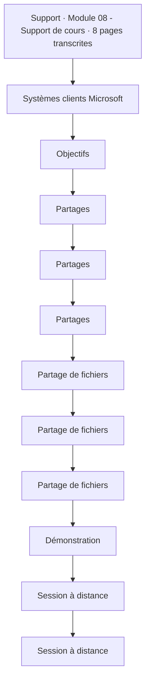
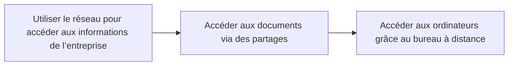
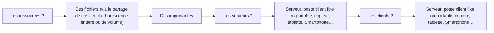
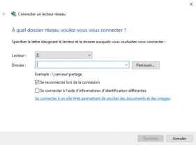
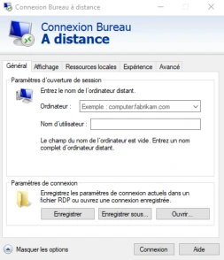
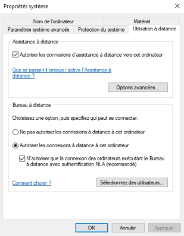

# Module 08 — Le partage de ressources

[Travaux pratiques](../../tp/systemes-clients/module-08/index.md)

Les parties ci-dessous reprennent le cours original, dans le même ordre. Les encadrés et les schémas répètent ses formulations.

## Parcours de lecture

1. Support · Module 08 - Support de cours · 8 pages transcrites
2. Systèmes clients Microsoft
3. Objectifs
4. Partages
5. Partages
6. Partages
7. Partage de fichiers
8. Partage de fichiers
9. Partage de fichiers
10. Démonstration
11. Session à distance
12. Session à distance
13. Session à distance
14. Démonstration
15. TP
16. Conclusion
17. Systèmes Clients Microsoft Partages et sessions distantes
18. Énoncé
19. Solution
20. Partages et sessions distantes
21. Proposition de solution

**Visuel externe**

SOURCE DRIVE · TRANSCRIPTION DU SUPPORT

Le contenu des documents du dossier TSSR est transcrit ci-dessous, page par page. Les textes et tableaux sont intégrés à la page Web. Aucun fichier PDF, aucune diapositive entière ni aucune reproduction de page n’est affiché. Seuls des croquis ou visuels isolés et vérifiés peuvent accompagner la transcription. Les versions et les consignes restent celles des supports de formation. Les compléments IA sont conservés dans leur onglet distinct.

## Support · Module 08 - Support de cours · 8 pages transcrites

## Systèmes clients Microsoft

Module 08 – Le partage de ressources

## Objectifs

!!! note "À retenir"
    Utiliser le réseau pour accéder aux informations de l’entreprise Accéder aux documents via des partages Accéder aux ordinateurs grâce au bureau à distance

**Visuel externe**

- Utiliser le réseau pour accéder aux informations de l’entreprise
- Accéder aux documents via des partages
- Accéder aux ordinateurs grâce au bureau à distance

## Partages

!!! note "À retenir"
    Les principes du partage Permet d'accéder à une ressource hébergée par un serveur depuis un client à travers le réseau RÉSEAU

**Visuel externe**

Les principes du partage

- Permet d'accéder à une ressource
- hébergée par un serveur
- depuis un client
- à travers le réseau

RÉSEAU

## Partages

!!! note "À retenir"
    Des fichiers (via le partage de dossier, d'arborescence entière ou de volume) Des imprimantes Les serveurs ?

**Visuel externe**

- Les ressources ?
- Des fichiers (via le partage de dossier, d'arborescence entière ou de volume)
- Des imprimantes
- Les serveurs ?
- Tout type de système connecté au réseau de l'entreprise peut potentiellement partager ses ressources
- Serveur, poste client fixe ou portable, copieur, tablette, Smartphone…
- Les clients ?
- Tout type de système connecté au réseau peut accéder aux ressources partagées de l'entreprise
- Serveur, poste client fixe ou portable, copieur, tablette, Smartphone…

## Partages

!!! note "À retenir"
    Une authentification est requise (compte local, du domaine) 3 niveaux d'accès sont définis sur la ressource partagée Lecture, Modifier, Contrôle total 2 vérifications d'identités sont effectuées 1 – Au niveau du partage 2 – Puis au niveau des droits NTFS Les autorisations du partage sont restrictives RÉSEAU

**Visuel externe**

- Qui peut partager ?
- Des droits administratifs sont requis ! Partager, c'est modifier le système !
- Qui a accès au partage ?
- Une authentification est requise (compte local, du domaine)
- 3 niveaux d'accès sont définis sur la ressource partagée
- Lecture, Modifier, Contrôle total
- 2 vérifications d'identités sont effectuées
- 1 – Au niveau du partage
- 2 – Puis au niveau des droits NTFS
- Les autorisations du partage sont restrictives

RÉSEAU

## Partage de fichiers

!!! note "À retenir"
    Comment accéder aux fichiers partagés depuis Windows 10 ?

Comment accéder aux fichiers partagés depuis Windows 10 ?

- De façon momentanée, depuis l'explorateur avec le chemin UNC \\serveur\partage
- Durablement, avec la fonctionnalité Connecter un lecteur réseau
- Les lecteurs mappés sont mémorisés avec le profil utilisateur
- En ligne de commande avec net use
- Exemple net use z: \\serveur\partage
- La commande net view liste les partages
- En PowerShell avec la cmdlet New-SmbMapping
- Exemple New-SmbMapping -LocalPath 'R:' -RemotePath '\\SRV-FIC\Compta'

Illustration isolée du support — Module 08 - Support de cours

Illustration isolée du support — Module 08 - Support de cours

## Partage de fichiers

Comment partager des fichiers ?

- Depuis l'explorateur Windows
- Ouverture du partage sur le conteneur
- Partage de base : partage simplifié orienté utilisateur (à éviter)
- Partage avancé : onglet Partage depuis les propriétés du conteneur
- Par défaut, l'entité Tout le monde est en Lecture
- Bonne pratique : préférez l'entité de sécurité Utilisateurs Authentifiés

## Partage de fichiers

- Depuis le composant MMC Dossiers partagés (fsmgmt.msc)
- Visualisation des partages actifs
- Assistant de création de partages
- Vues Sessions et Fichiers ouverts
- Affichage des partages administratifs générés par le système
- Depuis l'invite de commande
- net share pour lister et configurer les partages
- Exemple : net share commun=d:\Note_de_service /grant:"utilisateurs authentifiés",FULL
- En PowerShell avec la cmdlet New-SmbShare
- New-SmbShare -Name "VMSFiles" -Path "C:\ClusterStorage\Volume1\VMFiles" -FullAccess "Authenticated Users"

Illustration isolée du support — Module 08 - Support de cours

Illustration isolée du support — Module 08 - Support de cours

## Démonstration

## Session à distance

- Accès distant au poste
- Possible grâce à la fonctionnalité Bureau à distance
- Authentification avec un compte valide (local ou de domaine)
- Nécessite des privilèges spécifiques
- Même niveau de fonctionnement qu'une session locale
- Utilisation courante
- Maintenir des postes (1 seule session locale ou distante)
- Accéder à distance aux serveurs (2 sessions simultanées depuis Windows 2008)
- Accéder à son environnement de travail depuis l'extérieur (VPN)
- Les limites
- Mode maintenance sur un poste client (pas d'interaction possible avec l'utilisateur)
- Sur les serveurs, 2 sessions avec des comptes différents
- Blocage (à distance) si les sessions restent ouvertes

## Session à distance

!!! note "À retenir"
    Comment se connecter à distance sur un poste Windows 10 ?

!!! example "Exemple"
    En ligne de commande avec mstsc Exemple : mstsc /v:serveur

- Comment se connecter à distance sur un poste Windows 10 ?
- Nativement, avec l'outil Connexion Bureau à distance
- Ensemble d'onglets pour personnaliser la connexion
- Sauvegarder les paramètres
- Mappez vos ressources locales sur le poste distant !
- En ligne de commande avec mstsc
- Exemple : mstsc /v:serveur

## Session à distance

Configuration du poste cible ?

- Rubrique Système du panneau de configuration
- Menu Paramètres système avancés
- Onglet Utilisation à distance
- Nativement désactivé
- 2 niveaux d'authentification
- Authentification standard
- Authentification NLA
- Par défaut, accès autorisé aux administrateurs

Fonctionnement

- Protocole RDP (port 3389)
- Configuration automatique du pare-feu
- Attention aux emplacements réseau

Illustration isolée du support — Module 08 - Support de cours

Illustration isolée du support — Module 08 - Support de cours

## Démonstration

TP

## Conclusion

!!! note "À retenir"
    Les réseaux sont les fondations des systèmes d’informations des entreprises.

- Les réseaux sont les fondations des systèmes d’informations des entreprises.
- Les systèmes d’exploitation tirent profit du réseau pour organiser et sécuriser l’accès aux informations

Référence du document : 1behcnzxdajFM0y3ydZ7w_ggzyePbJz24 · SHA-256 313d40d1e9005ae9…

| Objectifs | Utiliser le réseau pour accéder aux informations de l’entreprise Accéder aux documents via des partages Accéder aux ordinateurs grâce au bureau à distance |
| Partages | Les principes du partage Permet d'accéder à une ressource hébergée par un serveur depuis un client à travers le réseau RÉSEAU |
| Partages | Des fichiers (via le partage de dossier, d'arborescence entière ou de volume) Des imprimantes Les serveurs ? |
| Partages | Une authentification est requise (compte local, du domaine) 3 niveaux d'accès sont définis sur la ressource partagée Lecture, Modifier, Contrôle total 2 vérifications d'identité… |
| Partage de fichiers | Comment accéder aux fichiers partagés depuis Windows 10 ? |
| Partage de fichiers | Depuis l'explorateur Windows Ouverture du partage sur le conteneur Partage de base : partage simplifié orienté utilisateur (à éviter) Partage avancé : onglet Partage depuis les… |
| Partage de fichiers | Depuis le composant MMC Dossiers partagés (fsmgmt.msc) Visualisation des partages actifs Assistant de création de partages Vues Sessions et Fichiers ouverts Affichage des partag… |
| Session à distance | Accès distant au poste Possible grâce à la fonctionnalité Bureau à distance Authentification avec un compte valide (local ou de domaine) Nécessite des privilèges spécifiques Mêm… |
| Session à distance | Comment se connecter à distance sur un poste Windows 10 ? |
| Session à distance | Rubrique Système du panneau de configuration Menu Paramètres système avancés Onglet Utilisation à distance Nativement désactivé 2 niveaux d'authentification Authentification sta… |
| Conclusion | Les réseaux sont les fondations des systèmes d’informations des entreprises. |
| Énoncé | Lisez l'ensemble de ce TP avant de vous lancer dans la pratique |
| Solution | Une solution est proposée pour ce TP sous la forme d'un PDF commenté, disponible dans les ressources à télécharger. |
| Proposition de solution | Sur votre VM Win10-XX, partagez les ressources suivantes : Partagez le dossier Echange disponible sur le lecteur D: Vous utilisez les bonnes pratiques Microsoft Le partage se no… |
