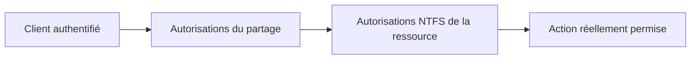

# Module 08 — Le partage de ressources

**Séquence :** Systèmes clients Microsoft  
**Fil conducteur :** rendre une ressource accessible par le réseau, contrôler ses permissions et distinguer accès aux fichiers et session distante.

## Objectifs

- Identifier le serveur, le client et la ressource dans une situation de partage.
- Accéder aux fichiers par UNC, lecteur réseau, commandes `net` et PowerShell.
- Configurer les permissions de partage et NTFS puis tester le résultat.
- Préparer et utiliser le Bureau à distance dans le scénario du TP.

## 1. Les principes du partage

Un partage rend une ressource **hébergée par un serveur** accessible **depuis un client**, à travers le réseau. La ressource peut être un dossier, une arborescence, un volume ou une imprimante. Les mots serveur et client décrivent ici le rôle joué : un poste fixe ou portable, un serveur, un copieur ou un autre équipement peut fournir ou consommer une ressource selon ses fonctionnalités.

Créer un partage requiert les privilèges administratifs du scénario, car cela modifie le système. Y accéder demande une authentification : compte local connu de la machine hébergeant le partage, ou compte de domaine selon l’environnement.

**Illustration IA / externe au cours — contrôles d’un accès distant à un dossier.**



Le partage propose **Lecture**, **Modifier** et **Contrôle total**. Une autorisation large au niveau du partage n’efface pas une restriction NTFS : les deux niveaux doivent permettre l’action demandée. Un accès local au dossier et un accès par le réseau ne constituent donc pas le même test.

## 2. Accéder à des fichiers partagés

| Méthode | Exemple du support | Usage |
|---|---|---|
| Chemin UNC dans l’Explorateur | `\\serveur\partage` | Accès ponctuel. |
| Connecter un lecteur réseau | Lettre associée au partage | Accès durable mémorisé avec le profil de l’utilisateur. |
| Invite de commandes | `net use` | Connexion en ligne de commande. |
| PowerShell | `New-SmbMapping` | Création d’une correspondance SMB. |

```bat
net use z: \\serveur\partage
net view
```

```powershell
New-SmbMapping -LocalPath 'R:' -RemotePath '\\SRV-FIC\Compta'
```

`net view` permet de consulter les partages ; une lettre mappée est une commodité du client, pas un dossier supplémentaire créé sur le serveur. Vérifier le chemin UNC et l’identité utilisée avant de conclure qu’un partage est absent.

## 3. Créer et observer un partage

Dans l’Explorateur, ouvrir les propriétés du conteneur, puis **Partage → Partage avancé**. Le cours distingue le partage simplifié orienté utilisateur, qu’il conseille d’éviter ici, du partage avancé. La configuration présentée par défaut utilise Tout le monde en Lecture ; le scénario préfère **Utilisateurs authentifiés**, avec une gestion précise des permissions NTFS.

La console **Dossiers partagés**, `fsmgmt.msc`, montre les partages actifs, propose un assistant de création et affiche les **Sessions**, **Fichiers ouverts** et partages administratifs générés par le système.

Exemples de création conservés du support :

```bat
net share commun=d:\Note_de_service /grant:"utilisateurs authentifiés",FULL
```

```powershell
New-SmbShare -Name "VMSFiles" -Path "C:\ClusterStorage\Volume1\VMFiles" -FullAccess "Authenticated Users"
```

Ces exemples illustrent le nom du partage, le chemin local et l’identité autorisée. Ils ne remplacent pas le contrôle NTFS du dossier. La [référence Microsoft de New-SmbShare](https://learn.microsoft.com/en-us/powershell/module/smbshare/new-smbshare?view=windowsserver2025-ps) constitue un complément externe pour identifier les paramètres.

## 4. Bureau à distance : accéder à une session

Le **Bureau à distance** fournit une session sur la machine cible, avec un compte valide et les privilèges nécessaires. Le support cite la maintenance des postes, l’administration des serveurs et l’accès à son environnement depuis l’extérieur via VPN. Il distingue une session de maintenance sur un poste client des sessions administratives de serveur, pour lesquelles il présente deux sessions simultanées et le risque de les laisser ouvertes.

Le client **Connexion Bureau à distance** comporte des onglets de personnalisation, permet d’enregistrer les paramètres et de rediriger certaines ressources locales vers le poste distant. En ligne de commande :

```bat
mstsc /v:serveur
```

Sur la cible, le support passe par **Système → Paramètres système avancés → Utilisation à distance**. La fonctionnalité est initialement désactivée dans le laboratoire. Il présente l’authentification standard et **NLA**, l’autorisation initiale des administrateurs et le protocole **RDP, port 3389**. Contrôler aussi les profils auxquels s’appliquent les règles du pare-feu.

!!! tip "Complément externe — session et configuration"
    `mstsc` est l’outil de connexion, non le bouton d’activation du service sur la cible. Il peut aussi ouvrir ou éditer une configuration `.rdp`. [Référence Microsoft mstsc](https://learn.microsoft.com/en-us/windows-server/administration/windows-commands/mstsc).

## 5. TP guidé — environ 1 heure

Les deux VM, Win10-XX et Discovery, doivent d’abord communiquer. Le TP s’appuie sur Echange, les groupes et les ACL des modules précédents.

### A. Partager Echange sous le nom CoWorkerShare

1. Sur Win10-XX, ouvrir les propriétés du dossier **Echange**, lecteur `D:`.
2. Choisir **Partage avancé**, cocher **Partager ce dossier** et nommer le partage `CoWorkerShare`.
3. Dans les autorisations du partage, retirer Tout le monde, ajouter Utilisateurs authentifiés en Contrôle total, comme dans la correction.
4. Dans **Sécurité**, vérifier que **`L_Collegues`** possède Modification sur le dossier ; l’ajouter si nécessaire.
5. Depuis Discovery, ouvrir `\\ADRESSE_IP_WIN10\CoWorkerShare` en remplaçant le marqueur par l’adresse relevée.
6. À la demande d’authentification, utiliser un compte de Win10-XX membre de `L_Collegues` et créer **TestPartage**.

Le test de création prouve davantage qu’une simple ouverture du partage. La correction demande ensuite de fermer la session de Discovery pour renouveler le contexte d’accès.

### B. Partager les manuels pour enrichir la FAQ

Le dossier **manuels d’utilisation** de TOOLS doit accepter des documents texte et des images. La correction attribue **Modification** au groupe Utilisateurs au niveau NTFS, ouvre le partage `manuels d’utilisation` avec Utilisateurs authentifiés en Contrôle total, puis le teste depuis Discovery avec un membre de `L_Collegues`.

Utiliser le chemin UNC du partage, s’authentifier avec le compte du laboratoire et créer **TestManuelsUtil**. Ce scénario est plus ouvert que le seul groupe `L_Collegues` au niveau NTFS : le choix de la correction est explicitement conservé, sans le présenter comme une règle universelle pour toute FAQ.

### C. Inspecter les partages administratifs de Discovery

```powershell
Get-SmbShare
Get-FileShare
Get-SmbShare ADMIN$
Get-SmbShareAccess N$
```

La correction situe `ADMIN$` dans `C:\Windows` et décrit `N$` comme accessible en Contrôle total aux Administrateurs, Opérateurs de sauvegarde et à l’entité INTERACTIF dans cette VM. Lire les propriétés **Path** et les identités de la liste d’accès pour vérifier le résultat sur le laboratoire. Les noms se terminant par `$` sont conservés littéralement.

### D. Préparer la session distante sur Discovery

1. Ouvrir `sysdm.cpl`, onglet **Utilisation à distance**, et constater l’état initial.
2. Autoriser les connexions distantes et ajouter les utilisateurs demandés.
3. La correction associe **Géraldine au login `giannis`**, **Laurent au login `lebron`**. Ce sont les identités du scénario, distinctes des noms affichés.
4. Sur Win10-XX, lancer Connexion Bureau à distance et renseigner l’adresse de Discovery, puis le compte de Géraldine du laboratoire.
5. Contrôler l’identité de la cible et la session obtenue ; la correction montre un échange de certificat à la première connexion.

### E. Distinguer accès distant et administration

Depuis la session de Géraldine, tenter l’action de modification du mot de passe de Laurent présentée dans la correction : elle échoue faute de privilège d’administration. Fermer cette session puis ouvrir celle de **`adm`** ; le compte administrateur peut réaliser l’action demandée. Une autorisation de connexion RDP ne transforme donc pas un utilisateur standard en administrateur.

À la fin, **se déconnecter** de la session distante selon la consigne, au lieu de laisser la session du TP ouverte.

## 6. Mini-quiz — 5 questions

1. Quels sont les deux niveaux d’autorisation d’un dossier accessible par un partage ?
2. Que désigne `\\serveur\partage` ?
3. Quelle console affiche sessions et fichiers ouverts sur les partages ?
4. Quel outil lance une connexion Bureau à distance ?
5. Pourquoi Géraldine peut-elle ouvrir une session distante sans pouvoir modifier le mot de passe de Laurent ?

??? success "Réponses commentées"
    1. Les autorisations de partage et les autorisations NTFS.
    2. Un chemin UNC vers une ressource partagée sur un serveur.
    3. Dossiers partagés, `fsmgmt.msc`.
    4. Connexion Bureau à distance, ou `mstsc`.
    5. Le droit d’ouvrir la session et les privilèges d’administration sont distincts.

## Pour pratiquer et réviser

- [TP — présentation](../../tp/systemes-clients/module-08/index.md)
- [Énoncé complet](../../tp/systemes-clients/module-08/enonces.md) et [correction](../../tp/systemes-clients/module-08/corrections.md)
- [Fiche de révision](../../revision/systemes-clients/module-08-le-partage-de-ressources.md)
- [Kahoot existant](../../kahoot/02-systemes-clients-microsoft-08-le-partage-de-ressources.md)
- [Retour à la formation](index.md)

## Sources et choix éditoriaux

Support M08, énoncé et correction lus en lecture seule dans le Drive. Les noms, chemins, groupes et choix de permissions de la correction ont été conservés et contextualisés. Le schéma, les tableaux et le mini-quiz sont des aides pédagogiques ; les deux références Microsoft sont des compléments externes. **Cours Original** fournit les transcriptions et captures isolées.
