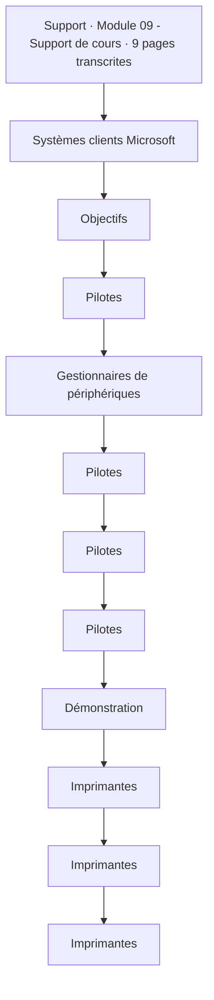
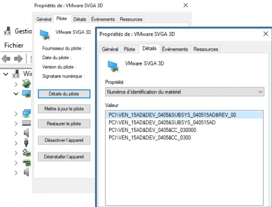
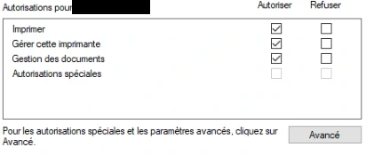
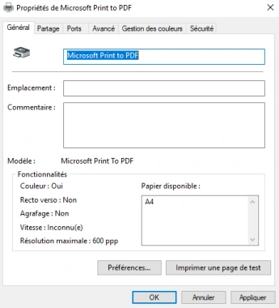
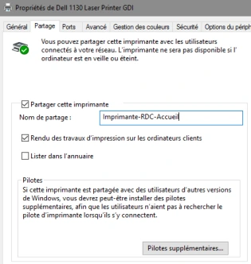
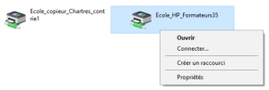
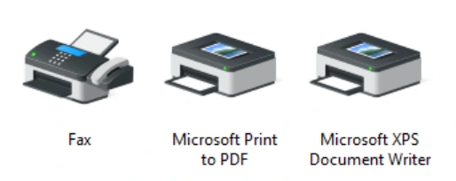
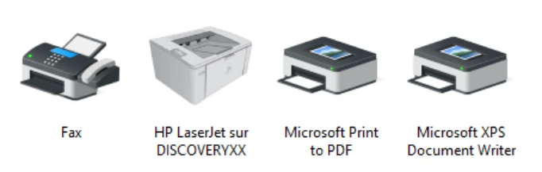
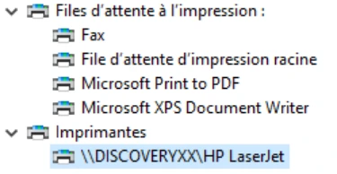

# Module 09 — Les pilotes et les imprimantes

Les parties ci-dessous reprennent le cours original, dans le même ordre. Les encadrés et les schémas répètent ses formulations.

## Parcours de lecture

1. Support · Module 09 - Support de cours · 9 pages transcrites
2. Systèmes clients Microsoft
3. Objectifs
4. Pilotes
5. Gestionnaires de périphériques
6. Pilotes
7. Pilotes
8. Pilotes
9. Démonstration
10. Imprimantes
11. Imprimantes
12. Imprimantes
13. Imprimantes
14. Imprimantes
15. Imprimantes
16. Démonstration
17. TP
18. Conclusion
19. Énoncé · Enonc‚ du TP - Les pilotes et les imprimantes · 4 pages transcrites
20. Systèmes Clients Microsoft Les pilotes et les imprimantes
21. Énoncé
22. Solution
23. Correction · Solution du TP - Les pilotes et imprimantes · 4 pages transcrites
24. Les pilotes et les imprimantes
25. Proposition de solution

**Visuel externe**



SOURCE DRIVE · TRANSCRIPTION DU SUPPORT

Le contenu des documents du dossier TSSR est transcrit ci-dessous, page par page. Les textes et tableaux sont intégrés à la page Web. Aucun fichier PDF, aucune diapositive entière ni aucune reproduction de page n’est affiché. Seuls des croquis ou visuels isolés et vérifiés peuvent accompagner la transcription. Les versions et les consignes restent celles des supports de formation. Les compléments IA sont conservés dans leur onglet distinct.

## Support · Module 09 - Support de cours · 9 pages transcrites

## Systèmes clients Microsoft

!!! note "À retenir"
    Module 09 – Les pilotes et les imprimantes

Module 09 – Les pilotes et les imprimantes

## Objectifs

!!! note "À retenir"
    Définir un pilote Windows et les pilotes Windows et les imprimantes Utiliser, configurer une imprimante Partager une ressource « imprimante »

**Visuel externe**


- Définir un pilote
- Windows et les pilotes
- Windows et les imprimantes
- Utiliser, configurer une imprimante
- Partager une ressource « imprimante »

## Pilotes

!!! note "À retenir"
    Prise en charge du matériel Plug and Play : prise en charge « à chaud » Non Plug and Play : nécessite un redémarrage (plus rare) Plusieurs modes de prise en charge Détection et installation automatique Détection et installation manuelle Affichage et paramétrage Outil Gestionnaire de périphériques Devmgmt.msc

**Visuel externe**


- Prise en charge du matériel
- Plug and Play : prise en charge « à chaud »
- Non Plug and Play : nécessite un redémarrage (plus rare)
- Plusieurs modes de prise en charge
- Détection et installation automatique
- Détection et installation manuelle
- Affichage et paramétrage
- Outil Gestionnaire de périphériques
- Devmgmt.msc

## Gestionnaires de périphériques

!!! note "À retenir"
    Affichage des composants pris en charge et non pris en charge Mettre à jour, désactiver, désinstaller Fonctionnalités avancées : Restaurer le pilote, informations détaillées, paramètres Illustration isolée du support — Module 09 - Support de cours

- Affichage des composants pris en charge et non pris en charge
- Mettre à jour, désactiver, désinstaller
- Fonctionnalités avancées : Restaurer le pilote, informations détaillées, paramètres



Illustration isolée du support — Module 09 - Support de cours

## Pilotes

**Visuel externe**


- Pour la gestion des composants matériel et logiciel
- Spécifiques à chaque architecture : 32 bits ou 64 bits
- Les pilotes signés sont privilégiés par Microsoft
- Les certificats sont délivrés par Microsoft ou générés en suivant les procédures fournies par Microsoft
- Ils permettent de garantir la stabilité des systèmes
- Ils sont obligatoires pour les éditions 64 bits
- Les principaux fichiers
- *.inf : définition du pilote au format texte
- *.sys : pilote lui-même
- *.cat : certificat fourni par Microsoft ou un tiers de confiance
- *.exe, *.dll, *.xml… : fichiers complémentaires selon les besoins

## Pilotes

**Visuel externe**


- La prise en charge se fait à partir du fichier INF
- Directement depuis le fichier (clic droit Installer)
- À partir d’un assistant d’installation (setup.exe) ou de mise à jour
- Une fois installé, le pilote est mémorisé par le système
- Permet sa réinstallation automatique
- Fichiers INF dans C:\Windows\inf
- Chaque pilote installé manuellement génère un fichier oemXX.inf
- Autres fichiers dans C:\Windows\system32 et C:\Windows\sysWOW64
- Le magasin de pilotes Windows
- Pour une prise en charge immédiate du matériel (installation du système)
- Emplacement : C:\Windows\System32\DriverStore
- Gestion du magasin en ligne de commande avec pnputil

## Pilotes

En complément

- msinfo32 pour le détail du matériel
- driverquery : outil CMD pour lister les pilotes installés
- driverquery /SI pour lister les pilotes signés
- pnputil : gestion du magasin de pilotes (ajout, suppression, information)
- pnputil /enum-drivers pour lister les pilotes tiers (oemXX.inf)
- pnputil /add-driver pilote.inf pour ajouter un pilote au magasin

## Démonstration

## Imprimantes

| Vocabulaire | Définition du support |
| --- | --- |
| Périphérique d’impression | Le matériel : moteur permettant de sortir la feuille imprimée. |
| Imprimante | Le logiciel : envoie l’ordre d’impression au périphérique d’impression (pilote, configuration, file d’attente d’impression, port d’impression). |
| File d’attente d’impression | Service spouleur : conversion numérique du document dans un langage interprétable par le périphérique d’impression. Envoi du job vers le port d’impression. |
| Imprimante locale | Périphérique d’impression directement relié à l’ordinateur via un port local. |
| Imprimante partagée | Imprimante locale partagée sur le réseau grâce à l’OS de l’ordinateur. Disponible si et seulement si l’ordinateur est allumé. |
| Imprimante réseau | Imprimante indépendante. Possède son propre OS, une interface réseau, un service web pour la configuration. |

## Imprimantes

Imprimante locale

- Directement reconnue par le système
- Utilisation d'un pilote générique du magasin de pilote
- Possibilité d'installer le pilote signé du constructeur pour plus de fonctionnalités
- Sécurité NTFS de l'imprimante

(Propriétés de l'imprimante onglet Sécurité)



Illustration isolée du support — Module 09 - Support de cours

## Imprimantes

!!! note "À retenir"
    Imprimante locale Disponible via le composant du Panneau de configuration Visualiser la file d'attente et autres options Éditer les propriétés de l'imprimante Informations générales Options avancées (horaire de production, priorité…)

Imprimante locale

- Disponible via le composant du Panneau de configuration
- Visualiser la file d'attente et autres options
- Éditer les propriétés de l'imprimante
- Informations générales
- Options avancées (horaire de production, priorité…)

## Imprimantes

Imprimante locale

- Disponible via le composant du Panneau de configuration
- Visualiser la file d'attente et autres options
- Éditer les propriétés de l'imprimante
- Informations générales
- Options avancées (horaire de production, priorité…)
- Partager l'imprimante locale sur le réseau
- Disponible et utilisable via le réseau de l'entreprise
- Accessible depuis le chemin UNC : \\serveur\imprimante
- Disponible si l'ordinateur hôte est allumé
- Les droits NTFS s'appliquent



Illustration isolée du support — Module 09 - Support de cours



Illustration isolée du support — Module 09 - Support de cours

## Imprimantes

Imprimante réseau

- Les imprimantes sont généralement raccordées au réseau de l’entreprise
- Le service de rôle Serveur d’impression pour
- Partager plusieurs imprimantes
- Centraliser la gestion des imprimantes
- Simplifier l'accès et la gestion des imprimantes

Réseau

Depuis le client

- Accès au serveur d'impression depuis le chemin UNC
- …puis connecter…

## Imprimantes

Le spouleur d'impression

- Programme qui gère la file d'attente
- Envoie les travaux d'impression au périphérique d'impression
- Peut être déplacé via une clé de la base de registre

Créer un pool d'impression

- Imprimante connectée à plusieurs périphériques d'impression
- Distribuer automatiquement les travaux d'impression à la prochaine imprimante disponible
- Réduit les délais d'attente des documents pour les utilisateurs.



Illustration isolée du support — Module 09 - Support de cours

## Démonstration

## TP

## Conclusion

!!! note "À retenir"
    Les périphériques ont besoin D’une liaison à un ordinateur Liaison locale Liaison réseau Les ordinateurs ont besoin D’un « mode d’emploi » du périphérique Les imprimantes sont des ressources à part entière Référence du document : 1yLnisoK5zTai4MhKpPNzNqRt4iXBSVHH · SHA-256 f5f6f49eafb0aeb3…

- Les périphériques ont besoin
- D’une liaison à un ordinateur
- Liaison locale
- Liaison réseau
- Les ordinateurs ont besoin
- D’un « mode d’emploi » du périphérique
- Les imprimantes sont des ressources à part entière

Référence du document : 1yLnisoK5zTai4MhKpPNzNqRt4iXBSVHH · SHA-256 f5f6f49eafb0aeb3…

## Énoncé · Enonc‚ du TP - Les pilotes et les imprimantes · 4 pages transcrites

## Systèmes Clients Microsoft Les pilotes et les imprimantes

### TP du Module 09 – Les pilotes et les imprimantes

!!! note "À retenir"
    Au cours de ce TP, vous serez amené à rechercher et à afficher des informations concernant les pilotes et les imprimantes de votre VM Windows 10 ainsi que de votre seconde VM.

Au cours de ce TP, vous serez amené à rechercher et à afficher des informations concernant les pilotes et les imprimantes de votre VM Windows 10 ainsi que de votre seconde VM. Votre seconde VM héberge une imprimante et il s'agira d'y accéder via le réseau, de l'installer et de vérifier sa présence sur votre système.

Durée estimée

1 heure

## Énoncé

!!! note "À retenir"
    Lisez l'ensemble de cet atelier avant de vous lancer dans la pratique

Lisez l'ensemble de cet atelier avant de vous lancer dans la pratique

### Sur Win10-XX

- Avec la commande cmd.exe adaptée, générez les fichiers CSV suivants :

o Pilotes_detail.csv recensant les informations détaillées sur l’ensemble des pilotes

o Pilotes_signature.csv contenant les informations sur la signature des pilotes

- Vous pourrez ouvrir et convertir ces fichiers avec Excel

- Avec l'interface graphique

o Affichez les informations détaillées sur le pilote graphique avec la console MMC adaptée. Retrouvez le VENDOR_ID et le DEVICE_ID du périphérique.

### Gestion des imprimantes Quelles sont les 4 imprimantes disponibles par défaut sur votre VM Win10-XX ? Les retrouvez-vous dans la console MMC adaptée ?

- Éditez les propriétés de l'imprimante Microsoft Print to PDF

o Faites en sorte que Microsoft Print to PDF soit définie comme imprimante par défaut. Sans configuration particulière, l'imprimante sortira des documents en orientation paysage. Imprimez une page de test pour vérification.

- Depuis votre VM Win10-XX, connectez-vous à l'imprimante partagée HP_LaserJet_Accueil_RDC_Bât2 disponible via Discovery.

o Attendez quelques minutes le temps que le pilote s'installe puis vérifier sa présence dans le panneau de configuration et dans la console MMC adaptée

### Sur Discovery Gestion de configurations personnalisées

- À l'aide de PowerShell, afficher les informations par défaut concernant l'imprimante "HP LaserJet".
- Affichez maintenant les informations suivantes concernant "HP LaserJet" :

o Son nom

o Si elle est partagée ou non

o Le nom du partage

o Le nom du port

o Son emplacement

o Sa priorité

## Solution

Une solution est proposée pour ce TP sous la forme d'un PDF commenté, disponible dans les ressources à télécharger.

Référence du document : 1gil6UWwobVqnHO-vdeev-U6K8dHlkDEa · SHA-256 ad95c9c4657c7087…

## Correction · Solution du TP - Les pilotes et imprimantes · 4 pages transcrites

Correction originale : à consulter après avoir tenté l’exercice.

## Les pilotes et les imprimantes

### TP du Module 09 – Les pilotes et les imprimantes

## Proposition de solution

Sur Win10-XX

- Avec la commande cmd.exe adaptée, générez les fichiers CSV suivants :

o Pilotes_detail.csv recensant les informations détaillées sur l’ensemble des

pilotes

o Pilotes_signature.csv contenant les informations sur la signature des pilotes

- Vous pourrez ouvrir et convertir ces fichiers avec Excel

```
driverquery /v /fo CSV > pilotes_details.csv
```

```
driverquery /si /fo CSV > pilotes_signatures.csv
```

Possibilités d'ouvrir les fichiers CSV avec Excel

Sélectionner la colonne A

Menu Données

Convertir

Délimité > Suivant

Cocher Virgule

Terminer

- Avec l'interface graphique

o Affichez les informations détaillées sur le pilote graphique avec la console

MMC adaptée. Retrouvez le VENDOR_ID et le DEVICE_ID du périphérique.

Rechercher > devmgmt.msc

Déployez le nœud Cartes graphiques

Clic droit sur VMware SVGA 3D > Propriétés

Onglet Détails

Propriété ID compatibles

Le VENDOR_ID est 15AD

Le DEVICE_ID est 0405

Il est possible de se rendre sur le site www.pcilookup.com et d'y renseigner ces ID pour retrouver des informations sur le matériel en question.

Gestion des imprimantes

Quelles sont les imprimantes disponibles par défaut sur votre VM Win10-XX ? Les retrouvez- vous dans la console MMC adaptée ?

Panneau de configuration

Matériel et audio

Périphériques et imprimantes

Les imprimantes disponibles par défaut sont FAX, Microsoft Print to PDF, Microsoft XPS Document Writer

Dans la console Gestionnaire de périphérique

Nœud Files d'attente à l'impression, nous retrouvons nos imprimantes.

- Éditez les propriétés de l'imprimante Microsoft Print to PDF

o Faites en sorte que Microsoft Print to PDF soit définie comme imprimante par

défaut. Sans configuration particulière, l'imprimante sortira des documents en orientation paysage. Imprimez une page de test pour vérification.

Clic droit sur l'imprimante Microsoft Print to PDF > Définir comme imprimante par défaut

Clic droit sur l'imprimante Microsoft Print to PDF > Propriétés de l'imprimante

Préférence

Orientation : Paysage

OK

Imprimer une page de test



Illustration isolée du support — Solution du TP - Les pilotes et imprimantes

Cette imprimante est virtuelle et va sortir un document numérique au format PDF.

Indiquer le nom et l'emplacement du futur document (par exemple sur le bureau) et vérifiez qu'il est bien au format paysage

- Depuis votre VM Win10-XX, connectez-vous à l'imprimante partagée HP_LaserJet_Accueil_RDC_Bât2 disponible via Discovery

o Attendez quelques minutes le temps que le pilote s'installe puis vérifier sa

présence dans le panneau de configuration et dans la console MMC adaptée

Avec votre explorateur Windows, dans la barre de navigation, entrez le chemin UNC suivant \\@ ip de Discovery\HP_LaserJet_Accueil_RDC_Bât2

Renseigner les login / mdp de l'utilisateur adm lorsque vous êtes challengé.

Faites un clic droit sur HP_LaserJet_Accueil_RDC_Bât > Connecter…

Au bout d'un certain temps, la nouvelle imprimante partagée apparaît dans la liste des imprimantes dans le panneau de configuration.

Sur Discovery

Gestion de configurations personnalisées

- À l'aide de PowerShell, afficher les informations par défaut concernant l'imprimante "HP LaserJet"

```
Get-Printer -name "HP LaserJet"
```

- Affichez maintenant les informations suivantes concernant "HP LaserJet" :

o Son nom

o Si elle est partagée ou non



Illustration isolée du support — Solution du TP - Les pilotes et imprimantes



Illustration isolée du support — Solution du TP - Les pilotes et imprimantes

o Le nom du partage

o Le nom du port

o Son emplacement

o Sa priorité

```
Get-Printer -Name "HP LaserJet" | select Name,Shared,ShareName,PortName,Location, Priority
```

Référence du document : 124yp7LoB3rJdpK1_0wRpKCBh31RDAZAT · SHA-256 baa642b049964f05…

## Fiche de synthèse

Les lignes reprennent les titres du cours et la première phrase de chaque partie.

| Partie | Repère du cours |
| --- | --- |
| Systèmes clients Microsoft | Module 09 – Les pilotes et les imprimantes |
| Objectifs | Définir un pilote Windows et les pilotes Windows et les imprimantes Utiliser, configurer une imprimante Partager une ressource « imprimante » |
| Pilotes | Prise en charge du matériel Plug and Play : prise en charge « à chaud » Non Plug and Play : nécessite un redémarrage (plus rare) Plusieurs modes de prise en charge Détection et… |
| Gestionnaires de périphériques | Affichage des composants pris en charge et non pris en charge Mettre à jour, désactiver, désinstaller Fonctionnalités avancées : Restaurer le pilote, informations détaillées, pa… |
| Pilotes | Pour la gestion des composants matériel et logiciel Spécifiques à chaque architecture : 32 bits ou 64 bits Les pilotes signés sont privilégiés par Microsoft Les certificats sont… |
| Pilotes | La prise en charge se fait à partir du fichier INF Directement depuis le fichier (clic droit Installer) À partir d’un assistant d’installation (setup.exe) ou de mise à jour Une… |
| Pilotes | En complément msinfo32 pour le détail du matériel driverquery : outil CMD pour lister les pilotes installés driverquery /SI pour lister les pilotes signés pnputil : gestion du m… |
| Imprimantes | Imprimante locale Directement reconnue par le système Utilisation d'un pilote générique du magasin de pilote Possibilité d'installer le pilote signé du constructeur pour plus de… |
| Imprimantes | Imprimante locale Disponible via le composant du Panneau de configuration Visualiser la file d'attente et autres options Éditer les propriétés de l'imprimante Informations génér… |
| Imprimantes | Imprimante locale Disponible via le composant du Panneau de configuration Visualiser la file d'attente et autres options Éditer les propriétés de l'imprimante Informations génér… |
| Imprimantes | Imprimante réseau Les imprimantes sont généralement raccordées au réseau de l’entreprise Le service de rôle Serveur d’impression pour Partager plusieurs imprimantes Centraliser… |
| Imprimantes | Le spouleur d'impression Programme qui gère la file d'attente Envoie les travaux d'impression au périphérique d'impression Peut être déplacé via une clé de la base de registre C… |
| Conclusion | Les périphériques ont besoin D’une liaison à un ordinateur Liaison locale Liaison réseau Les ordinateurs ont besoin D’un « mode d’emploi » du périphérique Les imprimantes sont d… |
| Énoncé | Lisez l'ensemble de cet atelier avant de vous lancer dans la pratique |
| Solution | Une solution est proposée pour ce TP sous la forme d'un PDF commenté, disponible dans les ressources à télécharger. |
| Correction · Solution du TP - Les pilotes et imprimantes · 4 pages transcrites | Correction originale : à consulter après avoir tenté l’exercice. |
| Proposition de solution | Sur Win10-XX Avec la commande cmd.exe adaptée, générez les fichiers CSV suivants : o Pilotes_detail.csv recensant les informations détaillées sur l’ensemble des pilotes o Pilote… |
