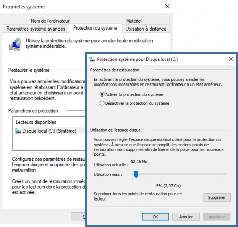
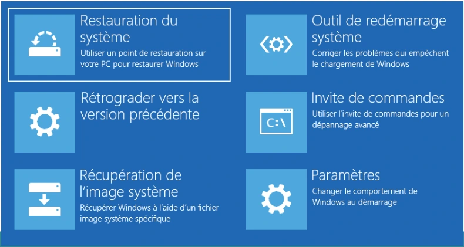

# Module 10 — La maintenance du système

[Travaux pratiques](../../tp/systemes-clients/module-10/index.md)

Les parties ci-dessous reprennent le cours original, dans le même ordre. Les encadrés et les schémas répètent ses formulations.

## Parcours de lecture

1. Support · Module 10 - Support de cours · 9 pages transcrites

**Visuel externe**

SOURCE DRIVE · TRANSCRIPTION DU SUPPORT

Le contenu des documents du dossier TSSR est transcrit ci-dessous, page par page. Les textes et tableaux sont intégrés à la page Web. Aucun fichier PDF, aucune diapositive entière ni aucune reproduction de page n’est affiché. Seuls des croquis ou visuels isolés et vérifiés peuvent accompagner la transcription. Les versions et les consignes restent celles des supports de formation. Les compléments IA sont conservés dans leur onglet distinct.

## Support · Module 10 - Support de cours · 9 pages transcrites

### La maintenance du système

Systèmes clients Microsoft — Module 10.

#### Objectifs

!!! note "À retenir"
    Découvrir des outils de diagnostics système.

**Visuel externe**

- Découvrir des outils de diagnostics système.
- Activer et gérer les points de restauration.
- Récupérer un système défaillant.

### Maintenance du système

**Visuel externe**

- Les outils de diagnostic.
- Points de restauration.
- Récupération du système.

#### Les problématiques

!!! note "À retenir"
    Performances : est-ce que le système est en mesure de réaliser les tâches ?

- Performances : est-ce que le système est en mesure de réaliser les tâches ? Quatre composants surveillés en priorité : processeur, mémoire, disque, réseau.
- Fiabilité : est-ce que le système a le comportement attendu ? Au démarrage, au lancement des services, au lancement des applications…

#### Les méthodes disponibles

!!! note "À retenir"
    Analyse en temps réel : ce qu’il se passe en ce moment.

- Analyse en temps réel : ce qu’il se passe en ce moment.
- Analyse sur un historique : ce qu’il s’est passé dernièrement (ou il y a longtemps).
- Diagnostic automatique : proposé par Windows. Certains outils proposent de résoudre automatiquement les problèmes (mais sans préciser la solution qui va être appliquée !).

### Les outils de diagnostic

#### Analyse en temps réel

| Outil | Utilisation |
| --- | --- |
| Gestionnaire de tâches | Processus, services, performances processeur et mémoire. |
| Observateur d’évènements | Contient tous les évènements enregistrés par le système. |
| Moniteur de ressources | Affichage détaillé pour les quatre composants principaux. |
| Analyseur de performances | Affichage des performances à partir de compteurs. |

#### Analyse sur un historique

| Outil | Utilisation |
| --- | --- |
| Historique de fiabilité | Vue synthétique de l’état de santé du système dans le temps. |
| Observateur d’évènements | Les évènements sont mémorisés dans des journaux, fichiers de 20 Mo par défaut. |
| Analyseur de performances | Permet de planifier des compteurs dans des plages horaires pour une analyse a posteriori. |

#### Diagnostic automatique

!!! note "À retenir"
    Diagnostic de mémoire Windows : redémarre automatiquement le système et lance une série de tests sur la mémoire physique.

- Diagnostic de mémoire Windows : redémarre automatiquement le système et lance une série de tests sur la mémoire physique.
- Composant Résolution de problème : série de packs de résolution de problèmes intégrés à Windows. Ils sont orientés utilisateur ; il n’est pas possible de choisir ou consulter la solution trouvée.

#### Dans quel but ?

!!! note "À retenir"
    Trouver des indices pour comprendre les problèmes et faire des recherches.

- Trouver des indices pour comprendre les problèmes et faire des recherches.
- Ressources : aide Windows, Technet, blogs spécialisés, moteur de recherche…

### Démonstration

### Les points de restauration système

!!! note "À retenir"
    Tel un journal, enregistrement des modifications du système : propose de les restaurer à un état antérieur ; plus rapide qu’une restauration complète ; sauvegarde le registre, certains fichiers système et les programmes ; ne sauvegarde pas les données ; désactivé par défaut ; s’active sur un lecteur.

**Visuel externe**

Tel un journal, enregistrement des modifications du système :

- propose de les restaurer à un état antérieur ;
- plus rapide qu’une restauration complète ;
- sauvegarde le registre, certains fichiers système et les programmes ;
- ne sauvegarde pas les données ;
- désactivé par défaut ;
- s’active sur un lecteur.

### Les points de restauration système

!!! note "À retenir"
    Création des points de restauration : chaque jour ; à chaque évènement important survenant sur le système (installation d’un pilote, désinstallation d’un logiciel…) ; manuellement.

**Visuel externe**

- Création des points de restauration : chaque jour ; à chaque évènement important survenant sur le système (installation d’un pilote, désinstallation d’un logiciel…) ; manuellement.
- Outil disponible via `sysdm.cpl`.
- Espace protégé alloué au stockage des points de restauration (méthode FIFO).
- Restauration possible via WinRE.

### Récupération du système — WinRE

!!! note "À retenir"
    Environnement de récupération du système d’exploitation principal de la machine.

- Environnement de récupération du système d’exploitation principal de la machine.
- Système d’exploitation léger, de réparation du système, lorsque le principal ne peut plus démarrer.
- Embarque des outils de diagnostics et des outils de réparation.
- Possibilité de réinitialiser le PC : réinstallation du système, « retour à la configuration d’usine ».

Capture du support — Protection du système et création d’un point de restauration.

### Récupération du système

#### Comment lancer WinRE ?

- Depuis le menu Démarrer : **Maj + Redémarrer**.
- En ligne de commande : `shutdown /r /o`.
- Menu **Paramètres > Mise à jour et sécurité > Récupération > Redémarrer maintenant**.
- Depuis le support d’installation, menu **Réparer l’ordinateur**.

#### Chargement automatique de WinRE

- Après deux échecs consécutifs du démarrage du système d’exploitation.
- Après deux arrêts imprévus survenus moins de deux minutes après le démarrage.

#### Options avancées

Restauration du système ; outil de redémarrage système ; rétrograder vers la version précédente ; invite de commandes ; récupération de l’image système ; paramètres.

Capture du support — Options avancées de WinRE.

### Récupération du système — options avancées

| Option | Détails du support |
| --- | --- |
| Restauration du système | Utilisation d’un point de restauration système. Privilège d’administration requis. |
| Récupération de l’image système | Utilisation d’une sauvegarde de l’image système valide « si elle existe ». Média source requis : DVD, disque dur, etc. |
| Invite de commandes | Pour utiliser des outils de diagnostic ou de réparation ; cmd exécutée en tant qu’administrateur. |
| Rétrograder vers la version précédente | Si Windows 10 est une MAN, possibilité de retrouver Windows 7 ou Windows 8.1 source. Impossibilité de rétrograder vers la build Windows 10 précédente. |
| Paramètres | Redémarrage du poste et choix de démarrage spécifique : mode sans échec ; activer le mode vidéo basse résolution ; désactiver le contrôle obligatoire des signatures de pilotes… |
| Outil de redémarrage système | Reconstruit/répare le MBR éventuellement manquant ou corrompu ; reconstruit/répare le magasin BCD. |

### Démonstration

TP

### Conclusion

- Le technicien doit être en mesure de s’informer sur l’état du système : en temps réel ; sur une période passée.
- En cas de dysfonctionnement, le technicien doit pouvoir investiguer, enquêter, réparer et/ou restaurer le système.

Référence du document : 1v2qNo6jHKYzmMG-xiz8p6mCYvyeOJA9m · SHA-256 03eef11a677ef175…
