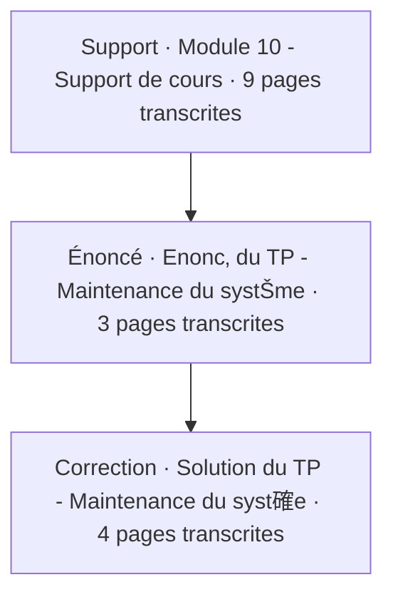
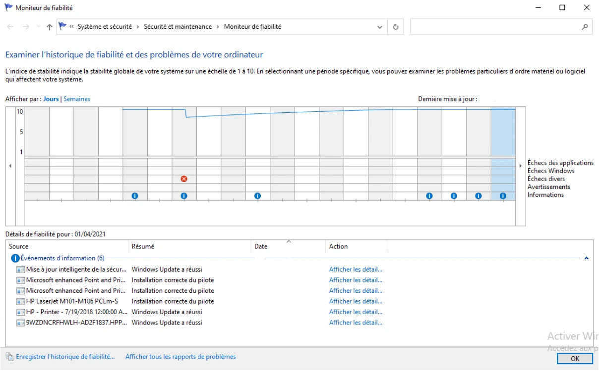
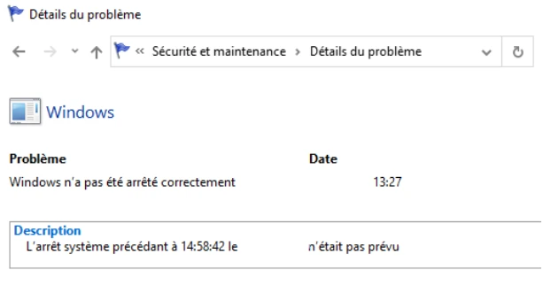

# Module 10 — La maintenance du système

Les parties ci-dessous reprennent le cours original, dans le même ordre. Les encadrés et les schémas répètent ses formulations.

## Parcours de lecture

1. Support · Module 10 - Support de cours · 9 pages transcrites
2. Énoncé · Enonc‚ du TP - Maintenance du systŠme · 3 pages transcrites
3. Correction · Solution du TP - Maintenance du syst確e · 4 pages transcrites

**Visuel externe**

SOURCE DRIVE · TRANSCRIPTION DU SUPPORT

Le contenu des documents du dossier TSSR est transcrit ci-dessous, page par page. Les textes et tableaux sont intégrés à la page Web. Aucun fichier PDF, aucune diapositive entière ni aucune reproduction de page n’est affiché. Seuls des croquis ou visuels isolés et vérifiés peuvent accompagner la transcription. Les versions et les consignes restent celles des supports de formation. Les compléments IA sont conservés dans leur onglet distinct.

## Support · Module 10 - Support de cours · 9 pages transcrites

### La maintenance du système

Systèmes clients Microsoft — Module 10.

#### Objectifs

!!! note "À retenir"
    Découvrir des outils de diagnostics système.

**Visuel externe**

- Découvrir des outils de diagnostics système.
- Activer et gérer les points de restauration.
- Récupérer un système défaillant.

### Maintenance du système

**Visuel externe**

- Les outils de diagnostic.
- Points de restauration.
- Récupération du système.

#### Les problématiques

!!! note "À retenir"
    Performances : est-ce que le système est en mesure de réaliser les tâches ?

- Performances : est-ce que le système est en mesure de réaliser les tâches ? Quatre composants surveillés en priorité : processeur, mémoire, disque, réseau.
- Fiabilité : est-ce que le système a le comportement attendu ? Au démarrage, au lancement des services, au lancement des applications…

#### Les méthodes disponibles

!!! note "À retenir"
    Analyse en temps réel : ce qu’il se passe en ce moment.

- Analyse en temps réel : ce qu’il se passe en ce moment.
- Analyse sur un historique : ce qu’il s’est passé dernièrement (ou il y a longtemps).
- Diagnostic automatique : proposé par Windows. Certains outils proposent de résoudre automatiquement les problèmes (mais sans préciser la solution qui va être appliquée !).

### Les outils de diagnostic

#### Analyse en temps réel

| Outil | Utilisation |
| --- | --- |
| Gestionnaire de tâches | Processus, services, performances processeur et mémoire. |
| Observateur d’évènements | Contient tous les évènements enregistrés par le système. |
| Moniteur de ressources | Affichage détaillé pour les quatre composants principaux. |
| Analyseur de performances | Affichage des performances à partir de compteurs. |

#### Analyse sur un historique

| Outil | Utilisation |
| --- | --- |
| Historique de fiabilité | Vue synthétique de l’état de santé du système dans le temps. |
| Observateur d’évènements | Les évènements sont mémorisés dans des journaux, fichiers de 20 Mo par défaut. |
| Analyseur de performances | Permet de planifier des compteurs dans des plages horaires pour une analyse a posteriori. |

#### Diagnostic automatique

!!! note "À retenir"
    Diagnostic de mémoire Windows : redémarre automatiquement le système et lance une série de tests sur la mémoire physique.

- Diagnostic de mémoire Windows : redémarre automatiquement le système et lance une série de tests sur la mémoire physique.
- Composant Résolution de problème : série de packs de résolution de problèmes intégrés à Windows. Ils sont orientés utilisateur ; il n’est pas possible de choisir ou consulter la solution trouvée.

#### Dans quel but ?

!!! note "À retenir"
    Trouver des indices pour comprendre les problèmes et faire des recherches.

- Trouver des indices pour comprendre les problèmes et faire des recherches.
- Ressources : aide Windows, Technet, blogs spécialisés, moteur de recherche…

### Démonstration

### Les points de restauration système

!!! note "À retenir"
    Tel un journal, enregistrement des modifications du système : propose de les restaurer à un état antérieur ; plus rapide qu’une restauration complète ; sauvegarde le registre, certains fichiers système et les programmes ; ne sauvegarde pas les données ; désactivé par défaut ; s’active sur un lecteur.

**Visuel externe**

Tel un journal, enregistrement des modifications du système :

- propose de les restaurer à un état antérieur ;
- plus rapide qu’une restauration complète ;
- sauvegarde le registre, certains fichiers système et les programmes ;
- ne sauvegarde pas les données ;
- désactivé par défaut ;
- s’active sur un lecteur.

### Les points de restauration système

!!! note "À retenir"
    Création des points de restauration : chaque jour ; à chaque évènement important survenant sur le système (installation d’un pilote, désinstallation d’un logiciel…) ; manuellement.

**Visuel externe**

- Création des points de restauration : chaque jour ; à chaque évènement important survenant sur le système (installation d’un pilote, désinstallation d’un logiciel…) ; manuellement.
- Outil disponible via `sysdm.cpl`.
- Espace protégé alloué au stockage des points de restauration (méthode FIFO).
- Restauration possible via WinRE.

### Récupération du système — WinRE

!!! note "À retenir"
    Environnement de récupération du système d’exploitation principal de la machine.

- Environnement de récupération du système d’exploitation principal de la machine.
- Système d’exploitation léger, de réparation du système, lorsque le principal ne peut plus démarrer.
- Embarque des outils de diagnostics et des outils de réparation.
- Possibilité de réinitialiser le PC : réinstallation du système, « retour à la configuration d’usine ».

Capture du support — Protection du système et création d’un point de restauration.

### Récupération du système

#### Comment lancer WinRE ?

- Depuis le menu Démarrer : **Maj + Redémarrer**.
- En ligne de commande : `shutdown /r /o`.
- Menu **Paramètres > Mise à jour et sécurité > Récupération > Redémarrer maintenant**.
- Depuis le support d’installation, menu **Réparer l’ordinateur**.

#### Chargement automatique de WinRE

- Après deux échecs consécutifs du démarrage du système d’exploitation.
- Après deux arrêts imprévus survenus moins de deux minutes après le démarrage.

#### Options avancées

Restauration du système ; outil de redémarrage système ; rétrograder vers la version précédente ; invite de commandes ; récupération de l’image système ; paramètres.

Capture du support — Options avancées de WinRE.

### Récupération du système — options avancées

| Option | Détails du support |
| --- | --- |
| Restauration du système | Utilisation d’un point de restauration système. Privilège d’administration requis. |
| Récupération de l’image système | Utilisation d’une sauvegarde de l’image système valide « si elle existe ». Média source requis : DVD, disque dur, etc. |
| Invite de commandes | Pour utiliser des outils de diagnostic ou de réparation ; cmd exécutée en tant qu’administrateur. |
| Rétrograder vers la version précédente | Si Windows 10 est une MAN, possibilité de retrouver Windows 7 ou Windows 8.1 source. Impossibilité de rétrograder vers la build Windows 10 précédente. |
| Paramètres | Redémarrage du poste et choix de démarrage spécifique : mode sans échec ; activer le mode vidéo basse résolution ; désactiver le contrôle obligatoire des signatures de pilotes… |
| Outil de redémarrage système | Reconstruit/répare le MBR éventuellement manquant ou corrompu ; reconstruit/répare le magasin BCD. |

### Démonstration

### TP

### Conclusion

- Le technicien doit être en mesure de s’informer sur l’état du système : en temps réel ; sur une période passée.
- En cas de dysfonctionnement, le technicien doit pouvoir investiguer, enquêter, réparer et/ou restaurer le système.

Référence du document : 1v2qNo6jHKYzmMG-xiz8p6mCYvyeOJA9m · SHA-256 03eef11a677ef175…

## Énoncé · Enonc‚ du TP - Maintenance du systŠme · 3 pages transcrites

### Maintenance du système

TP du Module 10 — La maintenance du système. **Durée estimée : 1 heure 30 minutes.**

Lors de ce TP, vous serez amené à découvrir les tableaux de bord de diagnostics, en temps réel et sur un historique. Vous observerez le comportement de votre système en état de marche. Vous réaliserez un point de restauration et vous observerez les conséquences d’une restauration à l’aide de WinRE.

#### Énoncé

Lisez l’ensemble de ce TP avant de vous lancer dans la pratique.

Sur **Win10-XX**, affichez et analysez les problèmes majeurs survenus sur votre système :

- depuis le démarrage de votre VM et de manière synthétique ;
- de manière détaillée sur le dernier évènement critique. Au cas où aucun évènement critique n’est survenu depuis le début du module, procédez à un arrêt brutal de votre VM WorkStation : **PowerOFF**.

#### Analyse en temps réel

- Lancez plusieurs tâches : copiez un gros fichier disponible sur les ressources à télécharger, démarrez les applications console PowerShell, Gestionnaire des tâches, Edge…
- Avec les outils adaptés et en temps réel, recherchez les processus qui consomment le plus de performances sur les quatre composants principaux.

### Analyse en temps réel — relevé

Remplissez le tableau suivant ; indiquez les ressources utilisées lors du traitement des différentes tâches en cours.

| Ressources | Observations |
| --- | --- |
| Processeurs | À compléter. |
| Mémoire | À compléter. |
| Réseau | À compléter. |
| Disque dur | À compléter. |

### Sauvegarde de l’état du système et des données

Préparation :

1. Vérifiez la configuration de la **Protection du système**.
2. Vérifiez les points de restauration disponibles.
3. Créez si nécessaire un point de restauration manuel.
4. Créez des fichiers dans le répertoire **Documents** de l’utilisateur en cours d’utilisation.
5. Désactivez ou désinstallez des fonctionnalités Windows de votre système : Lecteur Windows Media, IE11.

### Restauration du système

- À l’aide de WinRE, vous restaurez l’état du système grâce au dernier point de restauration disponible puis démarrez Windows normalement.
- Retrouvez-vous les fichiers dans le dossier **Documents** du dernier utilisateur ? Pouvez-vous lancer IE11 ? Le lecteur Windows Media ? Pourquoi ?

### Solution

Une solution est proposée pour ce TP sous la forme d’un PDF commenté, disponible dans les ressources à télécharger.

Référence du document : 1FbEMAW3ph860rbm4N_VaVZNaoAZ4-S6J · SHA-256 3e8c5e4191fdf59a…

## Correction · Solution du TP - Maintenance du syst確e · 4 pages transcrites

Correction originale : à consulter après avoir tenté l’exercice.

### Maintenance du système — proposition de solution

TP du Module 10 — La maintenance du système.

#### Sur Win10-XX

Affichez et analysez les problèmes majeurs survenus sur votre système :

- depuis le démarrage de votre VM et de manière synthétique ;
- de manière détaillée sur le dernier évènement critique. Au cas où aucun évènement critique n’est survenu depuis le début du module, procédez à un arrêt brutal de votre VM WorkStation : **PowerOFF**.

**Rechercher > Afficher l’historique de fiabilité**.

L’indice de fiabilité a chuté le jour où des échecs divers sont survenus, symbolisés par la croix blanche dans le cercle rouge, puis est remonté petit à petit les jours suivants.

Double clic sur l’évènement critique.

Capture du support — Historique de fiabilité et évènement critique du scénario.

### Analyse en temps réel

- Lancez plusieurs tâches : copiez un gros fichier disponible sur le partage **[CHEMIN A INDIQUER]**, démarrez les applications console PowerShell, Gestionnaire des tâches, Edge…
- Avec les outils adaptés et en temps réel, recherchez les processus qui consomment le plus de performances sur les quatre composants principaux.
- Remplissez le tableau suivant ; indiquez les ressources utilisées lors du traitement des différentes tâches en cours.

À l’aide du Gestionnaire de tâches et du Moniteur de ressources, vous pouvez lire, trier les informations puis les indiquer dans le tableau. Il n’existe pas de correction typique ici puisque les informations varient en fonction des ressources matérielles et de l’utilisation de la bande passante.

| Ressources | Observations |
| --- | --- |
| Processeurs | À relever sur la machine. |
| Mémoire | À relever sur la machine. |
| Réseau | À relever sur la machine. |
| Disque dur | À relever sur la machine. |

### Sauvegarde de l’état du système et des données — préparation

1. Vérifiez la configuration de la Protection du système.
2. Vérifiez les points de restauration disponibles.
3. Créez si nécessaire un point de restauration manuel.
4. Créez des fichiers dans le répertoire **Documents** de l’utilisateur en cours d’utilisation.

Capture du support — Détails de l’évènement critique illustré dans la correction.

### Protection du système et fonctionnalités

Désactivez ou désinstallez des fonctionnalités Windows de votre système : Lecteur Windows Media, IE11.

1. **Rechercher > sysdm.cpl**.
2. Onglet **Protection du système**.

Par défaut, la protection du système n’est activée sur aucun volume. Il n’y a donc aucun point de restauration disponible.

Pour créer un point de restauration manuel :

1. Sélectionnez **Disque local (C:) (Système)**.
2. **Configurer…**.
3. Cocher **Activer la protection du système**.
4. Déplacer le curseur vers la gauche pour obtenir environ **5 %** d’espace disque dédié au stockage des points de restauration système.
5. **Appliquer > OK**. La protection du système est maintenant activée sur le volume qui héberge le système.
6. **Créer…**.
7. Donner un nom au point de restauration : **Atelier13**.

Dans le dossier Documents de l’utilisateur en cours, créer quelques fichiers, dossiers, documents facilement identifiables, par exemple **Rep-Atelier13**, **FicAtelier13.txt**…

Le Lecteur Windows Media et Internet Explorer 11 sont des fonctionnalités Windows. Pour les désinstaller :

1. **Paramètres Windows > Gérer les fonctionnalités facultatives**.
2. Cliquer sur **Internet Explorer 11**, puis **Désinstaller**.
3. Cliquer sur **Lecteur Windows Media**, puis **Désinstaller**.

Il est ensuite possible de les réinstaller en cliquant sur **Ajouter une fonctionnalité**.

Pour simplement désactiver ces fonctionnalités, passer par **Panneau de configuration > Programmes > Activer ou désactiver des fonctionnalités Windows**.

- À l’aide de WinRE, restaurez l’état du système grâce au dernier point de restauration disponible puis démarrez Windows normalement.
- Retrouvez-vous les fichiers dans le dossier Documents du dernier utilisateur ? Pouvez-vous lancer IE11 ? Le Lecteur Windows Media ? Pourquoi ?

### Restauration avec WinRE

1. Clic droit sur le menu **Démarrer > Arrêter ou se déconnecter**. Maintenir **Shift**, puis cliquer sur **Redémarrer**.
2. Des informations apparaissent à l’écran et concernent la désinstallation ou la désactivation des fonctionnalités Windows IE11 et Lecteur Windows Media.
3. Le système d’exploitation de secours WinRE démarre ; il est indépendant du système Windows.
4. **Dépannage > Options avancées > Restauration du système**.
5. Choisissez un compte administrateur pour continuer puis indiquez son mot de passe.
6. L’assistant Restauration du système se lance : **Suivant**.
7. Sélectionnez votre point de restauration : **Terminer > Oui**.
8. Attendez quelques secondes puis cliquez sur **Redémarrer**.

Un message d’information indique que la restauration du système s’est correctement exécutée.

- Nous retrouvons nos fonctionnalités Windows IE11 et le Lecteur Windows Media ; cela est logique puisque nous les avions désinstallées ou désactivées après avoir créé le point de restauration.
- Nous retrouvons nos fichiers dans le dossier Documents de l’utilisateur alors que nous avons effectué le point de restauration avant leur création. Cela prouve que le point de restauration n’affecte pas les données utilisateurs.

Référence du document : 17DbApRmh1wq_4eA4BQBQ9lD4rP3X0Fit · SHA-256 bd2a59f5163dd712…

## Fiche de synthèse

Les lignes reprennent les titres du cours et la première phrase de chaque partie.

| Partie | Repère du cours |
| --- | --- |
| Correction · Solution du TP - Maintenance du syst確e · 4 pages transcrites | Correction originale : à consulter après avoir tenté l’exercice. |
