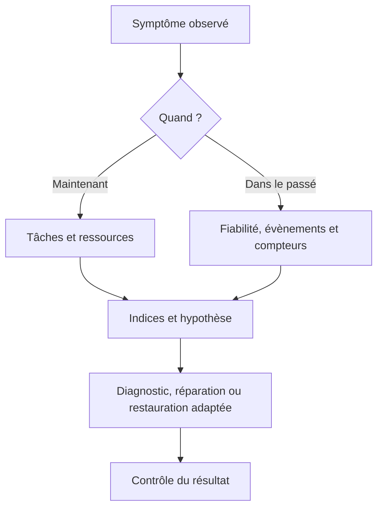
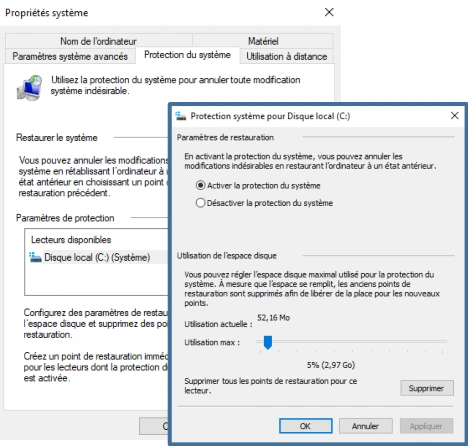

# Module 10 — La maintenance du système

**Séquence :** Systèmes clients Microsoft  
**Fil conducteur :** observer, comprendre, puis restaurer un état système dans la VM du laboratoire.

## Objectifs

- Distinguer un problème de performances d’un problème de fiabilité.
- Choisir un outil pour analyser le présent, l’historique ou lancer un diagnostic.
- Activer la protection système et créer un point de restauration.
- Accéder à WinRE et interpréter les conséquences d’une restauration.

## 1. Les deux questions de la maintenance

| Question | Ce qu’il faut rechercher |
|---|---|
| **Performances :** le système peut-il réaliser les tâches ? | Les ressources **processeur, mémoire, disque et réseau**, surveillées en priorité. |
| **Fiabilité :** le comportement est-il celui attendu ? | Les anomalies au démarrage, au lancement des services ou des applications. |

Un ralentissement observé maintenant et un évènement critique survenu hier ne se recherchent pas de la même façon. Le cours distingue donc trois méthodes : **temps réel**, **historique** et **diagnostic automatique**.

## 2. Choisir le bon outil

| Méthode | Outil du support | Informations apportées |
|---|---|---|
| Temps réel | Gestionnaire des tâches | Processus, services, performances du processeur et de la mémoire. |
| Temps réel | Moniteur de ressources | Vue détaillée des quatre composants principaux. |
| Temps réel ou historique | Observateur d’évènements | Évènements enregistrés par Windows et conservés dans des journaux. Le support mentionne des fichiers de 20 Mo par défaut. |
| Temps réel ou historique | Analyseur de performances | Compteurs ; collecte planifiée dans des plages horaires pour une analyse a posteriori. |
| Historique | Historique de fiabilité | Vue synthétique de l’état de santé du système dans le temps. |
| Automatique | Diagnostic de mémoire Windows | Redémarrage, puis tests de la mémoire physique. |
| Automatique | Résolution des problèmes | Packs intégrés orientés utilisateur ; le support indique que la solution appliquée n’est pas nécessairement détaillée. |

La finalité est de recueillir des **indices**, puis de chercher une explication avec l’aide Windows, les ressources techniques, les blogs spécialisés ou un moteur de recherche. Une mesure seule ne constitue pas un diagnostic.

**Illustration IA / externe au cours — démarche d’investigation.**



## 3. Les points de restauration système

Le point de restauration mémorise un **état du système**. Le support le compare à un journal de modifications : il permet de revenir à un état antérieur plus rapidement qu’une restauration complète.

| Il protège dans le support | Il ne remplace pas |
|---|---|
| Registre, certains fichiers système et programmes | Une sauvegarde des données utilisateur. |

La protection s’active **par lecteur**. Le support la présente comme désactivée par défaut ; il faut vérifier l’état réel du volume avant de compter sur un point disponible. L’espace de stockage des points est protégé et géré selon une logique FIFO : les plus anciens sont évincés quand l’espace doit être réutilisé.

Les créations citées sont quotidiennes, liées à un évènement important (installation de pilote, désinstallation de logiciel…) ou manuelles. L’outil se rejoint avec :

```text
sysdm.cpl
```

### Créer le point du TP

1. Ouvrir **Protection du système** dans les propriétés système.
2. Sélectionner **Disque local (C:) (Système)**, puis **Configurer**.
3. Activer la protection du système.
4. Le scénario réserve environ **5 %** du disque aux points ; appliquer puis valider.
5. Cliquer sur **Créer**, puis nommer le point **Atelier13**.

Le nom Atelier13 appartient à la numérotation de l’atelier source : ce n’est pas une confusion avec le module 13 sur les LGPO.



*Capture du support — fenêtres de protection du système.*

## 4. Récupérer un système avec WinRE

**WinRE** est l’environnement léger de récupération associé à Windows. Il dispose d’outils de diagnostic et de réparation lorsque le système principal ne démarre plus correctement ; le support cite aussi la réinitialisation du PC.

### Points d’entrée du support

- Maintenir **Maj** pendant **Redémarrer** dans le menu Démarrer.
- Lancer `shutdown /r /o`.
- Dans Windows 10 : **Paramètres > Mise à jour et sécurité > Récupération > Redémarrer maintenant**.
- Démarrer sur le support d’installation et choisir **Réparer l’ordinateur**.
- Le support indique le chargement automatique après **deux échecs consécutifs de démarrage**, ou **deux arrêts imprévus dans les deux minutes après le démarrage**.

### Options avancées à distinguer

| Option | Condition ou objectif |
|---|---|
| Restauration du système | Un point de restauration utilisable ; compte administrateur dans le scénario Windows 10. |
| Récupération de l’image système | Une image valide existante et son média source. |
| Invite de commandes | Outils de diagnostic ou de réparation avec les privilèges nécessaires. |
| Paramètres de démarrage | Mode sans échec, vidéo basse résolution ou désactivation temporaire du contrôle des signatures de pilotes. |
| Outil de redémarrage système | Réparation du démarrage ; le support cite le MBR et le magasin BCD. |
| Retour à une version précédente | Option historique présentée pour une mise à niveau depuis Windows 7 ou 8.1 ; le support indique qu’elle ne permet pas le retour à la build Windows 10 précédente. |

!!! info "Complément externe — contexte de version"
    Les écrans, conditions de retour arrière et demandes d’identification dépendent de la version de Windows et de l’installation. La ligne historique du support n’est pas une règle valable pour toutes les versions. Les entrées WinRE sont décrites dans la [référence Microsoft](https://learn.microsoft.com/windows-hardware/manufacture/desktop/windows-recovery-environment--windows-re--technical-reference).

## 5. TP complet : observer, modifier et restaurer

**Durée source : 1 h 30. Machine : Win10-XX.** Lire l’énoncé avant de commencer.

### A. Examiner les évènements passés

1. Rechercher **Afficher l’historique de fiabilité**.
2. Examiner la vue synthétique depuis le démarrage de la VM.
3. Ouvrir le dernier évènement critique pour en lire le détail.
4. Dans la capture de correction, l’indice baisse au moment des échecs, puis remonte progressivement les jours suivants.

!!! warning "Manipulation limitée au scénario"
    L’énoncé propose **PowerOFF** dans Workstation si aucun évènement critique n’est disponible. C’est une simulation sur la VM du TP ; l’arrêt brutal ne constitue pas une méthode courante de maintenance.

### B. Examiner les ressources en temps réel

1. Copier un gros fichier des ressources de l’atelier ; ouvrir PowerShell, le Gestionnaire des tâches et Edge.
2. Avec le Gestionnaire des tâches et le Moniteur de ressources, lire et trier les processus consommateurs.
3. Relever les ressources **processeur, mémoire, réseau et disque**.

| Ressource | Relevé attendu |
|---|---|
| Processeur | Processus consommateur et charge observée. |
| Mémoire | Processus et consommation observés. |
| Réseau | Trafic pendant la copie ou l’utilisation des applications. |
| Disque | Activité pendant les traitements. |

La correction ne donne aucune valeur universelle : les résultats varient avec le matériel et la bande passante. Le texte **[CHEMIN A INDIQUER]** de la correction est un emplacement à adapter au partage du laboratoire.

### C. Préparer la comparaison

1. Vérifier la protection du système et les points existants ; créer **Atelier13** si nécessaire, comme indiqué plus haut.
2. **Après** la création du point, ajouter dans **Documents** des fichiers et dossiers reconnaissables, par exemple **Rep-Atelier13** et **FicAtelier13.txt**.
3. Désinstaller **Internet Explorer 11** et **Lecteur Windows Media** par **Paramètres > Gérer les fonctionnalités facultatives**, ou les désactiver par **Panneau de configuration > Programmes > Activer ou désactiver des fonctionnalités Windows**.
4. La correction indique qu’une réinstallation peut se faire avec **Ajouter une fonctionnalité**. La présence de ces composants reste celle de l’image Windows 10 du TP.

### D. Restaurer puis expliquer

1. Clic droit sur **Démarrer > Arrêter ou se déconnecter**, maintenir **Maj/Shift**, cliquer sur **Redémarrer**.
2. Dans WinRE : **Dépannage > Options avancées > Restauration du système**.
3. Choisir le compte administrateur, saisir son mot de passe, puis **Suivant**.
4. Sélectionner le point voulu, puis **Terminer > Oui**.
5. Attendre la fin et redémarrer normalement. Contrôler le message de réussite.
6. Tester les fonctionnalités Windows et retrouver les fichiers de Documents.

| Constat de la correction | Explication |
|---|---|
| IE11 et Lecteur Windows Media sont retrouvés. | Leur modification est postérieure au point restauré. |
| Les fichiers créés ensuite dans Documents restent présents. | La restauration système ne restaure pas les données personnelles à l’état du point. |

## À retenir

Observer avant d’agir ; confronter temps réel et historique ; séparer **état système**, **image système** et **données utilisateur** ; vérifier le résultat après la récupération.

## Mini-quiz

1. Quels sont les quatre composants surveillés en priorité ?
2. Quels outils permettent une analyse historique ?
3. Pourquoi un point de restauration ne remplace-t-il pas une sauvegarde de Documents ?
4. Que faut-il posséder pour utiliser la récupération d’une image système ?
5. Pourquoi les fonctionnalités réapparaissent-elles alors que les fichiers de Documents ne disparaissent pas ?

??? note "Réponses"
    1. Processeur, mémoire, disque, réseau.
    2. Historique de fiabilité, journaux de l’Observateur d’évènements et collectes planifiées de l’Analyseur de performances.
    3. Il concerne l’état du système, pas une sauvegarde des données utilisateur.
    4. Une image valide et son média source.
    5. Le point précède la modification des fonctionnalités ; il ne rétablit pas les données utilisateur dans leur état antérieur.

- [Énoncé du TP](../../tp/systemes-clients/module-10/enonces.md) · [Correction](../../tp/systemes-clients/module-10/corrections.md)
- [Fiche de révision](../../revision/systemes-clients/module-10-la-maintenance-du-systeme.md)
- [Kahoot du module](../../kahoot/02-systemes-clients-microsoft-10-la-maintenance-du-systeme.md)
- [Présentation du cours](index.md)
