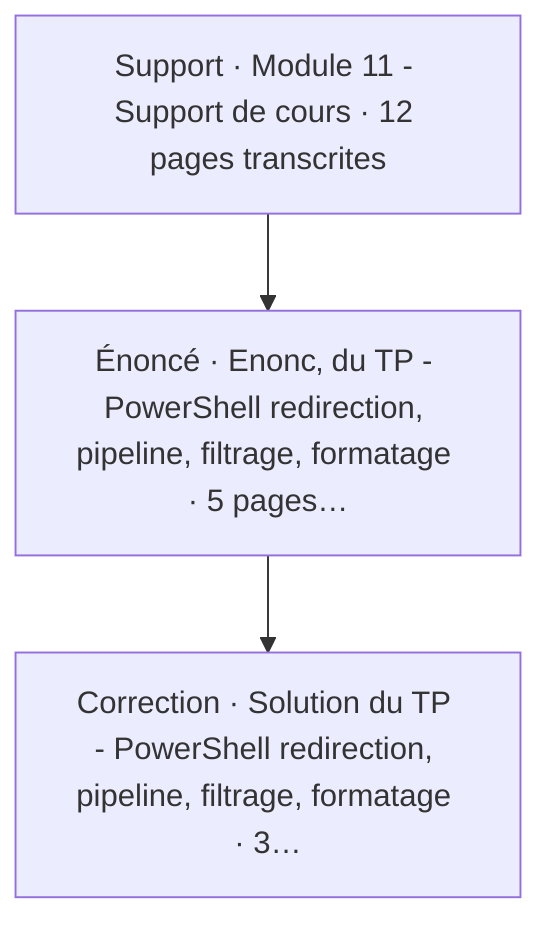
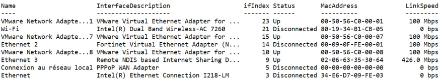
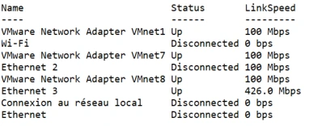
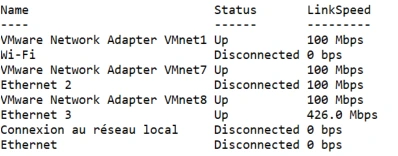
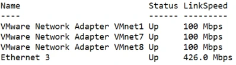

# Module 11 — Plus loin avec PowerShell

Les parties ci-dessous reprennent le cours original, dans le même ordre. Les encadrés et les schémas répètent ses formulations.

## Parcours de lecture

1. Support · Module 11 - Support de cours · 12 pages transcrites
2. Énoncé · Enonc‚ du TP - PowerShell redirection, pipeline, filtrage, formatage · 5 pages transcrites
3. Correction · Solution du TP - PowerShell redirection, pipeline, filtrage, formatage · 3 pages transcrites

**Visuel externe**



SOURCE DRIVE · TRANSCRIPTION DU SUPPORT

Le contenu des documents du dossier TSSR est transcrit ci-dessous, page par page. Les textes et tableaux sont intégrés à la page Web. Aucun fichier PDF, aucune diapositive entière ni aucune reproduction de page n’est affiché. Seuls des croquis ou visuels isolés et vérifiés peuvent accompagner la transcription. Les versions et les consignes restent celles des supports de formation. Les compléments IA sont conservés dans leur onglet distinct.

## Support · Module 11 - Support de cours · 12 pages transcrites

### Plus loin avec PowerShell

Systèmes clients Microsoft — Module 11.

#### Objectifs

**Visuel externe**


- Savoir rediriger les flux des cmdlets.
- Utiliser le pipeline.
- Filtrer puis formater le résultat.

### Plus loin avec PowerShell

**Visuel externe**


- Redirection de flux.
- Le pipeline.
- Filtrer l’affichage d’un résultat.

#### Redirection

!!! note "À retenir"
    Une cmdlet : reçoit des paramètres par l’entrée standard (`stdin:0`), par défaut le clavier ; fournit des résultats sur la sortie standard (`stdout:1`), par défaut l’écran ; affiche éventuellement les erreurs sur la sortie standard (`stderr:2`), par défaut l’écran.

Une cmdlet :

- reçoit des paramètres par l’entrée standard (`stdin:0`), par défaut le clavier ;
- fournit des résultats sur la sortie standard (`stdout:1`), par défaut l’écran ;
- affiche éventuellement les erreurs sur la sortie standard (`stderr:2`), par défaut l’écran.

Le schéma relie l’entrée standard (clavier) à la cmdlet, puis la cmdlet à la sortie standard et à la sortie erreur (écran).


Capture du support — Entrée standard, cmdlet, sortie standard et sortie erreur.

### Redirection

!!! note "À retenir"
    Exemple de redirection dans un fichier : Lecture du fichier : La capture présente les colonnes **Name**, **Enabled**, **Description** de la liste d’utilisateurs locaux.

| Flux | Syntaxe du support | Effet |
| --- | --- | --- |
| Sortie standard | `Cmdlet > fichier` ou `Cmdlet 1>fichier` | Redirige le flux de sortie standard vers « fichier ». |
| Sortie standard | `Cmdlet >> fichier` ou `Cmdlet 1>> fichier` | Redirige le flux de sortie standard à la fin de « fichier ». |
| Sortie d’erreur | `Cmdlet 2> fichier.err` | Redirige le flux de sortie d’erreur vers fichier.err. |
| Sortie d’erreur | `Cmdlet 2>> fichier.err` | Redirige le flux de sortie d’erreur à la fin de fichier.err. |
| Les deux flux | `Cmdlet > fichier 2>&1` | Redirige le flux de sortie standard et le flux de sortie d’erreur dans « fichier ». |
| Sortie d’erreur | `Cmdlet 2>$null` | Redirige le flux de sortie d’erreur « dans le vide ». |

Exemple de redirection dans un fichier :

```
Get-LocalUser > c:\temp\LocalUserList.txt
```

Lecture du fichier :

```
Get-Content c:\temp\LocalUserList.txt
```

La capture présente les colonnes **Name**, **Enabled**, **Description** de la liste d’utilisateurs locaux.


Capture du support — Contenu du fichier LocalUserList.txt montré dans le support.

### Démonstration

### Pipeline

!!! note "À retenir"
    Déjà utilisé avec `Select-Object`, le pipeline transmet le résultat de la sortie standard d’une cmdlet dans l’entrée standard d’une autre cmdlet.

- Déjà utilisé avec `Select-Object`, le pipeline transmet le résultat de la sortie standard d’une cmdlet dans l’entrée standard d’une autre cmdlet.
- Enchaînement de cmdlets possible.

Le schéma montre `cmdlet1 | cmdlet2 | cmdlet3` avec les liaisons `stdout` vers `stdin`.


Capture du support — Enchaînement de cmdlets avec le pipeline.

### Pipeline

!!! note "À retenir"
    Utilisé pour fournir un jeu restreint de propriétés.

!!! example "Exemple"
    Exemple avec `Get-NetAdapter` sans paramètre ni argument, qui affiche certaines propriétés.

- Utilisé pour fournir un jeu restreint de propriétés.
- Exemple avec `Get-NetAdapter` sans paramètre ni argument, qui affiche certaines propriétés.

```
Get-NetAdapter
Get-NetAdapter | Select Name,Status,LinkSpeed
```

Les captures montrent d’abord les propriétés par défaut, puis les colonnes **Name**, **Status**, **LinkSpeed**. Elles comprennent des interfaces VMware, Wi-Fi et Ethernet, avec des états Up ou Disconnected et des débits propres à l’exemple.

### Démonstration

!!! note "À retenir"
    Capture du support — Propriétés par défaut de Get-NetAdapter.



Capture du support — Propriétés par défaut de Get-NetAdapter.



Capture du support — Projection Name, Status et LinkSpeed.

### Filtrage

!!! note "À retenir"
    Les objets fournis par le pipeline sont parfois nombreux.

**Visuel externe**

```mermaid
flowchart LR
    N1["Les objets fournis par le pipeline sont parfois nombreux."]
    N2["Mettre en place le filtrage pour ne garder que les propriétés nécessaires."]
    N3["`Get-Help About_Comparison_Operator`."]
    N1 --> N2
    N2 --> N3
```

- Les objets fournis par le pipeline sont parfois nombreux.
- Mettre en place le filtrage pour ne garder que les propriétés nécessaires.
- Prérequis : connaître les opérateurs de comparaison. Par défaut insensibles à la casse ; les préfixer de `c` pour les rendre sensibles.
- `Get-Help About_Comparison_Operator`.

| Comparaison | Insensibilité à la casse | Sensibilité à la casse |
| --- | --- | --- |
| Égalité | `-eq` | `-ceq` |
| Inégalité | `-ne` | `-cne` |
| Supérieur à | `-gt` | `-cgt` |
| Supérieur ou égal à | `-ge` | `-cge` |
| Inférieur à | `-lt` | `-clt` |
| Inférieur ou égal à | `-le` | `-cle` |
| Comparaison d’égalité d’expression | `-like` | `-clike` |
| Comparaison d’inégalité d’expression | `-notlike` | `-cnotlike` |

### Filtrage basique

!!! note "À retenir"
    Exemple : Dans les captures du support, le filtrage conserve les interfaces dont Status vaut Up.

- Ne peut filtrer qu’une seule propriété.
- Nécessite la cmdlet `Where-Object`.

Exemple :

```
Get-NetAdapter | select Name,Status,LinkSpeed
Get-Netadapter | Select Name,Status,LinkSpeed | Where Status –like Up
```

Dans les captures du support, le filtrage conserve les interfaces dont Status vaut Up.

### Démonstration



Capture du support — État initial des cartes réseau.



Capture du support — Résultat du filtrage Status -like Up.

### Filtrage avancé

**Visuel externe**

```mermaid
flowchart LR
    N1["Pour filtrer plusieurs propriétés."]
    N2["Nécessite aussi la cmdlet `Where-Object`."]
    N3["Possibilité d’utiliser la variable `$PSITEM` ou `$_` pour être plus productif."]
    N4["`$_` contient tous les objets transmis à `Where-Object`."]
    N1 --> N2
    N2 --> N3
    N3 --> N4
```

- Pour filtrer plusieurs propriétés.
- Nécessite aussi la cmdlet `Where-Object`.
- Nécessite un script de filtrage `–FilterScript \{\}` dans la cmdlet `Where-Object`.
- Possibilité d’utiliser la variable `$PSITEM` ou `$_` pour être plus productif.
- `$_` contient tous les objets transmis à `Where-Object`.

Exemple :

```
Get-NetAdapter | select Name,Status,LinkSpeed
Get-NetAdapter | select Name,Status,LinkSpeed | Where –FilterScript {$_.Status –like "Up" –and $_.LinkSpeed –gt "100 Mbps"}
```

La capture du résultat présente **Ethernet 3**, **Up**, **426.0 Mbps**.


Capture du support — Jeu de propriétés avant le filtrage avancé.


Capture du support — Résultat du filtrage avancé illustré par le support.

### Démonstration

### Formatage

- Par défaut, PowerShell « formate » les résultats des cmdlets avant de les afficher à l’écran.
- Le format des résultats peut être modifié à l’aide de `Format-List`, `Format-Table`, `Format-Wide`.
- Les cmdlets `Format-*` sont à réaliser en dernier lieu, « après avoir terminé le travail ».

### Formatage

#### Affichage sous forme de liste

```
Get-Service | format-List
Get-Service | format-List –Property *
Get-service | FL –Property Name,Status,DisplayName
Get-Service | select Name,Status,DisplayName | FL
```

Les deux dernières commandes sont équivalentes.

#### Affichage sous forme de tableau

```
Get-TimeZone | Format-Table
Get-TimeZone | Format-Table –Property *
Get-TimeZone | FT –Property StandardName,BaseUtcOffset -autosize
```

#### Affichage sous forme de liste élargie

- Afficher une liste sur une ou plusieurs colonnes.
- Une seule propriété de la collection d’objets est sélectionnée.

```
Get-Process | Format-Wide
Get-Process | Format-Wide –Property ID
Get-Process | FW –Property ID –column 5
Get-Process | FW –Property ID -autosize
```

### Démonstration

### TP

### Conclusion

- Maîtriser PowerShell, l’essence même d’un technicien moderne.
- Aller plus loin, être curieux.
- S’éveiller au scripting PowerShell.

Référence du document : 1HamKlfbV8ZYxo2PhljLtcWWvX1nH9WCF · SHA-256 4fba04cb03a40c65…

## Énoncé · Enonc‚ du TP - PowerShell redirection, pipeline, filtrage, formatage · 5 pages transcrites

### Redirection, pipeline, filtrage, formatage

TP du Module 11 — Plus loin avec PowerShell. **Durée estimée : 2 heures.**

L’objectif sera de répondre aux consignes, notamment en les traduisant du français en langage PowerShell.

Pour arriver à vos fins, n’oubliez pas les bonnes pratiques :

- utilisez `get-command` pour rechercher la bonne cmdlet ;
- utilisez `get-help` pour savoir comment elle fonctionne ;
- si des propriétés spécifiques sont demandées, utilisez `select` après le pipeline ;
- si une ou des valeurs sont spécifiées, utilisez le pipe `where` et éventuellement la syntaxe du filtrage avancé pour rechercher deux valeurs ou plus ;
- utilisez les commandes de formatage si la consigne le précise ;
- prenez votre temps et investissez du temps de lecture du `get-help`.

#### Énoncé

Lisez l’ensemble de cet atelier avant de vous lancer dans la pratique.

Sur **Win10-XX**, recherchez les commandes adaptées : affichez la date du jour puis, à l’aide de la même commande, le quantième de l’année, c’est-à-dire le numéro du jour de l’année.

### Évènements et pare-feu

1. Affichez la liste des évènements enregistrés dans le journal **Security**.
2. À l’aide de la commande précédente, affichez les évènements dont l’**EventID est 4624**.
3. Affichez la liste précédente en ne montrant que l’**EventID**, la **date d’écriture de l’évènement** et le **message**.
4. Affichez la liste des règles de pare-feu activées.

### Pare-feu et volumes

Parmi les règles de pare-feu activées, n’affichez que leurs noms, le profil réseau auquel elles appartiennent, leurs directions et si elles autorisent ou bloquent l’accès.

#### Afficher des propriétés selon plusieurs critères

Sur **Discovery** :

1. Affichez la liste des volumes disques.
2. Affichez la liste des volumes qui possèdent **plus de 8 Go** d’espace libre.
3. Affichez la liste des volumes dont la taille maximum **ne dépasse pas 25 Go**.

### Volumes, services et groupes

1. Affichez la liste des volumes qui possèdent **plus de 8 Go** d’espace libre et dont la taille maximale **ne dépasse pas 25 Go**.
2. Le résultat de la commande précédente ne devra afficher que le **nom**, la **lettre de lecteur** et le **type de système de fichier**, le tout sous forme de liste.
3. Affichez les noms et statuts des services actuellement démarrés et qui démarrent automatiquement au lancement du système d’exploitation.
4. Affichez les membres, et leur SID, du groupe **L_HA_Ventes**.

### Partages, CD-ROM et imprimante

1. Affichez le nom et le chemin des partages administratifs sous forme de liste.
2. Affichez la lettre de lecteur, le type de lecteur et l’état de santé des volumes dont l’état est sain et de type **CD-ROM**.
3. Affichez le nom, le type, le nom du pilote et le nom du partage de l’imprimante **HP LaserJet**. Le résultat sera affiché sous forme de liste.

#### Solution

Une solution est proposée pour ce TP sous la forme d’un PDF commenté, disponible dans les ressources à télécharger.

Référence du document : 1aiTSranU5ERDjDPk9aKXZKqnXCbubWxp · SHA-256 9ed320b7fe165ff5…

## Correction · Solution du TP - PowerShell redirection, pipeline, filtrage, formatage · 3 pages transcrites

Correction originale : à consulter après avoir tenté l’exercice.

### Redirection, pipeline, filtrage, formatage — proposition de solution

TP du Module 11 — Plus loin avec Powershell.

Sur **Win10-XX**, recherchez les commandes adaptées pour les besoins suivants.

#### Affichez la date du jour, puis, à l’aide de la même commande, affichez le quantième de l’année (le numéro du jour de l’année)

```
Get-Date
Get-Date | Select DayOfYear
```

#### Affichez la liste des évènements ayant été enregistrés dans le journal Security

```
Get-EventLog -LogName Security
```

Et il y en a beaucoup !

#### À l’aide de la commande précédente, affichez les évènements dont l’EventID est 4624

```
Get-EventLog -LogName Security | Where EventID -eq 4624
```

#### Affichez la liste précédente en ne montrant que l’EventID, la date d’écriture de l’évènement et le message

```
Get-EventLog -LogName Security | Where EventID -eq 4624 | Select EventID,TimeWritten,Message
```

#### Affichez la liste des règles de pare-feu activées

```
Get-NetFirewallRule | Where Enabled -like 'True'
```

Ou :

```
Get-NetFirewallRule -Enabled True
```

#### Parmi ces règles de pare-feu activées, n’affichez que leurs noms, le profil réseau à laquelle elles appartiennent, leurs directions et si elles autorisent ou bloquent l’accès

```
Get-NetFirewallRule | Where Enabled -like 'true' | Select DisplayName,Profile,Direction,Action
```

### Afficher des propriétés selon plusieurs critères

Sur **Discovery**, affichez la liste des volumes disques :

```
Get-Volume
```

Affichez la liste des volumes qui possèdent plus de 8 Go d’espace libre :

```
Get-Volume | Where SizeRemaining -gt "8GB"
Get-Volume | Where SizeRemaining -gt 8589934592
```

`8589934592 = 8 x 1024 x 1024 x 1024`.

Affichez la liste des volumes dont la taille maximum ne dépasse pas 25 Go :

```
Get-Volume | Where Size -lt '25GB'
Get-Wolume | where Size -lt 26843545600
```

Affichez la liste des volumes qui possèdent plus de 8 Go d’espace libre et dont la taille maximale ne dépasse pas 25 Go :

```
Get-Volume | Where -Filterscript {$_.sizeremaining -gt '8GB' -and $_.size -lt '25GB'}
```

Le résultat de la commande précédente ne devra afficher que le nom, la lettre de lecteur et le type de système de fichier… le tout sous forme de liste :

```
Get-Volume | Where -Filterscript {$_.SizeRemaining -gt '8GB' -and $_.Size -lt '25GB'} | FL FileSystemLabel,DriveLetter,FileSystemType
```

Affichez les noms et status des services qui sont actuellement démarrés et qui démarrent automatiquement au lancement du système d’exploitation :

```
Get-Service | Where -FilterScript {$_.Status -like "Running" -and $_.StartType -like "Automatic"} | Select Name,Status
```

Affichez les membres (et leur SID) du groupe **L_HA_Ventes** :

```
Get-LocalGroupMember L_HA_Ventes | Select Name,SID
```

Affichez le nom et le chemin des partages administratifs sous forme de liste :

```
Get-SMBShare | Select Name,Path | Where Name -like *$
```

Affichez la lettre de lecteur, le type de lecteur et l’état de santé des volumes dont l’état est sain et de type CD-ROM :

```
Get-Volume | Where -FilterScript {$_.DriveType -eq 'CD-ROM' -and $_.HealthStatus -eq 'Healthy'} | Select DriveLetter,DriveType,HealthStatus
```

Affichez le nom, le type, le nom du pilote et le nom du partage de l’imprimante HP LaserJet. Le résultat sera affiché sous la forme d’une liste :

### Imprimante HP LaserJet — commande

```
Get-Printer -Name *Laser* | FL Name,Type,DriverName,ShareName
```

Référence du document : 124nAOUzJnaB_U-6kCzYbo32duYLrUdif · SHA-256 395fc3a2f586e25a…

## Fiche de synthèse

Les lignes reprennent les titres du cours et la première phrase de chaque partie.

| Partie | Repère du cours |
| --- | --- |
| Correction · Solution du TP - PowerShell redirection, pipeline, filtrage, formatage · 3 pages transcrites | Correction originale : à consulter après avoir tenté l’exercice. |
