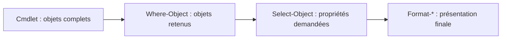

# Module 11 — Plus loin avec PowerShell

**Séquence :** Systèmes clients Microsoft  
**Démarche :** produire des objets, filtrer, sélectionner, puis présenter ou rediriger le résultat.

## Objectifs

- Rediriger la sortie de succès et les erreurs d’une commande.
- Enchaîner des cmdlets avec le pipeline.
- Utiliser les opérateurs de comparaison et les filtres simples ou composés.
- Choisir un format d’affichage et traiter chaque consigne du TP.

## 1. Flux et redirections

Le support emploie le modèle **stdin 0** (clavier), **stdout 1** (écran) et **stderr 2** (écran) pour introduire les échanges d’une commande.

!!! info "Complément externe — précision PowerShell"
    Ce dessin est une introduction issue des shells classiques. Dans PowerShell, le pipeline transmet des **objets**, et son entrée n’est pas le flux stdin. Les flux redirigeables 1 et 2 correspondent au **succès** et aux **erreurs**. [Référence Microsoft sur la redirection](https://learn.microsoft.com/en-gb/powershell/module/microsoft.powershell.core/about/about_redirection?view=powershell-5.1).

| Opérateur | Destination et comportement |
|---|---|
| `>` ou `1>` | Écrire la sortie de succès dans un fichier en remplaçant son contenu. |
| `>>` ou `1>>` | Ajouter la sortie de succès à la fin du fichier. |
| `2>` | Écrire les erreurs dans un fichier en remplaçant son contenu. |
| `2>>` | Ajouter les erreurs à la fin du fichier. |
| `2>&1` | Fusionner les erreurs dans le flux de succès. |
| `2>$null` | Écarter les erreurs affichées. |

Toutes les formes montrées dans le support :

```powershell
Cmdlet > fichier
Cmdlet 1> fichier
Cmdlet >> fichier
Cmdlet 1>> fichier
Cmdlet 2> fichier.err
Cmdlet 2>> fichier.err
Cmdlet > fichier 2>&1
Cmdlet 2>$null
```

`Cmdlet` et `fichier` sont les noms génériques du tableau, pas une commande à lancer telle quelle.

### Exemple du module : écrire puis lire les utilisateurs locaux

```powershell
Get-LocalUser > C:\temp\LocalUserList.txt
Get-Content C:\temp\LocalUserList.txt
```

Le dossier doit exister. Le fichier contient le résultat affiché, avec notamment **Name**, **Enabled** et **Description** dans la capture de formation.

## 2. Pipeline et sélection de propriétés

Le caractère `|` relie la sortie d’une commande à la suivante. `Select-Object`, abrégé `Select`, permet de projeter les propriétés utiles :

```powershell
Get-NetAdapter
Get-NetAdapter | Select-Object Name,Status,LinkSpeed
```

La première commande utilise l’affichage par défaut ; la seconde conserve **Name**, **Status**, **LinkSpeed**.

**Illustration IA / externe au cours — chaîne de traitement des objets.**



## 3. Comparaisons et filtrage

| Comparaison | Insensible à la casse | Sensible à la casse |
|---|---|---|
| Égalité | `-eq` | `-ceq` |
| Différence | `-ne` | `-cne` |
| Supérieur | `-gt` | `-cgt` |
| Supérieur ou égal | `-ge` | `-cge` |
| Inférieur | `-lt` | `-clt` |
| Inférieur ou égal | `-le` | `-cle` |
| Correspondance de motif | `-like` | `-clike` |
| Absence de correspondance | `-notlike` | `-cnotlike` |

Le préfixe `c` concerne la casse lors de comparaisons de chaînes. Lire l’aide des opérateurs :

```powershell
Get-Help about_Comparison_Operators
```

### Filtre simple

```powershell
Get-NetAdapter | Select-Object Name,Status,LinkSpeed |
    Where-Object Status -like 'Up'
```

La syntaxe simplifiée exprime ici une condition sur **Status**.

### Filtre avancé

`Where-Object -FilterScript { ... }` permet de combiner les conditions ; `$_` et `$PSItem` désignent l’objet actuellement traité. Le support présente :

```powershell
Get-NetAdapter | Select-Object Name,Status,LinkSpeed |
    Where-Object -FilterScript {
        $_.Status -like 'Up' -and $_.LinkSpeed -gt '100 Mbps'
    }
```

Le résultat illustré est **Ethernet 3**, **Up**, **426.0 Mbps**.

!!! warning "Lecture critique de l’exemple source"
    Comparer une chaîne affichée telle que `100 Mbps` n’est pas une comparaison fiable de débits numériques. Ce résultat appartient à la démonstration du support. Avant un filtre de production, contrôler le type et l’unité de la propriété, puis comparer des valeurs numériques cohérentes. Les tirets typographiques de la transcription source sont remplacés par des tirets ASCII dans les commandes de cette fiche.

## 4. Formater en dernier

PowerShell prépare automatiquement l’affichage. Les commandes de formatage permettent de le choisir ; elles s’emploient **après** le travail sur les objets.

| Commande | Alias | Usage |
|---|---|---|
| `Format-List` | `FL` | Une liste de propriétés par objet. |
| `Format-Table` | `FT` | Une ligne par objet et plusieurs colonnes. |
| `Format-Wide` | `FW` | Une propriété distribuée sur une ou plusieurs colonnes. |

### Tous les exemples d’affichage du support

```powershell
Get-Service | Format-List
Get-Service | Format-List -Property *
Get-Service | FL -Property Name,Status,DisplayName
Get-Service | Select-Object Name,Status,DisplayName | FL

Get-TimeZone | Format-Table
Get-TimeZone | Format-Table -Property *
Get-TimeZone | FT -Property StandardName,BaseUtcOffset -AutoSize

Get-Process | Format-Wide
Get-Process | Format-Wide -Property ID
Get-Process | FW -Property ID -Column 5
Get-Process | FW -Property ID -AutoSize
```

Les deux sélections de **Name,Status,DisplayName** sont équivalentes pour l’affichage demandé. Un `Format-*` placé trop tôt empêche de poursuivre normalement les filtres sur les objets d’origine.

## 5. TP complet : traduire une consigne en pipeline

**Durée source : 2 h. Machines : Win10-XX puis Discovery pour les volumes.** Les noms de groupes, imprimantes et propriétés viennent du laboratoire.

Méthode : rechercher avec `Get-Command`, lire `Get-Help`, identifier les objets, filtrer les valeurs, sélectionner les propriétés, puis formater si demandé.

### A. Date et journal Security

Date du jour puis numéro du jour dans l’année :

```powershell
Get-Date
Get-Date | Select-Object DayOfYear
```

Liste du journal Security, filtre sur **4624**, puis **EventID, TimeWritten, Message** :

```powershell
Get-EventLog -LogName Security
Get-EventLog -LogName Security | Where-Object EventID -eq 4624
Get-EventLog -LogName Security | Where-Object EventID -eq 4624 |
    Select-Object EventID,TimeWritten,Message
```

Ces commandes reprennent le TP Windows PowerShell du support. Adapter les privilèges au journal consulté ; la fiche ne suppose pas que toutes les commandes historiques existent dans toutes les versions de PowerShell.

### B. Règles de pare-feu actives

Deux formes données par la correction :

```powershell
Get-NetFirewallRule | Where-Object Enabled -like 'True'
Get-NetFirewallRule -Enabled True
```

N’afficher ensuite que le nom, le profil, la direction et l’action :

```powershell
Get-NetFirewallRule | Where-Object Enabled -like 'True' |
    Select-Object DisplayName,Profile,Direction,Action
```

### C. Volumes et seuils

```powershell
Get-Volume
Get-Volume | Where-Object SizeRemaining -gt '8GB'
Get-Volume | Where-Object SizeRemaining -gt 8589934592
```

La correction convertit **8 × 1024 × 1024 × 1024 = 8 589 934 592 octets**. Elle utilise les formes suivantes pour 25 Go :

```powershell
Get-Volume | Where-Object Size -lt '25GB'
Get-Volume | Where-Object Size -lt 26843545600
```

Puis les deux critères, et le format liste :

```powershell
Get-Volume | Where-Object -FilterScript {
    $_.SizeRemaining -gt '8GB' -and $_.Size -lt '25GB'
}
Get-Volume | Where-Object -FilterScript {
    $_.SizeRemaining -gt '8GB' -and $_.Size -lt '25GB'
} | Format-List FileSystemLabel,DriveLetter,FileSystemType
```

!!! info "Écarts du document source et choix pédagogique"
    La correction contient **Get-Wolume** : c’est une coquille, conservée dans Cours Original ; la commande est `Get-Volume`. Elle utilise `-lt` alors que « ne dépasse pas 25 Go » signifie **inférieur ou égal**. Pour répondre littéralement à l’énoncé, employer `-le 25GB` dans les filtres de taille. `-gt 8GB` reste correct pour « plus de 8 Go ». La notation PowerShell `GB` du TP repose ici sur des multiples de 1024.

### D. Services automatiques et membres du groupe

Services **Running** dont le démarrage est **Automatic**, puis membres et SID de **L_HA_Ventes** :

```powershell
Get-Service | Where-Object -FilterScript {
    $_.Status -like 'Running' -and $_.StartType -like 'Automatic'
} | Select-Object Name,Status

Get-LocalGroupMember L_HA_Ventes | Select-Object Name,SID
```

### E. Partages administratifs

La correction sélectionne les noms se terminant par `$`. L’énoncé demande une liste : ajouter le formatage final.

```powershell
Get-SmbShare | Select-Object Name,Path |
    Where-Object Name -like '*$' | Format-List
```

Le motif est mis entre guillemets pour une lecture explicite ; l’Original conserve l’écriture `*$` du document.

### F. Volumes CD-ROM sains

```powershell
Get-Volume | Where-Object -FilterScript {
    $_.DriveType -eq 'CD-ROM' -and $_.HealthStatus -eq 'Healthy'
} | Select-Object DriveLetter,DriveType,HealthStatus
```

### G. Imprimante HP LaserJet

Nom, type, pilote et partage sous forme de liste :

```powershell
Get-Printer -Name '*Laser*' | Format-List Name,Type,DriverName,ShareName
```

Un résultat vide peut être cohérent avec une ressource absente du laboratoire ; ne pas fabriquer un périphérique ou des valeurs pour remplir la réponse.

## Mini-quiz

1. Quelle différence entre `>` et `>>` ?
2. Que désigne `$_` dans `Where-Object` ?
3. Pourquoi formater à la fin du pipeline ?
4. Quel opérateur traduit « ne dépasse pas 25 Go » ?
5. Quelle différence entre `Select-Object` et `Where-Object` ?

??? note "Réponses"
    1. Remplacement du fichier contre ajout à la fin.
    2. L’objet en cours de traitement.
    3. Pour terminer les sélections et filtres sur les objets avant leur présentation.
    4. `-le 25GB` dans le contexte d’unités du TP.
    5. Select choisit les propriétés ; Where retient les objets qui satisfont la condition.

- [Énoncé du TP](../../tp/systemes-clients/module-11/enonces.md) · [Correction](../../tp/systemes-clients/module-11/corrections.md)
- [Fiche de révision](../../revision/systemes-clients/module-11-plus-loin-avec-powershell.md)
- [Kahoot du module](../../kahoot/02-systemes-clients-microsoft-11-plus-loin-avec-powershell.md)
- [Présentation du cours](index.md)
