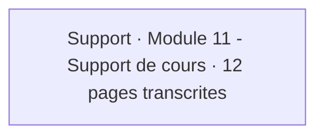
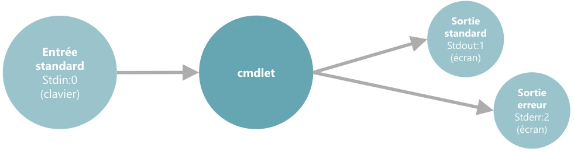
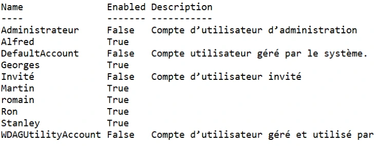
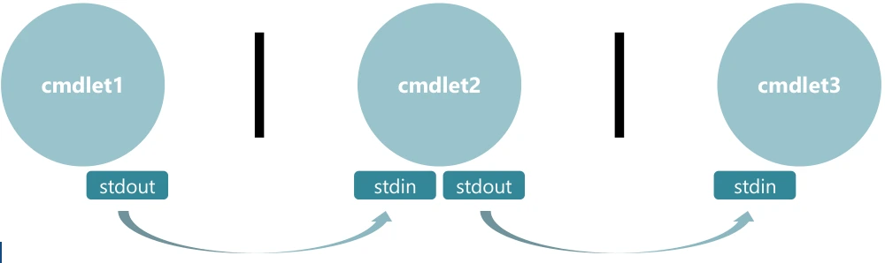
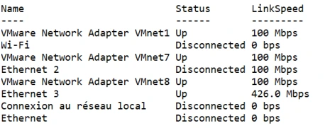
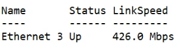

# Module 11 — Plus loin avec PowerShell

[Travaux pratiques](../../tp/systemes-clients/module-11/index.md)

Les parties ci-dessous reprennent le cours original, dans le même ordre. Les encadrés et les schémas répètent ses formulations.

## Parcours de lecture

1. Support · Module 11 - Support de cours · 12 pages transcrites

**Visuel externe**



SOURCE DRIVE · TRANSCRIPTION DU SUPPORT

Le contenu des documents du dossier TSSR est transcrit ci-dessous, page par page. Les textes et tableaux sont intégrés à la page Web. Aucun fichier PDF, aucune diapositive entière ni aucune reproduction de page n’est affiché. Seuls des croquis ou visuels isolés et vérifiés peuvent accompagner la transcription. Les versions et les consignes restent celles des supports de formation. Les compléments IA sont conservés dans leur onglet distinct.

## Support · Module 11 - Support de cours · 12 pages transcrites

### Plus loin avec PowerShell

Systèmes clients Microsoft — Module 11.

#### Objectifs

**Visuel externe**


- Savoir rediriger les flux des cmdlets.
- Utiliser le pipeline.
- Filtrer puis formater le résultat.

### Plus loin avec PowerShell

**Visuel externe**


- Redirection de flux.
- Le pipeline.
- Filtrer l’affichage d’un résultat.

#### Redirection

!!! note "À retenir"
    Une cmdlet : reçoit des paramètres par l’entrée standard (`stdin:0`), par défaut le clavier ; fournit des résultats sur la sortie standard (`stdout:1`), par défaut l’écran ; affiche éventuellement les erreurs sur la sortie standard (`stderr:2`), par défaut l’écran.

Une cmdlet :

- reçoit des paramètres par l’entrée standard (`stdin:0`), par défaut le clavier ;
- fournit des résultats sur la sortie standard (`stdout:1`), par défaut l’écran ;
- affiche éventuellement les erreurs sur la sortie standard (`stderr:2`), par défaut l’écran.

Le schéma relie l’entrée standard (clavier) à la cmdlet, puis la cmdlet à la sortie standard et à la sortie erreur (écran).



Capture du support — Entrée standard, cmdlet, sortie standard et sortie erreur.

### Redirection

!!! note "À retenir"
    Exemple de redirection dans un fichier : Lecture du fichier : La capture présente les colonnes **Name**, **Enabled**, **Description** de la liste d’utilisateurs locaux.

| Flux | Syntaxe du support | Effet |
| --- | --- | --- |
| Sortie standard | `Cmdlet > fichier` ou `Cmdlet 1>fichier` | Redirige le flux de sortie standard vers « fichier ». |
| Sortie standard | `Cmdlet >> fichier` ou `Cmdlet 1>> fichier` | Redirige le flux de sortie standard à la fin de « fichier ». |
| Sortie d’erreur | `Cmdlet 2> fichier.err` | Redirige le flux de sortie d’erreur vers fichier.err. |
| Sortie d’erreur | `Cmdlet 2>> fichier.err` | Redirige le flux de sortie d’erreur à la fin de fichier.err. |
| Les deux flux | `Cmdlet > fichier 2>&1` | Redirige le flux de sortie standard et le flux de sortie d’erreur dans « fichier ». |
| Sortie d’erreur | `Cmdlet 2>$null` | Redirige le flux de sortie d’erreur « dans le vide ». |

Exemple de redirection dans un fichier :

```
Get-LocalUser > c:\temp\LocalUserList.txt
```

Lecture du fichier :

```
Get-Content c:\temp\LocalUserList.txt
```

La capture présente les colonnes **Name**, **Enabled**, **Description** de la liste d’utilisateurs locaux.



Capture du support — Contenu du fichier LocalUserList.txt montré dans le support.

### Démonstration

### Pipeline

!!! note "À retenir"
    Déjà utilisé avec `Select-Object`, le pipeline transmet le résultat de la sortie standard d’une cmdlet dans l’entrée standard d’une autre cmdlet.

- Déjà utilisé avec `Select-Object`, le pipeline transmet le résultat de la sortie standard d’une cmdlet dans l’entrée standard d’une autre cmdlet.
- Enchaînement de cmdlets possible.

Le schéma montre `cmdlet1 | cmdlet2 | cmdlet3` avec les liaisons `stdout` vers `stdin`.



Capture du support — Enchaînement de cmdlets avec le pipeline.

### Pipeline

!!! note "À retenir"
    Utilisé pour fournir un jeu restreint de propriétés.

!!! example "Exemple"
    Exemple avec `Get-NetAdapter` sans paramètre ni argument, qui affiche certaines propriétés.

- Utilisé pour fournir un jeu restreint de propriétés.
- Exemple avec `Get-NetAdapter` sans paramètre ni argument, qui affiche certaines propriétés.

```
Get-NetAdapter
Get-NetAdapter | Select Name,Status,LinkSpeed
```

Les captures montrent d’abord les propriétés par défaut, puis les colonnes **Name**, **Status**, **LinkSpeed**. Elles comprennent des interfaces VMware, Wi-Fi et Ethernet, avec des états Up ou Disconnected et des débits propres à l’exemple.

### Démonstration

!!! note "À retenir"
    Capture du support — Propriétés par défaut de Get-NetAdapter.


Capture du support — Propriétés par défaut de Get-NetAdapter.


Capture du support — Projection Name, Status et LinkSpeed.

### Filtrage

!!! note "À retenir"
    Les objets fournis par le pipeline sont parfois nombreux.

**Visuel externe**

```mermaid
flowchart LR
    N1["Les objets fournis par le pipeline sont parfois nombreux."]
    N2["Mettre en place le filtrage pour ne garder que les propriétés nécessaires."]
    N3["`Get-Help About_Comparison_Operator`."]
    N1 --> N2
    N2 --> N3
```

- Les objets fournis par le pipeline sont parfois nombreux.
- Mettre en place le filtrage pour ne garder que les propriétés nécessaires.
- Prérequis : connaître les opérateurs de comparaison. Par défaut insensibles à la casse ; les préfixer de `c` pour les rendre sensibles.
- `Get-Help About_Comparison_Operator`.

| Comparaison | Insensibilité à la casse | Sensibilité à la casse |
| --- | --- | --- |
| Égalité | `-eq` | `-ceq` |
| Inégalité | `-ne` | `-cne` |
| Supérieur à | `-gt` | `-cgt` |
| Supérieur ou égal à | `-ge` | `-cge` |
| Inférieur à | `-lt` | `-clt` |
| Inférieur ou égal à | `-le` | `-cle` |
| Comparaison d’égalité d’expression | `-like` | `-clike` |
| Comparaison d’inégalité d’expression | `-notlike` | `-cnotlike` |

### Filtrage basique

!!! note "À retenir"
    Exemple : Dans les captures du support, le filtrage conserve les interfaces dont Status vaut Up.

- Ne peut filtrer qu’une seule propriété.
- Nécessite la cmdlet `Where-Object`.

Exemple :

```
Get-NetAdapter | select Name,Status,LinkSpeed
Get-Netadapter | Select Name,Status,LinkSpeed | Where Status –like Up
```

Dans les captures du support, le filtrage conserve les interfaces dont Status vaut Up.

### Démonstration


Capture du support — État initial des cartes réseau.


Capture du support — Résultat du filtrage Status -like Up.

### Filtrage avancé

**Visuel externe**

```mermaid
flowchart LR
    N1["Pour filtrer plusieurs propriétés."]
    N2["Nécessite aussi la cmdlet `Where-Object`."]
    N3["Possibilité d’utiliser la variable `$PSITEM` ou `$_` pour être plus productif."]
    N4["`$_` contient tous les objets transmis à `Where-Object`."]
    N1 --> N2
    N2 --> N3
    N3 --> N4
```

- Pour filtrer plusieurs propriétés.
- Nécessite aussi la cmdlet `Where-Object`.
- Nécessite un script de filtrage `–FilterScript \{\}` dans la cmdlet `Where-Object`.
- Possibilité d’utiliser la variable `$PSITEM` ou `$_` pour être plus productif.
- `$_` contient tous les objets transmis à `Where-Object`.

Exemple :

```
Get-NetAdapter | select Name,Status,LinkSpeed
Get-NetAdapter | select Name,Status,LinkSpeed | Where –FilterScript {$_.Status –like "Up" –and $_.LinkSpeed –gt "100 Mbps"}
```

La capture du résultat présente **Ethernet 3**, **Up**, **426.0 Mbps**.



Capture du support — Jeu de propriétés avant le filtrage avancé.



Capture du support — Résultat du filtrage avancé illustré par le support.

### Démonstration

### Formatage

- Par défaut, PowerShell « formate » les résultats des cmdlets avant de les afficher à l’écran.
- Le format des résultats peut être modifié à l’aide de `Format-List`, `Format-Table`, `Format-Wide`.
- Les cmdlets `Format-*` sont à réaliser en dernier lieu, « après avoir terminé le travail ».

### Formatage

#### Affichage sous forme de liste

```
Get-Service | format-List
Get-Service | format-List –Property *
Get-service | FL –Property Name,Status,DisplayName
Get-Service | select Name,Status,DisplayName | FL
```

Les deux dernières commandes sont équivalentes.

#### Affichage sous forme de tableau

```
Get-TimeZone | Format-Table
Get-TimeZone | Format-Table –Property *
Get-TimeZone | FT –Property StandardName,BaseUtcOffset -autosize
```

#### Affichage sous forme de liste élargie

- Afficher une liste sur une ou plusieurs colonnes.
- Une seule propriété de la collection d’objets est sélectionnée.

```
Get-Process | Format-Wide
Get-Process | Format-Wide –Property ID
Get-Process | FW –Property ID –column 5
Get-Process | FW –Property ID -autosize
```

### Démonstration

### TP

### Conclusion

- Maîtriser PowerShell, l’essence même d’un technicien moderne.
- Aller plus loin, être curieux.
- S’éveiller au scripting PowerShell.

Référence du document : 1HamKlfbV8ZYxo2PhljLtcWWvX1nH9WCF · SHA-256 4fba04cb03a40c65…
