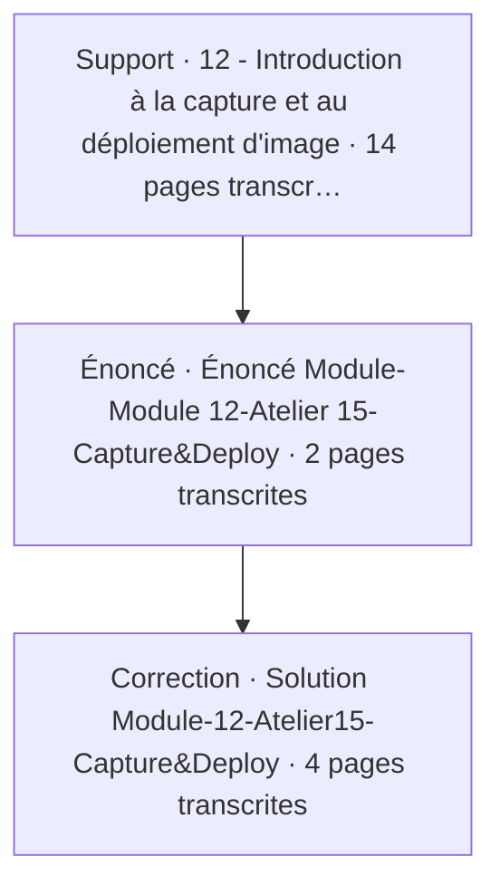
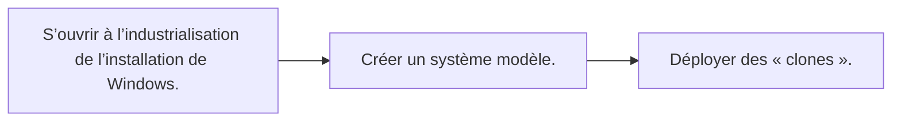
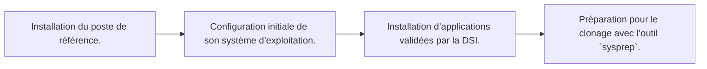
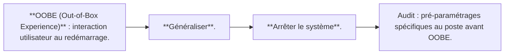

# Module 12 — Introduction à la capture et au déploiement d’image

Les parties ci-dessous reprennent le cours original, dans le même ordre. Les encadrés et les schémas répètent ses formulations.

## Parcours de lecture

1. Support · 12 - Introduction à la capture et au déploiement d'image · 14 pages transcrites
2. Énoncé · Énoncé Module-Module 12-Atelier 15-Capture&Deploy · 2 pages transcrites
3. Correction · Solution Module-12-Atelier15-Capture&Deploy · 4 pages transcrites

**Visuel externe**



SOURCE DRIVE · TRANSCRIPTION DU SUPPORT

Le contenu des documents du dossier TSSR est transcrit ci-dessous, page par page. Les textes et tableaux sont intégrés à la page Web. Aucun fichier PDF, aucune diapositive entière ni aucune reproduction de page n’est affiché. Seuls des croquis ou visuels isolés et vérifiés peuvent accompagner la transcription. Les versions et les consignes restent celles des supports de formation. Les compléments IA sont conservés dans leur onglet distinct.

## Support · 12 - Introduction à la capture et au déploiement d'image · 14 pages transcrites

### Introduction à la capture et au déploiement d’image

Systèmes clients Microsoft — Module 12.

### Objectifs

!!! note "À retenir"
    S’ouvrir à l’industrialisation de l’installation de Windows.

**Visuel externe**



- S’ouvrir à l’industrialisation de l’installation de Windows.
- Créer un système modèle.
- Déployer des « clones ».

### Problématique

- Recherche de productivité dans le service informatique :
  - tendre vers un parc informatique homogène pour réduire les configurations ;
  - tendre vers un ensemble de systèmes d’exploitation homogènes pour réduire le maintien ;
  - posséder des systèmes d’exploitation « clé en main » pour les nouveaux collaborateurs et les collaborateurs avec un poste défaillant.
- Solution : posséder des images de référence.

### Préparation du master

!!! note "À retenir"
    Configuration initiale de son système d’exploitation.

**Visuel externe**



1. Installation du poste de référence.
2. Configuration initiale de son système d’exploitation.
3. Installation d’applications validées par la DSI.
4. Préparation pour le clonage avec l’outil `sysprep`.

### Sysprep

!!! note "À retenir"
    Pour rendre les postes uniques dans l’entreprise : les paramètres personnalisés du Master sont remis à zéro ; une version par génération de systèmes ; outils graphiques et en ligne de commande.

**Visuel externe**


Pour rendre les postes uniques dans l’entreprise :

- les paramètres personnalisés du Master sont remis à zéro ;
- une version par génération de systèmes ;
- outils graphiques et en ligne de commande.

### Sysprep — paramètres nécessaires

!!! note "À retenir"
    **OOBE (Out-of-Box Experience)** : interaction utilisateur au redémarrage.

**Visuel externe**



- **OOBE (Out-of-Box Experience)** : interaction utilisateur au redémarrage.
- **Généraliser**.
- **Arrêter le système**.

En ligne de commande :

```
C:\Windows\System32\sysprep\sysprep.exe /oobe /generalize /shutdown
```

En complément :

- Audit : pré-paramétrages spécifiques au poste avant OOBE.
- Journaux consultables après redémarrage dans les répertoires Panther, dans `C:\Windows\System32\Sysprep`, fichiers TXT et EVT.


Capture du support — Outil de préparation du système : OOBE, généraliser et arrêt.

### Sysprep — configurations et pilotes

!!! note "À retenir"
    Incompatible avec toutes les configurations (certains rôles serveur, jonction, etc.).

- Incompatible avec toutes les configurations (certains rôles serveur, jonction, etc.).
- Incompatible avec des Apps installées depuis le Microsoft Store.
- Pilotes installés manuellement : supprimés par défaut par sysprep ; non supprimés avec le paramètre `/PersistAllDeviceInstalls` en ligne de commande.
- Les comptes utilisateurs ne sont pas supprimés par sysprep.
- Activez et utilisez le compte administrateur pour un paramétrage plus précis (il sera réinitialisé par sysprep).

### Démonstration

### Exploitation du master

!!! note "À retenir"
    Une fois le système de référence éteint : **ne pas le redémarrer avant d’avoir capturé l’image du système !**

!!! warning "Attention"
    Une fois le système de référence éteint : **ne pas le redémarrer avant d’avoir capturé l’image du système !**

Une fois le système de référence éteint : **ne pas le redémarrer avant d’avoir capturé l’image du système !**

#### Récupérer l’image système grâce au serveur de déploiement

!!! note "À retenir"
    Images d’amorçage à disposition sur le serveur de déploiement.

- Méthode automatisée.
- Amorçage PXE.
- Images d’amorçage à disposition sur le serveur de déploiement.
- Déploiement possible grâce au serveur.

#### Récupérer l’image système grâce à dism

- Méthode manuelle.
- Nécessite un support WinPE amorçable : DVD, clé USB, etc.
- Léger, contient des outils spécifiques pour la capture et le déploiement.
- Commande puissante.

### Exploitation du master

#### Mise à jour des images

- Possible en mode « déconnecté » (offline) avec le format WIM et l’outil en ligne de commande `dism`, présent dans WinPE et dans Windows.

#### Le poste cible est-il prêt ?

- Des outils Microsoft permettent d’évaluer la compatibilité du matériel et des logiciels cibles : Conseiller de mise à niveau, Application Compatibility Toolkit, etc.
- WinPE comprend des outils de préparation : `diskpart`, `mount`, `drvload`, `net use`, Powershel, etc.

### Déploiement

| Mode | Démarche |
| --- | --- |
| Automatisé grâce au serveur de déploiement | Déploiement en masse ; démarrer les postes sur le réseau (Boot PXE) ; les clients requêtent puis se connectent au serveur de déploiement, ici WDS ; choix de l’image à déployer. |
| Manuel grâce à dism | Déploiement au cas par cas ; démarrer les postes sur le support amorçable WinPE ; partitionnement du stockage d’accueil. |

### Démonstration

### TP

### Conclusion

- Déployer un système est courant aujourd’hui en entreprise.
- Les systèmes de déploiement via un serveur se démocratisent.

Référence du document : 1oGP63A32X8AfSS2omfB8LzwnTdBIIHF- · SHA-256 354e071ac6043135…

## Énoncé · Énoncé Module-Module 12-Atelier 15-Capture&Deploy · 2 pages transcrites

### Introduction à la capture et au déploiement

Travaux pratiques 15 — **Cursus : TSSR**. **Cours : Windows Client**.

**Sujet : TP — Introduction à la capture et au déploiement**. Version : **2021-01**.

#### Objectifs

Connaître les principes de capture et de déploiement d’image Windows.

#### Prérequis

Avoir terminé l’atelier 13 — Maintenance.

### Principales tâches à réaliser

#### Préparation du poste de référence Win10-XX

1. Activez le compte utilisateur **Administrateur** et fixez-lui un mot de passe. Fermez votre session actuelle et ouvrez une session avec le compte Administrateur.
2. Assurez-vous d’avoir un snapshot récent disponible avant de faire les prochaines manipulations. Dans le doute, faites-en un.
3. Supprimez les utilisateurs que vous avez créés lors de l’atelier 08 qui traitait des utilisateurs et des groupes. Supprimez l’utilisateur que vous avez créé lors de l’installation de cette VM. Supprimez aussi leurs profils.
4. Procédez à un sysprep généralisé en mode OOBE suivi d’une extinction de votre machine **Win10-XX**.

### Création d’un clone de la machine de référence

1. Créez un dossier **Win10-XX-Clone** dans votre dossier **VMs-WorkStation**.
2. Utilisez la fonctionnalité de clonage de WorkStation : créez un **Full Clone** de Win10-XX depuis son état actuel. Cette nouvelle VM sera hébergée dans le dossier Win10-XX-Clone créé précédemment.

#### Configuration / observation du clone

- Allumez la VM Win10-XX et appliquez le dernier snapshot.
- Allumez la VM Win10-XX-Clone dès qu’elle est disponible et procédez à sa configuration initiale.
- Remplissez le tableau ci-dessous.

| Contrôle | Win10-XX | Win10-XX-Clone |
| --- | --- | --- |
| VMware Tools présents ? | À relever. | À relever. |
| Nom de la machine configuré dans l’OS | À relever. | À relever. |
| Nombre de volumes | À relever. | À relever. |
| Nombre de users dans la base SAM | À relever. | À relever. |
| Adresse IP | À relever. | À relever. |
| Date et heure du premier log dans le journal système | À relever. | À relever. |
| Nombre de points de restauration | À relever. | À relever. |
| Compte administrateur activé ? | À relever. | À relever. |
| Pilote de l’imprimante HP LaserJet présent ? | À relever. | À relever. |
| Règle entrante ICMP | À relever. | À relever. |

Référence du document : 1jSef3bGrIC03pPNbYGk_afp2xRvVwJWQ · SHA-256 4f2df8512b2e7d7a…

## Correction · Solution Module-12-Atelier15-Capture&Deploy · 4 pages transcrites

Correction originale : à consulter après avoir tenté l’exercice.

### Cloner une VM Windows dans les règles de l’art

TP du Module 12 — Introduction à la capture et au déploiement d’image. **Proposition de solution.**

#### Préparation du poste de référence Win10-XX

Activez le compte utilisateur Administrateur et fixez-lui un mot de passe. Fermez votre session actuelle et ouvrez une session avec ce compte. Assurez-vous d’avoir un snapshot récent disponible avant de faire les prochaines manipulations. Dans le doute, faites-en un.

1. Ouvrez une session avec un compte d’utilisateur membre du groupe prédéfini **Administrateurs**.
2. Depuis le composant logiciel enfichable **Utilisateurs et groupes locaux**, nœud **Utilisateurs**.
3. Clic droit sur **Administrateur > Propriétés**.
4. Décocher **Le compte est désactivé** : **Appliquer > OK**.

L’icône en lien avec l’utilisateur Administrateur a changé. La flèche noire dans un rond blanc a disparu. Cela veut dire que nous pouvons maintenant utiliser ce compte. Mais il faut encore lui fixer un mot de passe pour ouvrir une session locale.

1. Clic droit sur **Administrateur > Définir le mot de passe… > Continuer**.
2. Fixer un mot de passe : **OK**. Une fenêtre apparaît : **Le mot de passe a été défini > OK**.
3. Fermez la session actuelle et ouvrez une nouvelle session sur la VM avec le compte **Administrateur**, maintenant présent dans la liste des utilisateurs de l’écran d’accueil.

Puisque c’est la première fois que cet utilisateur ouvre une session locale, un profil est créé et il faut terminer sa configuration.

Supprimez les utilisateurs que vous avez créés lors de l’atelier 08 qui traitait des utilisateurs et des groupes. Supprimez l’utilisateur que vous avez créé lors de l’installation de cette VM. Supprimez aussi leurs profils.

### Nettoyage des profils et généralisation

#### Commençons par supprimer les profils des utilisateurs

1. **Rechercher > sysdm.cpl**.
2. Onglet **Paramètres système avancés**.
3. Encadré **Profil des utilisateurs > bouton Paramètres…**.
4. Supprimez les profils pour ne laisser que celui de l’Administrateur et le Profil par défaut.

#### Suppression des comptes utilisateurs

Composant logiciel enfichable **Utilisateurs et groupes locaux**, nœud **Utilisateur**. Supprimez les comptes utilisateurs **pnom** ainsi que ceux créés lors de l’atelier 8.

#### Procédez à un sysprep généralisé en mode OOBE suivi d’une extinction de votre machine Win10-XX

1. Lancez l’Explorateur Windows.
2. Naviguez jusqu’au répertoire `C:\Windows\System32\Sysprep`.
3. Double clic sur `sysprep.exe`.
4. Mode **OOBE**.
5. Cochez **Généraliser**.
6. Éteindre automatiquement le système à l’issue du Sysprep.

Si sysprep échoue, consulter les journaux sysprep disponibles dans le dossier **Panther** et corriger l(es) erreur(s). Aidez-vous d’Internet le cas échéant.

En cas d’erreur du sysprep, vous trouverez un fichier de log dans le dossier Panther que vous pouvez ouvrir avec le bloc-note. « Épluchez-le » et aidez-vous d’Internet pour résoudre les blocages. Plusieurs pistes sont possibles : [https://docs.microsoft.com/fr-fr/troubleshoot/windows-client/deployment/sysprep-fails-remove-or-update-store-apps](https://docs.microsoft.com/fr-fr/troubleshoot/windows-client/deployment/sysprep-fails-remove-or-update-store-apps).

### Création d’un clone de la machine de référence

Créez un dossier **Win10-XX-Clone** dans votre dossier **VMs-WorkStation**. Utilisez la fonctionnalité de clonage de WorkStation.

- Créez un **Full Clone** de Win10-XX depuis son état actuel.
- Cette nouvelle VM sera hébergée dans le dossier **Win10-XX-Clone** créé précédemment.

### Configuration / observation du clone

1. Appliquez son dernier snapshot puis allumez la VM **Win10-XX**.
2. Allumez **Win10-XX-Clone** dès qu’elle est disponible et procédez à sa configuration initiale.
3. Remplissez les deux tableaux ci-dessous.

#### Conséquences du clonage WorkStation

| Contrôle | Win10-XX | Win10-XX-Clone |
| --- | --- | --- |
| Nombre de disques durs | 3 | 3 |
| Nombre de volumes | 6 en comptant le lecteur de DVD | 6 en comptant le lecteur de DVD |
| Carte réseau « bridgée » ? | Oui | Oui |
| Nombre de snapshots | Nombre de snapshots depuis le début du module | Pas de snapshot présent |
| Qté RAM | 4 Go | 4 Go |

#### Conséquences de sysprep

| Contrôle | Win10-XX | Win10-XX-Clone |
| --- | --- | --- |
| VMware Tools présents ? | Oui | Oui |
| Nom de la machine configuré dans l’OS | Win10-XX | DESKTOP-<chaîneDeCaratèreAléatoire> |

### Les conséquences de sysprep — suite

| Contrôle | Win10-XX | Win10-XX-Clone |
| --- | --- | --- |
| Nombre de users dans la base SAM | Comptes natifs, compte créé à l’installation de la VM et tous les comptes créés lors de l’atelier 8 | Comptes natifs ainsi que le compte créé au premier démarrage de la VM |
| Adresse IP | Adresse IP fixe configurée lors de l’atelier 10 | En DHCP |
| Date et heure du premier log dans le journal système | Date de l’installation de la VM lors de l’atelier 1 | Date du démarrage du clone après le Sysprep et le clonage |
| Nb de points de restaurations | Celui de l’atelier 13 (et voir d’autres si vous en avez fait d’autres) | Aucun. La protection du système est désactivée. |
| Compte administrateur activé ? | Oui (si vous avez réalisé le dernier snapshot après avoir activé le compte administrateur) | Non |
| Pilote de l’imprimante HP LaserJet présents ? | Oui | Non |
| Règle entrante ICMP ? | Oui | Oui |

Référence du document : 1xc_WjKIiXqmXNPfoE8iP4JArQud4P_Jo · SHA-256 5fc1f0a57215154a…

## Fiche de synthèse

Les lignes reprennent les titres du cours et la première phrase de chaque partie.

| Partie | Repère du cours |
| --- | --- |
| Correction · Solution Module-12-Atelier15-Capture&Deploy · 4 pages transcrites | Correction originale : à consulter après avoir tenté l’exercice. |
