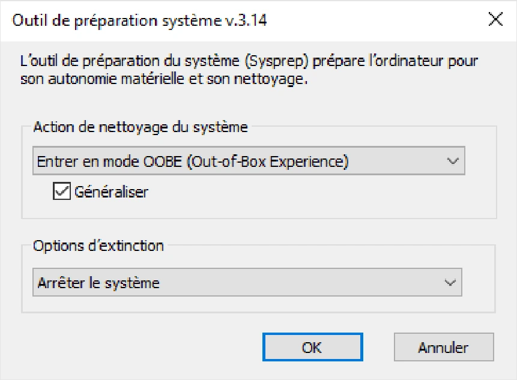
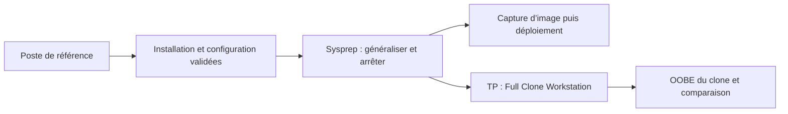

# Module 12 — Introduction à la capture et au déploiement d’image

**Séquence :** Systèmes clients Microsoft  
**Application :** préparer un master Windows, le généraliser, puis observer son clone dans le laboratoire.

## Objectifs

- Comprendre la recherche d’homogénéité et de productivité.
- Préparer un système de référence avec les applications validées par la DSI.
- Distinguer généralisation, capture et déploiement.
- Réaliser le **Full Clone Workstation** du TP et comparer les deux VM.

## 1. Pourquoi une image de référence ?

Un parc homogène réduit les configurations à maintenir. Une image de référence permet de disposer d’un système prêt pour l’arrivée d’un collaborateur ou le remplacement d’un poste défaillant. Le support relie donc le déploiement à l’industrialisation de l’installation de Windows.

### Préparer le master

1. Installer le poste de référence.
2. Configurer son système d’exploitation.
3. Installer les applications **validées par la DSI**.
4. Préparer le clonage avec **Sysprep**.

Le master est le poste modèle. Une capture n’est pas simplement la copie d’une session de travail quelconque : le système de référence doit être préparé.

## 2. Généraliser avec Sysprep

Sysprep remet à zéro les paramètres propres au master pour préparer des systèmes distincts. Le support mentionne une version de l’outil par génération de Windows et deux interfaces : graphique et ligne de commande.

| Choix du support | Rôle |
|---|---|
| **OOBE** (*Out-of-Box Experience*) | Présenter l’interaction de configuration au prochain démarrage. |
| **Généraliser** | Retirer les particularités à régénérer pour le poste cible. |
| **Arrêter le système** | Conserver le master arrêté avant sa capture ou son clonage. |

```cmd
C:\Windows\System32\sysprep\sysprep.exe /oobe /generalize /shutdown
```



*Capture du support — paramètres de préparation du système.*

Le support présente aussi le mode **Audit**, destiné au paramétrage spécifique avant OOBE. Les journaux de diagnostic se trouvent dans les répertoires **Panther**, notamment sous `C:\Windows\System32\Sysprep`.

### Limites et points à vérifier

- Certaines configurations, certains rôles serveur ou certaines jonctions ne sont pas compatibles avec la préparation envisagée.
- Des applications Microsoft Store peuvent provoquer un échec ; lire les journaux plutôt que répéter la commande sans diagnostic.
- **Sysprep ne supprime pas les comptes utilisateurs** : le nettoyage demandé par le TP est une étape distincte.
- Le support demande d’activer le compte Administrateur pour le paramétrage, puis indique sa réinitialisation après généralisation.
- La gestion des pilotes doit être examinée avant d’appliquer l’image à un autre matériel.

!!! info "Complément externe — corriger l’écriture PersistAllDeviceInstalls"
    L’Original conserve `/PersistAllDeviceInstalls` tel qu’écrit dans le support. Microsoft documente **PersistAllDeviceInstalls comme un réglage du fichier de réponses**, dans le composant Microsoft-Windows-PnpSysprep pendant la passe generalize ; ce n’est pas une option autonome de la ligne de commande Sysprep. Son utilisation suppose une configuration matérielle adaptée. [Réglage Microsoft](https://learn.microsoft.com/en-us/windows-hardware/customize/desktop/unattend/microsoft-windows-pnpsysprep-persistalldeviceinstalls) · [Options Sysprep](https://learn.microsoft.com/en-us/windows-hardware/manufacture/desktop/sysprep-command-line-options?view=windows-11).

## 3. Capturer et exploiter le master

**Une fois le master arrêté par Sysprep, ne pas le redémarrer avant sa capture.**

| Méthode du support | Environnement | Usage |
|---|---|---|
| Automatisée | Serveur de déploiement, images d’amorçage, démarrage réseau PXE | Capture puis déploiement à partir du serveur. |
| Manuelle | Support WinPE amorçable, DVD ou clé USB, outil DISM | Capture et déploiement au cas par cas. |

WinPE est un environnement léger disposant d’outils dédiés. Le cours cite **diskpart**, **mount**, **drvload**, **net use** et **PowerShell** pour préparer les opérations. Il cite aussi les outils d’évaluation de compatibilité matérielle et logicielle, tels que le Conseiller de mise à niveau et l’Application Compatibility Toolkit ; leurs noms restent ceux du support.

Les images **WIM** peuvent être mises à jour **hors ligne** avec DISM, présent dans Windows et WinPE.

### Déployer

- **En masse par serveur** : démarrage PXE, connexion au serveur de déploiement, ici **WDS**, puis choix de l’image.
- **Manuellement avec DISM** : démarrage sur WinPE et préparation/partitionnement du stockage cible.

Le support introduit ces possibilités sans fournir ici une procédure complète de commandes DISM ou une infrastructure WDS prête à utiliser.

**Illustration IA / externe au cours — distinguer les étapes et l’application du TP.**



## 4. TP complet : cloner une VM Windows

L’énoncé porte le titre **Travaux pratiques 15**, version **2021-01**, et demande d’avoir terminé l’atelier 13 Maintenance. La numérotation de ces ateliers est historique ; cette page appartient bien au module 12.

Le TP réalise un **Full Clone VMware Workstation**, après Sysprep. Il ne réalise pas une capture WIM ou un déploiement WDS.

### A. Préparer Win10-XX

1. Ouvrir une session avec un compte membre des **Administrateurs**.
2. Dans **Utilisateurs et groupes locaux > Utilisateurs**, ouvrir **Administrateur > Propriétés**.
3. Décocher **Le compte est désactivé**, appliquer et valider. La flèche de désactivation disparaît de l’icône.
4. Clic droit sur le compte : **Définir le mot de passe > Continuer** ; fixer le mot de passe et valider le message de confirmation.
5. Fermer la session et ouvrir une session avec **Administrateur**. Au premier démarrage de ce profil, terminer sa configuration.
6. S’assurer d’un **snapshot récent** avant les manipulations suivantes ; dans le doute, en créer un.

### B. Nettoyer les profils et les comptes du scénario

1. Ouvrir `sysdm.cpl`, puis **Paramètres système avancés > Profil des utilisateurs > Paramètres**.
2. Supprimer les profils prévus par le TP en conservant **Administrateur** et **Profil par défaut**.
3. Dans **Utilisateurs et groupes locaux**, supprimer le compte **pnom** créé à l’installation et les comptes créés pendant l’atelier 8.

!!! warning "Périmètre de manipulation"
    Ces suppressions portent sur les comptes de la **VM d’exercice** préparée pour le clonage. Suivre la liste du scénario et conserver l’accès Administrateur ; ce n’est pas une consigne à appliquer sur le poste personnel.

### C. Généraliser et arrêter

1. Ouvrir `C:\Windows\System32\Sysprep\sysprep.exe`.
2. Choisir **OOBE**, cocher **Généraliser** et choisir l’arrêt automatique à l’issue de Sysprep.
3. En cas d’erreur, consulter les journaux du dossier **Panther**, corriger la cause puis reprendre. La correction cite les [échecs liés aux applications Store](https://learn.microsoft.com/fr-fr/troubleshoot/windows-client/deployment/sysprep-fails-remove-or-update-store-apps).
4. Laisser la machine de référence arrêtée avant le clonage.

### D. Créer le clone

1. Créer **Win10-XX-Clone** dans **VMs-WorkStation**.
2. Utiliser le clonage Workstation depuis **l’état actuel** de Win10-XX.
3. Choisir **Full Clone**.
4. Héberger la nouvelle VM dans le dossier créé.

### E. Démarrer et comparer

1. Restaurer le dernier snapshot de **Win10-XX**, puis la démarrer, comme indiqué par la correction.
2. Démarrer **Win10-XX-Clone** et effectuer sa configuration initiale.
3. Comparer les paramètres matériels du clone et les particularités réinitialisées par Sysprep.

#### Conséquences du clonage dans la correction

| Contrôle | Win10-XX | Win10-XX-Clone |
|---|---|---|
| Disques durs | 3 | 3 |
| Volumes, DVD compris | 6 | 6 |
| Carte réseau bridgée | Oui | Oui |
| Snapshots | Historique des ateliers | Aucun snapshot présent |
| RAM | 4 Go | 4 Go |

#### Conséquences de Sysprep dans la correction

| Contrôle | Référence restaurée | Clone au premier démarrage |
|---|---|---|
| VMware Tools | Présents | Présents |
| Nom dans Windows | Win10-XX | DESKTOP suivi d’une chaîne aléatoire |
| Comptes SAM | Comptes natifs et comptes des ateliers retrouvés par le snapshot | Comptes natifs et compte créé lors du premier démarrage |
| IP | IP fixe de l’atelier 10 | DHCP |
| Premier évènement du journal système | Installation initiale de la VM | Démarrage après généralisation et clonage |
| Points de restauration | Atelier 13 et éventuels autres points | Aucun ; protection désactivée |
| Administrateur activé | Oui si le snapshot le conservait actif | Non |
| Pilote HP LaserJet | Présent | Absent |
| Règle entrante ICMP | Présente | Présente |

Ces valeurs sont les résultats **du laboratoire source**. Le retour au snapshot explique que des comptes supprimés pendant la préparation réapparaissent dans la VM de référence. Le clone est issu de son état généralisé, et non de ce snapshot restauré.

## Mini-quiz

1. Pourquoi préparer une image de référence ?
2. Que signifient OOBE, Généraliser et Arrêter ?
3. Pourquoi ne pas redémarrer le master avant sa capture ?
4. Le TP réalise-t-il une image WIM ?
5. Pourquoi comparer séparément matériel virtuel et identité Windows ?

??? note "Réponses"
    1. Pour homogénéiser le parc et préparer les installations récurrentes.
    2. Configuration au prochain démarrage, retrait des particularités du master et arrêt avant capture.
    3. Pour conserver l’état préparé avant le prochain démarrage de spécialisation.
    4. Non : il réalise un Full Clone Workstation après Sysprep.
    5. Le clonage conserve la configuration matérielle illustrée, tandis que Sysprep réinitialise des paramètres propres au système.

- [Énoncé du TP](../../tp/systemes-clients/module-12/enonces.md) · [Correction](../../tp/systemes-clients/module-12/corrections.md)
- [Fiche de révision](../../revision/systemes-clients/module-12-introduction-a-la-capture-et-au-deploiement-d-image.md)
- [Tutoriel capture et déploiement](../../tutoriels/capture-deploiement-windows.md)
- [Kahoot M12](../../kahoot/02-systemes-clients-microsoft-12-introduction-a-la-capture-et-au-deploiement-d-image.md)
- [Présentation du cours](index.md)
