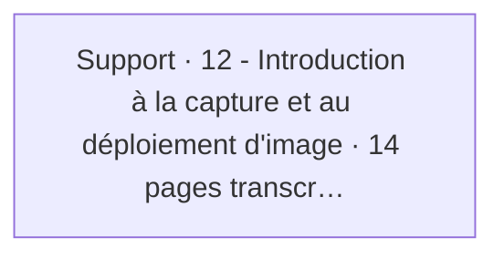
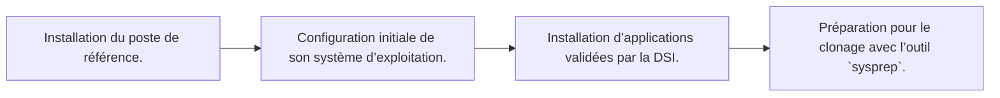
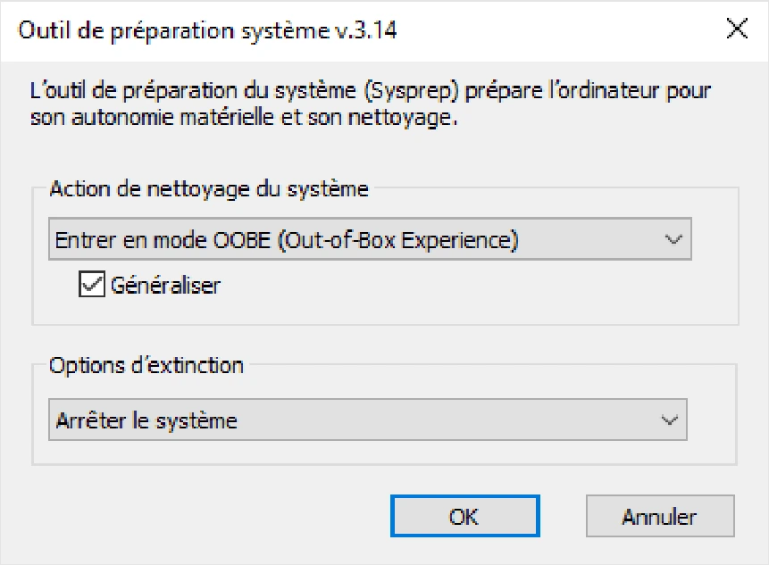

# Module 12 — Introduction à la capture et au déploiement d’image

[Travaux pratiques](../../tp/systemes-clients/module-12/index.md)

Les parties ci-dessous reprennent le cours original, dans le même ordre. Les encadrés et les schémas répètent ses formulations.

## Parcours de lecture

1. Support · 12 - Introduction à la capture et au déploiement d'image · 14 pages transcrites

**Visuel externe**



SOURCE DRIVE · TRANSCRIPTION DU SUPPORT

Le contenu des documents du dossier TSSR est transcrit ci-dessous, page par page. Les textes et tableaux sont intégrés à la page Web. Aucun fichier PDF, aucune diapositive entière ni aucune reproduction de page n’est affiché. Seuls des croquis ou visuels isolés et vérifiés peuvent accompagner la transcription. Les versions et les consignes restent celles des supports de formation. Les compléments IA sont conservés dans leur onglet distinct.

## Support · 12 - Introduction à la capture et au déploiement d'image · 14 pages transcrites

### Introduction à la capture et au déploiement d’image

Systèmes clients Microsoft — Module 12.

### Objectifs

!!! note "À retenir"
    S’ouvrir à l’industrialisation de l’installation de Windows.

**Visuel externe**


- S’ouvrir à l’industrialisation de l’installation de Windows.
- Créer un système modèle.
- Déployer des « clones ».

### Problématique

- Recherche de productivité dans le service informatique :
  - tendre vers un parc informatique homogène pour réduire les configurations ;
  - tendre vers un ensemble de systèmes d’exploitation homogènes pour réduire le maintien ;
  - posséder des systèmes d’exploitation « clé en main » pour les nouveaux collaborateurs et les collaborateurs avec un poste défaillant.
- Solution : posséder des images de référence.

### Préparation du master

!!! note "À retenir"
    Configuration initiale de son système d’exploitation.

**Visuel externe**



1. Installation du poste de référence.
2. Configuration initiale de son système d’exploitation.
3. Installation d’applications validées par la DSI.
4. Préparation pour le clonage avec l’outil `sysprep`.

### Sysprep

!!! note "À retenir"
    Pour rendre les postes uniques dans l’entreprise : les paramètres personnalisés du Master sont remis à zéro ; une version par génération de systèmes ; outils graphiques et en ligne de commande.

**Visuel externe**


Pour rendre les postes uniques dans l’entreprise :

- les paramètres personnalisés du Master sont remis à zéro ;
- une version par génération de systèmes ;
- outils graphiques et en ligne de commande.

### Sysprep — paramètres nécessaires

!!! note "À retenir"
    **OOBE (Out-of-Box Experience)** : interaction utilisateur au redémarrage.

**Visuel externe**


- **OOBE (Out-of-Box Experience)** : interaction utilisateur au redémarrage.
- **Généraliser**.
- **Arrêter le système**.

En ligne de commande :

```
C:\Windows\System32\sysprep\sysprep.exe /oobe /generalize /shutdown
```

En complément :

- Audit : pré-paramétrages spécifiques au poste avant OOBE.
- Journaux consultables après redémarrage dans les répertoires Panther, dans `C:\Windows\System32\Sysprep`, fichiers TXT et EVT.



Capture du support — Outil de préparation du système : OOBE, généraliser et arrêt.

### Sysprep — configurations et pilotes

!!! note "À retenir"
    Incompatible avec toutes les configurations (certains rôles serveur, jonction, etc.).

- Incompatible avec toutes les configurations (certains rôles serveur, jonction, etc.).
- Incompatible avec des Apps installées depuis le Microsoft Store.
- Pilotes installés manuellement : supprimés par défaut par sysprep ; non supprimés avec le paramètre `/PersistAllDeviceInstalls` en ligne de commande.
- Les comptes utilisateurs ne sont pas supprimés par sysprep.
- Activez et utilisez le compte administrateur pour un paramétrage plus précis (il sera réinitialisé par sysprep).

### Démonstration

### Exploitation du master

!!! note "À retenir"
    Une fois le système de référence éteint : **ne pas le redémarrer avant d’avoir capturé l’image du système !**

!!! warning "Attention"
    Une fois le système de référence éteint : **ne pas le redémarrer avant d’avoir capturé l’image du système !**

Une fois le système de référence éteint : **ne pas le redémarrer avant d’avoir capturé l’image du système !**

#### Récupérer l’image système grâce au serveur de déploiement

!!! note "À retenir"
    Images d’amorçage à disposition sur le serveur de déploiement.

- Méthode automatisée.
- Amorçage PXE.
- Images d’amorçage à disposition sur le serveur de déploiement.
- Déploiement possible grâce au serveur.

#### Récupérer l’image système grâce à dism

- Méthode manuelle.
- Nécessite un support WinPE amorçable : DVD, clé USB, etc.
- Léger, contient des outils spécifiques pour la capture et le déploiement.
- Commande puissante.

### Exploitation du master

#### Mise à jour des images

- Possible en mode « déconnecté » (offline) avec le format WIM et l’outil en ligne de commande `dism`, présent dans WinPE et dans Windows.

#### Le poste cible est-il prêt ?

- Des outils Microsoft permettent d’évaluer la compatibilité du matériel et des logiciels cibles : Conseiller de mise à niveau, Application Compatibility Toolkit, etc.
- WinPE comprend des outils de préparation : `diskpart`, `mount`, `drvload`, `net use`, Powershel, etc.

### Déploiement

| Mode | Démarche |
| --- | --- |
| Automatisé grâce au serveur de déploiement | Déploiement en masse ; démarrer les postes sur le réseau (Boot PXE) ; les clients requêtent puis se connectent au serveur de déploiement, ici WDS ; choix de l’image à déployer. |
| Manuel grâce à dism | Déploiement au cas par cas ; démarrer les postes sur le support amorçable WinPE ; partitionnement du stockage d’accueil. |

### Démonstration

TP

### Conclusion

- Déployer un système est courant aujourd’hui en entreprise.
- Les systèmes de déploiement via un serveur se démocratisent.

Référence du document : 1oGP63A32X8AfSS2omfB8LzwnTdBIIHF- · SHA-256 354e071ac6043135…
