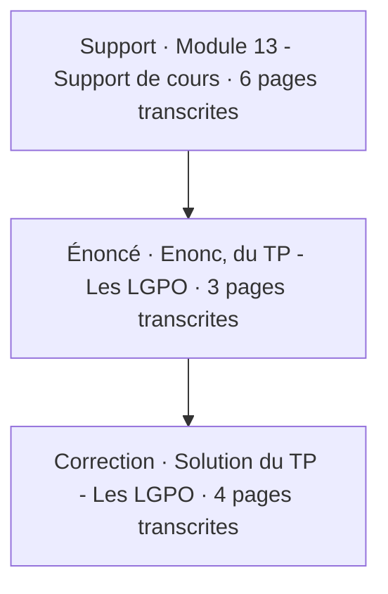
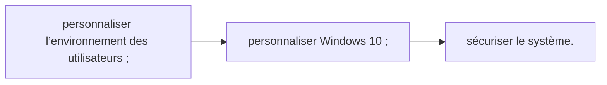
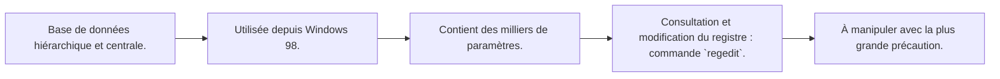
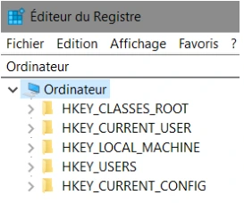
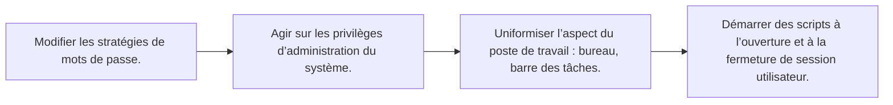
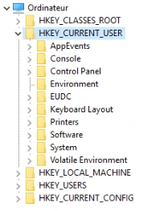
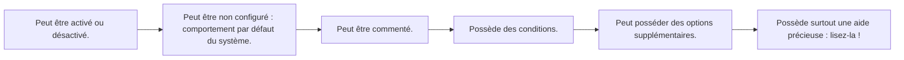
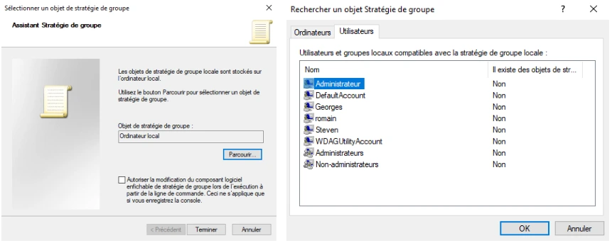

# Module 13 — Les stratégies de groupe local

Les parties ci-dessous reprennent le cours original, dans le même ordre. Les encadrés et les schémas répètent ses formulations.

## Parcours de lecture

1. Support · Module 13 - Support de cours · 6 pages transcrites
2. Énoncé · Enonc‚ du TP - Les LGPO · 3 pages transcrites
3. Correction · Solution du TP - Les LGPO · 4 pages transcrites

**Visuel externe**

SOURCE DRIVE · TRANSCRIPTION DU SUPPORT

Le contenu des documents du dossier TSSR est transcrit ci-dessous, page par page. Les textes et tableaux sont intégrés à la page Web. Aucun fichier PDF, aucune diapositive entière ni aucune reproduction de page n’est affiché. Seuls des croquis ou visuels isolés et vérifiés peuvent accompagner la transcription. Les versions et les consignes restent celles des supports de formation. Les compléments IA sont conservés dans leur onglet distinct.

## Support · Module 13 - Support de cours · 6 pages transcrites

### Les stratégies de groupe local

Systèmes clients Microsoft — Module 13.

#### Objectifs

!!! note "À retenir"
    Les stratégies de groupe local pour : personnaliser l’environnement des utilisateurs ; personnaliser Windows 10 ; sécuriser le système.

**Visuel externe**

Les stratégies de groupe local pour :

- personnaliser l’environnement des utilisateurs ;
- personnaliser Windows 10 ;
- sécuriser le système.

### La base de registre Windows

!!! note "À retenir"
    Base de données hiérarchique et centrale.

**Visuel externe**

- Base de données hiérarchique et centrale.
- Stocke toutes les informations de configuration du système pour un ou plusieurs utilisateurs, programmes et périphériques matériels.
- Utilisée depuis Windows 98.
- Contient des milliers de paramètres.
- Lors de son exécution, Windows consulte en permanence les informations contenues dans le Registre.
- Consultation et modification du registre : commande `regedit`.
- À manipuler avec la plus grande précaution.

#### Cinq catégories (ou ruches)

!!! note "À retenir"
    Capture du support — Les cinq catégories affichées dans l’Éditeur du Registre.

| Catégorie | Informations |
| --- | --- |
| `HKEY_CLASSES_ROOT` | Informations sur les applications : objets OLE, extensions. |
| `HKEY_CURRENT_USER` (`HKEY_USERS\SID`) | Configuration relative à l’utilisateur qui a ouvert une session. |
| `HKEY_LOCAL_MACHINE` | Informations de configuration spécifiques à l’ordinateur, pour n’importe quel utilisateur. |
| `HKEY_USERS` | Tous les profils utilisateur chargés activement sur l’ordinateur. |
| `HKEY_CURRENT_CONFIG` | Profil matériel utilisé par l’ordinateur. |

Capture du support — Les cinq catégories affichées dans l’Éditeur du Registre.

### La base de registre Windows

!!! note "À retenir"
    Les ruches contiennent des clés, qui peuvent elles-mêmes contenir des clés… Les clés contiennent des valeurs : binaires ou hexadécimales ; chaînes de caractères.

- Les ruches contiennent des clés, qui peuvent elles-mêmes contenir des clés…
- Les clés contiennent des valeurs : binaires ou hexadécimales ; chaînes de caractères.
- Chaque valeur correspond à un paramètre du système.

### LGPO

Les **LGPO (Local Group Policy Object)** :

- gèrent le comportement du poste de travail et des utilisateurs avec une seule et même console : console MMC personnalisée et composant logiciel enfichable Éditeur d’objets de stratégie de groupe ; console MMC Stratégie de sécurité locale (`secpol.msc`) ;
- réduisent le temps consacré à la gestion du poste de travail ;
- agissent sur la base de registre de façon plus conviviale.

#### Concrètement que peut-on faire par LGPO ?

!!! note "À retenir"
    Modifier les stratégies de mots de passe.

**Visuel externe**

- Modifier les stratégies de mots de passe.
- Agir sur les privilèges d’administration du système.
- Uniformiser l’aspect du poste de travail : bureau, barre des tâches.
- Restreindre l’accès à certains paramètres : panneau de configuration, ligne de commande.
- Démarrer des scripts à l’ouverture et à la fermeture de session utilisateur.

Capture du support — Clés et sous-clés du registre.

Capture du support — Nom, type et données des valeurs du registre.

### LGPO — cibles et paramètres

!!! note "À retenir"
    Possibilité d’agir sur le poste local ou sur un poste distant.

- Possibilité d’agir sur le poste local ou sur un poste distant.
- Possibilité d’agir sur différents objets de la base SAM.

#### Chaque paramètre

!!! note "À retenir"
    Peut être non configuré : comportement par défaut du système.

**Visuel externe**

- Peut être activé ou désactivé.
- Peut être non configuré : comportement par défaut du système.
- Peut être commenté.
- Possède des conditions.
- Peut posséder des options supplémentaires.
- Possède surtout une aide précieuse : lisez-la !

Capture du support — Sélection d’un ordinateur et d’un objet utilisateur dans la console LGPO.

Capture du support — Paramètre LGPO : état, commentaire, conditions, options et aide.

### Démonstration

### TP

### Conclusion

!!! note "À retenir"
    Bien connaître le fonctionnement des stratégies de groupe local pour : découvrir la base de registre : paramètres utilisateurs, paramètres ordinateurs, stratégies de sécurité ; se préparer à l’utilisation des stratégies de groupe de domaine.

Bien connaître le fonctionnement des stratégies de groupe local pour :

- découvrir la base de registre : paramètres utilisateurs, paramètres ordinateurs, stratégies de sécurité ;
- se préparer à l’utilisation des stratégies de groupe de domaine.

Référence du document : 1_48SPLn3Sy6sVQ6vagYTrqeow4wX8qGt · SHA-256 7db1109d7e25b727…

## Énoncé · Enonc‚ du TP - Les LGPO · 3 pages transcrites

### Les LGPO

TP du module — Les stratégies de groupe local. **Durée estimée : 1 heure.**

À travers ce TP, vous allez découvrir par vous-mêmes les consoles d’édition de stratégie de groupe local et de stratégie de sécurité. Vous les utiliserez pour modifier les stratégies par défaut, personnaliser les environnements de travail de votre VM et augmenter la sécurité du système. Vous testerez vos LGPO pour vous assurer qu’elles soient fonctionnelles.

#### Énoncé

Lisez l’ensemble de ce TP avant de vous lancer dans la pratique.

Sur **Win10-XX**, à l’aide des consoles appropriées, pour augmenter le niveau de sécurité d’accès aux ressources de votre VM, tous les utilisateurs devront utiliser un mot de passe avec les caractéristiques suivantes :

- longueur minimale : **7 caractères** ;
- **3 mots de passe** conservés dans l’historique ;
- respect des exigences de complexité.

### GPO non-administrateurs

Créez une GPO non-administrateurs :

- interdire l’accès au Panneau de configuration et à l’application Paramètres du PC ;
- verrouiller la barre des tâches ;
- mettre en place un papier peint de votre choix sur le bureau.

### GPO pour l’utilisateur Romain

Créez une GPO pour l’utilisateur **Romain** : Romain aura accès au Panneau de configuration et à l’application Paramètres du PC.

### GPO pour Romain — suite

Supprimer l’accès au **Gestionnaire des tâches**.

### Solution

Une solution est proposée pour ce TP sous la forme d’un PDF commenté, disponible dans les ressources à télécharger.

Référence du document : 1GdjmnsdqeGxqI7y_7H86GRW4pLuPq3Tw · SHA-256 bd00c5e5793e9d80…

## Correction · Solution du TP - Les LGPO · 4 pages transcrites

Correction originale : à consulter après avoir tenté l’exercice.

### Les LGPO — solution

TP du Module 13 — Les stratégies de groupe local. **Durée estimée : 1 heure.**

Sur **Win10-XX**, à l’aide des consoles appropriées appliquez les consignes suivantes :

Pour augmenter le niveau de sécurité d’accès aux ressources de votre VM, tous les utilisateurs devront utiliser un mot de passe avec les caractéristiques suivantes :

- Longueur minimale : **7 caractères**.
- **3 mots de passe** seront conservés dans l’historique.
- Il devra respecter les exigences de complexité.
- **Rechercher > secpol.msc**.
- Nœud **Stratégies de comptes > Stratégie de mot de passe**.
- Double clic sur **Longueur minimale du mot de passe** : **7 caractères > OK**.
- Double clic sur **Conserver l’historique des mots de passe** : **3 mots de passe mémorisés > OK**.
- Double clic sur **Le mot de passe doit respecter les exigences de complexité** : **Activé**.
- Pour comprendre les exigences de complexité : onglet **Expliquer**.

Fermez la session actuelle puis faites des tests « grandeurs réelles » avec des utilisateurs standard.

Tentez de changer le mot de passe d’un utilisateur standard (**Ctrl + Alt + Suppr > Modifier un mot de passe**) et vérifiez si les contraintes de sécurité que vous avez configurées ci-dessus fonctionnent.

#### Créez une GPO non-administrateurs

**Rechercher > mmc > Ajouter le composant logiciel enfichable Éditeur d’objet de stratégie de groupe > Parcourir**.

### Console Non-administrateurs

1. Onglet **Utilisateurs**.
2. Double clic sur **Non-administrateurs**.
3. **Terminer > OK**.

#### Interdire l’accès au Panneau de configuration et l’application Paramètres du PC

Dans la console de gestion de stratégie de groupe des Non-administrateurs :

1. **Configuration utilisateur**.
2. **Modèle d’administration**.
3. Clic sur **Panneau de configuration**.
4. Double clic sur **Interdire l’accès au Panneau de configuration et à l’application Paramètres du PC**.
5. **Activé**.
6. **Appliquer > OK**.

#### Verrouiller la barre des tâches

Dans la console de gestion de stratégie de groupe des Non-administrateurs :

1. **Configuration utilisateur**.
2. **Modèle d’administration**.
3. Clic sur **Menu Démarrer et barre des tâches**.
4. Double clic sur **Verrouiller la Barre des tâches**.
5. **Activé**.
6. **Appliquer > OK**.

#### Mettez en place un papier peint de votre choix sur le bureau

Dans la console de gestion de stratégie de groupe des Non-administrateurs :

1. **Configuration utilisateur**.
2. **Modèle d’administration**.
3. **Bureau**.
4. Clic sur **Bureau**.

### Papier peint du bureau

1. Double clic sur **Papier peint du bureau > Activé**.
2. Indiquez le chemin d’une image ou d’un partage dans lequel les utilisateurs ont au moins les autorisations d’accès en **Lecture**.
3. Faites attention au fait que votre image soit au format **BMP ou JPG**.
4. **Appliquer > OK**.

Ouvrez une session avec un utilisateur standard (Non-administrateurs) pour tester toutes ces contraintes.

### Créez une GPO pour l’utilisateur Romain

Romain aura accès au Panneau de configuration et à l’application Paramètres du PC.

1. Dans la même console MMC, ajouter le composant logiciel enfichable **Éditeur d’objet de stratégie de groupe**.
2. **Parcourir**.
3. Onglet **Utilisateurs**.
4. Double clic sur **romain**.
5. **Terminer > OK**.
6. Nœud **Stratégie ordinateur local\romain**.
7. **Configuration utilisateur**.
8. **Modèle d’administration**.
9. Clic sur **Panneau de configuration**.
10. Double clic sur **Interdire l’accès au Panneau de configuration et à l’application Paramètres du PC**.
11. **Désactivé**.
12. **Appliquer > OK**.

#### Supprimer l’accès au Gestionnaire des tâches

Nœud **Stratégie ordinateur local\romain > Configuration utilisateur**.

### Supprimer le Gestionnaire des tâches pour Romain

1. **Modèle d’administration**.
2. **Système**.
3. **Options Ctrl+Alt+Suppr**.
4. Double clic sur **Supprimer le gestionnaire des tâches**.
5. **Activé**.
6. **Appliquer > OK**.

Ouvrez une session avec le compte d’utilisateur **romain** puis testez ces contraintes.

Référence du document : 1L8HLjAz1Zk7f8R1DKihfi2GC2Nbs4cu9 · SHA-256 784eb23a36b7c418…

## Fiche de synthèse

Les lignes reprennent les titres du cours et la première phrase de chaque partie.

| Partie | Repère du cours |
| --- | --- |
| Correction · Solution du TP - Les LGPO · 4 pages transcrites | Correction originale : à consulter après avoir tenté l’exercice. |
