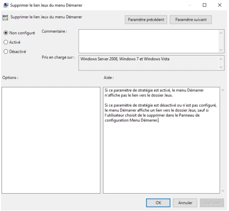

# Module 13 — Les stratégies de groupe local

**Séquence :** Systèmes clients Microsoft  
**Application :** personnaliser Windows et l’environnement des utilisateurs avec les consoles locales.

## Objectifs

- Décrire le rôle du Registre et reconnaître ses cinq catégories du support.
- Distinguer ruche, clé, sous-clé et valeur.
- Choisir une console et une cible LGPO.
- Appliquer les paramètres de mot de passe et les restrictions du TP, puis les tester avec le bon compte.

## 1. Comprendre le Registre Windows

Le Registre est une base centrale hiérarchisée dans laquelle Windows consulte des informations de configuration du système, des utilisateurs, des programmes et du matériel. Le support le présente comme utilisé depuis Windows 98 et souligne qu’il comporte des milliers de paramètres.

`regedit` permet de consulter et modifier le Registre : le support insiste sur la **plus grande précaution**.

| Catégorie du support | Informations |
|---|---|
| `HKEY_CLASSES_ROOT` | Applications, objets OLE, extensions de fichiers. |
| `HKEY_CURRENT_USER` | Utilisateur connecté ; correspond à sa branche `HKEY_USERS\SID`. |
| `HKEY_LOCAL_MACHINE` | Paramètres de l’ordinateur, quel que soit l’utilisateur. |
| `HKEY_USERS` | Profils utilisateurs activement chargés. |
| `HKEY_CURRENT_CONFIG` | Profil matériel utilisé. |

Une **ruche** contient des **clés**, elles-mêmes organisées en sous-clés. Les clés contiennent des **valeurs**, par exemple des chaînes ou des données binaires/hexadécimales ; les valeurs portent les réglages.

**Illustration IA / externe au cours — organisation d’un réglage.**

## 2. Administrer avec les LGPO

Les **Local Group Policy Objects** permettent d’agir sur le comportement du poste et des utilisateurs avec une interface plus accessible que l’édition directe du Registre. Elles réduisent le temps de gestion et préparent à l’étude des stratégies de groupe de domaine.

Les consoles du support sont **MMC**, le composant **Éditeur d’objets de stratégie de groupe**, et **Stratégie de sécurité locale** avec `secpol.msc`.

### Ce que le cours propose de régler

- Stratégies de mots de passe.
- Privilèges d’administration du système.
- Bureau et barre des tâches.
- Accès au Panneau de configuration ou à la ligne de commande.
- Scripts à l’ouverture ou à la fermeture de session.

Le support présente le ciblage d’un poste local ou distant et de différents objets de la base SAM. Dans le TP, les cibles sont la stratégie locale de sécurité, **Non-administrateurs** et **romain**.

### Lire un paramètre avant de le modifier

| État | Sens |
|---|---|
| **Activé** | La règle décrite par le paramètre est appliquée. |
| **Désactivé** | La règle est explicitement désactivée selon son aide. |
| **Non configuré** | Le réglage n’est pas défini par ce paramètre ; le support le présente comme le comportement par défaut. |

Un paramètre peut posséder un commentaire, des conditions d’application, des options supplémentaires et une aide. **Lire cette aide** est indispensable : activer un paramètre nommé « Interdire… » applique l’interdiction, et non une autorisation.

*Capture du support — états, commentaire, conditions et explication d’un paramètre.*

## 3. TP complet : mots de passe et environnements locaux

**Durée source : 1 h. Machine : Win10-XX.** Les valeurs sont des consignes de laboratoire, pas une politique de sécurité à appliquer à toute organisation.

### A. Exigences de mot de passe

1. Ouvrir **secpol.msc**.
2. Aller à **Stratégies de comptes > Stratégie de mot de passe**.
3. Régler **Longueur minimale du mot de passe** sur **7 caractères**.
4. Régler **Conserver l’historique des mots de passe** sur **3 mots de passe mémorisés**.
5. Activer **Le mot de passe doit respecter les exigences de complexité**.
6. Lire l’onglet **Expliquer** pour comprendre les exigences.
7. Fermer la session, puis tester avec un **utilisateur standard** : **Ctrl + Alt + Suppr > Modifier un mot de passe**.

Le test doit constater l’acceptation ou le refus selon les contraintes configurées ; la présence d’une valeur dans la console ne suffit pas.

### B. Créer la console Non-administrateurs

1. Ouvrir **mmc**.
2. Ajouter **Éditeur d’objet de stratégie de groupe**.
3. Choisir **Parcourir > Utilisateurs > Non-administrateurs**.
4. Terminer puis valider.

La cible choisie ici est essentielle : les trois réglages suivants sont destinés aux non-administrateurs.

### C. Restreindre et personnaliser

| Objectif | Chemin sous Configuration utilisateur > Modèle d’administration | Réglage |
|---|---|---|
| Interdire Panneau de configuration et Paramètres | Panneau de configuration > Interdire l’accès au Panneau de configuration et à l’application Paramètres du PC | Activé, puis Appliquer et OK. |
| Verrouiller la barre des tâches | Menu Démarrer et barre des tâches > Verrouiller la Barre des tâches | Activé, puis Appliquer et OK. |
| Imposer le papier peint | Bureau > Bureau > Papier peint du bureau | Activé ; chemin de l’image ; Appliquer et OK. |

L’image du papier peint doit être en **BMP ou JPG**. Le fichier ou le partage doit offrir au moins la permission **Lecture** aux utilisateurs concernés.

Ouvrir une session standard pour vérifier les trois effets : accès refusé aux paramètres visés, barre verrouillée et image visible.

### D. Ajouter la cible Romain

1. Dans la même MMC, ajouter un autre composant **Éditeur d’objet de stratégie de groupe**.
2. **Parcourir > Utilisateurs > romain > Terminer > OK**.
3. Repérer le nœud **Stratégie ordinateur local\romain**.
4. Dans **Configuration utilisateur > Modèle d’administration > Panneau de configuration**, ouvrir **Interdire l’accès au Panneau de configuration et à l’application Paramètres du PC**.
5. Choisir **Désactivé**, appliquer et valider : le TP veut rendre cet accès à Romain.
6. Dans **Configuration utilisateur > Modèle d’administration > Système > Options Ctrl+Alt+Suppr**, ouvrir **Supprimer le gestionnaire des tâches**.
7. Choisir **Activé**, appliquer et valider.
8. Ouvrir une session avec **romain**, puis tester les deux comportements.

### E. Tableau de contrôle du scénario

| Compte ou groupe | Accès Panneau / Paramètres | Barre et papier peint | Gestionnaire des tâches |
|---|---|---|---|
| Non-administrateur visé par la règle générale | Interdit par la règle de groupe | Paramètres imposés par cette règle | Aucune restriction supplémentaire demandée par cette seule règle. |
| Romain | Accès rendu par son réglage ciblé | Vérifier les autres règles qui le concernent. | Retiré par sa règle ciblée. |

Tester **le compte ciblé** permet de comprendre l’effet combiné des stratégies. Ce TP reste local ; il ne décrit pas la gestion d’un domaine Active Directory.

## À retenir

Le Registre conserve les paramètres ; la LGPO fournit leur interface de gestion. Toujours vérifier **la cible**, **le sens du nom**, **l’état**, **les options** et **le résultat en session**.

## Mini-quiz

1. Quelle différence entre HKEY_CURRENT_USER et HKEY_LOCAL_MACHINE ?
2. Que faut-il lire avant d’activer un paramètre nommé « Interdire… » ?
3. Comment cibler les non-administrateurs dans la MMC ?
4. Pourquoi Romain a-t-il un réglage « Désactivé » pour l’interdiction du Panneau ?
5. Quels prérequis du papier peint sont précisés dans la correction ?

??? note "Réponses"
    1. Utilisateur connecté contre ordinateur, indépendamment de l’utilisateur.
    2. L’aide, les conditions et les options du paramètre.
    3. Parcourir, onglet Utilisateurs, puis Non-administrateurs dans l’Éditeur d’objet de stratégie de groupe.
    4. Pour désactiver explicitement cette interdiction dans sa stratégie ciblée.
    5. BMP ou JPG, chemin valable et lecture autorisée pour les utilisateurs concernés.

- [Énoncé du TP](../../tp/systemes-clients/module-13/enonces.md) · [Correction](../../tp/systemes-clients/module-13/corrections.md)
- [Fiche de révision](../../revision/systemes-clients/module-13-les-strategies-de-groupe-local.md)
- [Kahoot du module](../../kahoot/02-systemes-clients-microsoft-13-les-strategies-de-groupe-local.md)
- [Présentation du cours](index.md)
