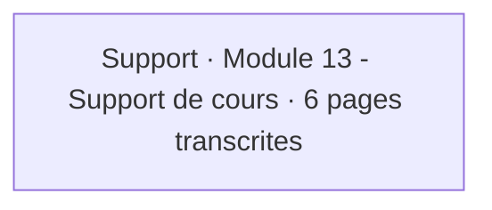
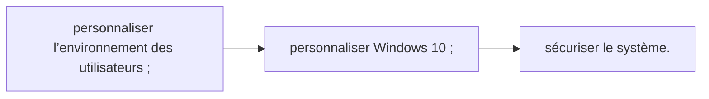
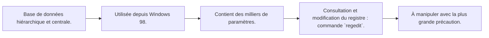
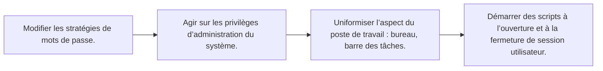
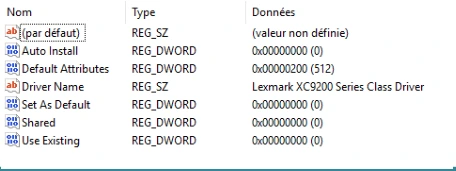
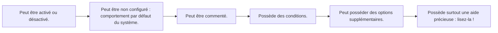
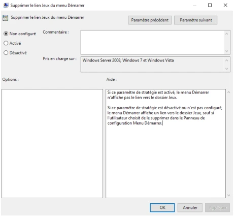

# Module 13 — Les stratégies de groupe local

[Travaux pratiques](../../tp/systemes-clients/module-13/index.md)

Les parties ci-dessous reprennent le cours original, dans le même ordre. Les encadrés et les schémas répètent ses formulations.

## Parcours de lecture

1. Support · Module 13 - Support de cours · 6 pages transcrites

**Visuel externe**

SOURCE DRIVE · TRANSCRIPTION DU SUPPORT

Le contenu des documents du dossier TSSR est transcrit ci-dessous, page par page. Les textes et tableaux sont intégrés à la page Web. Aucun fichier PDF, aucune diapositive entière ni aucune reproduction de page n’est affiché. Seuls des croquis ou visuels isolés et vérifiés peuvent accompagner la transcription. Les versions et les consignes restent celles des supports de formation. Les compléments IA sont conservés dans leur onglet distinct.

## Support · Module 13 - Support de cours · 6 pages transcrites

### Les stratégies de groupe local

Systèmes clients Microsoft — Module 13.

#### Objectifs

!!! note "À retenir"
    Les stratégies de groupe local pour : personnaliser l’environnement des utilisateurs ; personnaliser Windows 10 ; sécuriser le système.

**Visuel externe**

Les stratégies de groupe local pour :

- personnaliser l’environnement des utilisateurs ;
- personnaliser Windows 10 ;
- sécuriser le système.

### La base de registre Windows

!!! note "À retenir"
    Base de données hiérarchique et centrale.

**Visuel externe**

- Base de données hiérarchique et centrale.
- Stocke toutes les informations de configuration du système pour un ou plusieurs utilisateurs, programmes et périphériques matériels.
- Utilisée depuis Windows 98.
- Contient des milliers de paramètres.
- Lors de son exécution, Windows consulte en permanence les informations contenues dans le Registre.
- Consultation et modification du registre : commande `regedit`.
- À manipuler avec la plus grande précaution.

#### Cinq catégories (ou ruches)

!!! note "À retenir"
    Capture du support — Les cinq catégories affichées dans l’Éditeur du Registre.

| Catégorie | Informations |
| --- | --- |
| `HKEY_CLASSES_ROOT` | Informations sur les applications : objets OLE, extensions. |
| `HKEY_CURRENT_USER` (`HKEY_USERS\SID`) | Configuration relative à l’utilisateur qui a ouvert une session. |
| `HKEY_LOCAL_MACHINE` | Informations de configuration spécifiques à l’ordinateur, pour n’importe quel utilisateur. |
| `HKEY_USERS` | Tous les profils utilisateur chargés activement sur l’ordinateur. |
| `HKEY_CURRENT_CONFIG` | Profil matériel utilisé par l’ordinateur. |

Capture du support — Les cinq catégories affichées dans l’Éditeur du Registre.

### La base de registre Windows

!!! note "À retenir"
    Les ruches contiennent des clés, qui peuvent elles-mêmes contenir des clés… Les clés contiennent des valeurs : binaires ou hexadécimales ; chaînes de caractères.

- Les ruches contiennent des clés, qui peuvent elles-mêmes contenir des clés…
- Les clés contiennent des valeurs : binaires ou hexadécimales ; chaînes de caractères.
- Chaque valeur correspond à un paramètre du système.

LGPO

Les **LGPO (Local Group Policy Object)** :

- gèrent le comportement du poste de travail et des utilisateurs avec une seule et même console : console MMC personnalisée et composant logiciel enfichable Éditeur d’objets de stratégie de groupe ; console MMC Stratégie de sécurité locale (`secpol.msc`) ;
- réduisent le temps consacré à la gestion du poste de travail ;
- agissent sur la base de registre de façon plus conviviale.

#### Concrètement que peut-on faire par LGPO ?

!!! note "À retenir"
    Modifier les stratégies de mots de passe.

**Visuel externe**

- Modifier les stratégies de mots de passe.
- Agir sur les privilèges d’administration du système.
- Uniformiser l’aspect du poste de travail : bureau, barre des tâches.
- Restreindre l’accès à certains paramètres : panneau de configuration, ligne de commande.
- Démarrer des scripts à l’ouverture et à la fermeture de session utilisateur.

Capture du support — Clés et sous-clés du registre.

Capture du support — Nom, type et données des valeurs du registre.

### LGPO — cibles et paramètres

!!! note "À retenir"
    Possibilité d’agir sur le poste local ou sur un poste distant.

- Possibilité d’agir sur le poste local ou sur un poste distant.
- Possibilité d’agir sur différents objets de la base SAM.

#### Chaque paramètre

!!! note "À retenir"
    Peut être non configuré : comportement par défaut du système.

**Visuel externe**

- Peut être activé ou désactivé.
- Peut être non configuré : comportement par défaut du système.
- Peut être commenté.
- Possède des conditions.
- Peut posséder des options supplémentaires.
- Possède surtout une aide précieuse : lisez-la !

Capture du support — Sélection d’un ordinateur et d’un objet utilisateur dans la console LGPO.

Capture du support — Paramètre LGPO : état, commentaire, conditions, options et aide.

### Démonstration

TP

### Conclusion

!!! note "À retenir"
    Bien connaître le fonctionnement des stratégies de groupe local pour : découvrir la base de registre : paramètres utilisateurs, paramètres ordinateurs, stratégies de sécurité ; se préparer à l’utilisation des stratégies de groupe de domaine.

Bien connaître le fonctionnement des stratégies de groupe local pour :

- découvrir la base de registre : paramètres utilisateurs, paramètres ordinateurs, stratégies de sécurité ;
- se préparer à l’utilisation des stratégies de groupe de domaine.

Référence du document : 1_48SPLn3Sy6sVQ6vagYTrqeow4wX8qGt · SHA-256 7db1109d7e25b727…
