# Module additionnel — Workstation

Les parties ci-dessous reprennent le cours original, dans le même ordre. Les encadrés et les schémas répètent ses formulations.

## Parcours de lecture
1. Support · Module additionnel - Support de cours · 11 pages transcrites
2. Notes du Drive · module 1 et 2 et extra.txt · document texte
3. Module additionnel - VMware Workstation
4. Quiz complet — Systèmes clients Microsoft

**Visuel externe**

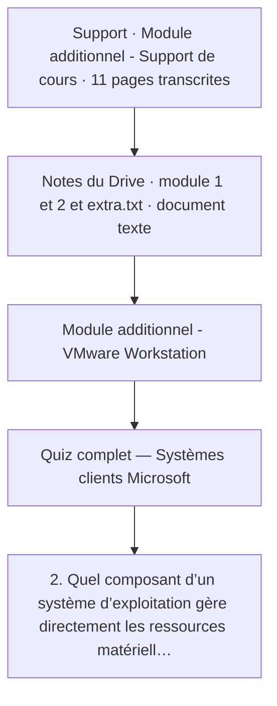

SOURCE DRIVE · TRANSCRIPTION DU SUPPORT

Le contenu des documents du dossier TSSR est transcrit ci-dessous, page par page. Les textes et tableaux sont intégrés à la page Web. Aucun fichier PDF, aucune diapositive entière ni aucune reproduction de page n’est affiché. Seuls des croquis ou visuels isolés et vérifiés peuvent accompagner la transcription. Les versions et les consignes restent celles des supports de formation. Les compléments IA sont conservés dans leur onglet distinct.

## Support · Module additionnel - Support de cours · 11 pages transcrites

### Workstation

!!! note "À retenir"
    Systèmes clients Microsoft — Module additionnel.

Systèmes clients Microsoft — Module additionnel.

#### Objectifs

!!! note "À retenir"
    Découvrir : la virtualisation des systèmes ; Workstation et les ressources ; Workstation et le réseau ; les spécificités de Workstation ; l’import et l’export de machines virtuelles.

**Visuel externe**

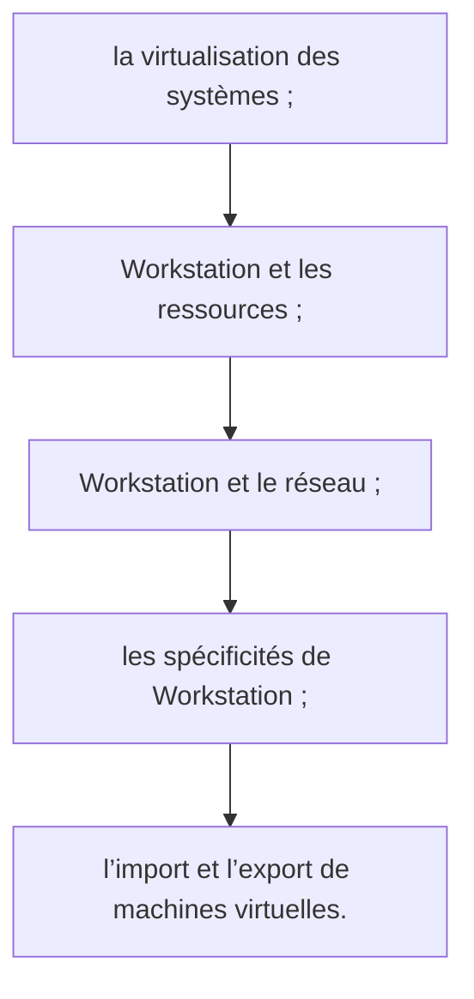

Découvrir :

- la virtualisation des systèmes ;
- Workstation et les ressources ;
- Workstation et le réseau ;
- les spécificités de Workstation ;
- l’import et l’export de machines virtuelles.

### Virtualisation des systèmes

!!! note "À retenir"
    Faire cohabiter plusieurs systèmes invités, isolés et indépendants, grâce aux ressources d’un ordinateur physique, appelé hôte.

Faire cohabiter plusieurs systèmes invités, isolés et indépendants, grâce aux ressources d’un ordinateur physique, appelé hôte.

| Élément | Description |
| --- | --- |
| Hôte | Ordinateur physique, serveur ou PC client ; possède les ressources. |
| Système invité | Ordinateur virtuel, ou VM (Virtual Machine) ; possède son propre OS ; utilise les ressources de l’hôte ; défini par un ensemble de fichiers, géré par l’hyperviseur et contenu dans un répertoire d’accueil. |

#### L’hyperviseur

!!! note "À retenir"
    Élément indispensable de la virtualisation.

**Visuel externe**

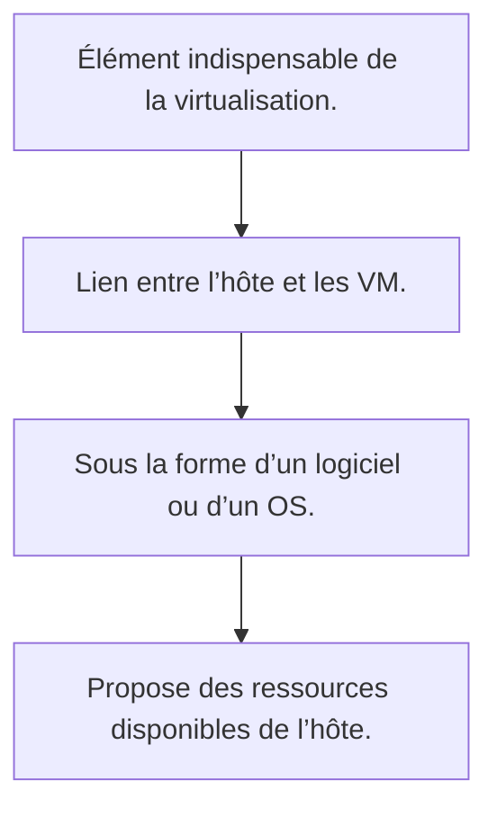

- Élément indispensable de la virtualisation.
- Lien entre l’hôte et les VM.
- Sous la forme d’un logiciel ou d’un OS.
- Propose des ressources disponibles de l’hôte.
- Gère, partage et priorise les accès aux ressources de l’hôte lorsque les VM en ont besoin.

### Virtualisation des systèmes — ressources

!!! note "À retenir"
    Les quatre éléments indispensables au bon fonctionnement d’un ordinateur physique : le processeur ; la mémoire vive ; le disque dur ; la carte réseau.

**Visuel externe**

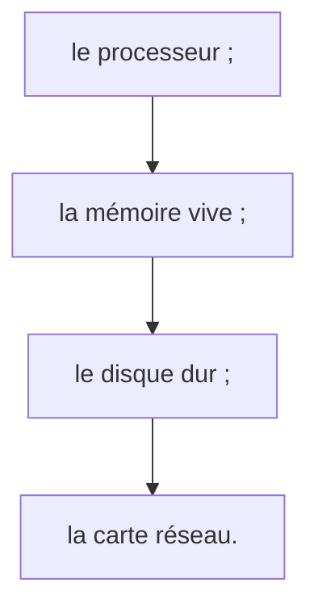

Les quatre éléments indispensables au bon fonctionnement d’un ordinateur physique :

- le processeur ;
- la mémoire vive ;
- le disque dur ;
- la carte réseau.

Une VM possède les mêmes besoins pour fonctionner.

Autres besoins : lecteur DVD / stockage externe ; carte graphique ; carte son ; firmware.

Le schéma place plusieurs VM au-dessus de l’**HYPERVISEUR**, lui-même au-dessus des ressources matérielles.

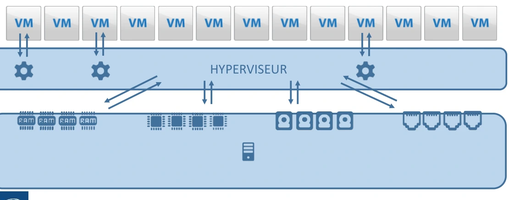

Capture du support — L’hyperviseur partage les ressources de l’hôte entre les machines virtuelles.

### Le processeur

!!! note "À retenir"
    Les captures présentent le nombre de processeurs, le nombre de cœurs par processeur, le nombre total de cœurs, ainsi que les options du moteur de virtualisation.

Attribution des ressources CPU. Les captures présentent le nombre de processeurs, le nombre de cœurs par processeur, le nombre total de cœurs, ainsi que les options du moteur de virtualisation.

### La mémoire vive

!!! note "À retenir"
    Capture du support — Attribution des processeurs et options de virtualisation.

- Attribuée à la VM au démarrage.
- Configurable.

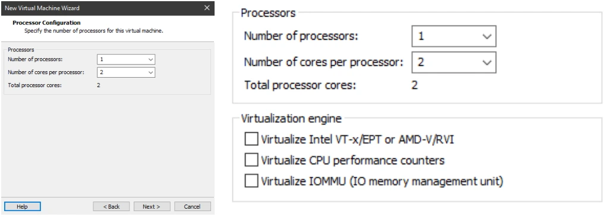

Capture du support — Attribution des processeurs et options de virtualisation.

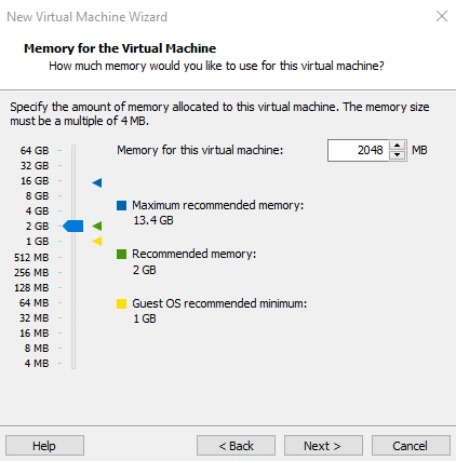

Capture du support — Attribution de mémoire à la machine virtuelle.

### Le disque dur

!!! note "À retenir"
    La capture montre les choix d’allocation de l’espace disque et de stockage dans un seul fichier ou plusieurs fichiers.

**Visuel externe**

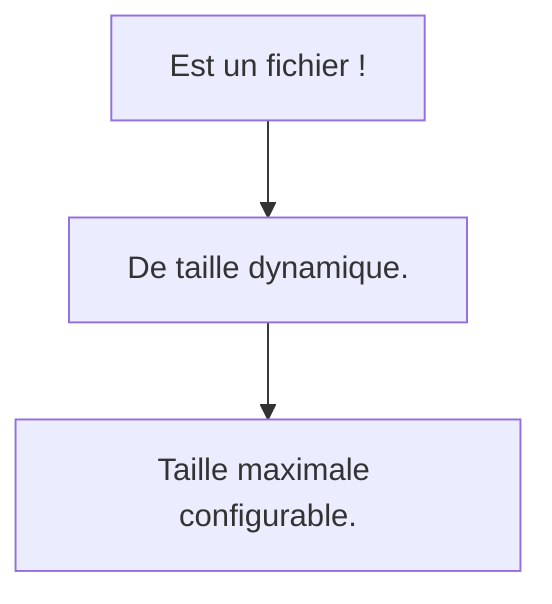

- Est un fichier !
- De taille dynamique.
- Taille maximale configurable.

La capture montre les choix d’allocation de l’espace disque et de stockage dans un seul fichier ou plusieurs fichiers.

### La carte réseau

La VM peut communiquer avec :

- des VM de son réseau ;
- des VM de réseaux différents ;
- l’hôte ;
- d’autres machines physiques ;
- le monde entier.

Pour cela, elle doit être connectée à un switch.

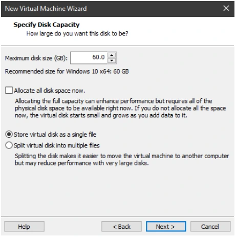

Capture du support — Création et capacité maximale d’un disque virtuel.

### La carte réseau — switchs virtuels

Les switchs sont virtuels : Host-Only ; VMnet et Lan Segment ; Bridge ; NAT (translation d’adresse).

#### Host-Only

Le schéma relie les VM au switch Host-Only et à l’hôte au moyen de **VMware Network Adapter VMnet1**.

#### VMnet

Le schéma relie les VM au switch **VMnetX** et à l’hôte au moyen de **VMware Network Adapter VMnetX**.

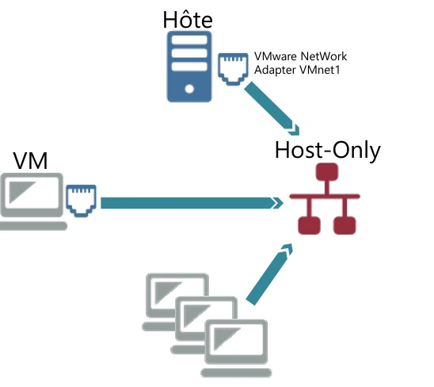

Capture du support — Réseau Host-Only avec adaptateur VMnet1 sur l’hôte.

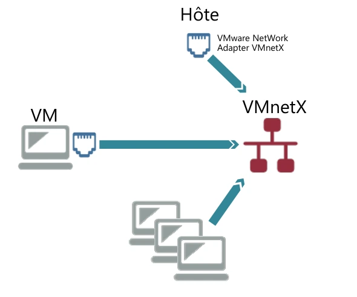

Capture du support — Réseau VMnetX et adaptateur de l’hôte.

### La carte réseau — VMnet et Lan Segment

Les switchs sont virtuels : Host-Only ; VMnet et Lan Segment ; Bridge ; NAT (translation d’adresse).

Le schéma **Lan Segment** relie plusieurs VM au même switch virtuel.

Le schéma de maquette relie quatre ensembles, **Serveurs**, **Administratif**, **Usine** et **Imprimantes**, à un **routeur virtuel** par des switchs distincts.

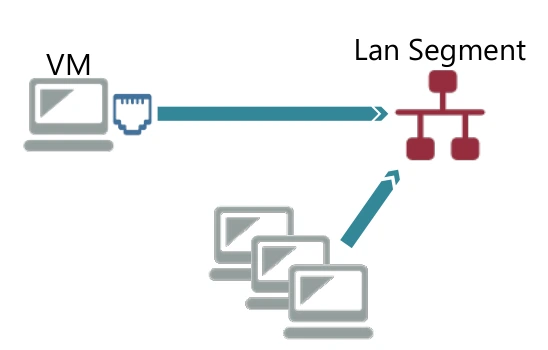

Capture du support — Lan Segment entre machines virtuelles.

### La carte réseau — Bridge et NAT

Les switchs sont virtuels : Host-Only ; VMnet et Lan Segment ; Bridge ; NAT (translation d’adresse).

#### Bridge

Le schéma relie les VM au switch **Bridge**, puis à **Internet**.

#### NAT (translation d’adresse)

Le schéma relie les VM au switch **NAT**, puis à l’**hôte** et à **Internet**. L’interface virtuelle côté hôte est **VMware Network Adapter VMnet8** ; l’interface vers Internet est **Ethernet**.

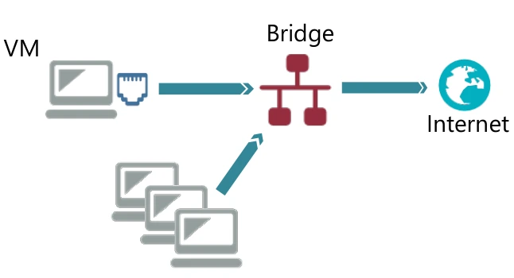

Capture du support — Réseau Bridge vers le réseau physique et Internet.

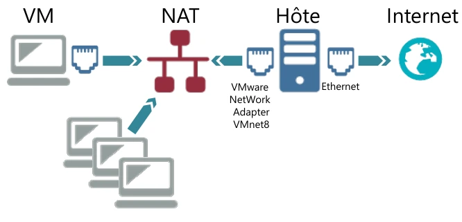

Capture du support — Réseau NAT et adaptateur VMware Network Adapter VMnet8.

### Workstation

#### Les avantages

- IHM épurée, simple d’utilisation.
- Pause, snapshots, clonage.
- Partages de dossier entre l’hôte et la machine virtuelle.
- Glisser/Déposer et autres avantages grâce aux VMware Tools.

#### Les inconvénients

- Prévu pour des maquettes simples.
- Logiciel propriétaire VMware.
- Temps d’adaptation aux différentes notions : virtualisation des OS, du stockage, des réseaux…

#### Quelques trucs à connaître

- Possibilité de paramétrer la séquence de démarrage dans le BIOS de la VM.
- Les médias amovibles de type CD/DVD, USB, disquette sont gérés.
- Par défaut la VM « capture » le clavier et la souris : tapez **Ctrl + Alt** pour reprendre la main.
- Pour faire **Ctrl + Alt + Suppr** dans la VM, taper **Ctrl + Alt + Inser**, ou cliquer sur l’icône **Send Ctrl+Alt+Del to this virtual machine**.

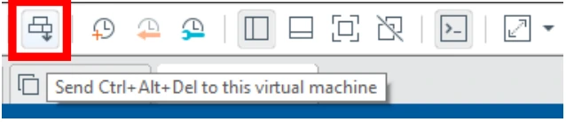

Capture du support — Commande Workstation pour envoyer Ctrl + Alt + Suppr à la VM.

### Démonstration

### Import/export de VM

| Opération | Méthodes |
| --- | --- |
| Importer | Possibilité d’utiliser des VM existantes : ouvrir (Open) une VM depuis son dossier d’accueil ; importer une VM depuis son archive `.ovf` ou `.ova`. |
| Exporter | Sauvegarder votre VM dans son état actuel pour la réutiliser plus tard : en copiant son dossier d’accueil ; en l’exportant dans une archive `.ovf` ou `.ova`. |

### Démonstration

### Conclusion

- Permet de maquetter des environnements pour apprendre ou pour tester avant de mettre en production.
- Virtualise la puissance de calcul, le stockage et l’accès au réseau.
- C’est l’outil majeur de votre formation.
- Vous en découvrirez davantage avec l’expérience.

Référence du document : 1rBR8LA5blEFEi_JGfTgavsoyozNJqlCf · SHA-256 3dd20f3a66d49d66…

## Notes du Drive · module 1 et 2 et extra.txt · document texte

Notes textuelles présentes dans le Drive. Aucun support de cours illustré distinct n’est fourni pour ce document ; aucune illustration n’a été inventée ou attribuée au support.

## Module additionnel - VMware Workstation

### Objectifs du module

### La virtualisation des systèmes

### VMware Workstation et les ressources

### VMware Workstation et le réseau

### VMware Workstation et ses spécificités

### Démonstration - Création d'une VM

### Import et export de VM

### Démonstration - Import et export de VM

### Conclusion

Dans ce module, nous allons découvrir différents aspects du logiciel VMware Workstation dans le but de pouvoir créer une machine virtuelle.

### Objectifs du module

Nous allons explorer les notions essentielles de la virtualisation des systèmes, ce qui nous permettra de comprendre comment fonctionne VMware Workstation. Nous apprendrons également à gérer les ressources de Workstation, afin de maximiser l'efficacité de nos machines virtuelles.

### Virtualisation des systèmes

Nous allons aborder le concept de virtualisation, en détaillant ses avantages et ses inconvénients. Cela inclut la compréhension de l'environnement virtuel et comment il interagit avec le matériel physique.

### Workstation et ses ressources

Nous allons examiner les différentes ressources que nous pouvons attribuer à nos machines virtuelles. Cela inclut la gestion de la mémoire, du processeur et du stockage alloué à chaque machine virtuelle.

### Workstation et le réseau

Dans cette partie, nous allons voir comment configurer le réseau pour nos machines virtuelles. Nous allons apprendre à établir une communication entre les machines virtuelles et le réseau physique.

### Spécificités de Workstation

Nous allons également étudier les spécificités de VMware Workstation, telle que la prise en charge de différents systèmes d'exploitation et la gestion des snapshots pour sauvegarder nos configurations.

### Import et export de machines virtuelles

Enfin, nous allons apprendre à importer et exporter des machines virtuelles, ce qui nous permettra de partager des environnements virtuels et de les transférer entre différents systèmes.

Ce module nous offre une compréhension approfondie de VMware Workstation, que nous allons mettre en pratique à travers des exercices et des études de cas concrets.

Dans ce texte, nous allons explorer la virtualisation des systèmes, qui est une notion fondamentale avant de plonger dans l'utilisation de VMware Workstation.

Qu'est-ce que la virtualisation des systèmes ?

La virtualisation des systèmes nous permet de faire cohabiter plusieurs systèmes d'exploitation sur une seule machine physique. En règle générale, un ordinateur, ou une machine physique, est piloté par un unique système d'exploitation. Ce dernier est le seul à pouvoir utiliser les ressources physiques de l'ordinateur. L'idée principale de la virtualisation est donc de permettre à différents systèmes d'exploitation dits "invités" d'exploiter les ressources de la machine hôte.

### Le rôle de l'hôte et des machines virtuelles

Dans le contexte de la virtualisation, la machine physique est appelée l'hôte. L'hôte possède un certain nombre de ressources matérielles qui seront partagées entre les différents systèmes d'exploitation qu'il héberge. Les systèmes d'exploitation invités fonctionnent dans un ordinateur virtuel, souvent désigné sous l'appellation de "virtual machine" ou "VM". Chaque VM possède son propre système d'exploitation, qui est à la fois indépendant et isolé des autres, tout en cohabitant sur la même machine hôte.

### Le fonctionnement des machines virtuelles

Les VM utilisent les ressources de l'hôte, qui sont définies au préalable par le technicien. Une machine virtuelle est définie par un ensemble de fichiers stockés dans un répertoire, et ces fichiers seront gérés par un hyperviseur. L'hyperviseur est l'élément central de la virtualisation, car il fait le lien entre les VM et l'hôte, permettant ainsi la coexistence des différents systèmes d'exploitation. Sans hyperviseur, la virtualisation ne serait pas possible.

### Les types d'hyperviseurs

L'hyperviseur existe sous deux formes. Il peut être un logiciel, comme VMware Workstation, ou un système d'exploitation, comme ESXI, également proposé par VMware. L'hyperviseur a une vision globale sur l'ensemble des ressources de l'hôte et gère l'accès à ces ressources pour les différentes VM.

### Les besoins des machines virtuelles

Pour fonctionner correctement, une VM, comme toute machine physique, nécessite plusieurs éléments essentiels : des ressources processeur, de la mémoire vive, du stockage et une carte réseau. En plus de ces ressources, une VM peut également nécessiter des composants supplémentaires tels qu'un BIOS ou EFI, une carte graphique, voire un lecteur DVD.

### Visualisation de la virtualisation

Pour mieux comprendre le processus, imaginons un schéma : un hôte équipé de nombreux ressources peut héberger un hyperviseur, que ce soit sous forme de logiciel comme Workstation ou sous forme de système d'exploitation comme ESXI. L'hyperviseur nous permet de manipuler plusieurs VM, qu'elles exécutent un système d'exploitation Linux ou Microsoft Windows. Grâce à cet hyperviseur, nous pouvons gérer efficacement les ressources CPU, RAM, stockage et les connexions réseau nécessaires aux différentes VM.

### Compréhension globale de la virtualisation

Il est important de réaliser que bien que les systèmes d'exploitation invités aient l'impression d'avoir un accès direct aux ressources matérielles, c’est en fait l'hyperviseur qui intercepte leurs demandes. Il priorise, gère et partage ces ressources entre toutes les VM. Cela nous montre comment la virtualisation permet d'optimiser l'utilisation des ressources informatiques tout en garantissant l'isolation de chaque environnement invité.

En conclusion, la virtualisation des systèmes est un concept clé qui nous permet de maximiser l'utilisation des ressources matérielles d'une machine tout en offrant un environnement isolé pour chaque système d'exploitation invité.

Dans VMware Workstation, nous avons la possibilité de créer des machines virtuelles (VM) configurées selon nos besoins.

Nous avons la possibilité de configurer les ressources CPU lors de la création d'une VM. En fonction des ressources totales de notre hôte, nous attribuons des processeurs et des cœurs de processeur. Il est important de ne pas créer de VM trop gourmandes. En effet, plus nous attribuons de ressources CPU de l'hôte, plus il y a de chances que les instructions de notre VM soient mises en file d'attente, car d'autres VM ou même l'OS de l'hôte peuvent être prioritaires. Cela peut donc avoir un impact néfaste sur les performances.

### Recommandations et ajustements

Les recommandations de VMware sont disponibles en cliquant sur le bouton Help. Nous pouvons toujours ajuster cette attribution une fois la VM créée, mais seulement si celle-ci est éteinte. En fonction du système d'exploitation qui est ou sera installé sur notre VM, Workstation connaît les préconisations des éditeurs et nous propose donc des choix de quantité de RAM à allouer à notre VM.

### Gestion de la mémoire vive

La mémoire vive attribuée à notre VM lui est techniquement attribuée dès son démarrage. Si nous configurons une VM avec 4 Go de mémoire vive et que nous la démarrons, notre hôte va immédiatement lui dédier 4 Go. Nous devons donc faire attention au dimensionnement de notre VM. Autrement dit, nous devons nous assurer d'avoir suffisamment de mémoire vive disponible sur notre hôte pour que notre VM démarre et fonctionne de manière optimale. Si nous éteignons notre VM, les 4 Go sont libérés et l'hôte pourra s'en servir pour d'autres tâches. Si nous mettons notre VM en pause, le contenu de la mémoire vive est transféré dans un fichier qui se trouve dans le répertoire d'accueil de la VM. Ce contenu retourne en RAM lorsque nous sortons la VM de son état de pause.

### Disque dur d'une VM

Le disque dur d'une VM est en fait un fichier, ce qui nous donne beaucoup d'avantages. Puisque c'est un fichier, nous pouvons le manipuler comme un fichier. C'est-à-dire que nous pouvons en créer facilement des dizaines. Nous pouvons les déplacer, les copier, les compresser, ou les supprimer. Bref, c'est l'un des gros points forts de la virtualisation, et cela ouvre le champ à beaucoup de possibilités. De plus, par défaut, la taille du disque dur d'une VM est dynamique. Plus nous remplissons le disque dur virtuel de notre VM, plus le fichier grandit. Cela nous permet de moins nous soucier du dimensionnement de l'espace disque de notre hôte. Par exemple, si nous dédions 60 Go maximum à une VM fraîchement installée avec un OS, le fichier ne fera en réalité que quelques Go et grandira au fur et à mesure de la vie de notre VM. Mieux encore, nous pouvons faire du surdimensionnement : nous pouvons allouer plus d'espace que nous n'en avons sur notre hôte tant que tout cet espace n'est pas réellement utilisé.

### Précautions à prendre

Cependant, une VM possédant un disque d'une taille maximum de 20 Go ne pourra pas dépasser ce quota. De même, si notre hôte n'a plus d'espace, car tout est utilisé pour des VM ou d'autres tâches, nous nous dirigeons vers des effets de bord assez désagréables.

Pour conclure, il est crucial de bien gérer nos ressources CPU et RAM lors de la création de VM sur VMware Workstation afin d'assurer des performances optimales et de prévenir les problèmes potentiels dus à un dimensionnement inapproprié.

Dans ce module, nous allons explorer la notion de VMware Workstation et son rôle essentiel dans la gestion des réseaux virtuels.

### Les fondamentaux de la communication dans vmware workstation

Nous comprenons que, tout comme une machine physique, une machine virtuelle doit respecter les règles de communication de base des réseaux pour interagir. Pour ce faire, elle doit être connectée à un switch. Cette connexion nécessite une carte réseau virtuelle.

### Les types de connexions disponibles

Nous avons plusieurs options grâce aux switches virtuels proposés par VMware Workstation.

### Connexion Hostonly

La connexion Hostonly nous permet de faire communiquer notre VM avec d'autres VM hébergées sur l'hôte, à condition qu'elles soient toutes connectées au même réseau virtuel Hostonly. Il est également possible de communiquer avec l'hôte. Bien sûr, toutes ces machines doivent être dans le même réseau IP, ce qui nécessite une bonne configuration de nos adresses IP.

### Configuration de l'adressage IP

Pour configurer l'adressage de l'hôte, nous devrons ajuster l'adresse IP sur la carte VMware Network Admin. Cette carte est accessible via la commande ncpa.cpl.

### Le réseau VMnet

Le réseau VMnet fonctionne comme les réseaux Hostonly, mais avec l'avantage de pouvoir les personnaliser et les multiplier. Ces réseaux sont numérotés de 0 à 19, avec la particularité que le VMnet1 est réservé comme réseau Hostonly par défaut, tandis que le VMnet8 est dédié au réseau NAT. En activant une carte réseau depuis le menu Virtual Network Editor de Workstation, nous pouvons également communiquer avec notre hôte.

### Les segments LAN

Les LAN segments nous permettent de créer de petits réseaux virtuels pour nos VM. Ces segments peuvent être nommés, ce qui facilite leur gestion. Par exemple, lors de la maquette d'un petit réseau d'entreprise, nous pourrions créer des réseaux tels que "usine", "administratif", "serveur", "imprimante", etc. Si nous souhaitons faire communiquer ces différents réseaux, nous pouvons les relier à l'aide d'un routeur virtuel, bien que la communication directe avec l'hôte ne soit pas possible dans ce cas.

### Le réseau bridge

Le réseau bridge offre la possibilité de connecter notre VM au réseau physique, c'est-à-dire au switch physique auquel notre hôte est connecté. Les communications passent alors par le câble qui relie notre hôte au réseau, ce qui nous permet de bénéficier des services réseau tels que DNS ou DHCP, et d'accéder au reste du monde comme n'importe quelle machine physique.

### Le réseau NAT

Le réseau NAT présente une particularité intéressante. Tout comme le réseau Hostonly, notre VM est connectée au réseau NAT et peut communiquer avec d'autres VM ainsi qu'avec l'hôte à travers la carte virtuelle VMware Network Adapter VMNet8. Grâce à ce réseau, notre VM aura également la possibilité de communiquer avec le réseau physique en empruntant l'adresse IP de la carte Ethernet de l'hôte, process connu sous le nom de translation d'adresse.

Nous avons ainsi exploré les différents types de connexions possibles avec VMware Workstation et leur fonction dans la communication réseau des machines virtuelles. Comprendre ces concepts est essentiel pour configurer efficacement nos réseaux virtuels.

Dans cet article, nous allons explorer la solution VMware Workstation et ses spécificités.

### Avantages de VMware Workstation

Nous constatons que VMware Workstation possède plusieurs avantages. Déjà, son interface est épurée et simple à utiliser. Sa prise en main est généralement rapide. Grâce aux VMware Tools qui peuvent être installés dans la VM, nous pouvons améliorer l'utilisation des VM, comme par exemple en réalisant des glissés-déposés de fichiers de l'hôte vers la VM. Nous avons également la possibilité de mettre facilement en pause une VM pour libérer temporairement les ressources de l'hôte.

À notre sens, la virtualisation, de par certaines fonctionnalités, a révolutionné l'administration système, a transformé nos métiers. En quelques clics, nous avons la possibilité, via un snapshot, d'enregistrer la configuration d'une VM à un instant T, avant de procéder éventuellement à une action critique sur la VM, comme la mise à jour d'une application ou l'installation d'un nouveau pilote tiers. Si cette action critique s'avère être un échec et que cela provoque un crash, nous pourrons revenir au snapshot, rappeler notre snapshot, revenir à la dernière configuration enregistrée, ce qu'on appelle dans notre métier procéder à un rollback, afin de retrouver à nouveau une situation stable et fonctionnelle, puis d'investiguer sur l'échec pour ne pas le reproduire.

### Clonage et maquettes virtuelles

Le clonage aussi est révolutionnaire. En quelques clics et en quelques minutes, nous pouvons nous retrouver avec une maquette composée de plusieurs VM, en clonant une VM modèle en plusieurs clones. En somme, en quelques minutes, nous pouvons nous retrouver avec les bases d'une maquette d'une petite infrastructure d'entreprise.

### Inconvénients de VMware Workstation

Cependant, il existe des inconvénients à Workstation. Ce logiciel est prévu pour faire des petites maquettes et des tests. Pour virtualiser des machines de production, des serveurs ou des services importants, nous devons utiliser une autre solution de virtualisation plus poussée, prévue pour les entreprises. De plus, Workstation est un logiciel propriétaire, soumis à licence, et qui possède un certain coût. Nous n'aurons pas accès aux sources de Workstation pour éventuellement les modifier ou les personnaliser. Enfin, la virtualisation s'appuie sur des concepts qui ne sont pas simples à comprendre au départ et qu'il faut maîtriser.

### Démarrer avec VMware Workstation

Quelques trucs sont à connaître pour démarrer avec Workstation. Une VM possède un firmware, un BIOS, un UEFI, que nous pouvons configurer, comme par exemple adapter sa séquence de démarrage. Nous pouvons brancher une clé USB sur le port USB de l'hôte, et elle peut être automatiquement reconnue par notre VM. Lorsque nous travaillons dans une VM, celle-ci capture les entrées clavier et souris. Si nous voulons reprendre la main sur notre hôte, il suffit de taper CTRL et ALT en même temps. Des boutons sont prévus dans la barre de navigation de Workstation pour envoyer un CTRL ALT SUPPR dans la VM, ou pour faire des snapshots, ou pour adapter l'affichage de la VM. Bref, avec le temps, en pratiquant quotidiennement, nous maîtriserons tous ces concepts.

En conclusion, VMware Workstation est un logiciel très utile pour des tests et maquettes virtuelles, mais il convient d'être conscient de ses limitations et de ses coûts pour une réalisation à grande échelle.

Dans cette section, nous allons démontrer comment créer une machine virtuelle (VM) à l'aide de VMware Workstation.

Après avoir lancé Workstation, nous accédons à la page principale. Dans la fenêtre centrale, nous avons accès à des actions rapides comme créer une nouvelle VM ou rattacher une VM existante. À gauche, nous disposons de la librairie des VM que nous pouvons utiliser. Comme nous sommes sur une instance de Workstation fraîchement installée, aucune VM n'est disponible.

### Création d'une nouvelle VM

En haut, se trouve la barre de navigation pour administrer Workstation et ses VM. Commençons par la création d'une nouvelle VM. Nous allons partir ici sur la création d'une VM typique. Trois choix se présentent concernant le système d'exploitation qui sera installé dans cette future VM.

Nous pouvons utiliser le lecteur DVD de l'hôte. Workstation parcourt le contenu du DVD pour en déduire le futur système d'exploitation. Nous pouvons aussi spécifier une image ISO qui contient le système d'exploitation. Ces deux options permettent de gagner du temps, mais Workstation prendra quelques décisions seules concernant la configuration de la VM, ce qui n'est pas toujours ce que nous souhaitons. Nous conseillons donc fortement de choisir l'option « I will install the operating system later ».

### Choix et configuration de la VM

En gros, nous créons d'abord la VM, puis nous installons ensuite l'OS. Ici, nous choisissons le système d'exploitation qui sera hébergé par la suite dans la VM. Le choix est important, car Workstation va adapter le matériel en fonction du futur système et va nous proposer des recommandations de configuration. Dans notre cas, nous choisissons Windows 10 64 bits.

Nous allons lui donner un nom, un nom de référence pour Workstation, et une localisation sur le disque dur de l'hôte, puisque la VM est définie par un ensemble de fichiers. Dans notre démonstration, nous hébergeons les fichiers de notre VM dans le répertoire suivant : dossier VM et sous-dossier Workstation.

Nous allons créer un nouveau sous-dossier dans Workstation et nous allons lui donner le nom de notre future VM. Dans les bonnes pratiques, il est intéressant d'héberger votre VM sur un volume à part et sur un disque rapide, de préférence un disque dur SSD.

### Finalisation de la création de la VM

La taille maximale de notre disque dur virtuel en Go nous est présentée. Workstation nous propose 64 Go, car c'est la taille recommandée pour une VM qui hébergera un système d'exploitation Windows 10. Le disque dur de la VM est un fichier avec une extension VMDK pour Virtual Machine Disk. Nous avons la possibilité d'utiliser notre disque via un fichier simple ou bien de le découper en plusieurs petits morceaux. Nous choisissons « Store virtual disk as a single file » pour une meilleure lecture visuelle du contenu de notre répertoire.

### Récapitulatif et démarrage de la VM

Un récapitulatif de la création de notre VM nous est présenté. Nous constatons que la VM possède déjà une configuration CPU, RAM, et une carte réseau. Nous avons la possibilité de modifier cette configuration en cliquant sur « Customize hardware ». Nous pouvons également changer la quantité de mémoire vive allouée et le nombre de processeurs utilisés. Pour cette démonstration, nous choisirons un cœur de notre processeur.

Nous connectons notre VM au réseau. Nous l'ajoutons au réseau « Hostonly ». Ensuite, nous cliquons sur Finish. Notre VM apparaît dans notre librairie. Nous pouvons voir la configuration établie précédemment et l'éditer de nouveau si nécessaire. Finalement, nous pouvons allumer notre VM et elle démarre. Évidemment, elle bloque au démarrage car, pour le moment, aucun système d'exploitation n'est installé.

### Vérification des fichiers de la VM

Nous arrêtons la VM en effectuant un clic droit puis en choisissant « Power » > « Shutdown Guest ». Nous allons faire un tour dans le dossier d'accueil de la VM. La VM est hébergée dans le répertoire « VM », « Workstation » et « Demos ». Nous retrouvons ici les fichiers qui définissent cette VM démo.

Le fichier « vmx » récapitule sa configuration dans un fichier texte que nous pouvons éditer avec un bloc-notes, par exemple. Le fichier « vmdk » correspond au disque dur de la VM. À ce stade, sa taille est de quelques mégas et non pas 60 Go. Sa taille grandira au fur et à mesure de la vie de la VM, mais ne pourra cependant pas dépasser 60 Go.

Nous avons vu comment créer une VM à l'aide de VMware Workstation. Cette opération requiert une bonne compréhension des étapes et des choix à faire pour assurer un bon fonctionnement de la VM par la suite.

Dans cette section, nous allons explorer les notions d'importation et d'exportation de machines virtuelles (VM) dans VMware Workstation.

Nous savons qu'une VM est définie par un ensemble de fichiers, et cela constitue un avantage important. Puisque ce sont des fichiers, nous avons donc la possibilité de les déplacer, de les copier, et de les manipuler.

### Importation de machines virtuelles

Nous pouvons importer des VM déjà existantes dans notre librairie. Si le dossier d'accueil est disponible, nous pouvons ouvrir la VM depuis Workstation ou bien nous pouvons double-cliquer sur le fichier VMX pour que la VM se charge dans la librairie de notre hyperviseur.

Une autre possibilité est d'importer une VM depuis une archive. Nous pouvons utiliser des formats tels que OVA (Open Virtual Appliance) ou OVF (Open Virtualization Format).

### Exportation de machines virtuelles

A l'inverse, nous avons la capacité d'exporter des VM, que ce soit pour les sauvegarder, les déplacer ou les réutiliser par la suite. Nous pouvons tout simplement le faire en copiant le dossier d'accueil de la VM vers sa destination de sauvegarde.

Une autre méthode consiste à créer une archive OVA ou OVF, ce qui nous permet de conserver une version compacte de notre machine virtuelle qui peut être facilement transférée ou stockée.

### Commandes pour l'exportation

Voici un exemple de commande que nous pourrions utiliser pour exporter une VM en utilisant le format OVA :

```
vmware-vdiskmanager -r <nom_VM>.vmdk -t 1 <nom_VM_export.ova>
```

En conclusion, nous avons vu que l'importation et l'exportation de machines virtuelles dans VMware Workstation est un processus simple et efficace, permettant de gérer nos VM de manière flexible.

Dans ce module, nous allons explorer la notion d'import et d'export de machines virtuelles (VM) en utilisant VMware Workstation.

### Importation d'une machine virtuelle

Pour commencer, nous allons voir comment importer une VM dans notre environnement de virtualisation. Je vais pouvoir aller chercher le dossier qui héberge déjà une VM. Sur mon disque externe, je possède une VM d'Ebian 9. Je vais l'importer dans ma librairie. Il suffit de sélectionner, de double-cliquer sur le fichier VMX. Puisque cette VM existait déjà, elle possède déjà une configuration. On peut le voir, 512 MB de mémoire vive, un processeur, un disque dur de 20 GB. Bref, sa configuration est disponible. Nous allons pouvoir démarrer la machine virtuelle.

Workstation me pose une question. Il me demande si j'ai déplacé cette VM. Dans ce cas, il conservera la configuration source, comme par exemple son adresse MAC. Ou bien si j'ai copié cette VM. Dans ce cas, Workstation générera une nouvelle adresse MAC. Dans mon cas, je l'ai copiée. La VM démarre.

### Utilisation d'archives OVA et OVF

De la même manière, nous pouvons nous baser sur une archive OVA ou OVF pour importer une machine virtuelle dans la librairie. Je vais pouvoir ouvrir une nouvelle machine virtuelle et aller sélectionner une archive OVA, par exemple. Ici, une archive PFSense.

Il vous demande de donner un nom pour cette VM dans votre librairie. Puis, dans quel répertoire vous souhaitez décompacter votre archive. Je vais l'appeler PFSense et je vais la décompacter dans un sous-dossier VM qui portera son nom. Et j'importe la VM. L'importation peut prendre quelques secondes à quelques minutes. La VM est maintenant importée dans notre librairie. C'est une archive, elle existait déjà, cette VM. Elle possède donc aussi déjà une configuration. Un giga de mémoire vive, un processeur, un disque dur de 20 gigas, etc. Et nous allons pouvoir démarrer cette machine virtuelle.

### Exportation d'une machine virtuelle

Passons maintenant à l'exportation d'une VM. Admettons que nous souhaitions conserver une copie de notre VM démo. Dans un premier temps, on peut tout simplement copier-coller le dossier d'un volume vers un autre. Ce qui est peut-être la solution la plus simple. Cependant, nous pouvons aussi créer une archive OVA ou OVF de notre VM.

Allons-y. On sélectionne la VM. Voici les étapes à suivre :

### File, Export to OVF

On sélectionne une destination pour l'export. Et on choisit le format OVF par défaut. Sinon, on peut changer l'extension en OVA. Enregistré. L'exportation de la VM est en cours. L'export se termine.

Nous allons pouvoir aller vérifier maintenant si l'exportation s'est bien déroulée, si l'archive OVA est bien disponible dans le dossier destination. Nous allons pouvoir aller vérifier dans mon dossier OVA. Et j'ai bien une archive démo qui est présente. Vous remarquerez qu'elle est très légère. Ce qui n'est pas étonnant puisque cette VM ne possède pas du tout de système d'exploitation. L'avantage avec l'OVA, c'est que votre VM est archivée dans un seul fichier.

En conclusion, l'importation et l'exportation des VMs dans VMware Workstation sont des procédés simples mais cruciaux pour la gestion de nos environnements virtuels. Grâce à ces techniques, nous pouvons facilement sauvegarder et transférer nos machines virtuelles selon nos besoins.

Dans cette formation, nous avons découvert que Workstation est un logiciel essentiel pour maqueter des environnements, que ce soit pour l'apprentissage ou pour effectuer des tests avant une mise en production.

Nous avons vu que Workstation nous permet de virtualiser l'utilisation des ressources telles que le CPU, la RAM, le stockage et l'accès au réseau. Cela constitue un atout majeur dans notre parcours de formation en tant que Technicien Supérieur Systèmes et Réseaux.

Grâce à cet outil, nous serons en mesure de créer des environnements flexibles et adaptés à nos besoins, facilitant ainsi l'expérimentation et l'apprentissage pratique.

En conclusion, VMware Workstation est un outil incontournable qui nous accompagnera tout au long de notre formation, et nous avons hâte de découvrir davantage grâce à nos futures expériences.

Parfait — je pars donc sur **l’option A** : je te fais le **quiz complet “Systèmes clients Microsoft” (modules 1 + 2 + extra)** **à partir de ce que tu m’as déjà fourni**, avec la même logique que pour les autres :

- **questions faciles, moyennes et difficiles**
- **QCM + vrai/faux**
- **explication + exemple pour chaque question**
- **centré sur le cours**
- **sans partir hors sujet**
- avec la partie **extra basée sur VMware / virtualisation / installation de Windows 10 en VM** telle qu’elle apparaît dans ton fichier

## Quiz complet — Systèmes clients Microsoft

Référence du document : 1nxEVg-7mxd3jMbcAE5Kz3qCC4VNDZHhg · SHA-256 7d214dc2f3c70800…

## Fiche de synthèse

Les lignes reprennent les titres du cours et la première phrase de chaque partie.

| Partie | Repère du cours |
| --- | --- |
| Notes du Drive · module 1 et 2 et extra.txt · document texte | Notes textuelles présentes dans le Drive. |
