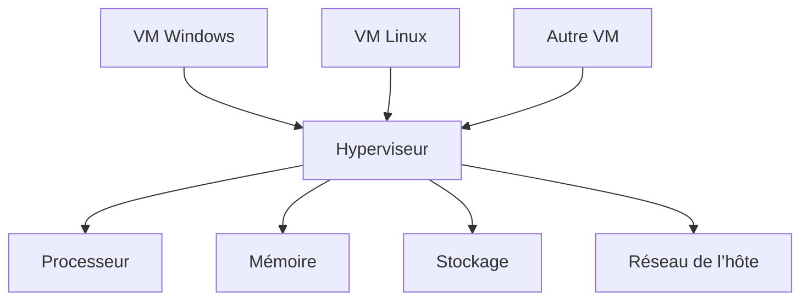
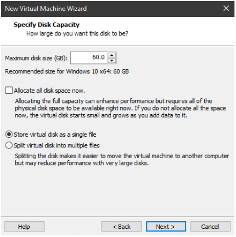

# Module additionnel — Workstation

**Séquence :** Systèmes clients Microsoft  
**Utilité :** comprendre l’environnement des VM utilisées dans les ateliers Windows.

## Objectifs

- Distinguer hôte, invité et hyperviseur.
- Identifier les ressources attribuées à une VM.
- Reconnaître les topologies réseau dessinées dans le support.
- Utiliser les raccourcis, l’import et l’export dans le contexte du cours.

## 1. Hôte, invité et hyperviseur

La virtualisation fait cohabiter plusieurs systèmes invités à partir des ressources d’un ordinateur physique, appelé **hôte**.

| Élément | Rôle |
|---|---|
| **Hôte** | PC client ou serveur physique qui possède les ressources. |
| **Invité / VM** | Ordinateur virtuel avec son propre système d’exploitation, décrit par des fichiers regroupés dans un répertoire d’accueil. |
| **Hyperviseur** | Lien entre l’hôte et les VM ; logiciel ou OS qui propose, gère, partage et priorise les ressources de l’hôte. |

Les invités sont présentés comme isolés et indépendants ; leur fonctionnement utilise néanmoins le matériel commun de l’hôte.

**Illustration IA / externe au cours — partage des ressources.**

## 2. Les ressources d’une machine virtuelle

| Ressource | Ce qu’enseigne le support |
|---|---|
| Processeur | Attribution des ressources CPU ; la capture expose processeurs, cœurs et options du moteur de virtualisation. |
| Mémoire vive | Attribuée au démarrage et configurable. |
| Disque | Un **fichier**, dont la croissance peut être dynamique et la capacité maximale configurée. |
| Carte réseau | Reliée à un switch virtuel pour communiquer avec les autres systèmes. |

Une VM a les mêmes quatre besoins fondamentaux qu’une machine physique. Le support ajoute DVD et stockage externe, carte graphique, carte son et firmware.

### Comprendre les captures de configuration

- CPU : distinguer le nombre de processeurs virtuels et le nombre de cœurs par processeur.
- Mémoire : le curseur de configuration fixe l’allocation ; la valeur de la capture est un exemple.
- Disque : l’assistant montre la capacité maximale, l’allocation immédiate éventuelle et le choix d’un seul fichier ou de plusieurs fichiers.

*Capture du support — capacité et organisation du disque virtuel.*

## 3. Cartes et switchs virtuels

Le cours rappelle qu’une VM doit être connectée à un **switch** pour communiquer. Selon le raccordement, elle peut joindre des VM de son réseau, des VM d’autres réseaux, l’hôte, d’autres machines physiques et le monde extérieur.

| Topologie dessinée dans le support | Repère de lecture |
|---|---|
| **Host-Only** | Les VM et l’hôte sont raccordés au switch virtuel ; adaptateur de l’hôte **VMware Network Adapter VMnet1**. |
| **VMnetX** | Switch virtuel VMnetX avec adaptateur VMware Network Adapter VMnetX sur l’hôte. |
| **Lan Segment** | Plusieurs VM partagent le segment virtuel représenté ; aucun adaptateur de l’hôte n’est dessiné. |
| **Bridge** | Le switch relie les VM au réseau physique, avec une sortie Internet figurée. |
| **NAT** | Le schéma passe par le réseau NAT, l’adaptateur **VMnet8** de l’hôte, puis son interface **Ethernet** vers Internet. |

Les accès dépendent de la topologie et de sa configuration : un nom de mode ne suffit pas à garantir une connectivité.

Le support montre aussi une maquette avec quatre réseaux **Serveurs**, **Administratif**, **Usine** et **Imprimantes**, reliés à un **routeur virtuel**. C’est un exemple d’architecture de laboratoire, pas un réseau à recréer sans consignes.

## 4. Atouts et limites de Workstation

### Avantages cités

- Interface épurée et simple d’utilisation.
- Pause, snapshots et clonage.
- Dossiers partagés entre l’hôte et la VM.
- Glisser-déposer et autres fonctions liées aux **VMware Tools**.

### Limites citées

- Le support le situe dans des maquettes simples.
- Il présente Workstation comme un logiciel propriétaire VMware.
- Sa prise en main demande de comprendre la virtualisation des OS, du stockage et du réseau.

Ces points décrivent le support de formation ; les captures et noms de produit restent ceux de cette version.

## 5. Manipulations à connaître

| Besoin | Action du support |
|---|---|
| Modifier l’ordre d’amorçage | Paramétrer la séquence de démarrage dans le BIOS de la VM. |
| Utiliser un média amovible | CD/DVD, USB et disquette sont cités. |
| Reprendre clavier et souris sur l’hôte | **Ctrl + Alt**. |
| Envoyer Ctrl + Alt + Suppr dans l’invité | **Ctrl + Alt + Inser** ou bouton **Send Ctrl+Alt+Del to this virtual machine**. |

La distinction entre raccourci de l’hôte et raccourci de l’invité évite d’envoyer l’action au mauvais système.

## 6. Importer et exporter

| Opération | Deux méthodes du support |
|---|---|
| Importer une VM existante | Ouvrir (**Open**) son dossier d’accueil ; importer une archive **.ovf** ou **.ova**. |
| Conserver une VM pour la réutiliser | Copier son dossier d’accueil ; exporter une archive **.ovf** ou **.ova**. |

Le support parle de conserver la VM dans son état actuel. Il ne fournit pas de VM ou d’archive à télécharger dans ce module.

## 7. Mise en pratique dans le parcours

**TP spécifique au module additionnel : Inexistant dans les supports fournis.** Aucun énoncé ni corrigé distinct n’est inventé.

Pour retrouver une application documentée du clonage, utiliser le [TP du module 12](../../tp/systemes-clients/module-12/index.md) et sa [correction](../../tp/systemes-clients/module-12/corrections.md). Il distingue le **Full Clone** Workstation et la généralisation Windows.

Les notes « module 1 et 2 et extra » sont partagées avec les modules précédents et restent liées dans l’onglet Original, avec leur provenance. Elles ne constituent pas un second support illustré Workstation.

## À retenir

Workstation sert aux maquettes d’apprentissage et aux tests avant production. L’hyperviseur répartit CPU, mémoire, stockage et réseau ; la configuration du réseau détermine les communications. Les fonctions de la VM et les raccourcis se comprennent toujours par rapport à l’hôte.

## Mini-quiz

1. Qui possède les ressources physiques : l’hôte ou l’invité ?
2. Quels sont les quatre besoins fondamentaux de la VM ?
3. Quelle interface de l’hôte apparaît dans le schéma Host-Only ?
4. Comment reprendre le contrôle du clavier et de la souris sur l’hôte ?
5. Quelles sont les deux formes d’import présentées ?

??? note "Réponses"
    1. L’hôte ; l’invité utilise les ressources attribuées via l’hyperviseur.
    2. Processeur, mémoire, disque et réseau.
    3. VMware Network Adapter VMnet1.
    4. Ctrl + Alt.
    5. Ouvrir la VM depuis son dossier d’accueil ou importer une archive OVF/OVA.

- [Fiche de révision Workstation](../../revision/systemes-clients/module-additionnel-workstation.md)
- [Kahoot Workstation](../../kahoot/02-systemes-clients-microsoft-additionnel-workstation.md)
- [Présentation du cours](index.md)
