# Module 01 — Découverte de Microsoft 365

Les parties ci-dessous reprennent le cours original, dans le même ordre. Les encadrés et les schémas répètent ses formulations.

## Parcours de lecture

1. Support · Module 01 - Support de cours · 9 pages transcrites

SOURCE DRIVE · TRANSCRIPTION DU SUPPORT

Le contenu des documents du dossier TSSR est transcrit ci-dessous, page par page. Les textes et tableaux sont intégrés à la page Web. Aucun fichier PDF, aucune diapositive entière ni aucune reproduction de page n’est affiché. Seuls des croquis ou visuels isolés et vérifiés peuvent accompagner la transcription. Les versions et les consignes restent celles des supports de formation. Les compléments IA sont conservés dans leur onglet distinct.

## Support · Module 01 - Support de cours · 9 pages transcrites

### Page 1

#### Outils collaboratifs

Découverte de Microsoft 365

#### Objectifs

!!! note "À retenir"
    Comprendre les enjeux d’une plateforme Cloud Appréhender la gestion des licences dans Microsoft 365 Découvrir les applications Office 365 disponibles Connaître les prérequis pour créer une plateforme

**Visuel externe**

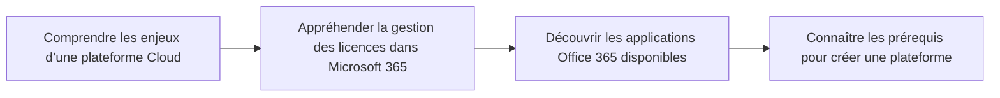

- Comprendre les enjeux d’une plateforme Cloud
- Appréhender la gestion des licences dans Microsoft 365
- Découvrir les applications Office 365 disponibles
- Connaître les prérequis pour créer une plateforme

### Page 2

#### L’environnement Microsoft 365

#### Qu’est-ce qu’une offre SaaS ?

!!! note "À retenir"
    **SaaS** Software as a Service Le Software as a Service ou logiciel en tant que service, est un modèle d'exploitation commerciale des logiciels dans lequel ceux-ci sont installés sur des serveurs distants plutôt que sur la machine de l'utilisateur.

**SaaS** Software as a Service

Le Software as a Service ou logiciel en tant que service, est un modèle d'exploitation commerciale des logiciels dans lequel ceux-ci sont installés sur des serveurs distants plutôt que sur la machine de l'utilisateur. Les clients ne paient pas de licence d'utilisation pour une version, mais utilisent librement le service en ligne ou, plus généralement, payent un abonnement.

(Wikipédia)

### Page 3

#### Microsoft 365 et ses concurrents

!!! note "À retenir"
    Zoho, G Suite, HyperOffice, Amazon Web Services, IBM Cloud.

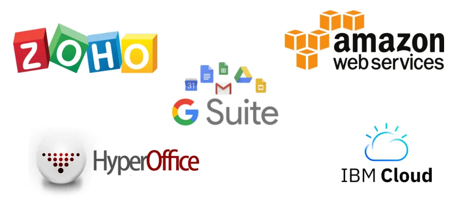

Zoho, G Suite, HyperOffice, Amazon Web Services, IBM Cloud.

#### Qu’est-ce que Microsoft 365 ?

!!! note "À retenir"
    Offres Cloud - Multiples applications (Exchange, SharePoint, Office, etc.) Multiplateformes S’adresse aux particuliers et aux entreprises Moins de serveurs sur site Cloud Microsoft.

**Visuel externe**

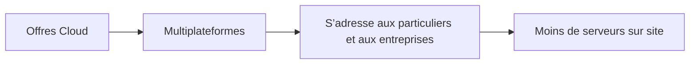

- Offres Cloud
  - Multiples applications (Exchange, SharePoint, Office, etc.)
- Multiplateformes
- S’adresse aux particuliers et aux entreprises
- Moins de serveurs sur site

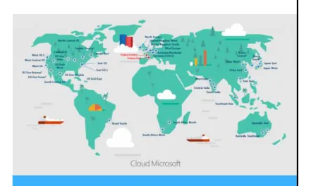

Cloud Microsoft.

| 75 M | 4 |
| --- | --- |
| d’utilisateurs actifs par jour fin mai 2020 | Datacenters en France |

### Page 4

#### Les éléments de base de Microsoft 365

!!! note "À retenir"
    Microsoft 365 — Exchange Online, OneDrive, Office 365 ProPlus, Microsoft Teams, SharePoint Online, Azure AD.

**Visuel externe**

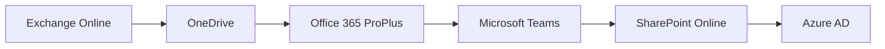

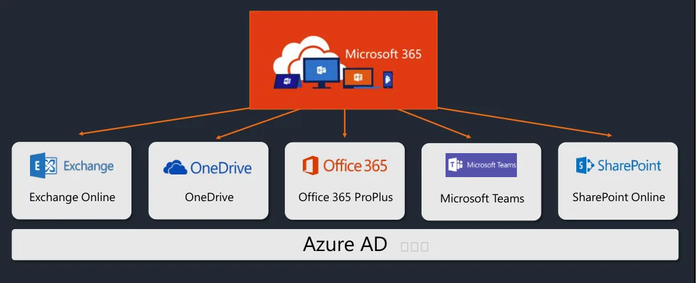

Microsoft 365 — Exchange Online, OneDrive, Office 365 ProPlus, Microsoft Teams, SharePoint Online, Azure AD.

- Exchange Online
- OneDrive
- Office 365 ProPlus
- Microsoft Teams
- SharePoint Online
- Azure AD

#### Plans et licences

Microsoft Office 365

| Famille | Plans |
| --- | --- |
| Particuliers | Famille Personnel Famille et étudiant |
| PME | Business Basic Business Standard Business Premium Apps for Business |
| Education | A1 A3 A5 |
| Association | Business Basic Pour les associations Business Standard Pour les associations E1 Pour les associations E3 Pour les associations E5 Pour les associations |
| Gouvernement | E1 Secteur public E3 Secteur public E5 Secteur public |
| Employés de terrain | F3 |
| Entreprise | Entreprise E3 Entreprise E5 Apps for Entreprise |

### Page 5

#### Les services principaux

!!! note "À retenir"
    Exchange Online, SharePoint Online, Microsoft Teams.

**Visuel externe**

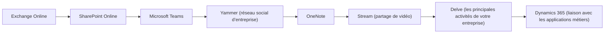

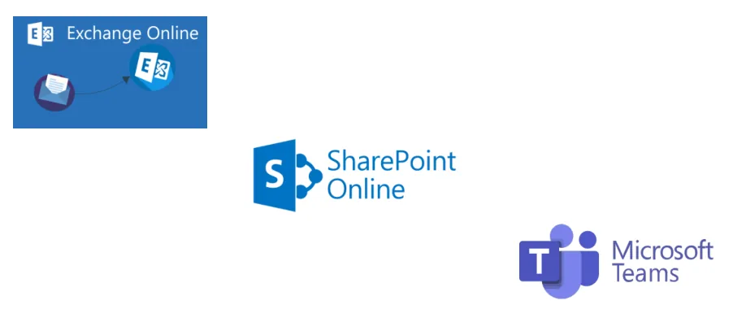

Exchange Online, SharePoint Online, Microsoft Teams.

- Exchange Online
- SharePoint Online
- Microsoft Teams

- Yammer (réseau social d’entreprise)
- OneNote
- Stream (partage de vidéo)
- Delve (les principales activités de votre entreprise)
- Dynamics 365 (liaison avec les applications métiers)
- …

### Page 6

#### Office 365 ProPlus

!!! note "À retenir"
    Office 365 Professional Plus Office 365 Online Office 365.

- Office 365 Professional Plus
- Office 365 Online

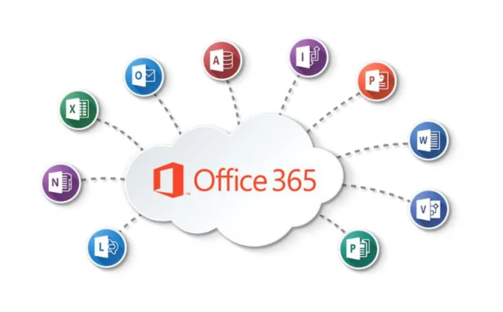

Office 365.

#### SharePoint Online

- SharePoint Online
- Organisation — Gestion de l’information, des utilisateurs et des projets
- Boîte aux lettres de site
- OneDrive
- Communauté
- Réseau social
- Partage — Échanger des idées et réinventer la collaboration
- Application Mobile
- PowerPivot et PowerView
- Gestion — Réduction des coûts, des risques et du temps pour votre infrastructure
- Règle de recherche
- Règle d’affichage de recherche
- Construire — Créer vos applications et vos outils
- Application
- Design Manager
- SharePoint Store

### Page 7

#### Tenant Microsoft 365

#### Définition

| Famille et plan | Tenant | Administrateur global |
| --- | --- | --- |
| Microsoft Office 365 est disponible en famille (particulier, association, entreprise…) de plans (Business, E3 secteur public, E5 entreprise). | C’est l’ensemble des services de VOTRE abonnement dans Microsoft 365 associé à VOTRE domaine pour VOTRE entreprise. | C’est l’utilisateur qui a souscrit à l’abonnement Microsoft 365 et qui a les plus hauts privilèges sur tout votre Tenant. |

### Page 8

#### Créer un Tenant Microsoft 365

!!! note "À retenir"
    Sélectionnez un plan Exemple : famille, A1, E5, F3 Fournissez une adresse mail valide Exemple : prénom.nomannée@exemple.lab Entrez les données de votre entreprise Exemple : nom et nombre de salariés Choisissez le nom de votre Tenant Exemple : admin@monentreprise.onmicrosoft.com Validez Terminez l’inscription

1. Sélectionnez un plan
   Exemple : famille, A1, E5, F3
2. Fournissez une adresse mail valide
   Exemple : prénom.nomannée@exemple.lab
3. Entrez les données de votre entreprise
   Exemple : nom et nombre de salariés
4. Choisissez le nom de votre Tenant
   Exemple : admin@monentreprise.onmicrosoft.com
5. Validez
   Terminez l’inscription

#### Votre Tenant

- Nom de Tenant type :
  - nomdeladministrateurglobal@dom.onmicrosoft.com
- Possibilité d’envoyer ou de recevoir des courriels pour ce domaine
- Le Tenant n'est pas modifiable
- Afin d’avoir une adresse mail en @votreentreprise.fr :
  - Location d’un domaine internet puis création d’un domaine personnalisé dans Microsoft 365

### Page 9

#### Louer un domaine internet

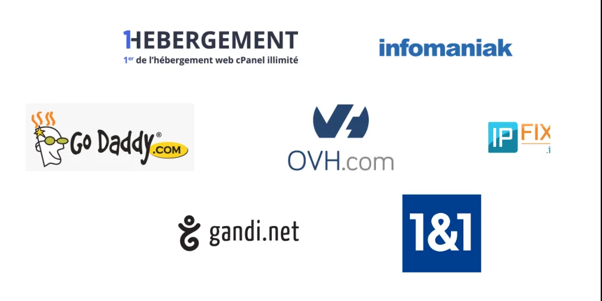

1er de l’hébergement web cPanel illimité, infomaniak, GoDaddy.com, OVH.com, IP FIX, gandi.net, 1&1.

- 1er de l’hébergement web cPanel illimité
- infomaniak
- GoDaddy.com
- OVH.com
- IP FIX
- gandi.net
- 1&1

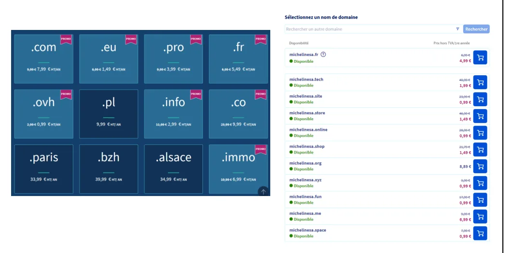

Sélectionnez un nom de domaine — Rechercher un autre domaine — Rechercher — Disponibilité — Prix hors TVA/1re année. Extensions : .com, .eu, .pro, .fr, .ovh, .pl, .info, .co, .paris, .bzh, .alsace, .immo.

Référence du document : 1ge2dZ-8TJDb2O0oL72reWf2Z1ZXGgiqk · SHA-256 83fd3c99e1a0c64d…
