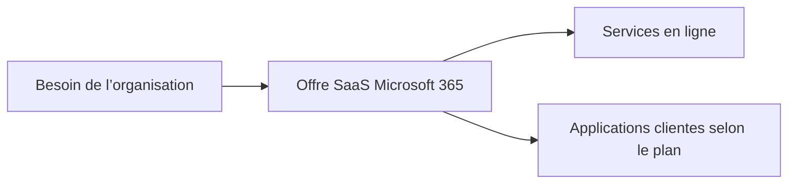
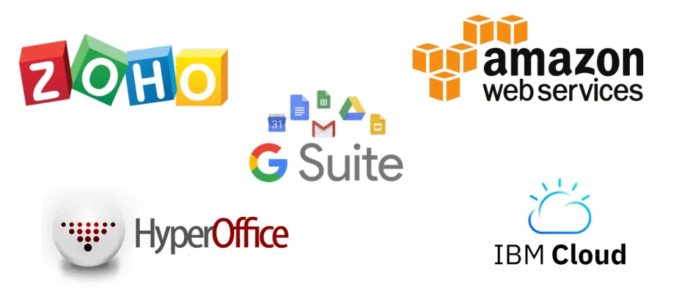
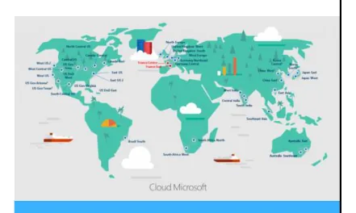
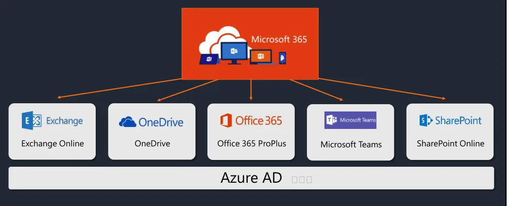
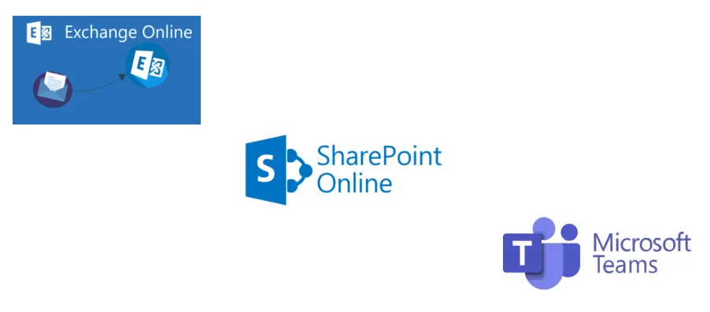
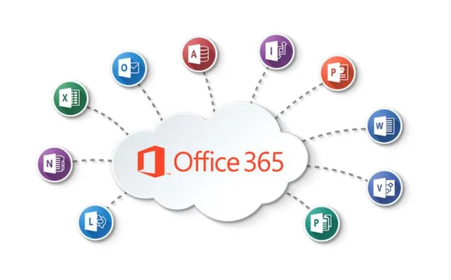
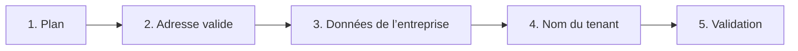
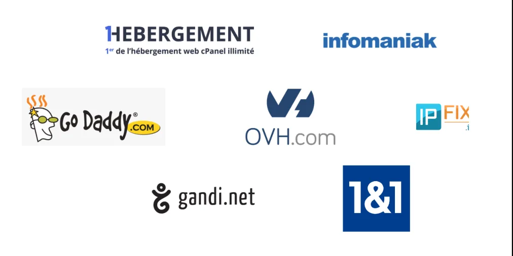
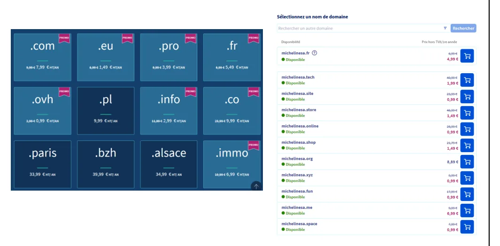

# Module 01 — Découverte de Microsoft 365

**Séquence :** Microsoft 365 — Outils collaboratifs  
**Rôle dans le parcours :** situer la plateforme, ses plans et le tenant avant Word, Excel, Outlook et OneDrive.

## Objectifs

À l’issue du module, vous devez pouvoir :

- comprendre les enjeux d’une plateforme Cloud ;
- appréhender la gestion des licences dans Microsoft 365 ;
- découvrir les applications Office 365 disponibles ;
- connaître les prérequis pour créer une plateforme.

## 1. Le modèle SaaS

Le support définit le **SaaS** (*Software as a Service*, logiciel en tant que service) par la citation suivante, attribuée à Wikipédia :

> Le Software as a Service ou logiciel en tant que service, est un modèle d'exploitation commerciale des logiciels dans lequel ceux-ci sont installés sur des serveurs distants plutôt que sur la machine de l'utilisateur. Les clients ne paient pas de licence d'utilisation pour une version, mais utilisent librement le service en ligne ou, plus généralement, payent un abonnement.

!!! success "À retenir"
    Le logiciel est installé sur des serveurs distants. L’usage se fait en ligne, en général par abonnement, et non par l’achat d’une version installée uniquement sur le poste.

**Illustration IA / externe au cours — place du SaaS dans le parcours du module.**

## 2. Microsoft 365 et ses concurrents

Le support affiche les offres suivantes comme concurrents : Zoho, G Suite, HyperOffice, Amazon Web Services et IBM Cloud.

Capture du support — concurrents cités.

## 3. Qu’est-ce que Microsoft 365 ?

| Caractéristique du support | Ce qu’elle recouvre |
|---|---|
| Offres Cloud | Plusieurs applications : Exchange, SharePoint, Office, etc. |
| Multiplateformes | Le service n’est pas lié à un seul type de poste. |
| Publics | Particuliers et entreprises. |
| Moins de serveurs sur site | Une partie de l’infrastructure n’est plus hébergée localement. |

Le support indique aussi **75 millions** d’utilisateurs actifs par jour fin mai 2020 et **4** datacenters en France, sur une carte légendée « Cloud Microsoft ».

Capture du support — Cloud Microsoft.

## 4. Les éléments de base

Microsoft 365 s’appuie, dans le support, sur Exchange Online, OneDrive, Office 365 ProPlus, Microsoft Teams, SharePoint Online et Azure AD.

Capture du support — éléments de base.

| Élément | Rôle tel que le module le situe |
|---|---|
| Exchange Online | Messagerie. |
| OneDrive | Fichiers de l’utilisateur. |
| Office 365 ProPlus | Applications Office de l’offre présentée. |
| Microsoft Teams | Collaboration d’équipe. |
| SharePoint Online | Sites, informations, utilisateurs et projets. |
| Azure AD | Identité, sous les éléments de base. |

!!! info "Complément externe au cours"
    Le support nomme ce service d’identité **Azure AD**. La documentation Microsoft actuelle le nomme **Microsoft Entra ID**. Les consignes du module conservent le nom du support. [Présentation du nouveau nom](https://learn.microsoft.com/en-us/entra/fundamentals/new-name).

Les services principaux montrés ensuite sont Exchange Online, SharePoint Online et Microsoft Teams, puis :

| Service | Précision du support |
|---|---|
| Yammer | Réseau social d’entreprise. |
| OneNote | Cité parmi les services principaux. |
| Stream | Partage de vidéo. |
| Delve | Les principales activités de votre entreprise. |
| Dynamics 365 | Liaison avec les applications métiers. |
| … | Le support laisse la liste ouverte. |

Capture du support — services principaux.

### Office 365 ProPlus

Le support distingue **Office 365 Professional Plus** et **Office 365 Online**, autour d’un nuage légendé Office 365.

Capture du support — Office 365.

!!! info "Complément externe au cours"
    « Office 365 ProPlus » est un nom historique. Le nom commercial actuel correspondant est « Microsoft 365 Apps ». Les intitulés du support restent ceux à retenir pour ce module. [Cycle de vie Microsoft 365 Apps](https://learn.microsoft.com/en-us/lifecycle/products/microsoft-365-apps).

### Ce que le support rattache à SharePoint Online

- Organisation : gestion de l’information, des utilisateurs et des projets.
- Boîte aux lettres de site, OneDrive, communauté, réseau social.
- Partage : échanger des idées et réinventer la collaboration.
- Application mobile.
- PowerPivot et PowerView.
- Gestion : réduction des coûts, des risques et du temps pour l’infrastructure.
- Règle de recherche et règle d’affichage de recherche.
- Construire : créer vos applications et vos outils.
- Application, Design Manager, SharePoint Store.

## 5. Plans et licences

Le support organise **Microsoft Office 365** par familles. Un plan n’est pas un service : la famille dépend du contexte (particulier, association, entreprise…).

| Famille | Plans cités |
|---|---|
| Particuliers | Famille ; Personnel ; Famille et étudiant |
| PME | Business Basic ; Business Standard ; Business Premium ; Apps for Business |
| Education | A1 ; A3 ; A5 |
| Association | Business Basic, Business Standard, E1, E3 et E5 pour les associations |
| Gouvernement | E1, E3 et E5 Secteur public |
| Employés de terrain | F3 |
| Entreprise | Entreprise E3 ; Entreprise E5 ; Apps for Entreprise |

!!! warning "Attention"
    Le support précise que Microsoft Office 365 est disponible en familles (particulier, association, entreprise…) de plans, avec comme exemples Business, E3 secteur public et E5 entreprise. On ne choisit pas un nom de plan avant d’avoir identifié la famille.

## 6. Le tenant

| Notion | Définition du support |
|---|---|
| Famille et plan | Microsoft Office 365 est disponible en famille (particulier, association, entreprise…) de plans (Business, E3 secteur public, E5 entreprise). |
| Tenant | C’est l’ensemble des services de **votre** abonnement dans Microsoft 365 associé à **votre** domaine pour **votre** entreprise. |
| Administrateur global | C’est l’utilisateur qui a souscrit à l’abonnement Microsoft 365 et qui a les plus hauts privilèges sur tout le tenant. |

### Créer un tenant

1. **Sélectionnez un plan.** Exemple : famille, A1, E5, F3.
2. **Fournissez une adresse mail valide.** Exemple : `prénom.nomannée@campus-eni.fr`.
3. **Entrez les données de votre entreprise.** Exemple : nom et nombre de salariés.
4. **Choisissez le nom de votre tenant.** Exemple : `admin@monentreprise.onmicrosoft.com`.
5. **Validez** et terminez l’inscription.

**Illustration IA / externe au cours — ordre des cinq étapes.**

### Votre tenant

- Nom de tenant type : `nomdeladministrateurglobal@dom.onmicrosoft.com`.
- Possibilité d’envoyer ou de recevoir des courriels pour ce domaine.
- Le tenant n’est pas modifiable.
- Pour une adresse en `@votreentreprise.fr` : location d’un domaine internet, puis création d’un domaine personnalisé dans Microsoft 365.

!!! warning "Attention"
    Le support indique que le nom de tenant n’est pas modifiable. Il se contrôle avant la validation.

### Louer un domaine internet

Le support montre ces enseignes : 1er de l’hébergement web cPanel illimité, infomaniak, GoDaddy.com, OVH.com, IP FIX, gandi.net et 1&1.

Capture du support — location d’un domaine.

La diapositive suivante demande de **sélectionner un nom de domaine** : champ « Rechercher un autre domaine », bouton « Rechercher », colonnes Disponibilité et Prix hors TVA/1re année. Extensions affichées : `.com`, `.eu`, `.pro`, `.fr`, `.ovh`, `.pl`, `.info`, `.co`, `.paris`, `.bzh`, `.alsace`, `.immo`.

Capture du support — recherche de disponibilité.

Ce module ne comporte pas de TP distinct.

## Résumé

1. Microsoft 365 est présenté comme une offre SaaS, multiplateforme, pour particuliers et entreprises, avec moins de serveurs sur site.
2. Le socle cité est Exchange Online, OneDrive, Office 365 ProPlus, Teams, SharePoint Online et Azure AD.
3. Le plan dépend de la famille. Le tenant regroupe les services de l’abonnement pour le domaine de l’entreprise.
4. L’administrateur global a les plus hauts privilèges. Le nom de tenant n’est pas modifiable.
5. Une adresse de l’organisation suppose un domaine loué puis déclaré dans Microsoft 365.

## Mini-quiz

1. Que paie en général le client dans le modèle SaaS cité par le support ?
2. Citez les six éléments de base dessinés sous Microsoft 365.
3. Quelle différence le support fait-il entre une famille de plans et le tenant ?
4. Pourquoi le nom `admin@monentreprise.onmicrosoft.com` se vérifie-t-il avant la validation ?
5. Que faut-il faire pour obtenir une adresse `@votreentreprise.fr` ?

??? note "Réponses du mini-quiz"
    1. Un abonnement pour un service en ligne, plutôt qu’une licence d’une version installée seulement sur le poste.
    2. Exchange Online, OneDrive, Office 365 ProPlus, Microsoft Teams, SharePoint Online, Azure AD.
    3. La famille regroupe les plans (particuliers, PME, éducation, association, gouvernement, employés de terrain, entreprise). Le tenant est l’ensemble des services de l’abonnement associé au domaine de l’entreprise.
    4. Parce que le tenant n’est pas modifiable.
    5. Louer un domaine internet, puis créer un domaine personnalisé dans Microsoft 365.

- [Fiche de révision](../../revision/microsoft-365/module-01-decouverte-de-microsoft-365.md)
- [Kahoot du module](../../kahoot/03-microsoft-365-outils-collaboratifs-01-decouverte-de-microsoft-365.md)
- [Présentation de la séquence](index.md)
