# Module 02 — Connaissances des notions de base Word

[Travaux pratiques](../../tp/microsoft-365/module-02/index.md)

Les parties ci-dessous reprennent le cours original, dans le même ordre. Les encadrés et les schémas répètent ses formulations.

## Parcours de lecture

1. Support · Module 02 - Support de cours · 21 pages transcrites

**Visuel externe**

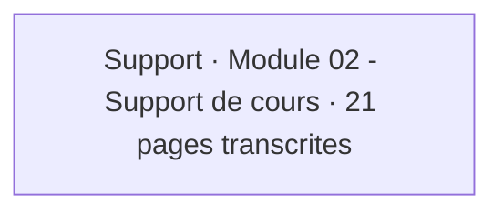

SOURCE DRIVE · TRANSCRIPTION DU SUPPORT

Le contenu des documents du dossier TSSR est transcrit ci-dessous, page par page. Les textes et tableaux sont intégrés à la page Web. Aucun fichier PDF, aucune diapositive entière ni aucune reproduction de page n’est affiché. Seuls des croquis ou visuels isolés et vérifiés peuvent accompagner la transcription. Les versions et les consignes restent celles des supports de formation. Les compléments IA sont conservés dans leur onglet distinct.

## Support · Module 02 - Support de cours · 21 pages transcrites

### Page 1

#### Outils collaboratifs

##### Connaissances des notions de base Word

##### Objectifs

!!! note "À retenir"
    Découvrir les fonctionnalités de Microsoft Word Mettre en forme un document Utiliser les fonctionnalités de Word qui permettent d’automatiser la mise en forme du document

- Découvrir les fonctionnalités de Microsoft Word
- Mettre en forme un document
- Utiliser les fonctionnalités de Word qui permettent d’automatiser la mise en forme du document

### Page 2

#### Connaissances des notions de base Word

#### L’interface de Word

#### Présentation de Word

!!! note "À retenir"
    Au démarrage, choisir Nouveau document Un modèle Document récent Visuel du support.

**Visuel externe**


- Au démarrage, choisir
- Nouveau document
- Un modèle
- Document récent


Visuel du support.

### Page 3

| La barre accès rapide | La barre de titre | La zone utilisateur |
| --- | --- | --- |

##### Le ruban Les règles

##### Les barres de défilement

##### La zone de rédaction

##### La barre d’état

#### Présentation de Word

**Visuel externe**

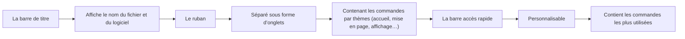

- La barre de titre
- Affiche le nom du fichier et du logiciel
- Le ruban
- Séparé sous forme d’onglets
- Contenant les commandes par thèmes (accueil, mise en page, affichage…)
- La barre accès rapide
- Personnalisable
- Contient les commandes les plus utilisées
- La zone utilisateur
- Affiche le nom de l’utilisateur de la licence

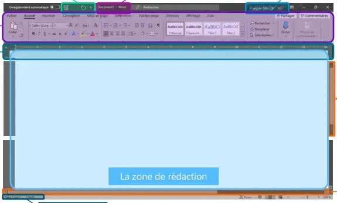

Visuel du support.

### Page 4

!!! note "À retenir"
    Les barres de défilement Permettent de naviguer dans le document La barre d’état Contient des informations sur le document Les règles Pas affichées par défaut Permet de positionner les éléments précisément et les taquets de tabulation La zone de rédaction Contient le texte de votre document

**Visuel externe**

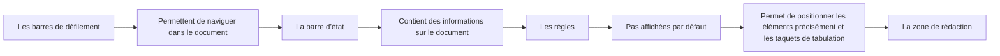

- Les barres de défilement
- Permettent de naviguer dans le document
- La barre d’état
- Contient des informations sur le document
- Les règles
- Pas affichées par défaut
- Permet de positionner les éléments précisément et les taquets de tabulation
- La zone de rédaction
- Contient le texte de votre document

#### Connaissances des notions de base Word

#### Création d’un document

### Page 5

#### Écriture d’un document

**Visuel externe**

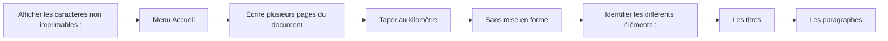

- Afficher les caractères non imprimables :
- Menu Accueil
- Écrire plusieurs pages du document
- Taper au kilomètre
- Sans mise en forme
- Identifier les différents éléments :
- Les titres
- Les paragraphes
- Les listes :
- À puces
- Numérotées

- Mettre en forme le document
- Alignement des paragraphes :
- Positionner des taquets de tabulations
- Utiliser les tabulations
- Espacement des paragraphes :
- Éviter les paragraphes vides
- Création des styles de paragraphes :
- Appliquer un style aux différents paragraphes
- Pas de paragraphe du style normal


Visuel du support.

### Page 6

!!! note "À retenir"
    Mettre en forme le document Enchaînement des paragraphes : Lier les styles les uns aux autres Utilisation des sauts : Permettre de fixer le contenu de chaque page Création du sommaire automatiquement Finir l’écriture du document

- Mettre en forme le document
- Enchaînement des paragraphes :
- Lier les styles les uns aux autres
- Utilisation des sauts :
- Permettre de fixer le contenu de chaque page
- Création du sommaire automatiquement
- Finir l’écriture du document

#### Tenant Microsoft 365

##### Démo

##### Prise en main et création d'un document

### Page 7

#### Connaissances des notions de base Word

#### Mise en forme d’un

```
document
```

#### Page de garde et sommaire

!!! note "À retenir"
    Prévoir des pages vides (si nécessaire) : Pour la page de garde Pour le sommaire Insérer des sauts de page Menu Insertion

- Prévoir des pages vides (si nécessaire) :
- Pour la page de garde
- Pour le sommaire
- Insérer des sauts de page
- Menu Insertion

| Bouton sur le | Caractère non |
| --- | --- |
| bandeau | imprimable sur la page |

### Page 8

#### Connaissances des notions de base Word

#### Gestion des titres

- Mettre en forme les titres :
- Choisir la numérotation
- Choisir la police :
- Casse (Majuscule/Minuscule)
- Taille
- Mettre en forme le texte
- Gras
- Italique
- Souligné
- Ajuster les retraits de la liste (clic droit sur la puce) :
- Espacement de la marge
- Espacement entre la numérotation et le texte (tabulation)
- Caractère entre la numérotation et le texte :
- Tabulation ou Espace

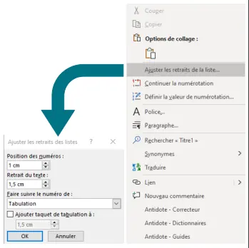

Visuel du support.

### Page 9

- Mettre en forme le style Titre
- Mettre à jour le style Titre1 avec le titre nouvellement créé
- Menu Accueil
- Procéder de la même façon avec les autres titres
- Les autres titres apparaissent automatiquement dans l’accès rapide des styles

- Hiérarchiser la numérotation des titres
- Gérer grâce à la liste à plusieurs niveaux

①

②

- À chaque niveau

| • Appuyer sur le bouton Plus en bas à gauche | ① |  |
| --- | --- | --- |
| • Choisir le style | ② |  |
| • Choisir la mise en forme si nécessaire | ③ | ③ |
| • Choisir la position du texte | ④ |  |

- La mise en forme des titres peut être

④

refaite titre par titre

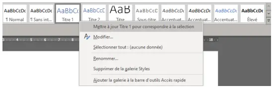

Visuel du support.

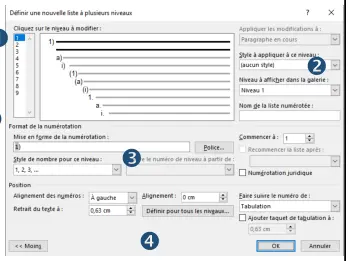

Visuel du support.

### Page 10

##### Les étapes

!!! note "À retenir"
    Refaire la gestion des retraits qui aura sûrement été modifiée

- 1. Créer les différents titres
- 2. Définir la liste à plusieurs niveaux
- 3. Refaire la gestion des retraits qui aura sûrement été modifiée

#### Connaissances des notions de base Word

#### Gestion des paragraphes

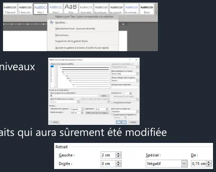

Visuel du support.

### Page 11

- Mettre en forme des paragraphes
- Aligner le paragraphe par rapport au titre
- Ajuster les retraits
- Modifier les taquets sur la règle
- Choisir la police
- Taille
- Casse (Majuscule/Minuscule)
- Aligner le texte du paragraphe
- Alignement « à gauche »
- Alignement « centrer »
- Alignement « à droite »
- Alignement « justifier »
- Alignement du texte sur la gauche et la droite

- Créer un nouveau style
- Sauvegarder la structure du paragraphe
- Définir le nouveau style
- Nommer ce style
- Possibilité de le modifier
- Le style apparaît dans l’accès rapide

##### Nouveau style dans l’accès rapide


Visuel du support.

### Page 12

#### Gestion des paragraphes

!!! note "À retenir"
    Lier les styles Automatiser l’application des styles Mettre en forme le texte pendant la frappe Modifier un style de l’accès rapide Choisir le style du paragraphe Mise en forme liée

- Lier les styles
- Automatiser l’application des styles
- Mettre en forme le texte pendant la frappe
- Modifier un style de l’accès rapide

| ① | ①② |
| --- | --- |

- Choisir le style du paragraphe
- Mise en forme liée

| • Choisir le style du paragraphe suivant | ② |
| --- | --- |

#### Connaissances des notions de base Word

#### Gestion de l’espacement

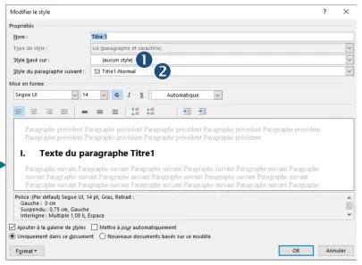

Visuel du support.

### Page 13

- Espacement des titres et des paragraphes
- Ne pas utiliser de paragraphes vides
- Paragraphes ne contenant pas de texte

| • Symboliser par le caractère non affichable | ④ |
| --- | --- |

- Utiliser l’espacement de paragraphe

| • Utiliser l’outil « Interligne et espacement de paragraphe » | ① |
| --- | --- |
| Choisir l’interligne du paragraphe | ② |

| • | Ajouter ou supprimer l’espace | ③ |
| --- | --- | --- |
| • Paramétrer les options d’interligne | ④ |  |

①

| • | L’alignement |  |
| --- | --- | --- |
| • | Gauche |  |
| • | Centrer |  |
| • | Droite |  |
| • | Justifier |  |
| • | Le retrait | ② |
| • | L’espacement |  |
| • | Avant |  |
| • | Après |  |
| • | L’interlignage |  |

③

- À partir de l’accès rapide des styles
- Clic droit sur un style
- Modifier le style
- Bouton Format
- Options d’espacement
- Applique la modification à tous les paragraphes liés au style


Visuel du support.


Visuel du support.

### Page 14

#### Connaissances des notions de base Word

#### Gestion de l’alignement

#### Gestion des alignements

!!! note "À retenir"
    Alignement des titres et des paragraphes Taquets de retrait de la règle Visuel du support.

- Alignement des titres et des paragraphes
- Taquets de retrait de la règle


Visuel du support.

### Page 15

- Options des paragraphes

#### Connaissances des notions de base Word

#### Gestion des tabulations


Visuel du support.

### Page 16

- Utilisation des tabulations
- Taquet gauche
- Taquet centré
- Taquet droit
- Taquet décimal
- Caractère non imprimable « tabulation »
- Un caractère « tabulation » par taquet sur la règle

- Utilisation des tabulations durant la création du document
- Positionner les tabulations durant la frappe
- Sélectionner le texte à aligner
- Positionner les taquets de tabulation
- Créer un style pour une réutilisation


Visuel du support.

### Page 17

#### Connaissances des notions de base Word

#### Gestion des sauts

- Les différents types de sauts
- Saut de page
- Permet de fixer le contenu d’une page
- Poursuite de la mise en forme
- En-tête de page
- Pied de page
- Orientation de la page
- Numérotation des pages
- Saut de colonne
- Permet de définir la fin du contenu d’une colonne
- Indiquer le texte qui doit être dans une autre colonne

### Page 18

- Sauts de section
- Saut de section page suivante
- Fixer le contenu d’une page
- Définir la fin d’une section et le début d’une nouvelle
- Changer la mise en forme
- En-tête de page
- Pied de page
- Orientation de la page
- Numérotation des pages
- Saut de section continu
- Définir la fin d’une section et le début d’une nouvelle
- Insérer une mise en page différente dans une page
- Marges différentes

#### Connaissances des notions de base Word

Gestion de la table des

matières

### Page 19

#### Gestion de la table des matières

- Insertion de la table des matières
- Ajout de la table des matières
- À partir du menu Références

| • Choisir une table des matières | ① |
| --- | --- |

ou

| • Créer une Table des matières personnalisée | ② |
| --- | --- |

① ②

- Définir la table des matières personnalisée
- Choisir le format
- Choisir les niveaux à afficher
- Quel « Titre » afficher ?
- Regarder les aperçus
- Choisir les caractères de suite

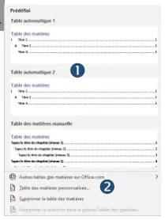

Visuel du support.


Visuel du support.

### Page 20

- Personnaliser la table des matières
- Dépend de la mise en forme des styles TM X
- Apparaît au fur et à mesure de leur utilisation

| Style Titre X | Style TM X de la table |
| --- | --- |
| du document | des matières du document |

#### Tenant Microsoft 365

##### Démo

##### Mise en forme d’un document


Visuel du support.

### Page 21

#### Connaissances des notions de base Word

TP

##### Démo

##### Utilisation de Word

Référence du document : 1Nw7I-8Wr17r1iJIvcze8T1R2qOvO8qvP · SHA-256 7677971f03707dff…
