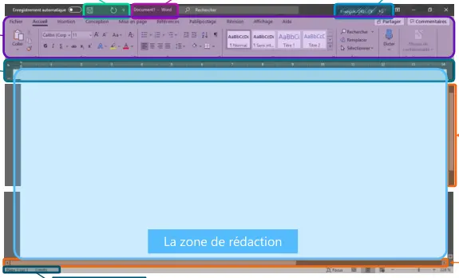
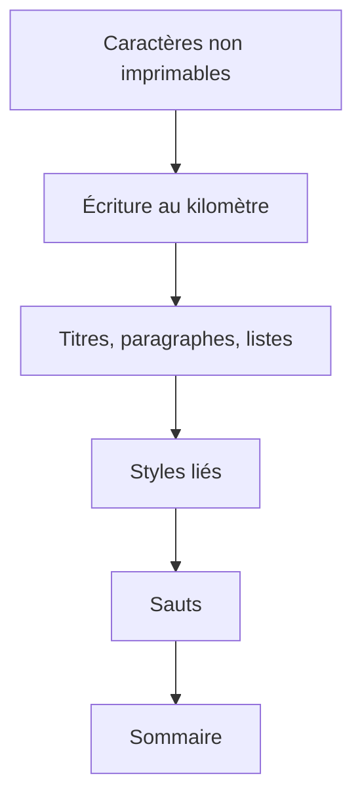

# Module 02 — Connaissances des notions de base Word

**Séquence :** Microsoft 365 — Outils collaboratifs  
**Rôle dans le parcours :** produire un document Word dont la structure tient par les styles, les sauts et le sommaire.

## Objectifs

- Découvrir les fonctionnalités de Microsoft Word.
- Mettre en forme un document.
- Utiliser les fonctionnalités de Word qui permettent d’automatiser la mise en forme du document.

## 1. L’interface

Au démarrage, le support propose de choisir un **nouveau document**, un **modèle** ou un **document récent**.

| Zone | Rôle décrit |
|---|---|
| Barre de titre | Affiche le nom du fichier et du logiciel. |
| Ruban | Onglets qui contiennent les commandes par thèmes (Accueil, Mise en page, Affichage…). |
| Barre d’accès rapide | Personnalisable. Contient les commandes les plus utilisées. |
| Zone utilisateur | Affiche le nom de l’utilisateur de la licence. |
| Barres de défilement | Permettent de naviguer dans le document. |
| Barre d’état | Contient des informations sur le document. |
| Règles | Pas affichées par défaut. Servent à positionner les éléments et les taquets de tabulation. |
| Zone de rédaction | Contient le texte du document. |

Capture du support — zones de l’interface.

## 2. Écrire, puis mettre en forme

!!! tip "Astuce"
    Affichez d’abord les caractères non imprimables depuis le menu Accueil. Un paragraphe vide devient visible : le support demande de ne pas s’en servir pour créer de l’espace.

Ordre du support :

1. Écrire plusieurs pages **au kilomètre**, sans mise en forme.
2. Identifier les titres, les paragraphes et les listes (à puces ou numérotées).
3. Mettre en forme : alignement, taquets de tabulation, espacement, styles.
4. Ne pas laisser de paragraphe au style Normal.
5. Lier les styles les uns aux autres pour enchaîner les paragraphes.
6. Utiliser les sauts pour fixer le contenu de chaque page.
7. Créer le sommaire automatiquement, puis finir l’écriture.

**Illustration IA / externe au cours — chaîne de mise en forme.**

### Page de garde et sommaire

Prévoir si nécessaire des pages vides pour la page de garde et le sommaire, puis insérer des sauts de page par le menu Insertion. Le caractère non imprimable correspondant apparaît sur la page.

## 3. Titres et liste à plusieurs niveaux

Pour un titre : numérotation, police (casse et taille), gras, italique, souligné. Clic droit sur la puce pour régler l’espacement de la marge, l’espacement entre le numéro et le texte (tabulation) et le caractère qui les sépare (tabulation ou espace).

Mettre à jour le style Titre 1 avec le titre nouvellement créé, menu Accueil, puis recommencer pour les autres titres. Ils apparaissent dans l’accès rapide des styles.

Hiérarchie, dans la liste à plusieurs niveaux, pour chaque niveau :

1. Appuyer sur le bouton Plus en bas à gauche.
2. Choisir le style.
3. Choisir la mise en forme si nécessaire.
4. Choisir la position du texte.

La mise en forme peut ensuite être refaite titre par titre. Les trois étapes annoncées sont : créer les titres, définir la liste à plusieurs niveaux, puis refaire les retraits qui auront souvent été modifiés.

## 4. Paragraphes, espacement, alignement, tabulations

| Réglage | Ce que dit le support |
|---|---|
| Alignement | À gauche, centrer, à droite, justifier (texte aligné à gauche et à droite). |
| Retraits | Aligner le paragraphe par rapport au titre, taquets sur la règle. |
| Police | Taille et casse. |
| Nouveau style | Sauvegarde la structure, reçoit un nom, peut être modifié, apparaît dans l’accès rapide. |
| Styles liés | Le style du paragraphe suivant s’applique pendant la frappe. |
| Espacement | Outil « Interligne et espacement de paragraphe » : interligne, ajouter ou supprimer l’espace, options. |
| Depuis un style | Clic droit, Modifier, Format, options d’espacement : la modification atteint tous les paragraphes liés. |

Dans la boîte de paragraphe, le support distingue l’alignement (gauche, centrer, droite, justifier), le retrait, l’espacement avant et après, et l’interlignage.

!!! warning "Attention"
    Un paragraphe vide, symbolisé par le caractère non imprimable, ne remplace pas l’espacement de paragraphe.

### Tabulations

Taquet gauche, centré, droit et décimal. Le caractère non imprimable « tabulation » : un caractère par taquet sur la règle. On peut poser les taquets pendant la frappe, ou sélectionner le texte puis poser les taquets, puis créer un style pour réutiliser ce réglage.

## 5. Sauts

| Type | Effet décrit |
|---|---|
| Saut de page | Fixe le contenu d’une page. La mise en forme peut ensuite porter sur l’en-tête, le pied de page, l’orientation et la numérotation. |
| Saut de colonne | Termine le contenu d’une colonne et envoie la suite dans une autre. |
| Saut de section page suivante | Termine une section et en commence une autre à la page suivante. Permet de changer en-tête, pied de page, orientation et numérotation. |
| Saut de section continu | Nouvelle section dans la même page, par exemple des marges différentes. |

## 6. Table des matières

Depuis le menu Références : choisir une table des matières, ou en créer une personnalisée. Pour la table personnalisée : format, niveaux de titres affichés, aperçus, caractères de suite.

La personnalisation dépend des styles **TM** correspondant aux styles **Titre** du document. Ces styles de table apparaissent au fur et à mesure de leur utilisation.

| Dans le document | Dans la table des matières |
|---|---|
| Style Titre X | Style TM X |

Le support se termine par une démonstration « Mise en forme d’un document », puis le TP « Utilisation de Word ».

## 7. TP — Utilisation de Word

**Durée estimée :** 60 à 90 minutes. Avoir suivi les vidéos du module 2.

**Objectif :** mettre en forme un document Word.

**Prérequis :** Office 365 installé. Récupérer « Système Solaire – Document Brut.docx » (document à mettre en forme) et « Système Solaire – Document Fini.pdf » (résultat attendu). Chaque paragraphe du document a été identifié.

### Styles de titres

| Réglage | Titre 1 | Titre 2 | Titre 3 | Titre 4 |
|---|---|---|---|---|
| Basé sur | Aucun style | Aucun style | Aucun style | Aucun style |
| Paragraphe suivant | T1-Paragraphe | T2-Paragraphe | T3-Paragraphe | T4-Paragraphe |
| Police | Comic Sans Ms | Comic sans ms | Comic sans ms | Comic sans ms |
| Taille | 14 pts, gras | 13 pts, gras | 12 pts, gras et italique | 11 pts, italique |
| Espacement | 12 pt avant, 6 pt après | 6 pt avant, 3 pt après | 6 pt avant, 3 pt après | 4 pt avant, 0 pt après |
| Numérotation | I, II, III … puis un espace | A., B., C. … puis un espace | 1., 2., 3… puis un espace | a), b), c)… puis un espace |
| Position | Retrait gauche 0,5 cm | Retrait gauche 0,5 cm | Aligner à gauche 1 cm | Aligner à gauche 1,5 cm |

Définir ensuite la liste à plusieurs niveaux pour tous ces titres.

### Paragraphes

| Style | Police | Taille | Avant / après | Autre espacement | Retrait gauche | Alignement | Style suivant |
|---|---|---|---|---|---|---|---|
| P0_Paragraphe | Cambria | 14 pts | 0 / 0 | — | — | Justifier | — |
| T1-Paragraphe | Cambria | 13 pts | 0 / 6 | Entre paragraphes de même style | 0,75 cm | Justifier | T1-Paragraphe |
| T2-Paragraphe | Cambria | 12 pts | 0 / 4 | Entre paragraphes de même style | 1,25 cm | Justifier | T2-Paragraphe |
| T3-Paragraphe | Cambria | 11 pts | 0 / 0 | Entre paragraphes de même style | 1,75 cm | Justifier | T3-Paragraphe |

### Puces

Toutes sont basées sur Aucun style, justifiées, avec un retrait négatif de 0,5 cm, et reprennent leur propre nom comme style suivant.

| Style | Taille | Avant / après | Retrait gauche | Puce | Particularité |
|---|---|---|---|---|---|
| T2-Puces | Cambria 12 pts | 0 / 4 | 1,25 cm | ➢ | Interligne simple et espacement entre paragraphes de même style |
| T2-SousPuces | Cambria 11 pts italique | 0 / 4 | 1,75 cm | ✓ | Espacement entre paragraphes de même style |
| T3-Puces | Cambria 11 pts | 0 / 4 | 1,75 cm | puce du support | Espacement entre paragraphes de même style |
| T3-SousPuces | Cambria 10 pts italique | 0 / 4 | 2,25 cm | puce du support | Espacement entre paragraphes de même style |
| T4-Puces | Cambria 10 pts | 4 / 2 | 2 cm | puce du support | Espacement entre paragraphes de même style |
| T4-SousPuces | Cambria 10 pts italique | 0 / 2 | 3,25 cm | puce du support | Espacement entre paragraphes de même style |

### Fin de document

1. Mettre en forme le texte signalé `Début_tab` et `Fin_tab` en tableau : **Tableau 5 foncé – accentuation 3**.
2. Mettre en forme les images. Le texte et les images sont présentés sur 2 colonnes.
3. Créer la table des matières en première page.
4. Mettre un filigrane sur les pages.
5. Mettre un en-tête sur chaque page des planètes.
6. Numéroter toutes les pages sauf la page de garde.
7. Rajouter une page de garde avec la présentation souhaitée.

### Correction : méthode du support

La correction demande d’analyser le document avant de modifier les styles plusieurs fois.

1. Relever les styles : Titre 1, Titre 2, Titre 3, Titre 4, P0_Paragraphe, T1-Paragraphe, T2-Paragraphe, T3-Paragraphe, T2-Puces, T2-SousPuces, T3-Puces, T3-SousPuces, T4-Puces, T4-SousPuces.
2. Ouvrir la galerie de styles. Si Titre 1 ou Titre 2 n’apparaissent pas, utiliser la flèche en bas à droite de la galerie.
3. Nettoyer les styles existants, puis créer les styles listés sans encore tout paramétrer.
4. Configurer le premier titre, puis la liste à plusieurs niveaux, puis terminer les titres et les autres styles.
5. Appliquer les styles sur l’ensemble du document.
6. Mettre en forme les tableaux, ajouter le filigrane, l’en-tête par page, la numérotation hors page de garde, puis la page de garde.

Les captures de la correction montrent chaque boîte de style. Elles sont dans l’onglet Cours Original, au fil des pages de la solution.

## Résumé

Word se prend en main en séparant l’écriture et la mise en forme. Les styles liés, la liste à plusieurs niveaux, les sauts et la table des matières évitent de rejouer la présentation paragraphe par paragraphe. Le TP Système solaire en est la mise en pratique : quatorze styles, un tableau, deux colonnes, un sommaire, un filigrane, un en-tête et une page de garde.

## Mini-quiz

1. Que faut-il afficher avant de juger les paragraphes vides ?
2. Quel style le support refuse-t-il de laisser sur les paragraphes une fois la structure créée ?
3. Que règle-t-on dans « Plus » de la liste à plusieurs niveaux ?
4. Quelle différence entre un saut de page et un saut de section continu ?
5. De quels styles dépend une table des matières personnalisée ?

??? note "Réponses du mini-quiz"
    1. Les caractères non imprimables, menu Accueil.
    2. Le style Normal.
    3. Le style du niveau, sa mise en forme si nécessaire, et la position du texte. Le bouton Plus est en bas à gauche.
    4. Le saut de page fixe le contenu d’une page. Le saut de section continu commence une nouvelle section dans la même page, par exemple avec des marges différentes.
    5. Des styles Titre du document, repris par les styles TM de la table.

- [Fiche de révision](../../revision/microsoft-365/module-02-connaissances-des-notions-de-base-word.md)
- [Énoncé du TP](../../tp/microsoft-365/module-02/enonces.md)
- [Kahoot du module](../../kahoot/03-microsoft-365-outils-collaboratifs-02-connaissances-des-notions-de-base-word.md)
- [Présentation de la séquence](index.md)
