# Module 02 — Connaissances des notions de base Word

Les parties ci-dessous reprennent le cours original, dans le même ordre. Les encadrés et les schémas répètent ses formulations.

## Parcours de lecture

1. Support · Module 02 - Support de cours · 21 pages transcrites
2. Énoncé · Enoncé du TP - Utilisation de Word · 6 pages transcrites
3. Correction · Solution du TP - Utilisation de Word · 25 pages transcrites

**Visuel externe**

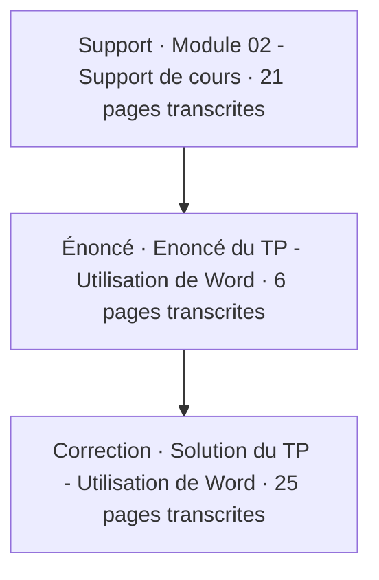

SOURCE DRIVE · TRANSCRIPTION DU SUPPORT

Le contenu des documents du dossier TSSR est transcrit ci-dessous, page par page. Les textes et tableaux sont intégrés à la page Web. Aucun fichier PDF, aucune diapositive entière ni aucune reproduction de page n’est affiché. Seuls des croquis ou visuels isolés et vérifiés peuvent accompagner la transcription. Les versions et les consignes restent celles des supports de formation. Les compléments IA sont conservés dans leur onglet distinct.

## Support · Module 02 - Support de cours · 21 pages transcrites

### Page 1

#### Outils collaboratifs

##### Connaissances des notions de base Word

##### Objectifs

!!! note "À retenir"
    Découvrir les fonctionnalités de Microsoft Word Mettre en forme un document Utiliser les fonctionnalités de Word qui permettent d’automatiser la mise en forme du document

- Découvrir les fonctionnalités de Microsoft Word
- Mettre en forme un document
- Utiliser les fonctionnalités de Word qui permettent d’automatiser la mise en forme du document

### Page 2

#### Connaissances des notions de base Word

#### L’interface de Word

#### Présentation de Word

!!! note "À retenir"
    Au démarrage, choisir Nouveau document Un modèle Document récent Visuel du support.

**Visuel externe**

- Au démarrage, choisir
- Nouveau document
- Un modèle
- Document récent

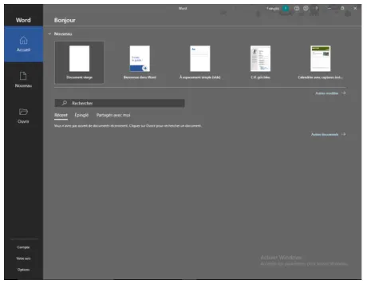

Visuel du support.

### Page 3

| La barre accès rapide | La barre de titre | La zone utilisateur |
| --- | --- | --- |

##### Le ruban Les règles

##### Les barres de défilement

##### La zone de rédaction

##### La barre d’état

#### Présentation de Word

**Visuel externe**

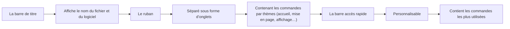

- La barre de titre
- Affiche le nom du fichier et du logiciel
- Le ruban
- Séparé sous forme d’onglets
- Contenant les commandes par thèmes (accueil, mise en page, affichage…)
- La barre accès rapide
- Personnalisable
- Contient les commandes les plus utilisées
- La zone utilisateur
- Affiche le nom de l’utilisateur de la licence

Visuel du support.

### Page 4

!!! note "À retenir"
    Les barres de défilement Permettent de naviguer dans le document La barre d’état Contient des informations sur le document Les règles Pas affichées par défaut Permet de positionner les éléments précisément et les taquets de tabulation La zone de rédaction Contient le texte de votre document

**Visuel externe**

- Les barres de défilement
- Permettent de naviguer dans le document
- La barre d’état
- Contient des informations sur le document
- Les règles
- Pas affichées par défaut
- Permet de positionner les éléments précisément et les taquets de tabulation
- La zone de rédaction
- Contient le texte de votre document

#### Connaissances des notions de base Word

#### Création d’un document

### Page 5

#### Écriture d’un document

**Visuel externe**

- Afficher les caractères non imprimables :
- Menu Accueil
- Écrire plusieurs pages du document
- Taper au kilomètre
- Sans mise en forme
- Identifier les différents éléments :
- Les titres
- Les paragraphes
- Les listes :
- À puces
- Numérotées

- Mettre en forme le document
- Alignement des paragraphes :
- Positionner des taquets de tabulations
- Utiliser les tabulations
- Espacement des paragraphes :
- Éviter les paragraphes vides
- Création des styles de paragraphes :
- Appliquer un style aux différents paragraphes
- Pas de paragraphe du style normal

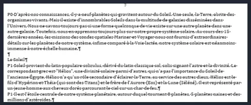

Visuel du support.

### Page 6

!!! note "À retenir"
    Mettre en forme le document Enchaînement des paragraphes : Lier les styles les uns aux autres Utilisation des sauts : Permettre de fixer le contenu de chaque page Création du sommaire automatiquement Finir l’écriture du document

- Mettre en forme le document
- Enchaînement des paragraphes :
- Lier les styles les uns aux autres
- Utilisation des sauts :
- Permettre de fixer le contenu de chaque page
- Création du sommaire automatiquement
- Finir l’écriture du document

#### Tenant Microsoft 365

##### Démo

##### Prise en main et création d'un document

### Page 7

#### Connaissances des notions de base Word

#### Mise en forme d’un

#### document

#### Page de garde et sommaire

!!! note "À retenir"
    Prévoir des pages vides (si nécessaire) : Pour la page de garde Pour le sommaire Insérer des sauts de page Menu Insertion

- Prévoir des pages vides (si nécessaire) :
- Pour la page de garde
- Pour le sommaire
- Insérer des sauts de page
- Menu Insertion

| Bouton sur le | Caractère non |
| --- | --- |
| bandeau | imprimable sur la page |

### Page 8

#### Connaissances des notions de base Word

#### Gestion des titres

- Mettre en forme les titres :
- Choisir la numérotation
- Choisir la police :
- Casse (Majuscule/Minuscule)
- Taille
- Mettre en forme le texte
- Gras
- Italique
- Souligné
- Ajuster les retraits de la liste (clic droit sur la puce) :
- Espacement de la marge
- Espacement entre la numérotation et le texte (tabulation)
- Caractère entre la numérotation et le texte :
- Tabulation ou Espace

Visuel du support.

### Page 9

- Mettre en forme le style Titre
- Mettre à jour le style Titre1 avec le titre nouvellement créé
- Menu Accueil
- Procéder de la même façon avec les autres titres
- Les autres titres apparaissent automatiquement dans l’accès rapide des styles

- Hiérarchiser la numérotation des titres
- Gérer grâce à la liste à plusieurs niveaux

①

②

- À chaque niveau

| • Appuyer sur le bouton Plus en bas à gauche | ① |  |
| --- | --- | --- |
| • Choisir le style | ② |  |
| • Choisir la mise en forme si nécessaire | ③ | ③ |
| • Choisir la position du texte | ④ |  |

- La mise en forme des titres peut être

④

refaite titre par titre

Visuel du support.

Visuel du support.

### Page 10

##### Les étapes

!!! note "À retenir"
    Refaire la gestion des retraits qui aura sûrement été modifiée

- 1. Créer les différents titres
- 2. Définir la liste à plusieurs niveaux
- 3. Refaire la gestion des retraits qui aura sûrement été modifiée

#### Connaissances des notions de base Word

#### Gestion des paragraphes

Visuel du support.

### Page 11

- Mettre en forme des paragraphes
- Aligner le paragraphe par rapport au titre
- Ajuster les retraits
- Modifier les taquets sur la règle
- Choisir la police
- Taille
- Casse (Majuscule/Minuscule)
- Aligner le texte du paragraphe
- Alignement « à gauche »
- Alignement « centrer »
- Alignement « à droite »
- Alignement « justifier »
- Alignement du texte sur la gauche et la droite

- Créer un nouveau style
- Sauvegarder la structure du paragraphe
- Définir le nouveau style
- Nommer ce style
- Possibilité de le modifier
- Le style apparaît dans l’accès rapide

##### Nouveau style dans l’accès rapide

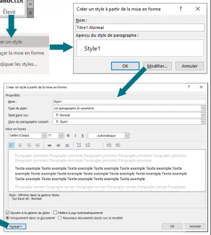

Visuel du support.

### Page 12

#### Gestion des paragraphes

!!! note "À retenir"
    Lier les styles Automatiser l’application des styles Mettre en forme le texte pendant la frappe Modifier un style de l’accès rapide Choisir le style du paragraphe Mise en forme liée

- Lier les styles
- Automatiser l’application des styles
- Mettre en forme le texte pendant la frappe
- Modifier un style de l’accès rapide

| ① | ①② |
| --- | --- |

- Choisir le style du paragraphe
- Mise en forme liée

| • Choisir le style du paragraphe suivant | ② |
| --- | --- |

#### Connaissances des notions de base Word

#### Gestion de l’espacement

Visuel du support.

### Page 13

- Espacement des titres et des paragraphes
- Ne pas utiliser de paragraphes vides
- Paragraphes ne contenant pas de texte

| • Symboliser par le caractère non affichable | ④ |
| --- | --- |

- Utiliser l’espacement de paragraphe

| • Utiliser l’outil « Interligne et espacement de paragraphe » | ① |
| --- | --- |
| Choisir l’interligne du paragraphe | ② |

| • | Ajouter ou supprimer l’espace | ③ |
| --- | --- | --- |
| • Paramétrer les options d’interligne | ④ |  |

①

| • | L’alignement |  |
| --- | --- | --- |
| • | Gauche |  |
| • | Centrer |  |
| • | Droite |  |
| • | Justifier |  |
| • | Le retrait | ② |
| • | L’espacement |  |
| • | Avant |  |
| • | Après |  |
| • | L’interlignage |  |

③

- À partir de l’accès rapide des styles
- Clic droit sur un style
- Modifier le style
- Bouton Format
- Options d’espacement
- Applique la modification à tous les paragraphes liés au style

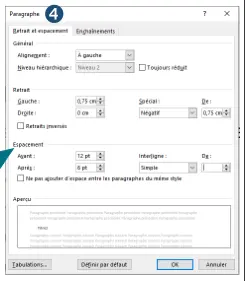

Visuel du support.

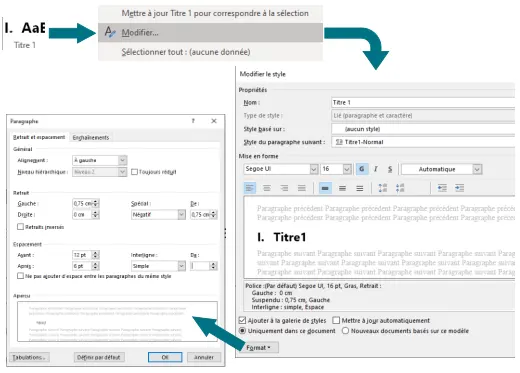

Visuel du support.

### Page 14

#### Connaissances des notions de base Word

#### Gestion de l’alignement

#### Gestion des alignements

!!! note "À retenir"
    Alignement des titres et des paragraphes Taquets de retrait de la règle Visuel du support.

- Alignement des titres et des paragraphes
- Taquets de retrait de la règle

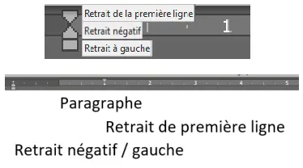

Visuel du support.

### Page 15

- Options des paragraphes

#### Connaissances des notions de base Word

#### Gestion des tabulations

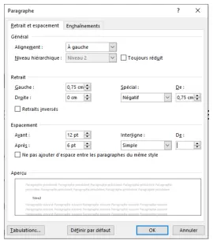

Visuel du support.

### Page 16

- Utilisation des tabulations
- Taquet gauche
- Taquet centré
- Taquet droit
- Taquet décimal
- Caractère non imprimable « tabulation »
- Un caractère « tabulation » par taquet sur la règle

- Utilisation des tabulations durant la création du document
- Positionner les tabulations durant la frappe
- Sélectionner le texte à aligner
- Positionner les taquets de tabulation
- Créer un style pour une réutilisation

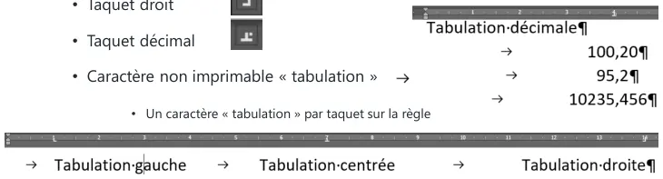

Visuel du support.

### Page 17

#### Connaissances des notions de base Word

#### Gestion des sauts

- Les différents types de sauts
- Saut de page
- Permet de fixer le contenu d’une page
- Poursuite de la mise en forme
- En-tête de page
- Pied de page
- Orientation de la page
- Numérotation des pages
- Saut de colonne
- Permet de définir la fin du contenu d’une colonne
- Indiquer le texte qui doit être dans une autre colonne

### Page 18

- Sauts de section
- Saut de section page suivante
- Fixer le contenu d’une page
- Définir la fin d’une section et le début d’une nouvelle
- Changer la mise en forme
- En-tête de page
- Pied de page
- Orientation de la page
- Numérotation des pages
- Saut de section continu
- Définir la fin d’une section et le début d’une nouvelle
- Insérer une mise en page différente dans une page
- Marges différentes

#### Connaissances des notions de base Word

#### Gestion de la table des

#### matières

### Page 19

#### Gestion de la table des matières

- Insertion de la table des matières
- Ajout de la table des matières
- À partir du menu Références

| • Choisir une table des matières | ① |
| --- | --- |

ou

| • Créer une Table des matières personnalisée | ② |
| --- | --- |

① ②

- Définir la table des matières personnalisée
- Choisir le format
- Choisir les niveaux à afficher
- Quel « Titre » afficher ?
- Regarder les aperçus
- Choisir les caractères de suite

Visuel du support.

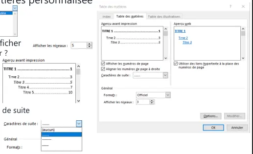

Visuel du support.

### Page 20

- Personnaliser la table des matières
- Dépend de la mise en forme des styles TM X
- Apparaît au fur et à mesure de leur utilisation

| Style Titre X | Style TM X de la table |
| --- | --- |
| du document | des matières du document |

#### Tenant Microsoft 365

##### Démo

##### Mise en forme d’un document

Visuel du support.

### Page 21

#### Connaissances des notions de base Word

#### TP

##### Démo

##### Utilisation de Word

Référence du document : 1Nw7I-8Wr17r1iJIvcze8T1R2qOvO8qvP · SHA-256 7677971f03707dff…

## Énoncé · Enoncé du TP - Utilisation de Word · 6 pages transcrites

### Page 1

#### Utilisation de Word

TP du Module 02 – Notions de base sur Word

Avant de démarrer ce TP, il convient d’avoir suivi les vidéos du module 2.

**Durée estimée** 60 à 90 minutes

#### Énoncé

##### Objectifs :

- Mettre en forme un document Word

##### Prérequis :

- Avoir installé Office 365.
- Récupérer deux documents :
  - « Système Solaire – Document Brut.docx », document à mettre en forme
  - « Système Solaire – Document Fini.pdf », document contenant le résultat attendu

Chaque paragraphe du document a été identifié

- Mettre en forme les différents paragraphes en fonction des directives suivantes.

##### Titre 1

| Nom | Titre 1 |
| --- | --- |
| Style basé sur | Aucun style |
| Style du paragraphe suivant | T1-Paragraphe |
| Police | Comic Sans Ms |
| Taille | 14 pts - Gras. |
| Espacement | 12 points avant 6 points après |
| Numérotation | I, II, III … Numéro suivi d’un espace |
| Retrait gauche | 0,5 cm |

### Page 2

- Mettre en forme les paragraphes (T2) :

##### Titre 2

| Nom | Titre 2 |
| --- | --- |
| Style basé sur | Aucun style |
| Style du paragraphe suivant | T2-Paragraphe |
| Police | Comic sans ms |
| Taille | 13 pts - Gras. |
| Espacement | 6 points avant 3 points après |
| Numérotation | A., B., C. … Numéro suivi d’un espace |
| Retrait gauche | 0,5 cm |

- Mettre en forme les paragraphes (T3) :

##### Titre 3

| Nom | Titre 3 |
| --- | --- |
| Style basé sur | Aucun style |
| Style du paragraphe suivant | T3-Paragraphe |
| Police | Comic sans ms |
| Taille | 12 pts - Gras/Italique |
| Espacement | 6 points avant 3 points après |
| Numérotation | 1., 2., 3… Numéro suivi d’un espace |
| Aligner à gauche | 1 cm |

- Mettre en forme les paragraphes (T4) :

##### Titre 4

| Nom | Titre 4 |
| --- | --- |
| Style basé sur | Aucun style |
| Style du paragraphe suivant | T4-Paragraphe |
| Police | Comic sans ms |
| Taille | 11 pts - Italique |
| Espacement | 4 points avant 0 point après |
| Numérotation | a), b), c)… Numéro suivi d’un espace |
| Aligner à gauche | 1,5 cm |

Pensez à définir la liste à plusieurs niveaux pour tous ces titres.

- Mettre en forme les paragraphes (P0) :

##### Paragraphes (P0)

| Nom | P0_Paragraphe |
| --- | --- |
| Style basé sur | Aucun style |
| Police | Cambria |
| Taille | 14 pts |
| Espacement | 0 point avant 0 point après |
| Aligner | Justifier |

### Page 3

- Mettre en forme les paragraphes (P1) :

##### Paragraphes (P1)

| Nom | T1-Paragraphe |
| --- | --- |
| Style basé sur | Aucun style |
| Style du paragraphe suivant | T1-Paragraphe |
| Police | Cambria |
| Taille | 13 pts |
| Espacement | 0 point avant 6 points après Ajouter de l’espacement entre les paragraphes de même style |
| Retrait | Retrait gauche 0,75 cm |
| Aligner | Justifier |

- Mettre en forme les paragraphes (P2) :

##### Paragraphes (P2)

| Nom | T2-Paragraphe |
| --- | --- |
| Style basé sur | Aucun style |
| Style du paragraphe suivant | T2-Paragraphe |
| Police | Cambria |
| Taille | 12 pts |
| Espacement | 0 point avant 4 points après Ajouter de l’espacement entre les paragraphes de même style |
| Retrait | Retrait gauche 1,25 cm |
| Aligner | Justifier |

- Mettre en forme les paragraphes (P3) :

##### Paragraphes (P3)

| Nom | T3-Paragraphe |
| --- | --- |
| Style basé sur | Aucun style |
| Style du paragraphe suivant | T3-Paragraphe |
| Police | Cambria |
| Taille | 11 pts |
| Espacement | 0 point avant 0 point après Ajouter de l’espacement entre les paragraphes de même style |
| Retrait | Retrait gauche 1,75 cm |
| Aligner | Justifier |

### Page 4

- Mettre en forme les puces (TP2) :

##### Puces (TP2)

| Nom | T2-Puces |
| --- | --- |
| Style basé sur | Aucun style |
| Style du paragraphe suivant | T2-Puces |
| Police | Cambria |
| Taille | 12 pts |
| Espacement | 0 point avant 4 points après Ajouter de l’espacement entre les paragraphes de même style Interligne Simple |
| Retrait | Retrait gauche 1,25 cm Retrait négatif : 0,5 cm |
| Aligner | Justifier |
| Puce | ➢ |

- Mettre en forme les puces (TSP2) :

##### Puces (TSP2)

| Nom | T2-SousPuces |
| --- | --- |
| Style basé sur | Aucun style |
| Style du paragraphe suivant | T2-SousPuces |
| Police | Cambria |
| Taille | 11 pts - italique |
| Espacement | 0 point avant 4 points après Ajouter de l’espacement entre les paragraphes de même style |
| Retrait | Retrait gauche 1,75 cm Retrait négatif : 0,5 cm |
| Aligner | Justifier |
| Puce | ✓ |

- Mettre en forme les puces (TP3) :

##### Puces (TP3)

| Nom | T3-Puces |
| --- | --- |
| Style basé sur | Aucun style |
| Style du paragraphe suivant | T3-Puces |
| Police | Cambria |
| Taille | 11 pts |
| Espacement | 0 point avant 4 points après Ajouter de l’espacement entre les paragraphes de même style |
| Retrait | Retrait gauche 1,75 cm Retrait négatif : 0,5 cm |
| Aligner | Justifier |
| Puce |  |

### Page 5

- Mettre en forme les puces (TSP3) :

##### Puces (TSP3)

| Nom | T3-SousPuces |
| --- | --- |
| Style basé sur | Aucun style |
| Style du paragraphe suivant | T3-SousPuces |
| Police | Cambria |
| Taille | 10 pts - Italique |
| Espacement | 0 point avant 4 points après Ajouter de l’espacement entre les paragraphes de même style |
| Retrait | Retrait gauche 2,25 cm Retrait négatif : 0,5 cm |
| Aligner | Justifier |
| Puce |  |

- Mettre en forme les puces (TP4) :

##### Puces (TP4)

| Nom | T4-Puces |
| --- | --- |
| Style basé sur | Aucun style |
| Style du paragraphe suivant | T4-Puces |
| Police | Cambria |
| Taille | 10 pts |
| Espacement | 4 points avant 2 points après Ajouter de l’espacement entre les paragraphes de même style |
| Retrait | Retrait gauche 2 cm Retrait négatif : 0,5 cm |
| Aligner | Justifier |
| Puce |  |

- Mettre en forme les puces (TSP4) :

##### Puces (TSP4)

| Nom | T4-SousPuces |
| --- | --- |
| Style basé sur | Aucun style |
| Style du paragraphe suivant | T4-SousPuces |
| Police | Cambria |
| Taille | 10 pts - Italique |
| Espacement | 0 point avant 2 points après Ajouter de l’espacement entre les paragraphes de même style |
| Retrait | Retrait gauche 3,25 cm Retrait négatif : 0,5 cm |
| Aligner | Justifier |
| Puce |  |

### Page 6

- Mettre en forme le texte signalé (Début_tab et Fin_tab) en tableau
  - Tableau 5 foncé – accentuation 3
- Mettre en forme les images

Le texte et les images sont présentés sur 2 colonnes.

- Créer la table des matières en première page
- Mettre un filigrane sur les pages
- Mettre un en-tête sur chaque page des planètes
- Mettre une numération sur toutes pages sauf la page de garde
- Rajouter une page de garde avec la présentation que vous souhaitez.

Référence du document : 1cpVO66OSKeYwpzWHd6M9vMopjymmpmbP · SHA-256 d71a06cce8c72a7c…

## Correction · Solution du TP - Utilisation de Word · 25 pages transcrites

Correction originale : à consulter après avoir tenté l’exercice.

### Page 1

#### Utilisation de Word

#### Solution

TP du Module 02 – Notions de base sur Word Avant de démarrer ce TP, il convient d’avoir suivi les vidéos du module 2.

##### Durée estimée 60 à 90 minutes

Approche méthodologique Avant de se lancer bille en tête dans le TP, il est intéressant d’analyser le document dans sa globalité et de recenser les besoins afin d’éviter de repasser plusieurs fois pour faire des modifications dans les styles et ainsi perdre du temps.

##### Voici la méthodologie :

| • | Relever l’ensemble des styles nécessaires |
| --- | --- |
| • | Configuration des styles |

o Configuration du premier titre o Configuration de la liste de titres à plusieurs niveaux

| • | Finalisation de la configuration des styles de titres |
| --- | --- |
| • | Finalisation de la préparation de tous les styles |
| • | Application des styles sur l’ensemble du document |
| 1) | Relever l’ensemble des styles |
| a. | Titre 1 |
| b. | Titre 2 |
| c. | Titre 3 |
| d. | Titre 4 |
| e. | P0_Paragraphe |
| f. | T1-Paragraphe |
| g. | T2-Paragraphe |
| h. | T3-Paragraphe |
| i. | T2-Puces |
| j. | T2-SousPuces |
| k. | T3-Puces |
| l. | T3-SousPuces |

m. T4-Puces

| n. | T4-SousPuces |
| --- | --- |

### Page 2

Création des styles Identifiez les styles présents dans la galerie de styles : Si certains styles n’apparaissent pas (comme Titre1, Titre2…), cliquez sur la flèche en bas à droite de la capture : Les titres apparaissent maintenant dans la galerie de styles.

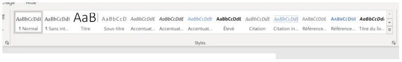

Visuel du support.

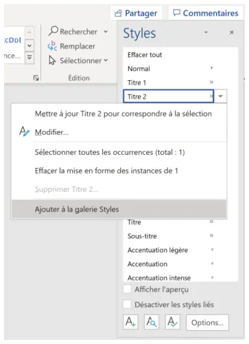

Visuel du support.

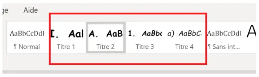

Visuel du support.

### Page 3

Vous pouvez également nettoyer les styles existants afin de clarifier la mise en forme du document : Créez l’ensemble des styles listés précédemment (il n’est pas nécessaire d’assigner polices et autres paramétrages à ce moment).

##### Voici le résultat après création :

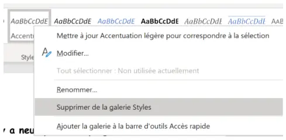

Visuel du support.

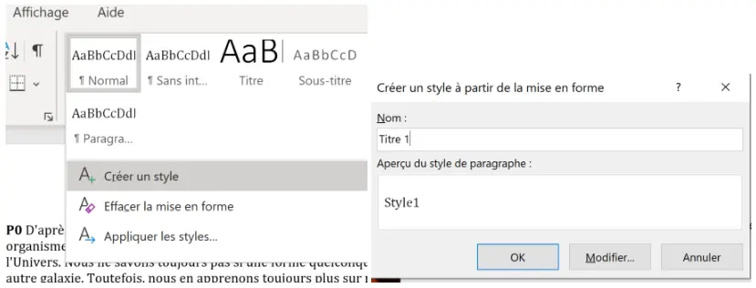

Visuel du support.

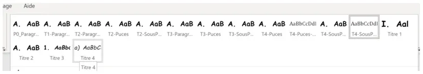

Visuel du support.

### Page 4

##### Vous pouvez maintenant commencer à paramétrer les différents styles :

| Nom : | ❑ | Titre 1 |
| --- | --- | --- |
| Style basé sur : | ❑ | Aucun style |
| Style du paragraphe suivant | ❑ | T1-Paragraphe |
| Police : | ❑ | Comic Sans Ms |
| Taille : | ❑ | 14 pts - Gras. |
| ❑ | 12 points avant |  |

##### Espacement :

| ❑ | 6 points après |
| --- | --- |
| ❑ | I, II, III … |

##### Numérotation :

| ❑ | Numéro suivi d’un espace |  |
| --- | --- | --- |
| Retrait gauche : | ❑ | 0,5 cm |

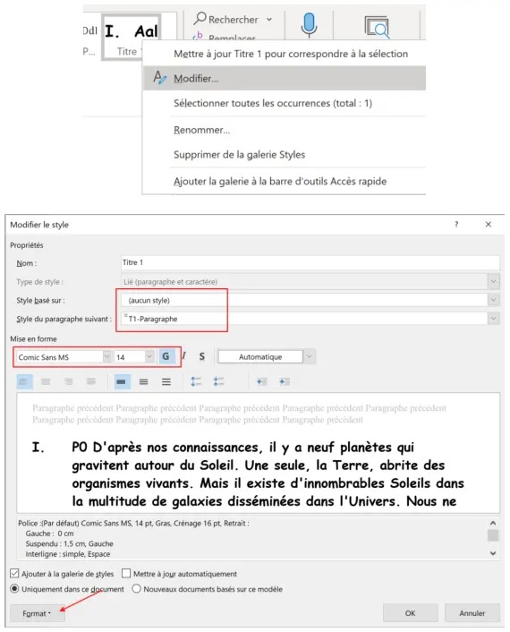

Visuel du support.

### Page 5

Liste de titres à plusieurs niveaux Suite à l’application de ce style sur une première ligne de texte, clic droit sur le numéro dans le texte puis Ajuster les retraits de la liste, puis configurez l’ensemble des retraits et numérotations pour les titres suivants :

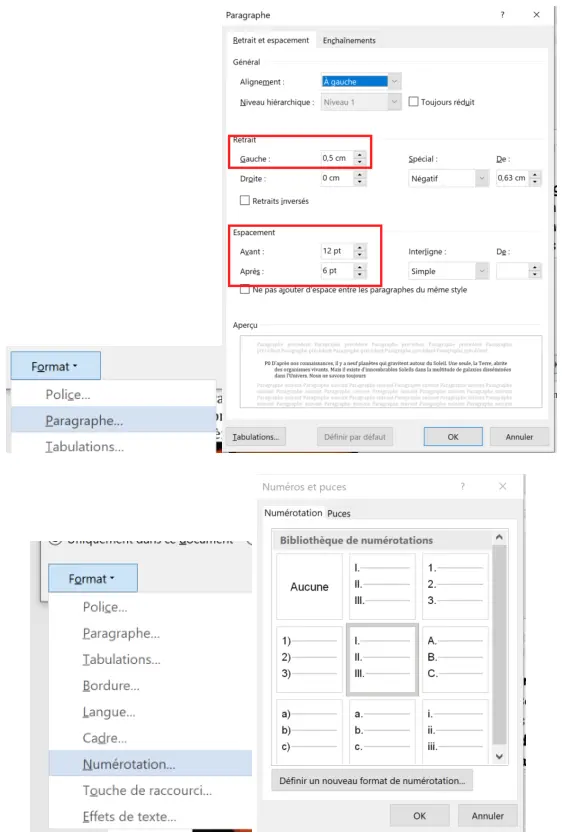

Visuel du support.

Visuel du support.

### Page 6

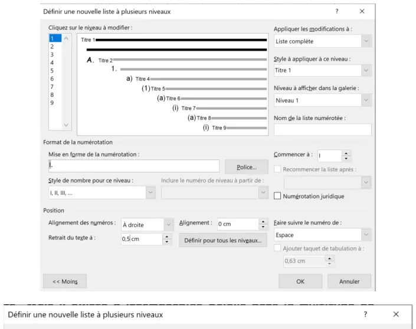

Visuel du support.

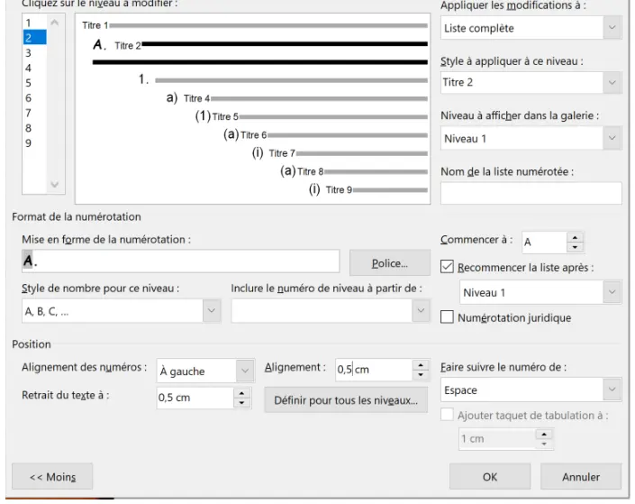

Visuel du support.

### Page 7

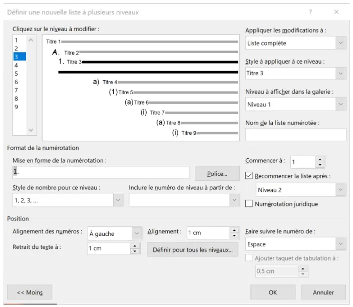

Visuel du support.

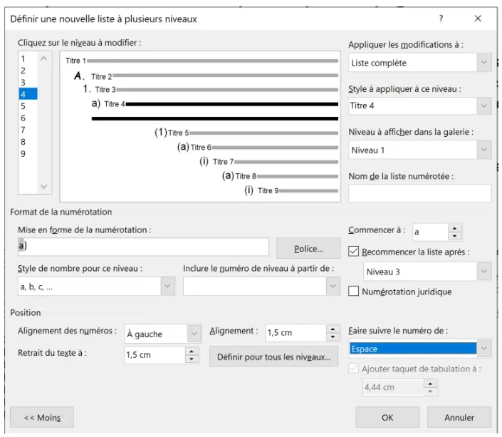

Visuel du support.

### Page 8

##### Configuration des autres styles

| Nom : | ❑ | Titre 2 |
| --- | --- | --- |
| Style basé sur : | ❑ | Aucun style |
| Style du paragraphe suivant | ❑ | T2-Paragraphe |
| Police : | ❑ | Comic sans ms |
| Taille : | ❑ | 13 pts - Gras. |
| ❑ | 6 points avant |  |

##### Espacement :

| ❑ | 3 points après |
| --- | --- |
| ❑ | A., B., C. … |

##### Numérotation :

| ❑ | Numéro suivi d’un espace |  |
| --- | --- | --- |
| Retrait gauche : | ❑ | 0,5 cm |

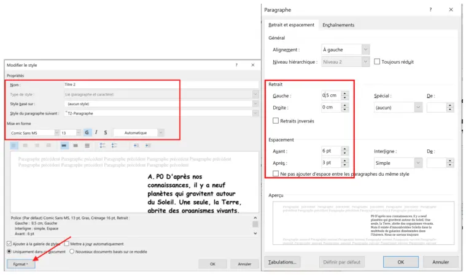

Visuel du support.

### Page 9

| Nom : | ❑ | Titre 3 |
| --- | --- | --- |
| Style basé sur : | ❑ | Aucun style |
| Style du paragraphe suivant | ❑ | T3-Paragraphe |
| Police : | ❑ | Comic sans ms |
| Taille : | ❑ | 12 pts - Gras/Italique |
| ❑ | 6 points avant |  |

##### Espacement :

| ❑ | 3 points après |
| --- | --- |
| ❑ | 1., 2., 3… |

##### Numérotation :

| ❑ | Numéro suivi d’un espace |  |
| --- | --- | --- |
| Aligner à gauche : | ❑ | 1 cm |

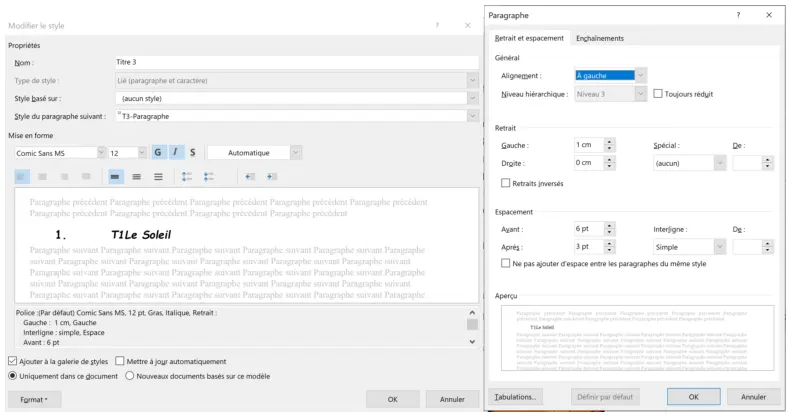

Visuel du support.

### Page 10

| Nom : | ❑ | Titre 4 |
| --- | --- | --- |
| Style basé sur : | ❑ | Aucun style |
| Style du paragraphe suivant | ❑ | T4-Puces |
| Police : | ❑ | Comic sans ms |
| Taille : | ❑ | 11 pts - Italique |
| ❑ | 4 points avant |  |

##### Espacement :

| ❑ | 0 point après |
| --- | --- |
| ❑ | a), b), c)… |

##### Numérotation :

| ❑ | Numéro suivi d’un espace |  |
| --- | --- | --- |
| Aligner à gauche : | ❑ | 1,5 cm |

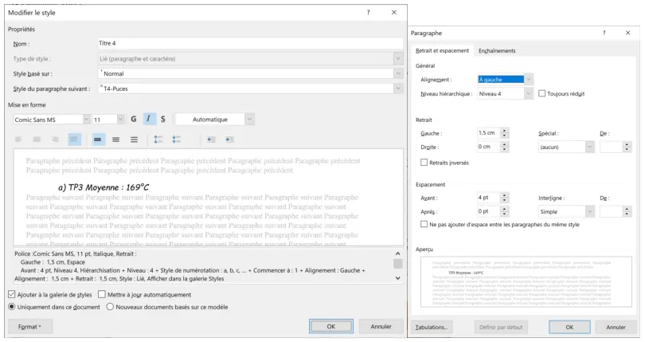

Visuel du support.

### Page 11

| Nom : | ❑ P0_Paragraphe |
| --- | --- |
| Style basé sur : | ❑ Aucun style |
| Police : | ❑ Cambria |
| Taille : | ❑ 14 pts |

- 0 point avant

##### Espacement :

- 0 point après

| Aligner | ❑ Justifier |
| --- | --- |

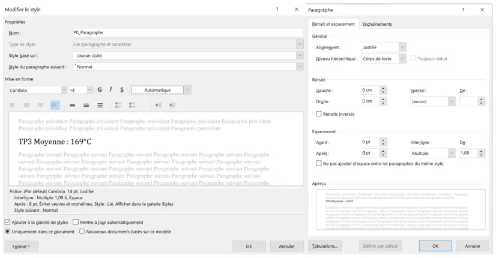

Visuel du support.

### Page 12

| Nom : | ❑ | T1-Paragraphe |
| --- | --- | --- |
| Style basé sur : | ❑ | Aucun style |
| Style du paragraphe suivant | ❑ | T1-Paragraphe |
| Police : | ❑ | Cambria |
| Taille : | ❑ | 13 pts |
| ❑ | 0 point avant |  |
| ❑ | 6 points après |  |

| ❑ | Ajouter de l’espacement entre les |
| --- | --- |

paragraphes de même style

| ❑ | Retrait gauche 0,75 cm |
| --- | --- |

##### Aligner :

| ❑ | Justifier |
| --- | --- |

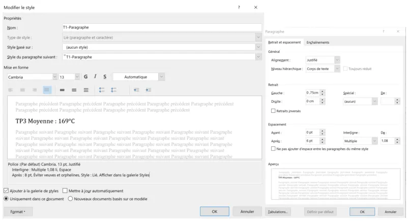

Visuel du support.

### Page 13

| Nom : | ❑ T2-Paragraphe |
| --- | --- |
| Style basé sur : | ❑ Aucun style |

##### Style du paragraphe suivant ❑ T2-Paragraphe

| Police : | ❑ Cambria |
| --- | --- |
| Taille : | ❑ 12 pts |

- 0 point avant
- 4 points après

##### Espacement :

- Ajouter de l’espacement entre les paragraphes de même style
- Retrait gauche 2 cm

##### Aligner :

- Justifier

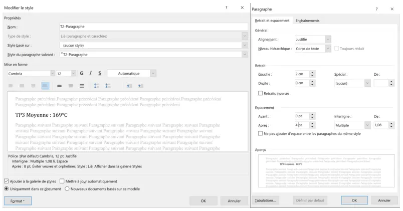

Visuel du support.

### Page 14

| Nom : | ❑ T3-Paragraphe |
| --- | --- |
| Style basé sur : | ❑ Aucun style |

##### Style du paragraphe suivant ❑ T3-Paragraphe

| Police : | ❑ Cambria |
| --- | --- |
| Taille : | ❑ 11 pts |

- 0 point avant
- 0 point après

##### Espacement :

- Ajouter de l’espacement entre les paragraphes de même style
- Retrait gauche 1,75 cm

##### Aligner :

- Justifier

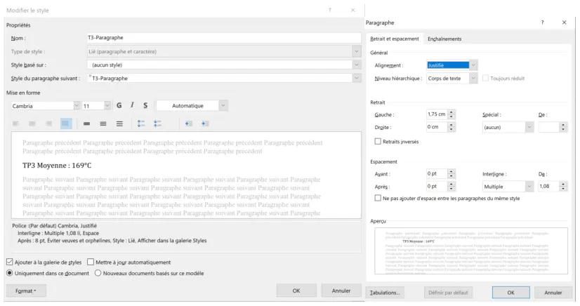

Visuel du support.

### Page 15

| Nom : | ❑ T2-Puces |
| --- | --- |
| Style basé sur : | ❑ Aucun style |

##### Style du paragraphe suivant ❑ T2-Puces

| Police : | ❑ Cambria |
| --- | --- |
| Taille : | ❑ 12 pts |

- 0 point avant
- 4 points après

##### Espacement :

- Ajouter de l’espacement entre les paragraphes de même style
- Retrait gauche 1,25cm

##### Aligner :

- Justifier

| Retrait négatif : | ❑ 0,5 cm |
| --- | --- |
| Puce | ❑ ➢ |

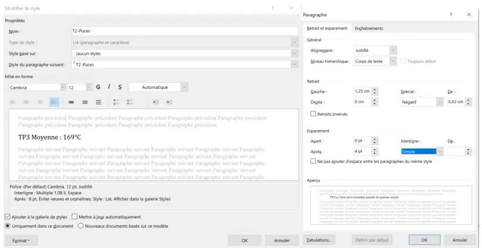

Visuel du support.

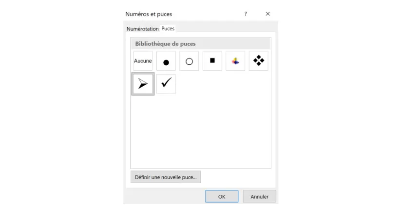

Visuel du support.

### Page 16

| Nom : | ❑ T2-SousPuces |
| --- | --- |
| Style basé sur : | ❑ Aucun style |

##### Style du paragraphe suivant ❑ T2-SousPuces

| Police : | ❑ Cambria |
| --- | --- |
| Taille : | ❑ 11 pts - italique |

- 0 point avant
- 4 points après

##### Espacement :

- Ajouter de l’espacement entre les paragraphes de même style
- Retrait gauche 1,75cm

##### Aligner :

- Justifier

| Retrait négatif : | ❑ 0,5 cm |
| --- | --- |
| Puce | ❑ ✓ |

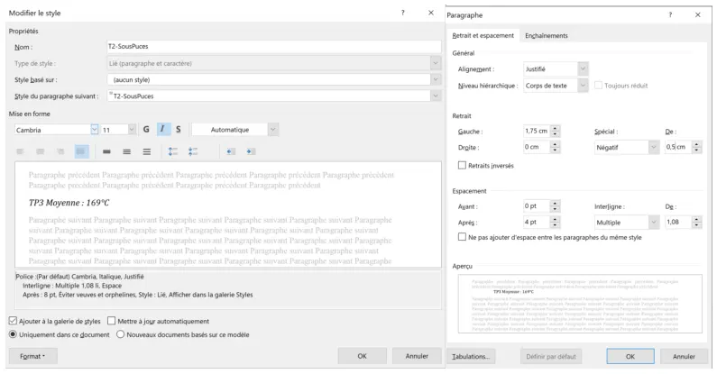

Visuel du support.

### Page 17

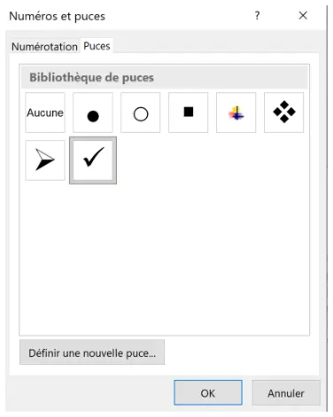

Visuel du support.

### Page 18

| Nom : | ❑ T3-Puces |
| --- | --- |
| Style basé sur : | ❑ Aucun style |

##### Style du paragraphe suivant ❑ T3-Puces

| Police : | ❑ Cambria |
| --- | --- |
| Taille : | ❑ 11 pts |

- 0 point avant
- 4 points après

##### Espacement :

- Ajouter de l’espacement entre les paragraphes de même style
- Retrait gauche 1,75cm

##### Aligner :

- Justifier

| Retrait négatif : | ❑ 0,5 cm |
| --- | --- |
| Puce | ❑ ↪ |

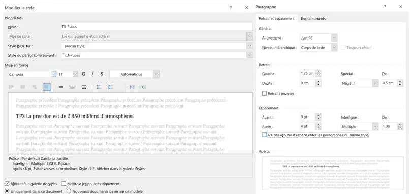

Visuel du support.

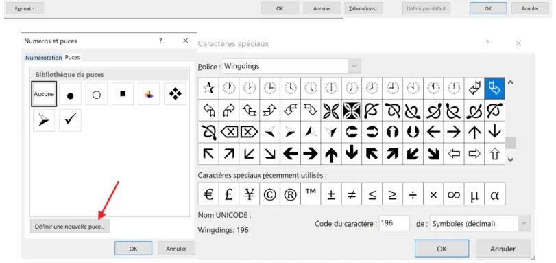

Visuel du support.

### Page 19

| Nom : | ❑ T3-SousPuces |
| --- | --- |
| Style basé sur : | ❑ Aucun style |

##### Style du paragraphe suivant ❑ T3-SousPuces

| Police : | ❑ Cambria |
| --- | --- |
| Taille : | ❑ 10 pts - Italique |

- 0 point avant
- 4 points après

##### Espacement :

- Ajouter de l’espacement entre les paragraphes de même style
- Retrait gauche 2,25cm

##### Aligner :

- Justifier

| Retrait négatif : | ❑ 0,5 cm |
| --- | --- |
| Puce | ❑ ► |

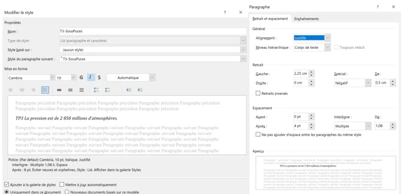

Visuel du support.

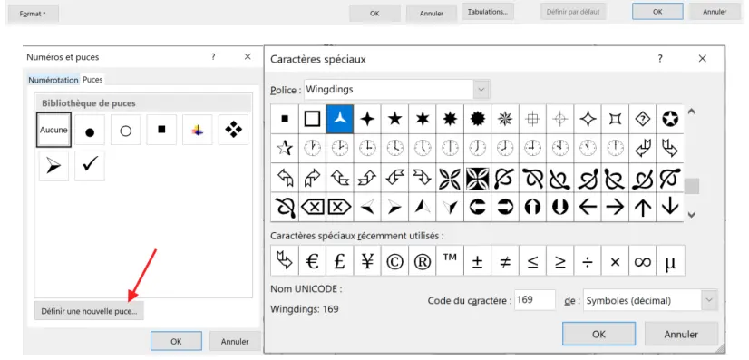

Visuel du support.

### Page 20

| Nom : | ❑ T4-Puces |
| --- | --- |
| Style basé sur : | ❑ Aucun style |

##### Style du paragraphe suivant ❑ T4-Puces

| Police : | ❑ Cambria |
| --- | --- |
| Taille : | ❑ 10 pts - gras |

- 4 points avant
- 2 points après

##### Espacement :

- Ajouter de l’espacement entre les paragraphes de même style
- Retrait gauche 2 cm

##### Aligner :

- Justifier

| Retrait négatif : | ❑ 0,5 cm |
| --- | --- |
| Puce | ❑ ★ |

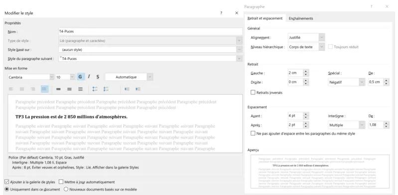

Visuel du support.

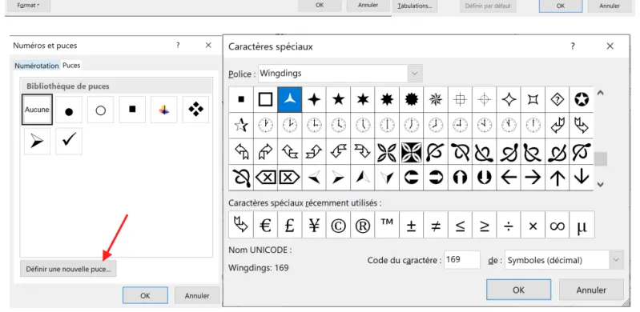

Visuel du support.

### Page 21

| Nom : | ❑ T4-SousPuces |
| --- | --- |
| Style basé sur : | ❑ Aucun style |

##### Style du paragraphe suivant ❑ T4-SousPuces

| Police : | ❑ Cambria |
| --- | --- |
| Taille : | ❑ 10 pts - Italique |

- 0 point avant
- 2 points après

##### Espacement :

- Ajouter de l’espacement entre les paragraphes de même style
- Retrait gauche 3,25cm

##### Aligner :

- Justifier

| Retrait négatif : | ❑ 0,5 cm |
| --- | --- |
| Puce | ❑ ► |

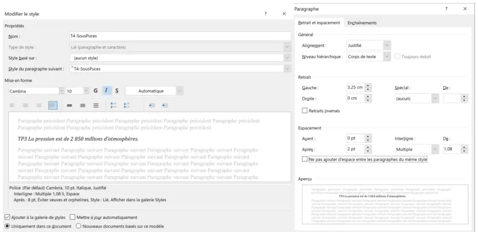

Visuel du support.

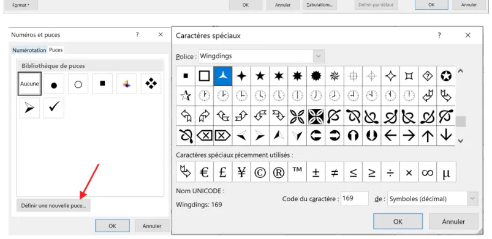

Visuel du support.

### Page 22

Mise en forme des tableaux : Sélectionnez le texte, cliquer sur Insertion / Tableau / Insérer un tableau

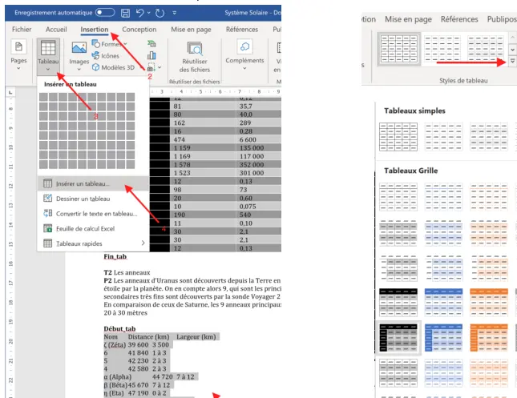

Visuel du support.

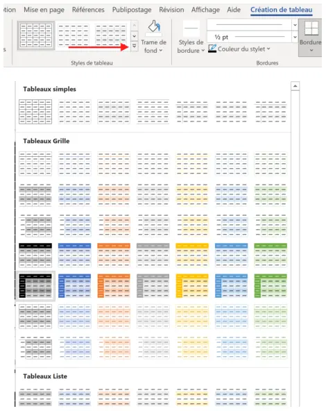

Visuel du support.

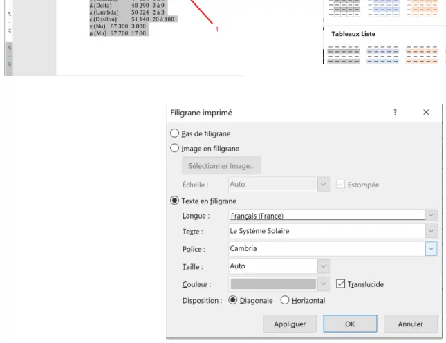

Visuel du support.

### Page 23

Table des matières : Positionnez-vous sur la première page du document puis insérez un saut de section après la table des matières :

Ajouter un filigrane : Sous Conception, sélectionnez Filigrane puis tapez Le système solaire

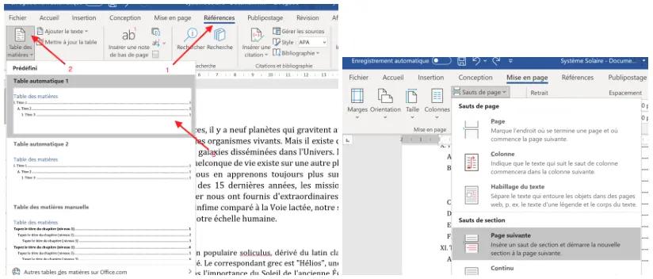

Visuel du support.

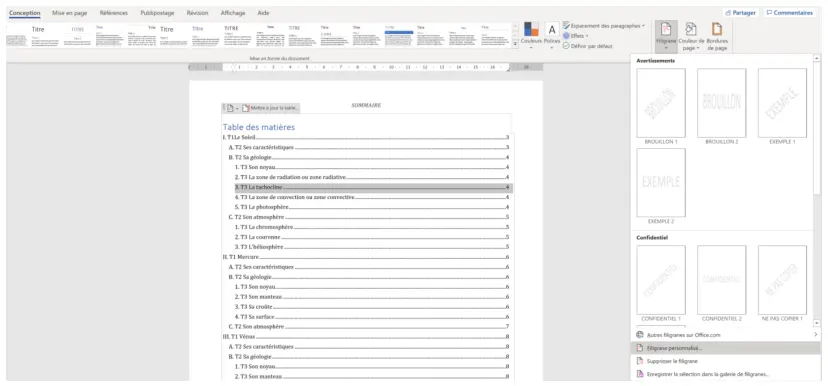

Visuel du support.

### Page 24

En-tête par page : Placez-vous à la fin d’un chapitre et cliquez sur Mise en Page / Sauts de page / Page suivante Double cliquez dans la zone de l’en-tête et désélectionnez la case Lier au précédent puis modifiez le texte. Répétez l’opération pour tous les chapitres.

##### Numérotation des pages :

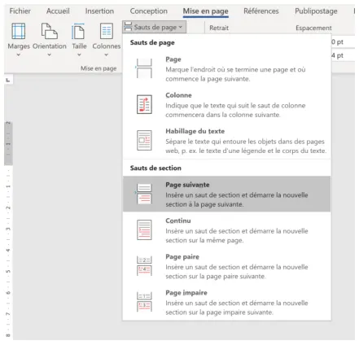

Visuel du support.

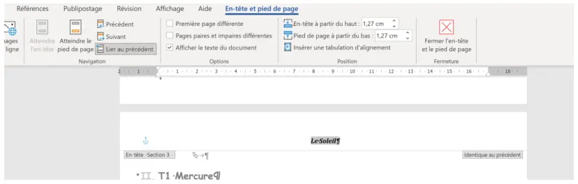

Visuel du support.

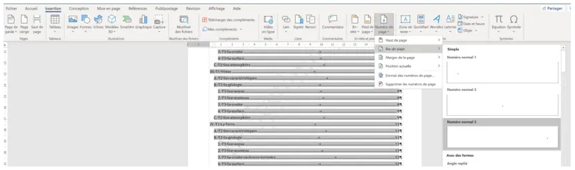

Visuel du support.

### Page 25

##### Page de garde :

Visuel du support.

Visuel du support.

Référence du document : 1zm3iHXF8RS_loevQPbqj7frtV_Kf6mFj · SHA-256 f2e3f47a7476d825…

## Fiche de synthèse

Les lignes reprennent les titres du cours et la première phrase de chaque partie.

| Partie | Repère du cours |
| --- | --- |
| Correction · Solution du TP - Utilisation de Word · 25 pages transcrites | Correction originale : à consulter après avoir tenté l’exercice. |
