# Module 03 — Connaissances des notions de base d’Excel

[Travaux pratiques](../../tp/microsoft-365/module-03/index.md)

Les parties ci-dessous reprennent le cours original, dans le même ordre. Les encadrés et les schémas répètent ses formulations.

## Parcours de lecture

1. Support · Module 03 - Support de cours · 13 pages transcrites
2. Support · Clients - Document Fini · 4 pages transcrites

**Visuel externe**

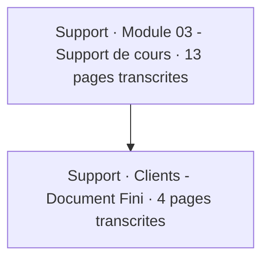

SOURCE DRIVE · TRANSCRIPTION DU SUPPORT

Le contenu des documents du dossier TSSR est transcrit ci-dessous, page par page. Les textes et tableaux sont intégrés à la page Web. Aucun fichier PDF, aucune diapositive entière ni aucune reproduction de page n’est affiché. Seuls des croquis ou visuels isolés et vérifiés peuvent accompagner la transcription. Les versions et les consignes restent celles des supports de formation. Les compléments IA sont conservés dans leur onglet distinct.

## Support · Module 03 - Support de cours · 13 pages transcrites

### Page 1

#### Outils collaboratifs

##### Connaissances des notions de base d’Excel

##### Objectifs

!!! note "À retenir"
    Découvrir les fonctionnalités de Microsoft Excel Mettre en forme un tableau Utiliser des fonctions de calcul Mettre en avant la liaison avec SharePoint

**Visuel externe**

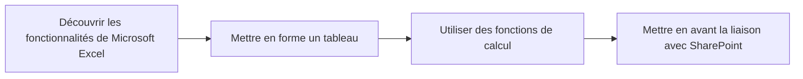

- Découvrir les fonctionnalités de Microsoft Excel
- Mettre en forme un tableau
- Utiliser des fonctions de calcul
- Mettre en avant la liaison avec SharePoint

### Page 2

#### Connaissances des notions de base d’Excel

#### Notions de base Excel

#### Classeur sous Excel

!!! note "À retenir"
    Créer un classeur Nouveau classeur À partir d’un modèle Ouvrir un classeur À partir des classeurs récents En recherchant le classeur Dans l’ordinateur Sur le réseau Visuel du support.

**Visuel externe**

- Créer un classeur
- Nouveau classeur
- À partir d’un modèle
- Ouvrir un classeur
- À partir des classeurs récents
- En recherchant le classeur
- Dans l’ordinateur
- Sur le réseau

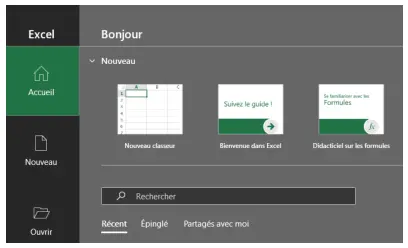

Visuel du support.

### Page 3

#### Limitation d’un classeur

**Visuel externe**

```mermaid
flowchart LR
    N1["Les limitations d’un classeur sont liées :"]
    N2["À l’ordinateur"]
    N3["Au système d’exploitation"]
    N4["Limitation d’un classeur :"]
    N5["Nombre de feuilles : 255"]
    N6["Les limitations d’une feuille sont :"]
    N7["Nombre de feuilles : 255"]
    N8["Nombre de lignes maximum : 10 148 576"]
    N1 --> N2
    N2 --> N3
    N3 --> N4
    N4 --> N5
    N5 --> N6
    N6 --> N7
    N7 --> N8
```

- Les limitations d’un classeur sont liées :
- À l’ordinateur
- Au système d’exploitation
- Limitation d’un classeur :
- Nombre de feuilles : 255
- Les limitations d’une feuille sont :
- Nombre de feuilles : 255
- Nombre de lignes maximum : 10 148 576
- Nombre de colonnes maximum : 16 384
- Nom des cellules va de A1 à XFD10148576
- Nom d’une feuille : 31 caractères maximum
- Nombre de caractères dans une cellule
- Texte : 32767 caractères
- Formule : 8192 caractères
- Chiffre : 11 caractères affichables Si le chiffre est plus long, affichage en écriture exponentielle

#### Calcul simple dans Excel

!!! note "À retenir"
    Calcul simple Excel ≈ calculatrice Opérateurs Classique - * / Ordre de calcul %, ^, * , / -, + Pourcentage, exposant, multiplication & division, soustraction & addition L’ordre peut être changé avec l’utilisation des parenthèses (calcul prioritaire) Visuel du support.

**Visuel externe**

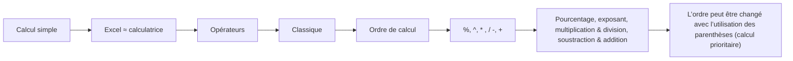

| Addition : + | Soustraction : - |
| --- | --- |

- Calcul simple
- Excel ≈ calculatrice
- Opérateurs
- Classique

| • + | Multiplication : * | Division : / |
| --- | --- | --- |

- -
- *
- /
- Ordre de calcul
- %, ^, * , / -, +
- Pourcentage, exposant, multiplication & division, soustraction & addition
- L’ordre peut être changé avec l’utilisation des parenthèses (calcul prioritaire)

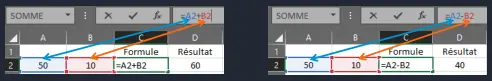

Visuel du support.

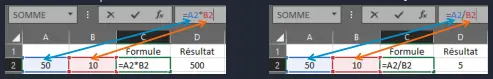

Visuel du support.

### Page 4

#### Connaissances des notions de base d’Excel

#### Les cellules

#### Cellules d’Excel

##### Référence de la cellule sélectionnée

- Les cellules
- Référencées par une ou plusieurs lettres (colonne) et un nombre (ligne)
- La première cellule : A1
- La dernière cellule : XFD10148576
- Modification des références
- La référence peut-être remplacée par un nom
- La zone « référence » est modifiable
- La liste des noms
- Accessible par le menu « Formules »
- Dans le gestionnaire de noms

| • | Nouveau nom |
| --- | --- |
| • | Modifier un nom |
| • | Supprimer un nom |

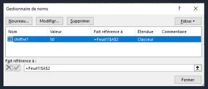

Visuel du support.

### Page 5

#### Cellules d’Excel

- Les pointeurs
- La croix blanche
- Sélectionner une cellule
- La référence est affichée
- Sélectionner plusieurs cellules
- Le nombre de colonnes et de lignes est affiché
- Éditer le contenu d’une cellule
- Par la barre de formule
- En double cliquant dans une cellule

- Les pointeurs
- La flèche blanche
- Apparaît en se positionnant sur le bord d’une cellule sélectionnée
- Permet de déplacer une cellule (contenu, formule, mise en forme)
- Curseur : flèche blanche + croix fléchée

##### Déplacement

!!! note "À retenir"
    Permet de copier une cellule + CTRL (contenu, formule,

- Permet de copier une cellule + CTRL (contenu, formule,

##### Copie

!!! note "À retenir"
    mise en forme) Curseur : flèche blanche + petite croix La croix noire Apparaît en se positionnant sur le petit carré en bas à droite Recopier la cellule (contenu, formule, mise en forme) Recopier en incrémentant la valeur de contenu si possible Visuel du support.

mise en forme)

- Curseur : flèche blanche + petite croix
- La croix noire
- Apparaît en se positionnant sur le petit carré en bas à droite
- Recopier la cellule (contenu, formule, mise en forme)
- Recopier en incrémentant la valeur de contenu si possible

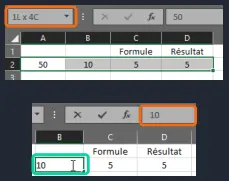

Visuel du support.

### Page 6

#### Cellules d’Excel

!!! note "À retenir"
    Les pointeurs Incrémentation En fonction des listes personnalisées Dans les « Options Excel » Menu « Options avancées » Modifier les listes personnalisées En sélectionnant deux cellules

- Les pointeurs
- Incrémentation
- En fonction des listes personnalisées
- Dans les « Options Excel »
- Menu « Options avancées »

| • | En bas du menu |
| --- | --- |

- Modifier les listes personnalisées
- En sélectionnant deux cellules

##### Pas de 5

!!! note "À retenir"
    Définir un pas de recopie Aperçu des valeurs lors de la recopie

- Définir un pas de recopie
- Aperçu des valeurs lors de la recopie

##### Aperçu de la valeur

#### Connaissances des notions de base d’Excel

#### Les fonctions

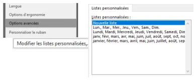

Visuel du support.

### Page 7

#### Fonctions Excel

!!! note "À retenir"
    Les fonctions d’Excel La liste des fonctions Excel Les catégories des fonctions Base de données Cube Date et Heure Finances Informations Ingénierie Logique Mathématiques et Trigonométrie Recherche et Référence Statistiques Texte Web Quelques fonctions à connaître Fonctions « Mathématiques »

- Les fonctions d’Excel
- La liste des fonctions Excel
- Les catégories des fonctions
- Base de données
- Cube
- Date et Heure
- Finances
- Informations
- Ingénierie
- Logique
- Mathématiques et Trigonométrie
- Recherche et Référence
- Statistiques
- Texte
- Web

- Quelques fonctions à connaître
- Fonctions « Mathématiques »

| alea() : Génère en nombre aléatoire entre 0 et 1 | Ex : = alea()*100 | Résultat : variable x 100 |  |
| --- | --- | --- | --- |
| arrondi() : Arrondit un nombre à X chiffre après la virgule | Ex : = arrondi(3,14159;2) | Résultat : 3,14 |  |
| • | arrondi.inf() |  |  |
| • | arronfi.sup() | Ex : = arrondi.inf(3,14159;3) | Résultat : 3,141 |
| Ex : = arrondi.sup(3,14159;3) | Résultat : 3,142 |  |  |
| ent() : Arrondit un nombre à l’entier inférieur | Ex : = ent(3,14159) | Résultat : 3 |  |
| produit() : Multiplie tous les nombres | Ex : = produit(B2:B3;2) | Résultat : (B2 x B3) x 2 |  |

##### Equivalent à *

| somme() : Additionne tous les nombres | Ex : = somme(B2:B3) | Résultat : B2 + B3 |
| --- | --- | --- |

##### Equivalent à +

| quotient() : Donne la partie entière du résultat d’une | Ex : = quotient(5;2) | Résultat : 5/2 = 2 |
| --- | --- | --- |

division

| mod() : Renvoie le reste d’une division | Ex : = mod(5;2) | Résultat : 1 |
| --- | --- | --- |

### Page 8

#### Fonctions Excel

- Quelques fonctions à connaître
- Fonctions « Texte »

| concat() : Assemble des chaînes de caractères | Ex : = concat("Hello";" ";"world") | Résultat : "Hello world" |
| --- | --- | --- |

##### Equivalent à « & »

| droite() : Extrait des caractères à partir de la droite | Ex : = droite(Hello;2) | Résultat : "lo" |
| --- | --- | --- |
| gauche() : Extrait des caractères à partir de la gauche | Ex : = gauche(Hello;4) | Résultat : "Hell" |
| majuscule() : Convertit la chaîne de caractères en majuscule | Ex : = majuscule(Hello) | Résultat : "HELLO" |
| minuscule() : Convertit la chaîne de caractères en minuscule | Ex : = minuscule(Hello) | Résultat : "hello" |
| nbcar() : Renvoie le nombre de caractères d’une chaîne de caractères | Ex : = nbcar("Hello world") | Résultat : 11 |
| texte() : Convertit un nombre en chaîne de caractères | Ex : = texte(17;12) | Résultat : "17,12" |
| cnum() : Convertit une chaîne de caractères chiffre en nombre | Ex : = cnum("17,12") | Résultat : 17,12 |

#### Fonctions Excel

- Quelques fonctions à connaître
- Fonctions « Recherche »

| colonne() : Renvoie le numéro de colonne | Ex : = colonne(E3) | Résultat : 5 |
| --- | --- | --- |
| ligne() : Renvoie le numéro de la ligne | Ex : = ligne(E3) | Résultat : 3 |
| recherchev() : Recherche une valeur dans un tableau puis | Ex : = recherchev(3;A2:E5;4) | Résultat : "Rennes" |

retourne une valeur dans une autre colonne sur la même ligne

| rechercheh() : Recherche une valeur dans un tableau puis | Ex : = rechercheh("Ville";A2:E5;3) | Résultat : "Rennes" |
| --- | --- | --- |

retourne une valeur dans une autre ligne sur la même colonne

| trouve() : Renvoie la position d’une chaîne de caractères | Ex : = trouve("o";C3) | Résultat : 8 |
| --- | --- | --- |

dans une chaîne de caractères

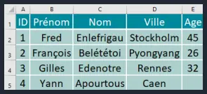

Visuel du support.

### Page 9

- Quelques fonctions à connaître
- Fonctions « Logique »

| si() : Retourne une valeur après avoir vérifié une | Ex : = SI(B5="Yann";Vrai;Faux) | Résultat : "Vrai" |
| --- | --- | --- |

ou plusieurs conditions

| et() : Permet d’effectuer un test avec plusieurs | Ex : = SI(ET(B4="Gilles";A4>2);"OK";"Anormal") Résultat : "Vrai" | Ex : = ET(A2<A5;A3<3) |
| --- | --- | --- |
| conditions à vérifier | Résultat : "OK" |  |

##### Toutes les conditions doivent être validées

| ou() : Permet d’effectuer un test avec plusieurs | Ex : = OU(B2="François";A3>=2) | Résultat : "Vrai" Résultat : |
| --- | --- | --- |
| conditions à vérifier. | Ex : = SI(OU(D3="Rennes";E1>50);"au moins une | "au moins une valeur est |

valeur est ok";"Faux")

| Une condition doit être validée | ok" |  |
| --- | --- | --- |
| sierreur() : Permet de gérer les erreurs | Ex : = SIERREUR(moy(E2:E5);"une valeur est | Résultat : "une valeur est NULL" |
| retournées par une fonction | NULL") |  |

#### Connaissances des notions de base d’Excel

#### Utilisation des fonctions

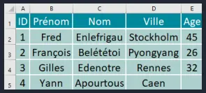

Visuel du support.

### Page 10

#### Les fonctions

- Trouver la fonction
- Choisir la cellule de destination du résultat
- Taper « = »
- Puis les premières lettres de la fonction
- Excel va vous proposer les fonctions contenant les caractères saisis
- En cliquant sur le nom des fonctions, vous avez un aperçu de la fonction

- Sélectionner la fonction par un double clic
- Une aide simplifiée sur la commande apparaît

| • Cliquer sur | pour obtenir de l’aide détaillée |
| --- | --- |

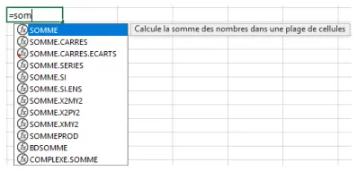

Visuel du support.

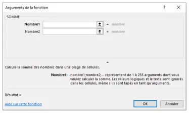

Visuel du support.

### Page 11

#### Recopie des fonctions

- Recopie de la formule vers d’autres cellules
- En utilisant la croix noire, recopie de toute la structure de la cellule
- Pour recopier seulement la formule, effectuer un copier-coller spécial avec le clic droit de la souris

- Recopie de la formule verticalement

| • Lors de la copie, la référence des cellules évolue | En cellule E2 : =somme(A2:D2) |
| --- | --- |
| • Copie vers la ligne suivante | En cellule E3 : =somme(A3:D3) |

- Recopie de la formule horizontalement

| • Lors de la copie, la référence des cellules évolue | En cellule A10 : =somme(A2:A9) |
| --- | --- |
| • Copie vers la ligne suivante | En cellule B10 : =somme(B2:B9) |

### Page 12

- Référence relative d’une cellule

| • « nom » normal | cellule A1 |
| --- | --- |

- Utilisable dans les formules
- Évolue lors de la recopie
- Référence absolue d’une cellule
- Nom contenant des symboles « $ »

cellule $A$1

- Utilisable dans les formules

| • | N’évolue pas lors de la recopie |
| --- | --- |
| • | Horizontalement |
| • | Verticalement |

- Référence absolue d’une ligne ou d’une colonne

##### Ligne absolue A$1

- Ligne absolue : $ devant les nombres
- Colonne absolue : $ devant les lettres

| • Utilisable dans les formules | Colonne absolue $A1 |
| --- | --- |
| • | Ne change pas la ligne ou la colonne |
| • | Horizontalement |
| • | Verticalement |

- Touche « F4 » pour le référencement absolu

#### Connaissances des notions de base d’Excel

#### Excel et SharePoint

### Page 13

#### Office et SharePoint

- Documents stockés sur SharePoint
- Sauvegarde automatique
- Gestion automatique des versions des documents
- Possibilité d’ouvrir une version antérieure
- Sans écrasement de la version courante
- Historique des personnes qui ont modifié le document À partir du nom du classeur, cliquer sur la petite flèche

##### À partir du menu « Fichier »

#### Connaissances des notions de base d’Excel

TP

##### Démo

##### Utilisation d’Excel

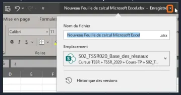

Visuel du support.

Référence du document : 1iMM4_v_Oj8W9fCRz_eZZfRFRLbyfCWKk · SHA-256 454b907751a8980a…

## Support · Clients - Document Fini · 4 pages transcrites

### Page 1

#### Liste des clients

Le tableau est nommé Clients.

| Code clients | Titre | Nom | Prénom | Adresse1 | CP | Ville | Pays | Total Achats |
| --- | --- | --- | --- | --- | --- | --- | --- | --- |
| BEUODEBRUBEL | Madame | BEUKELAERE | Odette | avenue de la Reine Astrid | 1000 | BRUXELLES | BELGIQUE | 31,00 € |
| BINJULNICFRA | Monsieur | BINOCHE | Julien | 56, place de la Victoire | 06100 | NICE | FRANCE | 39,00 € |
| CAIMICRENFRA | Monsieur | CAINE | Mickaël | 12, rue des Capucins | 35000 | RENNES | FRANCE | 16,50 € |
| CURARTLYOFRA | Monsieur | CURT | Arthur | 12, rue du Commerce | 69100 | LYON | FRANCE | 24,50 € |
| DESSOPRENFRA | Madame | DESVENTS | Sophie | 3, rue des Roches | 35000 | RENNES | FRANCE | 34,50 € |
| DUBJEANANFRA | Monsieur | DUBOIS | Jean | 10, impasse des Marguerites | 44000 | NANTES | FRANCE | 32,50 € |
| HOLSHENANFRA | Monsieur | HOLMES | Sherlock | 16, rue Mauduit | 44100 | NANTES | FRANCE | 57,50 € |
| HOUSÉBMARFRA | Monsieur | HOUDAN | Sébastien | 125, avenue Marceau | 13210 | MARSEILLE | FRANCE |  |
| IRVAMYNANFRA | Madame | IRVING | Amy | 17, rue Avenue Shining | 44300 | NANTES | FRANCE | 63,50 € |
| IZGBERLONGRA | Madame | IZGOUD | Bernadette | Spring Road | 675490 | LONDRES | GRANDE-BRETAGNE | 79,00 € |
| LAPMAXNANFRA | Monsieur | LAPORTE | Maxime | 34, rue des Cèdres | 44000 | NANTES | FRANCE | 33,50 € |
| LEVMARANGFRA | Madame | LEVASSEUR | Marthe | 15, rue de la Fauvette | 49000 | ANGERS | FRANCE | 19,00 € |
| PORJULNANFRA | Madame | PORTE | Juliette | 10, rue des Peupliers | 44400 | NANTES | FRANCE | 26,00 € |
| PREJEARENFRA | Madame | PREFFER | Jeanne | 24, rue de l'Evasion | 35000 | RENNES | FRANCE | 19,50 € |
| REGOTAGENSUI | Madame | REGION | Otalie | 10, avenue Fragmeht | 1212 | GENEVE | SUISSE | 42,00 € |
| WALEVANANFRA | Mademoiselle | WALKEN | Eva | 32, rue des Voyants | 44000 | NANTES | FRANCE | 55,00 € |
|  |  |  |  |  |  |  |  | 573,00 € |

### Page 2

#### Catalogue des produits

Le tableau est nommé Ouvrage.

| Code | Collection | Nom | Tome | Nom auteur | Prénom auteur | Prix | Ventes | % des ventes |
| --- | --- | --- | --- | --- | --- | --- | --- | --- |
| COLSUZHUNG1 | Hunger Games |  | Tome 1 | Collins | Suzanne | 17,00 € | 2 | 6% |
| COLSUZHUNG2 | Hunger Games | L'embrasement | Tome 2 | Collins | Suzanne | 17,00 € | 1 | 3% |
| COLSUZHUNG3 | Hunger Games | La révolte | Tome 3 | Collins | Suzanne | 17,50 € | 0 | 0% |
| DASJAMLABY1 | Labyrinthe | Le labyrinthe | Tome 1 | Dasher | James | 15,50 € | 3 | 9% |
| DASJAMLABY2 | Labyrinthe | La terre Brûlée | Tome 2 | Dasher | James | 16,00 € | 0 | 0% |
| DASJAMLABY3 | Labyrinthe | Le remède mortel | Tome 3 | Dasher | James | 16,50 € | 0 | 0% |
| GIEKERROUG1 | Rouge Rubis |  | Tome 1 | Gier | Kerstin | 13,50 € | 1 | 3% |
| GIEKERBLEU2 | Bleu Saphir |  | Tome 2 | Gier | Kerstin | 13,00 € | 3 | 9% |
| GIEKERVERT3 | Vert Emeraude |  | Tome 3 | Gier | Kerstin | 13,00 € | 2 | 6% |
| MARGEOGAME1 | Games of Throne | Intégrale 1 | Tome 1 | Martin | George R.R. | 19,00 € | 3 | 9% |
| MARGEOGAME2 | Games of Throne | Intégrale 2 | Tome 2 | Martin | George R.R. | 19,50 € | 2 | 6% |
| MARGEOGAME3 | Games of Throne | Intégrale 3 | Tome 3 | Martin | George R.R. | 19,50 € | 3 | 9% |
| MARGEOGAME4 | Games of Throne | Intégrale 4 | Tome 4 | Martin | George R.R. | 21,00 € | 2 | 6% |
| MARGEOGAME5 | Games of Throne | Intégrale 5 | Tome 5 | Martin | George R.R. | 21,00 € | 1 | 3% |
| PAOCHRERAG1 | Eragon |  | Tome 1 | Paolini | Christopher | 12,00 € | 2 | 6% |
| PAOCHRERAG2 | Eragon | L'aîné | Tome 2 | Paolini | Christopher | 12,50 € | 1 | 3% |
| PAOCHRERAG3 | Eragon | Brisingr | Tome 3 | Paolini | Christopher | 13,00 € | 0 | 0% |
| PAOCHRERAG4 | Eragon | L'héritage | Tome 4 | Paolini | Christopher | 14,00 € | 0 | 0% |
| ROTVERDIVE1 | Divergente |  | Tome 1 | Roth | Veronica | 14,50 € | 2 | 6% |
| ROTVERDIVE2 | Divergente |  | Tome 2 | Roth | Veronica | 14,50 € | 1 | 3% |
| ROTVERDIVE3 | Divergente |  | Tome 3 | Roth | Veronica | 15,00 € | 1 | 3% |
| ALDJUSMISÉ | Miséricorde |  |  | Alder-Olsen | Jussi | 16,50 € | 2 | 6% |
| ALDJUSPROF | Profanation |  |  | Alder-Olsen | Jussi | 17,00 € | 2 | 6% |
| ALDJUSDÉLI | Délivrance |  |  | Alder-Olsen | Jussi | 17,50 € | 1 | 3% |
| ALDJUSDOSS | Dossier 64 |  |  | Alder-Olsen | Jussi | 18,00 € | 0 | 0% |
| ALDJUSL'EF | L'effet papillon |  |  | Alder-Olsen | Jussi | 19,00 € | 0 | 0% |
| ALDJUSPROM | Promesse |  |  | Alder-Olsen | Jussi | 20,00 € | 0 | 0% |

### Page 3

#### Liste des produits vendus

Le tableau est nommé Achats.

| Numéro de la commande | Date de la commande | Code clients | Nom et Prénom | Produits | Titre et Tome | Montant TTC | Total de la commande |
| --- | --- | --- | --- | --- | --- | --- | --- |
| 210107CAIMICRENFRA | 07/01/2021 | CAIMICRENFRA | CAINE Mickaël | ALDJUSMISÉ | Miséricorde | 16,50 | 16,50 |
| 210107DESSOPRENFRA | 07/01/2021 | DESSOPRENFRA | DESVENTS Sophie | ALDJUSPROF | Profanation | 17,00 |  |
| 210107DESSOPRENFRA | 07/01/2021 | DESSOPRENFRA | DESVENTS Sophie | ALDJUSDÉLI | Délivrance | 17,50 | 34,50 |
| 210115IZGBERLONGRA | 15/01/2021 | IZGBERLONGRA | IZGOUD Bernadette | MARGEOGAME1 | Games of Throne 1 | 19,00 |  |
| 210115IZGBERLONGRA | 15/01/2021 | IZGBERLONGRA | IZGOUD Bernadette | MARGEOGAME2 | Games of Throne 2 | 19,50 | 38,50 |
| 210120WALEVANANFRA | 20/01/2021 | WALEVANANFRA | WALKEN Eva | GIEKERROUG1 | Rouge Rubis 1 | 13,50 |  |
| 210120WALEVANANFRA | 20/01/2021 | WALEVANANFRA | WALKEN Eva | GIEKERBLEU2 | Bleu Saphir 2 | 13,00 |  |
| 210120WALEVANANFRA | 20/01/2021 | WALEVANANFRA | WALKEN Eva | GIEKERVERT3 | Vert Emeraude 3 | 13,00 | 39,50 |
| 210122LAPMAXNANFRA | 22/01/2021 | LAPMAXNANFRA | LAPORTE Maxime | ALDJUSMISÉ | Miséricorde | 16,50 |  |
| 210122LAPMAXNANFRA | 22/01/2021 | LAPMAXNANFRA | LAPORTE Maxime | ALDJUSPROF | Profanation | 17,00 | 33,50 |
| 210125LEVMARANGFRA | 25/01/2021 | LEVMARANGFRA | LEVASSEUR Marthe | MARGEOGAME1 | Games of Throne 1 | 19,00 | 19,00 |
| 210125BINJULNICFRA | 25/01/2021 | BINJULNICFRA | BINOCHE Julien | MARGEOGAME2 | Games of Throne 2 | 19,50 |  |
| 210125BINJULNICFRA | 25/01/2021 | BINJULNICFRA | BINOCHE Julien | MARGEOGAME3 | Games of Throne 3 | 19,50 | 39,00 |
| 210130CURARTLYOFRA | 30/01/2021 | CURARTLYOFRA | CURT Arthur | PAOCHRERAG1 | Eragon 1 | 12,00 |  |
| 210130CURARTLYOFRA | 30/01/2021 | CURARTLYOFRA | CURT Arthur | PAOCHRERAG2 | Eragon 2 | 12,50 | 24,50 |
| 210201IRVAMYNANFRA | 01/02/2021 | IRVAMYNANFRA | IRVING Amy | COLSUZHUNG1 | Hunger Games 1 | 17,00 |  |
| 210201IRVAMYNANFRA | 01/02/2021 | IRVAMYNANFRA | IRVING Amy | COLSUZHUNG2 | Hunger Games 2 | 17,00 | 34,00 |
| 210206DUBJEANANFRA | 06/02/2021 | DUBJEANANFRA | DUBOIS Jean | COLSUZHUNG1 | Hunger Games 1 | 17,00 |  |
| 210206DUBJEANANFRA | 06/02/2021 | DUBJEANANFRA | DUBOIS Jean | DASJAMLABY1 | Labyrinthe 1 | 15,50 | 32,50 |
| 210206WALEVANANFRA | 06/02/2021 | WALEVANANFRA | WALKEN Eva | DASJAMLABY1 | Labyrinthe 1 | 15,50 | 15,50 |
| 210206BEUODEBRUBEL | 06/02/2021 | BEUODEBRUBEL | BEUKELAERE Odette | MARGEOGAME1 | Games of Throne 1 | 19,00 |  |
| 210206BEUODEBRUBEL | 06/02/2021 | BEUODEBRUBEL | BEUKELAERE Odette | PAOCHRERAG1 | Eragon 1 | 12,00 | 31,00 |
| 210208HOLSHENANFRA | 08/02/2021 | HOLSHENANFRA | HOLMES Sherlock | DASJAMLABY1 | Labyrinthe 1 | 15,50 |  |
| 210208HOLSHENANFRA | 08/02/2021 | HOLSHENANFRA | HOLMES Sherlock | GIEKERBLEU2 | Bleu Saphir 2 | 13,00 |  |
| 210208HOLSHENANFRA | 08/02/2021 | HOLSHENANFRA | HOLMES Sherlock | ROTVERDIVE1 | Divergente 1 | 14,50 | 43,00 |
| 210210HOLSHENANFRA | 10/02/2021 | HOLSHENANFRA | HOLMES Sherlock | ROTVERDIVE1 | Divergente 1 | 14,50 | 14,50 |
| 210210IRVAMYNANFRA | 10/02/2021 | IRVAMYNANFRA | IRVING Amy | ROTVERDIVE2 | Divergente 2 | 14,50 |  |
| 210210IRVAMYNANFRA | 10/02/2021 | IRVAMYNANFRA | IRVING Amy | ROTVERDIVE3 | Divergente 3 | 15,00 | 29,50 |
| 210215IZGBERLONGRA | 15/02/2021 | IZGBERLONGRA | IZGOUD Bernadette | MARGEOGAME3 | Games of Throne 3 | 19,50 |  |
| 210215IZGBERLONGRA | 15/02/2021 | IZGBERLONGRA | IZGOUD Bernadette | MARGEOGAME4 | Games of Throne 4 | 21,00 | 40,50 |
| 210215PREJEARENFRA | 15/02/2021 | PREJEARENFRA | PREFFER Jeanne | MARGEOGAME3 | Games of Throne 3 | 19,50 | 19,50 |
| 210215REGOTAGENSUI | 15/02/2021 | REGOTAGENSUI | REGION Otalie | MARGEOGAME4 | Games of Throne 4 | 21,00 |  |
| 210215REGOTAGENSUI | 15/02/2021 | REGOTAGENSUI | REGION Otalie | MARGEOGAME5 | Games of Throne 5 | 21,00 | 42,00 |
| 210220PORJULNANFRA | 20/02/2021 | PORJULNANFRA | PORTE Juliette | GIEKERBLEU2 | Bleu Saphir 2 | 13,00 |  |
| 210220PORJULNANFRA | 20/02/2021 | PORJULNANFRA | PORTE Juliette | GIEKERVERT3 | Vert Emeraude 3 | 13,00 | 26,00 |
|  |  |  |  |  |  | 573,00 € | 573,00 € |

### Page 4

#### Total des ventes par clients

Feuille 3.

| Nom et Prénom | Somme de Montant TTC |
| --- | --- |
| BEUKELAERE Odette | 31,00 |
| BINOCHE Julien | 39,00 |
| CURT Arthur | 24,50 |
| DESVENTS Sophie | 34,50 |
| DUBOIS Jean | 32,50 |
| HOLMES Sherlock | 57,50 |
| IRVING Amy | 63,50 |
| IZGOUD Bernadette | 79,00 |
| LAPORTE Maxime | 33,50 |
| PORTE Juliette | 26,00 |
| PREFFER Jeanne | 19,50 |
| REGION Otalie | 42,00 |
| WALKEN Eva | 55,00 |
| CAINE Mickaël | 16,50 |
| LEVASSEUR Marthe | 19,00 |
| Total général | 573,00 |

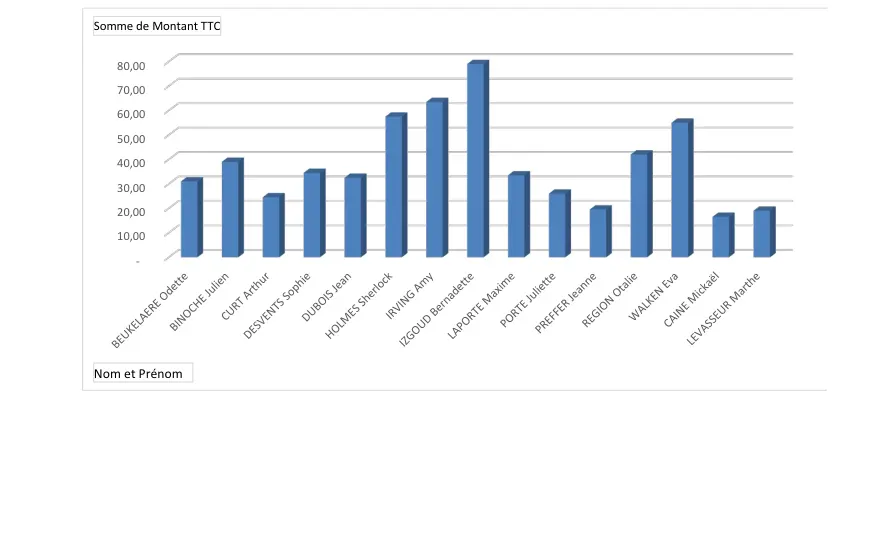

Somme de Montant TTC.

Référence du document : 12QGYWriIVavMocVlQ6I_tEbRz288mcjC · SHA-256 9a86ba62d2ce7f29…
