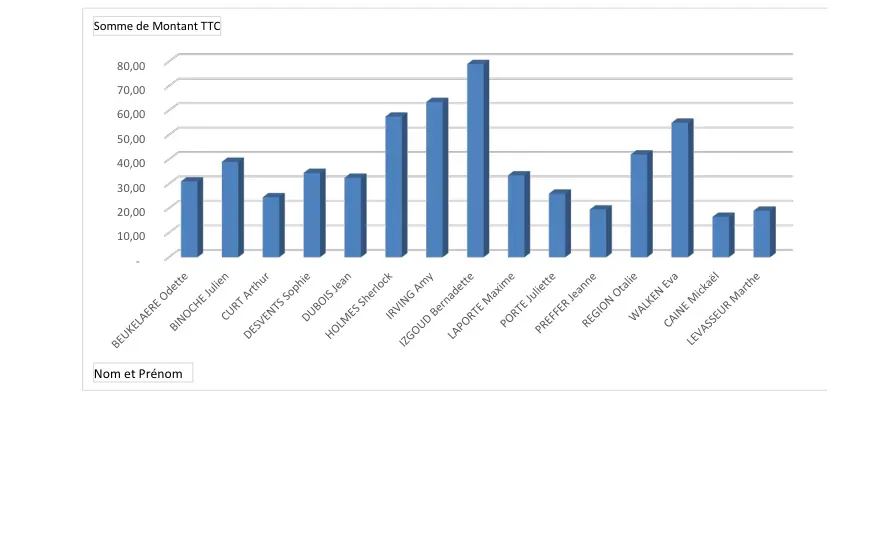

# Module 03 — Connaissances des notions de base d’Excel

**Séquence :** Microsoft 365 — Outils collaboratifs  
**Rôle dans le parcours :** manipuler un classeur, ses fonctions et son lien avec SharePoint, puis réaliser le TP Clients.

## Objectifs

- Découvrir les fonctionnalités de Microsoft Excel.
- Mettre en forme un tableau.
- Utiliser des fonctions de calcul.
- Mettre en avant la liaison avec SharePoint.

## 1. Classeur

On crée un classeur neuf ou à partir d’un modèle. On ouvre un classeur récent, ou on le recherche dans l’ordinateur ou sur le réseau.

### Limites indiquées par le support

Les limites d’un classeur sont liées à l’ordinateur et au système d’exploitation.

| Élément | Valeur du support |
|---|---|
| Nombre de feuilles d’un classeur | 255 |
| Nombre de feuilles (rappel dans les limites d’une feuille) | 255 |
| Lignes maximum | 10 148 576 |
| Colonnes maximum | 16 384 |
| Plage des noms de cellules | A1 à XFD10148576 |
| Nom d’une feuille | 31 caractères maximum |
| Texte dans une cellule | 32 767 caractères |
| Formule | 8 192 caractères |
| Chiffre affichable | 11 caractères, puis écriture exponentielle |

!!! info "Complément externe au cours"
    La documentation actuelle d’Excel indique 1 048 576 lignes et une dernière cellule XFD1048576. Ce module retient les valeurs écrites dans le support : 10 148 576 et XFD10148576.

## 2. Calcul simple

Excel est présenté comme une calculatrice. Opérateurs classiques : `+`, `-`, `*`, `/`. Ordre annoncé : `%`, `^`, `*`, `/`, `-`, `+` (pourcentage, exposant, multiplication et division, soustraction et addition). Les parenthèses rendent un calcul prioritaire.

## 3. Cellules, noms et pointeurs

Une cellule est référencée par une ou plusieurs lettres de colonne et un nombre de ligne. La première est A1, la dernière XFD10148576. La zone de référence est modifiable : un nom peut remplacer la référence. La liste des noms est dans le menu Formules, gestionnaire de noms : nouveau nom, modifier, supprimer.

| Pointeur | Où il apparaît | Effet |
|---|---|---|
| Croix blanche | Sur une cellule | Sélectionne. La référence s’affiche. Plusieurs cellules : le nombre de colonnes et de lignes s’affiche. |
| Édition | Barre de formule, ou double-clic | Modifie le contenu. |
| Flèche blanche | Bord d’une cellule sélectionnée | Déplace contenu, formule et mise en forme. Le curseur montre la flèche et une croix fléchée. |
| Flèche blanche et petite croix, avec Ctrl | Même bord | Copie contenu, formule et mise en forme. |
| Croix noire | Petit carré en bas à droite | Recopie contenu, formule et mise en forme, en incrémentant la valeur si c’est possible. |

L’incrémentation suit les listes personnalisées : Options Excel, Options avancées, en bas du menu. En sélectionnant deux cellules, on définit un pas de recopie (le support illustre un pas de 5) et un aperçu des valeurs.

## 4. Fonctions à connaître

Catégories listées : Base de données, Cube, Date et Heure, Finances, Informations, Ingénierie, Logique, Mathématiques et Trigonométrie, Recherche et Référence, Statistiques, Texte, Web.

Les noms ci-dessous sont ceux du support, en français et en minuscules.

### Mathématiques

| Fonction | Rôle | Exemple du support | Résultat annoncé |
|---|---|---|---|
| `alea()` | Nombre aléatoire entre 0 et 1 | `=alea()*100` | variable × 100 |
| `arrondi()` | Arrondit à X chiffres après la virgule | `=arrondi(3,14159;2)` | 3,14 |
| `arrondi.inf()` | Arrondi vers le bas | `=arrondi.inf(3,14159;3)` | 3,141 |
| `arronfi.sup()` | Libellé du support à côté de l’exemple `=arrondi.sup(3,14159;3)` | cet exemple | 3,142 |
| `ent()` | Entier inférieur | `=ent(3,14159)` | 3 |
| `produit()` | Multiplie les nombres, équivalent de `*` | `=produit(B2:B3;2)` | (B2 × B3) × 2 |
| `somme()` | Additionne, équivalent de `+` | `=somme(B2:B3)` | B2 + B3 |
| `quotient()` | Partie entière d’une division | `=quotient(5;2)` | 2 |
| `mod()` | Reste d’une division | `=mod(5;2)` | 1 |

!!! warning "Attention"
    Le support écrit le libellé `arronfi.sup()` et, sur la ligne d’exemple, `=arrondi.sup(3,14159;3)`. Les deux graphies sont dans la diapositive. L’exemple à retenir pour le résultat 3,142 est `arrondi.sup`.

### Texte

| Fonction | Exemple | Résultat |
|---|---|---|
| `concat()`, équivalent de `&` | `=concat("Hello";" ";"world")` | Hello world |
| `droite()` | `=droite(Hello;2)` | lo |
| `gauche()` | `=gauche(Hello;4)` | Hell |
| `majuscule()` | `=majuscule(Hello)` | HELLO |
| `minuscule()` | `=minuscule(Hello)` | hello |
| `nbcar()` | `=nbcar("Hello world")` | 11 |
| `texte()` | `=texte(17;12)` | 17,12 |
| `cnum()` | `=cnum("17,12")` | 17,12 |

### Recherche

| Fonction | Exemple | Résultat |
|---|---|---|
| `colonne()` | `=colonne(E3)` | 5 |
| `ligne()` | `=ligne(E3)` | 3 |
| `recherchev()` | `=recherchev(3;A2:E5;4)` | Rennes |
| `rechercheh()` | `=rechercheh("Ville";A2:E5;3)` | Rennes |
| `trouve()` | `=trouve("o";C3)` | 8 |

### Logique

| Fonction | Règle | Exemple | Résultat annoncé |
|---|---|---|---|
| `si()` | Valeur selon une ou plusieurs conditions | `=SI(B5="Yann";Vrai;Faux)` | Vrai |
| `et()` | Toutes les conditions doivent être validées | `=SI(ET(B4="Gilles";A4>2);"OK";"Anormal")` et `=ET(A2<A5;A3<3)` | OK, puis Vrai |
| `ou()` | Une condition doit être validée | `=OU(B2="François";A3>=2)` et `=SI(OU(D3="Rennes";E1>50);"au moins une valeur est ok";"Faux")` | Vrai, puis « au moins une valeur est ok » |
| `sierreur()` | Gère l’erreur renvoyée par une fonction | `=SIERREUR(moy(E2:E5);"une valeur est NULL")` | une valeur est NULL |

### Saisir et recopier

1. Choisir la cellule du résultat.
2. Taper `=`, puis les premières lettres : Excel propose les fonctions qui les contiennent.
3. Un clic sur le nom donne un aperçu. Un double-clic sélectionne la fonction. Une aide simplifiée apparaît ; un clic sur l’aide ouvre le détail.

La croix noire recopie toute la structure. Pour ne recopier que la formule : copier-coller spécial, clic droit.

| Sens | Avant | Après |
|---|---|---|
| Vers la ligne suivante | En E2 : `=somme(A2:D2)` | En E3 : `=somme(A3:D3)` |
| Vers la colonne suivante | En A10 : `=somme(A2:A9)` | En B10 : `=somme(B2:B9)` |

| Référence | Écriture | Comportement à la recopie |
|---|---|---|
| Relative | A1 | Évolue. |
| Absolue | $A$1 | N’évolue ni horizontalement ni verticalement. |
| Ligne absolue | A$1 | Le numéro de ligne ne change pas. Le `$` est devant le nombre. |
| Colonne absolue | $A1 | La lettre ne change pas. Le `$` est devant la lettre. |

La touche **F4** passe au référencement absolu.

## 5. Excel et SharePoint

Pour un document stocké sur SharePoint, le support décrit la sauvegarde automatique, la gestion automatique des versions, l’ouverture d’une version antérieure sans écraser la version courante, et l’historique des personnes qui ont modifié le document. On y accède par la petite flèche à côté du nom du classeur, ou par le menu Fichier.

## 6. TP — Utilisation d’Excel

**Durée :** 60 à 90 minutes. Avoir suivi les vidéos du module.  
**Objectif :** fonctions, graphique et tableau.  
**Prérequis :** récupérer « Clients – Document Brut.docx » et « Clients – Document Fini.pdf », le résultat attendu.

Le classeur fini nomme trois tableaux : **Clients**, **Ouvrage** et **Achats**. La feuille 3 s’intitule « Total des ventes par clients ». HOUDAN Sébastien n’a pas de total achats affiché ; le total général des autres clients est 573,00 €.

### Pas-à-pas de l’énoncé

1. **Liste des clients — Codes clients.** Composer le code avec Nom, Prénom, Ville et Pays, en `majuscule()`, `gauche()` et `concatener()` ou `&`.
2. **Catalogue des produits — Code ouvrage.** Nom-Auteur, Prénom-Auteur, Collection et Tome, avec `majuscule()`, `gauche()`, `droite()` et `&`.
3. **Liste des produits vendus — Numéro de la commande.** Date de la commande et Code clients. Si l’une des deux colonnes est vide, n’afficher rien. Fonctions : `droite()`, `annee()`, `mois()`, `jour()`, `si()`, `ou()`, `&`.
4. **Nom et Prénom.** Colonnes Nom et Prénom du tableau Clients, via `recherchev()` et `&`.
5. **Titre et Tome.** Collection et Tome du tableau Ouvrage, via `recherchev()`, `&` et `droite()`.
6. **Montant TTC.** Prix du tableau Ouvrage, via `recherchev()`.
7. **Total de la commande.** Si le code client est identique à celui de la ligne du dessous, laisser vide, sinon calculer. Fonctions : `si()`, `ou()`, `somme.si.ens()`.
8. **Ventes.** Compter les articles à partir de Produits (Achats) et des codes Ouvrage, avec `nb.si.ens()`.
9. **% des ventes.** À partir de la colonne Ventes, avec `somme()`.
10. **Total des ventes par clients.** Tableau croisé dynamique depuis Liste des produits vendus : Nom et Prénom en ligne, somme de Montant TTC en valeurs. Puis un graphique croisé dynamique, histogramme groupé 3D.
11. **Total Achats** sur Liste des clients, depuis le tableau croisé, par Nom et Prénom. En cas d’erreur, la cellule reste vide : `recherchev()` et `sierreur()`.

### Correction : formules du support

Code client, puis étirer vers le bas :

```
=MAJUSCULE(GAUCHE(D6;3)&GAUCHE(E6;3)&GAUCHE(H6;3)&GAUCHE(I6;3))
```

Code ouvrage (3 ou 4 premiers caractères, et le dernier caractère du tome) :

```
=MAJUSCULE(GAUCHE(F7;3)&GAUCHE(G7;3)&GAUCHE(C7;4)&DROITE(E7;1))
```

Numéro de commande. La formule simple `=DROITE(ANNEE(C6);2)&MOIS(C6)&JOUR(C6)&D6` n’ajoute pas le zéro des mois et jours inférieurs à 10. La correction ajoute les tests, puis le cas des cellules vides :

```
=SI(OU(C8="";D8="");"";DROITE(ANNEE(C8);2)&SI(MOIS(C8)>9;MOIS(C8);"0"&MOIS(C8))&SI(JOUR(C8)>9;JOUR(C8);"0"&JOUR(C8))&D8)
```

Nommer le tableau Clients depuis le menu indiqué par la correction, puis :

```
=RECHERCHEV(D6;Clients;3;FAUX)&" "&RECHERCHEV(D6;Clients;4;FAUX)
```

Titre et tome. Le nom de feuille conserve l’espace final écrit dans la correction :

```
=RECHERCHEV('Liste des produits vendus '!F6;Ouvrage;2;FAUX)&" "&DROITE(RECHERCHEV('Liste des produits vendus '!F6;Ouvrage;4;FAUX);1)
```

Montant TTC, puis la même recherche protégée :

```
=RECHERCHEV(F6;Ouvrage;7;FAUX)
=SIERREUR(RECHERCHEV(F6;Ouvrage;7;FAUX);"")
```

Total de commande : si la cellule du dessous a le même code, ou si le montant est vide, ne rien afficher. Sinon `SOMME.SI.ENS` sur le numéro de commande :

```
=SI(OU(B7=B8;H7="");"";SOMME.SI.ENS(Montant;Commande;B7))
```

Ventes et pourcentage (référence absolue sur la colonne des ventes) :

```
=NB.SI.ENS(produits;B7)
=I7/SOMME($I$7:$I$33)
```

Tableau croisé : indiquer le champ demandé (la correction dit « Indiquez Vendus »), puis Nombre de Montant et les paramètres de champ. Insertion, Graphique croisé dynamique, histogramme groupé 3D.

Total achats, recherche sur la concaténation Nom et Prénom, comparée au tableau croisé, colonne J :

```
=SIERREUR((RECHERCHEV(D6&" "&E6;'Total des ventes par clients'!$B$3:$C$19;2;FAUX));"")
```



<p class="tssr-caption">Capture du support — histogramme du classeur fini.</p>

## Résumé

Un classeur se limite par les valeurs du support. Les pointeurs distinguent sélection, déplacement, copie et recopie incrémentée. Les fonctions du module couvrent le calcul, le texte, la recherche et la logique. `F4` fige une référence. SharePoint ajoute versions et historique. Le TP Clients enchaîne codes, recherches, totaux conditionnels, tableau croisé et graphique.

## Mini-quiz

1. Quelle est la dernière cellule citée par le support ?
2. Que fait la croix noire de plus que la copie avec Ctrl ?
3. Pourquoi la formule simple du numéro de commande est-elle insuffisante pour le mois de janvier ?
4. Que signifie `$A$1` à la recopie ?
5. Quelle fonction empêche d’afficher une erreur de `RECHERCHEV` dans Total Achats ?

??? note "Réponses du mini-quiz"
    1. XFD10148576. Le support indique aussi 10 148 576 lignes et 16 384 colonnes.
    2. Elle recopie en incrémentant la valeur quand c’est possible, selon les listes personnalisées ou le pas défini.
    3. `MOIS` et `JOUR` renvoient un seul chiffre sous 10. La correction préfixe un 0 avec `SI`.
    4. La colonne et la ligne restent fixes.
    5. `SIERREUR`, avec une chaîne vide comme valeur de remplacement.

- [Fiche de révision](../../revision/microsoft-365/module-03-connaissances-des-notions-de-base-d-excel.md)
- [Énoncé du TP](../../tp/microsoft-365/module-03/enonces.md)
- [Kahoot du module](../../kahoot/03-microsoft-365-outils-collaboratifs-03-connaissances-des-notions-de-base-d-excel.md)
- [Présentation de la séquence](index.md)
