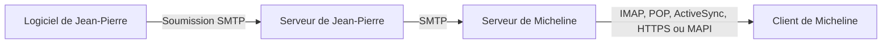

# Module 04 — Exploiter Outlook et savoir le dépanner

**Séquence :** Microsoft 365 — Outils collaboratifs  
**Rôle dans le parcours :** suivre un message de l’expéditeur au destinataire, paramétrer Outlook, puis le dépanner.

## Objectifs

- Comprendre le cheminement d’un e-mail.
- Connaître l’utilisation des outils de communication asynchrone.
- Paramétrer un logiciel de messagerie.

## 1. Du courrier papier au courriel

Le support suit une lettre de **Jean-Pierre, à Nantes**, vers **Micheline, à Rennes**.

1. Jean-Pierre écrit la lettre.
2. Le facteur vient la chercher.
3. Il la remet au bureau de poste local de Jean-Pierre.
4. Ce bureau l’envoie au centre de tri de Nantes.
5. Le centre de tri de Nantes l’envoie au centre de tri de Rennes.
6. Le centre de tri de Rennes l’envoie au bureau de poste local de Micheline.
7. Le facteur de Micheline lui remet la lettre.
8. Micheline la prend dans sa boîte aux lettres et la lit.

Le même scénario devient un courriel, avec l’exemple « Bonjour Micheline, réunion mercredi de 15 h à 16 h ».

1. Jean-Pierre écrit le message dans Outlook, Thunderbird ou un autre logiciel.
2. Le serveur de Jean-Pierre va chercher le message dans la boîte d’envoi (**soumission SMTP**) et en garde une copie dans les éléments envoyés.
3. Ce serveur envoie le message au serveur de Micheline (**SMTP**).
4. Le client de Micheline télécharge le message dans la boîte de réception : **IMAP, POP, ActiveSync, HTTPS, MAPI**, etc.

**Illustration IA / externe au cours — les quatre temps du courriel.**

## 2. Ports à ouvrir

Tous les ports nécessaires doivent être ouverts sur le pare-feu.

| Protocole | Port non sécurisé | Port TLS/SSL |
|---|---|---|
| HTTP, Hypertext Transfer Protocol | 80 | 443 |
| POP3, Post Office Protocol | 110 | 995 |
| IMAP4, Interactive Message Access Protocol | 143 | 993 |
| SMTP, Simple Mail Transfer Protocol | 25 | — |
| Soumission client SMTP | 2525 | 587 ou 2525 (465 déprécié) |

## 3. Installer et laisser Autodiscover configurer

Se connecter à `https://portal.office.com`. Le support illustre la validation d’une adresse de récupération, `micheline@campus-eni.fr`, et un code `785245`, puis le paramétrage du compte.

**Autodiscover** est l’autoconfiguration d’Outlook avec un serveur de messagerie à partir de l’adresse de courriel. Le support la date d’Outlook 2007 et du client Skype for Business.

1. L’utilisateur entre son adresse à l’ouverture d’Outlook.
2. Outlook cherche le serveur de messagerie et s’y connecte.
3. Le client envoie l’adresse SMTP pour obtenir les options de cette adresse.
4. Un fichier `.xml` est téléchargé avec les paramètres.
5. Outlook se connecte à Exchange Online dans Microsoft 365 et peut recevoir les messages.

Test : **Ctrl + clic droit** sur l’icône Outlook dans la zone de notification. Le menu affiche alors État de la connexion et Tester la configuration automatique de la messagerie. Sans la touche Ctrl, ces commandes n’apparaissent pas. Le support compare les deux menus et montre un test pour `micheline@campus-eni.fr`.

Codes HTTP du test : 1xx information, 2xx succès, 3xx redirection, 4xx erreur du client, 5xx erreur du serveur.

## 4. Trois Outlook, une interface

| | Outlook 365 | Outlook Online | Outlook 2019 |
|---|---|---|---|
| Installation | Sur le PC | Navigateur | Sur le PC |
| Hors connexion | Fichier `.ost` | Connexion Internet nécessaire | Fichier `.ost` |
| Offre | Payant avec l’offre Office de Microsoft 365 | — | Payant avec le pack Office |
| Limites citées | Mises à jour de fonctionnalité et de sécurité | Ne gère pas de contact externe tel que Gmail ou Yahoo | Ne prend pas en charge de compte IMAP ; mises à jour de sécurité |
| Fonctions | Toutes celles de sa version | — | Toutes celles disponibles pour sa version |

Outlook gère la messagerie, les rendez-vous, les réunions, les contacts et les tâches.

L’interface comprend la barre de titre, le ruban, les volets (calendrier, lecture, contacts, tâches), le volet des dossiers et la barre de navigation des dossiers.

| Fonction | Effet |
|---|---|
| Outlook aujourd’hui | Rendez-vous, nombre de messages reçus, liste des tâches. |
| Affichage en conversations | Regroupe les messages de même objet. |
| Réponse automatique | Message ou alerte pendant une absence. |
| Barre d’infos-courrier | Disponibilité des destinataires à la rédaction. Le support cite `Jpierre@campus-eni.fr`. |
| Règle | Condition, action, exception : ranger, prioriser, classer. |
| Rappel | Supprimer les copies non lues, ou les supprimer et les remplacer par un nouveau message. |

## 5. Calendrier, tâches, catégories, archivage

| Élément | Définition du support |
|---|---|
| Rendez-vous | Bloque une plage horaire. |
| Réunion | Invite des utilisateurs et des ressources (salles, matériels). |
| Événement | Ne bloque pas de temps et dure au minimum la journée. |
| Groupe de calendriers | Affiche plusieurs calendriers ensemble, ou les fusionne. |
| Tâche | Action à mener, attribuée par soi ou par autrui, avec priorité et suivi. |
| Élément | Message, rendez-vous, tâche, réunion… |
| Catégorie | Classe et priorise. Une règle peut l’affecter selon des conditions. Le support montre la catégorie « congés ». |

Quand la boîte devient trop grande, les messages partent dans une boîte d’archivage, avec l’archivage automatique.

### Raccourcis du support

Le support renvoie à la page Microsoft des raccourcis Outlook : [raccourcis clavier pour Outlook](https://support.microsoft.com/fr-fr/office/raccourcis-clavier-pour-outlook-3cdeb221-7ae5-4c1d-8c1d-9e63216c1efd).

| Action | Raccourci |
|---|---|
| Fermer une fenêtre ou un menu | Échap |
| Onglet Accueil | Alt + H |
| Créer un message | Ctrl + Maj + M |
| Envoyer | Alt + S |
| Insérer un fichier | Alt + N, A, F |
| Nouvelle tâche | Ctrl + Maj + K |
| Supprimer l’élément sélectionné | Supprimer |
| Rechercher | Ctrl + E ou F3 |
| Répondre | Alt + H, R, P |
| Transférer | Alt + H, F, W |
| Répondre à tous | Alt + H, R, A |
| Onglet Envoyer/recevoir | Alt + J, S |
| Calendrier | Ctrl + 2 |
| Créer un rendez-vous | Ctrl + Maj + A |
| Enregistrer sous, onglet pièces jointes | Alt + J, A, A, V |
| Vérifier les nouveaux courriers | Ctrl + M ou F9 |

## 6. Dépanner

| Outil | Ce que le support en fait |
|---|---|
| [testconnectivity.microsoft.com](https://testconnectivity.microsoft.com/) | Teste les accès externes de l’infrastructure Exchange. |
| Outlook sur le web | Valide le couple identifiant et mot de passe. |
| Journalisation | Récupère les informations sur les erreurs de connexion. Le support montre `C:\Users\micheline\AppData\Local\Temp\Journalisation d’Outlook` et rappelle de la désactiver ensuite. |
| Mode hors connexion | Diagnostique les performances réseau et propose une solution en cas de coupure. |
| Mode sans échec | Démarre sans les modules complémentaires et peut réparer certains démarrages. |
| Modules complémentaires | Désactiver ceux qui sont inutiles ou trop gourmands. |
| État de la connexion | Ctrl + clic droit sur l’icône. Le support y montre plusieurs adresses, dont `micheline@campus-eni.fr`, `micheline.JP@campus-eni.fr`, `micheline@eni-ecole.fr` et `compta@campus-eni.fr`. |
| Nouveau profil | Outlook fermé : supprimer le profil, rouvrir, laisser Autodiscover reconfigurer. |
| Paramètres du compte | Fichiers de configuration de chaque compte. |
| `.pst` | Personal Storage Table. Messages de certains logiciels Microsoft. Sans Exchange (POP3, IMAP4…), messages, calendrier et autres éléments sont dans un `.pst` local. |
| `.ost` | Offline Storage Table. Données hors connexion. Avec Exchange, messages, calendrier et autres éléments restent sur le serveur. |
| Taille | MaxFileSize 50 Go, taille maximale absolue. WarnFileSize 47,5 Go : au-delà, des processus internes peuvent encore écrire. |
| `SCANPST.EXE` | Analyse et corrige le fichier de données. Le support cite aussi `MicrosoftEasyFix20101.mini.diagcab` et les articles support `kb/272227` et `kb/2768656`. |
| Nombre d’éléments | Propriétés de la boîte, illustrées avec `micheline@eni-ecole.fr`. |
| Outlook Anywhere | Activé par défaut. Accès Exchange Online depuis Internet sans VPN. Commande citée : `Test-OutlookConnectivity`. |

!!! warning "Attention"
    Le support demande de désactiver la journalisation une fois le diagnostic terminé : elle prend beaucoup de place sur le poste.

## 7. TP 1 — Utilisation d’Outlook

**Durée :** 60 minutes. Vidéos des modules 1 à 4 et TP précédents.  
**Objectif :** utilisation et paramétrage d’Outlook. **Prérequis :** Office installé.

La correction indique de se connecter à la machine du centre de formation, avec l’exemple `micheline.d@10durand2020.onmicrosoft.com`. Un code de vérification peut arriver par SMS, puis une fenêtre active Office.

1. Ouvrir Outlook et se connecter avec l’adresse `campus-eni.fr` pour utiliser Autodiscover.
2. Se connecter au tenant. Noter le nom de l’appareil où Office est installé et le comparer au nom de la machine. La correction ouvre `http://portal.office.com`, Mon compte, Appareil, puis `hostname` dans une console.
3. Relever le lieu et l’adresse IP de la dernière connexion, dans la partie connexion de Mon compte.
4. Tester Autodiscover depuis la zone de notification. Noter les protocoles et le code HTTP. La correction décoche « Utiliser Guessmart » et « Authentification Guessmart sécurisée », puis Tester. Protocoles relevés : MAPI HTTP et HTTP. Le premier code 401 est présenté comme normal, parce que plusieurs URL sont testées. Le second code 200 indique un succès.
5. Afficher Outlook aujourd’hui, en cliquant sur la boîte.
6. Ajouter au ruban « Répondre à tous », « Transférer », « Éliminer les éléments supprimés » et « Nouvelle tâche » (flèche du ruban, puis Autres commandes pour la tâche).
7. Réponse automatique hors de l’organisation : « je suis actuellement en congés. Je serais de nouveau disponible à partir du (2 jours plus tard) dès 8h00. » L’énoncé demande un test depuis une autre adresse vers le mail écrit `compus-eni.fr`. La correction passe par Fichier, Réponses automatiques.
8. Règle « mon mail perso » : à partir du message de retour, corps contenant « réponse automatique », déplacement dans « réponse congés », catégorie verte « réponse auto », exécution aussi sur les messages déjà dans la boîte de réception. Vérifier, puis s’envoyer un message dont le corps contient « réponse automatique ».
9. Ajouter le complément web Emojis : Fichier, Gérer les compléments, installer, redémarrer.
10. Signature pour les nouveaux messages et les réponses : « Cordialement, », une ligne vide, nom et prénom, adresse. La refaire dans Outlook sur le web (Fichier, Options, Courrier, Signatures ; sur le web : Paramètres, Afficher tous les paramètres d’Outlook).
11. Afficher les trois volets Calendrier, Contacts et Tâches : Affichage, Barre des tâches.
12. Mode Conversation pour toute la boîte : Affichage, Afficher en tant que conversation, toutes les boîtes.
13. Réunion Teams depuis `campus-eni.fr` vers une autre adresse. La correction demande si l’autre adresse peut y accéder, via Calendrier, Nouvelle réunion Teams.
14. Envoyer un courriel et le rappeler : Éléments envoyés, Action, Rappeler ce message.
15. Afficher le calendrier des jours fériés et le fusionner avec le calendrier.
16. Tâche « cours Office 365 », du lundi au vendredi, priorité haute, statut « en cours de réalisation », achèvement 70 %.
17. Envoyer un message du compte `campus-eni.fr` vers le tenant et le transformer en rendez-vous en le glissant vers le calendrier.

**Bonus de l’énoncé :** sondage Forms, question « le lever de soleil est-il ? », réponses « beau ? » et « magnifique ? ». La correction montre aussi Options, Utiliser les boutons de votes, Sondage, et signale qu’une autre réponse peut être « de droite ? ». Elle conclut qu’il n’existe pas une seule façon de faire.

## 8. TP 2 — Dépanner Outlook

**Durée :** 60 minutes. Même prérequis de vidéos, plus le TP d’utilisation.  
**Objectif :** connaître les méthodes de diagnostic.

1. Ouvrir `https://testconnectivity.microsoft.com`. La correction choisit Office 365, puis Connectivité Outlook. Le test doit réussir.
2. Activer la journalisation : Fichier, Options, Options avancées. Redémarrer. Ouvrir `C:\utilisateurs\votrenom\AppData\Local\Temp\Journalisation d’Outlook` avec le Bloc-notes.
3. Mode sans échec : Exécuter `outlook.exe /safe`, choisir le profil. La correction constate que les émojis ne sont plus proposés dans un nouveau message.
4. État de la connexion : Ctrl + clic droit sur l’icône. Noter le MailboxId, lu dans « Nom du serveur ».
5. Refaire le profil, Outlook éteint : Panneau de configuration, Mail (Microsoft Outlook 2016), Afficher les profils, supprimer, appliquer. Relancer, nommer le profil avec le prénom. Autodiscover reconfigure. Mails, calendrier et tâches sont retéléchargés. Les émojis, installés depuis Outlook sur le web, doivent être de nouveau présents.
6. Emplacement du fichier de données : Fichier, Informations, Paramètres du compte.
7. `SCANPST.EXE` dans `C:\Programmes\Microsoft Office\root\Office16`. La correction pointe un fichier du type `C:\Utilisateurs\votrenom\AppData\Local\Microsoft\Outlook\micheline@10durand2020.onmicrosoft.com – micheline.ost`, puis répare.
8. Nombre d’éléments de la boîte de réception : clic droit, Propriétés, Taille du dossier.

La correction rappelle qu’une autre méthode reste possible.

## Résumé

Le courriel reprend le trajet de la lettre : soumission SMTP, SMTP entre serveurs, puis IMAP, POP, ActiveSync, HTTPS ou MAPI. Autodiscover télécharge un XML à partir de l’adresse. Le dépannage va du test de connectivité à la journalisation, au mode sans échec, au profil, puis à `.ost` / `.pst` et à `SCANPST.EXE`.

## Mini-quiz

1. Quel protocole va chercher le message dans la boîte d’envoi ?
2. Quel port TLS le support associe-t-il à IMAP4 ?
3. Que faut-il maintenir enfoncé pour voir « Tester la configuration automatique » ?
4. Que signifie un code HTTP 200 dans le test Autodiscover de la correction ?
5. Quelle est la taille maximale absolue d’un `.ost` ou d’un `.pst` selon le support ?

??? note "Réponses du mini-quiz"
    1. La soumission SMTP.
    2. 993. Le port non sécurisé est 143.
    3. La touche Ctrl, en plus du clic droit sur l’icône de la zone de notification.
    4. Un succès. Le 401 précédent est présenté comme normal, car plusieurs URL sont testées.
    5. MaxFileSize : 50 Go. WarnFileSize est à 47,5 Go.

- [Fiche de révision](../../revision/microsoft-365/module-04-exploiter-outlook-et-savoir-le-depanner.md)
- [Dépannage Outlook](../../troubleshooting/outlook-connexion.md)
- [Énoncés du TP](../../tp/microsoft-365/module-04/enonces.md)
- [Kahoot du module](../../kahoot/03-microsoft-365-outils-collaboratifs-04-exploiter-outlook-et-savoir-le-depanner.md)
- [Présentation de la séquence](index.md)
