# Module 04 — Exploiter Outlook et savoir le dépanner

[Travaux pratiques](../../tp/microsoft-365/module-04/index.md)

Les parties ci-dessous reprennent le cours original, dans le même ordre. Les encadrés et les schémas répètent ses formulations.

## Parcours de lecture

1. Support · Module 04 - Support de cours · 33 pages transcrites

**Visuel externe**

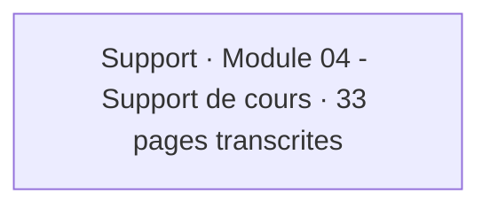

SOURCE DRIVE · TRANSCRIPTION DU SUPPORT

Le contenu des documents du dossier TSSR est transcrit ci-dessous, page par page. Les textes et tableaux sont intégrés à la page Web. Aucun fichier PDF, aucune diapositive entière ni aucune reproduction de page n’est affiché. Seuls des croquis ou visuels isolés et vérifiés peuvent accompagner la transcription. Les versions et les consignes restent celles des supports de formation. Les compléments IA sont conservés dans leur onglet distinct.

## Support · Module 04 - Support de cours · 33 pages transcrites

### Page 1

#### Outils collaboratifs

##### Exploiter Outlook et savoir le dépanner

##### Objectifs

!!! note "À retenir"
    Comprendre le cheminement d’un email Connaître l’utilisation des outils de communication asynchrone Paramétrer un logiciel de messagerie

**Visuel externe**

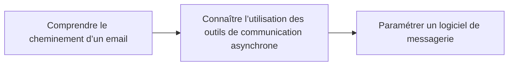

- Comprendre le cheminement d’un email
- Connaître l’utilisation des outils de communication asynchrone
- Paramétrer un logiciel de messagerie

### Page 2

#### Exploiter Outlook et savoir le dépanner

#### Cheminement d’un

#### courrier

#### Les étapes de cheminement d’un courrier

!!! note "À retenir"
    Jean-Pierre de Nantes écrit une lettre à Micheline de Rennes Jean-Pierre écrit sa lettre

- Jean-Pierre de Nantes écrit une lettre à Micheline de Rennes
- Jean-Pierre écrit sa lettre

##### Rennes

| Nantes | Micheline |
| --- | --- |

##### Jean-Pierre

##### Facteur de

| Facteur de | Micheline |
| --- | --- |
| Jean-Pierre | Centre de tri |
| Bureau de | Bureau de |
| poste local | poste local |

##### Centre de tri

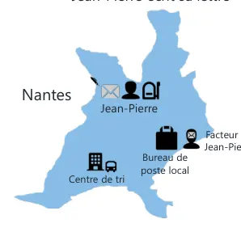

Visuel du support.

Visuel du support.

### Page 3

#### Les étapes de cheminement d’un courrier

!!! note "À retenir"
    Jean-Pierre de Nantes écrit une lettre à Micheline de Rennes Le facteur vient chercher sa lettre

- Jean-Pierre de Nantes écrit une lettre à Micheline de Rennes
- Le facteur vient chercher sa lettre

##### Rennes

| Nantes | Micheline |
| --- | --- |

##### Jean-Pierre

##### Facteur de

| Facteur de | Micheline |
| --- | --- |
| Jean-Pierre | Centre de tri |
| Bureau de | Bureau de |
| poste local | poste local |

##### Centre de tri

#### Les étapes de cheminement d’un courrier

!!! note "À retenir"
    Jean-Pierre de Nantes écrit une lettre à Micheline de Rennes Le facteur donne la lettre au bureau de poste local de Jean-Pierre

- Jean-Pierre de Nantes écrit une lettre à Micheline de Rennes
- Le facteur donne la lettre au bureau de poste local de Jean-Pierre

| Facteur de | Rennes |
| --- | --- |
| Nantes | Micheline |

##### Jean-Pierre

##### Facteur de Micheline

##### Centre de tri

| Bureau de | Bureau de |
| --- | --- |
| poste local | poste local |

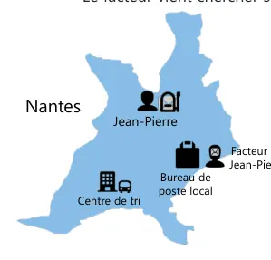

Visuel du support.

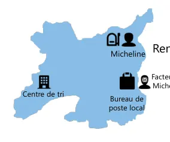

Visuel du support.

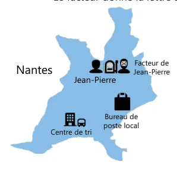

Visuel du support.

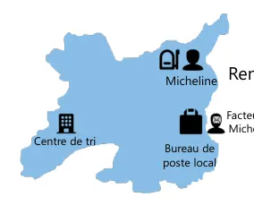

Visuel du support.

### Page 4

#### Les étapes de cheminement d’un courrier

!!! note "À retenir"
    Jean-Pierre de Nantes écrit une lettre à Micheline de Rennes Le bureau de poste envoie la lettre au centre de tri de Nantes

- Jean-Pierre de Nantes écrit une lettre à Micheline de Rennes
- Le bureau de poste envoie la lettre au centre de tri de Nantes

##### Rennes

| Nantes | Micheline |
| --- | --- |

##### Jean-Pierre

##### Facteur de

| Facteur de | Micheline |
| --- | --- |
| Jean-Pierre | Centre de tri |
| Bureau de | Bureau de |
| poste local | poste local |

##### Centre de tri

#### Les étapes de cheminement d’un courrier

!!! note "À retenir"
    Jean-Pierre de Nantes écrit une lettre à Micheline de Rennes Le centre de tri de Nantes l’envoie au centre de tri de Rennes

- Jean-Pierre de Nantes écrit une lettre à Micheline de Rennes
- Le centre de tri de Nantes l’envoie au centre de tri de Rennes

##### Rennes

| Nantes | Micheline |
| --- | --- |

##### Jean-Pierre

##### Facteur de

| Facteur de | Micheline |
| --- | --- |
| Jean-Pierre | Centre de tri |
| Bureau de | Bureau de |
| poste local | poste local |

##### Centre de tri

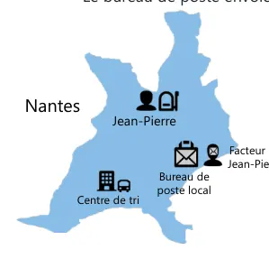

Visuel du support.

Visuel du support.

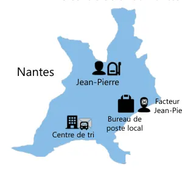

Visuel du support.

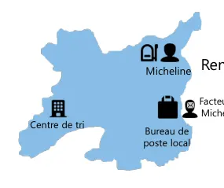

Visuel du support.

### Page 5

#### Les étapes de cheminement d’un courrier

!!! note "À retenir"
    Jean-Pierre de Nantes écrit une lettre à Micheline de Rennes Le centre de tri de Rennes l’envoie au bureau de poste local de Micheline

- Jean-Pierre de Nantes écrit une lettre à Micheline de Rennes
- Le centre de tri de Rennes l’envoie au bureau de poste local de Micheline

##### Rennes

| Nantes | Micheline |
| --- | --- |

##### Jean-Pierre

##### Facteur de

| Facteur de | Micheline |
| --- | --- |
| Jean-Pierre | Centre de tri |
| Bureau de | Bureau de |
| poste local | poste local |

##### Centre de tri

#### Les étapes de cheminement d’un courrier

!!! note "À retenir"
    Jean-Pierre de Nantes écrit une lettre à Micheline de Rennes Le facteur de Micheline donne la lettre à Micheline

- Jean-Pierre de Nantes écrit une lettre à Micheline de Rennes
- Le facteur de Micheline donne la lettre à Micheline

##### Rennes

| Nantes | Micheline |
| --- | --- |

##### Jean-Pierre

##### Facteur de

| Facteur de | Micheline |
| --- | --- |
| Jean-Pierre | Centre de tri |
| Bureau de | Bureau de |
| poste local | poste local |

##### Centre de tri

Visuel du support.

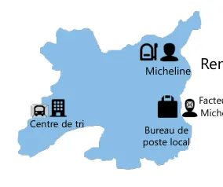

Visuel du support.

Visuel du support.

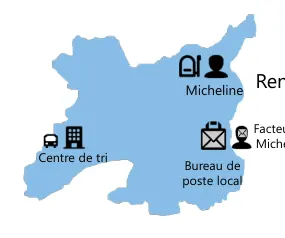

Visuel du support.

### Page 6

#### Les étapes de cheminement d’un courrier

- Jean-Pierre de Nantes écrit une lettre à Micheline de Rennes
- Micheline prend le courrier dans sa boîte aux lettres puis lit la lettre de Jean-Pierre

##### Rennes

| Nantes | Micheline |
| --- | --- |

##### Jean-Pierre

##### Facteur de

| Facteur de | Micheline |
| --- | --- |
| Jean-Pierre | Centre de tri |
| Bureau de | Bureau de |
| poste local | poste local |

##### Centre de tri

#### Exploiter Outlook et savoir le dépanner

#### Cheminement d’un mail

Visuel du support.

Visuel du support.

### Page 7

#### Les étapes de cheminement d’un mail

- Jean-Pierre de Nantes écrit un courriel à Micheline de Rennes
- Jean-Pierre écrit un email sur son logiciel (Outlook, Thunderbird, etc.)

##### Internet

| SMTP | SMTP |
| --- | --- |

Bonjour Micheline,

| réunion mercredi | Serveur de |
| --- | --- |
| de 15h à 16h | Serveur de |

messagerie de

messagerie de

| Jean-Pierre | Micheline |
| --- | --- |

#### Les étapes de cheminement d’un mail

- Jean-Pierre de Nantes écrit un courriel à Micheline de Rennes
- Le serveur de messagerie de Jean-Pierre vient chercher l’email dans la boîte d’envoi du logiciel (protocole soumission SMTP) et fait une copie dans les éléments envoyés

##### Internet

| SMTP | SMTP |
| --- | --- |

##### Bonjour Micheline, réunion mercredi

| de 15h à 16h | Serveur de | Serveur de |
| --- | --- | --- |
| messagerie de | messagerie |  |
| Soumission SMTP | Jean-Pierre | de Micheline |

### Page 8

#### Les étapes de cheminement d’un mail

- Jean-Pierre de Nantes écrit un courriel à Micheline de Rennes
- Le serveur de messagerie de Jean-Pierre envoie le mail au serveur de messagerie de Micheline (protocole SMTP)

##### Internet

| SMTP | SMTP |
| --- | --- |

##### Serveur de messagerie de

| SMTP | Serveur de |
| --- | --- |

##### Jean-Pierre

messagerie de Micheline

#### Les étapes de cheminement d’un mail

- Jean-Pierre de Nantes écrit un courriel à Micheline de Rennes
- Le client de messagerie de Micheline peut télécharger ses mails dans sa boîte de réception depuis son serveur de messagerie (protocole IMAP ou POP ou ActiveSync ou HTTPS ou MAPI, etc.)

##### Internet

| SMTP | SMTP |
| --- | --- |

##### Bonjour Micheline, réunion mercredi

| Serveur de | POP, IMAP, HTTPS, | de 15h à 16h |
| --- | --- | --- |

##### Serveur de

| messagerie de | ActiveSync |
| --- | --- |

messagerie de

##### Micheline

##### Jean-Pierre

### Page 9

#### Exploiter Outlook et savoir le dépanner

#### Prérequis pour

#### l’exploitation réseau

#### Ports et protocoles

- Tous les ports nécessaires doivent être ouverts sur le pare-feu

| Protocole | Port non sécurisé | Port TLS/SSL |
| --- | --- | --- |
| HTTP Hypertext Transfer Protocol | 80 | 443 |
| POP3 Post Office Protocol | 110 | 995 |
| IMAP4 Interactive Message Access | 143 | 993 |

##### Protocol

| SMTP Simple Mail Transfer Protocol | 25 |  |
| --- | --- | --- |
| Soumission client SMTP | 2525 | 587 ou 2525 |

(465 déprécié)

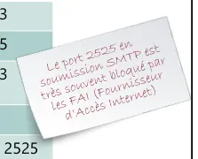

Visuel du support.

### Page 10

#### Exploiter Outlook et savoir le dépanner

#### Installation

#### Installer Outlook depuis Microsoft 365

- Se connecter à https://portal.office.com

##### Valider votre adresse de récupération

micheline@exemple.lab

785245

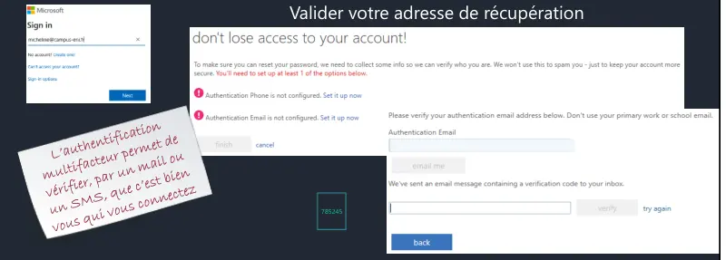

Visuel du support.

### Page 11

#### Installer Outlook depuis Microsoft 365

- Paramétrer son compte

#### Exploiter Outlook et savoir le dépanner

#### Autodiscover

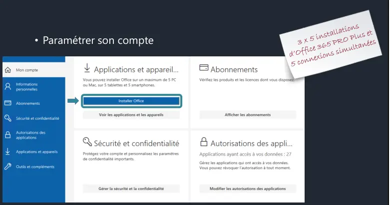

Visuel du support.

### Page 12

#### Définition

- C’est l’autoconfiguration de votre Outlook avec un serveur de messagerie en renseignant votre adresse mail.
- Découverte automatique à partir d’Outlook 2007 et le client Skype for business.

#### Processus de la découverte automatique

**Visuel externe**

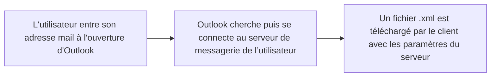

- L'utilisateur entre son adresse mail à l'ouverture d'Outlook
- Outlook cherche puis se connecte au serveur de messagerie de l’utilisateur
- Le client envoie son adresse SMTP pour avoir les options de configuration de cette adresse
- Un fichier .xml est téléchargé par le client avec les paramètres du serveur
- Outlook se connecte au serveur Exchange Online dans Microsoft 365 et peut recevoir ses mails

##### Internet

##### SMTP web.xml

| Micheline@exemple.lab | POP, IMAP, HTTPS, MAPI |
| --- | --- |

##### Serveur de messagerie de Micheline

### Page 13

#### Test Autodiscover

- CTRL + clic droit sur l’icône Outlook dans la zone de notification pour afficher les menus État de la connexion et Tester la configuration automatique de la messagerie

| Sans CTRL + clic droit sur l’icône Outlook | Avec CTRL + clic droit sur l’icône Outlook |
| --- | --- |
| dans la zone de notification | dans la zone de notification |

- Test de la configuration automatique de la messagerie micheline@exemple.lab

| Sans CTRL + clic droit sur l’icône Outlook | Avec CTRL + clic droit sur l’icône Outlook |
| --- | --- |
| dans la zone de notification | dans la zone de notification |

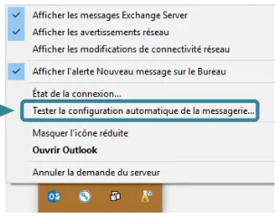

Visuel du support.

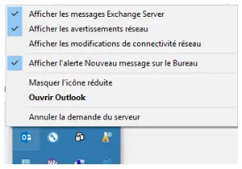

Visuel du support.

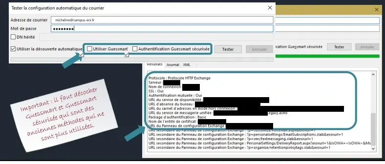

Visuel du support.

### Page 14

- Code retour HTTP du test

| • 1xx | Information |
| --- | --- |
| • 2xx | Succès |
| • 3xx | Redirection |
| • 4xx | Erreur du client |
| • 5xx | Erreur du serveur |

#### Exploiter Outlook et savoir le dépanner

#### Présentation d’Outlook

Visuel du support.

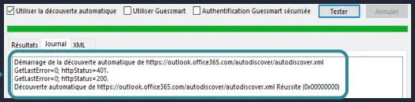

Visuel du support.

### Page 15

#### Versions Outlook

| Outlook 365 | Outlook Online | Outlook 2019 |
| --- | --- | --- |
| • À installer sur votre PC | • Accessible depuis un navigateur | • À installer sur votre PC |
| • Disponible hors connexion (fichier .ost) | • Nécessite une connexion Internet | • Disponible hors connexion (fichier .ost) |
| • Payant avec l’offre Office de Microsoft 365 | • Ne gère pas de contact externe à | • Payant avec l’offre pack Office |

##### Microsoft tel que Gmail ou Yahoo!

| • Nécessite des mises à jour de | • Nécessite des mises à jour de sécurité |
| --- | --- |
| fonctionnalité et de sécurité | • Ne prend pas en charge de compte |

- À toutes les fonctionnalités disponibles

##### IMAP

pour sa version

- À toutes les fonctionnalités disponibles

#### Utiliser Outlook

#### Outlook

**Visuel externe**

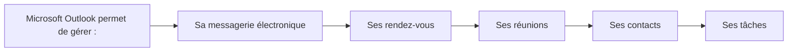

- Microsoft Outlook permet de gérer :
- Sa messagerie électronique
- Ses rendez-vous
- Ses réunions
- Ses contacts
- Ses tâches

Visuel du support.

### Page 16

#### L’interface Outlook

##### La barre de titre Le ruban

volet calendrier

##### Les volets

volet de lecture

##### Le volet des dossiers

volet contacts volet des tâches

##### La barre de navigation des dossiers

#### Exploiter Outlook et savoir le dépanner

#### Messagerie Outlook

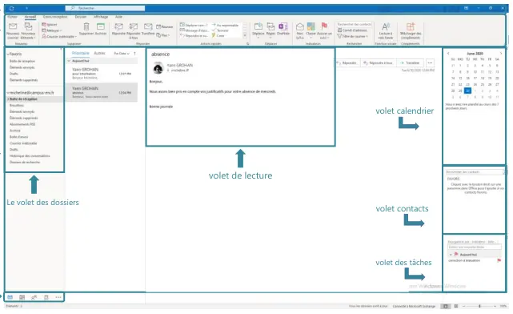

Visuel du support.

### Page 17

#### Outlook aujourd’hui

- Affiche les rendez-vous, le nombre de messages reçus et la liste des tâches

#### L’affichage en conversions

- Regroupe plusieurs messages avec le même objet dans une conversation unique

##### Jean Pierre

##### Activer le mode conversation

##### Jean Pierre

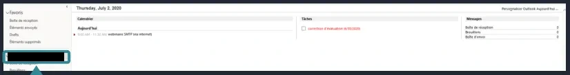

Visuel du support.

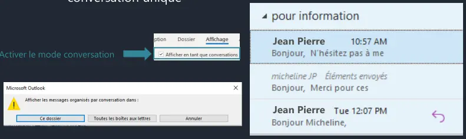

Visuel du support.

### Page 18

#### Réponse automatique

- Envoie un message ou une alerte aux utilisateurs qui essayent de vous joindre pendant une absence

#### La barre d’infos-courrier et message d’absence

- Donne des informations sur la disponibilité de chaque destinataire lors de la création d’un mail

##### Jpierre@exemple.lab

Visuel du support.

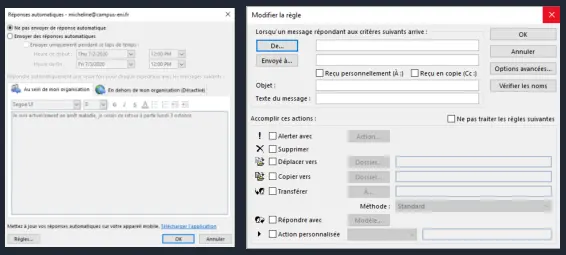

Visuel du support.

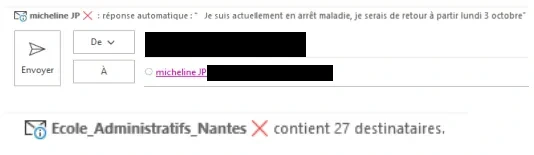

Visuel du support.

### Page 19

#### Règle de gestion des messages

- Crée des règles pour gérer, ranger, prioriser… vos messages

| Condition | Action | Exception |
| --- | --- | --- |

#### Rappel de message

- Rappel d’un message non lu en cochant l’option Supprimer les copies non lues de ce message
- Remplacer un message non lu en cochant l’option Supprimer les copies non lues et les remplacer par un nouveau message

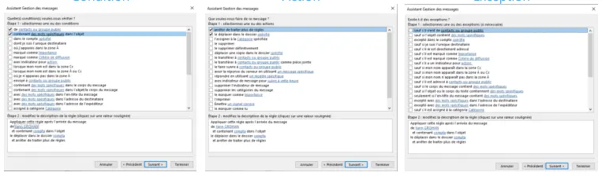

Visuel du support.

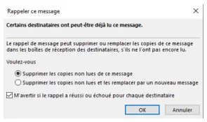

Visuel du support.

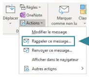

Visuel du support.

### Page 20

#### Exploiter Outlook et savoir le dépanner

#### Calendrier

#### Rendez-vous, réunion, événement

**Visuel externe**

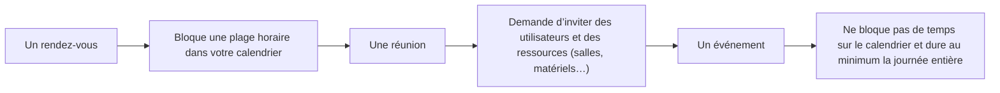

- Un rendez-vous
- Bloque une plage horaire dans votre calendrier
- Une réunion
- Demande d’inviter des utilisateurs et des ressources (salles, matériels…)
- Un événement
- Ne bloque pas de temps sur le calendrier et dure au minimum la journée entière

Visuel du support.

### Page 21

#### Groupes de calendriers

- Créer un ou plusieurs groupes de calendriers afin d’afficher plusieurs calendriers en même temps
- Fusionner plusieurs calendriers dans le même affichage

#### Les tâches

- Planification d’actions à mener que vous vous êtes ou que l’on vous a attribuées sur votre calendrier
- Possibilité de prioriser et d’effectuer un suivi

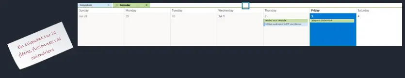

Visuel du support.

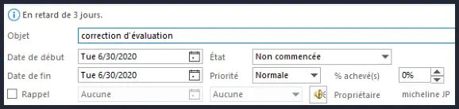

Visuel du support.

### Page 22

#### Exploiter Outlook et savoir le dépanner

#### Autres éléments

#### Les éléments et les catégories

- Un élément d’Outlook, c’est : un message, un rendez-vous, une tâche, une réunion…
- Une catégorie : classer, prioriser vos éléments
- Avec les règles de gestion des messages : affectation automatiquement d’une catégorie suivant certaine(s) condition(s)

##### Affecter une catégorie congés

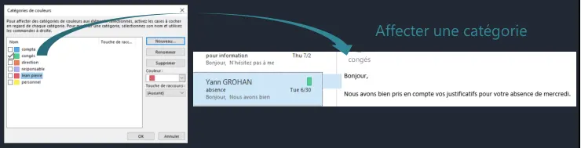

Visuel du support.

### Page 23

#### L’archivage

- Lorsque la taille de votre boîte aux lettres devient trop importante, il devient nécessaire de déplacer ces messages dans une boîte aux lettres d’archivage
- Utilisation de l’archivage automatique

#### Quelques raccourcis clavier

| Fermer une fenêtre ou un menu | Échap |
| --- | --- |
| Accédez à l’onglet Accueil | Alt + H |
| Créer un message | Ctrl + Maj + M |
| Envoyer un message | Alt + S |
| Insérer un fichier | Alt + N, A, F |
| Nouvelle tâche | Ctrl + Maj + K |
| Supprimer un élément (lorsqu’un message, une tâche ou une réunion est sélectionné) | Supprimer |
| Rechercher un élément | Ctrl + E ou F3 |
| Répondre à un courrier | Alt + H, R, P |
| Transférer un courrier | Alt + H, F, W |
| Sélectionnez l’option répondre à tous | Alt + H, R, A |
| Accédez à l’onglet Envoyer/recevoir | Alt + J, S |
| Accédez au calendrier | Ctrl + 2 |
| Créer un rendez-vous | Ctrl + Maj + A |
| Ouvrir la boîte de dialogue Enregistrer sous dans l’onglet pièces jointes | Alt + J, A, A, V |
| Vérifier l’arrivée de nouveaux courriers | Ctrl + M ou F9 |

Source : https://support.microsoft.com/fr-fr/office/raccourcis-clavier-pour-outlook-3cdeb221-7ae5-4c1d-8c1d-9e63216c1efd

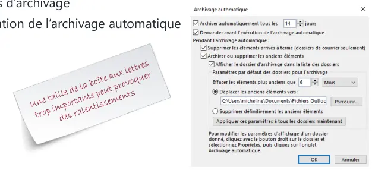

Visuel du support.

### Page 24

#### Exploiter Outlook et savoir le dépanner

##### Utilisation d’Outlook

##### Démo

##### Paramétrage d’Outlook

#### Exploiter Outlook et savoir le dépanner

#### TP

##### Démo

##### Utilisation et paramétrage

### Page 25

#### Exploiter Outlook et savoir le dépanner

#### Dépanner Outlook

#### Test distant pour votre infrastructure Microsoft 365

- Teste les accès externes de votre infrastructure Exchange

https://testconnectivity.microsoft.com/

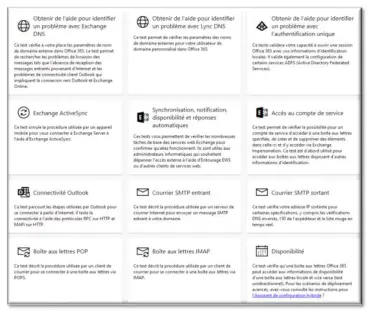

Visuel du support.

### Page 26

#### Validation du login/Password avec Outlook online

#### Activer la journalisation

- La journalisation d’Outlook récupère des informations sur les erreurs de connexion

| 1 | 3 |
| --- | --- |

2

4

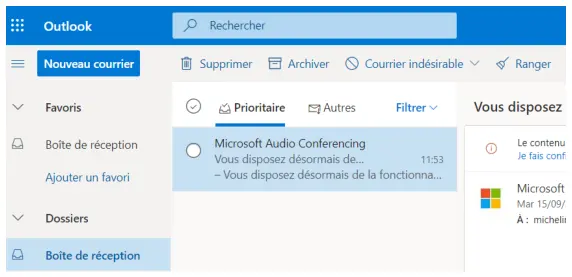

Visuel du support.

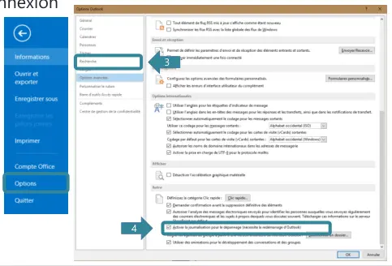

Visuel du support.

### Page 27

##### C:\Users\micheline\AppData\Local\Temp\Journalisation d’Outlook

#### Mode hors connexion

- Permet de diagnostiquer d’éventuels problèmes de performance réseau et de proposer une solution viable en cas de coupure réseau

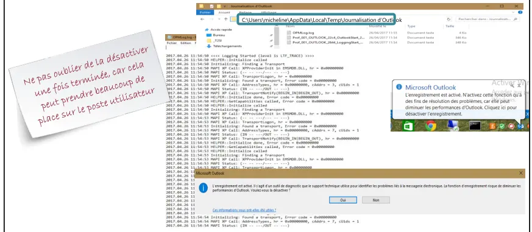

Visuel du support.

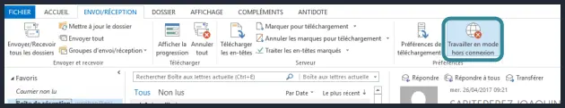

Visuel du support.

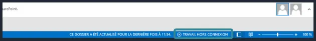

Visuel du support.

### Page 28

#### Mode sans échec

- Le mode sans échec permet de réparer certains démarrages d’Outlook et de démarrer le client sans les modules complémentaires

#### Modules complémentaires

- Désactiver les modules inutiles ou trop gourmands en ressource permet d’améliorer les performances d’Outlook

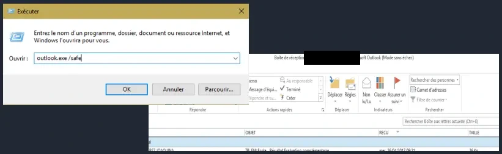

Visuel du support.

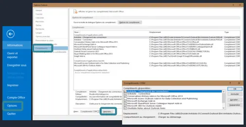

Visuel du support.

### Page 29

#### État de la connexion Outlook

micheine@ecole.lab micheline.JP@exemple.lab micheline@exemple.lab

| CTRL + clic droit sur l’icône | micheline.JP@exemple.lab |
| --- | --- |

micheline@ecole.lab

| Outlook | micheline@ecole.lab |
| --- | --- |

micheline.JP@exemple.lab compta@exemple.lab

| dans la zone de notification | micheline@exemple.lab |
| --- | --- |

micheline.JP@exemple.lab micheline@exemple.lab compta@exemple.lab

#### Refaire un profil

- En cas de problème sur Outlook, il est possible de recréer un profil avec l’Autodiscover pour la

1

configuration automatique.

2

3

1. Supprimer le profil avec Outlook fermé 2. Ouvrir Outlook pour un Autodiscover

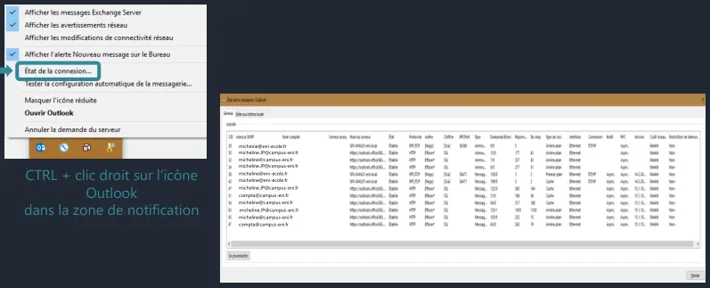

Visuel du support.

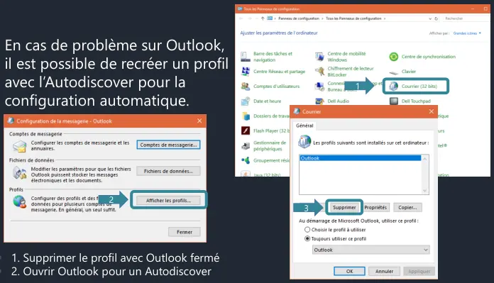

Visuel du support.

### Page 30

#### Paramètres du compte

- Contient les fichiers de configuration de chaque compte Outlook micheline@ecole.lab

micheline@ecole.lab micheline.JP@exemple.lab micheline@exemple.lab compta@exemple.lab micheline@ecole.lab\Boîte de réception

##### C:\Users\...\Outlook\micheline@ecole.lab.ost

#### Les extensions .pst et .ost

- .pst « Personal Storage Table » : fichier contenant les messages de certains logiciels Microsoft
- .ost « Offline Storage Table » : fichier contenant vos données lorsque vous êtes hors connexion
- Les messages, le calendrier et les autres éléments sont stockés sur le serveur Exchange
- Sans Exchange Server (POP3, IMAP4…), les messages, calendriers et autres éléments sont stockés localement dans un fichier .pst

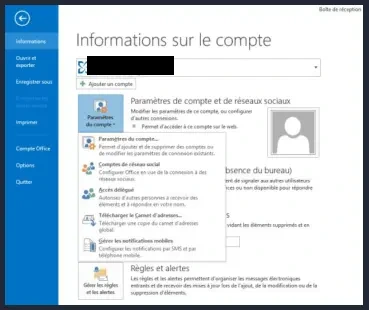

Visuel du support.

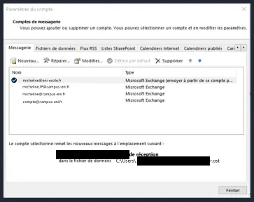

Visuel du support.

Visuel du support.

### Page 31

#### Limites d’Outlook

- Les limites des fichiers .ost ou .pst
- MaxFileSize : 50 Go
- Taille maximale absolue que peuvent atteindre les fichiers .pst et .ost.
- WarnFileSize : 47,5 Go
- Quantité maximale de données que les fichiers .pst et .ost peuvent contenir, mais des processus internes peuvent encore écrire dans ces fichiers

#### Contrôle des fichiers ost/pst

- Outil de réparation SCANPST.EXE pour analyser les erreurs dans le fichier de données et les corriger

| Microsoft\Outlook\micheline@ecole.lab.ost | C:\Users\micheline\AppData\Local\Microsoft\Outlook\micheline@ecole.lab.ost |
| --- | --- |

D:\backup\outlook\micheline@ecole.lab.bak

|  | (https://support.microsoft.com/fr-fr/kb/272227) |
| --- | --- |

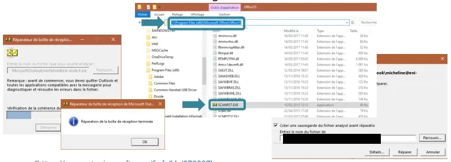

Visuel du support.

### Page 32

- Même chose avec l’outil de réparation MicrosoftEasyFix20101.mini.diagcab pour analyser les erreurs dans le fichier de données et les corriger

#### Limites d’Outlook

- Problème de performance d’Outlook (https://support.microsoft.com/fr-fr/kb/2768656)

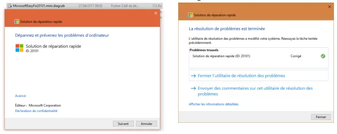

Visuel du support.

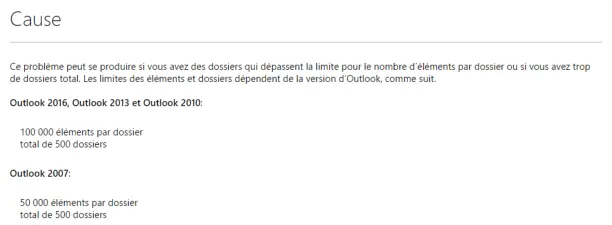

Visuel du support.

### Page 33

- Connaître le nombre d’éléments dans une BAL micheline@ecole.lab

\\micheline@ecole.lab

#### Outlook Anywhere

- Outlook Anywhere est activé par défaut et donne un accès avec Outlook aux serveurs Exchange Online depuis Internet
- Vous n'avez pas besoin d'utiliser un réseau privé virtuel (VPN) pour accéder à des serveurs Exchange Online depuis Internet
- Vous pouvez tester la connexion avec la commande :

##### PS>Test-OutlookConnectivity

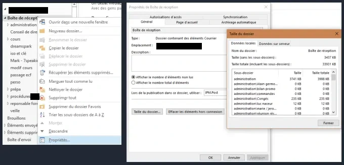

Visuel du support.

Référence du document : 1brKPwebFWpVHKGBfMEHryg2m5_R7-x00 · SHA-256 1e1b6f635d6593b2…
