# Module 05 — Exploiter Teams, SharePoint et OneDrive

Les parties ci-dessous reprennent le cours original, dans le même ordre. Les encadrés et les schémas répètent ses formulations.

## Parcours de lecture

1. Support · Module 05 - Support de cours · 15 pages transcrites
2. Énoncé · M5 - Enoncé du TP - OneDrive · 1 pages transcrites
3. Correction · M5 - Solution du TP - OneDrive · 7 pages transcrites

**Visuel externe**

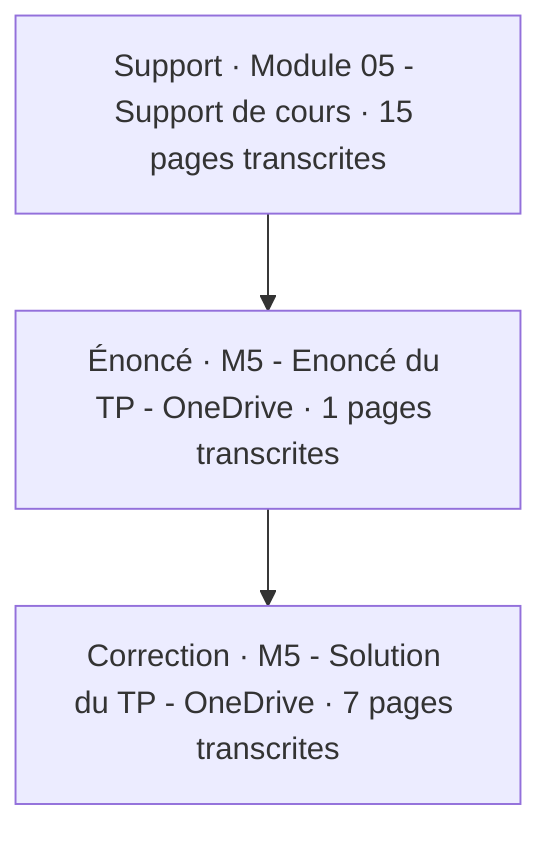

SOURCE DRIVE · TRANSCRIPTION DU SUPPORT

Le contenu des documents du dossier TSSR est transcrit ci-dessous, page par page. Les textes et tableaux sont intégrés à la page Web. Aucun fichier PDF, aucune diapositive entière ni aucune reproduction de page n’est affiché. Seuls des croquis ou visuels isolés et vérifiés peuvent accompagner la transcription. Les versions et les consignes restent celles des supports de formation. Les compléments IA sont conservés dans leur onglet distinct.

## Support · Module 05 - Support de cours · 15 pages transcrites

### Page 1

#### Outils collaboratifs

##### Exploiter Teams, SharePoint et OneDrive dans un contexte

collaboratif

#### Exploiter Teams, SharePoint et OneDrive dans un contexte collaboratif

##### Objectifs

!!! note "À retenir"
    Comprendre les enjeux d’une plateforme collaborative Utiliser une plateforme Cloud pour exploiter vos données Utiliser des outils de synchronisation des données

**Visuel externe**

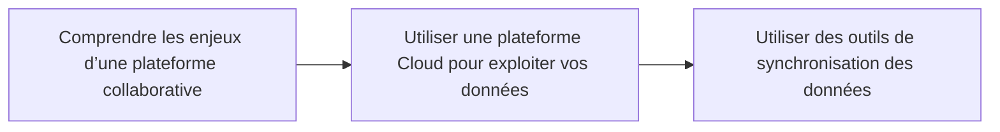

- Comprendre les enjeux d’une plateforme collaborative
- Utiliser une plateforme Cloud pour exploiter vos données
- Utiliser des outils de synchronisation des données

### Page 2

#### Exploiter Teams, SharePoint et OneDrive dans un contexte collaboratif

#### SharePoint

#### Qu’est-ce que SharePoint ?

**Visuel externe**

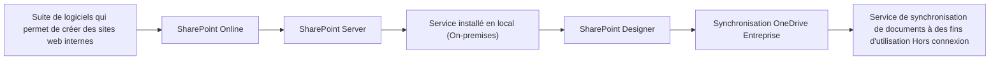

- Suite de logiciels qui permet de créer des sites web internes
- SharePoint Online
- Service hébergé dans le cloud par Microsoft par un abonnement à Microsoft 365 ou SharePoint Online autonome
- SharePoint Server
- Service installé en local (On-premises)
- SharePoint Designer
- Service gratuit permettant de gérer des flux de travail (basée sur Business Connectivity Services)
- Synchronisation OneDrive Entreprise
- Service de synchronisation de documents à des fins d'utilisation Hors connexion

### Page 3

#### À quoi sert SharePoint ?

**Visuel externe**

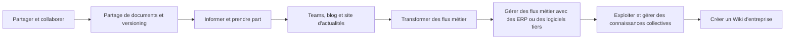

- Partager et collaborer
- Partage de documents et versioning
- Informer et prendre part
- Teams, blog et site d'actualités
- Transformer des flux métier
- Gérer des flux métier avec des ERP ou des logiciels tiers
- Exploiter et gérer des connaissances collectives
- Créer un Wiki d'entreprise
- Protéger et gérer vos données
- Anti-programme malveillant

#### Exploiter Teams, SharePoint et OneDrive dans un contexte collaboratif

#### OneDrive

### Page 4

#### Qu’est-ce que OneDrive ?

**Visuel externe**

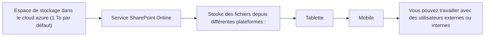

- Espace de stockage dans le cloud azure (1 To par défaut)
- Service SharePoint Online
- Stocke des fichiers depuis différentes plateformes :
- PC
- Tablette
- Mobile
- Vous pouvez stocker, consulter et partager des fichiers à partir de n’importe quel ordinateur connecté à internet
- Vous pouvez travailler avec des utilisateurs externes ou internes
- Il est possible de sécuriser vos fichiers avec des fonctionnalités avancées de chiffrement

#### Comment accéder à son OneDrive ?

!!! note "À retenir"
    Via le portail Microsoft 365 Via l’application Visuel du support.

- Via le portail Microsoft 365
- Via l’application

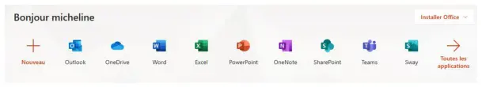

Visuel du support.

### Page 5

#### Les icônes OneDrive

Les trois tirets bleus signifient que c'est un nouveau fichier La croix rouge sur un fichier ou un dossier signifie qu'il ne peut pas être synchronisé Le nuage grisé signifie que vous n'êtes pas connecté à votre compte Le symbole de pause signifie que votre OneDrive est en pause de synchronisation Les flèches circulaires signifient que la synchronisation est en cours

Le nuage avec une personne signifie que le fichier ou le dossier a été partagé Le nuage signifie que le fichier ou le dossier n'est disponible qu'en ligne Le cercle vert avec la coche verte signifie que le fichier ouvert en ligne va être téléchargé localement Le cercle vert avec la coche blanche signifie que le fichier sera toujours téléchargé localement Le cadenas signifie que des paramètres vous empêchent de synchroniser ce dossier ou ce fichier

### Page 6

#### Partager dans OneDrive

- Partage :
- Par un lien
- Par un mail

#### La corbeille dans OneDrive

!!! note "À retenir"
    Restauration d’un fichier Visuel du support.

- Restauration d’un fichier

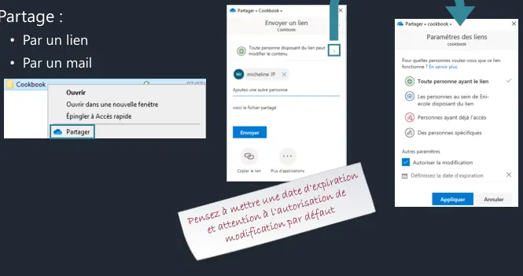

Visuel du support.

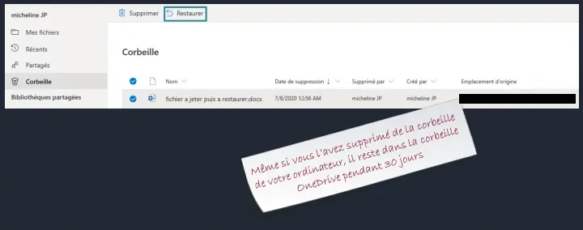

Visuel du support.

### Page 7

#### Restaurer son espace OneDrive

#### Le versioning dans OneDrive

!!! note "À retenir"
    L'historique des versions vous permet de suivre toutes les modifications sur votre fichier Il vous permet aussi de revenir à une version précédente sans perdre la dernière version enregistrée Visuel du support.

- L'historique des versions vous permet de suivre toutes les modifications sur votre fichier
- Il vous permet aussi de revenir à une version précédente sans perdre la dernière version enregistrée

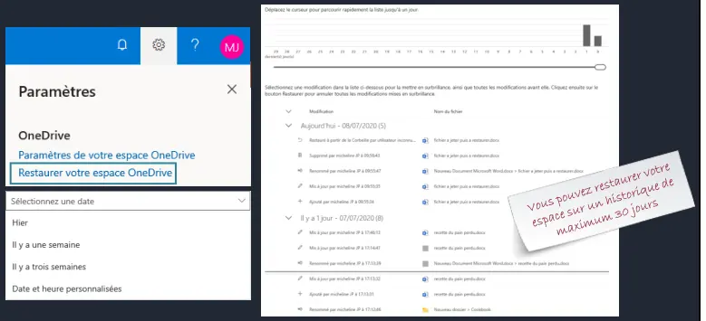

Visuel du support.

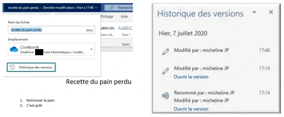

Visuel du support.

### Page 8

#### La co-édition (co-authoring) dans OneDrive

- La co-édition permet d'avoir une notification lorsqu'un autre utilisateur ouvre le même fichier que vous et de travailler avec lui en même temps
- OneDrive, OneDrive Entreprise, SharePoint Online et SharePoint Server sont des zones de stockage partagées qui permettent la co-édition
- Prise en charge du co-authoring sur ces extensions :
- .docx (Word), .pptx (PowerPoint) et .xlsx (Excel)

##### Retrouver le curseur du co-auteur avec sa couleur associée

#### Les paramètres du client OneDrive

!!! note "À retenir"
    Vous pouvez choisir les dossiers que vous voulez synchroniser Gérer les taux de chargement lors de la synchronisation Visuel du support.

- Vous pouvez choisir les dossiers que vous voulez synchroniser
- Gérer les taux de chargement lors de la synchronisation

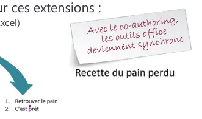

Visuel du support.

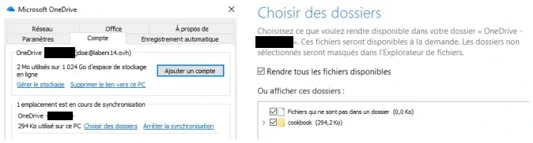

Visuel du support.

### Page 9

#### Exploiter Teams, SharePoint et OneDrive dans un contexte collaboratif

#### Teams

#### Qu’est-ce que Teams ?

- Un espace de travail centralisé
- Office et d'autres applications dans Teams en co-édition
- 1 To de stockage
- Conférence audio et vidéo
- Partage d'écran
- Planification de réunion
- Fil de conversation
- Enregistrement de réunion
- 250 équipes maximum qu’un utilisateur peut créer
- Multiplateformes (ordinateur, tablette, smartphone)
- Un calendrier

### Page 10

#### L’interface de Teams

- Teams est composé de trois volets

| Volet Gauche | Volet Central | Volet Principal |
| --- | --- | --- |

#### Structure d’une équipe

| Equipe | Un ou des propriétaires |
| --- | --- |

##### Un ou des membres

| Canaux | Général | Groupe 1 | Groupe 2 | Groupe 3 | Groupe 4 |
| --- | --- | --- | --- | --- | --- |
| publications | publications | publications | publications | publications |  |
| fichiers | fichiers | fichiers | fichiers | fichiers |  |

##### Onglets

| notes | notes | notes | notes | notes |
| --- | --- | --- | --- | --- |
| applications | applications | applications | applications | applications |

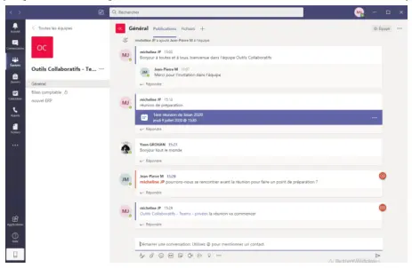

Visuel du support.

### Page 11

#### Qu’est-ce qu’une équipe dans Teams ?

!!! note "À retenir"
    Une équipe est un ensemble d’utilisateurs, de contenus et d’outils 10000 membres par équipe maximum Un utilisateur peut être membre de 1000 équipes maximum

- Une équipe est un ensemble d’utilisateurs, de contenus et d’outils
- 10000 membres par équipe maximum
- Un utilisateur peut être membre de 1000 équipes maximum

#### Créer une équipe dans Teams

!!! note "À retenir"
    Lorsque vous créez une équipe Teams, il sera aussi créé : Un nouveau groupe Microsoft 365 Un site SharePoint Online Une boîte aux lettres partagée (cachée par défaut dans Outlook) Un bloc-notes OneNote

- Lorsque vous créez une équipe Teams, il sera aussi créé :
- Un nouveau groupe Microsoft 365
- Un site SharePoint Online
- Une boîte aux lettres partagée (cachée par défaut dans Outlook)
- Un bloc-notes OneNote

### Page 12

#### Les paramètres d’une équipe Teams

!!! note "À retenir"
    Vous pouvez gérer : L’image d’une équipe Les autorisations des membres Les autorisations invité L’utilisation des mentions @mentions L’utilisation de code d’invitation L’utilisation des outils amusants (emojis, GIF, autocollants…) La création de balises (seul le propriétaire peut en créer par défaut)

- Vous pouvez gérer :
- L’image d’une équipe
- Les autorisations des membres
- Les autorisations invité
- L’utilisation des mentions @mentions
- L’utilisation de code d’invitation
- L’utilisation des outils amusants (emojis, GIF, autocollants…)
- La création de balises (seul le propriétaire peut en créer par défaut)

#### Qu’est-ce qu’un canal ?

- Compartimente votre équipe par sujet
- Un canal peut être privé ou public
- Chaque équipe à un canal Général par défaut
- Vous pouvez gérer les notifications par canal
- Un canal supprimé peut être restauré avec un maximum de 30 jours
- 200 canaux au maximum par équipe

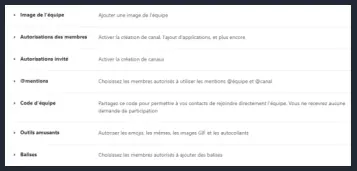

Visuel du support.

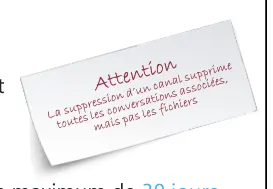

Visuel du support.

### Page 13

#### Créer un canal dans Teams

- Un canal est un ensemble de conversations, de contenus et d'outils

##### Vous pouvez ajouter des onglets

| Vous pouvez envoyer un mail dans un canal | vers des applications ou des |
| --- | --- |

fichiers pour un accès rapide

##### Un connecteur permet d'associer une application à votre canal

##### Vous pouvez ajouter des contenus à votre canal

##### Avoir une conversation au fil de l'eau de votre projet

#### Qu’est-ce qu’un onglet ?

- Un canal est scindé en plusieurs onglets par défaut
- Publications
- Fichiers
- Notes
- Vous pouvez créer d’autres onglets et y publier des applications

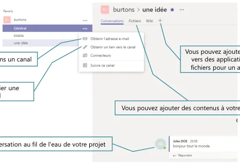

Visuel du support.

### Page 14

#### La gestion des fichiers Teams

- Les fichiers sont accessibles par défaut par tous les membres de l’équipe depuis l’onglet Fichiers
- Ils sont stockés dans une bibliothèque SharePoint créée pour chaque canal
- Ils ont les mêmes fonctionnalités que dans OneDrive, c’est-à-dire le versioning et le co-authoring
- Il est possible de transformer un fichier en onglet

#### Les messages

- Un message peut être privé ou public
- Un message public est visible par tous les membres de l’équipe ou du canal
- Un message privé ou une conversation ne sont lisibles que par la personne sélectionnée
- Un message peut être enregistré
- Il est possible de faire une conférence audio ou vidéo à une ou plusieurs personnes et de l’enregistrer dans l’application Stream

### Page 15

#### Les réunions d’équipe

- Une réunion peut être planifiée ou créée sur l’instant
- Maximum 250 utilisateurs
- Peut être créée depuis Outlook
- Lors d’une réunion, il est possible de partager :
- Une présentation PowerPoint
- Son écran
- Un tableau blanc
- Il existe une salle d’attente afin de faire patienter des utilisateurs avant le début d’une réunion
- Il existe 3 rôles :
- L’organisateur qui a créé la réunion et qui dispose de tous les droits
- Le présentateur qui peut gérer la réunion et les utilisateurs, mais pas les rôles
- Le participant

Référence du document : 1btkcyqXJeJ7orW9xW4NKJQZBqilyiBk6 · SHA-256 3d399e41849d4610…

## Énoncé · M5 - Enoncé du TP - OneDrive · 1 pages transcrites

### Page 1

#### Utilisation de OneDrive

#### Énoncé

TP du Module 05 – Exploiter Teams, SharePoint et OneDrive dans un contexte collaboratif Avant de démarrer ce TP, il convient d’avoir suivi les vidéos des modules 1 à 5 et d’avoir réalisé les TP proposés.

##### Durée estimée 60 minutes

Objectifs Utilisation de OneDrive.

Prérequis Avoir installé Office 365.

| • | Ouvrez un navigateur en navigation privée et allez à la page : |
| --- | --- |

o https://portal.office.com. o Connectez-vous avec votre compte de tenant puis ouvrez OneDrive Online. o Créez un fichier Word nommé « recette du pain perdu » :

| ▪ | Titre : recette du pain perdu |
| --- | --- |
| ▪ | Contenu : retrouver le pain |
| • | Partagez le fichier « recette du pain perdu » avec une autre adresse mail. |

o Indiquez une date d’expiration au lendemain o Avec le mot de passe : Pa$$w0rd (c’est un zéro). o Envoyez-le avec le message : « voici la recette que tu m’avais demandée ». o Ouvrez le fichier avec votre application de bureau Word et modifiez-le en ajoutant la ligne : « Attention, je ne parle pas de l’arbre. »

| • | Fermez le fichier puis affichez l’activité sur votre fichier. |
| --- | --- |
| • | Rouvrez-le et restaurez à la version précédente. |
| • | Vérifiez. |
| • | Ouvrez OneDrive avec votre explorateur et modifiez l’emplacement de synchronisation |

des fichiers vers « C:\usersvotrenom\Documents\OneDrive ».

| • | Depuis votre explorateur, partagez la recette avec Jean-Pierre en lecture. |
| --- | --- |

Référence du document : 1o0ntHLs0ZAkg2EFWnh_bTqaSCOrgmDj7 · SHA-256 29c95f64a89a1a33…

## Correction · M5 - Solution du TP - OneDrive · 7 pages transcrites

Correction originale : à consulter après avoir tenté l’exercice.

### Page 1

#### Utilisation de OneDrive

#### Solution

TP du Module 05 – Exploiter Teams, SharePoint et OneDrive dans un contexte collaboratif Avant de démarrer ce TP, il convient d’avoir suivi les vidéos des modules 1 à 5 et d’avoir réalisé les TP proposés.

##### Durée estimée 60 minutes

En fonction des informations qui vous ont été fournies, connectez-vous à la machine du laboratoire.

| • | Ouvrez | un | navigateur | en | navigation | privée | et | allez | à | la |
| --- | --- | --- | --- | --- | --- | --- | --- | --- | --- | --- |

page https://portal.office.com. Connectez-vous avec votre compte de tenant puis ouvrez OneDrive Online. Créez un fichier Word nommé « recette du pain perdu » : o Titre centré : recette du pain perdu o Contenu :

| ▪ | 1. retrouver le pain |
| --- | --- |
| ▪ | 2. C’est prêt |

Utilisez une page en navigation privée pour ne pas interférer avec une autre connexion Office 365 puis cliquez sur OneDrive.

### Page 2

Cliquez su Nouveau  Document Word Créez le contenu du fichier.

Sélectionnez le fichier puis renommez-le.

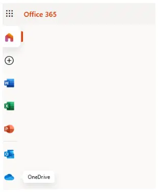

Visuel du support.

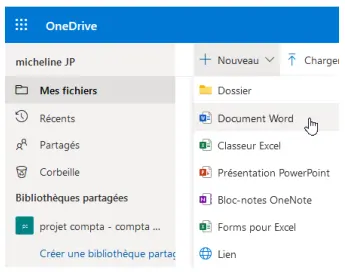

Visuel du support.

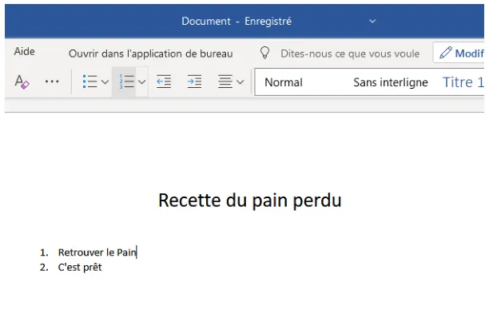

Visuel du support.

### Page 3

| • | Partagez le fichier « recette du pain perdu » avec votre compte exemple.lab. Indiquez |
| --- | --- |

une date d’expiration au lendemain et comme mot de passe : Pa$$w0rd (c’est un zéro). Envoyez-le avec le message : « voici la recette que tu m’avais demandée ». Sélectionnez le fichier puis cliquez sur Partager. Indiquez votre adresse mail campus puis ajoutez les messages. Ensuite, cliquez sur « Toute personne disposant … », indiquez une date d’expiration et le mot de passe : Pa$$w0rd (c’est un zéro) puis envoyez-le.

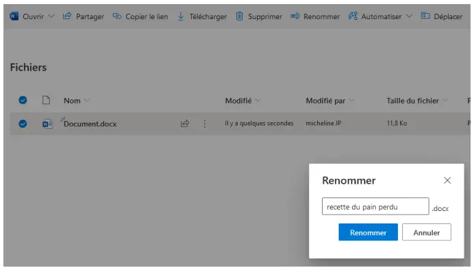

Visuel du support.

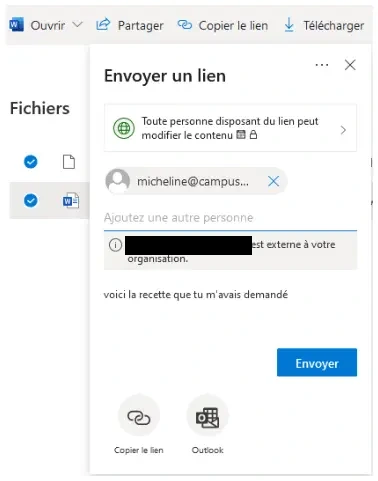

Visuel du support.

### Page 4

| • | Ouvrez le fichier avec votre application de bureau Word et modifiez-le en ajoutant la |
| --- | --- |

ligne : « Attention, je ne parle pas de l’arbre. » Fermez le fichier puis affichez l’activité sur votre fichier. Rouvrez-le et restaurez à la version précédente. Vérifiez. Ouvrez le fichier et sélectionnez « Ouvrir dans l’application ».

Ajoutez la phrase demandée. Sélectionnez le message puis cliquez sur Afficher les détails.

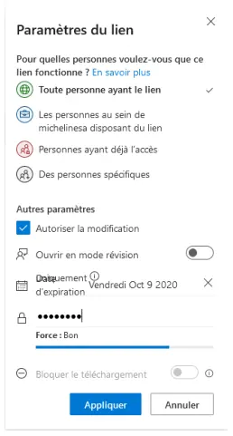

Visuel du support.

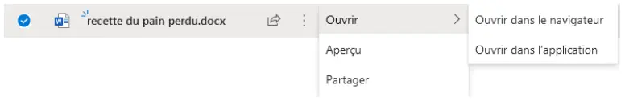

Visuel du support.

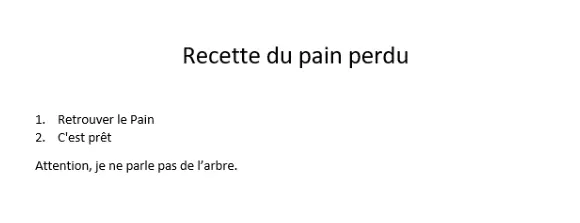

Visuel du support.

### Page 5

Sélectionnez le fichier puis cliquez sur les trois points et Historique des versions. Cliquez sur Restaurer sur la version désirée puis vérifiez.

| • | Ouvrez OneDrive avec votre explorateur et modifiez l’emplacement de synchronisation |
| --- | --- |

des fichiers vers « C:\usersvotrenom\Documents\OneDrive ». Allez dans l’explorateur Windows et cliquez sur le nuage bleu puis renseignez votre adresse exemple.lab.

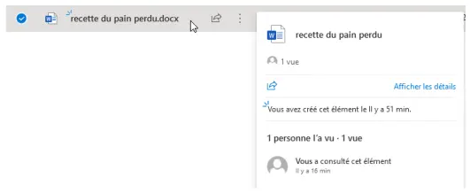

Visuel du support.

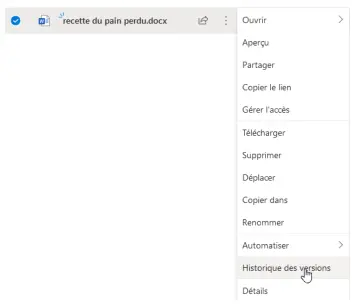

Visuel du support.

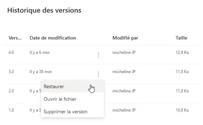

Visuel du support.

### Page 6

Créez un répertoire dans Documents puis changez l’emplacement.

##### C:\Users\votrenom\Documents\Onedrive - micheline

| • | Depuis votre explorateur, partagez la recette avec Jean-Pierre en lecture. |
| --- | --- |

Allez dans l’Explorateur Windows et cliquez sur le nuage bleu puis faites un clic droit sur le fichier recette et enfin partagez-le.

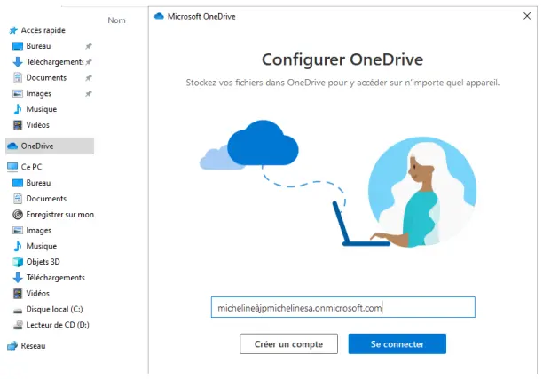

Visuel du support.

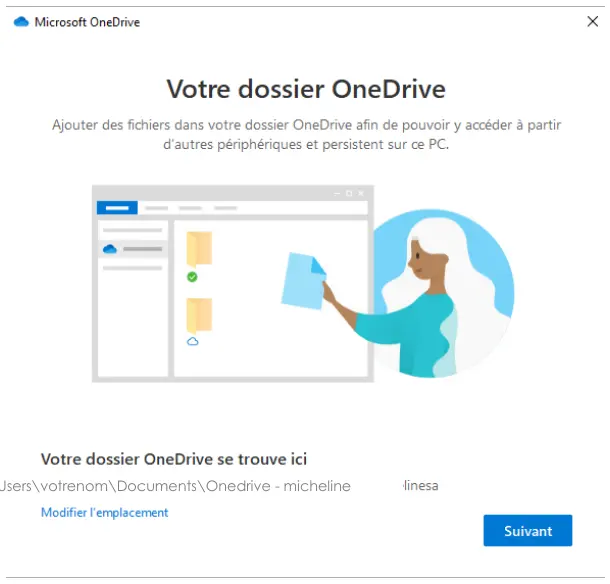

Visuel du support.

### Page 7

Allez sur la gestion des liens, puis décochez « Autoriser la modification ». D’autres solutions sont possibles pour ce TP. Il n’existe pas une seule façon de faire.

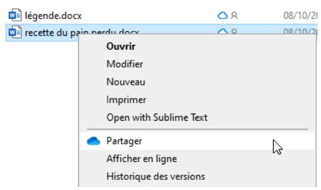

Visuel du support.

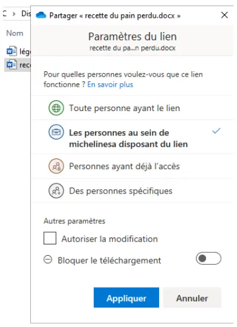

Visuel du support.

Référence du document : 1VyzxkiTFZ_7CSqJMtHamo5EC-2x4129U · SHA-256 4dde7d467424ae97…

## Fiche de synthèse

Les lignes reprennent les titres du cours et la première phrase de chaque partie.

| Partie | Repère du cours |
| --- | --- |
| Correction · M5 - Solution du TP - OneDrive · 7 pages transcrites | Correction originale : à consulter après avoir tenté l’exercice. |
