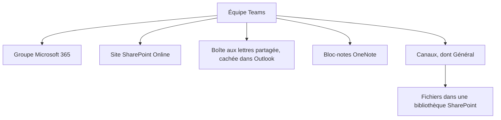

# Module 05 — Exploiter Teams, SharePoint et OneDrive

**Séquence :** Microsoft 365 — Outils collaboratifs  
**Rôle dans le parcours :** relier le stockage, les sites et l’espace d’équipe, puis réaliser le TP OneDrive.

## Objectifs

- Comprendre les enjeux d’une plateforme collaborative.
- Utiliser une plateforme Cloud pour exploiter vos données.
- Utiliser des outils de synchronisation des données.

## 1. SharePoint

SharePoint est une suite de logiciels qui permet de créer des sites web internes.

| Composant | Description du support |
|---|---|
| SharePoint Online | Service hébergé dans le cloud par Microsoft, par un abonnement Microsoft 365 ou SharePoint Online autonome. |
| SharePoint Server | Service installé en local (on-premises). |
| SharePoint Designer | Service gratuit de flux de travail, basé sur Business Connectivity Services. |
| Synchronisation OneDrive Entreprise | Synchronise des documents pour une utilisation hors connexion. |

À quoi sert SharePoint :

- Partager et collaborer : documents et versioning.
- Informer et prendre part : Teams, blog et site d’actualités.
- Transformer des flux métier : ERP ou logiciels tiers.
- Exploiter les connaissances collectives : wiki d’entreprise.
- Protéger et gérer les données : anti-programme malveillant.

## 2. OneDrive

| Point | Texte du support |
|---|---|
| Nature | Espace de stockage dans le cloud Azure, 1 To par défaut. Service SharePoint Online. |
| Postes | PC, tablette, mobile. |
| Accès | Stocker, consulter et partager depuis n’importe quel ordinateur connecté à Internet. |
| Personnes | Utilisateurs externes ou internes. |
| Protection | Fonctionnalités avancées de chiffrement. |
| Entrées | Portail Microsoft 365, ou application. |

### Icônes

| Signe | Signification |
|---|---|
| Trois tirets bleus | Nouveau fichier. |
| Croix rouge | Le fichier ou le dossier ne peut pas être synchronisé. |
| Nuage grisé | Vous n’êtes pas connecté au compte. |
| Pause | OneDrive est en pause de synchronisation. |
| Flèches circulaires | Synchronisation en cours. |
| Nuage avec une personne | Fichier ou dossier partagé. |
| Nuage | Disponible uniquement en ligne. |
| Cercle vert, coche verte | Le fichier ouvert en ligne va être téléchargé localement. |
| Cercle vert, coche blanche | Le fichier sera toujours téléchargé localement. |
| Cadenas | Un paramètre empêche de synchroniser ce dossier ou ce fichier. |

Partage par un lien ou par un e-mail. La corbeille permet de restaurer un fichier. L’historique des versions suit les modifications et permet de revenir à une version précédente sans perdre la dernière version enregistrée.

La co-édition prévient quand un autre utilisateur ouvre le même fichier et permet de travailler en même temps. OneDrive, OneDrive Entreprise, SharePoint Online et SharePoint Server sont des zones partagées qui la prennent en charge, pour `.docx`, `.pptx` et `.xlsx`. Le curseur du co-auteur se retrouve avec sa couleur.

Le client OneDrive permet de choisir les dossiers synchronisés et de gérer les taux de chargement.

## 3. Teams

Teams est un espace de travail centralisé : Office et d’autres applications en co-édition, 1 To de stockage, conférence audio et vidéo, partage d’écran, planification de réunion, fil de conversation, enregistrement de réunion, 250 équipes maximum qu’un utilisateur peut créer, clients multiplateformes, un calendrier.

L’interface a trois volets : gauche, central et principal.

| Niveau | Contenu décrit |
|---|---|
| Équipe | Un ou des propriétaires, un ou des membres. |
| Canaux | Général, puis Groupe 1 à Groupe 4 dans le schéma. |
| Dans chaque canal | Publications, fichiers, notes, applications. |

Une équipe réunit des utilisateurs, des contenus et des outils. Maximum 10 000 membres par équipe. Un utilisateur peut être membre de 1 000 équipes au maximum.

Créer une équipe crée aussi un groupe Microsoft 365, un site SharePoint Online, une boîte aux lettres partagée (cachée par défaut dans Outlook) et un bloc-notes OneNote.

Paramètres gérables : image, autorisations des membres, autorisations invité, @mentions, code d’invitation, outils amusants (emojis, GIF, autocollants), balises (seul le propriétaire peut en créer par défaut).

| Règle d’un canal | Valeur du support |
|---|---|
| Rôle | Compartimente l’équipe par sujet. |
| Visibilité | Privé ou public. |
| Canal par défaut | Général. |
| Notifications | Gérables par canal. |
| Suppression | Restauration possible pendant 30 jours au maximum. |
| Plafond | 200 canaux par équipe. |

Un canal réunit conversations, contenus et outils. On peut ajouter des onglets, envoyer un e-mail dans un canal, associer une application par un connecteur, ajouter des contenus et tenir une conversation au fil du projet.

Onglets par défaut : Publications, Fichiers, Notes. D’autres onglets peuvent publier des applications.

Les fichiers de l’onglet Fichiers sont accessibles par défaut à tous les membres. Ils sont dans une bibliothèque SharePoint créée pour chaque canal, avec le versioning et le co-authoring de OneDrive. Un fichier peut devenir un onglet.

Un message public est visible par les membres de l’équipe ou du canal. Un message privé ou une conversation ne sont lisibles que par la personne sélectionnée. Un message peut être enregistré. Une conférence audio ou vidéo, à une ou plusieurs personnes, peut être enregistrée dans Stream.

Une réunion est planifiée ou immédiate, 250 utilisateurs maximum, et peut être créée depuis Outlook. On peut y partager une présentation PowerPoint, son écran ou un tableau blanc. Une salle d’attente fait patienter avant le début.

| Rôle | Droits décrits |
|---|---|
| Organisateur | A créé la réunion et dispose de tous les droits. |
| Présentateur | Gère la réunion et les utilisateurs, mais pas les rôles. |
| Participant | Rôle distinct des deux précédents. |

**Illustration IA / externe au cours — ce qu’une équipe Teams crée en plus d’elle-même.**

## 4. TP — Utilisation de OneDrive

**Durée :** 60 minutes. Vidéos des modules 1 à 5 et TP précédents.  
**Objectif :** utilisation de OneDrive. **Prérequis :** Office 365 installé.

1. Ouvrir un navigateur en navigation privée et aller sur `https://portal.office.com`.
2. Se connecter avec le compte de tenant, puis ouvrir OneDrive Online.
3. Créer un fichier Word « recette du pain perdu ». Titre : recette du pain perdu. Contenu : retrouver le pain.
4. Le partager avec une autre adresse. Expiration au lendemain. Mot de passe : `Pa$$w0rd` (c’est un zéro). Message : « voici la recette que tu m’avais demandée ».
5. Ouvrir le fichier dans Word de bureau et ajouter : « Attention, je ne parle pas de l’arbre. »
6. Fermer le fichier, afficher l’activité, le rouvrir, restaurer la version précédente, vérifier.
7. Ouvrir OneDrive dans l’explorateur et modifier l’emplacement de synchronisation vers `C:\usersvotrenom\Documents\OneDrive`.
8. Depuis l’explorateur, partager la recette avec Jean-Pierre en lecture.

### Correction

La correction demande de se connecter à la machine du centre de formation. Le contenu du fichier y est précisé en deux lignes : « 1. retrouver le pain » et « 2. C’est prêt ». Le titre est centré. La navigation privée évite d’interférer avec une autre connexion Office 365.

1. Nouveau, Document Word. Créer le contenu, sélectionner le fichier, le renommer. La capture écrit « Cliquez su Nouveau » : le support omet le r de « sur ».
2. Partager avec le compte `campus-eni.fr`. La correction clique sur Partager, indique l’adresse, le message, puis « Toute personne disposant … », la date d’expiration et le mot de passe `Pa$$w0rd`.
3. Ouvrir dans l’application, ajouter la phrase, sélectionner le message, Afficher les détails.
4. Trois points, Historique des versions, Restaurer, puis vérifier.
5. Dans l’explorateur, cliquer le nuage bleu, renseigner l’adresse `campus-eni.fr`, créer un répertoire dans Documents et changer l’emplacement. La correction montre `C:\Users\votrenom\Documents\Onedrive - micheline`.
6. Clic droit sur la recette, Partager. Dans la gestion des liens, décocher « Autoriser la modification ».

La correction conclut qu’il n’existe pas une seule façon de faire.

## Résumé

SharePoint porte les sites et les bibliothèques. OneDrive est l’espace personnel d’1 To, avec des icônes d’état précises et la co-édition des fichiers Office. Teams ajoute les équipes, les canaux et les réunions, mais range les fichiers dans SharePoint. Le TP enchaîne création, partage protégé par mot de passe, version, déplacement du dossier synchronisé et partage en lecture seule.

## Mini-quiz

1. Quelle différence le support fait-il entre SharePoint Online et SharePoint Server ?
2. Que signifie le cadenas OneDrive ?
3. Quels trois objets une nouvelle équipe Teams crée-t-elle en plus du groupe et du bloc-notes ?
4. Où sont stockés les fichiers d’un canal ?
5. Combien de temps un canal supprimé peut-il être restauré ?

??? note "Réponses du mini-quiz"
    1. Online est hébergé dans le cloud. Server est installé en local.
    2. Un paramètre empêche de synchroniser ce dossier ou ce fichier.
    3. Un groupe Microsoft 365, un site SharePoint Online et une boîte aux lettres partagée cachée par défaut dans Outlook. Le bloc-notes OneNote est le quatrième objet cité.
    4. Dans une bibliothèque SharePoint créée pour chaque canal.
    5. 30 jours au maximum.

- [Fiche de révision](../../revision/microsoft-365/module-05-exploiter-teams-sharepoint-et-onedrive.md)
- [Énoncé du TP](../../tp/microsoft-365/module-05/enonces.md)
- [Kahoot du module](../../kahoot/03-microsoft-365-outils-collaboratifs-05-exploiter-teams-sharepoint-et-onedrive.md)
- [Présentation de la séquence](index.md)
